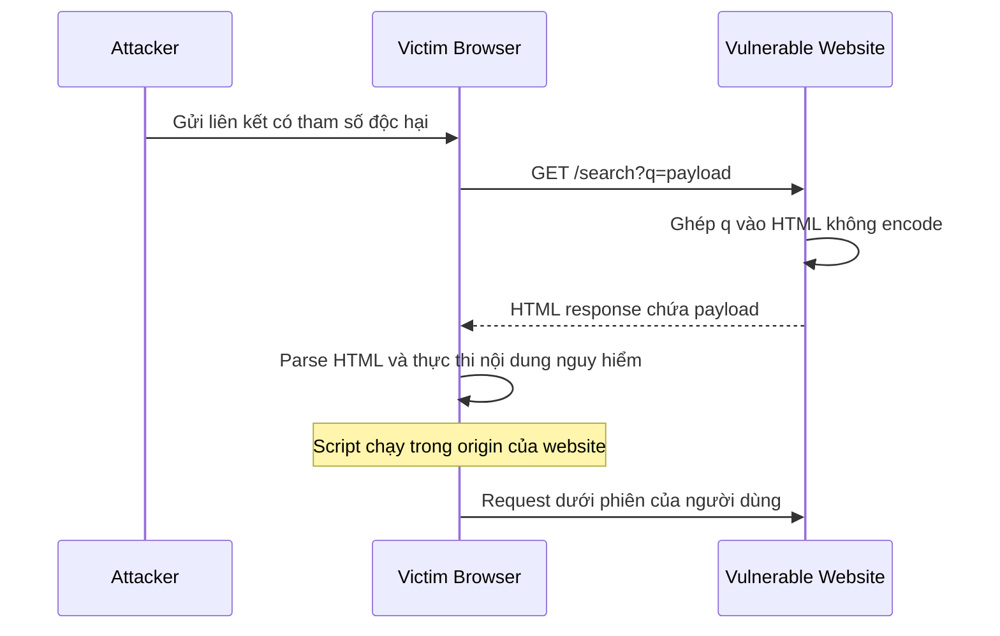

# Reflected XSS: dữ liệu từ request bị thực thi trong trang phản hồi

## 1. Reflected XSS là gì?

**Reflected Cross-Site Scripting (Reflected XSS)** là lỗ hổng xảy ra khi ứng dụng lấy dữ liệu không đáng tin cậy từ một request rồi đưa dữ liệu đó vào response theo cách khiến trình duyệt diễn giải nó thành HTML, thuộc tính hoặc JavaScript có thể thực thi. Dữ liệu thường được phản chiếu ngay trong response của request hiện tại, thay vì được lưu lâu dài trên server.

Ví dụ, một trang tìm kiếm nhận tham số `q` rồi hiển thị:

```text
GET /search?q=browser HTTP/1.1

Response:
<h1>Kết quả tìm kiếm cho: browser</h1>
```

Nếu ứng dụng đưa nguyên văn giá trị `q` vào HTML, attacker có thể tạo một URL chứa markup/script rồi dụ nạn nhân mở URL đó. Khi server phản chiếu dữ liệu không an toàn, trình duyệt phân tích response như một tài liệu thuộc origin của ứng dụng. Mã độc có thể chạy với quyền của origin đó.

Reflected XSS là lỗi **đưa dữ liệu không tin cậy vào sai ngữ cảnh đầu ra**. Chỉ URL-encode đầu vào hoặc chặn vài chuỗi đáng ngờ không giải quyết được gốc rễ. Ứng dụng phải xác định ngữ cảnh sử dụng dữ liệu và áp dụng output encoding hoặc sanitization phù hợp.

Bài viết thuộc chương **XSS và DOM** của module **SECURITY_APPLICATION_SECURITY_BROWSER_SECURITY**. Nội dung kết nối Reflected XSS với ranh giới origin, cookie, SOP, CORS, CSP, Trusted Types và các cơ chế bảo vệ ứng dụng web.

Sau bài học, bạn có thể:

- Mô tả chuỗi request → reflection → HTML parsing → script execution.
- Phân biệt Reflected XSS với Stored XSS và DOM-based XSS.
- Xác định source, data flow và sink gây lỗi.
- Chọn output encoding đúng cho HTML text, attribute, URL, JavaScript và CSS context.
- Dùng DOM API an toàn, template auto-escaping và sanitizer khi thật sự cần HTML.
- Hiểu CSP và Trusted Types là lớp phòng vệ bổ sung.
- Đánh giá tác động của XSS đối với cookie, session, dữ liệu và thao tác người dùng.
- Kiểm chứng lỗ hổng trong môi trường local được kiểm soát.

## 2. Cơ chế Reflected XSS

### 2.1. Chuỗi sự kiện

Một kịch bản điển hình:

1. Ứng dụng nhận dữ liệu từ URL, query parameter, path, form field hoặc header.
2. Server sử dụng dữ liệu đó để tạo HTML response.
3. Dữ liệu được chèn vào response mà không encode/sanitize theo đúng ngữ cảnh.
4. Trình duyệt parse response và nhận diện phần dữ liệu như markup hoặc mã có thể thực thi.
5. Mã chạy trong origin của trang bị lỗi, với quyền mà script của origin đó được phép có.



Điểm cốt lõi: trình duyệt không biết đoạn script đó đến từ query string. Khi server trả nó trong response HTML, trình duyệt xử lý theo ngữ cảnh tài liệu của website. Vì vậy, Same-Origin Policy không ngăn script này: mã đã chạy dưới chính origin bị khai thác.

### 2.2. Ví dụ trang tìm kiếm dễ bị lỗi

Giả sử server tạo HTML theo cách:

```js
const query = requestUrl.searchParams.get("q") ?? "";

const html =
  "<h1>Kết quả cho: " + query + "</h1>";
```

Nếu người dùng nhập chuỗi thông thường như `browser security`, trang hiển thị bình thường. Nhưng nếu query chứa HTML, trình duyệt có thể parse markup đó. Nếu markup có thuộc tính sự kiện hoặc nội dung thực thi, response có thể tạo ra XSS.

Trong phần thực hành, ta dùng một payload vô hại chỉ hiển thị hộp thoại trên server local để quan sát hành vi. Không thử nghiệm trên website của bên thứ ba hoặc URL mà bạn không có quyền kiểm thử.

### 2.3. Vì sao được gọi là "reflected"?

Dữ liệu được phản chiếu trong response của request hiện tại:

```text
Request parameter q
       |
       v
Server reads q
       |
       v
Server inserts q into response HTML
       |
       v
Browser parses response
```

Payload thường không cần được lưu vào database. Nạn nhân mở URL hoặc gửi form có dữ liệu đó, và response của chính request phản chiếu dữ liệu. Tuy nhiên, một số ứng dụng có thể ghi log hoặc lưu lịch sử tìm kiếm; điều đó không làm thay đổi phân loại cơ bản của lỗi.

## 3. Phân biệt Reflected, Stored và DOM-based XSS

Ba tên gọi mô tả các cách dữ liệu độc hại đi vào và được xử lý; chúng có thể giao nhau trong ứng dụng phức tạp.

| Loại XSS | Dữ liệu xuất phát | Khi nào payload được đưa tới nạn nhân? | Ví dụ |
|---|---|---|---|
| **Reflected XSS** | Request hiện tại như query, path, form hoặc header | Khi nạn nhân gửi request/mở URL và server phản chiếu dữ liệu trong response | Trang search đưa query vào HTML |
| **Stored XSS** | Dữ liệu được lưu trong database, comment, profile, ticket hoặc bài viết | Khi người dùng mở trang hiển thị dữ liệu đã lưu | Comment độc hại được render cho nhiều người |
| **DOM-based XSS** | Dữ liệu được JavaScript phía client đọc từ URL, fragment, storage hoặc message | Khi script phía client đưa dữ liệu vào DOM sink nguy hiểm | Script lấy location.hash rồi gán vào innerHTML |

Một trang có thể mắc nhiều dạng cùng lúc. Ví dụ server phản chiếu query vào HTML, sau đó script trong trang tiếp tục đọc giá trị và gán vào innerHTML; cần theo dõi từng data flow để xác định đầy đủ.

### 3.1. Reflected XSS không đồng nghĩa DOM-based XSS

Nếu server trả response HTML đã chứa payload nguy hiểm, đó là reflected path ở phía server. Nếu response ban đầu an toàn nhưng JavaScript của trang đọc dữ liệu từ location.hash rồi đưa vào sink nguy hiểm, đó là DOM-based path.

Fragment sau dấu `#` không được gửi trong HTTP request thông thường. Vì vậy, một payload chỉ nằm trong fragment thường không thể được server phản chiếu qua query; nhưng JavaScript phía client vẫn có thể đọc fragment và gây DOM XSS.

## 4. Source, data flow và sink

Để tìm Reflected XSS, hãy xác định ba điểm:

- **Source:** nơi dữ liệu không tin cậy đi vào ứng dụng.
- **Data flow:** các bước biến đổi, lưu tạm, nối chuỗi và truyền dữ liệu.
- **Sink:** nơi dữ liệu được diễn giải như HTML, JavaScript, URL hoặc một ngữ cảnh có thể thực thi.

### 4.1. Các source phổ biến

| Source | Ví dụ |
|---|---|
| Query parameter | `?q=hello`, `?returnTo=...` |
| Path segment | `/search/keyword` |
| Form body | Trường tìm kiếm hoặc tên hiển thị |
| HTTP header | User-Agent, Referer hoặc header ứng dụng tự định nghĩa |
| Cookie | Giá trị cookie được phản chiếu vào trang |
| Dữ liệu từ upstream | API hoặc dịch vụ bên ngoài được đưa vào response |

Không phải mọi source đều có thể bị attacker điều khiển trong mọi ứng dụng. Cần kiểm tra ai có thể đặt giá trị, request method nào dùng và dữ liệu có bị ràng buộc ở tầng khác không.

### 4.2. Các sink nguy hiểm

| Sink / ngữ cảnh | Ví dụ | Rủi ro |
|---|---|---|
| HTML parser | `innerHTML`, `outerHTML`, `document.write` | Chuỗi được parse thành markup |
| Event handler attribute | `onclick`, `onerror` | Có thể thực thi JavaScript |
| JavaScript source | Chuỗi ghép vào script inline | Có thể phá vỡ string/context |
| URL attribute | `href`, `src`, `action` | Có thể dùng scheme/đích không được phép |
| CSS context | Style attribute hoặc stylesheet ghép chuỗi | Có thể thay đổi giao diện hoặc kích hoạt hành vi ngoài dự kiến |
| Template raw HTML | Helper bỏ qua auto-escaping | Dữ liệu được đưa vào markup thô |

Các sink không có cùng quy tắc encoding. Escape HTML text không đủ để bảo vệ JavaScript string, CSS hoặc URL. Cần encode theo đúng ngữ cảnh cuối cùng.

## 5. Ngữ cảnh đầu ra quyết định cách phòng vệ

### 5.1. HTML text context

Nếu dữ liệu chỉ cần hiển thị như văn bản bên trong phần tử HTML, encode tối thiểu các ký tự cấu trúc:

| Ký tự | Dạng HTML entity |
|---|---|
| `&` | `&amp;` |
| `<` | `&lt;` |
| `>` | `&gt;` |
| `"` | `&quot;` |
| `'` | `&#39;` |

Ví dụ hàm escape minh họa:

```js
function escapeHtmlText(value) {
  const replacements = {
    "&": "&amp;",
    "<": "&lt;",
    ">": "&gt;",
    '"': "&quot;",
    "'": "&#39;",
  };

  return String(value).replace(/[&<>"']/g, (char) => replacements[char]);
}

const userInput = '';
const html = "<p>Kết quả: " + escapeHtmlText(userInput) + "</p>";
```

Sau encoding, chuỗi hiển thị như văn bản thay vì được parse thành phần tử img. Trong ứng dụng thực tế, ưu tiên template engine có auto-escaping đã được cấu hình đúng; không tự viết encoder nếu framework đã cung cấp giải pháp chuẩn.

### 5.2. HTML attribute context

Nếu dữ liệu được đặt vào thuộc tính HTML, thuộc tính cần được **quote** và encode theo quy tắc HTML attribute:

```html
<input value="DỮ_LIỆU_ĐÃ_ENCODE">
```

Không ghép dữ liệu vào thuộc tính không có dấu ngoặc kép hoặc vào event handler. Ví dụ sau nguy hiểm:

```js
const html = '<input value="' + userInput + '">';
```

Dùng template auto-escaping hoặc API DOM:

```js
const input = document.createElement("input");
input.value = userInput;
container.append(input);
```

Dùng property API giúp trình duyệt đặt giá trị thuộc tính theo đúng kiểu dữ liệu thay vì parse một chuỗi HTML tự tạo.

### 5.3. URL attribute context

Nếu người dùng cung cấp URL để đưa vào `href` hoặc `src`, phải kiểm tra scheme và đích trước, sau đó mới đưa giá trị vào thuộc tính đã quote/encode.

Ví dụ chỉ chấp nhận liên kết HTTPS:

```js
function parseSafeLink(value) {
  const url = new URL(value);

  if (url.protocol !== "https:") {
    throw new TypeError("Chỉ cho phép HTTPS");
  }

  if (url.username || url.password) {
    throw new TypeError("Không chấp nhận userinfo");
  }

  return url;
}

const link = document.createElement("a");
link.href = parseSafeLink(userInput).href;
link.textContent = "Mở liên kết";
container.append(link);
```

Nếu chỉ cho phép một số website, hãy so sánh `url.origin` với allowlist chính xác. Việc URL parse thành công không có nghĩa scheme hoặc host an toàn. URL encoding cũng không thay thế kiểm tra scheme.

### 5.4. JavaScript context

Tránh chèn dữ liệu người dùng trực tiếp vào source JavaScript:

```js
// Không an toàn: dữ liệu có thể phá vỡ chuỗi và cú pháp script.
const script = "<script>const name = '" + userInput + "';</script>";
```

Ưu tiên truyền dữ liệu dưới dạng JSON an toàn qua response riêng hoặc gắn vào DOM bằng API property/text. Nếu buộc phải serialize dữ liệu vào HTML, phải dùng cơ chế serialization dành cho ngữ cảnh HTML/script của framework; JSON.stringify đơn thuần không tự xử lý mọi nguy cơ khi nhúng JSON vào thẻ script HTML.

### 5.5. CSS context

Không ghép input không tin cậy vào CSS, selector, style string hoặc URL bên trong CSS. Thay vào đó, chọn từ danh sách token cố định:

```js
const allowedThemes = new Set(["light", "dark", "contrast"]);
const theme = allowedThemes.has(userChoice) ? userChoice : "light";

document.documentElement.dataset.theme = theme;
```

CSS escaping và HTML escaping là hai quy tắc khác nhau. Nếu giá trị chỉ cần chọn màu, kích thước hoặc theme, allowlist enum thường an toàn và dễ kiểm soát hơn.

### 5.6. HTML rich text cần sanitization

Nếu sản phẩm phải cho người dùng nhập nội dung có định dạng HTML (ví dụ trình soạn thảo bài viết), encode toàn bộ sẽ làm mất định dạng. Khi đó cần **HTML sanitizer** đã được kiểm chứng, dùng allowlist tag/attribute/protocol phù hợp.

Sanitization phải loại bỏ script, event handler, URL scheme nguy hiểm và các cấu trúc có thể tạo markup thực thi. Không dùng regex tự viết để lọc HTML. Cấu hình sanitizer phải được cập nhật theo thư viện và threat model; sau sanitize, vẫn cần chèn vào đúng sink.

## 6. Vì sao URL encoding không ngăn Reflected XSS?

URL encoding và HTML output encoding giải quyết hai vấn đề khác nhau:

- **URL/percent-encoding:** biểu diễn ký tự trong thành phần URL, ví dụ khoảng trắng thành `%20`.
- **HTML output encoding:** ngăn ký tự dữ liệu bị hiểu thành markup hoặc cú pháp HTML.
- **JavaScript encoding/serialization:** xử lý dữ liệu khi đặt vào ngữ cảnh JavaScript.
- **URL validation:** xác định scheme, host và đích có được phép trong nghiệp vụ hay không.

Ví dụ, query string có thể chứa `%3Cscript%3E...`. Khi server parse query, dữ liệu được giải mã thành ký tự `<script>`. Nếu server đưa chuỗi đã giải mã vào HTML mà không encode lại theo ngữ cảnh HTML, payload vẫn có thể thực thi.

**Quy tắc:** parse request đúng cách, giữ dữ liệu ở dạng dữ liệu, và encode tại điểm xuất ra theo ngữ cảnh. Không xem percent-encoding là biện pháp chống XSS.

## 7. Demo Reflected XSS trong môi trường local

Thí nghiệm dưới đây tạo hai route local: `/vulnerable` phản chiếu query trực tiếp vào HTML; `/safe` encode query trước khi hiển thị. Payload chỉ chạy trên server local do bạn tự khởi động.

### 7.1. Tạo server demo

Tạo file `reflected-xss-lab.mjs`:

```js
import http from "node:http";

function escapeHtml(value) {
  const map = {
    "&": "&amp;",
    "<": "&lt;",
    ">": "&gt;",
    '"': "&quot;",
    "'": "&#39;",
  };

  return String(value).replace(/[&<>"']/g, (char) => map[char]);
}

const server = http.createServer((req, res) => {
  const requestUrl = new URL(req.url, "http://127.0.0.1:8080");
  const query = requestUrl.searchParams.get("q") ?? "";
  const safeRoute = requestUrl.pathname === "/safe";
  const vulnerableRoute = requestUrl.pathname === "/vulnerable";

  if (!safeRoute && !vulnerableRoute) {
    res.writeHead(404, { "Content-Type": "text/plain; charset=utf-8" });
    res.end("Try /vulnerable or /safe");
    return;
  }

  const displayedQuery = safeRoute ? escapeHtml(query) : query;
  const html =
    "<!doctype html><html lang='vi'><meta charset='utf-8'>" +
    "<title>Reflected XSS lab</title><body>" +
    "<h1>Kết quả tìm kiếm</h1><p>" + displayedQuery + "</p>" +
    "<p>Route: " + (safeRoute ? "safe" : "vulnerable") + "</p>" +
    "</body></html>";

  const headers = {
    "Content-Type": "text/html; charset=utf-8",
    "Cache-Control": "no-store",
    "X-Content-Type-Options": "nosniff",
  };

  if (safeRoute) {
    headers["Content-Security-Policy"] =
      "default-src 'none'; base-uri 'none'; object-src 'none'; " +
      "frame-ancestors 'none'; script-src 'none'";
  }

  res.writeHead(200, headers);
  res.end(html);
});

server.listen(8080, "127.0.0.1", () => {
  console.log("Open http://127.0.0.1:8080/vulnerable?q=hello");
});
```

Khởi động:

```bash
node reflected-xss-lab.mjs
```

Mở `http://127.0.0.1:8080/vulnerable?q=hello` và `http://127.0.0.1:8080/safe?q=hello`. Hai route hiển thị kết quả giống nhau với input thông thường.

### 7.2. Tạo payload vô hại để quan sát

Trong DevTools Console của trang local, tạo URL chứa payload chỉ hiển thị alert:

```js
const target = new URL("http://127.0.0.1:8080/vulnerable");
target.searchParams.set("q", '');
console.log(target.href);
```

Mở URL được in ra. Trình duyệt nhận response có img với event handler, và hộp thoại xuất hiện khi tải ảnh lỗi. Thử thay pathname thành `/safe` rồi mở lại. Nội dung sẽ hiển thị như văn bản và không tạo phần tử img thực thi event handler.

Payload này chỉ nhằm kiểm chứng trong môi trường local. Không gửi URL chứa mã thử nghiệm tới người dùng hoặc website không có quyền kiểm thử.

### 7.3. Quan sát Network và DOM

Trong DevTools:

1. Mở tab **Network** và chọn request `/vulnerable`.
2. Xem **Query String Parameters** để xác định giá trị `q` mà browser gửi.
3. Xem **Response** để thấy dữ liệu được phản chiếu vào HTML.
4. Mở tab **Elements** để quan sát trình duyệt đã tạo phần tử img trong DOM.
5. Chạy `document.querySelector("img")` để xác nhận phần tử tồn tại.
6. Mở route `/safe` và lặp lại; dữ liệu được hiển thị như text, không tạo img.

Điểm cần rút ra: payload không cần được lưu vào database. Chỉ cần server phản chiếu request vào response trong ngữ cảnh HTML không an toàn.

## 8. Cách sửa Reflected XSS trong ứng dụng

### 8.1. Encode tại điểm xuất ra

Ví dụ với template engine có auto-escaping, truyền dữ liệu như biến văn bản bình thường:

```html
<h1>Kết quả cho: {{ query }}</h1>
```

Cú pháp cụ thể tùy template engine. Hãy xác minh engine có auto-escape mặc định, không dùng helper raw/unescaped cho dữ liệu không tin cậy, và không chuyển dữ liệu qua một bước render khác làm mất escaping.

Không encode đầu vào một lần rồi lưu mãi như HTML đã an toàn. Dữ liệu có thể được dùng ở nhiều context khác nhau; encode quá sớm hoặc encode nhiều lần dễ gây lỗi hiển thị và vẫn có thể sai context.

### 8.2. Dùng textContent thay innerHTML

Nếu JavaScript cần cập nhật kết quả tìm kiếm:

```js
const output = document.querySelector("#search-result");
const params = new URLSearchParams(location.search);
const query = params.get("q") ?? "";

output.textContent = query;
```

`textContent` tạo nội dung văn bản. Ngược lại:

```js
output.innerHTML = query;
```

yêu cầu browser parse chuỗi như HTML. Chỉ dùng innerHTML khi thực sự cần markup và nội dung đã được sanitize bằng thư viện tin cậy theo allowlist rõ ràng.

### 8.3. Tránh DOM sink không an toàn

Các sink cần review gồm:

- `innerHTML`, `outerHTML`, `insertAdjacentHTML`.
- `document.write` và `document.writeln`.
- `eval`, `Function`, `setTimeout(string)` và `setInterval(string)`.
- Event handler attribute như `onclick` hoặc `onerror`.
- Template helper hoặc framework escape hatch như raw HTML.

Không phải mọi lần dùng API này đều tạo XSS, nhưng dữ liệu không tin cậy đi vào chúng cần được xem xét nghiêm ngặt. Ưu tiên API tạo node, đặt text, property và attribute có kiểu.

### 8.4. Validate input không thay output encoding

Validation có ích để kiểm tra quy tắc nghiệp vụ: độ dài, kiểu, tập giá trị, định dạng email hoặc số trang. Nhưng validation không thay thế output encoding. Một chuỗi hợp lệ với nghiệp vụ vẫn có thể chứa ký tự đặc biệt khi được đưa vào HTML.

Ví dụ tên hiển thị có thể chứa dấu nháy, dấu nhỏ hơn hoặc ký tự Unicode. Nếu sản phẩm cho phép các ký tự đó, encode đúng context khi render thay vì cấm tùy tiện.

## 9. CSP: lớp phòng vệ bổ sung

**Content Security Policy (CSP)** cho phép website giới hạn nguồn script, object, frame và một số loại tài nguyên. CSP có thể làm giảm khả năng khai thác XSS khi output encoding còn thiếu sót, nhưng không thay thế việc sửa sink.

Ví dụ một policy khởi đầu chặt:

```http
Content-Security-Policy: default-src 'self'; script-src 'nonce-{RANDOM_NONCE}' 'strict-dynamic'; object-src 'none'; base-uri 'none'; frame-ancestors 'none'
```

`{RANDOM_NONCE}` là nonce ngẫu nhiên mật mã, được tạo mới cho từng response và gắn vào script hợp lệ. Không dùng nonce cố định hoặc đoán được. Với kiến trúc script phù hợp, có thể dùng hash và cân nhắc `strict-dynamic`; cần kiểm thử tương thích trước khi triển khai.

### 9.1. CSP giúp gì và không giúp gì?

- Hạn chế script inline không được cấp nonce/hash và script từ nguồn ngoài allowlist.
- Chặn object/plugin cũ qua `object-src 'none'`.
- `base-uri` hạn chế thẻ base bị chèn làm đổi đích URL tương đối.
- `frame-ancestors` kiểm soát ai được nhúng trang, hỗ trợ phòng clickjacking.
- CSP không biến dữ liệu HTML không an toàn thành văn bản.
- CSP có thể bị cấu hình quá rộng, ví dụ cho phép `'unsafe-inline'`, làm giảm đáng kể hiệu quả chống XSS.
- CSP không tự ngăn mọi loại DOM injection hoặc lạm dụng logic ứng dụng.

Nên triển khai `Content-Security-Policy-Report-Only` trước để quan sát vi phạm, tinh chỉnh nguồn hợp lệ, rồi mới áp policy thực thi. Không đưa nonce thật vào log hoặc tái sử dụng giữa các response.

## 10. Trusted Types và DOM XSS

**Trusted Types** là cơ chế của browser (được hỗ trợ trong Chromium-based browsers và cần kiểm tra tương thích ở trình duyệt mục tiêu) nhằm buộc một số DOM injection sink nhận kiểu dữ liệu tin cậy thay vì chuỗi tùy ý.

CSP có thể yêu cầu Trusted Types cho sink:

```http
Content-Security-Policy: require-trusted-types-for 'script'; trusted-types app-html dompurify
```

Ví dụ minh họa khi ứng dụng thật sự cần render HTML rich text và đã tích hợp sanitizer đáng tin cậy như DOMPurify:

```js
const htmlPolicy = trustedTypes.createPolicy("app-html", {
  createHTML(input) {
    return DOMPurify.sanitize(input, {
      USE_PROFILES: { html: true },
      RETURN_TRUSTED_TYPE: false,
    });
  },
});

container.innerHTML = htmlPolicy.createHTML(untrustedMarkup);
```

Trusted Types không tự sanitize dữ liệu. Policy tạo TrustedHTML phải thực hiện sanitization đúng cách; nếu policy chỉ trả lại input nguyên văn thì cơ chế bị vô hiệu về mặt bảo vệ. Ví dụ trên cho phép policy ứng dụng `app-html` và policy nội bộ `dompurify`; tên policy nội bộ cần được xác nhận theo phiên bản/tham số cấu hình DOMPurify đang dùng. Ưu tiên textContent nếu không cần HTML.

## 11. Tác động của Reflected XSS đối với cookie và session

Nếu Reflected XSS chạy trong origin của ứng dụng, script có thể thao tác trong phạm vi quyền của origin đó.

### 11.1. HttpOnly giảm nguy cơ đọc cookie nhưng không ngăn mọi hành động

Cookie phiên nên có các thuộc tính phù hợp, ví dụ:

```http
Set-Cookie: __Host-session=OPAQUE_ID; Path=/; Secure; HttpOnly; SameSite=Lax
```

`HttpOnly` ngăn JavaScript đọc giá trị cookie qua `document.cookie`. Tuy nhiên browser vẫn có thể tự gửi cookie trong request cùng origin khi các điều kiện khác phù hợp. Script XSS có thể gọi API dưới phiên nạn nhân và đọc response mà script cùng origin được phép đọc.

Do đó:

- HttpOnly giảm nguy cơ đánh cắp session ID trực tiếp.
- Secure giới hạn gửi cookie qua kênh không bảo mật.
- SameSite giảm một số request mang cookie từ ngữ cảnh cross-site.
- Không thuộc tính nào thay thế output encoding, CSP, Trusted Types hoặc kiểm soát quyền server-side.

### 11.2. SOP và CORS không cứu được origin bị XSS

SOP ngăn script từ origin khác đọc DOM/dữ liệu của ứng dụng. Nhưng trong Reflected XSS, script chạy **ngay trong origin của ứng dụng**, vì vậy có quyền giống script hợp lệ của trang.

CORS cũng không phải lớp phòng vệ cho XSS cùng origin. Request cùng origin không cần CORS permission để script đọc response. Nếu endpoint có quyền quá rộng hoặc không kiểm tra nghiệp vụ, XSS có thể gọi endpoint đó dưới session hiện tại.

### 11.3. Dữ liệu có thể bị lộ qua URL

Nếu payload nằm trong query string, URL có thể xuất hiện trong browser history, server/proxy access log, analytics, ảnh chụp màn hình hoặc Referer tùy Referrer-Policy và ngữ cảnh điều hướng. Tránh đưa token, mật khẩu hoặc dữ liệu cá nhân vào URL. Với các trang nhận dữ liệu nhạy cảm, cân nhắc `Referrer-Policy: no-referrer` hoặc chính sách ít tiết lộ hơn phù hợp với sản phẩm.

## 12. Phát hiện và kiểm thử Reflected XSS

### 12.1. Quy trình review

1. Xác định route nhận dữ liệu từ request.
2. Tìm các tham số được phản chiếu vào response.
3. Xác định context chính xác: HTML text, attribute, URL, script, CSS hay DOM.
4. Kiểm tra encoder/sanitizer được dùng ở đúng context chưa.
5. Xem response thô trong Network và DOM sau khi browser parse.
6. Kiểm tra CSP và Trusted Types như lớp phòng vệ bổ sung.
7. Xác nhận fix bằng input bình thường, ký tự đặc biệt và payload kiểm thử trong môi trường có quyền.

Không chỉ tìm từ khóa `<script>`. Payload XSS có nhiều dạng và sink khác nhau; review data flow từ source đến sink có độ tin cậy cao hơn.

### 12.2. Dùng marker không thực thi trước

Khi mới khảo sát, dùng chuỗi đánh dấu đơn giản như:

```text
REFLECT_TEST_<tag>&"'
```

Quan sát xem ký tự được trả về như text hay tạo markup/attribute. Marker giúp xác định vị trí reflection mà không cần thực thi mã. Nếu cần kiểm chứng thực thi, chỉ dùng payload vô hại trong môi trường test được kiểm soát.

### 12.3. Kiểm tra nhiều context

Một tham số có thể được dùng ở nhiều vị trí trong cùng response. Hãy kiểm tra:

- Bên trong phần tử HTML.
- Trong giá trị attribute có dấu ngoặc kép.
- Trong href/src sau khi validate URL.
- Trong script hoặc JSON nhúng.
- Trong CSS hoặc thuộc tính style.
- Trong JavaScript phía client đọc query/fragment rồi đưa vào DOM.

Một fix ở template HTML text không tự bảo vệ các lần sử dụng khác của cùng dữ liệu.

## 13. Những lỗi phòng vệ thường gặp

| Cách làm sai | Vì sao chưa đủ | Cách làm đúng |
|---|---|---|
| Chỉ chặn chuỗi `<script>` | XSS không chỉ dùng thẻ script | Encode đúng context và loại sink nguy hiểm |
| URL-encode query rồi coi là an toàn | Server có thể decode trước khi render HTML | Output encode tại sink |
| Chỉ validate input | Dữ liệu hợp lệ vẫn có ký tự đặc biệt | Validation + output encoding |
| Dùng HTML escape trong JavaScript/CSS | Mỗi context có quy tắc khác nhau | Tránh nhúng; dùng serializer/API đúng context |
| Dùng `innerHTML` cho text | Browser parse chuỗi thành markup | `textContent` |
| Tự lọc HTML bằng regex | HTML parser phức tạp và có nhiều biến thể | Sanitizer chuyên dụng theo allowlist |
| Chỉ bật CSP rồi bỏ qua sink | CSP có thể sai cấu hình hoặc không bao phủ mọi trường hợp | Sửa data flow, CSP là defense in depth |
| Nghĩ HttpOnly ngăn XSS hoàn toàn | Script vẫn có thể gửi request bằng session cookie | Phòng XSS; giới hạn quyền và xác nhận thao tác nhạy cảm |
| Nghĩ SOP ngăn script XSS trong origin | Script chạy dưới origin của trang bị lỗi | Sửa lỗ hổng ở server/client và kiểm tra quyền |
| Tin mọi URL đã percent-encode | Encoding không xác thực scheme hoặc host | Parse URL, validate destination, encode theo output context |

## 14. Checklist phòng vệ Reflected XSS

Trước khi đưa một route có dữ liệu người dùng ra production, hãy kiểm tra:

1. **Source:** Đã liệt kê query, path, form, header, cookie và dữ liệu upstream được phản chiếu chưa?
2. **Data flow:** Dữ liệu có đi qua nhiều lớp decode, nối chuỗi hoặc template raw không?
3. **Sink:** Xác định đúng HTML, attribute, URL, JavaScript, CSS hoặc DOM sink?
4. **Output encoding:** Encoder phù hợp được áp dụng tại điểm xuất ra chưa?
5. **Template:** Auto-escaping có bật và không bị vô hiệu bằng raw/unescaped helper?
6. **DOM API:** Dùng textContent, createElement và property API khi chỉ cần text?
7. **Rich HTML:** Nếu cần HTML, có sanitizer chuyên dụng và allowlist rõ ràng?
8. **URL:** Scheme/host được kiểm tra trước khi đặt vào href/src/action?
9. **CSP:** Có script-src chặt, nonce/hash, object-src và base-uri phù hợp?
10. **Trusted Types:** Có thể enforce cho DOM sink trong browser mục tiêu không?
11. **Session:** Cookie có Secure, HttpOnly, SameSite phù hợp; server kiểm tra quyền cho từng request?
12. **Cache/Referer:** URL chứa dữ liệu nhạy cảm có thể lộ qua history, log hoặc Referer không?
13. **Testing:** Đã kiểm tra response thô, DOM thực tế và các context khác nhau?
14. **Regression:** Có kiểm thử tự động cho ký tự đặc biệt và data flow từng gây lỗi?

## 15. Câu hỏi ôn tập

1. Reflected XSS khác Stored XSS ở cách dữ liệu được đưa đến nạn nhân như thế nào?
2. Vì sao browser có thể thực thi payload trong response của một website đáng tin?
3. Tại sao SOP không chặn script được phản chiếu trong chính origin của trang?
4. Phân biệt source và sink trong một trang tìm kiếm nhận query parameter.
5. Vì sao URL percent-encoding không thay thế HTML output encoding?
6. Khi nào dùng textContent thay vì innerHTML?
7. Tại sao HTML escaping không đủ khi dữ liệu được nhúng vào JavaScript string?
8. CSP có thể giảm rủi ro XSS như thế nào và vì sao không thay thế output encoding?
9. Trusted Types làm gì và policy phải đảm bảo điều gì?
10. HttpOnly có ngăn script XSS gọi API bằng session cookie không?
11. Vì sao cùng một input cần được encode khác nhau ở HTML, URL và CSS context?
12. Dùng marker không thực thi có ích gì khi kiểm thử ban đầu?

**Đáp án định hướng:** (1) Reflected lấy dữ liệu từ request hiện tại và phản chiếu vào response; Stored đọc dữ liệu đã lưu. (2) Vì browser parse response như tài liệu của origin trả response. (3) Script chạy dưới origin đó nên SOP không xem nó là script cross-origin. (4) Source là query; sink là vị trí HTML/DOM nơi dữ liệu được diễn giải. (5) Server có thể decode query rồi đưa ký tự vào HTML; hai encoding phục vụ context khác nhau. (6) Khi cần hiển thị text thuần. (7) Quy tắc HTML và JavaScript khác nhau; string có thể phá cú pháp script. (8) CSP giới hạn script được phép chạy, nhưng policy có thể sai hoặc không bao phủ mọi sink. (9) Trusted Types yêu cầu sink nhận kiểu tin cậy; policy phải sanitize/validate trước khi tạo TrustedHTML. (10) Không; browser vẫn tự gửi cookie. (11) Mỗi parser có ký tự phân tách và cú pháp riêng. (12) Xác định vị trí reflection mà không cần thực thi payload.

## 16. Tài liệu tham khảo

- [OWASP — Cross Site Scripting Prevention Cheat Sheet](https://cheatsheetseries.owasp.org/cheatsheets/Cross_Site_Scripting_Prevention_Cheat_Sheet.html): Output encoding, HTML sanitization và phòng XSS.
- [OWASP — Reflected XSS](https://owasp.org/www-community/attacks/xss/): Tổng quan các kiểu XSS và cách dữ liệu không tin cậy được thực thi.
- [MDN — Cross-site scripting (XSS)](https://developer.mozilla.org/en-US/docs/Web/Security/Attacks/XSS): Khái niệm XSS, context và phòng vệ.
- [MDN — innerHTML](https://developer.mozilla.org/en-US/docs/Web/API/Element/innerHTML): Rủi ro khi parse chuỗi HTML không tin cậy.
- [MDN — textContent](https://developer.mozilla.org/en-US/docs/Web/API/Node/textContent): API hiển thị dữ liệu dưới dạng văn bản.
- [MDN — Content Security Policy](https://developer.mozilla.org/en-US/docs/Web/HTTP/CSP): CSP và các directive bảo vệ script.
- [MDN — Trusted Types API](https://developer.mozilla.org/en-US/docs/Web/API/Trusted_Types_API): Cơ chế bảo vệ DOM injection sink.
- [OWASP — DOM based XSS Prevention Cheat Sheet](https://cheatsheetseries.owasp.org/cheatsheets/DOM_based_XSS_Prevention_Cheat_Sheet.html): Source, sink và API DOM an toàn.
- [WHATWG HTML Standard — Cookies](https://html.spec.whatwg.org/multipage/dom.html#cookies): Cookie trong nền tảng web.

**Kết nối với mô hình bảo mật web:** Reflected XSS biến dữ liệu request thành mã chạy trong origin của ứng dụng khi server phản chiếu nó vào response sai ngữ cảnh. Cookie HttpOnly, SOP và CORS không sửa được lỗi này; chúng chỉ giới hạn một số khả năng khác. Phòng vệ cốt lõi là kiểm soát data flow, encode tại output theo context, dùng DOM API an toàn và sanitizer khi cần HTML; CSP cùng Trusted Types bổ sung lớp bảo vệ để giảm khả năng khai thác.
