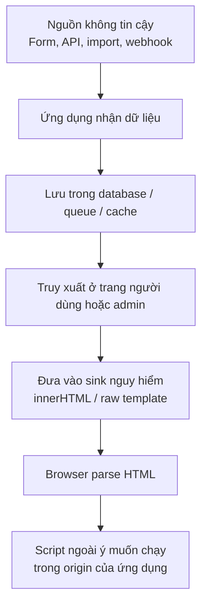

# Stored XSS

> **Chương:** XSS và DOM  
> **Bài học:** Stored XSS — mã độc được lưu trữ và thực thi khi nội dung được hiển thị  
> **Phạm vi module:** **SECURITY_APPLICATION_SECURITY_BROWSER_SECURITY** — phân tích ranh giới bảo mật giữa trình duyệt, origin, cookie và ứng dụng web để hiểu Same-Origin Policy (SOP), CORS và các cơ chế cách ly; thực hành phòng vệ XSS, CSRF, clickjacking bằng CSP, Trusted Types, security headers và kiểm chứng thực tế.

## Mục tiêu học tập

Sau bài này, bạn có thể:

1. Định nghĩa **Stored Cross-Site Scripting (Stored XSS)** và phân biệt với Reflected XSS, DOM-based XSS.
2. Mô tả chuỗi **nguồn dữ liệu không tin cậy → lưu trữ → truy xuất → sink nguy hiểm → thực thi trong browser**.
3. Nhận diện vị trí Stored XSS thường xuất hiện: bình luận, hồ sơ người dùng, ticket hỗ trợ, nội dung rich text, log, trang quản trị và dữ liệu nhập từ bên thứ ba.
4. Chọn cách xử lý phù hợp theo ngữ cảnh: HTML text, HTML attribute, URL, JavaScript, CSS và DOM.
5. Dùng API DOM an toàn, template auto-escaping và HTML sanitizer theo allowlist khi cần hỗ trợ rich text.
6. Giải thích vai trò và giới hạn của CSP, nonce, Trusted Types, HttpOnly, SameSite và SOP.
7. Xây dựng quy trình lưu, hiển thị, kiểm thử và xử lý dữ liệu đã bị chèn Stored XSS.

## 1. Stored XSS là gì?

**Stored XSS** là một dạng Cross-Site Scripting trong đó dữ liệu không tin cậy được lưu lại ở đâu đó trong hệ thống, sau đó được đưa vào một trang web theo cách khiến browser diễn giải dữ liệu ấy thành mã có thể thực thi.

Nguồn lưu trữ có thể là database, cache, message queue, hệ thống tìm kiếm, hồ sơ người dùng, bình luận, ticket hỗ trợ, log, dữ liệu import từ CSV/API/webhook, hoặc storage phía browser như localStorage và IndexedDB trong một biến thể DOM-based persistent XSS.

Ví dụ, một ứng dụng cho phép người dùng gửi bình luận. Kẻ tấn công gửi nội dung có chứa HTML/event handler. Server lưu bình luận. Khi người khác mở trang bình luận, ứng dụng đưa nội dung đó vào HTML bằng một sink nguy hiểm. Browser phân tích HTML và có thể thực thi JavaScript trong origin của ứng dụng.

**Điểm cốt lõi:** dữ liệu có thể được lưu hợp lệ về mặt nghiệp vụ nhưng vẫn không an toàn khi được render. Việc dữ liệu đã nằm trong database, do người dùng đăng nhập gửi lên, hoặc do một hệ thống nội bộ import vào không biến nó thành nội dung đáng tin cậy.

### 1.1. Chuỗi khai thác tổng quát



Stored XSS thường ảnh hưởng nhiều người truy cập cùng một bản ghi. Một nội dung được lưu có thể xuất hiện trong trang của người dùng khác, nhân viên hỗ trợ, kiểm duyệt viên hoặc quản trị viên. Vì thế, một lỗi render ở trang admin có thể nghiêm trọng dù trang người dùng thông thường đã xử lý nội dung an toàn.

### 1.2. Ví dụ minh họa vô hại

Giả sử một bình luận trong môi trường demo chứa chuỗi:

```html

```

Đây là payload kiểm chứng cục bộ: nếu browser xử lý nó như HTML và sự kiện lỗi ảnh được kích hoạt, thuộc tính `data-xss` trên body sẽ đổi thành `executed`. Ví dụ không gửi dữ liệu ra ngoài và không truy cập tài khoản.

Nếu ứng dụng hiển thị bình luận bằng cách gán chuỗi này vào `innerHTML`, browser có thể xử lý nó như markup. Nếu ứng dụng dùng `textContent`, chuỗi sẽ được hiển thị như văn bản và không tạo phần tử ảnh hay chạy event handler.

## 2. Stored XSS khác gì Reflected XSS và DOM-based XSS?

Ba thuật ngữ mô tả những cách dữ liệu đi vào và được thực thi khác nhau. Trong thực tế, một lỗ hổng có thể có đặc điểm của hơn một nhóm.

| Loại | Nguồn dữ liệu thường gặp | Cách dữ liệu đến sink | Đặc điểm |
|---|---|---|---|
| **Stored XSS** | Database, ticket, bình luận, profile, nội dung import | Server truy xuất dữ liệu đã lưu rồi render vào response hoặc DOM | Nội dung tồn tại và có thể ảnh hưởng nhiều lần/người |
| **Reflected XSS** | Query string, path, form hoặc request hiện tại | Server phản chiếu dữ liệu của request vào response không an toàn | Thường cần nạn nhân mở URL hoặc gửi request được chuẩn bị |
| **DOM-based XSS** | URL fragment, `postMessage`, storage, dữ liệu runtime | JavaScript phía client đưa dữ liệu vào DOM sink nguy hiểm | Lỗi nằm ở luồng xử lý DOM phía client |

### 2.1. Stored XSS phía server

Luồng phổ biến:

1. Người dùng gửi bình luận.
2. Server lưu nội dung vào database.
3. Một trang khác lấy bình luận từ database.
4. Template render nội dung mà không escape.
5. Browser thực thi markup/script ngoài ý muốn.

### 2.2. Stored DOM-based XSS

Một ứng dụng có thể lưu dữ liệu vào localStorage rồi render lại khi người dùng mở trang:

```js
const savedMessage = localStorage.getItem('saved-message');

// Không an toàn nếu dữ liệu có thể bị kiểm soát:
document.querySelector('#message').innerHTML = savedMessage;
```

Dữ liệu tồn tại qua nhiều lần tải trang trong browser, rồi đi vào DOM sink. Đây thường được mô tả là DOM-based persistent/stored XSS.

### 2.3. Tìm source và sink

Khi rà soát, hãy lần theo:

- **Source:** dữ liệu đến từ đâu, ai có thể kiểm soát?
- **Storage:** dữ liệu được lưu ở đâu, có thể bị thay đổi qua import/API/đồng bộ không?
- **Transformation:** dữ liệu được parse, decode, nối chuỗi hoặc render Markdown thế nào?
- **Sink:** dữ liệu đi vào HTML, attribute, URL, JavaScript, CSS hay API DOM nào?
- **Execution context:** nếu browser diễn giải dữ liệu, nó chạy trong document/origin nào và với quyền gì?

Đừng chỉ tìm các chuỗi đáng ngờ trong database. Cần tìm toàn bộ đường đi từ nguồn đến nơi browser diễn giải dữ liệu.

## 3. Stored XSS thường ẩn ở đâu?

Các bề mặt phổ biến không chỉ là ô bình luận trên trang công khai.

| Bề mặt | Ví dụ dữ liệu | Ai có thể bị ảnh hưởng? |
|---|---|---|
| Bình luận/đánh giá | Nội dung do khách hàng nhập | Người đọc trang sản phẩm |
| Hồ sơ người dùng | Tên hiển thị, mô tả, website | Người xem profile, nhân viên hỗ trợ |
| Ticket hỗ trợ | Tiêu đề, mô tả, phản hồi | Agent và quản trị viên |
| Diễn đàn/wiki | Bài viết, chữ ký, nội dung rich text | Thành viên và moderator |
| Dashboard quản trị | Log, tên thiết bị, địa chỉ, lỗi | Quản trị viên |
| Import CSV | Tên, mô tả, ghi chú | Người xem dữ liệu đã import |
| Webhook/API đối tác | Tên sản phẩm, thông báo, trạng thái | Người dùng của ứng dụng nhận dữ liệu |
| Notification/email preview | Nội dung thông báo, tiêu đề | Người xem hộp thông báo hoặc trang preview |
| Search result | Từ khóa, snippet, tên tài liệu | Người xem trang kết quả |
| Markdown/HTML editor | Link, ảnh, bảng, embed | Người đọc nội dung đã xuất bản |

### 3.1. Trang quản trị là mục tiêu đáng chú ý

Một ticket hỗ trợ có thể được tạo bởi tài khoản ít quyền, nhưng được nhân viên có quyền cao mở trong dashboard. Nếu ticket render không an toàn, script ngoài ý muốn chạy trong origin của dashboard.

Điều này có thể khiến nội dung do một người dùng gửi tác động tới những người dùng khác có quyền cao hơn. Khi thiết kế, cần coi **mọi dữ liệu đến từ khách hàng, đối tác, import và hệ thống ngoài** là không tin cậy ở nơi hiển thị, kể cả khi người tạo nội dung đã đăng nhập.

### 3.2. Dữ liệu “nội bộ” cũng có thể không đáng tin

Không mặc nhiên tin:

- Tên người dùng do một dịch vụ nội bộ đồng bộ.
- Nội dung được import bởi nhân viên.
- Log do hệ thống khác gửi về.
- Tên file hoặc metadata upload.
- Nội dung do AI hoặc webhook tạo ra.
- Nội dung đã được lưu lâu năm trước khi có quy tắc bảo vệ mới.

Nguồn dữ liệu có thể thay đổi theo thời gian; việc một bản ghi đã tồn tại lâu không chứng minh nó an toàn.

## 4. Vì sao Stored XSS nguy hiểm?

JavaScript được thực thi trong một document thường nhận quyền theo origin của document đó. Browser không phân biệt script ứng dụng và script độc chỉ dựa vào việc đoạn mã đến từ database hay do người dùng nhập.

Khi Stored XSS chạy trong origin ứng dụng, nó có thể:

- Đọc và thay đổi DOM mà người dùng hiện tại có quyền truy cập.
- Đọc dữ liệu hiển thị trong trang và các response mà script cùng origin được phép đọc.
- Gửi request same-origin bằng phiên đăng nhập hiện tại.
- Thực hiện thao tác mà người dùng hiện tại có quyền thực hiện.
- Đọc các dữ liệu lưu trữ phía client mà JavaScript được phép truy cập.
- Hiển thị form, thông báo hoặc nội dung giả mạo trong giao diện hợp lệ.
- Tác động đến các trang khác trong cùng ứng dụng nếu người dùng tiếp tục truy cập.

### 4.1. SOP và CORS không chặn script XSS trong chính origin

Giả sử ứng dụng chạy tại `https://app.example`. Khi script độc đã chạy trong document này, browser xem nó là script của document thuộc origin đó. Same-Origin Policy không thể phân biệt nó với mã JavaScript hợp lệ chỉ dựa vào origin.

CORS cũng không phải cơ chế chống XSS. CORS điều khiển việc JavaScript từ origin khác có thể đọc response cross-origin hay không; nó không ngăn script độc đã chạy trong origin ứng dụng đọc dữ liệu mà ứng dụng đó có quyền đọc.

### 4.2. HttpOnly giúp gì và không giúp gì?

Cookie phiên có thể được đặt:

```http
Set-Cookie: __Host-session=opaque-id; Path=/; Secure; HttpOnly; SameSite=Lax
```

`HttpOnly` ngăn JavaScript đọc trực tiếp giá trị cookie qua `document.cookie`. Đây là biện pháp hữu ích để giảm khả năng đánh cắp cookie bằng một số kịch bản XSS.

Tuy nhiên, script XSS vẫn có thể gửi request same-origin; browser có thể tự đính kèm cookie HttpOnly phù hợp. Nếu người dùng đang đăng nhập, script có thể thực hiện những thao tác mà phiên đó được phép thực hiện hoặc đọc response mà trang cùng origin được phép đọc.

**HttpOnly giảm khả năng lấy trực tiếp cookie; nó không vô hiệu hóa XSS.**

### 4.3. SameSite không phải biện pháp chống XSS

SameSite điều chỉnh việc browser gửi cookie trong các ngữ cảnh same-site/cross-site, hỗ trợ phòng CSRF. Script đã chạy trong origin ứng dụng có thể tạo request cùng origin. Vì vậy, SameSite không thay thế việc phòng XSS.


## 5. Gốc lỗi: đưa dữ liệu không tin cậy vào sink nguy hiểm

Một sink là nơi browser hoặc API diễn giải dữ liệu theo cách có thể tạo HTML, script, URL hoặc hành vi thực thi.

Các sink cần rà soát gồm:

| Sink/API | Rủi ro |
|---|---|
| `element.innerHTML` | Parse chuỗi thành HTML |
| `element.outerHTML` | Thay phần tử bằng markup |
| `insertAdjacentHTML()` | Parse chuỗi HTML tại vị trí chỉ định |
| `document.write()` | Ghi markup vào document |
| `iframe.srcdoc` | Parse nội dung thành document HTML |
| `eval()` / `Function()` | Diễn giải chuỗi thành JavaScript |
| `setTimeout(string)` | Có thể diễn giải chuỗi như mã trong các dạng API tương ứng |
| `element.setAttribute()` với attribute nguy hiểm | Có thể tạo event handler hoặc URL nguy hiểm |
| `location` / `href` / `src` | Có thể điều hướng/tải URL ngoài dự kiến |
| Template raw/unescaped | Bỏ qua output escaping của framework |

Không phải mọi lần dùng một API trong bảng đều chắc chắn tạo lỗ hổng; kết quả phụ thuộc dữ liệu, ngữ cảnh và cách sử dụng. Nhưng đây là các vị trí nên ưu tiên kiểm tra.

### 5.1. Ví dụ sai: render bình luận bằng innerHTML

```js
function renderComment(comment) {
  const container = document.querySelector('#comments');

  // Không an toàn nếu comment.body là dữ liệu không tin cậy.
  container.innerHTML = '<p>' + comment.body + '</p>';
}
```

Nếu `comment.body` chứa markup, browser sẽ parse nó như HTML.

### 5.2. Ví dụ đúng: render văn bản bằng textContent

```js
function renderComment(comment) {
  const container = document.querySelector('#comments');
  const paragraph = document.createElement('p');

  paragraph.textContent = comment.body;
  container.replaceChildren(paragraph);
}
```

`textContent` đưa dữ liệu vào text node. Browser hiển thị các ký tự như văn bản thay vì diễn giải chúng thành markup.

Khi nội dung chỉ cần là văn bản, đây thường là lựa chọn đơn giản và an toàn nhất.

### 5.3. Không nối chuỗi HTML để tạo cấu trúc

Thay vì:

```js
container.innerHTML = '<h3>' + title + '</h3><p>' + body + '</p>';
```

Hãy tạo node và đặt text:

```js
const heading = document.createElement('h3');
heading.textContent = title;

const paragraph = document.createElement('p');
paragraph.textContent = body;

container.replaceChildren(heading, paragraph);
```

Cách này giữ cấu trúc HTML do chương trình kiểm soát, còn dữ liệu người dùng chỉ đi vào text node.

## 6. Output encoding phải đúng ngữ cảnh

Không có một hàm “escape XSS” dùng được an toàn cho mọi vị trí. Cách mã hóa phụ thuộc vào **ngữ cảnh đầu ra**.

| Ngữ cảnh | Ví dụ | Cách xử lý |
|---|---|---|
| HTML text | Nội dung trong `<p>...</p>` | HTML text encoding hoặc API text node |
| HTML attribute | Giá trị trong `title="..."` | Attribute encoding, luôn quote attribute |
| URL | Giá trị `href` hoặc `src` | Parse URL, allowlist scheme/host khi cần, sau đó encode theo ngữ cảnh |
| JavaScript | Dữ liệu nhúng trong script | Tránh inline interpolation; truyền qua JSON/API hoặc cơ chế serialize an toàn |
| CSS | Dữ liệu trong style/property | Không nối dữ liệu không tin cậy vào CSS; dùng thuộc tính DOM và giá trị có allowlist |
| HTML rich text | Người dùng được phép dùng một tập markup | Sanitizer theo allowlist, sau đó chỉ đưa vào sink đã kiểm soát |

### 6.1. HTML text và attribute

Nếu render thủ công HTML text, các ký tự đặc biệt cần được encode, ví dụ:

| Ký tự | Dạng HTML thường dùng |
|---|---|
| `&` | `&amp;` |
| `<` | `&lt;` |
| `>` | `&gt;` |
| `"` | `&quot;` |
| `'` | `&#x27;` |

Template engine hiện đại thường có chế độ auto-escaping. Ví dụ trong template Handlebars:

```handlebars
<p>{{comment.body}}</p>
```

Cú pháp `{{...}}` mặc định escape HTML. Dạng triple braces:

```handlebars
<p>{{{comment.body}}}</p>
```

bỏ qua escaping và chỉ được dùng khi nội dung đã được kiểm soát, chẳng hạn HTML đã qua sanitizer đáng tin cậy và phù hợp với sink.

Trong React, text interpolation thông thường được escape:

```jsx
function Comment({ body }) {
  return <p>{body}</p>;
}
```

Cần thận trọng với `dangerouslySetInnerHTML`, vì nó yêu cầu ứng dụng tự bảo đảm HTML đầu vào đã an toàn.

### 6.2. Attribute không phải text node

Ví dụ:

```js
const link = document.createElement('a');
link.textContent = 'Mở tài liệu';
link.setAttribute('title', untrustedTitle);
```

Đặt giá trị qua API DOM và giữ attribute được quote trong template giúp tránh việc nối chuỗi markup. Nhưng **URL attribute** như `href` cần kiểm tra scheme riêng; không phải mọi chuỗi hợp lệ về cú pháp đều an toàn để điều hướng.

### 6.3. URL cần kiểm tra scheme

Nếu người dùng có thể cung cấp URL:

```js
function safeHttpUrl(value) {
  try {
    const url = new URL(value, window.location.origin);

    if (url.protocol !== 'https:' && url.protocol !== 'http:') {
      return null;
    }

    return url.href;
  } catch {
    return null;
  }
}

const href = safeHttpUrl(untrustedUrl);

if (href) {
  const link = document.createElement('a');
  link.href = href;
  link.textContent = 'Mở liên kết';
  container.append(link);
}
```

Đây là ví dụ allowlist scheme HTTP/HTTPS. Một ứng dụng có thể cần giới hạn thêm host, port hoặc path. Không dùng kiểm tra tiền tố chuỗi đơn giản vì URL có thể chứa userinfo, host giả hoặc dạng biểu diễn khó nhận ra.

### 6.4. Tránh nhúng dữ liệu vào JavaScript/CSS

Không tạo inline script bằng cách nối dữ liệu:

```html
<script>
  const comment = "DỮ LIỆU_DO_NGƯỜI_DÙNG_GỬI";
</script>
```

Dấu nháy, dấu gạch chéo và ký tự kết thúc script có thể khiến việc escape sai ngữ cảnh dẫn tới lỗi. Ưu tiên tải dữ liệu qua API hoặc gắn dữ liệu vào DOM bằng text node/attribute an toàn.

Tương tự, không đưa nội dung người dùng vào `style` hoặc CSS rule bằng nối chuỗi. Chọn giá trị từ tập cho phép và dùng API style phù hợp.

## 7. Template auto-escaping và các framework

Framework giúp giảm rủi ro khi dùng đúng cơ chế render mặc định, nhưng không thể bảo vệ mọi sink nếu lập trình viên chủ động bỏ qua escaping.

| Công nghệ | Cách hiển thị text thường an toàn | Cần đặc biệt chú ý |
|---|---|---|
| React | `{value}` trong JSX | `dangerouslySetInnerHTML`, URL, script/style |
| Vue | `{{ value }}` | `v-html`, URL binding, directive tùy chỉnh |
| Angular | Interpolation | `innerHTML`, bypass security APIs, direct DOM access |
| Handlebars | `{{value}}` | `{{{value}}}` |
| EJS | `<%= value %>` | `<%- value %>` không escape |
| Django templates | `{{ value }}` với autoescape mặc định | `safe`, `mark_safe`, tắt autoescape |
| Jinja | Autoescape khi cấu hình đúng cho HTML | `safe`, cấu hình autoescape sai |
| Razor | `@value` trong HTML context | `Html.Raw()` |

Quy tắc:

- Giữ auto-escaping mặc định.
- Review mọi API đánh dấu nội dung là “safe”, “raw” hoặc bỏ escape.
- Không cho phép dữ liệu người dùng quyết định template hoặc code.
- Không coi framework là sanitizer cho rich HTML.
- Kiểm tra output trong đúng context, đặc biệt khi dữ liệu đi qua nhiều template/component.

## 8. Khi ứng dụng thật sự cần rich text

Một số sản phẩm cần người dùng định dạng nội dung: in đậm, danh sách, link, trích dẫn, hình ảnh. `textContent` sẽ hiển thị markup như văn bản, nên không đáp ứng yêu cầu đó.

Trong trường hợp này, cần một **HTML sanitizer** dựa trên parser và allowlist, ví dụ DOMPurify.

### 8.1. Sanitization khác validation

- **Validation** kiểm tra dữ liệu có đáp ứng quy tắc nghiệp vụ không, ví dụ tiêu đề không quá 120 ký tự.
- **Sanitization** loại bỏ hoặc chuẩn hóa cấu trúc nguy hiểm khỏi nội dung cần cho phép dưới dạng HTML.
- **Output encoding** bảo đảm dữ liệu được hiển thị như văn bản trong một context cụ thể.

Ba việc giải quyết các mục tiêu khác nhau. Không thay output encoding bằng một bộ lọc regex; không dùng sanitizer HTML để bảo vệ mọi context JavaScript, URL hay CSS.

### 8.2. Ví dụ DOMPurify với profile HTML

```js
const cleanHtml = DOMPurify.sanitize(untrustedHtml, {
  USE_PROFILES: { html: true },
});

container.innerHTML = cleanHtml;
```

Profile HTML giúp giới hạn tập markup được phép. Cấu hình thực tế cần xem xét:

- Chỉ giữ các tag và attribute sản phẩm thật sự cần.
- Hạn chế URL scheme; không cho phép giao thức nguy hiểm.
- Không cho người dùng tự chèn script, event handler, iframe hoặc embed không cần thiết.
- Nếu có link mở tab mới, đặt chính sách `rel` phù hợp như `noopener`.
- Không cho phép SVG/MathML nếu sản phẩm không cần.
- Cập nhật sanitizer thường xuyên để nhận bản vá và quy tắc mới.

Không tự viết sanitizer bằng regex. HTML có cú pháp lồng nhau, entity, namespace và các trường hợp parser phức tạp; regex thay thế không phải ranh giới bảo mật đáng tin.

### 8.3. Sanitize ở đúng thời điểm

Một luồng an toàn có thể:

1. Nhận nội dung và kiểm tra giới hạn kích thước/định dạng.
2. Lưu dữ liệu gốc như dữ liệu không tin cậy.
3. Khi hiển thị ở HTML context, sanitize theo allowlist phù hợp.
4. Đưa kết quả vào sink HTML đã được kiểm soát.
5. Không sửa đổi chuỗi sau sanitization bằng cách nối thêm nội dung chưa được sanitize.

Một số hệ thống lưu cả bản gốc và bản đã sanitize để phục vụ chỉnh sửa/hiển thị. Nếu làm vậy, cần biết rõ bản nào là trusted output, sanitizer version nào đã tạo ra nó, và phải tái xử lý khi policy thay đổi.

**Không lưu dữ liệu đã HTML-encode như thể đó là dữ liệu nghiệp vụ chuẩn.** Nếu encode khi ghi rồi lại encode khi hiển thị, người dùng có thể nhìn thấy entity bị double-encode. Hãy giữ ranh giới rõ giữa dữ liệu gốc, sanitized rich text và output encoding theo context.

### 8.4. Markdown cũng cần được xử lý

Markdown có thể chứa link, ảnh, HTML thô hoặc cú pháp mở rộng tùy renderer. Khi render Markdown do người dùng tạo:

- Tắt raw HTML nếu sản phẩm không cần.
- Dùng renderer được duy trì và cấu hình phù hợp.
- Sanitization HTML output sau khi render nếu cần cho phép markup.
- Kiểm tra URL trong link/image.
- Không đưa output Markdown vào `innerHTML` trước khi xử lý.


## 9. CSP: lớp phòng vệ bổ sung cho Stored XSS

**Content Security Policy (CSP)** là response header giúp browser giới hạn nguồn tải tài nguyên và cách script được thực thi.

Ví dụ chính sách khởi đầu:

```http
Content-Security-Policy: default-src 'self'; script-src 'nonce-RANDOM_PER_RESPONSE'; object-src 'none'; base-uri 'none'; frame-ancestors 'none'
```

Trong triển khai thật, `RANDOM_PER_RESPONSE` phải được thay bằng nonce ngẫu nhiên, khó đoán và mới cho từng response HTML. Nonce trong header phải khớp với nonce trên các script hợp lệ:

```html
<script nonce="NONCE_CUA_RESPONSE_NAY" src="/assets/app.js"></script>
```

Cần bảo đảm nonce không bị tái sử dụng cố định hoặc lộ qua cache sai. Với response HTML có nonce, cache cần được thiết kế để không phát nhầm nội dung/header giữa các response không tương thích.

### 9.1. CSP giúp gì?

- Chặn hoặc giới hạn inline script không được cấp nonce/hash.
- Giới hạn nguồn script được phép tải.
- Có thể hạn chế object/embed và các nguồn tài nguyên.
- `base-uri 'none'` giảm rủi ro bị thay đổi base URL.
- `frame-ancestors 'none'` ngăn trang bị nhúng, hỗ trợ phòng clickjacking.

CSP có thể làm giảm tác động của một số payload Stored XSS, nhưng **không sửa sink nguy hiểm hoặc loại bỏ dữ liệu độc**. Một payload vẫn có thể gây hại qua HTML, URL hoặc hành vi được policy cho phép; CSP cấu hình rộng cũng có thể mất hiệu quả.

### 9.2. Triển khai CSP theo giai đoạn

1. Bắt đầu bằng `Content-Security-Policy-Report-Only` để quan sát vi phạm mà chưa chặn.
2. Phân loại nguồn script/style/connect/image thực sự cần.
3. Loại dần `unsafe-inline` và `unsafe-eval` khi ứng dụng cho phép.
4. Dùng nonce hoặc hash cho script hợp lệ.
5. Kiểm tra các trang admin, editor, upload preview và tích hợp đối tác.
6. Chuyển sang enforcement sau khi đã xử lý các vi phạm hợp lệ.

Không sao chép một policy mẫu vào production mà không kiểm tra các chức năng ứng dụng. CSP quá rộng làm giảm bảo vệ; CSP quá chặt có thể làm hỏng tính năng nếu chưa rà soát.

## 10. Trusted Types và DOM XSS

**Trusted Types** giúp kiểm soát việc dữ liệu chuỗi đi vào một số DOM injection sinks trên browser hỗ trợ. Khi áp dụng CSP directive phù hợp, browser có thể yêu cầu giá trị tại các sink nhạy cảm phải được tạo qua Trusted Types policy đã đăng ký.

Ví dụ header:

```http
Content-Security-Policy: require-trusted-types-for 'script'; trusted-types app-html
```

Một policy có thể tích hợp DOMPurify:

```js
const htmlPolicy = trustedTypes.createPolicy('app-html', {
  createHTML(input) {
    return DOMPurify.sanitize(input, {
      USE_PROFILES: { html: true },
      RETURN_TRUSTED_TYPE: false,
    });
  },
});

function renderRichText(container, untrustedHtml) {
  container.innerHTML = htmlPolicy.createHTML(untrustedHtml);
}
```

Trong callback `createHTML`, DOMPurify trả về chuỗi đã sanitize; Trusted Types policy chuyển kết quả thành TrustedHTML. Tùy cấu hình CSP, tên policy được phép phải khớp danh sách `trusted-types`.

Trusted Types:

- Giúp phát hiện và chặn nhiều đường đưa chuỗi không tin cậy vào DOM sink.
- Khuyến khích tập trung logic tạo HTML đáng tin cậy.
- Không tự sanitize nội dung nếu policy tạo TrustedHTML không làm điều đó.
- Không bảo vệ mọi context URL/CSS hoặc mọi loại XSS.
- Cần kiểm tra hỗ trợ của browser và các thư viện hiện có.

Ưu tiên `textContent` khi cần text. Trusted Types hữu ích khi ứng dụng thực sự cần HTML sink và muốn quản lý tập trung các điểm đó.

## 11. Các lớp phòng vệ bổ sung

Stored XSS cần phòng vệ ở nhiều lớp:

| Lớp | Biện pháp | Mục tiêu |
|---|---|---|
| Nhập dữ liệu | Validation theo nghiệp vụ, giới hạn kích thước/định dạng | Giảm dữ liệu bất thường và abuse |
| Lưu trữ | Giữ nguồn gốc và metadata; phân quyền sửa/xóa | Truy vết và xử lý bản ghi |
| Render text | Auto-escaping, `textContent` | Không diễn giải text thành HTML |
| Rich HTML | Sanitizer theo allowlist | Chỉ giữ markup sản phẩm cần |
| DOM | Tránh `innerHTML`, `eval`, raw sinks | Giảm đường thực thi |
| Script | CSP nonce/hash, không dùng `unsafe-eval` nếu có thể | Giới hạn thực thi script |
| DOM sinks | Trusted Types | Kiểm soát giá trị vào sink hỗ trợ |
| Session | HttpOnly, Secure, SameSite và session rotation | Giảm một số tác động liên quan phiên |
| Server | Authentication/authorization, CSRF protection | Giới hạn hành động nghiệp vụ |
| Response | Content-Type đúng, `X-Content-Type-Options: nosniff` | Tránh diễn giải sai loại nội dung |
| Giám sát | Log an toàn, report CSP, quy trình xóa payload | Phát hiện và phản ứng |

### 11.1. X-Content-Type-Options

Với response HTML, script và file tải lên, đặt MIME type chính xác và cân nhắc:

```http
X-Content-Type-Options: nosniff
```

Header này giúp browser không tự suy đoán MIME type trong những ngữ cảnh được áp dụng. Nó không thay sanitizer hoặc output encoding.

### 11.2. File upload và nội dung do người dùng cung cấp

Nếu ứng dụng cho phép upload HTML/SVG hoặc tài liệu có nội dung chủ động:

- Không phục vụ nội dung không tin cậy như trang cùng origin của ứng dụng chính nếu có thể tránh.
- Dùng origin/site riêng cho nội dung người dùng upload.
- Đặt Content-Type chính xác và `X-Content-Type-Options: nosniff`.
- Ưu tiên tải xuống thay vì render trực tiếp khi nghiệp vụ không cần preview.
- Với preview, dùng iframe sandbox và giới hạn nguồn.
- Không cho file upload tự trở thành script tin cậy trong trang chính.

Tách origin có thể giảm quyền mà nội dung upload nhận được. Cần thiết kế cookie scope và CORS để origin chứa file không chia sẻ quyền với ứng dụng chính.

### 11.3. CSRF và XSS giải quyết vấn đề khác nhau

CSRF khiến browser gửi request có credentials từ một ngữ cảnh không đáng tin; XSS khiến mã ngoài ý muốn chạy trong origin ứng dụng. CSRF token và SameSite không chữa Stored XSS. Ngược lại, output encoding và CSP không thay CSRF protection.

Nếu XSS đã chạy trong origin ứng dụng, script có thể truy cập các CSRF token mà JavaScript của trang có thể đọc và gọi API bằng phiên hiện tại. Vì vậy, phòng XSS vẫn là ưu tiên nền tảng.

## 12. Quy trình xử lý khi phát hiện Stored XSS

Khi phát hiện một bản ghi chứa nội dung có thể thực thi, cần xử lý cả nguyên nhân và dữ liệu đã lưu.

### 12.1. Khoanh vùng

- Xác định nguồn tạo dữ liệu: form, API, import, webhook, admin tool hay dịch vụ khác.
- Tìm các màn hình render bản ghi: trang công khai, profile, search, notification, admin dashboard, export/preview.
- Xác định sink và context cụ thể.
- Xác định vai trò/người dùng có thể mở trang bị ảnh hưởng.
- Xác định dữ liệu có thể đã được cache, index hoặc đồng bộ sang hệ thống khác.

### 12.2. Giảm tác động

- Tạm dừng hoặc giới hạn đường render có lỗ hổng nếu cần.
- Bật hoặc siết CSP phù hợp nếu đã kiểm thử, tránh tạo outage không cần thiết.
- Xử lý các bản ghi độc trong database, queue, cache và search index.
- Xóa cache HTML hoặc CDN phù hợp sau khi sửa.
- Thu hồi session/token nếu có bằng chứng hoặc đánh giá cho thấy phiên bị ảnh hưởng.
- Theo dõi các thao tác nhạy cảm trong khoảng thời gian sự cố.

Không chỉ xóa một bản ghi nếu nguồn import hoặc queue có thể đưa nó trở lại.

### 12.3. Sửa gốc và xác minh

1. Thay sink nguy hiểm bằng API an toàn hoặc sanitizer phù hợp.
2. Bảo đảm template auto-escaping không bị bypass.
3. Thêm test cho payload vô hại ở mọi màn hình hiển thị.
4. Reprocess dữ liệu cũ theo policy mới nếu cần.
5. Kiểm tra CSP/Trusted Types và các header trên response thực tế.
6. Xác nhận các vai trò khác nhau không còn nhận được nội dung có thể thực thi.
7. Ghi nhận nguyên nhân, phạm vi, dữ liệu đã xử lý và cách phòng tái diễn.

## 13. Thực hành A — Tái hiện Stored XSS vô hại trong môi trường local

Mục tiêu là quan sát khác biệt giữa HTML sink và text sink. Chỉ dùng trang demo chạy local, dữ liệu giả và payload không gửi thông tin ra ngoài.

### Bước 1: Tạo dữ liệu test

Dùng nội dung:

```html

```

Giả lập ứng dụng lưu nội dung này như một bình luận trong database test.

### Bước 2: Render không an toàn

```js
const comment = {
  body: "",
};

document.querySelector('#comment').innerHTML = comment.body;
```

Quan sát DOM và thuộc tính `document.body.dataset.xss`. Trong browser cho phép event handler và không có CSP chặn, dấu kiểm chứng có thể chuyển thành `executed`.

### Bước 3: Render an toàn

```js
const paragraph = document.createElement('p');
paragraph.textContent = comment.body;

document.querySelector('#comment').replaceChildren(paragraph);
```

Nội dung xuất hiện như văn bản. Không có ảnh mới và không có event handler được tạo.

### Bước 4: Kiểm tra persistence

- Reload trang và truy xuất lại bản ghi test.
- Mở trang bằng một profile/tab khác trong môi trường local.
- Xác minh dữ liệu vẫn tồn tại nhưng không thực thi sau khi sửa renderer.
- Kiểm tra cả trang admin nếu cùng dữ liệu được hiển thị ở đó.

## 14. Thực hành B — Rich text và sanitizer

Trong ứng dụng demo, cho phép một tập định dạng giới hạn như đoạn văn, in đậm, danh sách và link.

```js
const clean = DOMPurify.sanitize(untrustedHtml, {
  USE_PROFILES: { html: true },
});

container.innerHTML = clean;
```

Kiểm thử các trường hợp:

- Đoạn văn và thẻ định dạng được phép vẫn hiển thị.
- Event handler không được giữ lại.
- Script và embed không cần thiết bị loại bỏ.
- URL scheme không an toàn không được chấp nhận.
- Nội dung SVG/MathML bị loại nếu policy chỉ cho phép profile HTML.
- Kết quả vẫn an toàn sau khi lưu, truy xuất và render lại.

Kiểm tra sanitizer version và cấu hình thực tế. Không chỉ test chuỗi input; hãy kiểm tra DOM cuối cùng mà browser tạo ra.

## 15. Thực hành C — Kiểm tra CSP và Trusted Types

Trên trang demo:

1. Triển khai CSP ở chế độ Report-Only trước.
2. Quan sát vi phạm khi trang dùng inline script hoặc nguồn ngoài.
3. Chuyển script hợp lệ sang nonce/hash theo thiết kế.
4. Bật enforcement và xác minh payload test không thể thực thi.
5. Trên browser hỗ trợ Trusted Types, bật `require-trusted-types-for 'script'`.
6. Tìm những sink vẫn truyền string và thay bằng `textContent`, DOM API an toàn hoặc policy sanitizer.
7. Kiểm tra các chức năng editor/rich text không bị hỏng.

CSP/Trusted Types là defense-in-depth. Kết quả kiểm thử tốt không cho phép giữ lại các sink nguy hiểm không cần thiết.

## 16. Thực hành D — Rà soát Stored XSS ở trang admin

Dùng một ứng dụng demo có hai vai trò: người gửi ticket và nhân viên hỗ trợ.

1. Tạo ticket với dữ liệu văn bản chứa payload kiểm chứng vô hại.
2. Xác minh ticket được lưu và xuất hiện trong danh sách.
3. Mở ticket ở trang người gửi, trang agent và trang admin.
4. Kiểm tra mỗi view dùng renderer nào và sink nào.
5. Sửa để tất cả view hiển thị text an toàn hoặc rich HTML đã sanitize.
6. Tìm các bản sao của dữ liệu trong search result, notification và log viewer.
7. Kiểm thử lại với tài khoản/role khác nhau.

Bài lab cho thấy một nguồn dữ liệu có thể được render ở nhiều nơi; sửa một trang không đảm bảo các trang khác đã an toàn.

## 17. Checklist phòng chống Stored XSS

| Hạng mục | Câu hỏi kiểm tra |
|---|---|
| Source | Dữ liệu có thể đến từ user, import, webhook, log hoặc hệ thống khác không? |
| Storage | Có nơi lưu phụ như cache, search index, queue, localStorage không? |
| Sink | Có innerHTML, raw template, document.write, srcdoc, eval hoặc URL sink không? |
| Text output | Có dùng auto-escaping hoặc textContent không? |
| HTML output | Có sanitizer allowlist được duy trì và cấu hình phù hợp không? |
| URL | Có allowlist scheme/host khi cần không? |
| JavaScript/CSS | Có nối dữ liệu không tin cậy vào code hoặc style không? |
| Framework | Có bypass escaping như raw/safe APIs không? |
| Admin | Các trang hỗ trợ, moderation, log và quản trị có cùng mức bảo vệ không? |
| CSP | Có nonce/hash và policy được kiểm thử không? |
| Trusted Types | Có kiểm soát DOM injection sinks trên browser hỗ trợ không? |
| Cookie | Có HttpOnly, Secure, SameSite phù hợp không? |
| Cache | Có xóa cache/response chứa nội dung cũ sau khi xử lý không? |
| Legacy data | Có rà soát và reprocess bản ghi cũ không? |
| Tests | Có kiểm tra payload ở tất cả màn hình render và role không? |

## 18. Câu hỏi tự kiểm tra

**1.** Stored XSS khác Reflected XSS ở điểm chính nào?  
**Đáp án:** Stored XSS lưu dữ liệu không tin cậy trước khi nó được render, có thể ảnh hưởng nhiều lần và nhiều người. Reflected XSS thường phản chiếu dữ liệu của request hiện tại vào response.

**2.** Vì sao dữ liệu đã lưu trong database vẫn phải xem là không tin cậy?  
**Đáp án:** Database lưu dữ liệu; nó không chứng minh nội dung an toàn cho HTML, JavaScript, URL hoặc CSS context.

**3.** Nếu dùng textContent, chuỗi chứa thẻ img có được thực thi không?  
**Đáp án:** Không. Nội dung được tạo thành text node thay vì được parse như HTML.

**4.** Vì sao không có một hàm escape duy nhất cho HTML, URL, JavaScript và CSS?  
**Đáp án:** Mỗi context có quy tắc phân tích và ký tự đặc biệt khác nhau; encoding sai context vẫn có thể tạo lỗ hổng.

**5.** Khi nào nên dùng HTML sanitizer?  
**Đáp án:** Khi sản phẩm thật sự cần cho phép một tập HTML/rich text do người dùng tạo. Nếu chỉ cần văn bản, dùng text node hoặc auto-escaping.

**6.** Vì sao không nên tự viết HTML sanitizer bằng regex?  
**Đáp án:** HTML có cú pháp lồng nhau, entity, namespace và quy tắc parser phức tạp; regex không tạo ranh giới sanitization đáng tin cậy.

**7.** CSP có thay output encoding và sanitizer không?  
**Đáp án:** Không. CSP là lớp phòng vệ bổ sung, không sửa sink nguy hiểm hoặc làm dữ liệu đã lưu trở nên an toàn.

**8.** HttpOnly có ngăn mọi tác động của XSS không?  
**Đáp án:** Không. Nó ngăn JavaScript đọc trực tiếp cookie, nhưng script vẫn có thể gửi request bằng phiên browser đang có.

**9.** CORS có ngăn script Stored XSS chạy trong origin ứng dụng không?  
**Đáp án:** Không. Script đã chạy trong origin ứng dụng không cần CORS để thao tác dữ liệu cùng origin mà ứng dụng có quyền truy cập.

**10.** Nếu trang người dùng render an toàn, trang admin có thể vẫn bị Stored XSS không?  
**Đáp án:** Có. Mỗi nơi render dữ liệu cần được rà soát riêng; dashboard admin thường là bề mặt có quyền cao.

**11.** Có nên HTML-encode dữ liệu trước khi lưu database rồi encode lại khi hiển thị không?  
**Đáp án:** Thông thường không. Lưu dữ liệu nghiệp vụ gốc, rồi encode theo context khi output; nếu cần rich HTML thì sanitize theo allowlist. Tránh double-encoding.

**12.** Khi phát hiện Stored XSS, xóa bản ghi độc đã đủ chưa?  
**Đáp án:** Chưa. Cần sửa sink, kiểm tra mọi nơi render, xử lý bản sao trong cache/index/queue và test lại dữ liệu cũ.

## Ghi nhớ

**Stored XSS xảy ra khi dữ liệu không tin cậy được lưu lại rồi được browser diễn giải như nội dung có thể thực thi.** Ranh giới bảo mật bị phá vỡ tại nơi dữ liệu đi vào sink hoặc context không an toàn, chứ không phải chỉ vì dữ liệu tồn tại trong database.

Ưu tiên template auto-escaping và textContent cho văn bản; khi cần rich text, dùng sanitizer dựa trên parser với allowlist; kiểm soát URL và tránh nối dữ liệu vào JavaScript/CSS. CSP nonce và Trusted Types bổ sung lớp phòng vệ cho script/DOM, còn HttpOnly và SameSite chỉ giảm một số tác động liên quan cookie. Cuối cùng, rà soát tất cả nơi render — đặc biệt trang admin, log, import và notification — vì cùng một bản ghi có thể được hiển thị ở nhiều ngữ cảnh khác nhau.
