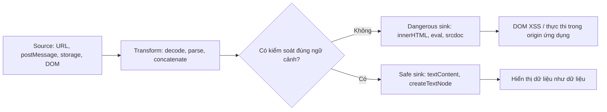

# DOM-based XSS — khi JavaScript biến dữ liệu không tin cậy thành mã thực thi

> **Chương:** XSS và DOM  
> **Mục tiêu:** Nhận diện luồng dữ liệu từ nguồn không tin cậy (source) tới điểm diễn giải nguy hiểm (sink), hiểu vì sao DOM API có thể tạo DOM-based Cross-Site Scripting (DOM XSS), chọn API an toàn, kiểm soát URL và thông điệp chéo origin, áp dụng sanitizer/Trusted Types/CSP và kiểm chứng trong DevTools.

## 1. DOM-based XSS là gì?

**DOM-based XSS** xảy ra khi JavaScript phía client lấy dữ liệu có thể bị người dùng hoặc bên ngoài kiểm soát, sau đó đưa dữ liệu đó vào một API khiến browser diễn giải nó như HTML, JavaScript hoặc một nội dung có thể thực thi. Mã độc cuối cùng chạy trong origin của ứng dụng, với quyền mà script của origin đó có.

Ví dụ, trang hiển thị lời chào dựa trên tham số URL:

```js
const params = new URLSearchParams(location.search);
const name = params.get("name");

document.querySelector("#welcome").innerHTML = "Xin chào " + name;
```

Nếu URL chứa:

```text
https://app.example.com/?name=<strong>Minh</strong>
```

thì browser diễn giải `<strong>Minh</strong>` thành HTML thay vì văn bản. Ví dụ này chỉ minh họa HTML injection bằng một thẻ định dạng vô hại; cùng kiểu sink có thể bị lợi dụng để chèn nội dung nguy hiểm nếu ứng dụng không kiểm soát dữ liệu.

DOM XSS thường được nhắc đến như một dạng XSS phía client vì nguồn dữ liệu và điểm chèn nằm trong luồng xử lý DOM. Nó có thể kết hợp với dữ liệu phản chiếu từ server hoặc dữ liệu đã lưu, nhưng điều quyết định là **JavaScript phía client đưa dữ liệu không tin cậy vào một sink nguy hiểm**.

## 2. Mô hình source → transform → sink

Để tìm DOM XSS, hãy lần theo ba thành phần:

1. **Source:** nơi dữ liệu không tin cậy đi vào ứng dụng.
2. **Transform:** các bước parse, nối chuỗi, decode, chuẩn hóa, lọc hoặc chuyển đổi dữ liệu.
3. **Sink:** API sử dụng dữ liệu theo cách browser có thể diễn giải thành HTML, script, URL hoặc nội dung hoạt động.



Không phải mọi transform đều làm dữ liệu an toàn. Ví dụ:

- `decodeURIComponent` chỉ giải mã percent-encoding, không làm HTML an toàn.
- `JSON.parse` chuyển JSON thành dữ liệu JavaScript, nhưng dữ liệu bên trong vẫn không đáng tin.
- `replace("<", "&lt;")` không phải sanitizer tổng quát cho mọi HTML context.
- Kiểm tra chuỗi bằng regex thường không đủ để xử lý HTML, URL hoặc JavaScript grammar.

**An toàn phụ thuộc vào sink và ngữ cảnh sử dụng cuối cùng**, không chỉ vào việc dữ liệu đã được xử lý một lần hay chưa.

## 3. Những source phổ biến trong trình duyệt

Source là mọi nơi dữ liệu từ bên ngoài có thể đi vào logic client. Một số source cần rà soát:

| Source | Ví dụ | Điều cần lưu ý |
| --- | --- | --- |
| URL query | `location.search`, `URLSearchParams` | Người dùng có thể sửa query hoặc gửi link chứa giá trị do họ chọn |
| URL fragment | `location.hash` | Fragment thường không được gửi lên server trong HTTP request nhưng vẫn đọc được bằng JavaScript |
| URL đầy đủ | `location.href` | Có thể chứa scheme, host, path và query do người dùng điều khiển |
| Referrer | `document.referrer` | Phụ thuộc trang điều hướng và Referrer-Policy; không phải dữ liệu đáng tin |
| Thông điệp | `message` event từ `postMessage` | Phải xác minh origin, source và cấu trúc message |
| Browser storage | `localStorage`, `sessionStorage`, IndexedDB | Dữ liệu lưu từ phiên trước có thể bị sửa hoặc đến từ phiên bản ứng dụng cũ |
| DOM hiện có | `element.dataset`, thuộc tính, text trong node | Nội dung có thể do người dùng, server hoặc script khác tạo |
| Tên cửa sổ | `window.name` | Có thể tồn tại qua điều hướng; không dùng như dữ liệu tin cậy |
| Dữ liệu từ API | JSON response, cấu hình động | Server response không mặc nhiên an toàn để chèn vào HTML |

Ví dụ đọc fragment:

```js
const tab = new URLSearchParams(location.hash.slice(1)).get("tab");
showTab(tab);
```

Nếu `showTab` chỉ so sánh với một danh sách tab cố định thì có thể an toàn. Nếu nó nối giá trị vào `innerHTML` hoặc dùng làm URL mà không kiểm tra, dữ liệu có thể trở thành đường DOM XSS hoặc một lỗi bảo mật khác.

### Dữ liệu từ postMessage

Thông điệp chéo origin phải được xem là không tin cậy cho tới khi kiểm tra:

```js
window.addEventListener("message", (event) => {
  if (event.origin !== "https://widget.partner.example") return;
  if (event.source !== expectedFrame.contentWindow) return;
  if (!event.data || event.data.type !== "DISPLAY_NAME") return;
  if (typeof event.data.value !== "string") return;

  document.querySelector("#display-name").textContent = event.data.value;
});
```

Kiểm tra `event.origin`, `event.source` và schema của dữ liệu. Không dùng `event.origin.endsWith("partner.example")` như phép xác minh vì hostname giả có thể kết thúc bằng cùng chuỗi. Ngay cả message từ origin được phép cũng cần được xem như dữ liệu; đừng đưa nó thẳng vào HTML hoặc sink thực thi.

## 4. Sink nguy hiểm: HTML parser

Những API sau có thể khiến browser parse chuỗi thành HTML:

| Sink | Rủi ro |
| --- | --- |
| `element.innerHTML` | Parse chuỗi HTML và thay nội dung bên trong phần tử |
| `element.outerHTML` | Parse HTML và thay thế chính phần tử |
| `insertAdjacentHTML()` | Parse HTML rồi chèn vào DOM tại vị trí chỉ định |
| `document.write()` / `writeln()` | Ghi chuỗi vào parser document |
| `Range.createContextualFragment()` | Parse chuỗi thành DocumentFragment theo context |
| `iframe.srcdoc` | Nạp chuỗi như một tài liệu HTML trong iframe |
| Một số luồng `DOMParser.parseFromString()` | Parse HTML; dữ liệu trở nên nguy hiểm nếu node/attribute được chuyển vào document hoạt động |

Ví dụ cùng source nhưng hai cách hiển thị:

```js
const message = new URLSearchParams(location.search).get("message") ?? "";

// Nguy hiểm: browser parse dữ liệu thành markup.
document.querySelector("#preview").innerHTML = message;

// An toàn hơn khi chỉ cần hiển thị văn bản.
document.querySelector("#preview").textContent = message;
```

Nếu yêu cầu sản phẩm chỉ là hiển thị tên, bình luận hoặc thông báo, hãy dùng `textContent` hoặc `createTextNode`. Không dùng HTML parser chỉ để thêm vài thẻ định dạng.

### Không phải mọi API có chữ “HTML” đều tự động thực thi script ngay

Một số API parse tài liệu ở chế độ inert hoặc có hành vi đặc biệt; điều đó không làm dữ liệu trở nên an toàn. Khi node hoặc thuộc tính được chuyển vào DOM hoạt động, các handler, URL và hành vi khác có thể trở thành nguy hiểm. Quy tắc thực tế là tránh luồng parse HTML không tin cậy nếu không có sanitizer đáng tin cậy và một lý do nghiệp vụ rõ ràng.

## 5. Sink nguy hiểm: JavaScript execution

Các API có thể biên dịch hoặc thực thi chuỗi như mã JavaScript cần được tránh với dữ liệu không tin cậy:

| Sink | Vì sao nguy hiểm |
| --- | --- |
| `eval(input)` | Diễn giải chuỗi như JavaScript |
| `new Function(input)` | Biên dịch chuỗi thành function |
| `setTimeout("...", delay)` | Dạng chuỗi được diễn giải như mã |
| `setInterval("...", delay)` | Tương tự `setTimeout` dạng chuỗi |
| Gán nội dung vào script rồi đưa node vào DOM | Có thể tạo script động và thực thi trong trang |

Thay vì:

```js
// Không dùng chuỗi làm mã.
setTimeout("refreshDashboard()", 1000);
```

hãy truyền function:

```js
setTimeout(() => {
  refreshDashboard();
}, 1000);
```

Không dùng `eval` để parse JSON. Dùng `JSON.parse` và vẫn xác thực schema của dữ liệu sau khi parse. JSON hợp lệ không đồng nghĩa dữ liệu hợp lệ cho nghiệp vụ.

## 6. Sink URL và thuộc tính DOM

Không phải sink nào cũng parse HTML. Một số thuộc tính nhận URL hoặc kích hoạt hành vi khi browser điều hướng/tải tài nguyên:

- `a.href`, `area.href`, `form.action`.
- `iframe.src`, `script.src`, `object.data`.
- `img.src`, `video.src` và các thuộc tính tải tài nguyên khác.
- `iframe.srcdoc` nhận HTML, không phải URL thông thường.
- Các thuộc tính sự kiện như `onclick`, `onerror` có thể thực thi JavaScript khi được gán trong những API phù hợp.

Ví dụ, gán chuỗi không kiểm tra vào `href` có thể cho phép một scheme nguy hiểm hoặc điều hướng tới website giả mạo. Hãy parse URL và allowlist scheme/origin:

```js
function setSafeLink(anchor, rawValue) {
  const url = new URL(rawValue, window.location.origin);

  // Ví dụ chính sách: chỉ cho liên kết HTTPS.
  if (url.protocol !== "https:") {
    throw new Error("Chỉ chấp nhận liên kết HTTPS");
  }

  anchor.href = url.href;
  anchor.rel = "noopener noreferrer";
}
```

Nếu chỉ cho phép điều hướng trong ứng dụng, hãy kiểm tra `url.origin === location.origin`. Nếu cho phép đối tác, dùng allowlist origin cụ thể. Không dùng `includes()` hoặc `endsWith()` trên URL thô để xác minh đích.

`setAttribute` không phải lúc nào cũng an toàn:

```js
// Không an toàn: tên thuộc tính và giá trị do dữ liệu điều khiển.
element.setAttribute(untrustedName, untrustedValue);

// Không gán dữ liệu vào thuộc tính event handler.
element.setAttribute("onclick", untrustedValue);
```

Nếu cần đặt thuộc tính, cố định tên thuộc tính trong code và xác thực giá trị theo loại thuộc tính. Với văn bản, dùng `textContent`; với URL, dùng URL parser và allowlist; với event, dùng `addEventListener` cùng function được định nghĩa trong code.

## 7. Sink an toàn và cách xây DOM bằng dữ liệu

Nếu mục tiêu là hiển thị văn bản, ưu tiên:

```js
const title = document.createElement("h2");
title.textContent = apiData.title;

const description = document.createElement("p");
description.append(document.createTextNode(apiData.description));

const card = document.querySelector("#cards");
card.replaceChildren(title, description);
```

Các API này tạo node và gắn dữ liệu dưới dạng text, không yêu cầu browser parse chuỗi thành markup.

| Nhu cầu | API nên ưu tiên |
| --- | --- |
| Hiển thị text | `textContent`, `createTextNode` |
| Tạo phần tử | `document.createElement` |
| Gắn node | `append`, `appendChild`, `replaceChildren` |
| Đăng ký sự kiện | `addEventListener` với function |
| Chọn một giá trị từ tập cho phép | Allowlist enum trước khi cập nhật UI |
| Điều hướng/tải URL | `new URL()`, kiểm tra scheme và origin, rồi gán thuộc tính URL |
| Hiển thị HTML do người dùng viết | Sanitizer HTML được duy trì, cấu hình phù hợp và kiểm thử |

“Safe sink” luôn phụ thuộc cách dùng. Ví dụ `textContent` an toàn để hiển thị text trong một phần tử thông thường, nhưng không nên dùng để đặt nội dung cho một node `script` rồi gắn node đó vào document. Hãy chọn node và API theo mục đích, không chỉ theo tên hàm.

## 8. Context matters: encode đúng ngữ cảnh

Một chuỗi có thể an toàn ở ngữ cảnh text nhưng không an toàn khi được dùng làm URL, JavaScript hoặc CSS. Encoding phải khớp với nơi dữ liệu được diễn giải:

| Ngữ cảnh | Hướng xử lý |
| --- | --- |
| HTML text node | Dùng text API; nếu render template server-side, dùng HTML text escaping đúng chuẩn |
| HTML attribute | Dùng API DOM đặt thuộc tính cố định và encode theo attribute context khi render server-side |
| URL | Parse URL, allowlist scheme/origin; percent-encoding không thay validation |
| JavaScript | Không nối dữ liệu không tin cậy vào code; truyền dữ liệu qua JSON/data channel an toàn |
| CSS | Tránh đưa dữ liệu tùy ý vào CSS; allowlist token/giá trị cần thiết |
| Rich HTML | Dùng HTML sanitizer được duy trì, sau đó đưa kết quả vào sink có kiểm soát |

Không dùng một hàm escape chung cho mọi context. Ví dụ HTML escaping không biến chuỗi thành URL an toàn, và URL encoding không ngăn JavaScript injection nếu dữ liệu sau đó được chèn vào script.

Framework hiện đại thường tự escape dữ liệu trong template text binding. Tuy nhiên, những API bỏ qua cơ chế này như `dangerouslySetInnerHTML`, `v-html` hoặc binding raw HTML vẫn có thể tạo DOM XSS. Hãy rà soát các “escape hatch” và kiểm tra luồng dữ liệu trước khi dùng.

## 9. Khi thật sự cần hiển thị HTML: dùng sanitizer

Một số sản phẩm cần hiển thị rich text do người dùng nhập, ví dụ mô tả bài viết hoặc bình luận có định dạng. Trong trường hợp đó, không thể chỉ dùng `textContent` nếu yêu cầu là render markup. Cần một HTML sanitizer chuyên dụng, được cập nhật và cấu hình theo nhu cầu.

Ví dụ với DOMPurify:

```js
// DOMPurify cần được cài đặt và import từ dependency được quản lý.
const cleanHtml = DOMPurify.sanitize(untrustedHtml, {
  USE_PROFILES: { html: true },
});

document.querySelector("#article").innerHTML = cleanHtml;
```

Sanitizer cần:

- Chỉ giữ những thẻ và thuộc tính sản phẩm thật sự cần.
- Loại bỏ event handler và URL scheme nguy hiểm.
- Được cập nhật khi phát hiện bypass hoặc thay đổi trình duyệt.
- Được cấu hình và kiểm thử cho đúng HTML context.
- Không bị vô hiệu hóa sau sanitize bằng cách nối thêm chuỗi hoặc chỉnh node theo cách nguy hiểm.

**Sanitize xong không có nghĩa dữ liệu có thể dùng ở mọi context.** Kết quả HTML đã làm sạch vẫn không nên đưa vào JavaScript, CSS hoặc URL. Nếu cần đổi context, phải xử lý lại theo chính sách phù hợp.

Không tự viết sanitizer bằng regex. HTML có cú pháp phức tạp, parser sửa markup lỗi theo quy tắc riêng và các trường hợp mutation có thể làm kết quả khác với chuỗi ban đầu.

## 10. Trusted Types: kiểm soát đường đi vào DOM sink

**Trusted Types** là cơ chế browser giúp giới hạn việc truyền chuỗi tùy ý vào một số sink có rủi ro XSS. Thay vì nhận mọi string, sink được bảo vệ có thể yêu cầu một đối tượng kiểu như `TrustedHTML`, `TrustedScript` hoặc `TrustedScriptURL`.

Trusted Types không tự làm sạch dữ liệu. Ứng dụng phải tạo policy có logic kiểm soát; policy đó là ranh giới bảo mật quan trọng.

Ví dụ policy HTML dùng DOMPurify:

```js
const htmlPolicy = trustedTypes.createPolicy("app-html", {
  createHTML(input) {
    return DOMPurify.sanitize(input, {
      USE_PROFILES: { html: true },
      RETURN_TRUSTED_TYPE: false,
    });
  },
});

const trustedHtml = htmlPolicy.createHTML(untrustedHtml);
document.querySelector("#article").innerHTML = trustedHtml;
```

Trong ví dụ, sanitizer trả về string đã làm sạch cho policy; Trusted Types bọc kết quả thành `TrustedHTML`. Không tạo policy trả lại nguyên input, vì như vậy chỉ chuyển chuỗi không tin cậy thành một “vé thông hành” tới sink.

Có thể thực thi bằng CSP:

```http
Content-Security-Policy: require-trusted-types-for 'script'; trusted-types app-html
```

`require-trusted-types-for 'script'` yêu cầu Trusted Types ở các sink thuộc phạm vi hỗ trợ; `trusted-types app-html` giới hạn tên policy được phép tạo. Trình duyệt chưa hỗ trợ Trusted Types có thể không thực thi directive như browser hỗ trợ, nên vẫn phải có phòng vệ an toàn độc lập.

### Triển khai theo giai đoạn

1. Kiểm kê các sink như `innerHTML`, `outerHTML`, `insertAdjacentHTML` và các API liên quan.
2. Tìm mọi luồng dữ liệu đi vào sink, thay bằng text API nếu có thể.
3. Với HTML thực sự cần thiết, tập trung qua sanitizer và policy hẹp.
4. Thử nghiệm CSP enforcement trong môi trường staging; xử lý các sink hợp lệ còn lại.
5. Theo dõi lỗi tương thích trên browser mục tiêu và không tạo default policy rộng chỉ để che lỗi.

Trusted Types đặc biệt hữu ích với ứng dụng lớn có nhiều team và nhiều code path, vì nó biến một số lỗi DOM XSS thành lỗi có thể phát hiện trong quá trình chạy.

## 11. CSP là lớp giảm thiểu bổ sung

Content Security Policy (CSP) có thể hạn chế script được tải và thực thi. Một chính sách nghiêm ngặt có thể bắt đầu từ:

```http
Content-Security-Policy: default-src 'self'; script-src 'self' 'nonce-RANDOM_PER_RESPONSE'; object-src 'none'; base-uri 'self'; require-trusted-types-for 'script'; trusted-types app-html
```

`RANDOM_PER_RESPONSE` là placeholder: server phải sinh nonce khó đoán riêng cho từng response và đặt cùng giá trị vào header và những script hợp lệ được phép chạy. Không dùng nonce cố định.

CSP giúp giảm tác động của một số kiểu injection, nhưng không thay thế:

- Ngăn dữ liệu không tin cậy đi vào sink nguy hiểm.
- Output encoding theo context.
- Sanitizer cho rich HTML.
- Trusted Types để kiểm soát sink ở browser hỗ trợ.
- Kiểm thử các đường DOM và phụ thuộc bên thứ ba.

Nếu CSP chứa `'unsafe-inline'` hoặc `'unsafe-eval'` không cần thiết, hiệu quả giảm thiểu có thể suy yếu. Không thêm các ngoại lệ này chỉ để làm ứng dụng hết lỗi mà chưa đánh giá nguồn thực thi.

## 12. DOM clobbering và các đường DOM gián tiếp

Không phải mọi vấn đề DOM đều là việc gán chuỗi vào `innerHTML`. **DOM clobbering** có thể xảy ra khi các phần tử HTML do nội dung không tin cậy tạo ra dùng `id` hoặc `name` trùng với tên thuộc tính/global mà code mong đợi. Điều này có thể khiến code lấy nhầm node thay vì đối tượng hoặc giá trị dự kiến.

Ví dụ code dễ mắc lỗi:

```js
// Dựa vào named property/global do DOM có thể ảnh hưởng.
const config = window.config;
initialize(config);
```

Hãy dùng biến lexical/module rõ ràng, lấy node bằng selector cụ thể, kiểm tra kiểu và schema, không dựa vào named properties toàn cục được tạo từ `id` hoặc `name` của markup.

Các đường gián tiếp khác:

- Template client render raw HTML.
- Plugin hoặc thư viện nhận callback dữ liệu không tin cậy.
- Mutation observer xử lý node được chèn từ nội dung người dùng.
- Dữ liệu lưu trong localStorage được tái sử dụng sau nhiều phiên bản.
- Message handler tin dữ liệu từ iframe nhưng không kiểm tra nguồn.

Rà soát DOM XSS cần xem **toàn bộ luồng dữ liệu**, không chỉ tìm một vài chuỗi `innerHTML`.

## 13. Ví dụ hoàn chỉnh: sửa DOM XSS trong trang tìm kiếm

Giả sử trang hiển thị từ khóa tìm kiếm:

```js
function renderSearchHeading() {
  const query = new URLSearchParams(location.search).get("q") ?? "";
  const heading = document.querySelector("#search-heading");

  // Cách nguy hiểm: query được diễn giải như HTML.
  heading.innerHTML = "Kết quả cho: " + query;
}
```

Nếu chỉ cần hiển thị từ khóa, sửa thành:

```js
function renderSearchHeading() {
  const query = new URLSearchParams(location.search).get("q") ?? "";
  const heading = document.querySelector("#search-heading");

  heading.textContent = "Kết quả cho: " + query;
}
```

Nếu giao diện cần một thẻ định dạng cố định:

```js
function renderSearchHeading() {
  const query = new URLSearchParams(location.search).get("q") ?? "";
  const heading = document.querySelector("#search-heading");
  const label = document.createElement("span");

  label.className = "search-term";
  label.textContent = query;
  heading.replaceChildren("Kết quả cho: ", label);
}
```

Ở đây markup do ứng dụng tạo bằng API DOM; giá trị query luôn được đặt dưới dạng text. Không cần HTML sanitizer vì ứng dụng không yêu cầu render HTML do người dùng cung cấp.

## 14. Kiểm thử DOM XSS trong DevTools

Thực hiện trong ứng dụng lab do bạn kiểm soát, với dữ liệu vô hại. Không cần dùng payload thực thi JavaScript để phát hiện sink HTML.

### Bước 1 — Tìm source

Tìm các vị trí đọc:

- `location.search`, `location.hash`, `location.href`.
- `document.referrer`, `window.name`.
- `message` event, `localStorage`, `sessionStorage`.
- Response API và dữ liệu DOM do người dùng kiểm soát.

Ghi lại source, nơi dữ liệu được decode/parse và mọi biến trung gian.

### Bước 2 — Tìm sink

Search codebase với những tên API:

```text
innerHTML
outerHTML
insertAdjacentHTML
document.write
createContextualFragment
srcdoc
eval
new Function
setTimeout(
setInterval(
```

Đây là danh sách bắt đầu, không phải danh sách đầy đủ. Kiểm tra cả wrapper function và API của framework như raw HTML binding.

### Bước 3 — Thử markup vô hại

Mở trang lab với query:

```text
?q=%3Cstrong%3EDOM%20test%3C%2Fstrong%3E
```

Nếu chữ “DOM test” xuất hiện đậm ngoài dự kiến, dữ liệu có thể đang được parse thành HTML. Nếu hiển thị nguyên văn `<strong>DOM test</strong>`, trang có thể đang dùng text sink. Kết quả này chưa chứng minh toàn bộ ứng dụng không có DOM XSS; hãy kiểm tra mọi source/sink liên quan.

### Bước 4 — Dùng DevTools Sources và breakpoint

1. Đặt breakpoint tại nơi đọc query/hash/message.
2. Theo dõi giá trị qua các hàm transform.
3. Đặt breakpoint tại lệnh gán DOM hoặc gọi API sink.
4. Xác nhận dữ liệu có được xử lý đúng context không.
5. Thử sửa sang `textContent` hoặc API DOM an toàn rồi chạy lại.

### Bước 5 — Kiểm tra CSP và Trusted Types

Trong browser hỗ trợ, bật CSP Trusted Types trên môi trường thử nghiệm. Quan sát Console khi code đưa string thường vào sink được bảo vệ. Sửa từng luồng bằng text sink hoặc policy sanitizer được duyệt; không tạo policy trả lại input để bỏ qua enforcement.

## 15. Checklist phòng vệ DOM-based XSS

- Xác định source: URL, referrer, message, storage, API và DOM.
- Theo dõi dữ liệu từ source tới sink; không giả định decode/parse đã làm sạch dữ liệu.
- Ưu tiên `textContent`, `createTextNode`, `createElement` và API DOM có cấu trúc.
- Tránh `innerHTML`, `outerHTML`, `document.write` và các sink HTML nếu không cần.
- Không dùng `eval`, `Function` hoặc timer dạng chuỗi với dữ liệu không tin cậy.
- Parse URL bằng `URL` API; allowlist scheme và origin; kiểm tra redirect đích.
- Với `postMessage`, xác minh origin, source và schema.
- Nếu cần rich HTML, dùng sanitizer được duy trì như DOMPurify và cấu hình tối thiểu.
- Cân nhắc Trusted Types để thực thi kiểm soát sink trong browser hỗ trợ.
- Dùng CSP nghiêm ngặt như lớp giảm thiểu; tránh ngoại lệ inline/eval không cần thiết.
- Kiểm tra raw HTML escape hatches trong framework và code của bên thứ ba.
- Kiểm thử source/sink bằng DevTools, unit test và browser mục tiêu.

## 16. Câu hỏi tự kiểm tra

1. DOM-based XSS khác gì với trường hợp server phản chiếu trực tiếp dữ liệu vào HTML?
2. Vì sao `location.hash` vẫn là source dù fragment không được gửi trong HTTP request?
3. Nêu ba source và ba sink có thể tạo thành một luồng DOM XSS.
4. Vì sao `decodeURIComponent` hoặc `JSON.parse` không tự làm dữ liệu an toàn?
5. Khi nào nên dùng `textContent` thay vì `innerHTML`?
6. Vì sao `setAttribute` không an toàn nếu tên thuộc tính hoặc giá trị do người dùng điều khiển?
7. DOMPurify giải quyết phần nào và vì sao kết quả sanitize vẫn phải dùng đúng context?
8. Trusted Types làm gì và vì sao policy trả lại input nguyên trạng là nguy hiểm?
9. CSP giảm tác động DOM XSS như thế nào và vì sao không thay việc sửa source-to-sink?
10. Vì sao cùng site nhưng khác origin không làm message từ sibling subdomain tự động đáng tin?

**Ghi nhớ:** DOM-based XSS xuất hiện khi dữ liệu không tin cậy đi từ **source** tới **sink** khiến browser diễn giải dữ liệu như markup hoặc code. Hãy ưu tiên API DOM biến dữ liệu thành text, kiểm tra URL và message theo allowlist, chỉ dùng HTML sanitizer khi thật sự cần rich HTML, rồi bổ sung Trusted Types và CSP để kiểm soát các đường còn lại. Phòng vệ hiệu quả bắt đầu từ việc hiểu và kiểm soát luồng source-to-sink trong toàn bộ ứng dụng.
