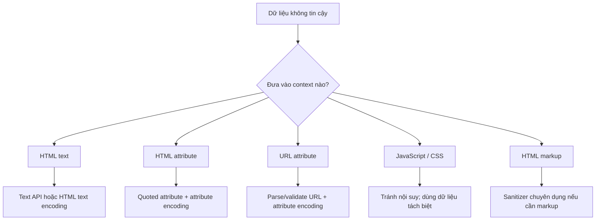

# HTML context

> **Chương:** XSS và DOM  
> **Học phần:** Application Security — Browser Security (`SECURITY_APPLICATION_SECURITY_BROWSER_SECURITY`)

Khi ứng dụng đưa dữ liệu người dùng vào HTML, browser không xem toàn bộ nội dung response như văn bản thuần. HTML parser phân tích dữ liệu theo **ngữ cảnh cú pháp**: văn bản giữa hai thẻ, giá trị thuộc tính, URL, JavaScript, CSS, comment hoặc vùng raw text như `script` và `style`. Cùng một chuỗi có thể chỉ hiển thị như văn bản trong ngữ cảnh này nhưng trở thành cấu trúc HTML hoặc mã có thể thực thi trong ngữ cảnh khác.

Đây là lý do **output encoding phải đúng với ngữ cảnh đầu ra**. Escape HTML chung chung, lọc một vài ký tự hoặc thay dấu `<` bằng entity ở mọi nơi không phải cách phòng XSS đáng tin cậy. Hãy hiểu parser đang ở context nào, dùng API/encoder phù hợp, và ưu tiên cách đưa dữ liệu vào DOM dưới dạng text thay vì tạo markup từ chuỗi không tin cậy.

## 1. Mục tiêu học tập

Sau bài học, bạn có thể:

1. Giải thích HTML context và vì sao cùng một input có thể mang ý nghĩa khác nhau tùy vị trí.
2. Phân biệt HTML text, quoted attribute, URL attribute, JavaScript, CSS, comment và raw-text context.
3. Chọn output encoding hoặc DOM API an toàn cho từng context.
4. Nhận diện các DOM sink nguy hiểm như `innerHTML`, `document.write`, `eval` và `srcdoc`.
5. Phân biệt encoding, validation, sanitization và Trusted Types.
6. Hiểu giới hạn của auto-escaping trong template engine và framework.
7. Kiểm chứng XSS context trong môi trường lab bằng DevTools.

## 2. HTML parser context là gì?

HTML là một ngôn ngữ có cấu trúc. Browser dùng parser để chuyển response thành DOM. Khi parser gặp một chuỗi ký tự, cách diễn giải của nó phụ thuộc vào vị trí hiện tại và trạng thái parser.

Ví dụ cùng một giá trị `userInput` có thể được đưa vào:

```html
<p>USER_INPUT</p>
<input value="USER_INPUT">
<a href="USER_INPUT">Mở liên kết</a>
<script>const message = "USER_INPUT";</script>
<style>.card::after { content: "USER_INPUT"; }</style>
```

Đây không phải năm vị trí có thể dùng cùng một hàm escape. Mỗi vị trí có cú pháp và cách diễn giải riêng. Một chuỗi an toàn trong HTML text có thể phá vỡ quoted attribute; một chuỗi đã HTML-encode vẫn có thể nguy hiểm nếu được đặt vào JavaScript hoặc URL có scheme thực thi.



Nguyên tắc quan trọng: **context được quyết định bởi vị trí dữ liệu được chèn vào, không phải bởi tên biến hoặc nguồn dữ liệu**. Dữ liệu từ database cũng có thể không đáng tin nếu ban đầu do người dùng cung cấp.

## 3. HTML text context

HTML text context là vùng văn bản thông thường nằm giữa các thẻ, ví dụ:

```html
<p>Xin chào, USER_INPUT</p>
<h2>Tiêu đề: USER_INPUT</h2>
```

Nếu dữ liệu không tin cậy được chèn trực tiếp như markup, các ký tự đặc biệt có thể làm parser tạo element hoặc attribute thay vì hiển thị văn bản. Cách an toàn là **HTML text encoding** phù hợp hoặc dùng DOM API đặt text.

Trong JavaScript:

```js
const name = new URLSearchParams(location.search).get("name") ?? "";
document.querySelector("#greeting").textContent = `Xin chào, ${name}`;
```

`textContent` tạo nội dung văn bản; browser không parse chuỗi thành HTML markup. Nếu server render HTML, template engine cần auto-escape ở HTML text context và không được tắt escape bằng cú pháp raw/trusted HTML cho dữ liệu không tin cậy.

Các ký tự thường cần được mã hóa trong HTML text gồm `&`, `<` và `>`; encoder HTML tổng quát cũng thường encode dấu nháy để giảm nguy cơ dùng nhầm context. Hãy dùng thư viện encoder đã được kiểm chứng thay vì tự thay chuỗi thủ công.

**Không dùng HTML encoding như một bộ lọc đầu vào.** Hãy giữ dữ liệu gốc trong model; encode ở điểm render cuối cùng theo đúng context. Nếu encode quá sớm rồi lại encode lần nữa, người dùng có thể nhìn thấy entity như `&amp;` thay vì ký tự mong muốn (double encoding).

## 4. Quoted HTML attribute context

Giá trị attribute thường được đặt trong dấu nháy kép:

```html
<input value="USER_INPUT">
<div title="USER_INPUT">Nội dung</div>
```

Nếu dữ liệu không được encode đúng, dấu nháy có thể kết thúc giá trị attribute sớm và phần còn lại bị parser diễn giải thành attribute khác. Vì vậy:

- Luôn đặt giá trị trong **dấu nháy**; tránh unquoted attribute.
- Dùng **HTML attribute encoding** phù hợp với quoted attribute.
- Không để người dùng kiểm soát tên attribute.
- Không đưa dữ liệu không tin cậy vào event-handler attribute như `onclick`, `onerror`.
- Không dùng attribute `style` làm nơi chứa CSS tùy ý.

Ví dụ DOM:

```js
const label = userSuppliedLabel;
const input = document.querySelector("#display-name");
input.setAttribute("value", label);
```

Với attribute văn bản thông thường như `value`, `title`, `aria-label`, `setAttribute` đặt giá trị dưới dạng attribute thay vì parse một chuỗi HTML mới. Nhưng **không phải mọi attribute đều an toàn chỉ vì dùng `setAttribute`**: `href`, `src`, `srcdoc`, `style` và các event handler có ngữ nghĩa đặc biệt. Phải xét loại attribute và giá trị trước khi gán.

### 4.1 Attribute name cũng là một ranh giới

Không tạo tên attribute từ input người dùng:

```js
// Tránh: tên attribute do dữ liệu không tin cậy quyết định.
element.setAttribute(userSuppliedName, userSuppliedValue);
```

Hãy dùng mapping cố định từ một tập lựa chọn đã biết:

```js
const allowedAttributes = {
  title: "title",
  label: "aria-label",
};

const attributeName = allowedAttributes[fieldType];
if (attributeName) {
  element.setAttribute(attributeName, userSuppliedValue);
}
```

Trong ví dụ, tên attribute đến từ allowlist trong code; giá trị vẫn cần xử lý theo ngữ nghĩa của attribute.

## 5. URL attribute context

Các attribute như `href`, `src`, `action`, `formaction` và một số attribute SVG có thể chứa URL. HTML attribute encoding chỉ bảo vệ cú pháp HTML; nó **không xác minh scheme hoặc đích đến URL**.

Ví dụ:

```html
<a href="USER_INPUT">Mở liên kết</a>

```

Một URL có scheme không phù hợp như `javascript:` có thể mang ý nghĩa thực thi trong một số vị trí. Vì vậy, cần hai bước độc lập:

1. **Parse và validate URL:** chỉ chấp nhận scheme/host/đường dẫn theo yêu cầu nghiệp vụ, ví dụ `https:` và có thể `http:` trong môi trường phù hợp; từ chối `javascript:`, `data:` hoặc scheme không cần thiết.
2. **Encode khi đặt vào HTML attribute:** sau khi đã tạo URL hợp lệ, vẫn phải encode giá trị theo quoted HTML attribute context.

Ví dụ kiểm tra link ngoài trong JavaScript:

```js
function getSafeExternalUrl(input) {
  try {
    const url = new URL(input);
    if (url.protocol !== "https:") return null;
    return url.href;
  } catch {
    return null;
  }
}

const safeUrl = getSafeExternalUrl(userProvidedUrl);
if (safeUrl) {
  const link = document.querySelector("#external-link");
  link.href = safeUrl;
  link.textContent = "Mở trang bên ngoài";
}
```

Đây là policy chỉ cho phép HTTPS tuyệt đối. Nếu ứng dụng cần URL tương đối hoặc domain nội bộ, hãy parse bằng base URL đã xác định và kiểm tra host/path theo allowlist. Không chỉ kiểm tra chuỗi bắt đầu bằng `https://` vì parser có thể diễn giải URL khác với cách kiểm tra chuỗi đơn giản.

Khi tạo query string, dùng `URL`/`URLSearchParams` hoặc API tương đương để encode **thành phần URL**. URL encoding không thay thế HTML attribute encoding nếu kết quả được nhúng vào HTML.

## 6. JavaScript context trong HTML

Một vị trí rủi ro cao là nội suy dữ liệu vào script inline:

```html
<script>
  const displayName = "USER_INPUT";
</script>
```

JavaScript parser có cú pháp riêng về dấu nháy, dấu gạch chéo, newline, comment và biểu thức. HTML parser còn xử lý nội dung bên trong `script` như raw text; chuỗi kết thúc `</script>` có thể kết thúc element ở cấp HTML parser ngay cả khi ký tự đó nằm trong JavaScript string. Vì thế, chỉ dùng HTML encoding hoặc JavaScript string escaping đơn lẻ có thể không đủ.

**Lựa chọn tốt nhất:** không chèn dữ liệu không tin cậy trực tiếp vào mã JavaScript. Đưa dữ liệu qua API/JSON response rồi xử lý như dữ liệu:

```js
const response = await fetch("/api/page-data");
const pageData = await response.json();
document.querySelector("#title").textContent = pageData.title;
```

Nếu cần truyền dữ liệu từ server-rendered HTML sang JavaScript, có thể đặt nó trong một attribute dữ liệu được quoted và HTML-attribute-encoded, rồi đọc bằng `dataset`:

```html
<main id="page" data-display-name="GIÁ_TRỊ_ĐÃ_ATTRIBUTE_ENCODE">
  <h1 id="heading"></h1>
</main>
```

```js
const root = document.querySelector("#page");
document.querySelector("#heading").textContent = root.dataset.displayName;
```

Nếu kiến trúc bắt buộc nhúng JSON vào script element, cần serializer chuyên biệt cho **HTML script raw-text context** có xử lý an toàn chuỗi đóng `</script>` (thường escape `<` thành dạng Unicode escape cùng các ký tự cần thiết), không chỉ `JSON.stringify` mặc định. Hãy ưu tiên thư viện/framework đã xử lý context này và kiểm thử parser; không tự viết serializer.

### 6.1 Event handler attribute là JavaScript context

Tránh cách viết:

```html
<button onclick="doSomething('USER_INPUT')">Thực hiện</button>
```

Attribute `onclick` chứa mã JavaScript, không phải attribute văn bản thông thường. HTML attribute encoding không biến dữ liệu thành một giá trị JavaScript an toàn. Dùng `addEventListener` và truyền dữ liệu qua thuộc tính/closure:

```js
const button = document.querySelector("#submit-button");
const recordId = pageData.recordId;

button.addEventListener("click", () => {
  openRecord(recordId);
});
```

## 7. CSS context

CSS cũng có cú pháp và khả năng tham chiếu tài nguyên. Không nội suy input tùy ý vào CSS declaration, selector hoặc `<style>` block:

```html
<style>
  .profile { background-image: url("USER_INPUT"); }
</style>
```

HTML encoding không phải CSS encoding. JavaScript string escaping cũng không bảo vệ mọi vị trí trong CSS. Cách an toàn là:

- Không tạo CSS rule từ chuỗi người dùng.
- Dùng class name cố định và mapping giá trị được phép.
- Nếu cần một giá trị động như màu, kiểm tra bằng parser/allowlist theo cú pháp hẹp rồi gán qua CSSOM phù hợp.
- Với URL trong CSS, áp dụng kiểm tra URL và policy tài nguyên; không cho input tùy ý tạo `url(...)`.

Ví dụ mapping màu:

```js
const themeColors = {
  blue: "#2457a7",
  green: "#18794e",
  gray: "#555555",
};

const selectedColor = themeColors[userChoice] ?? themeColors.gray;
document.querySelector("#badge").style.color = selectedColor;
```

Ở đây, giá trị đến từ mapping cố định, không phải CSS tùy ý do người dùng cung cấp.

## 8. HTML comment và raw-text context

Không đặt dữ liệu không tin cậy vào HTML comment:

```html
<!-- USER_INPUT -->
```

Comment có cú pháp riêng và có thể bị kết thúc sớm bởi dữ liệu chứa ký tự phân cách. Nếu cần ghi chú hoặc metadata, hãy dùng text node hoặc một data attribute có encoding phù hợp.

Các element như `script` và `style` có vùng raw text; một số element khác có quy tắc parsing đặc biệt. Không giả định chuỗi đã escape cho HTML text sẽ an toàn khi chuyển vào các vùng này. Tương tự, `textarea` và `title` có parsing mode riêng; hãy dùng template engine hiểu đúng context hoặc DOM API thay vì ghép HTML bằng chuỗi.

## 9. HTML markup context: khi nào cần sanitizer?

Đôi khi sản phẩm cần cho phép người dùng định dạng nội dung bằng một tập HTML hạn chế, ví dụ bình luận có chữ đậm, liên kết hoặc danh sách. Khi đó dữ liệu cần được biến thành **HTML markup** thay vì chỉ văn bản. Đây là một nhu cầu khác với HTML text context.

Không dùng cách tự xóa các tag như `script` hoặc lọc từ khóa. HTML có nhiều element, attribute, namespace và cách trình duyệt phục hồi markup sai cấu trúc. Một bộ lọc tự viết thường bỏ sót các đường thực thi.

Hãy dùng sanitizer HTML đã được kiểm chứng và cập nhật, với allowlist element/attribute/protocol phù hợp. Ví dụ minh họa với thư viện DOMPurify:

```js
const cleanHtml = DOMPurify.sanitize(untrustedHtml, {
  ALLOWED_TAGS: ["p", "strong", "em", "ul", "ol", "li", "a"],
  ALLOWED_ATTR: ["href", "title"],
});

document.querySelector("#comment").innerHTML = cleanHtml;
```

Đây là ví dụ định hướng; cần kiểm tra cấu hình URL/protocol của sanitizer, phiên bản thư viện, nhu cầu sản phẩm và các plugin. Không mở `style`, event handler, `srcdoc` hoặc các namespace phức tạp nếu không có lý do đã đánh giá. Sanitized HTML nên được xem là **trusted output có phạm vi cụ thể**, không phải chuỗi có thể đưa vào mọi context.

Nếu sản phẩm chỉ cần hiển thị văn bản, dùng `textContent` đơn giản và an toàn hơn sanitizer.

## 10. DOM sink: nơi dữ liệu trở thành cấu trúc hoặc mã

**Source** là nơi dữ liệu không tin cậy xuất phát, ví dụ URL, form, API, `postMessage`, storage hoặc nội dung người dùng. **Sink** là API/thuộc tính nơi dữ liệu được sử dụng. Một DOM-based XSS thường xuất hiện khi dữ liệu từ source đi tới sink nguy hiểm mà không được xử lý đúng.

| Sink/API | Rủi ro | Hướng thay thế hoặc kiểm soát |
| --- | --- | --- |
| `innerHTML` | Parse chuỗi thành HTML | `textContent`; hoặc sanitizer khi thật sự cần HTML |
| `outerHTML` | Thay element bằng markup được parse | DOM API tạo node; sanitizer nếu cần markup |
| `insertAdjacentHTML` | Parse chuỗi thành HTML tại vị trí chỉ định | `insertAdjacentText` hoặc tạo node |
| `document.write` / `writeln` | Ghi chuỗi vào parser/document | DOM API; tránh dùng với dữ liệu không tin cậy |
| `iframe.srcdoc` | Parse chuỗi như một tài liệu HTML riêng | Không dùng dữ liệu thô; sanitizer và sandbox/origin isolation khi cần |
| `eval`, `Function` | Diễn giải chuỗi thành JavaScript | Không thực thi code từ dữ liệu; dùng JSON/dữ liệu có schema |
| `setTimeout("...")` / `setInterval("...")` | Chuỗi được diễn giải thành code | Truyền function callback |
| `element.href` / `src` | URL có thể dùng scheme hoặc host không an toàn | Parse, validate scheme/host rồi gán |
| `setAttribute` | Ngữ nghĩa phụ thuộc attribute name | Chỉ dùng attribute cố định, phù hợp; validate URL/style/event contexts |
| CSSOM / `style` | Giá trị có thể ảnh hưởng CSS/URL | Mapping hoặc validate theo cú pháp hẹp |

Ví dụ dùng node API:

```js
const item = document.createElement("li");
item.textContent = untrustedLabel;
document.querySelector("#results").append(item);
```

Ở đây, dữ liệu chỉ trở thành text node. Không có bước parse chuỗi input thành markup.

## 11. Encoding, validation và sanitization khác nhau

Ba kỹ thuật thường bị nhầm lẫn:

| Kỹ thuật | Câu hỏi nó trả lời | Ví dụ |
| --- | --- | --- |
| **Output encoding** | Làm sao biểu diễn dữ liệu như literal trong context cụ thể? | HTML text encode, attribute encode, URL component encode |
| **Validation** | Dữ liệu có thỏa quy tắc nghiệp vụ/định dạng được chấp nhận không? | Chỉ cho phép ID dạng số, scheme HTTPS, enum màu |
| **Sanitization** | Làm sao loại bỏ cấu trúc/ngữ nghĩa nguy hiểm nhưng giữ markup được phép? | Sanitizer HTML với allowlist tag/attribute |

Không có kỹ thuật nào thay thế hoàn toàn hai kỹ thuật còn lại. Ví dụ, validation tên người dùng theo độ dài không giúp nó an toàn khi chèn vào HTML; output encoding không chứng minh URL là HTTPS; sanitizer HTML không phải cách mã hóa dữ liệu để đưa vào JavaScript.

### 11.1 Encode ở điểm xuất ra

Một dữ liệu có thể xuất hiện ở nhiều context khác nhau:

```text
Tên người dùng
  → HTML text trong trang hồ sơ
  → quoted attribute trong tooltip
  → JSON response cho frontend
  → email template
```

Mỗi context cần cách biểu diễn phù hợp. Hãy lưu dữ liệu gốc và encode tại sink cuối cùng. Không lưu phiên bản HTML-encoded trong database rồi dùng nó cho mọi đầu ra.

### 11.2 Tránh double encoding và decode sai thứ tự

Nếu encode hai lần, người dùng có thể nhìn thấy chuỗi entity. Nếu decode một giá trị đã encode rồi đưa nó vào sink nguy hiểm, rủi ro XSS có thể quay lại. Đừng dùng `decodeURIComponent`, HTML entity decode hoặc một bước “unescape” chung chung như biện pháp làm sạch. Hãy xác định dữ liệu gốc, context cuối cùng và chỉ encode một lần ở nơi render.

## 12. Auto-escaping trong template engine và framework

Nhiều template engine hiện đại tự động escape biến khi render HTML text hoặc một số quoted attribute context. Framework UI cũng thường mặc định tạo text node khi render biểu thức.

Tuy nhiên, auto-escaping không bảo vệ mọi vị trí:

- Cú pháp raw HTML như `dangerouslySetInnerHTML`, `v-html`, `{@html ...}` hoặc `|safe` thường bỏ qua auto-escape.
- Nội suy vào JavaScript, CSS, URL, event-handler attribute hoặc HTML comment cần quy tắc riêng.
- Template được render ở server và sau đó được hydrate ở client có thể có những đường dữ liệu khác nhau.
- Thư viện/plugin có thể tự dùng `innerHTML` hoặc sink nguy hiểm bên trong.
- Một template engine có thể escape HTML text nhưng không hiểu allowlist scheme cho `href`.

Quy tắc review: biết chính xác template engine đang escape context nào; kiểm tra mọi điểm tắt escape; tránh tạo HTML string bằng phép nối; và xác minh hành vi của DOM cuối cùng trong browser.

## 13. Trusted Types và CSP hỗ trợ bảo vệ context

**Trusted Types** giúp kiểm soát việc đưa chuỗi vào một số DOM sink nguy hiểm. Khi browser hỗ trợ và policy được bật ở chế độ cưỡng chế, các sink như `innerHTML` có thể yêu cầu một giá trị TrustedHTML thay vì chuỗi tùy ý.

Ví dụ header:

```http
Content-Security-Policy: require-trusted-types-for 'script'; trusted-types app-html
```

Ứng dụng phải tạo policy `app-html` có logic kiểm soát phù hợp, thường tích hợp sanitizer đã được kiểm chứng. Không tạo policy kiểu “tin mọi chuỗi” vì như vậy mất ý nghĩa của cơ chế.

**CSP** có thể hạn chế nguồn script, inline script và các hành vi tải tài nguyên. CSP chặt chẽ dùng nonce/hash giúp giảm tác động của một số lỗi XSS, nhưng CSP không thay thế output encoding hoặc sanitizer. Script được phép chạy vẫn có thể có lỗi logic hoặc trở thành gadget dẫn tới thực thi ngoài ý muốn.

Hai cơ chế này là defense in depth:

- Sửa sink/source và encode đúng context là phòng vệ ở gốc.
- Trusted Types giảm việc chuỗi tùy ý đi vào một số DOM sink.
- CSP hạn chế script và tài nguyên có thể thực thi.
- HttpOnly giảm khả năng đọc cookie xác thực nếu XSS xảy ra.

Không cơ chế nào đơn lẻ chứng minh ứng dụng không còn XSS.

## 14. HTML context và dữ liệu trong SVG/MathML

HTML document có thể chứa SVG và MathML. Khi parser chuyển namespace, một số element/attribute có ngữ nghĩa khác HTML thông thường. Vì vậy, không nên dùng encoder HTML text hoặc danh sách tag đơn giản để kết luận mọi markup SVG/MathML đều an toàn.

Nếu sản phẩm không cần SVG/MathML do người dùng cung cấp, hãy loại bỏ các namespace đó khỏi allowlist sanitizer. Nếu cần, dùng sanitizer hỗ trợ namespace tương ứng, giữ phiên bản cập nhật và kiểm thử browser. Không cho dữ liệu không tin cậy điều khiển event attribute, URL hoặc nội dung nhúng trong SVG.

## 15. Quy trình chọn cách xử lý theo context

Khi review một vị trí dữ liệu đi vào DOM, thực hiện lần lượt:

1. **Tìm source:** dữ liệu đến từ URL, form, API, database, `postMessage`, storage hay bên thứ ba?
2. **Xác định sink:** dữ liệu đi vào text node, attribute, URL, script, CSS hay HTML parser?
3. **Xác định parser context:** HTML text, quoted attribute, URL attribute, JavaScript, CSS, comment, raw text hoặc markup cần sanitizer?
4. **Chọn cách an toàn nhất:** ưu tiên `textContent`, `createElement`, property/attribute an toàn và dữ liệu tách biệt; chỉ dùng sanitizer nếu phải chấp nhận markup.
5. **Validate theo ngữ nghĩa:** kiểm tra URL scheme/host, enum, ID hoặc quy tắc nghiệp vụ trước khi gán vào property nhạy cảm.
6. **Encode ở sink:** dùng encoder đúng context nếu server render chuỗi HTML.
7. **Bổ sung defense in depth:** CSP, Trusted Types, HttpOnly và kiểm soát dependency theo mô hình đe dọa.
8. **Kiểm chứng DOM thực tế:** xem element/attribute sau khi parse, thử các input biên và kiểm tra browser console.

## 16. Ví dụ tổng hợp: render hồ sơ người dùng an toàn

Giả sử API trả:

```json
{
  "displayName": "Minh Anh",
  "bio": "Thích học bảo mật web",
  "website": "https://portfolio.example.test"
}
```

Frontend không cần ghép HTML string. Có thể tạo DOM:

```js
const profile = await fetch("/api/profile").then((r) => r.json());

const heading = document.createElement("h1");
heading.textContent = profile.displayName;

const biography = document.createElement("p");
biography.textContent = profile.bio;

const website = document.createElement("a");
website.textContent = "Website cá nhân";

try {
  const url = new URL(profile.website);
  if (url.protocol === "https:") {
    website.href = url.href;
    website.rel = "noopener noreferrer";
  } else {
    website.textContent = "Website không được hỗ trợ";
  }
} catch {
  website.textContent = "URL không hợp lệ";
}

const container = document.querySelector("#profile");
container.replaceChildren(heading, biography, website);
```

Trong ví dụ:

- `displayName` và `bio` được đưa vào text node.
- `website` được parse và kiểm tra scheme trước khi gán `href`.
- Không có chuỗi HTML nào được tạo từ dữ liệu API.
- Nếu sản phẩm cần hiển thị bio có định dạng HTML, cần một pipeline sanitizer riêng, không đổi `textContent` thành `innerHTML` trực tiếp.

## 17. Thực hành kiểm chứng trong môi trường lab

Thực hiện trên trang local hoặc ứng dụng lab bạn quản lý, với dữ liệu giả. Không thử payload trên website bên ngoài hoặc tài khoản người khác.

### Bài thử A — Cùng input, hai context

Tạo một trang nhận query parameter `q`, render một lần bằng `textContent` và một lần bằng `innerHTML` trong lab. Dùng chuỗi có ký tự HTML như:

```text
<b>demo</b>
```

**Kỳ vọng:** `textContent` hiển thị nguyên văn chuỗi; `innerHTML` tạo element `<b>`. Đây là minh họa rằng cùng dữ liệu có ý nghĩa khác nhau theo sink.

### Bài thử B — Quoted attribute

Nhận input làm `title` của một element. So sánh template auto-escape/attribute encoding với cách ghép chuỗi HTML thủ công. Kiểm tra DOM trong Elements panel để xem browser tạo attribute nào.

**Kỳ vọng:** Giá trị được đặt trong quoted attribute và encode đúng không tạo thêm attribute ngoài dự kiến. Không dùng event-handler attribute trong bài thử.

### Bài thử C — URL scheme validation

Tạo form lab nhận URL và chỉ cho phép HTTPS. Thử URL HTTPS hợp lệ, HTTP, URL tương đối, chuỗi không parse được và scheme không nằm trong allowlist. Quan sát giá trị `element.href` sau khi gán.

**Kỳ vọng:** Chỉ các URL thỏa policy được gán; HTML attribute encoding riêng lẻ không thay thế kiểm tra scheme.

### Bài thử D — DOM sink inventory

Trong code lab, tìm các vị trí dùng `innerHTML`, `outerHTML`, `insertAdjacentHTML`, `document.write`, `srcdoc`, `eval`, `Function` và `setTimeout` với chuỗi. Với từng vị trí, ghi source dữ liệu và context của sink; thay bằng DOM API hoặc sanitizer theo nhu cầu.

**Kỳ vọng:** Có thể lập được luồng source → transform → sink và xác định điểm cần sửa. Không phải mọi lần xuất hiện của API đều là lỗ hổng; cần xét dữ liệu đi vào và cách xử lý.

### Bài thử E — Sanitizer và Trusted Types

Trên lab, bật sanitizer cho vùng nội dung HTML có định dạng giới hạn. Kiểm tra markup được phép và markup bị loại. Nếu browser hỗ trợ, bật Trusted Types ở chế độ report-only hoặc cưỡng chế theo quy trình thử nghiệm; xem Console để xác định sink nào đang nhận chuỗi.

**Kỳ vọng:** Sanitizer giữ lại tập markup được phép; Trusted Types giúp phát hiện/kiểm soát các sink theo policy. Không tạo policy trả nguyên input như trusted HTML.

## 18. Các lỗi tư duy thường gặp

| Nhận định sai | Hiểu đúng |
| --- | --- |
| “Escape HTML một lần là an toàn ở mọi nơi.” | Mỗi parser context cần xử lý riêng; URL, JS và CSS có quy tắc khác HTML text. |
| “Dữ liệu từ database đã đáng tin.” | Dữ liệu có thể bắt nguồn từ người dùng và được lưu lâu dài; vẫn phải encode khi render. |
| “Dùng `setAttribute` là an toàn cho mọi attribute.” | `href`, `src`, `style`, `srcdoc` và event handler có ngữ nghĩa đặc biệt. |
| “URL đã HTML-encode là URL an toàn.” | Cần parse/validate scheme và host trước, rồi encode theo attribute context. |
| “`JSON.stringify` luôn an toàn khi nhúng trong `<script>`.” | HTML raw-text parser có thể kết thúc script tại `</script>`; cần serializer an toàn chuyên biệt hoặc tránh inline data. |
| “Sanitizer giống output encoder.” | Sanitizer tạo markup được phép; encoder biểu diễn dữ liệu literal trong một context. |
| “CSP thay thế sửa XSS.” | CSP là lớp giảm thiểu; sink/source và encoding vẫn cần sửa đúng. |
| “Trusted Types tự sanitize.” | Trusted Types kiểm soát giá trị đi vào sink; policy phải dùng logic an toàn. |
| “`textContent` và `innerHTML` chỉ khác cách viết.” | `textContent` tạo text; `innerHTML` parse markup. |

## 19. Checklist review HTML context

- [ ] Xác định source và sink cho mọi dữ liệu không tin cậy.
- [ ] Phân loại đúng HTML text, attribute, URL, JavaScript, CSS, comment, raw-text hoặc markup context.
- [ ] Ưu tiên `textContent`, `createElement`, `append` và API dữ liệu thay cho ghép HTML string.
- [ ] Quoted attribute và dùng encoder phù hợp khi server render.
- [ ] Không để người dùng điều khiển tên attribute, event handler hoặc CSS tùy ý.
- [ ] URL được parse/validate scheme, host và path theo allowlist trước khi gán.
- [ ] Không nội suy dữ liệu không tin cậy vào script/style/comment.
- [ ] HTML do người dùng cung cấp được sanitizer với allowlist phù hợp.
- [ ] Không dùng cú pháp raw HTML cho dữ liệu chưa được kiểm soát.
- [ ] Kiểm tra thư viện/template auto-escaping và mọi điểm tắt escape.
- [ ] CSP và Trusted Types được triển khai như lớp bổ sung, không thay sửa sink.
- [ ] Có test cho input biên, DOM cuối cùng và browser thực tế.

## 20. Câu hỏi tự kiểm tra

1. Vì sao cùng một chuỗi có thể an toàn trong HTML text nhưng nguy hiểm trong quoted attribute?
2. HTML attribute encoding có đủ để bảo vệ `href` không? Vì sao cần validate URL scheme?
3. Tại sao `</script>` là trường hợp đặc biệt khi nhúng JSON trong script inline?
4. Phân biệt output encoding, validation và sanitization bằng ví dụ.
5. Khi nào nên dùng `textContent`, khi nào cần sanitizer?
6. Vì sao `setAttribute("href", value)` vẫn cần kiểm tra URL?
7. Trusted Types và CSP giảm rủi ro XSS ở những lớp nào?
8. Làm sao tìm source → sink trong một luồng DOM-based XSS?

## 21. Ghi nhớ

**HTML context quyết định cách browser phân tích dữ liệu.** Hãy xác định dữ liệu nằm trong HTML text, quoted attribute, URL, JavaScript, CSS, comment, raw-text hay markup context trước khi chọn cách xử lý. Không có một hàm escape chung an toàn cho mọi vị trí.

Ưu tiên đưa dữ liệu vào DOM dưới dạng text bằng `textContent` và DOM API; validate URL theo scheme/host; chỉ chấp nhận HTML markup khi có sanitizer chuyên dụng; dùng output encoder đúng context ở server-rendered template. CSP và Trusted Types là lớp phòng vệ bổ sung. **Mục tiêu là để dữ liệu không tin cậy luôn được browser hiểu như dữ liệu, không biến thành cấu trúc hoặc mã thực thi ngoài ý muốn.**
