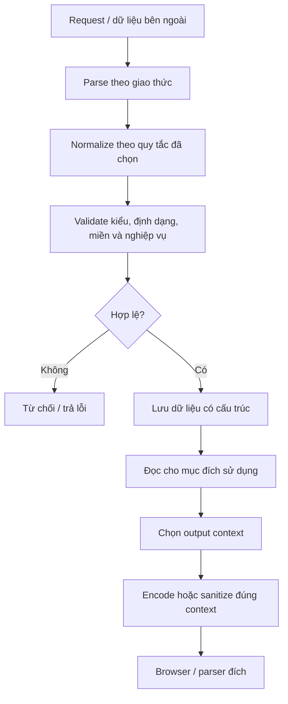

# Encoding không thay thế validation

## 1. Hai cơ chế giải quyết hai câu hỏi khác nhau

Trong ứng dụng web, dữ liệu từ người dùng có thể đi qua form, URL, API, database hoặc hệ thống bên ngoài trước khi được hiển thị trong browser. Một lỗi phổ biến là nghĩ rằng chỉ cần **validate đầu vào** hoặc chỉ cần **encode đầu ra** là đủ an toàn. Thực tế, hai cơ chế này bảo vệ những ranh giới khác nhau.

**Validation (kiểm tra hợp lệ)** trả lời: *Giá trị này có đúng kiểu, đúng định dạng và phù hợp quy tắc nghiệp vụ mà ứng dụng chấp nhận không?*

**Output encoding (mã hóa đầu ra)** trả lời: *Khi đưa giá trị vào một ngữ cảnh cụ thể, cần biểu diễn các ký tự như thế nào để parser của ngữ cảnh đó không hiểu dữ liệu là cấu trúc hoặc mã ngoài ý muốn?*

Ví dụ người dùng nhập tên hiển thị. Chuỗi `` có thể không phải tên hợp lệ theo quy tắc sản phẩm. Validation có thể từ chối nó vì chứa markup không được phép. Nhưng ngay cả tên hợp lệ như `An & Bình` vẫn phải được output encoding đúng khi render trong HTML. Ngược lại, HTML encoding có thể làm chuỗi markup hiển thị như text, nhưng nó không chứng minh dữ liệu hợp lệ theo nghiệp vụ.

| Cơ chế | Mục tiêu | Ví dụ |
| --- | --- | --- |
| Validation | Chấp nhận hoặc từ chối giá trị theo quy tắc dữ liệu/nghiệp vụ | Tuổi phải là số nguyên trong khoảng cho phép |
| Output encoding | Bảo vệ parser ở nơi dữ liệu được đưa ra | Ký tự `<` trong HTML text được biểu diễn như dữ liệu |
| Sanitization | Giữ lại một tập nội dung có cấu trúc được cho phép, loại bỏ phần nguy hiểm | Cho phép rich text với một allowlist HTML |

Trong module `SECURITY_APPLICATION_SECURITY_BROWSER_SECURITY`, sự phân biệt này đặc biệt quan trọng với XSS, DOM, URL, cookie, CORS và các ranh giới trình duyệt. Output encoding là một lớp phòng vệ XSS cốt lõi, còn validation kiểm soát chất lượng và ý nghĩa dữ liệu trước khi ứng dụng sử dụng nó.

### Kết quả học tập

Sau bài này, người học có thể:

1. Giải thích vì sao validation không thay thế output encoding và ngược lại.
2. Chọn cách encode theo HTML text, HTML attribute, URL, JavaScript, CSS và JSON context.
3. Phân biệt encoding, escaping, validation, normalization và sanitization.
4. Thiết kế pipeline xử lý dữ liệu từ request đến database và browser.
5. Tránh double encoding, decode lặp và kiểm tra chuỗi bằng blacklist.
6. Kiểm chứng bằng test case rằng dữ liệu hợp lệ vẫn dùng được và dữ liệu không tin cậy không trở thành mã thực thi.

## 2. Một giá trị có thể hợp lệ nhưng vẫn cần encode

Giả sử ứng dụng nhận tên hiển thị `An & Bình`. Giá trị này có thể hợp lệ theo quy tắc sản phẩm, nhưng cần biểu diễn khác nhau ở từng nơi:

| Dữ liệu | HTML text | URL query value | JSON string |
| --- | --- | --- | --- |
| `An & Bình` | `An &amp; Bình` | `An+%26+B%C3%ACnh` trong form-urlencoded | `"An & Bình"` |
| `a=b&c` | `a=b&amp;c` | `a%3Db%26c` | `"a=b&c"` |
| `<admin>` | `&lt;admin&gt;` | `%3Cadmin%3E` | `"<admin>"` |

Các biểu diễn trên thuộc những quy tắc khác nhau. HTML entity không phải percent-encoding; percent-encoding không phải JSON serialization; JSON serialization không tự động làm một chuỗi an toàn khi chèn vào HTML script.

Không có một chuỗi encoded duy nhất dùng an toàn ở mọi nơi. Cùng một dữ liệu có thể cần các biểu diễn khác nhau tùy parser tiêu thụ nó.

## 3. Validation: kiểm tra ý nghĩa và quy tắc nghiệp vụ

Validation nên được thực hiện tại ranh giới tiếp nhận dữ liệu và lặp lại ở server trước khi thực hiện hành động nhạy cảm. Client-side validation hữu ích cho trải nghiệm người dùng, nhưng có thể bị bỏ qua hoặc sửa đổi; server mới là nơi quyết định cuối cùng.

### 3.1. Các loại validation phổ biến

| Loại | Câu hỏi | Ví dụ |
| --- | --- | --- |
| Kiểu dữ liệu | Giá trị có đúng kiểu không? | ID phải là số nguyên, không nhận object thay cho string |
| Định dạng | Giá trị có đúng cấu trúc không? | Email, mã bưu chính, ngày theo định dạng được hỗ trợ |
| Miền giá trị | Giá trị có nằm trong tập cho phép không? | Trạng thái chỉ là `draft`, `published`, `archived` |
| Giới hạn | Độ dài, kích thước hoặc số lượng có hợp lý không? | Tên tối đa 80 ký tự, trang từ 1 đến 1000 |
| Quy tắc nghiệp vụ | Giá trị có hợp lệ trong ngữ cảnh tài khoản/tài nguyên không? | Người dùng chỉ sửa hồ sơ của chính mình |
| Quan hệ dữ liệu | Các trường có nhất quán với nhau không? | Ngày kết thúc không trước ngày bắt đầu |
| Phân quyền | Chủ thể có quyền thực hiện hành động không? | User không thể tự gửi `role=admin` để nâng quyền |

Validation không chỉ là kiểm tra chuỗi có ký tự đặc biệt hay không. Một tên người có thể hợp lệ khi chứa dấu tiếng Việt, dấu nháy hoặc dấu gạch nối; một bình luận có thể hợp lệ khi chứa dấu `<` như văn bản. Hãy xác định quy tắc theo nghiệp vụ thay vì cấm ký tự theo cảm tính.

### 3.2. Ưu tiên allowlist và kiểu dữ liệu rõ ràng

Với trường có miền giá trị nhỏ, dùng allowlist:

```js
const allowedStatuses = new Set(["draft", "published", "archived"]);

function validateStatus(value) {
  if (typeof value !== "string") {
    throw new TypeError("status phải là chuỗi");
  }
  if (!allowedStatuses.has(value)) {
    throw new Error("status không hợp lệ");
  }
  return value;
}
```

Với số, parse và kiểm tra miền giá trị:

```js
function validatePage(value) {
  const page = Number(value);
  if (!Number.isInteger(page) || page < 1 || page > 1000) {
    throw new Error("page phải là số nguyên từ 1 đến 1000");
  }
  return page;
}
```

Với dữ liệu text, xác định giới hạn độ dài, kiểu Unicode và quy tắc nội dung mà sản phẩm thật sự cần:

```js
function validateDisplayName(value) {
  if (typeof value !== "string") {
    throw new TypeError("Tên hiển thị phải là chuỗi");
  }

  const normalized = value.normalize("NFC").trim();
  const length = [...normalized].length;

  if (length < 1 || length > 80) {
    throw new Error("Tên hiển thị phải dài từ 1 đến 80 ký tự");
  }

  return normalized;
}
```

Ví dụ trên minh họa chuẩn hóa Unicode NFC và giới hạn số code point. Một sản phẩm cần tính grapheme cluster (ký tự người dùng nhìn thấy) có thể cần thư viện xử lý Unicode phù hợp hơn. Không áp dụng một giới hạn độ dài chung cho mọi loại dữ liệu.

### 3.3. Validation không phải authorization

Giá trị có định dạng hợp lệ vẫn có thể yêu cầu quyền mà người gửi không có:

```js
// Không được tin role do client gửi.
const requestedRole = req.body.role;
```

Việc `role` là một chuỗi hợp lệ không chứng minh người dùng có quyền cấp vai trò đó. Server phải lấy quyền từ danh tính/session đã xác thực và kiểm tra authorization theo tài nguyên, hành động. Validation và authorization là hai bước riêng.

### 3.4. Tránh blacklist và regex thay thế chuỗi

Một blacklist như “xóa `<script>`”, “chặn từ `javascript`” hoặc “loại bỏ dấu nháy” không thể bao quát các parser context và cách biểu diễn khác nhau. Nó cũng có thể làm hỏng dữ liệu hợp lệ. Hãy:

- Dùng allowlist khi tập giá trị có thể xác định rõ.
- Validate kiểu, giới hạn và quy tắc nghiệp vụ.
- Với HTML rich text, dùng sanitizer hiểu HTML thay vì regex.
- Với URL, parse bằng URL parser rồi kiểm tra protocol/host.
- Với đầu ra, encode theo context dù dữ liệu đã qua validation.

## 4. Output encoding: bảo vệ parser ở đích sử dụng

Output encoding chuyển ký tự dữ liệu thành biểu diễn an toàn cho một context cụ thể. Nó không thay đổi ý nghĩa nghiệp vụ của dữ liệu; nó ngăn parser hiểu dữ liệu như cấu trúc hoặc cú pháp ngoài ý muốn.

### 4.1. HTML text context

Khi đưa text vào giữa các thẻ HTML, các ký tự có ý nghĩa cấu trúc cần được encode theo HTML text context:

```html
<p>An &amp; Bình</p>
<p>&lt;admin&gt;</p>
```

Trong JavaScript, ưu tiên DOM API:

```js
const message = "An & Bình";
document.querySelector("#message").textContent = message;
```

`textContent` tạo text node, không parse chuỗi thành HTML. Nếu dùng template engine, kiểm tra auto-escaping đang bật và biến được render bằng cú pháp escaped. Không dùng cú pháp raw HTML cho dữ liệu không tin cậy.

### 4.2. HTML attribute context

Khi render giá trị vào thuộc tính HTML, cần dùng thuộc tính có dấu nháy và cơ chế attribute encoding phù hợp:

```html
<input value="An &amp; Bình">
```

Ưu tiên đặt DOM property:

```js
const input = document.createElement("input");
input.value = userDisplayName;
container.replaceChildren(input);
```

Không nối chuỗi để tạo attribute:

```js
// Không an toàn: dữ liệu có thể phá cấu trúc thuộc tính.
container.innerHTML = '<input value="' + userDisplayName + '">';
```

HTML attribute context vẫn có khác biệt theo loại thuộc tính. `title` và `value` là các thuộc tính dữ liệu thông thường; `href`, `src`, `action`, `style` và `onerror` có ngữ nghĩa đặc biệt. HTML attribute encoding không xác thực URL scheme và không biến event-handler attribute thành an toàn.

### 4.3. URL context

URL có nhiều thành phần. Nếu dữ liệu đi vào một query parameter hoặc path segment, encode đúng thành phần đó bằng API URL:

```js
const url = new URL("https://search.example.com/");
url.searchParams.set("q", userQuery);
url.searchParams.set("page", "1");
```

Nếu dữ liệu được đưa vào `href`, cần hai bước:

1. Parse/validate URL theo yêu cầu tính năng: protocol, hostname, port và có thể cả origin.
2. Đặt URL đã kiểm tra vào thuộc tính DOM hoặc dùng template auto-escaping đúng HTML attribute context.

Ví dụ:

```js
function parseSafeLink(raw) {
  let url;
  try {
    url = new URL(raw);
  } catch {
    return null;
  }

  if (url.protocol !== "https:") return null;
  if (url.username || url.password) return null;
  return url;
}

const safeUrl = parseSafeLink(userProvidedUrl);
if (safeUrl) {
  const link = document.createElement("a");
  link.href = safeUrl.href;
  link.textContent = "Mở tài liệu";
  link.rel = "noopener noreferrer";
  link.target = "_blank";
  container.append(link);
}
```

Percent-encoding không thay thế URL validation. Chuỗi `%6aavascript%3a...` có thể được decode ở một lớp khác; do đó hãy parse theo đúng URL parser và kiểm tra scheme sau parse. Không dùng `encodeURIComponent()` trên toàn bộ URL; hàm này dành cho một component, không phải toàn URL.

### 4.4. JavaScript context

Tránh nhúng dữ liệu không tin cậy vào script inline:

```html
<script>
  const displayName = "USER_VALUE";
</script>
```

Một chuỗi đã được JSON serialize vẫn có thể cần xử lý đặc biệt khi đặt trong HTML `<script>`, vì HTML parser có thể nhận diện thẻ đóng script trước khi JavaScript parser diễn giải chuỗi. Các ký tự như `<`, `>`, `&`, U+2028 và U+2029 cũng cần được xử lý theo serializer và môi trường sử dụng.

Ưu tiên:

- Tải dữ liệu qua endpoint JSON với `Content-Type: application/json`.
- Đọc response bằng `response.json()` rồi render bằng DOM API an toàn.
- Dùng framework/template serializer được thiết kế cho context đó nếu bắt buộc phải bootstrap dữ liệu.
- Tránh `eval`, `Function` và `setTimeout`/`setInterval` nhận chuỗi.

### 4.5. CSS context

Không ghép dữ liệu không tin cậy thành CSS tùy ý:

```js
// Tránh: đưa chuỗi người dùng vào CSS.
element.setAttribute("style", userStyle);

// Tốt hơn: validate một giá trị theo allowlist.
const allowedColors = new Set(["red", "blue", "green"]);
if (allowedColors.has(userColor)) {
  element.style.color = userColor;
}
```

Nếu sản phẩm cho phép tùy chỉnh style, xác định danh sách property và kiểu giá trị được phép; validate từng property. Không cho phép người dùng gửi một đoạn CSS tự do nếu không có threat model và cơ chế cách ly phù hợp.

### 4.6. JSON response context

Khi API trả JSON, dùng serializer JSON của framework và khai báo content type đúng:

```js
res.status(200).json({
  displayName: validatedDisplayName
});
```

Client đọc JSON như dữ liệu:

```js
const response = await fetch("/api/profile");
const profile = await response.json();
document.querySelector("#name").textContent = profile.displayName;
```

Không chuyển JSON response thành HTML bằng `innerHTML`. JSON là định dạng dữ liệu; nếu đưa một trường JSON vào HTML, URL hoặc script context, vẫn phải áp dụng quy tắc của context đích.

## 5. Bảng chọn cơ chế theo context

| Context đích | Ví dụ | Validation cần xem xét | Cách encode/đưa dữ liệu an toàn |
| --- | --- | --- | --- |
| HTML text | Nội dung đoạn văn | Kiểu string, độ dài, quy tắc nghiệp vụ | Template auto-escape hoặc `textContent` |
| HTML attribute thường | `title`, `value` | Kiểu và độ dài | Attribute encoding; DOM property |
| URL query value | `?q=...` | Giới hạn query, kiểu tham số | `URLSearchParams` |
| URL path segment | `/users/{id}` | Định dạng ID, quyền truy cập | Encode từng segment; router phải xử lý nhất quán |
| URL navigation | `href`, `location` | Scheme, host, port, origin | Parse URL + allowlist + đặt vào sink an toàn |
| JavaScript | Dữ liệu bootstrap | Schema và kiểu dữ liệu | Tránh inline script; dùng JSON endpoint/serializer context-aware |
| CSS | Giá trị style | Property và value allowlist | DOM style property với giá trị đã validate |
| JSON response | API payload | Schema, quyền xem dữ liệu | JSON serializer + content type; client render bằng safe sink |
| HTML rich text | Nội dung cần cho phép một tập markup | Chính sách markup sản phẩm | HTML sanitizer chuyên dụng; không chỉ encode hoặc validate chuỗi |

## 6. Encoding không thay thế validation

### 6.1. Encode không kiểm tra quy tắc nghiệp vụ

Giả sử endpoint nhận số lượng sản phẩm:

```js
const quantity = req.body.quantity;
```

Nếu output encoder chuyển chuỗi thành HTML-safe, giá trị `-1000000` vẫn có thể là một số được encode hợp lệ nhưng không hợp lệ theo nghiệp vụ. Server cần kiểm tra số nguyên, miền giá trị và tồn kho trước khi cập nhật đơn hàng.

Tương tự, encode một URL không chứng minh URL thuộc host được phép; encode một email không chứng minh email có định dạng hoặc thuộc tài khoản cần cập nhật; encode một `role` không cấp quyền cho người gửi.

### 6.2. Validation không thay thế encoding

Giả sử ứng dụng chỉ chấp nhận tên có chữ, dấu cách và dấu gạch nối. Một giá trị hợp lệ vẫn có thể chứa ký tự `&` hoặc dấu nháy nếu quy tắc sản phẩm cho phép. Khi render vào HTML, ký tự đó vẫn phải được encode đúng context.

Không thể dựa vào validation để đoán rằng mọi ký tự đặc biệt đã bị loại bỏ. Hơn nữa, cùng một giá trị có thể đi tới nhiều nơi:

- HTML text trong trang hồ sơ.
- HTML attribute trong biểu mẫu chỉnh sửa.
- URL query trong liên kết chia sẻ.
- JSON response cho mobile client.
- Email HTML.

Mỗi nơi có parser và yêu cầu encoding riêng.

### 6.3. Sanitization cũng không thay thế validation

Sanitizer HTML có thể loại bỏ markup hoặc attribute không được phép, nhưng nó không xác minh:

- Người dùng có quyền đăng bài hay không.
- Nội dung có vượt giới hạn dung lượng không.
- Liên kết có trỏ tới tài nguyên được phép không.
- Trường dữ liệu có đúng loại và đúng quan hệ nghiệp vụ không.

Nếu sản phẩm cho phép rich text, cần cả validation schema và sanitizer phù hợp. Nếu sản phẩm chỉ cần text, không cần chuyển input thành HTML; hãy giữ dữ liệu là text và render bằng `textContent`.

## 7. Thứ tự xử lý: parse, normalize, validate, store và encode

Một pipeline tham khảo:



Các bước này cần được điều chỉnh theo giao thức và kiến trúc:

1. **Parse:** hiểu cấu trúc đầu vào bằng parser phù hợp, ví dụ JSON parser hoặc URL parser.
2. **Normalize:** áp dụng chuẩn hóa cần thiết trước khi so sánh/validate, chẳng hạn Unicode normalization hoặc URL canonicalization. Không decode tùy tiện và không decode lặp.
3. **Validate:** kiểm tra kiểu, miền giá trị, schema, giới hạn và quy tắc nghiệp vụ trên giá trị đã được diễn giải theo quy tắc thống nhất.
4. **Authorize:** kiểm tra chủ thể có quyền thực hiện hành động trên tài nguyên.
5. **Store:** lưu dữ liệu theo ý nghĩa nghiệp vụ, không lưu một bản HTML-escaped chỉ để phục vụ một màn hình.
6. **Encode at output:** khi render, chọn encoder theo đúng context cuối cùng. Cùng một dữ liệu có thể cần encode khác nhau ở từng nơi.

Không phải ứng dụng nào cũng cần một bước normalize riêng. Chỉ chuẩn hóa khi có quy tắc xác định và các lớp liên quan dùng cùng cách hiểu. Với URL/path, cần thống nhất parser và số lần decode giữa proxy, server và router; với Unicode, chọn dạng chuẩn theo yêu cầu tìm kiếm/định danh của sản phẩm.

**Encode càng gần sink càng tốt.** Nếu encode trước khi lưu, dữ liệu có thể bị double encode khi hiển thị ở context khác hoặc gây khó khăn khi dùng lại qua API. Lưu dữ liệu chuẩn hóa theo mô hình nghiệp vụ, rồi encode cho từng output.

## 8. Double encoding và decode không nhất quán

### 8.1. Double encoding làm hỏng hiển thị

Ví dụ dữ liệu ban đầu:

```text
An & Bình
```

Sau HTML encoding:

```text
An &amp; Bình
```

Nếu encode thêm lần nữa:

```text
An &amp;amp; Bình
```

Browser có thể hiển thị nguyên văn `&amp;` thay vì dấu `&` mong muốn. Đây là lỗi double encoding. Nó thường xuất hiện khi một lớp encode trước khi lưu, một lớp khác encode lại khi render.

### 8.2. Decode lặp có thể tạo ra cấu trúc mới

Giả sử đầu vào:

```text
%252e%252e%252fadmin
```

Decode một lần có thể thành:

```text
%2e%2e%2fadmin
```

Decode lần thứ hai có thể thành:

```text
../admin
```

Nếu proxy validate trước khi decode nhưng ứng dụng decode thêm lần nữa, các lớp có thể hiểu đường dẫn khác nhau. Đây là nguồn của parser differential và path traversal.

Nguyên tắc:

- Parse theo đúng giao thức ở ranh giới tiếp nhận.
- Decode đúng số lần được giao thức quy định.
- Không gọi `decodeURIComponent()` lặp cho tới khi chuỗi “trông bình thường”.
- Validate giá trị sau khi đã được diễn giải theo cùng quy tắc với lớp sử dụng nó.
- Kiểm thử end-to-end qua CDN, reverse proxy, web server và application router.

## 9. Template engine và framework

Framework thường có cơ chế auto-escaping, nhưng lập trình viên có thể vô tình tắt nó hoặc gọi API chèn HTML thô.

| Công nghệ | Cơ chế mặc định thường gặp | Điểm cần rà soát |
| --- | --- | --- |
| React JSX | Text interpolation được escape | `dangerouslySetInnerHTML`, URL attributes và thư viện render HTML |
| Angular | Binding có sanitizer theo context | `bypassSecurityTrust...`, DOM API trực tiếp |
| Vue | `{{ value }}` hiển thị text đã escape | `v-html`, directive tự tạo và URL sink |
| Handlebars | `{{value}}` escape HTML; `{{{value}}}` raw | Triple braces và helper trả HTML an toàn |
| Jinja | Autoescape phụ thuộc cấu hình/environment | `safe`, `Markup`, template có autoescape tắt |
| Template server-side khác | Tùy engine và cấu hình | Kiểm tra cơ chế escape theo từng context, không chỉ theo tên framework |

### 9.1. Ví dụ template

Với engine hỗ trợ auto-escaping HTML:

```html
<p>{{ displayName }}</p>
```

Không dùng cú pháp raw cho dữ liệu người dùng:

```html
<p>{{{ displayName }}}</p>
```

Cú pháp cụ thể tùy template engine. Hãy đọc tài liệu của engine đang dùng và kiểm tra output thực tế. Auto-escaping cho HTML text không tự xác thực URL scheme, không sanitize rich HTML và không đảm bảo dữ liệu an toàn khi nhúng vào JavaScript hoặc CSS.

### 9.2. API bypass là ranh giới cần kiểm soát

Những API như `dangerouslySetInnerHTML`, `v-html`, `bypassSecurityTrustHtml` hoặc helper `safe` thường báo hiệu rằng ứng dụng đang bỏ qua cơ chế escape mặc định. Không phải lúc nào cũng sai khi dùng chúng, nhưng cần:

- Xác định dữ liệu đến từ đâu.
- Gọi sanitizer đã được kiểm thử nếu phải render HTML không tin cậy.
- Hạn chế số nơi được phép tạo HTML thô.
- Review policy và test regression khi sanitizer được cập nhật.

## 10. HTML rich text: encoding hay sanitization?

Hai yêu cầu sản phẩm cần cách xử lý khác nhau:

| Nhu cầu | Cách phù hợp |
| --- | --- |
| Hiển thị văn bản thuần, kể cả khi người dùng gõ dấu `<` | `textContent` hoặc HTML text encoding |
| Hiển thị HTML do ứng dụng tự tạo từ dữ liệu có cấu trúc | Tạo DOM bằng API an toàn hoặc template auto-escape |
| Hiển thị rich text do người dùng tạo | Sanitizer HTML chuyên dụng với allowlist |
| Chấp nhận một URL ngoài | URL parser + protocol/host allowlist, rồi đặt vào URL sink an toàn |

Nếu dùng sanitizer như DOMPurify, cấu hình phải theo đúng tính năng:

```js
const cleanHtml = DOMPurify.sanitize(untrustedHtml, {
  USE_PROFILES: { html: true }
});
container.innerHTML = cleanHtml;
```

Đây là ví dụ cho HTML profile cơ bản. Nếu sản phẩm cần link, hình ảnh hoặc thuộc tính bổ sung, cần đánh giá allowlist URL và attribute riêng. Không bật toàn bộ SVG, MathML, style hoặc custom element chỉ để giữ định dạng mà chưa phân tích nguy cơ.

Sanitizer không thay thế validation schema, giới hạn kích thước hoặc authorization. Nó cũng cần được cập nhật và kiểm thử khi có thay đổi phiên bản.

## 11. Những context lồng nhau cần chú ý

Một số vị trí chứa nhiều lớp parser. Ví dụ:

```html
<a href="/search?q=VALUE">Tìm kiếm</a>
```

Giá trị `VALUE` nằm trong **URL query component**, đồng thời toàn bộ URL nằm trong **HTML attribute**. Cần encode query value trước bằng URL API, rồi đưa URL hoàn chỉnh vào DOM property hoặc template HTML attribute auto-escaping. Chỉ HTML-escape giá trị không bảo đảm query có cấu trúc đúng; chỉ percent-encode giá trị cũng không bảo vệ nếu toàn URL được nối vào HTML thô.

Tương tự, JSON đặt trong HTML `<script>` có cả JSON/JavaScript parsing và HTML script-element parsing. Hãy tránh lồng context nếu có thể; dùng JSON endpoint riêng thường dễ kiểm soát hơn.

Quy tắc thực hành:

1. Xác định **parser cuối cùng** sẽ đọc giá trị.
2. Nếu có context lồng nhau, xử lý từng lớp theo thứ tự từ dữ liệu bên trong ra context ngoài.
3. Ưu tiên API cấu trúc để browser tạo DOM/URL thay vì nối chuỗi.
4. Không dùng một encoder chung cho mọi context.

## 12. CSP và Trusted Types là lớp bổ sung

Output encoding và validation là lớp nền tảng. Có thể tăng cường bằng:

- **Content Security Policy (CSP):** giới hạn script/resource được phép tải hoặc thực thi. Ưu tiên nonce/hash và tránh `'unsafe-inline'` nếu có thể.
- **Trusted Types:** trên browser hỗ trợ, buộc các DOM sink nhạy cảm nhận kiểu dữ liệu tin cậy được tạo qua policy. Policy cần sanitize thật sự; Trusted Types không tự làm sạch chuỗi.
- **Cookie flags:** `HttpOnly`, `Secure`, `SameSite` giúp giảm một số tác động khi XSS xảy ra, nhưng không làm script cùng origin mất quyền gọi API.

Không dùng CSP để thay output encoding. CSP có thể bị cấu hình quá rộng, còn browser có thể không hỗ trợ đầy đủ một số cơ chế. Hãy coi đây là defense in depth.

## 13. Thực hành: cùng một input, nhiều context

Tạo một trang lab cục bộ để so sánh cách browser xử lý dữ liệu:

```html
<!doctype html>
<meta charset="utf-8">
<title>Validation và output encoding</title>
<h1>Output context lab</h1>
<label>
  Nội dung:
  <input id="value" value="An & Bình">
</label>
<button id="render">Render</button>
<section>
  <h2>Text sink</h2>
  <p id="text"></p>
  <h2>HTML sink trong lab</h2>
  <div id="html"></div>
</section>
<script>
  const input = document.querySelector("#value");
  document.querySelector("#render").addEventListener("click", () => {
    const value = input.value;
    document.querySelector("#text").textContent = value;
    // Chỉ dùng để quan sát parser trong lab; không dùng với dữ liệu thật.
    document.querySelector("#html").innerHTML = value;
  });
</script>
```

Thử các giá trị:

| Input | Kết quả ở `textContent` | Kết quả ở `innerHTML` |
| --- | --- | --- |
| `An & Bình` | Hiển thị nguyên văn | Parser diễn giải ký tự theo HTML |
| `<strong>Xin chào</strong>` | Hiển thị cả dấu ngoặc nhọn như text | Tạo phần tử `strong` |
| `<em>Browser</em>` | Hiển thị như text | Tạo phần tử `em` |

Đây là lab để quan sát khác biệt giữa text sink và HTML parser. Không đưa payload thực thi vào website thật. Sau khi quan sát, thay `innerHTML` bằng `textContent` và xác nhận cả hai vùng đều hiển thị dữ liệu như text.

### 13.1. Thực hành validation riêng biệt

Thêm hàm kiểm tra tên hiển thị:

```js
function validateName(value) {
  if (typeof value !== "string") return null;
  const normalized = value.normalize("NFC").trim();
  const length = [...normalized].length;
  if (length < 1 || length > 80) return null;
  return normalized;
}
```

Thử giá trị rỗng, quá dài, số, object và một tên hợp lệ có dấu tiếng Việt. Sau validation, vẫn render bằng `textContent`. Thử một chuỗi có ký tự markup: kết quả validation phụ thuộc quy tắc sản phẩm, nhưng nếu được chấp nhận như text thì nó vẫn phải được render bằng text sink.

### 13.2. Ma trận kiểm thử

| Mã | Kiểm thử | Điều cần chứng minh |
| --- | --- | --- |
| OUT-01 | Tên hợp lệ có dấu tiếng Việt | Validation chấp nhận; output hiển thị đúng |
| OUT-02 | Chuỗi chứa `&`, `<`, `>` được phép như text | Output không bị parse thành markup |
| OUT-03 | Tên vượt giới hạn | Validation từ chối trước khi lưu |
| OUT-04 | Query value chứa `&` hoặc `=` | `URLSearchParams` giữ nguyên một giá trị |
| OUT-05 | URL dùng protocol không được phép | URL validation từ chối dù có thể encode được |
| OUT-06 | Rich text chứa phần tử ngoài allowlist | Sanitizer loại bỏ phần tử/attribute không được phép |
| OUT-07 | Cùng dữ liệu render vào HTML và JSON | Mỗi output dùng serializer/context phù hợp |
| OUT-08 | Encode hai lần | Test phát hiện hiển thị `&amp;` ngoài ý muốn |
| OUT-09 | Decode nhiều lần | Các lớp không diễn giải URL/path khác nhau |
| OUT-10 | Gửi request bỏ qua client validation | Server vẫn từ chối dữ liệu không hợp lệ |

## 14. Tình huống tổng hợp: bình luận và liên kết chia sẻ

**Bối cảnh:** ứng dụng cho phép người dùng đăng bình luận và thêm liên kết tham khảo. Bình luận được lưu trong database, hiển thị trên trang bài viết, trang quản trị và API JSON. Liên kết được render thành thẻ `<a>`.

Thiết kế pipeline:

1. Parse request và kiểm tra schema: `comment` là string, giới hạn độ dài và dung lượng.
2. Validate quy tắc nghiệp vụ: người dùng được phép bình luận, bài viết tồn tại và trạng thái cho phép nhận bình luận.
3. Lưu nội dung text theo dạng dữ liệu gốc đã chuẩn hóa; không lưu HTML-escaped cho một màn hình cụ thể.
4. Khi hiển thị bình luận, dùng `textContent` hoặc template HTML auto-escape.
5. Parse liên kết bằng `new URL()`, chỉ cho phép protocol phù hợp (ví dụ HTTPS), kiểm tra host nếu sản phẩm cần allowlist.
6. Đưa URL đã kiểm tra vào `link.href` bằng DOM API; nhãn liên kết dùng `textContent`.
7. API JSON dùng serializer và content type JSON; client không chèn JSON vào `innerHTML`.
8. Trang quản trị và email HTML áp dụng output handling riêng theo context của chúng.

### Mẫu báo cáo

| Luồng | Validation | Output handling | Bằng chứng |
| --- | --- | --- | --- |
| Form → database | Kiểu, độ dài, quyền đăng bài | Chưa encode theo HTML | Request và bản ghi |
| Database → bài viết | Dữ liệu đã có schema | `textContent`/auto-escape | DOM hiển thị text |
| URL → liên kết | Protocol, host, credentials | URL parser + DOM property | Link đích sau parse |
| Database → API | Schema và authorization | JSON serializer | Response JSON |
| Database → email HTML | Quy tắc dữ liệu | HTML context encoding riêng | Email preview |

### Tiêu chí hoàn thành

Thiết kế đạt khi:

- Server từ chối dữ liệu sai schema, sai miền hoặc không được phép theo nghiệp vụ.
- Dữ liệu hợp lệ vẫn được giữ nguyên ý nghĩa.
- Mỗi sink dùng đúng encoder hoặc API cấu trúc.
- URL được kiểm tra ngữ nghĩa trước khi đưa vào navigation sink.
- Rich text, nếu có, được sanitizer theo allowlist.
- Không encode sớm vào database và không decode lặp ở các lớp sau.
- Test chứng minh client-side validation có thể bị bỏ qua nhưng server vẫn kiểm tra.

## 15. Những sai lầm thường gặp

- Validation rồi thì không cần encode: sai, dữ liệu hợp lệ vẫn có thể chứa ký tự đặc biệt trong context đích.
- Encode rồi thì không cần validation: sai, encoding không kiểm tra kiểu, miền giá trị, quyền hay logic nghiệp vụ.
- HTML escape dùng được cho URL, JavaScript và CSS: sai, mỗi parser context cần cách xử lý riêng.
- Percent-encoding làm URL đáng tin: sai, vẫn cần parse và allowlist protocol/host.
- JSON serialization làm dữ liệu an toàn ở mọi nơi: sai, JSON không tự bảo vệ khi nhúng vào HTML script.
- Sanitizer thay validation: sai, sanitizer xử lý markup; validation kiểm tra schema và nghiệp vụ.
- Chỉ encode khi nhận dữ liệu: sai, encode tại output theo context cuối cùng.
- Có thể decode lặp cho tới khi chuỗi dễ đọc: sai, decode lặp có thể làm lộ cấu trúc mới.
- Client validation đủ để bảo vệ server: sai, server phải tự validate và authorize.
- CSP thay thế mọi lớp: sai, CSP là defense in depth.

## 16. Checklist triển khai

- [ ] Xác định source, nơi lưu và mọi sink của dữ liệu.
- [ ] Validate kiểu, schema, giới hạn và quy tắc nghiệp vụ ở server.
- [ ] Kiểm tra authorization riêng; không tin role hoặc user ID do client gửi.
- [ ] Chuẩn hóa theo quy tắc xác định trước khi so sánh/validate.
- [ ] Không dùng blacklist ký tự để thay thế validation hoặc encoding.
- [ ] Lưu dữ liệu theo ý nghĩa nghiệp vụ, không encode sẵn cho một context.
- [ ] Encode theo HTML text, attribute, URL, JavaScript, CSS hoặc JSON context phù hợp.
- [ ] Dùng DOM API như `textContent`, `.value`, `createElement` khi có thể.
- [ ] Parse và validate URL trước khi đặt vào `href`, `src` hoặc điều hướng.
- [ ] Dùng sanitizer chuyên dụng cho rich HTML; không dùng regex.
- [ ] Tránh double encoding và decode lặp.
- [ ] Kiểm thử qua toàn bộ đường đi browser, proxy, server và router.
- [ ] Bổ sung CSP/Trusted Types như các lớp giảm thiểu.

### Ghi nhớ

**Validation quyết định dữ liệu có được phép đi vào nghiệp vụ; output encoding quyết định dữ liệu được biểu diễn an toàn trong parser context cuối cùng.** Một giá trị có thể hợp lệ nhưng vẫn cần encode; một chuỗi đã encode vẫn có thể sai nghiệp vụ hoặc trỏ tới URL không được phép. Hãy parse và chuẩn hóa nhất quán, validate ở server, kiểm tra authorization riêng, lưu dữ liệu theo ý nghĩa gốc và encode gần sink theo đúng context. Với rich HTML, dùng sanitizer chuyên dụng. CSP và Trusted Types tăng cường bảo vệ nhưng không thay các bước nền tảng này.
