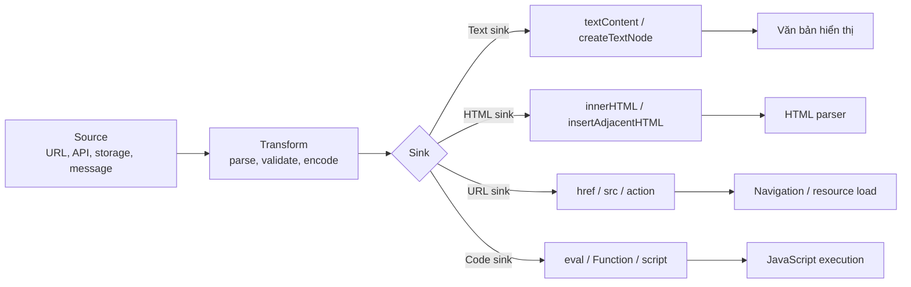

# DOM sink: nhận diện và kiểm soát điểm đưa dữ liệu vào DOM

**Chương:** DOM security  
**Mô-đun:** `SECURITY_APPLICATION_SECURITY_BROWSER_SECURITY` — phân tích ranh giới bảo mật giữa trình duyệt, origin, cookie và ứng dụng web để hiểu Same-Origin Policy (SOP), CORS và các cơ chế cách ly; thực hành phòng vệ XSS, CSRF, clickjacking bằng CSP, Trusted Types, security headers và kiểm chứng hành vi thực tế.

**DOM sink** là API hoặc thuộc tính mà ứng dụng dùng để đưa dữ liệu vào DOM, nơi trình duyệt có thể diễn giải dữ liệu đó thành HTML, JavaScript, URL, CSS hoặc cấu trúc có khả năng tạo hành vi. Nếu dữ liệu không tin cậy đi vào một sink có khả năng diễn giải mà không được kiểm tra/encode/sanitize đúng ngữ cảnh, ứng dụng có thể mắc DOM-based Cross-Site Scripting (DOM XSS) hoặc các lỗi injection khác.

Ví dụ, `element.textContent = userInput` thường đưa dữ liệu vào dưới dạng văn bản. Ngược lại, `element.innerHTML = userInput` yêu cầu trình duyệt phân tích chuỗi như HTML. Hai dòng code có thể hiển thị cùng một nội dung bình thường, nhưng có ranh giới bảo mật rất khác nhau.

Muốn phòng vệ DOM XSS, cần truy vết **source → biến trung gian → sink**: dữ liệu đến từ URL, message, storage hay API nào; được biến đổi ra sao; cuối cùng được đưa vào API nào. Tên hàm nghe có vẻ an toàn không đủ để kết luận. Phải xem sink diễn giải giá trị theo ngữ cảnh nào và dữ liệu đã được xử lý phù hợp chưa.

## 1. Mục tiêu học tập

Sau bài học, bạn có thể:

1. Giải thích DOM sink và mô hình source-to-sink trong DOM XSS.
2. Nhận diện các nhóm sink nguy hiểm: HTML, script, URL, CSS, event handler và navigation.
3. Chọn API an toàn hơn như `textContent`, `createElement`, `append` và thuộc tính DOM phù hợp.
4. Hiểu vì sao output encoding phụ thuộc ngữ cảnh và vì sao encode HTML không đủ cho URL hoặc JavaScript.
5. Áp dụng sanitizer và Trusted Types để giảm khả năng dữ liệu tùy ý đi vào HTML/script sink.
6. Dùng CSP như lớp phòng vệ bổ sung và kiểm tra tác động của policy với ứng dụng.
7. Viết test kiểm tra dữ liệu độc hại được hiển thị như text, không được thực thi hoặc tạo node ngoài ý muốn.

## 2. Mô hình source → transform → sink

Một ứng dụng thường nhận dữ liệu từ nhiều nguồn:

- URL: `location.search`, `location.hash`, path parameter, query string.
- Thông điệp: `postMessage`, BroadcastChannel, message từ worker.
- Lưu trữ: `localStorage`, `sessionStorage`, IndexedDB, cache.
- API: JSON, dữ liệu CMS, nội dung do người dùng tạo, dữ liệu từ bên thứ ba.
- DOM hiện có: thuộc tính, dataset, nội dung node, form field.
- Dữ liệu runtime: clipboard, drag-and-drop, tên file, giá trị input.

Nguồn không mặc định là độc hại, nhưng phải xem là **không đáng tin** nếu người dùng hoặc bên ngoài có thể tác động. Ngay cả dữ liệu từ API nội bộ cũng có thể chứa nội dung do người dùng khác tạo.

Một ví dụ DOM XSS:

```javascript
const params = new URLSearchParams(location.search);
const name = params.get("name") || "";

document.querySelector("#welcome").innerHTML =
  "Xin chào " + name;
```

Kẻ tấn công có thể tạo URL với giá trị `name` chứa markup. Khi nạn nhân mở liên kết, JavaScript của trang tự đọc query và đưa chuỗi vào HTML sink. Không cần server phản chiếu payload vào HTML response; vì vậy đây là DOM-based XSS.

Mô hình phân tích:



Điều cần xác định là **sink có thể diễn giải dữ liệu thành hành vi gì**. Một giá trị an toàn khi hiển thị như text có thể nguy hiểm khi dùng làm HTML; một chuỗi đã encode HTML vẫn có thể nguy hiểm nếu đưa vào URL scheme hoặc script context.

### 2.1. Taint không biến mất chỉ vì gán sang biến khác

Ví dụ:

```javascript
const value = new URLSearchParams(location.search).get("q");
const normalized = value.trim();
const cached = normalized;

render(cached);
```

`trim()` chỉ bỏ khoảng trắng, không loại bỏ HTML hoặc JavaScript. Đặt tên biến là `safeValue`, `clean` hay `trusted` cũng không biến dữ liệu thành đáng tin. Hãy theo dõi toàn bộ đường đi và chỉ đánh dấu dữ liệu đã được xử lý sau một phép kiểm tra có mục đích rõ ràng, phù hợp đúng sink.

Không phải mọi source đều phải bị từ chối. Ứng dụng có thể cho phép người dùng gửi văn bản, URL hoặc rich text. Điều quan trọng là giữ nguyên kiểu dữ liệu và chỉ chuyển sang ngữ cảnh có diễn giải khi đã xác thực/sanitize bằng quy tắc tương ứng.

## 3. Phân loại DOM sink

Bảng sau là bản đồ nhận diện ban đầu. Mức rủi ro thực tế phụ thuộc dữ liệu, browser, context, sanitizer và cách API được dùng.

| Nhóm sink | API/ví dụ | Rủi ro chính |
| --- | --- | --- |
| HTML parser | `innerHTML`, `outerHTML`, `insertAdjacentHTML()` | Chuỗi bị phân tích thành HTML và có thể tạo markup/hành vi nguy hiểm |
| Document writer | `document.write()`, `document.writeln()` | Ghi chuỗi vào parser của document, dễ gây HTML/script injection |
| Fragment parser | `Range.createContextualFragment()` | Phân tích chuỗi thành DocumentFragment |
| Script execution | `eval()`, `Function()`, `setTimeout(string)`, `setInterval(string)` | Diễn giải chuỗi như mã JavaScript |
| Script/resource URL | `script.src`, dynamic import, worker URL | Tải hoặc thực thi mã từ nguồn được chọn động |
| Navigation/resource URL | `location.href`, `window.open()`, `a.href`, `form.action`, `iframe.src` | Điều hướng/phát request tới URL không mong muốn; có thể dẫn tới phishing hoặc scheme nguy hiểm |
| Event handler | `setAttribute("onclick", value)`, inline handler | Chuỗi có thể trở thành mã xử lý sự kiện |
| CSS/style | `style.cssText`, `setAttribute("style", value)` | CSS injection, tải tài nguyên ngoài, giao diện giả mạo hoặc rò rỉ tùy context |
| HTML document parse | `DOMParser.parseFromString(input, "text/html")` | Tạo cây DOM từ HTML; rủi ro khi node được đưa vào document sống mà không sanitize |

**Lưu ý:** không phải mọi API trong bảng đều tự động thực thi JavaScript trong mọi trình duyệt/context. Ví dụ, script được tạo bằng `innerHTML` thường không chạy như script parser-inserted, nhưng event handler, URL nguy hiểm, SVG/HTML active content và các đường đi khác vẫn có thể tạo rủi ro. Không dùng khác biệt hành vi này như một biện pháp bảo vệ.

## 4. HTML sinks: khi trình duyệt trở thành HTML parser

### 4.1. `innerHTML` và `outerHTML`

`innerHTML` thay nội dung con của phần tử bằng cách parse chuỗi như HTML. `outerHTML` thay chính phần tử bằng HTML được parse. Chúng phù hợp cho template HTML đã được kiểm soát hoặc nội dung rich text đã sanitize, nhưng không phù hợp với chuỗi không tin cậy trực tiếp.

Ví dụ không an toàn:

```javascript
const comment = new URLSearchParams(location.search).get("comment");
document.querySelector("#comments").innerHTML = comment;
```

Nếu mục tiêu chỉ là hiển thị comment dạng văn bản:

```javascript
const comment = new URLSearchParams(location.search).get("comment") ?? "";
document.querySelector("#comments").textContent = comment;
```

Nếu cần tạo cấu trúc:

```javascript
const item = document.createElement("li");
item.textContent = comment;
document.querySelector("#comments").append(item);
```

Dùng DOM API để tạo node giúp tách **cấu trúc do ứng dụng kiểm soát** khỏi **dữ liệu do người dùng cung cấp**.

### 4.2. `insertAdjacentHTML()`

API này parse chuỗi HTML và chèn vào một vị trí tương đối với element:

```javascript
target.insertAdjacentHTML("beforeend", htmlString);
```

Tên method có chữ “insert” nhưng vẫn là HTML sink. Nếu nội dung là text, dùng `append(document.createTextNode(value))` hoặc tạo element và gán `textContent`.

### 4.3. `document.write()` và parser sinks

`document.write()` ghi nội dung vào document stream. Trong nhiều tình huống nó có thể ghi đè document hoặc tương tác với parser theo thời điểm gọi, khiến behavior khó dự đoán. Không dùng nó để render dữ liệu người dùng. Với ứng dụng hiện đại, ưu tiên tạo node và append vào một container đã xác định.

`Range.createContextualFragment()` và các API parse HTML khác cũng cần được xem là HTML sink. Việc tạo fragment chưa đồng nghĩa đã an toàn: node có thể được gắn vào document sống sau đó. Sanitize trước khi đưa rich HTML vào DOM.

### 4.4. `DOMParser.parseFromString()`

`DOMParser.parseFromString(input, "text/html")` tạo một document riêng để phân tích HTML. Document này ở trạng thái inert trong quá trình parse, nhưng dữ liệu bên trong vẫn là HTML không tin cậy. Nếu ứng dụng lấy node từ document đó rồi đưa vào document đang hoạt động, attribute event handler, URL nguy hiểm hoặc cấu trúc không mong muốn vẫn có thể gây vấn đề. Hãy sanitize trước khi chuyển node sang DOM sống; không xem việc parse thành document inert là một sanitizer.

## 5. URL sinks: dữ liệu có thể điều hướng hoặc tải tài nguyên

URL sink nhận một chuỗi rồi browser có thể điều hướng, tải tài nguyên hoặc gửi request. Các ví dụ thường gặp:

- `a.href` và `location.href`;
- `window.open(url)`;
- `form.action`;
- `iframe.src`, `img.src`, `script.src`;
- `link.href` cho stylesheet;
- `video.src`, `audio.src` và các thuộc tính resource khác.

Một chuỗi không chứa HTML vẫn có thể nguy hiểm nếu URL scheme hoặc host không được kiểm soát. Ví dụ `javascript:` có thể thực thi mã trong một số ngữ cảnh điều hướng; URL ngoài có thể dẫn đến phishing hoặc tải nội dung không tin cậy.

### 5.1. Parse URL và allowlist scheme

Không xác thực URL bằng regex rời rạc hoặc chỉ kiểm tra chuỗi bắt đầu bằng `https`. Dùng `URL` để phân tích:

```javascript
function safeNavigationUrl(rawValue) {
  let url;

  try {
    url = new URL(rawValue, window.location.origin);
  } catch {
    return null;
  }

  if (url.protocol !== "https:" && url.protocol !== "http:") {
    return null;
  }

  // Ví dụ này cho phép link HTTP(S) nói chung.
  // Nếu chỉ được phép trong hệ thống, so url.origin với allowlist.
  return url.href;
}

const destination = safeNavigationUrl(userProvidedUrl);
if (destination !== null) {
  link.href = destination;
} else {
  link.removeAttribute("href");
}
```

Nếu chỉ cho phép điều hướng nội bộ, so sánh `url.origin` với `window.location.origin`. Nếu cho phép đối tác, dùng allowlist origin chính xác gồm scheme, host và port. Không dùng `endsWith("example.com")` để tin cậy domain vì có thể chấp nhận hostname giả hoặc subdomain ngoài phạm vi.

### 5.2. Kiểm soát đích cho từng loại URL

URL hợp lệ về cú pháp chưa chắc phù hợp với mục đích. Một `img.src` có thể cần chỉ cho phép CDN; `form.action` cần trỏ về endpoint ứng dụng đã định; `script.src` cần nguồn script đã được quản trị. Hãy tạo hàm kiểm tra riêng cho từng mục đích thay vì một hàm `sanitizeUrl` chung chung rồi dùng ở mọi nơi.

Ví dụ link ngoài:

```javascript
const url = new URL(userProvidedUrl, location.href);

if (url.protocol === "https:" && allowedLinkOrigins.has(url.origin)) {
  const link = document.createElement("a");
  link.href = url.href;
  link.target = "_blank";
  link.rel = "noopener noreferrer";
  link.textContent = "Mở liên kết";
  container.append(link);
}
```

`noopener` ngăn trang mới điều khiển đối tượng opener. `noreferrer` còn hạn chế gửi referrer. Chọn theo yêu cầu sản phẩm và policy riêng tư.

### 5.3. Iframe và srcdoc

`iframe.src` là navigation/resource URL. Cần allowlist origin đích, cân nhắc sandbox và CSP `frame-src`. `iframe.srcdoc` là HTML sink: nội dung được parse thành document bên trong iframe. Nếu đưa nội dung không tin cậy vào `srcdoc`, hãy sanitize và cấu hình sandbox phù hợp; sandbox thiếu cẩn trọng có thể làm mất lớp cách ly dự kiến.

`iframe.srcdoc` cùng `sandbox` không có `allow-same-origin` thường tạo document với opaque origin. Nhưng việc thêm cả `allow-scripts` và `allow-same-origin` cho nội dung cùng origin với parent có thể làm suy yếu sandbox. Chọn quyền iframe tối thiểu cần thiết và kiểm tra giao tiếp qua `postMessage` bằng origin/source/payload cụ thể.

## 6. Script sinks: không diễn giải dữ liệu như mã

Các API sau là code sink nếu truyền chuỗi cần được thực thi:

```javascript
eval(userInput);
new Function(userInput)();
setTimeout(userInput, 1000);
setInterval(userInput, 1000);
```

`setTimeout(callback, delay)` và `setInterval(callback, delay)` với callback là function không cần parse chuỗi mã; dùng dạng callback:

```javascript
setTimeout(() => {
  updateStatus();
}, 1000);
```

Tránh xây dựng mã JavaScript bằng nối chuỗi. Nếu cần chọn hành vi theo dữ liệu, dùng map các hàm được định nghĩa sẵn:

```javascript
const actions = {
  save: () => saveDraft(),
  cancel: () => closeDialog()
};

const action = actions[userAction];
if (typeof action === "function") {
  action();
}
```

Cách này giới hạn dữ liệu đầu vào vào tập hành động mà ứng dụng chủ động định nghĩa.

### 6.1. Script URL và dynamic import

Gán dữ liệu tùy ý vào `script.src` hoặc dùng `import(userControlledUrl)` có thể khiến ứng dụng tải và thực thi mã từ nguồn ngoài. Không coi URL script là dữ liệu hiển thị thông thường. Dùng manifest hoặc allowlist asset do build/deploy quản lý, CSP `script-src` và cơ chế integrity phù hợp cho script tĩnh từ CDN.

Ví dụ không an toàn:

```javascript
const script = document.createElement("script");
script.src = new URLSearchParams(location.search).get("module");
document.head.append(script);
```

Nếu cần tải module theo tên, ánh xạ tên hợp lệ sang URL cố định:

```javascript
const modules = {
  chart: "/assets/chart-module.js",
  editor: "/assets/editor-module.js"
};

const moduleUrl = modules[selectedModule];
if (moduleUrl) {
  await import(moduleUrl);
}
```

Không dùng `import()` động với URL tự do lấy từ query, message hoặc API.

### 6.2. CSP không biến code sink thành API an toàn

CSP có thể chặn inline script, eval-like execution khi không cho phép `'unsafe-eval'`, và giới hạn nguồn tải script. Tuy nhiên, policy yếu, nonce bị lộ, allowlist host quá rộng hoặc script hợp lệ bị XSS gadget khai thác vẫn có thể làm ứng dụng tổn thương.

Giữ code sink khỏi dữ liệu không tin cậy là biện pháp gốc. CSP là lớp giảm thiểu hậu quả và cần được kiểm thử ở chế độ report-only trước khi enforce nếu ứng dụng hiện hữu có nhiều dependency.

## 7. Event handler và attribute sinks

### 7.1. Tránh tạo event handler từ chuỗi

Không dùng:

```javascript
element.setAttribute("onclick", userInput);
element.onclick = new Function(userInput);
```

Dùng event listener với function do ứng dụng định nghĩa:

```javascript
button.addEventListener("click", () => {
  submitForm();
});
```

`setAttribute()` không phải lúc nào cũng là sink nguy hiểm. Ví dụ gán `data-id` hoặc `title` với text thường không parse thành mã. Nhưng tên attribute và ngữ cảnh quyết định hành vi. Các attribute bắt đầu bằng `on` là event handler; `href`/`src`/`action` là URL; `style` là CSS. Không gán tên attribute do người dùng điều khiển.

### 7.2. Attribute name cũng phải do ứng dụng kiểm soát

Không cho input quyết định attribute name:

```javascript
// Rủi ro: attacker có thể chọn tên attribute nguy hiểm.
element.setAttribute(userProvidedAttributeName, userProvidedValue);
```

Nếu cần gán thuộc tính động, dùng allowlist cố định:

```javascript
const allowedAttributes = new Set(["title", "aria-label", "data-state"]);

if (allowedAttributes.has(attributeName)) {
  element.setAttribute(attributeName, String(value));
}
```

Ngay cả khi tên attribute nằm trong allowlist, vẫn kiểm tra value theo đúng ý nghĩa của thuộc tính. `title` có thể nhận text; `href` phải qua URL policy; `style` nên được thay bằng các thuộc tính CSS cụ thể được phép.

## 8. CSS và style sinks

`element.style.cssText` và `setAttribute("style", value)` parse chuỗi thành khai báo CSS. Trong browser hiện đại, CSS injection không đồng nghĩa trực tiếp với JavaScript execution như một số trình duyệt cũ, nhưng vẫn có thể gây tải tài nguyên, giao diện giả mạo, che nội dung, clickjacking cục bộ hoặc rò rỉ tín hiệu trong những ngữ cảnh đặc biệt.

Nếu chỉ cần thay đổi một thuộc tính đã định, dùng property riêng và giới hạn giá trị:

```javascript
const allowedColors = new Set(["navy", "teal", "gray"]);
const color = allowedColors.has(userColor) ? userColor : "gray";

element.style.color = color;
```

Không ghép chuỗi CSS từ dữ liệu không tin cậy:

```javascript
// Tránh nếu userInput có thể kiểm soát CSS syntax hoặc url().
element.style.cssText = "background-image: " + userInput;
```

Nếu cần giá trị số, parse thành number, kiểm tra giới hạn và gán qua property phù hợp. Ví dụ chiều rộng chỉ nhận số từ 0 đến 100:

```javascript
const width = Number(inputWidth);
if (Number.isFinite(width) && width >= 0 && width <= 100) {
  element.style.width = width + "%";
}
```

CSP `style-src` giúp giới hạn nguồn stylesheet và inline style theo policy, nhưng không thay thế validate dữ liệu style.

## 9. Output encoding và validation phải đúng ngữ cảnh

Không có một hàm encode duy nhất an toàn cho mọi sink. Cách xử lý phụ thuộc nơi dữ liệu sẽ được diễn giải:

| Ngữ cảnh | Cách làm ưu tiên | Tránh |
| --- | --- | --- |
| HTML text | Gán qua `textContent` hoặc tạo text node | Nối chuỗi vào `innerHTML` |
| HTML attribute | Dùng property/attribute cố định và giá trị đúng kiểu; để DOM API xử lý escaping | Ghép chuỗi HTML attribute bằng tay |
| URL | Parse bằng `URL`, kiểm tra scheme và origin/host theo allowlist | Chỉ HTML-encode rồi gán vào `href` |
| JavaScript | Không nhúng dữ liệu không tin cậy vào mã; truyền dữ liệu qua JSON/API và xử lý như value | Nối chuỗi vào inline script, `eval` hoặc `Function` |
| CSS | Gán property riêng với giá trị đã parse/allowlist | Ghép chuỗi CSS hoặc `cssText` từ input |
| Rich HTML | Sanitize bằng thư viện chuyên dụng, sau đó dùng Trusted Types nếu có | Regex tự loại bỏ tag hoặc tự viết sanitizer |

HTML escaping chỉ bảo vệ một số ngữ cảnh HTML. Nó không xác thực URL scheme, không biến một chuỗi thành JavaScript an toàn, và không thay thế sanitizer cho rich HTML.

### 9.1. Vì sao encode HTML không đủ cho URL?

Ví dụ, một chuỗi có thể không chứa ký tự HTML đặc biệt nhưng vẫn là URL scheme không được phép. Khi gán vào `a.href`, browser xử lý nó như URL. Vì vậy cần:

1. Parse chuỗi bằng `new URL(value, base)`.
2. Từ chối URL parse lỗi.
3. Kiểm tra `protocol` theo allowlist (thường chỉ `https:` và có thể `http:`).
4. Nếu chỉ cho phép host cụ thể, kiểm tra `origin` hoặc hostname theo allowlist chính xác.
5. Gán URL đã kiểm tra vào property phù hợp.

`encodeURIComponent()` chỉ encode một thành phần URI; nó không phải hàm xác thực URL và không ngăn scheme nguy hiểm nếu dùng sai vị trí.

### 9.2. Không ghép dữ liệu vào inline script

Không làm như sau:

```html
<script>
  const userName = "DỮ_LIỆU_DO_SERVER_CHÈN_VÀO";
</script>
```

Ngay cả khi dữ liệu đã được HTML-escape, context bên trong script vẫn có quy tắc escape riêng. Cách đơn giản hơn là đưa dữ liệu qua endpoint JSON hoặc một phần tử có cấu trúc rõ, rồi đọc bằng DOM API; vẫn cần xác thực kiểu và không đưa giá trị sau đó vào sink nguy hiểm.

## 10. Rich HTML: sanitizer và DOMPurify

Một số sản phẩm cần cho phép nội dung có định dạng như đoạn văn, link, danh sách hoặc hình ảnh. Dùng `textContent` khi có thể. Nếu nghiệp vụ thực sự cần rich HTML, hãy dùng sanitizer được duy trì như DOMPurify với cấu hình allowlist phù hợp.

Sanitizer phải hiểu HTML parser và các ngữ cảnh phức tạp như SVG, MathML, attribute, URL và mutation XSS. Regex xóa `<script>` hoặc thay chuỗi `onerror` không đủ: payload có thể dùng nhiều dạng markup, entity, namespace hoặc cách trình duyệt sửa cấu trúc HTML.

Ví dụ với DOMPurify:

```javascript
const cleanHtml = DOMPurify.sanitize(untrustedHtml, {
  USE_PROFILES: { html: true }
});

container.innerHTML = cleanHtml;
```

Đây là ví dụ cơ bản cho nội dung HTML profile. Cần cấu hình allowlist theo chức năng thực tế; nếu không cần style, iframe, SVG hoặc form, đừng cho phép chúng. Không sửa chuỗi sau khi sanitize bằng cách nối thêm markup không tin cậy, vì thao tác đó có thể làm mất bảo đảm sanitizer.

### 10.1. Sanitization không phải encoding

- **Encoding** biến ký tự để chúng được hiển thị như dữ liệu trong một context cụ thể.
- **Sanitization** parse nội dung và loại bỏ cấu trúc/attribute không được phép theo policy.
- **Validation** kiểm tra dữ liệu có đáp ứng định dạng hoặc quy tắc nghiệp vụ hay không.

Ba thao tác giải quyết vấn đề khác nhau. Ví dụ, nếu chỉ hiển thị tên người dùng, không cần sanitizer HTML; dùng `textContent`. Nếu render bài viết rich text, sanitizer HTML là cần thiết. Nếu chấp nhận URL avatar, parse URL và allowlist scheme/host.

Sau khi sanitize, chỉ sử dụng kết quả trong context mà sanitizer được thiết kế. Không lấy HTML đã sanitize rồi đưa sang JavaScript, CSS hoặc URL context.

## 11. Trusted Types: kiểm soát việc đưa chuỗi vào sink

Trusted Types là một Web API giúp ứng dụng phân biệt chuỗi thông thường với giá trị được tạo qua policy tin cậy. Khi trình duyệt hỗ trợ và CSP bật enforcement, một số sink nhạy cảm như `innerHTML` yêu cầu kiểu Trusted Types phù hợp thay vì chuỗi tùy ý.

Các kiểu chính:

- `TrustedHTML`: giá trị được phép dùng tại HTML injection sink.
- `TrustedScript`: giá trị cho một số JavaScript execution sink.
- `TrustedScriptURL`: URL được phép dùng cho một số sink tải script.

Trusted Types **không tự sanitize dữ liệu**. Ứng dụng định nghĩa policy để tạo giá trị trusted; policy phải gọi sanitizer hoặc áp quy tắc kiểm tra phù hợp. Một policy kiểu “chấp nhận mọi chuỗi” chỉ chuyển vấn đề sang một chỗ khác.

### 11.1. Tạo policy với DOMPurify

Ví dụ minh họa khi ứng dụng cần HTML đã sanitize:

```javascript
const htmlPolicy = trustedTypes.createPolicy("app-html", {
  createHTML(input) {
    return DOMPurify.sanitize(input, {
      USE_PROFILES: { html: true },
      RETURN_TRUSTED_TYPE: false
    });
  }
});

const safeHtml = htmlPolicy.createHTML(untrustedHtml);
container.innerHTML = safeHtml;
```

`RETURN_TRUSTED_TYPE: false` yêu cầu DOMPurify trả về chuỗi trong callback `createHTML`; Trusted Types policy sẽ bọc kết quả thành `TrustedHTML`. Cấu hình này cần kiểm tra với phiên bản DOMPurify và browser thực tế. Không tạo policy mặc định cho mọi sink nếu các phần ứng dụng có yêu cầu khác nhau.

### 11.2. Enforce bằng CSP

Một CSP có thể bật Trusted Types enforcement:

```http
Content-Security-Policy:
  default-src 'self';
  script-src 'self' 'nonce-{RANDOM_NONCE_PER_RESPONSE}';
  object-src 'none';
  base-uri 'self';
  require-trusted-types-for 'script';
  trusted-types app-html;
```

- `require-trusted-types-for 'script'` yêu cầu các sink được hỗ trợ nhận kiểu Trusted Types.
- `trusted-types app-html` giới hạn tên policy được phép tạo.
- Nonce phải ngẫu nhiên, khó đoán và riêng cho mỗi response; ví dụ trên chỉ là placeholder.
- CSP cần được gửi qua HTTP response header trong triển khai thực tế. Một số directive có thể có hỗ trợ khác nhau theo browser.

Nên bắt đầu bằng `Content-Security-Policy-Report-Only` để thu thập vi phạm, sửa các sink/dependency và sau đó chuyển sang enforcement. Không thêm `'unsafe-eval'` hoặc policy cho phép mọi tên chỉ để làm hết lỗi console mà chưa hiểu nguyên nhân.

### 11.3. Hỗ trợ trình duyệt và fallback

Trusted Types hiện chưa có mức hỗ trợ đồng đều trên mọi browser. Hãy kiểm tra browser/version mục tiêu và không dựa vào API này làm lớp bảo vệ duy nhất. Với browser không hỗ trợ, vẫn phải giữ nguyên nguyên tắc: không đưa chuỗi không tin cậy vào HTML/script sink; dùng DOM API an toàn và sanitizer.

Trusted Types không thay thế CSP nói chung, output encoding, server-side validation hoặc kiểm soát quyền. Nó giúp phát hiện/giới hạn các đường đưa chuỗi vào sink trong ứng dụng.

## 12. CSP và các lớp bảo vệ DOM

Content Security Policy (CSP) giới hạn những nguồn tài nguyên và hành vi mà document được phép sử dụng. Với DOM security, các directive thường liên quan:

| Directive | Vai trò |
| --- | --- |
| `script-src` | Giới hạn nguồn script và một số dạng thực thi script |
| `object-src` | Hạn chế plugin/object; thường đặt `'none'` |
| `base-uri` | Giới hạn URL cơ sở mà thẻ `<base>` được phép đặt |
| `style-src` | Giới hạn nguồn stylesheet và inline style theo policy |
| `img-src` | Giới hạn nguồn hình ảnh |
| `frame-src` | Giới hạn nguồn document mà trang được phép nhúng |
| `require-trusted-types-for 'script'` | Bật enforcement Trusted Types cho các sink được hỗ trợ |
| `trusted-types` | Giới hạn tên Trusted Types policy được phép tạo |

Ví dụ policy định hướng cho ứng dụng có script bundle cùng origin và nonce cho một script bootstrap:

```http
Content-Security-Policy: default-src 'self'; script-src 'self' 'nonce-{RANDOM_NONCE_PER_RESPONSE}'; object-src 'none'; base-uri 'self'; img-src 'self' https://images.example.test; frame-src https://video.example.test; style-src 'self'; require-trusted-types-for 'script'; trusted-types app-html
```

Đây là một header một dòng với nonce placeholder. Server phải sinh nonce ngẫu nhiên cho từng response và gắn cùng nonce vào đúng thẻ script được phép. Không dùng chuỗi placeholder trong production. Policy thật cần được thiết kế theo dependency, style, API, worker và iframe của ứng dụng; nếu bật Trusted Types, cần xử lý mọi sink và policy name mà thư viện hợp lệ sử dụng.

### 12.1. CSP không phải sanitizer

CSP có thể chặn một số payload hoặc giảm khả năng tải/thực thi mã, nhưng không làm chuỗi HTML trở nên an toàn để đưa vào DOM. CSP yếu có thể vẫn cho phép script từ host đáng tin bị khai thác; một số XSS gadget có thể dùng chức năng của script hợp lệ.

### 12.2. Report-only trước khi enforce

Khi thêm CSP cho ứng dụng đang chạy:

1. Bắt đầu bằng `Content-Security-Policy-Report-Only` với policy dự kiến.
2. Thu thập vi phạm từ luồng hợp lệ và phân loại theo directive, URL, route.
3. Sửa sink, dependency hoặc policy theo nhu cầu tối thiểu.
4. Kiểm thử lại các luồng quan trọng.
5. Chuyển sang `Content-Security-Policy` để enforce khi đã hiểu tác động.

Không đưa toàn bộ nguồn bên ngoài vào allowlist chỉ để hết report. Cần xác minh chủ sở hữu và tính cần thiết của từng nguồn.

## 13. Kiểm thử DOM sink và DOM XSS

Kiểm thử cần xác nhận cả **đầu ra mong muốn** lẫn **không có hành vi ngoài ý muốn**. Không chỉ tìm chuỗi payload trong HTML source.

### 13.1. Test an toàn cho text sink

Với một payload chứa markup, `textContent` phải giữ nguyên nó như văn bản:

```javascript
const payload = '';
const output = document.querySelector("#output");

output.textContent = payload;

console.assert(output.textContent === payload);
console.assert(output.querySelector("img") === null);
console.assert(window.__xssExecuted !== true);
```

Test này xác minh trình duyệt không tạo node ảnh và không thực thi handler từ chuỗi.

### 13.2. Test HTML sink có sanitizer

Nếu ứng dụng cần rich HTML, viết test theo allowlist đã chọn. Ví dụ, nếu policy cho phép `strong` nhưng cấm event handler và URL scheme nguy hiểm:

```javascript
const dirty = '<strong>Hello</strong>';
const clean = DOMPurify.sanitize(dirty, {
  USE_PROFILES: { html: true }
});

container.innerHTML = clean;

console.assert(container.querySelector("strong")?.textContent === "Hello");
console.assert(container.querySelector("[onerror]") === null);
console.assert(window.__xssExecuted !== true);
```

Cần bổ sung test cho mọi loại markup mà sản phẩm chủ động cho phép: link, ảnh, list, table, style nếu có, SVG/MathML nếu được yêu cầu. Policy càng rộng thì bộ test càng cần bao phủ nhiều context.

### 13.3. Test URL sink

Tạo test cho URL hợp lệ và không hợp lệ:

```javascript
const cases = [
  { input: "https://docs.example.test/guide", allowed: true },
  { input: "javascript:doSomething()", allowed: false },
  { input: "data:text/html,<h1>test</h1>", allowed: false },
  { input: "https://evil.example.test/", allowed: false }
];

for (const testCase of cases) {
  const result = validateHelpUrl(testCase.input);
  console.assert((result !== null) === testCase.allowed);
}
```

`validateHelpUrl` phải là hàm kiểm tra URL cụ thể của ứng dụng: parse bằng `URL`, allowlist scheme và origin chính xác. Test cần có trường hợp URL tương đối, port khác, userinfo, hostname đánh lừa, Unicode/IDNA và URL parse lỗi nếu những dạng này có thể xuất hiện trong sản phẩm.

### 13.4. Test DOM XSS end-to-end

Với browser automation, tạo một trang test có source như query string hoặc postMessage, đi qua router/render logic thật và quan sát DOM cuối. Các assertion nên bao gồm:

- text được hiển thị đúng như dữ liệu;
- không tạo element ngoài allowlist;
- không có event handler attribute ngoài ý muốn;
- không phát sinh request tải script/resource ngoài dự kiến;
- marker thực thi không được đặt;
- console không có Trusted Types/CSP violation ngoài dự kiến;
- route hợp lệ và chức năng rich text hợp lệ vẫn hoạt động.

Đặt test payload vào URL qua encoder đúng để kiểm tra cả bước parse query. Không bỏ qua bước source chỉ vì unit test gọi thẳng hàm render.

### 13.5. Đánh giá sink trong code review

Khi review thay đổi có DOM, tìm kiếm các API nhạy cảm:

- `innerHTML`, `outerHTML`, `insertAdjacentHTML`;
- `document.write`, `createContextualFragment`, `srcdoc`;
- `eval`, `Function`, string form của `setTimeout`/`setInterval`;
- `setAttribute` với tên attribute động hoặc attribute `on*`;
- `href`, `src`, `action`, `location`, `window.open`;
- `cssText` và các thuộc tính CSS nhận chuỗi.

Với mỗi vị trí, xác định source, transform, sink, loại context và test chứng minh policy. Nếu không tìm được lý do phải dùng sink có diễn giải, thay bằng API text/DOM an toàn hơn.

## 14. Lab: quan sát HTML sink và text sink

Lab là một file HTML tĩnh, chạy cục bộ trong browser. Nó dùng một marker trên trang thay cho popup hoặc request ra ngoài. Mục đích là quan sát event handler có bị diễn giải khi chuỗi đi vào HTML sink hay không.

Tạo file `dom-sink-lab.html`:

```html
<!doctype html>
<html lang="vi">
<head>
  <meta charset="utf-8">
  <meta name="viewport" content="width=device-width, initial-scale=1">
  <title>DOM sink lab</title>
</head>
<body>
  <h1>DOM sink lab</h1>
  <label for="payload">Dữ liệu thử nghiệm</label>
  <textarea id="payload" rows="4" cols="70"></textarea>
  <p>
    <button id="unsafe">Đưa vào innerHTML</button>
    <button id="safe">Đưa vào textContent</button>
    <button id="reset">Reset</button>
  </p>

  <h2>HTML sink</h2>
  <div id="unsafeOutput"></div>
  <p id="unsafeStatus">Chưa chạy handler</p>

  <h2>Text sink</h2>
  <div id="safeOutput"></div>
  <p id="safeStatus">Chưa có dữ liệu</p>

  <script>
    const input = document.querySelector("#payload");
    const unsafeOutput = document.querySelector("#unsafeOutput");
    const safeOutput = document.querySelector("#safeOutput");

    document.querySelector("#unsafe").addEventListener("click", () => {
      // Chỉ dùng để quan sát sink nguy hiểm trong lab local.
      unsafeOutput.innerHTML = input.value;
    });

    document.querySelector("#safe").addEventListener("click", () => {
      safeOutput.textContent = input.value;
      document.querySelector("#safeStatus").textContent =
        safeOutput.querySelector("img") === null
          ? "Không tạo img node; dữ liệu hiển thị như text"
          : "Unexpected element";
    });

    document.querySelector("#reset").addEventListener("click", () => {
      unsafeOutput.replaceChildren();
      safeOutput.replaceChildren();
      document.querySelector("#unsafeStatus").textContent = "Chưa chạy handler";
      document.querySelector("#safeStatus").textContent = "Chưa có dữ liệu";
    });
  </script>
</body>
</html>
```

Mở file trong browser. Nhấn **Đưa vào innerHTML**: trình duyệt parse chuỗi thành ảnh; ảnh không tồn tại nên event `error` có thể chạy và đổi marker thành `HANDLER EXECUTED`. Nhấn **Reset**, sau đó **Đưa vào textContent**: cả chuỗi markup hiển thị như văn bản, không tạo ảnh và không chạy handler.

### 14.1. Thay đổi input để tự kiểm tra

- Đổi nội dung thành `<strong>Xin chào</strong>`. Với `innerHTML`, chữ trở thành node đậm; với `textContent`, tag được hiển thị như ký tự.
- Thử một chuỗi URL `javascript:...` trong input rồi đưa vào text sink. Nó chỉ là văn bản; nếu gán vào `href`, cần URL validation riêng.
- Thử một chuỗi có attribute event handler khác. Quan sát rằng HTML sink có thể tạo nhiều loại node/attribute ngoài dự kiến.
- Mở DevTools → Elements để so sánh cây DOM sau mỗi thao tác; mở Console để quan sát lỗi tải ảnh và trạng thái marker.

Lab cố ý có nút dùng `innerHTML` không an toàn để minh họa. Chỉ mở file cục bộ, không đưa payload này vào website thật, không triển khai lab lên server công khai. Khi kết thúc, đóng tab hoặc xóa file lab.

## 15. Các ngộ nhận thường gặp

**“Chỉ `script` tag mới tạo DOM XSS.”** Sai. Event handler, URL scheme, SVG/HTML active content và các sink khác có thể tạo hành vi nguy hiểm.

**“Script thêm bằng `innerHTML` không chạy, nên `innerHTML` an toàn.”** Sai. Không chạy script tag theo một số hành vi parser không loại bỏ các rủi ro từ event handler, URL hoặc markup khác.

**“Mọi `setAttribute()` đều nguy hiểm.”** Sai. Rủi ro phụ thuộc tên attribute và context; `title` khác `onclick`, `href` hay `style`.

**“HTML-encode một lần là an toàn ở mọi nơi.”** Sai. HTML text, attribute, URL, JavaScript và CSS có quy tắc diễn giải khác nhau.

**“DOMPurify hoặc Trusted Types tự động làm mọi chuỗi an toàn.”** Sai. Sanitizer cần cấu hình đúng use case; Trusted Types cần policy tạo giá trị đáng tin và không tự sanitize.

**“CSP có thể thay thế việc sửa sink.”** Sai. CSP là defense-in-depth; sink không an toàn vẫn cần loại bỏ hoặc kiểm soát dữ liệu đầu vào.

**“Dữ liệu từ API nội bộ luôn đáng tin.”** Sai. API có thể trả nội dung do người dùng, CMS hoặc bên thứ ba tạo.

**“Nếu test không thấy alert thì không có XSS.”** Sai. XSS có thể thực hiện hành động không hiển thị popup. Test nên dùng marker, kiểm tra DOM, event, network và side effect.

## 16. Checklist kiểm soát DOM sink

Trước khi phát hành tính năng render dữ liệu động, kiểm tra:

1. **Source inventory:** xác định dữ liệu đến từ URL, API, storage, postMessage, clipboard, DOM hay input.
2. **Taint flow:** truy vết qua biến và hàm trung gian đến sink; không tin vào tên biến hoặc phép trim đơn giản.
3. **HTML sink:** ưu tiên `textContent`/DOM construction; nếu cần rich HTML, dùng sanitizer được duy trì.
4. **URL sink:** parse bằng `URL`; allowlist scheme và origin/host theo từng mục đích.
5. **Script sink:** không dùng eval, Function hoặc string timer; không tải script từ URL tùy ý.
6. **Event attributes:** không tạo `on*` handler từ chuỗi; dùng addEventListener với callback cố định.
7. **Attribute names:** dùng allowlist; kiểm tra value theo ngữ nghĩa attribute.
8. **CSS sink:** tránh cssText từ input; parse và giới hạn giá trị rồi gán property riêng.
9. **Iframe:** kiểm soát src/srcdoc, sandbox, frame-src và postMessage.
10. **Sanitizer:** cấu hình allowlist theo nội dung cần; không mutate HTML sau khi sanitize bằng dữ liệu không tin cậy.
11. **Trusted Types:** bật enforcement nếu browser mục tiêu hỗ trợ; chỉ cho phép policy có mục đích rõ và sanitizer phù hợp.
12. **CSP:** kiểm thử report-only rồi enforce; nonce riêng mỗi response, allowlist hẹp, không thêm unsafe directive tùy tiện.
13. **Automated tests:** test text, HTML, URL, script, event handler và DOM cuối; assert không có marker thực thi hoặc side effect.
14. **Code review:** tìm sink nhạy cảm trong diff và yêu cầu giải thích source, context, policy, test.
15. **Browser coverage:** kiểm tra các browser/version mục tiêu và dependency third-party.

## 17. Câu hỏi tự kiểm tra

**Câu 1.** Vì sao `innerHTML` nguy hiểm hơn `textContent` khi dữ liệu đến từ query string?  
**Đáp án:** `innerHTML` parse chuỗi thành HTML; `textContent` tạo nội dung văn bản và không diễn giải markup.

**Câu 2.** Dữ liệu đã HTML-encode có thể gán thẳng vào `a.href` không?  
**Đáp án:** Không. URL cần được parse và kiểm tra scheme/origin theo mục đích.

**Câu 3.** `setAttribute("title", value)` và `setAttribute("onclick", value)` có cùng rủi ro không?  
**Đáp án:** Không. `title` là text attribute thông thường; `onclick` là event handler context.

**Câu 4.** Trusted Types có tự loại bỏ event handler độc hại khỏi HTML không?  
**Đáp án:** Không. Trusted Types kiểm soát kiểu giá trị vào sink; policy phải gọi sanitizer phù hợp.

**Câu 5.** Có thể dùng DOMPurify rồi nối thêm chuỗi chưa sanitize vào kết quả không?  
**Đáp án:** Không. Nối thêm markup không tin cậy sau sanitize có thể phá bảo đảm của sanitizer.

**Câu 6.** Nếu CSP chặn một payload XSS, có thể giữ nguyên sink nguy hiểm không?  
**Đáp án:** Không. CSP là lớp bổ sung; cần sửa source-to-sink và kiểm soát dữ liệu.

**Câu 7.** Tại sao `http://localhost:3000` và `http://localhost:4000` không thích hợp để test cross-site?  
**Đáp án:** Khác port tạo cross-origin nhưng thường vẫn cùng site; test cookie SameSite cross-site cần hostname/site khác.

## 18. Ghi nhớ cốt lõi

DOM sink là nơi dữ liệu được đưa vào DOM và có thể được browser diễn giải thành cấu trúc hoặc hành vi. Phòng vệ bắt đầu bằng việc truy vết source-to-sink và chọn API đúng ngữ cảnh: dùng `textContent`/DOM construction cho text, parse và allowlist URL cho navigation/resource, tránh code sink, và dùng sanitizer khi thật sự cần rich HTML.

Trusted Types giúp giới hạn các chuỗi đi vào một số sink nhạy cảm khi được enforce bằng CSP; policy phải tạo giá trị từ sanitizer hoặc quy tắc kiểm tra đáng tin. CSP, sanitizer và Trusted Types là các lớp bổ sung cho cách viết DOM an toàn, output encoding và kiểm thử. **Không có một hàm encode hay một header đơn lẻ có thể làm mọi DOM sink an toàn.**

### Tài liệu tham khảo

- [OWASP — DOM based XSS Prevention Cheat Sheet](https://cheatsheetseries.owasp.org/cheatsheets/DOM_based_XSS_Prevention_Cheat_Sheet.html).
- [OWASP — Cross Site Scripting Prevention Cheat Sheet](https://cheatsheetseries.owasp.org/cheatsheets/Cross_Site_Scripting_Prevention_Cheat_Sheet.html).
- [MDN — Element.innerHTML](https://developer.mozilla.org/en-US/docs/Web/API/Element/innerHTML).
- [MDN — Trusted Types API](https://developer.mozilla.org/en-US/docs/Web/API/Trusted_Types_API).
- [MDN — Content Security Policy](https://developer.mozilla.org/en-US/docs/Web/HTTP/Guides/CSP).
- [DOMPurify — project documentation](https://github.com/cure53/DOMPurify).
- [W3C — Trusted Types](https://w3c.github.io/trusted-types/dist/spec/).
