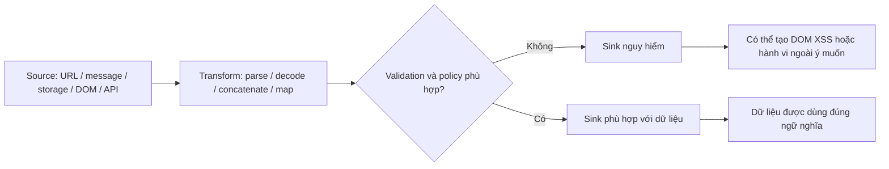

# DOM source — nhận diện nguồn dữ liệu đi vào ứng dụng phía trình duyệt

> **Chương:** DOM security  
> **Mục tiêu:** Nhận diện các nguồn dữ liệu (source) trong môi trường browser, hiểu dữ liệu nào có thể bị người dùng hoặc website bên ngoài kiểm soát, lần theo dữ liệu qua các bước xử lý và đánh giá trước khi nó tới DOM sink hoặc API nhạy cảm. Bài học tập trung vào việc xác định source chính xác để phát hiện và phòng vệ DOM XSS.

## 1. DOM source là gì?

Trong phân tích bảo mật DOM, **source** là điểm mà dữ liệu đi vào luồng xử lý JavaScript của trang. Dữ liệu có thể đến từ URL, thông điệp giữa cửa sổ, browser storage, DOM hiện có, form, API hoặc một thành phần khác của ứng dụng.

Ví dụ:

```js
const params = new URLSearchParams(location.search);
const displayName = params.get("name");
```

Ở đây, `location.search` là một source. Giá trị `name` do người gửi URL lựa chọn, nên cần xem là dữ liệu không tin cậy cho tới khi ứng dụng xác định được quy tắc sử dụng an toàn.

Source **không tự nó là lỗ hổng**. Một source trở thành một phần của đường tấn công khi dữ liệu có thể bị kiểm soát đi tới một thao tác nguy hiểm mà không được xử lý đúng. Ví dụ:

```js
const name = new URLSearchParams(location.search).get("name") ?? "";
document.querySelector("#welcome").textContent = name;
```

Đoạn này đọc source nhưng hiển thị dữ liệu dưới dạng text. Nếu thay `textContent` bằng `innerHTML`, browser sẽ parse dữ liệu thành markup và có thể tạo DOM XSS.

Khi rà soát code, hãy hỏi ba câu:

1. Dữ liệu bắt đầu từ đâu và ai có thể ảnh hưởng đến nó?
2. Dữ liệu được biến đổi, lưu lại hoặc truyền qua những thành phần nào?
3. Nó được dùng ở sink nào, với ngữ nghĩa gì?

## 2. Source, transform và sink trong một luồng dữ liệu

Một luồng DOM XSS thường được phân tích theo mô hình:



**Source** cho biết dữ liệu đi vào từ đâu. **Transform** cho biết code đã làm gì với dữ liệu. **Sink** là nơi dữ liệu được sử dụng: HTML parser, JavaScript execution, URL navigation, CSS, form submission hoặc một API khác.

Ví dụ một đường đi:

```js
const value = new URLSearchParams(location.search).get("q");
const decoded = decodeURIComponent(value ?? "");
const html = "<p>Kết quả: " + decoded + "</p>";
document.querySelector("#result").innerHTML = html;
```

Ở đây:

- Source là query parameter `q`.
- Transform là giải mã và nối chuỗi.
- Sink là `innerHTML`.

`decodeURIComponent` không làm dữ liệu an toàn. Nếu `URLSearchParams` đã giải mã percent-encoding khi lấy giá trị, giải mã thêm lần nữa còn có thể tạo ra ký tự cú pháp mà bước kiểm tra trước đó chưa nhìn thấy.

Không phải mọi source đều có thể bị tấn công từ xa. Một số source cần người dùng thao tác, cần extension, cần một trang cùng origin bị xâm nhập hoặc cần dữ liệu đã được lưu từ trước. Hãy xác định **mô hình kiểm soát thực tế**, không chỉ đánh dấu mọi API đọc dữ liệu là lỗ hổng.

## 3. URL sources: location, query, fragment và pathname

URL là nhóm source quan trọng vì người dùng hoặc website khác có thể tạo liên kết chứa dữ liệu tùy ý.

| Source | Dữ liệu trả về | Đặc điểm bảo mật |
| --- | --- | --- |
| `location.href` | URL đầy đủ của tài liệu hiện tại | Có thể chứa scheme, host, path, query và fragment |
| `location.search` | Chuỗi query, thường bắt đầu bằng `?` | Tham số có thể do người gửi link lựa chọn |
| `location.hash` | Fragment, thường bắt đầu bằng `#` | Không được gửi trong HTTP request thông thường nhưng JavaScript đọc được |
| `location.pathname` | Đường dẫn tài liệu | Có thể chứa các segment do người dùng điều khiển nếu server định tuyến theo path |
| `location.host` / `hostname` | Host và hostname hiện tại | Không dùng như danh tính đã xác thực nếu chưa parse và kiểm tra đúng |
| `document.URL` / `document.documentURI` | URL của document | Cần xem là input khi dùng để tạo nội dung hoặc điều hướng |

Ví dụ đọc query:

```js
const params = new URLSearchParams(window.location.search);
const searchTerm = params.get("q") ?? "";
const page = params.get("page") ?? "1";
```

`URLSearchParams` giúp parse query theo quy tắc URL, nhưng không xác nhận dữ liệu hợp lệ cho nghiệp vụ. Nếu `page` cần là số nguyên dương, hãy parse và kiểm tra miền giá trị. Nếu `q` chỉ dùng hiển thị, hãy đưa vào text sink; nếu dùng để tạo URL khác, cần kiểm tra URL theo chính sách đích.

### Fragment không đi lên server nhưng vẫn là source

Ví dụ:

```text
https://app.example.test/search#<strong>hello</strong>
```

Fragment thường không được gửi trong HTTP request tới server. Tuy nhiên, JavaScript trên trang có thể đọc `location.hash` và xử lý nó. Vì vậy, dữ liệu trong fragment vẫn có thể tạo DOM XSS nếu được đưa vào sink nguy hiểm.

Fragment thường được dùng cho tab, bộ lọc, định vị phần tử hoặc client-side routing. Đừng cho rằng “server không nhận được” đồng nghĩa “không có rủi ro”.

### Không decode URL nhiều lần

`URLSearchParams` đã giải mã các giá trị query theo quy tắc của nó. Gọi thêm `decodeURIComponent` mà không có lý do có thể gây double-decoding:

```js
const value = new URLSearchParams(location.search).get("q") ?? "";

// Không tự động decode lần hai.
renderSearchText(value);
```

Chỉ giải mã thêm khi giao thức dữ liệu quy định rõ một lớp encoding khác và ứng dụng có kiểm tra tương ứng. Mỗi lần decode có thể làm lộ thêm ký tự có ý nghĩa với parser ở bước sau.

## 4. Referrer và thông tin điều hướng

`document.referrer` cung cấp URL của tài liệu đã điều hướng người dùng tới trang hiện tại, nếu browser gửi thông tin đó theo Referrer Policy và ngữ cảnh điều hướng.

Ví dụ:

```js
const sourcePage = document.referrer;
document.querySelector("#came-from").textContent = sourcePage;
```

Referrer có thể bị rút gọn chỉ còn origin, bị loại bỏ hoàn toàn hoặc thay đổi theo chính sách bảo mật. Nếu có giá trị, nó vẫn có thể chứa dữ liệu do website trước đó kiểm soát. Không dùng referrer làm bằng chứng xác thực người dùng, quyền truy cập hoặc danh tính đối tác.

Nếu cần kiểm tra nguồn request cho CSRF, server nên dùng header `Origin` và/hoặc `Referer` theo chính sách endpoint, kết hợp token và authorization. `document.referrer` ở client không thay thế kiểm tra server-side.

## 5. postMessage: source từ cửa sổ và iframe khác origin

`window.postMessage` cho phép các browsing context trao đổi dữ liệu qua ranh giới origin. Dữ liệu nhận được trong event `message` là source:

```js
window.addEventListener("message", (event) => {
  const message = event.data;
  // message là dữ liệu đầu vào, cần kiểm tra trước khi sử dụng.
});
```

Không phải thông điệp nào cũng đến từ cửa sổ mà ứng dụng mong đợi. Hãy kiểm tra:

- `event.origin` có khớp origin cụ thể đã được cho phép không.
- `event.source` có đúng cửa sổ/iframe dự kiến không.
- `event.data` có đúng kiểu, cấu trúc, độ dài và giá trị nghiệp vụ không.
- Message type có nằm trong danh sách hành động mà ứng dụng hỗ trợ không.

Ví dụ:

```js
const partnerOrigin = "https://widget.partner.example";
const partnerFrame = document.querySelector("#partner-frame");

window.addEventListener("message", (event) => {
  if (event.origin !== partnerOrigin) return;
  if (event.source !== partnerFrame.contentWindow) return;

  const data = event.data;
  if (!data || typeof data !== "object") return;
  if (data.type !== "DISPLAY_STATUS") return;
  if (typeof data.value !== "string") return;
  if (data.value.length > 100) return;

  document.querySelector("#partner-status").textContent = data.value;
});
```

Kiểm tra origin không làm message trở thành HTML an toàn. Ứng dụng đối tác được phép gửi vẫn có thể gửi dữ liệu lỗi, sai định dạng hoặc bị xâm nhập. Dùng message như dữ liệu và đưa vào sink phù hợp.

### Cẩn trọng với opaque origin

Một số tài liệu sandboxed hoặc URL đặc biệt có opaque origin. Khi đó `event.origin` có thể là chuỗi `"null"`. Không chấp nhận mọi message có origin `null` như một nhóm tin cậy: nhiều tài liệu không liên quan cũng có thể có opaque origin. Nếu phải giao tiếp với iframe opaque, thiết kế giao thức xác nhận nguồn và dữ liệu riêng cho tình huống đó; không dựa duy nhất vào chuỗi origin.

## 6. Browser storage: dữ liệu tồn tại qua nhiều lần chạy

Những API lưu trữ phổ biến cũng là source:

| Source | Vòng đời | Điều cần lưu ý |
| --- | --- | --- |
| `localStorage` | Thường tồn tại qua lần mở browser | Người dùng, extension hoặc XSS cùng origin có thể thay đổi |
| `sessionStorage` | Gắn với browsing context/tab và vòng đời phiên tab | Dữ liệu cũ vẫn có thể không còn hợp lệ với phiên hiện tại |
| IndexedDB | Lưu trữ có cấu trúc, có thể tồn tại lâu | Dữ liệu có thể được tạo bởi phiên bản ứng dụng cũ hoặc nội dung người dùng |
| Cache API | Lưu response/tài nguyên | Response được cache không mặc nhiên là dữ liệu mới hoặc đã xác thực |
| Cookie | Được browser gửi theo cookie policy | Nội dung cookie có thể do server hoặc client tạo; không đọc cookie như dữ liệu đáng tin nếu chưa xác minh |

Ví dụ:

```js
const raw = localStorage.getItem("profile");
let profile;

try {
  profile = raw ? JSON.parse(raw) : null;
} catch {
  profile = null;
}
```

`JSON.parse` chỉ kiểm tra cú pháp JSON. Sau khi parse, ứng dụng vẫn cần schema validation, xác minh quyền và xử lý dữ liệu theo sink. Không tin trường `role` hoặc `isAdmin` trong storage để quyết định quyền truy cập.

### Storage event cũng là một nguồn dữ liệu

`storage` event được phát trong những browsing context khác khi storage thay đổi. Dữ liệu trong `event.key`, `event.newValue` và `event.oldValue` cần được xác thực giống dữ liệu đọc trực tiếp từ storage:

```js
window.addEventListener("storage", (event) => {
  if (event.key !== "ui-preference") return;
  const value = event.newValue;
  if (value !== "compact" && value !== "comfortable") return;
  applyLayout(value);
});
```

Không dùng dữ liệu storage để cấp quyền, xác nhận giao dịch hoặc khôi phục danh tính người dùng nếu không có xác minh phía server.

## 7. DOM hiện có: thuộc tính, dataset, form và text

Dữ liệu trong DOM cũng có thể là source. Ví dụ:

```html
<div id="profile" data-display-name="Tên do người dùng cung cấp"></div>
<input id="search" value="Từ khóa đã nhập">
```

JavaScript có thể đọc:

```js
const profile = document.querySelector("#profile");
const displayName = profile.dataset.displayName;
const searchValue = document.querySelector("#search").value;
```

Các giá trị này không tự động đáng tin. Chúng có thể được render từ server, CMS, dữ liệu do người dùng tạo, một script khác hoặc thay đổi qua DevTools. `dataset` chỉ là cách truy cập thuộc tính `data-*`; nó không phải sanitizer.

Những DOM source thường gặp:

- `element.value` của input, textarea và select.
- `element.getAttribute(...)` và `element.dataset`.
- `element.textContent` hoặc `innerText` của node chứa nội dung bên ngoài.
- Thuộc tính `id`, `name` và các named property có thể ảnh hưởng cách code tra cứu DOM.
- `document.forms`, `form.elements` và dữ liệu upload như tên file.

Ngay cả `textContent` khi dùng làm source cũng có thể chứa dữ liệu không tin cậy. `textContent` là sink an toàn cho việc hiển thị text trong phần tử thông thường, nhưng đọc từ nó không làm dữ liệu trở thành “đã làm sạch” cho mọi sink khác.

### DOM clobbering và id/name

HTML có thể tạo named properties trên một số đối tượng DOM. Nếu code dựa vào global hoặc thuộc tính cửa sổ được đặt tên theo `id`/`name`, markup không tin cậy có thể làm code lấy nhầm đối tượng.

Tránh:

```js
// Không dựa vào named global do id/name trong markup tạo ra.
const config = window.config;
```

Ưu tiên biến lexical/module rõ ràng và selector cụ thể:

```js
const configElement = document.querySelector("[data-app-config]");
const configText = configElement?.textContent ?? "";
```

Sau đó parse và kiểm tra schema. Không dùng tên DOM do dữ liệu bên ngoài kiểm soát như một cấu hình đã xác thực.

## 8. Form input, file, clipboard và thao tác người dùng

Form input là source trực tiếp vì người dùng có thể nhập dữ liệu tùy ý:

```js
const email = document.querySelector("#email").value;
const comment = document.querySelector("#comment").value;
```

Hãy xác thực theo yêu cầu nghiệp vụ và server vẫn phải xác thực lại. Kiểm tra ở client chủ yếu cải thiện trải nghiệm và giảm lỗi; nó không phải ranh giới bảo mật vì request có thể được gửi ngoài UI.

Một số source khác:

- `File.name`: tên file do người dùng hoặc hệ thống nguồn đặt; không dùng làm đường dẫn tin cậy.
- Clipboard và paste: nội dung có thể chứa văn bản, URL hoặc markup từ ứng dụng khác.
- Drag-and-drop: `DataTransfer` có thể chứa dữ liệu từ website hoặc ứng dụng ngoài.
- Input từ thiết bị: mã QR, camera hoặc thiết bị ngoại vi có thể cung cấp dữ liệu cần parse.

Nếu dữ liệu clipboard hoặc file name được đưa vào DOM, vẫn cần xử lý theo sink. Nếu file name dùng tạo đường dẫn lưu trên server, cần chuẩn hóa và tạo tên lưu an toàn phía server; không dựa vào tên file phía client.

## 9. Dữ liệu từ API và server không mặc nhiên an toàn

Một quan niệm sai là response từ server luôn đáng tin vì nó đến từ domain của ứng dụng. API có thể trả dữ liệu do người dùng khác nhập, dữ liệu từ đối tác, nội dung CMS, bản ghi cũ hoặc dữ liệu bị sửa bởi tài khoản có quyền thấp hơn.

Ví dụ:

```js
const response = await fetch("/api/comments");
const comments = await response.json();

for (const comment of comments) {
  const item = document.createElement("li");
  item.textContent = comment.body;
  document.querySelector("#comments").append(item);
}
```

Ở ví dụ này, comment body vẫn được xem là dữ liệu không tin cậy, nhưng được đưa vào text sink. Nếu thay bằng `item.innerHTML = comment.body`, dữ liệu user-generated có thể trở thành DOM XSS.

Khi nhận response:

1. Kiểm tra HTTP status và content type theo giao thức.
2. Parse dữ liệu có xử lý lỗi.
3. Xác thực schema, kiểu, độ dài và giá trị cho nghiệp vụ.
4. Phân quyền ở server; không dựa vào các trường role/quyền do client nhận rồi lưu.
5. Đưa dữ liệu vào DOM hoặc API theo đúng ngữ nghĩa.

HTTPS bảo vệ tính bí mật và toàn vẹn trên đường truyền tới server được xác thực; nó không chứng minh mọi trường dữ liệu trong response là an toàn để parse thành HTML hoặc code.

## 10. window.name, opener và browsing context

`window.name` là một giá trị gắn với browsing context và có thể được dùng để truyền dữ liệu qua điều hướng trong một số luồng. Hành vi partitioning và reset đã thay đổi theo browser/phiên bản, nên không dựa vào giả định rằng giá trị này luôn được xóa hoặc luôn được chia sẻ.

Nếu ứng dụng đọc `window.name`:

```js
const contextData = window.name;
```

hãy xem nó là dữ liệu không tin cậy và kiểm tra cấu trúc trước khi dùng. Không lưu token đăng nhập hoặc bí mật lâu dài trong `window.name`.

Tương tự, `window.opener` và các message từ cửa sổ mở ra cần được xem xét theo ranh giới origin. Khi mở liên kết ngoài bằng `target="_blank"`, dùng `rel="noopener noreferrer"` phù hợp để giảm quan hệ điều khiển giữa cửa sổ. Nếu ứng dụng chủ động dùng opener/postMessage, xác minh origin, source và message schema.

## 11. Source có mức độ tin cậy khác nhau

Không phải mọi source đều giống nhau. Khi threat model, hãy ghi rõ ai có thể kiểm soát và bằng cách nào:

| Source | Ai có thể ảnh hưởng? | Mức tin cậy ban đầu |
| --- | --- | --- |
| Query/fragment | Người gửi URL, người dùng, trang điều hướng | Không tin cậy |
| Form input/file name | Người dùng hiện tại | Không tin cậy |
| postMessage | Cửa sổ/iframe gửi message | Không tin cậy cho tới khi xác minh origin, source và schema |
| localStorage/IndexedDB | Script cùng origin, người dùng, extension, dữ liệu phiên cũ | Không tin cậy |
| DOM data attributes | Server template, CMS, người dùng hoặc script khác | Phụ thuộc nguồn tạo; thường cần xác minh |
| API response | Server, dữ liệu người dùng/đối tác được server lưu | Xác minh schema; nội dung text vẫn không tin cậy cho HTML |
| document.referrer | Trang trước và chính sách browser | Không dùng để xác thực |
| window.name | Browsing context và luồng điều hướng | Không tin cậy |

“Không tin cậy” không có nghĩa dữ liệu chắc chắn độc hại. Nó có nghĩa code không được giả định dữ liệu đáp ứng quy tắc của sink hoặc quyền nghiệp vụ nếu chưa kiểm tra.

## 12. Canonicalization và validation tại source

Một source có thể có nhiều cách biểu diễn: percent-encoding, Unicode, chữ hoa/thường, dấu phân cách hoặc kiểu dữ liệu khác nhau. Ứng dụng cần chuẩn hóa theo giao thức trước khi áp dụng allowlist.

Ví dụ kiểm tra tab:

```js
const params = new URLSearchParams(location.search);
const requestedTab = params.get("tab");
const allowedTabs = new Set(["overview", "orders", "settings"]);

const activeTab = allowedTabs.has(requestedTab)
  ? requestedTab
  : "overview";

showTab(activeTab);
```

Ví dụ kiểm tra URL đích:

```js
function parseAllowedDestination(rawValue) {
  const url = new URL(rawValue, location.origin);
  const allowedOrigins = new Set([
    location.origin,
    "https://help.example.com",
  ]);

  if (url.protocol !== "https:") {
    throw new Error("Scheme không được phép");
  }
  if (!allowedOrigins.has(url.origin)) {
    throw new Error("Origin không được phép");
  }
  if (url.username || url.password) {
    throw new Error("Không chấp nhận userinfo trong URL");
  }

  return url;
}
```

Validation phải dựa trên mục đích:

- Enum: allowlist chính xác.
- Số: parse thành number, kiểm tra integer/range.
- Boolean: chỉ chấp nhận biểu diễn được định nghĩa; không dùng truthiness của chuỗi.
- URL: parse bằng URL API, kiểm tra scheme/origin/port/path theo nghiệp vụ.
- Message: kiểm tra origin/source/schema/type/size.
- JSON/storage: parse có xử lý lỗi và kiểm tra schema.

Validation ở source giúp loại bỏ dữ liệu không hợp lệ cho nghiệp vụ, nhưng **không thay output encoding hoặc chọn sink an toàn**. Một tên hiển thị hợp lệ vẫn phải được hiển thị như text, không phải HTML.

## 13. Không nhầm source với sink

Trong code review, các API có thể xuất hiện ở cả hai vai trò tùy luồng:

| API/thuộc tính | Vai trò thường gặp | Ghi chú |
| --- | --- | --- |
| `location.search` | Source | Dữ liệu từ URL |
| `location.hash` | Source | Dữ liệu fragment |
| `event.data` | Source | Payload của postMessage |
| `localStorage.getItem` | Source | Dữ liệu lưu trữ |
| `element.value` | Source | Giá trị form |
| `element.dataset` | Source | Giá trị data attribute |
| `innerHTML` | Sink | Parse chuỗi thành HTML |
| `outerHTML` | Sink | Parse và thay node |
| `insertAdjacentHTML` | Sink | Parse HTML rồi chèn |
| `textContent` | Thường là text sink an toàn | Không parse thành HTML trong phần tử thông thường |
| `element.href` | Sink/đích điều hướng | Cần validate URL trước khi gán |
| `setAttribute` | Phụ thuộc thuộc tính | Tên và ngữ nghĩa attribute quyết định rủi ro |
| `eval` / `Function` | Sink thực thi code | Không dùng dữ liệu không tin cậy |

Một biến có thể vừa là output của bước trước vừa là source cho bước sau. Ví dụ dữ liệu đọc từ API được ghi vào localStorage, rồi lần mở trang sau lại được đọc ra. Hãy theo dõi **provenance** (nguồn gốc dữ liệu) qua các lần lưu/đọc, không chỉ theo tên biến.

## 14. Phương pháp rà soát source trong codebase

Một quy trình thực tế:

1. **Tìm API source.** Search `location.`, `document.referrer`, `postMessage`, `localStorage`, `sessionStorage`, `indexedDB`, `window.name`, `.value`, `dataset` và response parsing.
2. **Ghi nơi dữ liệu đi vào.** Với mỗi source, ghi ai kiểm soát, có cần đăng nhập không, dữ liệu tồn tại bao lâu và có thể sửa ở client không.
3. **Theo dõi transform.** Tìm decode, parse, concatenate, template, mapping, storage và event handler.
4. **Tìm sink.** Rà soát HTML parser, JS execution, URL attributes, CSS, navigation và API thay đổi trạng thái.
5. **Đánh giá ngữ cảnh.** Cùng một dữ liệu có thể an toàn khi hiển thị text nhưng nguy hiểm khi dùng làm HTML hoặc URL.
6. **Kiểm tra trust boundary.** Kiểm tra origin, source window, session, quyền API và server authorization khi có liên quan.
7. **Sửa ở đúng nơi.** Chọn safe sink trước; validate theo nghiệp vụ; sanitizer/Trusted Types/CSP là các lớp bổ sung khi cần.

Không chỉ search chuỗi `innerHTML` rồi kết luận hết DOM XSS. Wrapper, framework binding, thư viện bên thứ ba và các luồng gián tiếp có thể che source hoặc sink.

## 15. Thực hành: theo dõi DOM source bằng DevTools

Thực hiện trên một trang lab do bạn kiểm soát. Dùng dữ liệu hiển thị vô hại; không cần payload thực thi JavaScript.

### Bước 1 — Tạo trang thử nghiệm

```html
<!doctype html>
<html lang="vi">
  <meta charset="utf-8">
  <title>DOM source lab</title>
  <h1 id="welcome"></h1>
  <pre id="debug"></pre>
  <script>
    const params = new URLSearchParams(location.search);
    const query = params.get("q") ?? "";
    const fragment = location.hash.slice(1);

    document.querySelector("#welcome").textContent = query;
    document.querySelector("#debug").textContent = JSON.stringify({
      search: location.search,
      query,
      fragment,
      referrer: document.referrer,
    }, null, 2);
  </script>
</html>
```

Mở trang với query và fragment có ký tự đặc biệt nhưng vô hại, ví dụ:

```text
?q=DOM%20source%20test#tab=profile
```

Quan sát rằng query và fragment đều đọc được bằng JavaScript, nhưng fragment không nằm trong request HTTP thông thường tới server.

### Bước 2 — Đặt breakpoint ở source

Trong DevTools → Sources:

1. Đặt breakpoint tại dòng đọc `location.search`.
2. Tải lại trang với một query khác.
3. Quan sát giá trị `params` và kết quả `params.get("q")`.
4. Đặt breakpoint tại dòng đọc `location.hash` và so sánh.

### Bước 3 — Kiểm tra storage và message

Trong Console, tạo một giá trị thử nghiệm trong storage rồi đọc lại:

```js
localStorage.setItem("demo", JSON.stringify({ label: "Storage test" }));
const value = JSON.parse(localStorage.getItem("demo") ?? "null");
console.log(value);
```

Thử thay giá trị trong Application → Local Storage và tải lại. Điều này minh họa dữ liệu storage có thể thay đổi độc lập với code hiện tại.

Nếu trang có iframe lab, gửi message có cấu trúc và quan sát `event.origin`, `event.source`, `event.data`. Không dùng `"*"` làm targetOrigin khi gửi dữ liệu nhạy cảm.

### Bước 4 — Theo source tới sink

Tìm trong code các API sink như:

```text
innerHTML
outerHTML
insertAdjacentHTML
document.write
srcdoc
eval
new Function
setTimeout("...")
setInterval("...")
href / src / action
```

Với từng luồng, ghi source, transform và sink. Nếu mục tiêu chỉ hiển thị text, đổi sang `textContent` hoặc API DOM có cấu trúc. Nếu mục tiêu là URL, parse và allowlist URL; nếu mục tiêu là rich HTML, dùng sanitizer được duy trì và chính sách phù hợp.

### Bước 5 — Ghi kết quả

| Trường | Nội dung cần ghi |
| --- | --- |
| Source | API/thuộc tính và vị trí code |
| Người kiểm soát | User, trang ngoài, server, extension hay script cùng origin |
| Transform | Decode, parse, concat, storage hoặc mapping |
| Sink | HTML, JS, URL, CSS, navigation hay API |
| Validation | Schema, enum, URL policy, origin/source check |
| Biện pháp | Safe sink, output encoding, sanitizer, CSP, Trusted Types hoặc server check |
| Kết quả | Dữ liệu hiển thị đúng ngữ nghĩa và không tạo markup/hành động ngoài ý muốn |

## 16. Những ngộ nhận thường gặp

| Ngộ nhận | Cách hiểu đúng |
| --- | --- |
| “Source là lỗ hổng.” | Source chỉ là điểm dữ liệu đi vào; cần phân tích khả năng kiểm soát và sink cuối. |
| “Fragment không gửi lên server nên an toàn.” | JavaScript vẫn đọc được `location.hash` và có thể đưa nó vào sink. |
| “URLSearchParams đã sanitize dữ liệu.” | Nó parse query; không xác thực nghiệp vụ hoặc encode cho HTML. |
| “Dữ liệu từ API của chính mình luôn tin cậy.” | API có thể trả nội dung do người dùng/đối tác kiểm soát. |
| “JSON.parse làm dữ liệu an toàn.” | Nó chỉ parse cú pháp JSON; schema và ngữ nghĩa vẫn cần kiểm tra. |
| “postMessage từ partner origin là an toàn.” | Cần kiểm tra source, schema và xử lý payload theo đúng sink. |
| “localStorage thuộc origin nên không thể bị sửa.” | Script cùng origin, extension hoặc người dùng có thể thay đổi dữ liệu. |
| “textContent luôn làm dữ liệu sạch.” | Nó là sink phù hợp để hiển thị text; dữ liệu đọc lại vẫn có thể không an toàn cho sink khác. |
| “Chỉ cần tìm innerHTML là tìm đủ DOM XSS.” | Có nhiều sink, wrapper, framework binding và đường dữ liệu gián tiếp. |

## 17. Câu hỏi tự kiểm tra

1. DOM source là gì và vì sao source tự nó chưa phải lỗ hổng?
2. Phân biệt source, transform và sink bằng một ví dụ lấy dữ liệu từ query.
3. Vì sao `location.hash` vẫn là source dù không được gửi trong HTTP request?
4. URLSearchParams giải quyết việc gì và không giải quyết việc gì?
5. Vì sao `document.referrer` không phải bằng chứng xác thực?
6. Khi nhận `postMessage`, cần kiểm tra những thuộc tính nào trước khi sử dụng dữ liệu?
7. Vì sao dữ liệu trong localStorage và API response vẫn cần xác thực?
8. DOM clobbering có thể ảnh hưởng code dựa trên `id`/`name` như thế nào?
9. Vì sao validation tại source không thay thế việc chọn safe sink?
10. Làm thế nào lần theo một source gián tiếp đã được lưu trong storage rồi dùng ở lần tải trang sau?

**Ghi nhớ:** DOM source là nơi dữ liệu đi vào JavaScript của trang: URL, referrer, message, storage, DOM, form hoặc API. Source chỉ trở thành một phần của lỗ hổng khi dữ liệu có thể bị kiểm soát đi tới sink không an toàn. Hãy xác định người kiểm soát dữ liệu, theo dõi provenance qua các bước parse/transform/lưu trữ, xác thực theo nghiệp vụ và chọn sink đúng ngữ nghĩa. Với HTML, ưu tiên text API hoặc sanitizer; với URL, parse và allowlist; với message, kiểm tra origin/source/schema; và luôn giữ authorization ở server.
