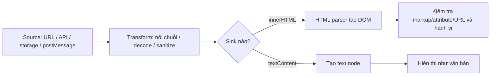

# innerHTML

> **Chương:** DOM security  
> **Học phần:** Application Security — Browser Security (`SECURITY_APPLICATION_SECURITY_BROWSER_SECURITY`)

`innerHTML` là một DOM property cho phép đọc hoặc thay thế nội dung HTML bên trong một element. Khi gán chuỗi vào property này, browser **parse chuỗi thành DOM nodes**. Vì vậy, nếu chuỗi có dữ liệu không tin cậy, ứng dụng có thể vô tình biến dữ liệu thành element, attribute hoặc nội dung có khả năng thực thi. Đây là một trong những DOM sink thường gặp nhất dẫn tới **DOM-based Cross-Site Scripting (DOM XSS)**.

Điểm cần nhớ: `innerHTML` không đơn thuần hiển thị một chuỗi. Nó yêu cầu HTML parser diễn giải chuỗi theo ngữ cảnh của element đích. Cách an toàn nhất khi chỉ cần hiển thị văn bản là dùng `textContent`; nếu sản phẩm cần cho phép một tập HTML giới hạn, phải dùng sanitizer chuyên dụng, quản lý policy và kiểm thử kết quả sau khi browser parse.

## 1. Mục tiêu học tập

Sau bài học, bạn có thể:

1. Giải thích `innerHTML` là HTML parsing sink và vì sao dữ liệu không tin cậy có thể tạo DOM ngoài ý muốn.
2. Phân biệt `innerHTML`, `textContent`, `innerText`, `outerHTML` và `insertAdjacentHTML`.
3. Nhận diện luồng source → transform → sink trong DOM XSS.
4. Hiểu giới hạn của việc cho rằng script element được chèn bằng `innerHTML` sẽ tự thực thi hay không thực thi.
5. Chọn giữa DOM API tạo node, sanitizer HTML và Trusted Types.
6. Thiết kế allowlist HTML/attribute phù hợp với nhu cầu sản phẩm.
7. Giải thích vai trò và giới hạn của CSP, Trusted Types và DOMPurify.
8. Kiểm thử `innerHTML` an toàn bằng dữ liệu giả trong môi trường lab.

## 2. `innerHTML` hoạt động như thế nào?

`element.innerHTML` có hai cách sử dụng:

- **Đọc:** trả về serialization của các node con dưới dạng chuỗi HTML.
- **Ghi:** parse chuỗi được gán như một HTML fragment trong ngữ cảnh element đích, sau đó thay thế các node con hiện tại bằng kết quả parse.

Ví dụ:

```html
<div id="message"></div>
```

```js
const message = document.querySelector("#message");
message.innerHTML = "<strong>Xin chào!</strong>";
```

Browser tạo một element `<strong>` và một text node bên trong nó. DOM sau khi cập nhật có cấu trúc tương đương:

```html
<div id="message">
  <strong>Xin chào!</strong>
</div>
```

Đây là điểm khác biệt với `textContent`: `textContent` tạo nội dung văn bản, còn `innerHTML` yêu cầu browser parse markup. Nếu dữ liệu chứa cú pháp HTML, parser có thể tạo element và attribute theo ý nghĩa của cú pháp đó.

## 3. Vì sao `innerHTML` là một injection sink?

Một *injection sink* là API nhận dữ liệu rồi diễn giải nó như cấu trúc hoặc mã có ý nghĩa đặc biệt. `innerHTML` là sink vì nó chuyển chuỗi thành DOM.

Luồng DOM XSS thường có dạng:

```text
Source không tin cậy
  → xử lý/biến đổi dữ liệu
  → HTML parsing sink (innerHTML)
  → browser tạo DOM
  → cấu trúc hoặc hành vi ngoài ý muốn
```

Nguồn dữ liệu không tin cậy có thể là:

- Query string hoặc fragment trong URL.
- Dữ liệu nhập từ form, bình luận, tên hiển thị hoặc mô tả sản phẩm.
- Response từ API, dữ liệu database có nguồn gốc từ người dùng.
- `postMessage` từ cửa sổ/iframe khác.
- `localStorage`, `sessionStorage`, IndexedDB hoặc cache phía client.
- Nội dung từ bên thứ ba hoặc dữ liệu được nhập từ file.

Ví dụ một cách làm không an toàn:

```js
const params = new URLSearchParams(location.search);
const name = params.get("name") ?? "";

document.querySelector("#greeting").innerHTML = `Xin chào ${name}`;
```

`name` đến từ URL, nên người dùng có thể kiểm soát. Template string chỉ nối chuỗi; nó không encode HTML. Khi gán kết quả vào `innerHTML`, browser parse toàn bộ chuỗi như markup.

Nếu chỉ muốn hiển thị tên:

```js
document.querySelector("#greeting").textContent = `Xin chào ${name}`;
```

Lúc này ký tự `<`, `>` hoặc dấu nháy trong tên được hiển thị như dữ liệu, không trở thành cấu trúc HTML.

## 4. Phân biệt các API nội dung DOM

| API | Hành vi | Có parse chuỗi thành HTML? | Gợi ý bảo mật |
| --- | --- | --- | --- |
| `textContent` | Đọc/ghi text content của node và descendants | Không | Ưu tiên khi hiển thị văn bản |
| `innerText` | Đọc/ghi văn bản theo cách hiển thị/layout | Không parse chuỗi thành HTML khi ghi | Có thể kích hoạt tính toán layout; không dùng để render markup |
| `innerHTML` | Đọc/ghi HTML bên trong element | Có | Chỉ dùng HTML tĩnh đáng tin hoặc output đã sanitize/TrustedHTML |
| `outerHTML` | Đọc/ghi serialization của chính element và descendants | Có khi ghi | Là sink tương tự; có thể thay thế element hiện tại |
| `insertAdjacentHTML` | Parse fragment rồi chèn vào vị trí chỉ định | Có | Cần kiểm soát như `innerHTML` |
| `insertAdjacentText` | Chèn text node | Không | Lựa chọn an toàn hơn khi cần text |
| `createElement` + `append` | Tạo node và gắn vào DOM | Không parse chuỗi thành HTML | Ưu tiên cho DOM động |

Ví dụ dùng DOM API:

```js
const item = document.createElement("li");
item.textContent = userSuppliedLabel;
document.querySelector("#results").append(item);
```

Trong trường hợp này, `userSuppliedLabel` chỉ trở thành text node. Không cần HTML encoder ở client để biến nó thành markup an toàn.

## 5. `innerHTML` không phải công cụ tạo văn bản

Nếu nội dung cần hiển thị là văn bản thuần, dùng:

```js
const output = document.querySelector("#output");
output.textContent = untrustedText;
```

Không dùng:

```js
output.innerHTML = untrustedText;
```

Sự khác nhau không chỉ nằm ở cách hiển thị. `innerHTML` có thể tạo element, attribute, URL hoặc các cấu trúc có hành vi đặc biệt. `textContent` không gọi HTML parser để diễn giải input.

Một số ứng dụng cần xuống dòng hoặc nhấn mạnh văn bản. Không nhất thiết phải chuyển sang `innerHTML`: có thể tạo node `<br>`, `<strong>` cố định trong code và đặt nội dung động bằng `textContent`.

```js
const message = document.createElement("p");
const label = document.createElement("strong");
label.textContent = userName;

message.append("Xin chào ", label, document.createElement("br"));
message.append(document.createTextNode(userMessage));
document.querySelector("#output").replaceChildren(message);
```

Markup được tạo bởi code tĩnh; dữ liệu người dùng chỉ được đặt vào text node.

## 6. Những hiểu nhầm về script element được chèn bằng innerHTML

Một điểm cần hiểu chính xác: **`<script>` element được tạo khi gán chuỗi qua `innerHTML` thường không được thực thi như script vừa tải từ HTML parser ban đầu**. Tuy nhiên, điều này không biến `innerHTML` thành API an toàn.

HTML injection vẫn có thể dẫn tới XSS qua những cấu trúc khác, chẳng hạn event-handler attribute, URL có scheme nguy hiểm, SVG hoặc các element/attribute có hành vi đặc biệt theo browser. Kẻ tấn công không cần dựa riêng vào `<script>` để thực thi mã.

Vì vậy:

- Không dùng quy tắc “script tag không chạy” làm lý do để đưa input thô vào `innerHTML`.
- Không tự xây bộ lọc chỉ xóa `<script>`; còn nhiều cách tạo hành vi ngoài ý muốn.
- Xem `innerHTML` là sink cần kiểm soát ngay cả khi payload thử nghiệm không làm script chạy.
- Kiểm tra cả DOM cuối cùng và hành vi browser, không chỉ tìm chuỗi `<script>` trong response.

## 7. `innerHTML` thay thế descendants và có thể ảnh hưởng ứng dụng

Khi gán `innerHTML`, browser loại bỏ các node con hiện tại rồi tạo node mới từ chuỗi. Điều này có thể:

- Làm mất event listener đã gắn trực tiếp vào node con cũ.
- Làm mất trạng thái input, selection, focus hoặc widget.
- Tạo lại các element với ID trùng lặp hoặc tên có thể ảnh hưởng truy cập DOM.
- Kích hoạt callback/lifecycle của custom element đã đăng ký khi node tương ứng được tạo và kết nối.
- Làm thay đổi cấu trúc DOM mà code khác đang tham chiếu.

Nếu cần cập nhật một phần giao diện, hãy cân nhắc `replaceChildren`, `append`, `replaceWith` hoặc cập nhật property cụ thể thay vì serialize toàn bộ HTML thành chuỗi rồi parse lại.

Không tái sử dụng reference tới node cũ sau khi đã thay descendants. Nếu component có state hoặc event delegation, thiết kế cập nhật DOM theo lifecycle của framework.

## 8. Context parsing và namespace

`innerHTML` parse fragment theo ngữ cảnh của element đích. Cùng một chuỗi có thể được xử lý khác nhau khi đặt trong `div`, `table`, `select` hoặc một element thuộc SVG/MathML namespace.

Ví dụ, bảng HTML có quy tắc chèn và sắp xếp node riêng. Browser có thể tự tạo hoặc di chuyển element để sửa markup không hợp lệ. SVG và MathML có namespace cùng attribute semantics khác HTML thông thường.

Điều này có hai hệ quả:

1. Không giả định một chuỗi đã sanitize trong context này sẽ an toàn khi đưa sang context khác.
2. Sanitizer phải hỗ trợ đúng loại markup và namespace mà sản phẩm chấp nhận.

Nếu ứng dụng không cần SVG/MathML do người dùng cung cấp, hãy loại chúng khỏi allowlist. Nếu cần hỗ trợ, dùng sanitizer có khả năng xử lý namespace và giữ thư viện được cập nhật.

## 9. Khi nào sản phẩm thực sự cần innerHTML?

Một số tính năng cần hiển thị nội dung HTML có định dạng, ví dụ:

- Bài viết hoặc mô tả có đoạn văn, tiêu đề và danh sách.
- Bình luận hỗ trợ chữ đậm, chữ nghiêng và liên kết.
- Nội dung tài liệu được chuyển đổi từ Markdown sang HTML.
- Email hoặc nội dung rich text được biên tập qua editor.

Trong những trường hợp này, chỉ dùng `textContent` có thể làm mất chức năng định dạng. Tuy nhiên, không nên cho phép toàn bộ HTML tùy ý. Cần định nghĩa **một tập markup tối thiểu** theo yêu cầu sản phẩm, sau đó sanitize bằng thư viện chuyên dụng.

Ví dụ allowlist cho bình luận có thể chỉ gồm `p`, `strong`, `em`, `ul`, `ol`, `li`, `a` và một số attribute cần thiết như `href`, `title`. Không mặc định cho phép `style`, event handler, `iframe`, `object`, `embed`, `srcdoc` hoặc custom element.

## 10. Sanitization với DOMPurify

DOMPurify là một thư viện sanitizer HTML phổ biến. Nó parse markup và loại bỏ cấu trúc/attribute không được phép theo policy. Ví dụ:

```js
const cleanHtml = DOMPurify.sanitize(untrustedHtml, {
  ALLOWED_TAGS: ["p", "strong", "em", "ul", "ol", "li", "a"],
  ALLOWED_ATTR: ["href", "title"],
  FORBID_ATTR: ["style"],
});

document.querySelector("#comment").innerHTML = cleanHtml;
```

Đây là ví dụ định hướng, không phải cấu hình phù hợp cho mọi sản phẩm. Cần kiểm tra policy URL/protocol, nhu cầu `target`, `rel`, attribute accessibility và phiên bản thư viện. Nếu chỉ cho phép liên kết HTTPS, cần cấu hình/kiểm tra URL tương ứng; không tự giả định allowlist tag đã giới hạn mọi đích URL theo đúng nghiệp vụ.

### 10.1 Sanitizer không phải encoder

Sanitizer tạo ra HTML markup thuộc một policy đã chọn. Output encoding lại biểu diễn dữ liệu thành literal trong một context. Hai việc khác nhau:

| Kỹ thuật | Khi dùng | Ví dụ |
| --- | --- | --- |
| `textContent` | Chỉ hiển thị văn bản | Tên, mô tả thuần, thông báo |
| Output encoding | Server render dữ liệu vào HTML context | HTML text/attribute encoding |
| Sanitization | Cần cho phép một tập HTML do người dùng cung cấp | Rich text/comment |
| URL validation | Dữ liệu sẽ trở thành URL | Parse URL, allowlist scheme/host |

Không dùng sanitizer HTML để “làm sạch” JavaScript, CSS hoặc URL ở mọi vị trí. Không dùng HTML encoder rồi coi output là HTML an toàn để parse.

### 10.2 Giữ sanitizer và cấu hình luôn được cập nhật

Các lỗi parser và bypass sanitizer có thể được phát hiện theo thời gian. Hãy:

- Cập nhật DOMPurify theo quy trình dependency management.
- Theo dõi advisory/security release của thư viện.
- Dùng cấu hình allowlist tối thiểu và có test regression.
- Không sửa output đã sanitize bằng thao tác nối chuỗi không an toàn.
- Không dùng sanitizer tự viết bằng regex.
- Nếu sanitize phía server, dùng DOM implementation được hỗ trợ và cập nhật; môi trường DOM giả/lỗi thời có thể tạo khác biệt so với browser thật.

## 11. Mutation XSS và việc thay đổi markup sau sanitize

Một số trường hợp gọi là **mutation XSS (mXSS)** liên quan đến cách browser parse, serialize và parse lại markup. Một đoạn HTML có thể bị parser sửa cấu trúc; nếu ứng dụng lấy serialization hoặc biến đổi markup sau khi sanitize rồi đưa lại vào sink, kết quả cuối cùng có thể khác cấu trúc sanitizer đã đánh giá ban đầu.

Để giảm rủi ro:

- Dùng sanitizer hiện đại, cập nhật và hỗ trợ browser/namespace mục tiêu.
- Tránh sửa chuỗi HTML sau khi sanitize bằng regex hoặc nối thêm attribute.
- Tránh sanitize trong một parser context rồi chuyển output sang context khác mà không đánh giá.
- Không lấy `innerHTML` đã sanitize, chỉnh sửa tùy tiện rồi gán lại vào `innerHTML`.
- Kiểm thử DOM sau parse trong browser mục tiêu và thêm regression case cho markup biên.

Sanitizer không phải giấy phép để xử lý HTML tùy ý ở mọi nơi. Policy phải gắn với context sử dụng cụ thể.

## 12. Trusted Types bảo vệ innerHTML

**Trusted Types** là cơ chế của browser giúp kiểm soát việc truyền chuỗi vào một số injection sink. Khi bật enforcement, các sink như `innerHTML` có thể yêu cầu giá trị kiểu `TrustedHTML` thay vì string tùy ý.

Ví dụ response header:

```http
Content-Security-Policy: require-trusted-types-for 'script'; trusted-types app-html
```

Ứng dụng cần tạo policy được cho phép:

```js
const htmlPolicy = trustedTypes.createPolicy("app-html", {
  createHTML(input) {
    return DOMPurify.sanitize(input, {
      ALLOWED_TAGS: ["p", "strong", "em", "ul", "ol", "li", "a"],
      ALLOWED_ATTR: ["href", "title"],
      RETURN_TRUSTED_TYPE: false,
    });
  },
});

const trustedMarkup = htmlPolicy.createHTML(untrustedHtml);
document.querySelector("#comment").innerHTML = trustedMarkup;
```

Trong callback `createHTML`, DOMPurify trả về string để Trusted Types policy bọc thành `TrustedHTML`; vì vậy ví dụ đặt `RETURN_TRUSTED_TYPE: false`. Cấu hình thực tế cần theo phiên bản DOMPurify và cách tích hợp Trusted Types mà thư viện hỗ trợ.

**Trusted Types không tự sanitize.** Policy `createHTML` phải chứa logic an toàn. Nếu policy trả nguyên input, mọi chuỗi sẽ được cấp nhãn trusted và cơ chế mất tác dụng. Không tạo default policy cho phép mọi chuỗi chỉ để làm ứng dụng hết lỗi console.

Hỗ trợ Trusted Types khác nhau giữa browser. Cần có chiến lược tương thích và kiểm thử trên browser mục tiêu; không bỏ sanitizer chỉ vì một số browser không hỗ trợ enforcement.

## 13. CSP bổ sung defense in depth

Content Security Policy có thể hạn chế nguồn script và các cách thực thi mã. Một policy chặt chẽ có thể giảm tác động của một số payload XSS, nhưng không biến `innerHTML` thành sink an toàn.

Ví dụ policy định hướng:

```http
Content-Security-Policy: default-src 'self'; script-src 'self' 'nonce-{RANDOM_PER_RESPONSE}'; object-src 'none'; base-uri 'none'; frame-ancestors 'none'
```

`{RANDOM_PER_RESPONSE}` là placeholder; server phải sinh nonce đủ ngẫu nhiên, riêng cho từng response và gắn nonce tương ứng vào script được phép. Không đưa placeholder literal vào production. CSP có thể chặn nhiều inline event handler và script không được cấp phép, nhưng các đường thực thi khác, script được tin cậy hoặc logic ứng dụng sai vẫn có thể gây rủi ro.

Kết hợp các lớp:

- `textContent`/DOM API an toàn xử lý dữ liệu như dữ liệu.
- Sanitizer cho trường hợp cần HTML markup.
- Trusted Types kiểm soát việc đưa string vào sink.
- CSP giới hạn nguồn và hành vi script.
- HttpOnly giảm khả năng script đọc cookie phiên.

Mỗi lớp giải quyết một phần khác nhau; không có lớp nào thay thế toàn bộ các lớp còn lại.

## 14. Các sink HTML khác cần review cùng innerHTML

Khi audit DOM XSS, đừng chỉ tìm `innerHTML`. Những API sau cũng có thể parse hoặc tạo cấu trúc từ chuỗi:

| Sink/API | Hành vi | Cách xử lý |
| --- | --- | --- |
| `outerHTML` | Parse và thay thế element | DOM API; sanitizer/TrustedHTML nếu cần markup |
| `insertAdjacentHTML` | Parse fragment và chèn vào vị trí | Như `innerHTML` |
| `document.write` | Ghi chuỗi vào document parser | Tránh với dữ liệu động; dùng DOM API |
| `iframe.srcdoc` | Parse chuỗi thành tài liệu iframe | Không dùng input thô; cân nhắc sanitizer, sandbox và origin riêng |
| `Range.createContextualFragment` | Parse chuỗi thành fragment theo context | Xử lý như HTML injection sink |
| `DOMParser.parseFromString(..., "text/html")` | Parse chuỗi thành document HTML | Parsing không phải sanitization; kiểm soát trước khi đưa node vào live DOM |
| `setHTMLUnsafe` | API parse HTML với khả năng nhận markup chưa sanitize | Chỉ dùng khi có cơ chế bảo vệ phù hợp và hiểu rõ semantics |

Một số browser/API có phương thức HTML sanitization tích hợp đang được triển khai theo mức hỗ trợ khác nhau. Chỉ sử dụng khi đã xác minh compatibility, semantics và policy. Không nhầm một API có chữ “HTML” hoặc “parse” với một sanitizer tự động.

## 15. DOM clobbering và ID/name từ HTML không tin cậy

HTML injection không chỉ tạo script. Các element có `id` hoặc `name` có thể ảnh hưởng cách một số thuộc tính DOM được truy cập, dẫn tới **DOM clobbering**: markup làm shadow hoặc thay đổi giá trị mà code ứng dụng kỳ vọng là object/property có sẵn.

Ví dụ, code cũ dựa vào global named properties như `window.someForm` hoặc `document.someElement` có thể bị ảnh hưởng bởi element do HTML không tin cậy tạo ra. Đây là một lý do cần kiểm soát `id`, `name`, form và element được cho phép trong rich HTML.

Biện pháp:

- Không dựa vào global named properties; truy vấn node rõ ràng bằng `querySelector` và kiểm tra kiểu/quan hệ.
- Không cho phép `id`/`name` tùy ý trong nội dung rich text nếu không cần.
- Dùng sanitizer và allowlist phù hợp.
- Không coi HTML đã được escape ở một nơi là đáng tin cho mọi logic DOM khác.

## 16. Review source → transform → sink

Khi tìm thấy `innerHTML`, hãy xác định toàn bộ luồng dữ liệu:



Các câu hỏi review:

1. Ai kiểm soát dữ liệu? Có thể bị thay đổi qua URL, API, storage hoặc postMessage không?
2. Dữ liệu có được decode hoặc nối thêm sau khi sanitize không?
3. Sink có thực sự cần HTML hay chỉ cần text/DOM node?
4. Nếu cần HTML, allowlist có giới hạn tag, attribute, URL scheme và namespace không?
5. Sanitizer có chạy ngay trước sink và dùng phiên bản cập nhật không?
6. Có Trusted Types enforcement không? Policy có sanitize thật hay chỉ trả input?
7. CSP có hạn chế script phù hợp không?
8. Có test DOM cuối cùng và hành vi browser với input biên không?

Đừng kết luận mọi `innerHTML` đều là lỗ hổng: chuỗi markup tĩnh do code kiểm soát có thể là hợp lệ. Nhưng mọi đường dữ liệu động đi vào sink phải được đánh giá, kể cả khi dữ liệu đến từ backend hoặc database.

## 17. Thực hành kiểm chứng trong môi trường lab

Thực hiện trên ứng dụng local hoặc trang lab bạn quản lý, với dữ liệu giả. Không thử payload trên website bên ngoài hoặc tài khoản người khác.

### Bài thử A — So sánh innerHTML và textContent

Tạo hai vùng hiển thị:

```html
<div id="as-text"></div>
<div id="as-html"></div>
```

Chạy:

```js
const sample = "<strong>Lab demo</strong>";
document.querySelector("#as-text").textContent = sample;
document.querySelector("#as-html").innerHTML = sample;
```

**Kỳ vọng:** Vùng thứ nhất hiển thị nguyên chuỗi ký tự; vùng thứ hai tạo element `<strong>`. Không cần dùng chuỗi thực thi mã để thấy sự khác biệt giữa text và markup.

### Bài thử B — Quan sát descendants bị thay thế

Tạo một element có node con và event listener. Gán một chuỗi markup mới vào `innerHTML`, rồi kiểm tra node reference cũ, event listener và focus.

**Kỳ vọng:** Descendants cũ bị thay thế; reference cũ không còn đại diện cho node đang nằm trong DOM. Ghi nhận tác động UI trước khi quyết định dùng `innerHTML` cho cập nhật từng phần.

### Bài thử C — Sanitizer allowlist

Trong trang lab có DOMPurify, thử nội dung rich text giả gồm paragraph, bold, link và các tag/attribute không nằm trong allowlist. Render kết quả sanitizer vào vùng preview.

**Kỳ vọng:** Các tag/attribute ngoài policy bị loại; markup hợp lệ vẫn hiển thị. Kiểm tra cả URL của link và DOM cuối cùng, không chỉ chuỗi sanitizer trả về.

### Bài thử D — Trusted Types

Trên browser hỗ trợ Trusted Types, bật CSP enforcement ở môi trường lab. Thử gán một string trực tiếp vào `innerHTML`, sau đó dùng policy đã tích hợp sanitizer để tạo `TrustedHTML`.

**Kỳ vọng:** Gán string không được policy chấp nhận sẽ bị chặn; giá trị do policy tạo được chấp nhận. Nếu policy trả nguyên input, bài test không chứng minh sanitizer an toàn.

### Bài thử E — Inventory sink

Tìm `innerHTML`, `outerHTML`, `insertAdjacentHTML`, `document.write`, `srcdoc`, `createContextualFragment` và `DOMParser`. Ghi source, transform, sink, loại dữ liệu và lý do nghiệp vụ cần markup. Thay các trường hợp chỉ hiển thị text bằng DOM API.

**Kỳ vọng:** Mỗi sink có quyết định rõ ràng: bỏ sink, dùng text API, hoặc giữ lại với sanitizer/Trusted Types và test regression.

## 18. Các lỗi thường gặp

| Lỗi/nhận định | Vì sao có vấn đề | Cách xử lý |
| --- | --- | --- |
| Dùng `innerHTML` để hiển thị text | Browser parse input thành markup | Dùng `textContent` |
| Chỉ xóa tag `<script>` | Còn event handler, URL và nhiều cấu trúc khác | Dùng sanitizer HTML có allowlist |
| Cho rằng script chèn bằng innerHTML không chạy nên an toàn | Các đường HTML injection khác vẫn có thể dẫn tới XSS | Xem mọi dữ liệu động vào `innerHTML` là cần kiểm soát |
| Sanitize bằng regex | HTML parser phức tạp, regex dễ bỏ sót | Dùng DOMPurify hoặc sanitizer đã được kiểm chứng |
| Sanitize xong rồi nối chuỗi thêm | Có thể phá policy đã áp dụng | Không sửa output tùy tiện; sanitize ở sát sink |
| Dùng cùng output ở mọi context | HTML context/namespace khác nhau | Ràng buộc sanitizer với context sử dụng |
| Tạo Trusted Types policy tin mọi input | Mọi chuỗi được gắn nhãn trusted | Policy phải sanitize/validate thực sự |
| Chỉ bật CSP | CSP không sửa lỗi tạo DOM và có thể có script được tin cậy | Sửa source/sink, sanitizer, TT và CSP |
| Bỏ qua custom element/ID/name | Có thể kích hoạt lifecycle hoặc DOM clobbering | Giới hạn markup và kiểm tra DOM |
| Tin HTML từ database | Dữ liệu lưu trữ có thể bắt nguồn từ người dùng | Đánh giá theo nguồn gốc và sanitize/encode tại output |

## 19. Checklist review innerHTML

- [ ] Tìm toàn bộ điểm ghi vào `innerHTML` và các sink HTML tương đương.
- [ ] Xác định source và khả năng người dùng/bên ngoài kiểm soát dữ liệu.
- [ ] Nếu chỉ cần text, thay bằng `textContent`, `insertAdjacentText` hoặc DOM API.
- [ ] Nếu cần markup, xác định allowlist tag, attribute, URL scheme và namespace.
- [ ] Dùng sanitizer cập nhật, được kiểm chứng; không tự lọc bằng regex.
- [ ] Không sửa output đã sanitize bằng nối chuỗi hoặc chuyển sang context khác.
- [ ] Đánh giá `id`, `name`, custom element, form và DOM clobbering.
- [ ] Cân nhắc Trusted Types enforcement và policy có sanitizer thực sự.
- [ ] Triển khai CSP phù hợp như lớp defense in depth.
- [ ] Kiểm tra DOM sau parse, không chỉ chuỗi HTML trước parse.
- [ ] Có regression test cho sanitizer, URL, SVG/MathML và markup biên nếu được hỗ trợ.
- [ ] Theo dõi/cập nhật dependency sanitizer và kiểm thử trên browser mục tiêu.

## 20. Câu hỏi tự kiểm tra

1. Vì sao `innerHTML` được gọi là HTML injection sink?
2. Khác biệt bảo mật giữa `innerHTML` và `textContent` là gì?
3. Vì sao việc `<script>` chèn bằng `innerHTML` thường không thực thi không chứng minh sink an toàn?
4. Khi nào sản phẩm có lý do hợp lệ để dùng `innerHTML`?
5. Sanitizer cần kiểm soát những thành phần nào ngoài tên tag?
6. Vì sao không nên chỉnh sửa hoặc nối thêm chuỗi sau khi sanitize?
7. Trusted Types kiểm soát điều gì và vì sao policy vẫn phải sanitize?
8. `Vary`/CSP có thay thế sanitizer hoặc DOM API an toàn không?
9. DOM clobbering có thể phát sinh từ HTML không tin cậy như thế nào?
10. Làm sao kiểm tra một luồng source → transform → sink có an toàn?

## 21. Ghi nhớ

`innerHTML` đọc hoặc thay thế HTML bên trong element bằng cách yêu cầu browser parse một chuỗi thành DOM. Khi chuỗi có dữ liệu không tin cậy, parser có thể tạo cấu trúc và attribute ngoài dự kiến, dẫn tới DOM XSS. Việc một loại script element được chèn bằng `innerHTML` thường không tự thực thi **không** làm cho sink này an toàn.

Nếu chỉ hiển thị văn bản, dùng `textContent` hoặc DOM API tạo node. Nếu cần rich HTML, dùng sanitizer chuyên dụng với allowlist tối thiểu, giữ thư viện cập nhật và kiểm tra DOM cuối cùng. Trusted Types giúp kiểm soát sink, CSP giảm khả năng thực thi ngoài ý muốn; cả hai là lớp bổ sung. **Chỉ đưa markup đã được kiểm soát vào `innerHTML`, và luôn biết dữ liệu đến từ đâu, được xử lý thế nào, sẽ được parser diễn giải ra sao.**
