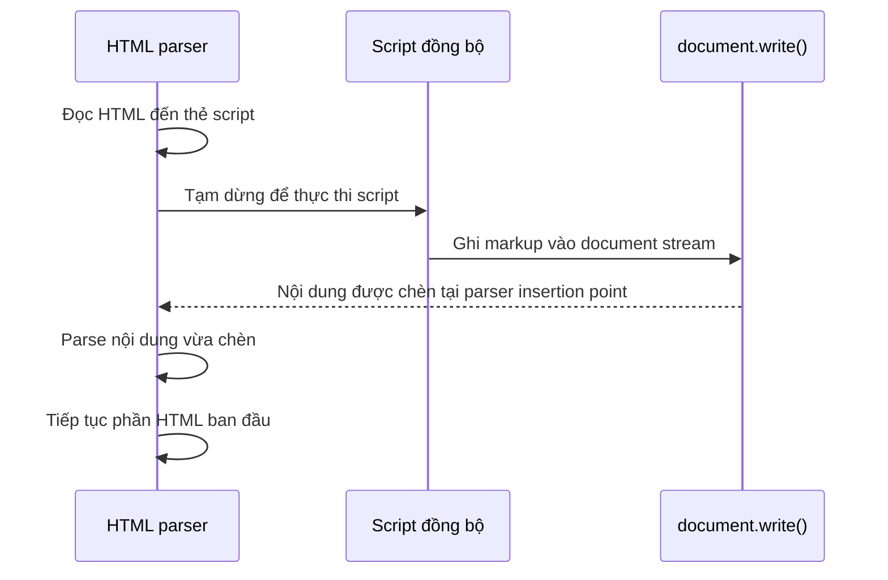

# document.write

> **Chương:** DOM security  
> **Bài học:** document.write — cách hoạt động, rủi ro bảo mật và cách thay thế an toàn  
> **Phạm vi module:** **SECURITY_APPLICATION_SECURITY_BROWSER_SECURITY** — phân tích ranh giới bảo mật giữa trình duyệt, origin, cookie và ứng dụng web để hiểu Same-Origin Policy (SOP), CORS và các cơ chế cách ly; thực hành phòng vệ XSS, CSRF, clickjacking bằng CSP, Trusted Types, security headers và kiểm chứng thực tế.

## Mục tiêu học tập

Sau bài này, bạn có thể:

1. Giải thích `document.write()`, `document.writeln()`, `document.open()` và `document.close()`.
2. Mô tả parser insertion point và vì sao `document.write()` có thể thay đổi luồng phân tích HTML đang tải.
3. Phân biệt hành vi khi gọi trong lúc parser đang chạy với khi document đã tải xong.
4. Nhận diện nguy cơ Stored XSS/DOM XSS khi dữ liệu không tin cậy đi vào `document.write()`.
5. Thay thế việc ghi chuỗi HTML bằng DOM API, text node và template auto-escaping.
6. Sử dụng sanitizer và Trusted Types trong ứng dụng legacy cần xử lý rich HTML.
7. Giải thích CSP, giới hạn của CSP và rủi ro hiệu năng do script được chèn bằng `document.write()`.
8. Kiểm thử hành vi trong một trang local cô lập và lập kế hoạch loại bỏ các điểm gọi legacy.

## 1. document.write() là gì?

`document.write()` là một API cũ của DOM cho phép ghi chuỗi vào luồng HTML của document. Browser đưa nội dung đó qua HTML parser như một phần của tài liệu đang được tạo.

Ví dụ đơn giản:

```html
<!doctype html>
<html lang="vi">
<head>
  <meta charset="utf-8">
  <title>Demo document.write</title>
</head>
<body>
  <script>
    document.write('<p>Thông báo do trang tạo ra</p>');
  </script>
</body>
</html>
```

Trong lúc parser đang đọc tài liệu, lời gọi trên chèn một phần tử paragraph vào luồng HTML tại vị trí parser hiện tại. Nó không tìm một phần tử cụ thể để sửa; nó ghi vào **document stream**.

Điều này khác với việc tạo node rồi gắn vào một container:

```js
const paragraph = document.createElement('p');
paragraph.textContent = 'Thông báo do trang tạo ra';
document.querySelector('#message').append(paragraph);
```

Ở ví dụ thứ hai, chương trình tạo node rõ ràng và gắn nó vào vị trí được chọn. Không có thao tác ghi ngược vào luồng parser của toàn document.

`document.write()` thường được coi là API legacy. Nó có thể làm thay đổi cấu trúc tài liệu, ảnh hưởng quá trình tải trang và tạo một HTML injection sink nếu dữ liệu không tin cậy được đưa vào.

## 2. Các API liên quan

### 2.1. document.write()

`document.write(...text)` chuyển các đối số thành chuỗi, nối chúng lại và ghi vào luồng document. Các đối số không tự được escape hay sanitize.

```js
document.write('<h2>');
document.write('Xin chào');
document.write('</h2>');
```

Các lời gọi này tạo ra markup trong document đang được parse. Cách dùng nhiều lần không giúp nội dung an toàn hơn.

### 2.2. document.writeln()

`document.writeln(...text)` tương tự `document.write()`, nhưng thêm một ký tự xuống dòng sau nội dung được ghi.

```js
document.writeln('<p>Dòng thứ nhất</p>');
document.writeln('<p>Dòng thứ hai</p>');
```

Ký tự xuống dòng trong HTML source thường chỉ là whitespace. Nó không đồng nghĩa với một phần tử `<br>` và không bảo đảm tạo khoảng cách hiển thị.

`document.writeln()` có cùng rủi ro injection và vấn đề vòng đời document như `document.write()`.

### 2.3. document.open()

`document.open()` mở một luồng document để ghi nội dung mới. Khi được gọi trên document hiện tại, nó xóa nội dung tài liệu hiện có và bắt đầu một document mới trong cùng browsing context.

```js
document.open();
document.write('<!doctype html><title>Trang mới</title><p>Nội dung mới</p>');
document.close();
```

Đây là thao tác có ảnh hưởng toàn trang. Nó không phải API để cập nhật một vùng giao diện.

Trong nhiều trường hợp, `document.write()` được gọi sau khi document đã tải xong sẽ tự động kích hoạt hành vi tương đương `document.open()` trước khi ghi. Vì vậy, một dòng `document.write()` chạy muộn có thể xóa trang hiện tại.

### 2.4. document.close()

`document.close()` đóng luồng document đã mở bằng `document.open()` và báo cho parser rằng không còn nội dung được ghi thêm theo luồng đó.

Nếu ứng dụng dùng bộ ba `open()`, `write()` và `close()` để tạo tài liệu, cần bảo đảm chuỗi thao tác hoàn tất đúng thứ tự. Đây vẫn là cách tạo document legacy và không nên dùng để render dữ liệu người dùng.

## 3. Parser insertion point: điều làm document.write() đặc biệt

HTML parser xử lý tài liệu theo luồng. Khi gặp một script đồng bộ trong HTML, parser có thể tạm dừng để chạy script. Trong lúc script đó đang chạy, parser có một vị trí chèn hiện tại — thường được gọi là **parser insertion point**.

Nếu script gọi `document.write()`, nội dung được đưa vào luồng tại vị trí đó. Parser tiếp tục xử lý phần nội dung mới trước khi đi tiếp phần HTML ban đầu còn lại.



Ví dụ:

```html
<body>
  <p>Trước script</p>

  <script>
    document.write('<p>Nội dung được chèn</p>');
  </script>

  <p>Sau script</p>
</body>
```

Trong điều kiện parser đang xử lý script đồng bộ, thứ tự trong DOM sẽ là paragraph trước script, paragraph được chèn và paragraph sau script.

Đây là hành vi khác với việc gọi `append()` sau khi toàn bộ trang đã tải. `document.write()` can thiệp vào quá trình parse tài liệu, nên có thể ảnh hưởng cả thứ tự tạo node lẫn việc tải tài nguyên.

### 3.1. Vì sao parser phải tạm dừng?

Một script đồng bộ có thể gọi `document.write()` và chèn thêm markup mà parser phải xử lý ngay tại vị trí hiện tại. Nếu parser tiếp tục đọc phần HTML phía sau trước khi script chạy xong, thứ tự tài liệu có thể sai.

Do đó, script đồng bộ kiểu cổ điển thường chặn parser trong lúc tải và thực thi. Nếu script còn tải tài nguyên mạng, việc parse HTML có thể phải chờ.

### 3.2. Nội dung được ghi có thể tiếp tục chứa script

Vì chuỗi được đưa qua HTML parser, markup được ghi có thể chứa phần tử script hoặc event handler. Những nội dung này có thể được xử lý theo quy tắc HTML/CSP tương ứng.

Đây là lý do `document.write()` là một **HTML parsing sink**. Nó không hoạt động như `textContent`: browser không xem chuỗi được ghi là văn bản thuần.

## 4. Hành vi phụ thuộc thời điểm gọi

Cần phân biệt ít nhất hai trường hợp.

### 4.1. Gọi khi document vẫn đang được parse

Khi parser insertion point còn tồn tại, nội dung được ghi có thể được chèn vào vị trí parser hiện tại. Đây là cách hoạt động lịch sử của các script đồng bộ được nhúng trong trang.

Nó có thể:

- Thay đổi thứ tự node được tạo.
- Chèn HTML vào document stream.
- Khiến parser xử lý thêm script hoặc tài nguyên.
- Chặn quá trình parse trong khi tài nguyên được tải.
- Tạo hành vi phụ thuộc thứ tự thực thi script.

### 4.2. Gọi sau khi document đã tải xong

Ví dụ:

```js
window.addEventListener('load', () => {
  document.write('<p>Đã tải xong</p>');
});
```

Đây là cách dùng nguy hiểm về mặt vòng đời. Khi không còn parser insertion point, browser thường mở lại document stream; thao tác đó có thể xóa nội dung document hiện tại trước khi ghi chuỗi mới.

Trong một số tình huống đặc biệt, browser có thể bỏ qua lời gọi thay vì thay document. Hành vi cụ thể chịu ảnh hưởng bởi ngữ cảnh thực thi và can thiệp của browser. Không dựa vào khác biệt này để thiết kế ứng dụng.

### 4.3. Gọi từ script async, defer hoặc module

Các script có thuộc tính `async`, `defer` hoặc loại `type="module"` chạy theo lịch thực thi khác với script đồng bộ parser-blocking. Khi chúng gọi `document.write()`, không thể giả định parser insertion point vẫn tồn tại.

Browser có thể bỏ qua lời gọi hoặc xử lý theo hành vi can thiệp riêng. Một số trường hợp có thể tạo ra kết quả không mong muốn hoặc làm mất nội dung tài liệu.

**Quy tắc thực tế:** không dùng `document.write()` trong async script, defer script, module script, callback timer, event handler hoặc mã chạy sau khi trang đã tải.

### 4.4. Không phải browser nào cũng thực hiện giống nhau trong mọi hoàn cảnh

Browser hiện đại có thể can thiệp để hạn chế tác động hiệu năng của `document.write()`, đặc biệt khi script bên ngoài làm chậm quá trình tải trang hoặc đến từ nguồn khác origin. Nội dung có thể bị chặn/không được chèn trong một số điều kiện.

Vì vậy, không nên dùng việc “đã thấy chạy trên máy mình” làm bằng chứng rằng API này ổn định. Nếu cần duy trì mã legacy, phải kiểm thử các browser và mạng mục tiêu, đồng thời có kế hoạch thay thế.

## 5. Vì sao document.write() tạo rủi ro XSS?

`document.write()` đưa chuỗi vào HTML parser. Nếu chuỗi chứa dữ liệu do người dùng hoặc hệ thống bên ngoài kiểm soát, browser có thể diễn giải dữ liệu đó thành HTML, thuộc tính sự kiện hoặc script.

Ví dụ lỗi:

```js
function showComment(comment) {
  document.write('<p>' + comment + '</p>');
}
```

Nếu `comment` là dữ liệu không tin cậy, nó có thể thay đổi cấu trúc HTML và tạo nội dung chủ động.

### 5.1. Chuỗi source → storage → sink

Một tình huống Stored XSS:

1. Người dùng gửi bình luận.
2. Server lưu bình luận vào database.
3. Trang quản trị truy xuất bình luận đó.
4. Script frontend ghép bình luận vào chuỗi HTML.
5. `document.write()` đưa chuỗi vào parser.
6. Browser xử lý markup ngoài ý muốn trong origin của trang quản trị.

Luồng này có thể ảnh hưởng đến người có quyền cao hơn người tạo bình luận. Nguồn dữ liệu đã được lưu hoặc đã qua backend không làm nó trở nên đáng tin.

### 5.2. DOM XSS từ storage hoặc URL

Một ứng dụng có thể lấy nội dung từ URL fragment, localStorage, postMessage hoặc API rồi gọi `document.write()`.

```js
const value = new URLSearchParams(location.search).get('notice');

// Không an toàn: dữ liệu từ URL được parse như HTML.
document.write('<p>' + value + '</p>');
```

Dù dữ liệu không được lưu trong database, nó vẫn không tin cậy. Nếu được lưu lại trước khi render, cùng luồng có thể mang đặc điểm persistent/stored XSS.

### 5.3. HTML parser không biết nguồn gốc dữ liệu

Parser chỉ nhận chuỗi HTML. Nó không biết phần nào do lập trình viên viết, phần nào đến từ bình luận, API, tên file hay webhook.

Do đó, việc ghép dữ liệu không tin cậy vào markup trước khi gọi `document.write()` khiến dữ liệu vượt qua ranh giới từ text sang HTML.

## 6. document.write() và Stored XSS

Một ví dụ thực tế là hệ thống bình luận hoặc ticket hỗ trợ lưu dữ liệu người dùng rồi render ở trang khác.

Giả sử nội dung lưu trong database là chuỗi HTML kiểm chứng vô hại:

```html

```

Nếu trang quản trị lấy chuỗi đó và gọi:

```js
document.write('<div class="comment">' + savedComment + '</div>');
```

Browser phân tích chuỗi như HTML. Nếu event handler được phép chạy và ảnh không tải được, thuộc tính kiểm chứng có thể xuất hiện trên body. Đây là ví dụ local để quan sát parser sink; không gửi dữ liệu ra ngoài và không truy cập tài khoản.

### 6.1. Vì sao Stored XSS có thể ảnh hưởng người có quyền cao?

Bản ghi có thể do người dùng ít quyền tạo ra, nhưng lại được hiển thị trong:

- Dashboard nhân viên hỗ trợ.
- Trang kiểm duyệt nội dung.
- Trang quản trị người dùng.
- Bảng log và lịch sử giao dịch.
- Trang xem trước nội dung import.

Nếu một trong các trang này dùng `document.write()` với dữ liệu không tin cậy, script có thể chạy trong origin và quyền của người đang xem trang đó. Do vậy, cần rà soát tất cả nơi render cùng một trường dữ liệu, không chỉ trang công khai.

### 6.2. Dữ liệu đã được kiểm tra ở server vẫn cần xử lý khi output

Validation ở server có thể bảo đảm tiêu đề không quá dài hoặc trường trạng thái thuộc danh sách cho phép. Điều đó không bảo đảm nội dung an toàn khi đưa vào HTML.

Các nguồn vẫn cần xem là không tin cậy tại thời điểm render:

- Nội dung người dùng nhập.
- Nội dung import từ CSV hoặc tài liệu.
- Webhook và API đối tác.
- Tên file, metadata và log.
- Dữ liệu được đồng bộ giữa các dịch vụ.
- Nội dung được tạo bởi công cụ tự động hoặc AI.

**Lưu trữ không phải là sanitization. Validation không thay output encoding.**

## 7. Vì sao document.write() không phải text output API?

Nếu mục tiêu là hiển thị chuỗi, `document.write()` là công cụ sai vì nó chuyển chuỗi vào HTML parser.

So sánh:

| API | Cách browser xử lý dữ liệu | Phù hợp để hiển thị text? |
|---|---|:---:|
| `document.write(value)` | Parse chuỗi như HTML trong document stream | Không |
| `element.innerHTML = value` | Parse chuỗi như HTML trong phần tử | Không |
| `element.textContent = value` | Tạo/đặt text node | Có |
| `document.createTextNode(value)` | Tạo text node | Có |
| `element.append(textNode)` | Gắn node vào DOM | Có |

### 7.1. Thay thế bằng textContent

Không an toàn:

```js
function renderNotice(untrustedNotice) {
  document.write('<p>' + untrustedNotice + '</p>');
}
```

An toàn hơn:

```js
function renderNotice(untrustedNotice) {
  const paragraph = document.createElement('p');
  paragraph.textContent = untrustedNotice;
  document.querySelector('#notice').replaceChildren(paragraph);
}
```

Dữ liệu được hiển thị như văn bản. Những ký tự như dấu nhỏ hơn, dấu lớn hơn và dấu nháy không trở thành markup.

### 7.2. Tạo cấu trúc bằng DOM API

Nếu cần tạo nhiều phần tử, hãy để chương trình kiểm soát cấu trúc và đặt dữ liệu vào text node:

```js
function renderComment(comment) {
  const article = document.createElement('article');
  article.className = 'comment';

  const heading = document.createElement('h3');
  heading.textContent = comment.author;

  const body = document.createElement('p');
  body.textContent = comment.body;

  article.append(heading, body);
  document.querySelector('#comments').append(article);
}
```

Cách này không cần ghép chuỗi HTML và không dùng parser để diễn giải dữ liệu người dùng.

### 7.3. Tạo link cần kiểm tra URL

Nếu ứng dụng cần hiển thị một URL do người dùng cung cấp, kiểm tra scheme trước khi gán vào thuộc tính:

```js
function createSafeLink(value) {
  let url;

  try {
    url = new URL(value, window.location.origin);
  } catch {
    return null;
  }

  if (!['https:', 'http:'].includes(url.protocol)) {
    return null;
  }

  const link = document.createElement('a');
  link.href = url.href;
  link.textContent = 'Mở liên kết';
  link.rel = 'noopener noreferrer';

  return link;
}
```

Ứng dụng có thể cần allowlist host, port hoặc path ngoài allowlist scheme. Không dùng kiểm tra chuỗi bằng `startsWith()` để xác minh URL; URL parser mới là công cụ phân tích cấu trúc.

## 8. Output encoding nếu phải tạo HTML

Trong một hệ thống legacy chưa thể loại bỏ ngay `document.write()`, có thể có trường hợp dữ liệu cần được chèn vào HTML text context. Khi đó, output encoding phải đúng ngữ cảnh.

Ví dụ helper minh họa cho **HTML text context**:

```js
function escapeHtmlText(value) {
  return String(value)
    .replaceAll('&', '&amp;')
    .replaceAll('<', '&lt;')
    .replaceAll('>', '&gt;')
    .replaceAll('"', '&quot;')
    .replaceAll("'", '&#x27;');
}

document.write('<p>' + escapeHtmlText(untrustedText) + '</p>');
```

Ví dụ này chỉ minh họa cách encode cho text node bên trong HTML. Nó không phải hàm escape đa dụng. Không dùng nguyên helper này cho:

- Giá trị URL trong `href` hoặc `src`.
- JavaScript string hoặc inline script.
- CSS hoặc style attribute.
- Tên attribute hoặc cấu trúc HTML tùy biến.
- Nội dung rich HTML cần cho phép một tập markup.

Cách tốt hơn vẫn là không dùng `document.write()` cho dữ liệu động. Dùng `textContent` hoặc template engine có auto-escaping theo context.

### 8.1. Đừng tự viết sanitizer bằng regex

HTML có quy tắc parser, entity, namespace, thuộc tính, phần tử lồng nhau và các trường hợp malformed markup. Một số cách viết có thể được browser chuẩn hóa thành DOM khác với chuỗi ban đầu.

Regex không phải bộ phân tích HTML và không tạo ra ranh giới bảo mật đáng tin cậy. Nếu sản phẩm cần rich text, dùng thư viện sanitizer được duy trì, cấu hình allowlist và kiểm tra DOM cuối cùng.

## 9. Rich HTML: sanitizer và TrustedHTML

Một số sản phẩm cần cho phép người dùng viết nội dung có định dạng như in đậm, danh sách và liên kết. Trong trường hợp này, không thể chỉ hiển thị nguyên chuỗi bằng `textContent`.

Hãy dùng HTML sanitizer dựa trên parser, ví dụ DOMPurify:

```js
const cleanHtml = DOMPurify.sanitize(untrustedHtml, {
  USE_PROFILES: { html: true },
});

const container = document.querySelector('#preview');
container.innerHTML = cleanHtml;
```

Cấu hình thực tế cần giới hạn tag, attribute và URL scheme theo chức năng cần thiết. Không bật SVG, MathML, iframe hoặc embed nếu sản phẩm không cần.

**Không nên dùng sanitizer rồi đưa kết quả trở lại `document.write()` chỉ vì sink đó đang có sẵn.** Hãy render kết quả đã sanitize vào một container được chọn rõ ràng, hoặc chuyển cấu trúc sang DOM node.

### 9.1. Trusted Types

Trusted Types giúp kiểm soát việc chuỗi đi vào các DOM injection sinks được hỗ trợ. Khi bật enforcement, browser có thể yêu cầu giá trị HTML phải được tạo qua một Trusted Types policy.

Ví dụ CSP:

```http
Content-Security-Policy: require-trusted-types-for 'script'; trusted-types app-html
```

Ví dụ policy tích hợp DOMPurify:

```js
const htmlPolicy = trustedTypes.createPolicy('app-html', {
  createHTML(input) {
    return DOMPurify.sanitize(input, {
      USE_PROFILES: { html: true },
      RETURN_TRUSTED_TYPE: false,
    });
  },
});

function renderRichText(container, untrustedHtml) {
  container.innerHTML = htmlPolicy.createHTML(untrustedHtml);
}
```

Policy chỉ an toàn khi hàm tạo TrustedHTML thực sự làm sạch đầu vào. Nếu policy trả nguyên chuỗi do người dùng gửi, Trusted Types không tự biến nội dung độc thành an toàn.

`document.write()` là một HTML injection sink cần được xem xét khi bật Trusted Types. Nếu mã legacy gọi sink này với string, enforcement có thể làm lộ lỗi hoặc chặn thao tác trên browser hỗ trợ. Không tạo policy chỉ để hợp thức hóa việc ghi HTML tùy ý; hãy dùng policy sanitizer hoặc loại bỏ sink.

## 10. CSP giúp gì khi document.write() được gọi?

Content Security Policy (CSP) là một lớp phòng vệ bổ sung, giúp browser giới hạn script được phép thực thi và nguồn tài nguyên được tải.

Ví dụ chính sách khởi đầu:

```http
Content-Security-Policy: default-src 'self'; script-src 'self' 'nonce-RANDOM_PER_RESPONSE'; object-src 'none'; base-uri 'none'; frame-ancestors 'none'
```

Nonce phải ngẫu nhiên, khó đoán, được tạo mới cho mỗi response HTML và khớp với script hợp lệ. Không dùng một nonce cố định trong source code.

CSP có thể chặn inline script hoặc event handler không được cho phép, nhưng không làm cho chuỗi được ghi trở thành văn bản thuần. `document.write()` vẫn có thể thay đổi DOM, chèn nội dung giả mạo hoặc tạo markup không mong muốn.

CSP cũng không bảo vệ nếu policy cho phép nguồn script không an toàn, dùng `unsafe-inline` quá rộng, hoặc ứng dụng có script gadget có thể bị lạm dụng. Do đó:

- Sửa sink và luồng dữ liệu trước.
- Giữ CSP ở vai trò defense-in-depth.
- Dùng nonce/hash và giới hạn nguồn script.
- Không cho phép inline event handler nếu không cần.
- Kiểm tra trang legacy và script bên thứ ba trước khi enforcement.

### 10.1. CSP Report-Only

Có thể triển khai `Content-Security-Policy-Report-Only` để thu thập vi phạm trước khi chặn. Giai đoạn này giúp tìm script hợp lệ đang phụ thuộc inline code hoặc nguồn ngoài.

Report-Only không chặn payload XSS. Sau khi xử lý các vi phạm hợp lệ, chuyển sang header enforcement và kiểm tra lại trên các browser mục tiêu.

## 11. document.write() và script bên thứ ba

Một số đoạn mã quảng cáo, analytics hoặc widget cũ yêu cầu nhúng script đồng bộ có sử dụng `document.write()` để chèn thêm markup hoặc tải script khác.

Ví dụ legacy:

```html
<script src="https://vendor.example/legacy-widget.js"></script>
```

Nếu script bên thứ ba gọi `document.write()` trong lúc parser đang chạy, nó có thể chèn nội dung vào trang chủ. Điều này có thể:

- Chặn parser trong lúc tải script hoặc tài nguyên tiếp theo.
- Làm thay đổi thứ tự nội dung.
- Tạo phụ thuộc vào mạng và thời điểm thực thi.
- Làm widget lỗi khi được chuyển sang async/defer.
- Mở thêm đường đưa HTML từ nhà cung cấp bên ngoài vào trang chính.

### 11.1. Không tự ý thêm async vào script legacy

Thêm thuộc tính `async` có thể thay đổi thứ tự thực thi và khiến parser insertion point không còn tồn tại khi script chạy. Nếu vendor dựa vào `document.write()`, widget có thể bị browser bỏ qua phần ghi hoặc hoạt động khác trước.

Cần xác minh tài liệu vendor và thay bằng cách tích hợp hiện đại được hỗ trợ. Không giải quyết vấn đề bằng cách giả định script async vẫn có thể ghi vào parser stream như script đồng bộ.

### 11.2. Các phương án thay thế

Ưu tiên theo mức kiểm soát:

1. SDK hiện đại của nhà cung cấp không dùng document.write.
2. Tạo script element qua DOM API, thiết lập URL đã được allowlist và xử lý sự kiện load/error.
3. Dùng iframe sandbox cho widget cần một document riêng.
4. Tải dữ liệu qua API rồi render bằng DOM node.
5. Loại bỏ tích hợp nếu không thể giới hạn quyền và nguồn nội dung phù hợp.

Ví dụ tải một script được kiểm soát:

```js
function loadVendorScript(src) {
  const url = new URL(src);

  if (url.origin !== 'https://static.vendor.example') {
    throw new Error('Nguồn script không được cho phép');
  }

  const script = document.createElement('script');
  script.src = url.href;
  script.async = true;

  script.addEventListener('error', () => {
    console.error('Không tải được widget');
  });

  document.head.append(script);
}
```

Chỉ dùng cách này khi vendor hỗ trợ tải bất đồng bộ và không phụ thuộc document.write. Script bên thứ ba vẫn chạy trong ngữ cảnh trang chủ nếu được chèn trực tiếp; hãy đánh giá quyền truy cập và cân nhắc iframe sandbox.

## 12. Hiệu năng và độ ổn định

`document.write()` có thể gây ra nhiều vấn đề ngoài XSS:

| Vấn đề | Nguyên nhân | Hệ quả |
|---|---|---|
| Parser blocking | Script đồng bộ dừng parser; script/tài nguyên được chèn có thể kéo dài thời gian chờ | Trang hiển thị chậm |
| Network dependency | Tài nguyên bên thứ ba được tải ngay trong quá trình parse | Mạng chậm làm chậm nội dung phía sau |
| Thứ tự thực thi khó đoán | Nội dung chèn tiếp tục chứa script hoặc tài nguyên | Khó debug và kiểm thử |
| Hành vi khác nhau | Browser có thể can thiệp hoặc bỏ qua trong một số ngữ cảnh | Lỗi phụ thuộc browser/mạng |
| Document bị thay thế | Gọi sau khi parser hoàn tất có thể mở lại và xóa document | Mất giao diện, mất state |
| Khó tích hợp module | API gắn với parser stream cổ điển | Không phù hợp kiến trúc async/module hiện đại |

Không phải mọi lần gọi `document.write()` đều làm trang chậm hoặc xóa document. Tác động phụ thuộc thời điểm, loại script, tài nguyên được chèn và browser. Tuy nhiên, sự phụ thuộc này làm API khó dự đoán và khó bảo trì.

### 12.1. Vì sao DOM API ổn định hơn?

DOM API cập nhật node trong vị trí rõ ràng, không cần can thiệp parser đang tải trang. Ứng dụng có thể tạo nội dung sau khi fetch hoàn tất, kiểm tra trạng thái và xử lý lỗi mạng mà không ghi lại document stream.

```js
async function renderMessages() {
  const response = await fetch('/api/messages');

  if (!response.ok) {
    throw new Error('Không tải được danh sách');
  }

  const messages = await response.json();
  const list = document.querySelector('#messages');
  const fragment = document.createDocumentFragment();

  for (const message of messages) {
    const item = document.createElement('li');
    item.textContent = message.body;
    fragment.append(item);
  }

  list.replaceChildren(fragment);
}
```

Ở ví dụ này, dữ liệu API được đặt vào text node. Cấu trúc danh sách do chương trình tạo ra và không cần HTML string.

## 13. Quy trình rà soát và thay thế document.write()

Khi tìm thấy `document.write()` trong codebase, không nên thay máy móc bằng `innerHTML`. Cần xác định mục đích thật của từng lời gọi.

### 13.1. Tìm và phân loại

Tìm các API:

- `document.write(`
- `document.writeln(`
- `document.open(`
- `document.close(`

Sau đó xác định:

1. Lời gọi chạy trong parser-blocking script, callback, event handler hay module?
2. Chuỗi ghi có chứa dữ liệu động không?
3. Dữ liệu đến từ user, URL, API, database hay vendor?
4. Nội dung cần là text, rich HTML hay toàn bộ document?
5. Có script/resource nào được chèn cùng markup không?
6. Trang nào và vai trò nào có thể render nội dung đó?
7. Có CSP hoặc Trusted Types enforcement đang áp dụng không?

### 13.2. Chọn cách thay thế theo mục đích

| Mục đích cũ | Thay thế phù hợp |
|---|---|
| Hiển thị text | `textContent` hoặc `createTextNode()` |
| Tạo một số phần tử | `createElement()`, `append()`, `replaceChildren()` |
| Render danh sách | DOM node + `DocumentFragment` |
| Hiển thị rich HTML | Sanitizer allowlist + container cụ thể |
| Tải script | `createElement('script')` với nguồn allowlist và xử lý load/error |
| Nhúng widget bên thứ ba | SDK hiện đại hoặc iframe sandbox |
| Tạo trang HTML ban đầu | Server-side template có auto-escaping |
| Preview tài liệu | Document riêng hoặc iframe sandbox phù hợp |

### 13.3. Xử lý mã legacy theo từng bước

1. Thêm test ghi nhận đầu ra hiện tại.
2. Xác định context và nguồn dữ liệu của mỗi lời gọi.
3. Thay nội dung text bằng text node.
4. Nếu cần rich HTML, thiết kế allowlist và sanitizer trước khi render.
5. Chuyển tải script sang cơ chế bất đồng bộ được vendor hỗ trợ.
6. Thêm CSP/Trusted Types theo lộ trình, kiểm tra các trang cũ.
7. Xóa lời gọi legacy sau khi chức năng thay thế đã được xác minh.
8. Kiểm tra lại hiệu năng, thứ tự tải và trải nghiệm người dùng.

Không dùng regex để thay toàn bộ lời gọi `document.write` trong repository. Mỗi điểm gọi có thể có mục đích và context khác nhau; sửa cần hiểu luồng dữ liệu và vị trí render.

## 14. Thực hành A — Quan sát parser insertion point

Thực hiện trong một file HTML local riêng, không dùng trang đang đăng nhập.

### Bước 1: Tạo file demo

```html
<!doctype html>
<html lang="vi">
<head>
  <meta charset="utf-8">
  <title>Parser insertion point</title>
</head>
<body>
  <p id="before">Trước script</p>

  <script>
    document.write('<p id="written">Được chèn bởi document.write</p>');
  </script>

  <p id="after">Sau script</p>
</body>
</html>
```

### Bước 2: Mở DevTools

1. Mở file trong browser.
2. Chọn tab Elements.
3. Quan sát thứ tự node `before`, `written` và `after`.
4. Xem View Source để so sánh source ban đầu với DOM sau khi parser xử lý.
5. Ghi nhận nội dung được chèn không xuất hiện trong file HTML gốc nhưng có mặt trong DOM.

### Kết quả mong đợi

Nội dung được ghi xuất hiện tại vị trí parser đang xử lý. Thí nghiệm cho thấy API ghi vào document stream chứ không cập nhật một container đã chọn.

## 15. Thực hành B — Quan sát lời gọi sau khi tải trang

Dùng một file local khác để tránh ảnh hưởng ứng dụng đang sử dụng.

```html
<!doctype html>
<html lang="vi">
<head>
  <meta charset="utf-8">
  <title>Late document.write</title>
</head>
<body>
  <h1 id="original">Nội dung ban đầu</h1>

  <script>
    window.addEventListener('load', () => {
      document.write('<p>Document đã được ghi lại</p>');
    });
  </script>
</body>
</html>
```

1. Mở file và quan sát trang sau khi load.
2. Kiểm tra xem nội dung ban đầu có còn không.
3. Xem Console và DOM.
4. Lặp lại trên browser mục tiêu khác nếu cần.
5. Ghi nhận sự khác biệt do browser intervention hoặc bối cảnh thực thi.

Không chạy thử nghiệm này trên trang thật; lời gọi muộn có thể thay thế document hiện tại.

## 16. Thực hành C — So sánh XSS sink với text node

Chỉ dùng payload kiểm chứng vô hại trong file local:

```js
const probe =
  "";

// HTML parser sink: không an toàn với dữ liệu không tin cậy.
const unsafeContainer = document.querySelector('#unsafe');
unsafeContainer.innerHTML = probe;

// Text node: dữ liệu chỉ được hiển thị.
const safeContainer = document.querySelector('#safe');
safeContainer.textContent = probe;
```

Quan sát:

- Container unsafe có thể tạo phần tử ảnh và event handler trong môi trường cho phép.
- Container safe hiển thị nguyên chuỗi như văn bản.
- Kiểm tra DOM cuối cùng trong Elements, không chỉ nhìn chuỗi ban đầu.
- Thử áp dụng CSP để quan sát việc thực thi bị giới hạn; ghi nhớ CSP không thay thế việc dùng sink an toàn.

## 17. Thực hành D — Thay thế lời gọi legacy

Trong một trang demo có vùng hiển thị thông báo:

1. Tìm các lời gọi `document.write()` và `document.writeln()`.
2. Phân loại dữ liệu là text hay rich HTML.
3. Thay text bằng `textContent` và `createElement`.
4. Nếu cần rich text, tích hợp sanitizer và kiểm tra allowlist.
5. Nếu có script vendor, xác minh SDK có hỗ trợ async hoặc iframe sandbox.
6. Bật Trusted Types trên browser hỗ trợ trong môi trường test.
7. Kiểm tra CSP report và Console.
8. Xác minh thứ tự nội dung, chức năng và hiệu năng sau thay đổi.

## 18. Checklist bảo mật khi review document.write()

| Hạng mục | Câu hỏi cần trả lời |
|---|---|
| Vị trí gọi | Lời gọi xảy ra khi parser còn hoạt động hay sau load? |
| Nguồn dữ liệu | Chuỗi có chứa user input, URL, storage, API hoặc vendor data không? |
| HTML parsing | Dữ liệu có thể tạo tag, attribute hoặc script không? |
| Context | Nội dung là text, rich HTML hay document hoàn chỉnh? |
| Thay thế | Có thể dùng textContent/createElement không? |
| Sanitizer | Nếu cần rich HTML, có parser-based allowlist không? |
| Trusted Types | Sink có được kiểm soát khi browser hỗ trợ không? |
| CSP | Inline script/event handler có bị giới hạn không? |
| Third-party | Script vendor có phụ thuộc parser insertion point không? |
| Timing | Có async/defer/module hoặc callback muộn không? |
| Document lifecycle | Có nguy cơ document bị mở lại và xóa không? |
| Performance | Có parser blocking hoặc tải tài nguyên đồng bộ không? |
| Testing | Có test trên các browser và mạng mục tiêu không? |
| Cleanup | Có xóa đường gọi legacy sau khi thay thế không? |

## 19. Câu hỏi tự kiểm tra

**1.** `document.write()` ghi nội dung vào đâu?  
**Đáp án:** Nó ghi chuỗi vào document stream để HTML parser xử lý, không ghi vào một container được chọn như DOM API thông thường.

**2.** Parser insertion point là gì?  
**Đáp án:** Là vị trí trong luồng parse nơi nội dung mới có thể được chèn khi parser đang xử lý script đồng bộ.

**3.** Vì sao `document.write()` có thể chặn việc tải trang?  
**Đáp án:** Script đồng bộ có thể tạm dừng parser; nội dung chèn có thể yêu cầu tải và thực thi thêm tài nguyên trước khi parser tiếp tục.

**4.** Gọi `document.write()` sau khi trang tải xong có thể gây điều gì?  
**Đáp án:** Browser thường mở lại document stream và xóa nội dung document hiện tại trước khi ghi; một số bối cảnh có thể bị browser bỏ qua.

**5.** `document.writeln()` có an toàn hơn `document.write()` không?  
**Đáp án:** Không. Nó chỉ thêm ký tự xuống dòng; dữ liệu vẫn được parse như HTML.

**6.** Vì sao dữ liệu từ database vẫn có thể tạo Stored XSS qua `document.write()`?  
**Đáp án:** Dữ liệu lưu trữ vẫn không tin cậy ở thời điểm render; sink đưa nó vào HTML parser mà không tự escape.

**7.** `textContent` khác `document.write()` như thế nào?  
**Đáp án:** `textContent` tạo text node; `document.write()` đưa chuỗi qua HTML parser.

**8.** Có thể dùng một hàm escape HTML text cho URL hoặc JavaScript context không?  
**Đáp án:** Không. Mỗi context cần cách xử lý riêng; URL còn cần kiểm tra scheme/host.

**9.** Sanitizer có khiến việc dùng `document.write()` trở thành lựa chọn tốt không?  
**Đáp án:** Không. Sanitizer có thể làm sạch rich HTML theo allowlist, nhưng nên đưa kết quả vào container cụ thể và loại bỏ parser sink legacy.

**10.** CSP có biến nội dung được ghi thành text an toàn không?  
**Đáp án:** Không. CSP giới hạn việc thực thi script theo policy; markup vẫn có thể thay đổi DOM hoặc giả mạo giao diện.

**11.** Trusted Types có tự sanitize chuỗi không?  
**Đáp án:** Không. Policy phải tạo TrustedHTML từ dữ liệu đã được xử lý an toàn, chẳng hạn qua sanitizer.

**12.** Vì sao script bên thứ ba dùng `document.write()` có thể hỏng khi thêm `async`?  
**Đáp án:** Script async chạy khi parser insertion point có thể không còn tồn tại; browser có thể bỏ qua thao tác ghi hoặc xử lý khác.

## Ghi nhớ

**`document.write()` là HTML parser sink thao tác trên document stream.** Khi được gọi trong lúc parser đang xử lý script đồng bộ, nội dung có thể được chèn tại parser insertion point; khi gọi muộn, browser thường mở lại và xóa document trước khi ghi. Hành vi này vừa khó dự đoán, vừa có thể chặn parser và tạo Stored/DOM XSS nếu chuỗi chứa dữ liệu không tin cậy.

Với nội dung text, dùng `textContent` hoặc `createTextNode`; với cấu trúc, tạo node bằng DOM API; với rich HTML, dùng sanitizer theo allowlist và Trusted Types khi phù hợp. CSP là lớp phòng vệ bổ sung, không thay việc sửa sink. Hãy kiểm kê các lời gọi legacy, đặc biệt ở script quảng cáo/widget bên thứ ba, rồi thay theo mục đích thực tế và kiểm chứng trên browser mục tiêu.
