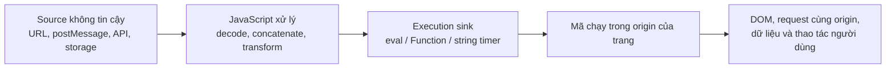

# eval: rủi ro thực thi mã động trong JavaScript và DOM XSS

JavaScript có thể tạo và thực thi mã từ một chuỗi thông qua các API như `eval()`, `Function()` hoặc truyền chuỗi vào `setTimeout()` và `setInterval()`. Những API này biến dữ liệu thành chương trình. Nếu chuỗi có thể bị người dùng, URL, API hoặc một thành phần không tin cậy kiểm soát, ứng dụng có thể vô tình thực thi mã trong quyền của trang đang mở.

Đây là một nhóm **DOM-based XSS** quan trọng: dữ liệu không tin cậy đi từ một nguồn (source) tới một điểm thực thi (sink) mà không được kiểm soát. Kẻ tấn công không nhất thiết phải làm server trả về một trang HTML chứa script; mã JavaScript hợp pháp đã có trong trang có thể tự lấy dữ liệu độc hại rồi đưa vào `eval()`.

Bài học thuộc chương **DOM security**, trong phạm vi `SECURITY_APPLICATION_SECURITY_BROWSER_SECURITY`: phân tích ranh giới bảo mật giữa trình duyệt, origin, cookie và ứng dụng web; hiểu Same-Origin Policy, CORS và các cơ chế cách ly; thực hành phòng vệ XSS, CSRF, clickjacking bằng CSP, Trusted Types, security headers và kiểm chứng hành vi thực tế.

## 1. Mục tiêu học tập

Sau bài học, người học có thể:

1. Giải thích vì sao `eval()` và các API thực thi chuỗi tạo ra rủi ro code injection.
2. Phân biệt direct eval, indirect eval, `Function()` và string-based timer.
3. Theo dõi dữ liệu từ source đến execution sink trong một luồng DOM XSS.
4. Thay việc thực thi chuỗi bằng `JSON.parse()`, allowlist hành động, mapping hàm và parser giới hạn.
5. Giải thích vai trò của CSP `script-src` và chỉ thị `unsafe-eval`.
6. Hiểu Trusted Types bảo vệ một số DOM injection sink như thế nào và giới hạn của nó với dynamic code execution.
7. Kiểm tra mã nguồn, DevTools và response headers để tìm, xác minh và khắc phục rủi ro.

## 2. Vì sao eval nguy hiểm?

`eval()` nhận một chuỗi và phân tích chuỗi đó như mã JavaScript:

```js
const expression = '1 + 2';
const result = eval(expression);
console.log(result); // 3
```

Ví dụ trên có vẻ vô hại vì chuỗi là hằng số do lập trình viên viết. Rủi ro xuất hiện khi chuỗi được ghép từ dữ liệu có thể bị kiểm soát từ bên ngoài:

```js
const expression = new URLSearchParams(location.search).get('expression');
const result = eval(expression); // Không an toàn
```

Nếu URL chứa:

```text
?expression=alert(document.domain)
```

thì mã trong tham số có thể chạy trong origin của trang khi đoạn code được thực thi. Trong một trang đã đăng nhập, script có thể thao tác DOM, gửi request cùng origin, đọc dữ liệu mà JavaScript được phép truy cập hoặc thay đổi giao diện để lừa người dùng.

**Nguyên tắc:** dữ liệu phải tiếp tục là dữ liệu. Không chuyển chuỗi không tin cậy thành mã JavaScript.

### eval không phải bộ phân tích dữ liệu

Một số ứng dụng dùng `eval()` để đọc JSON hoặc cấu hình:

```js
const settings = eval('(' + serverResponseText + ')');
```

Đây là lựa chọn nguy hiểm và không cần thiết. JSON là định dạng dữ liệu có parser chuẩn:

```js
const settings = JSON.parse(serverResponseText);
```

`JSON.parse()` chỉ phân tích cú pháp JSON, không thực thi biểu thức JavaScript, function hoặc câu lệnh. Tuy nhiên, dữ liệu sau khi parse vẫn phải được kiểm tra schema và không được đưa tiếp vào một HTML/URL/script sink không an toàn.

## 3. Những API có thể thực thi chuỗi như mã

Không chỉ `eval()` mới đáng rà soát. Những API sau có thể biên dịch hoặc thực thi chuỗi trong một số cách gọi:

| API/cách gọi | Hành vi | Rủi ro |
| --- | --- | --- |
| `eval(source)` | Phân tích và thực thi chuỗi JavaScript | Nguồn dữ liệu không tin cậy có thể trở thành chương trình. |
| `new Function(source)` | Biên dịch chuỗi thành function mới | Tạo mã động; chuỗi đầu vào có thể thay đổi thân hàm. |
| `Function(source)` | Tạo function từ chuỗi | Có cùng nhóm rủi ro thực thi mã động. |
| `setTimeout(source, delay)` | Nếu đối số đầu là chuỗi, chuỗi được xử lý như mã | Timer trở thành execution sink. |
| `setInterval(source, delay)` | Nếu đối số đầu là chuỗi, chuỗi được xử lý như mã lặp lại | Mã không tin cậy có thể được thực thi nhiều lần. |
| `javascript:` URL | Một số ngữ cảnh điều hướng xử lý URL như mã JavaScript | Dữ liệu điều khiển URL có thể dẫn đến thực thi mã. |
| Inline event handler (`onclick`, `onerror`...) | Giá trị thuộc tính được xử lý như mã handler | Không dùng dữ liệu để tạo handler động. |

### Function constructor

```js
const operation = 'return 10 * 2';
const calculate = new Function(operation);
console.log(calculate()); // 20
```

`Function()` tạo function mới từ chuỗi. Khác với direct eval, function được tạo không đóng (capture) lexical scope cục bộ của nơi gọi; phần thân chạy trong global scope của realm tương ứng. Điều này **không làm nó an toàn**: mã vẫn có thể truy cập các global API được phép và thao tác tài liệu.

Không nối dữ liệu vào constructor:

```js
const userCode = new URLSearchParams(location.search).get('code');
const run = new Function(userCode); // Không an toàn
run();
```

### String-based timer

Không dùng:

```js
setTimeout("document.querySelector('#status').textContent = 'Done'", 1000);
```

Hãy truyền function:

```js
setTimeout(() => {
  document.querySelector('#status').textContent = 'Done';
}, 1000);
```

Đối số function được gọi như callback đã định nghĩa trong mã ứng dụng; nó không yêu cầu parser biên dịch một chuỗi mới.

### Direct eval và indirect eval

Direct eval xảy ra khi gọi trực tiếp `eval(...)` như một identifier. Trong một số điều kiện, mã được đánh giá có thể truy cập lexical scope của nơi gọi. Điều này làm tác động của chuỗi khó dự đoán và có thể ảnh hưởng biến trong phạm vi hiện tại, đặc biệt với code không strict.

Indirect eval gọi hàm eval qua một tham chiếu khác, ví dụ:

```js
const run = eval;
run('console.log("global scope")');
```

Indirect eval đánh giá mã trong global scope thay vì lexical scope của caller. Cách gọi này **không giảm rủi ro code injection**; mã vẫn được thực thi.

Không dùng strict mode hoặc indirect eval như biện pháp khắc phục. Biện pháp đúng là loại bỏ việc đánh giá mã không tin cậy.

## 4. DOM XSS: source, transformation và execution sink

Một luồng DOM XSS thường có ba thành phần:

1. **Source:** nơi dữ liệu đi vào ứng dụng.
2. **Transformation:** các bước parse, decode, ghép chuỗi hoặc xử lý dữ liệu.
3. **Sink:** API khiến dữ liệu được diễn giải thành HTML, URL, CSS hoặc mã thực thi.



### Những source cần kiểm tra

- `location.search`, `location.hash`, `location.pathname` và các giá trị URL khác.
- `document.referrer` và thông tin điều hướng.
- Dữ liệu nhận từ `window.postMessage()`.
- API response, dữ liệu CMS, nội dung do người dùng tạo.
- `localStorage`, `sessionStorage`, IndexedDB và cookie mà JavaScript đọc được.
- Thuộc tính DOM hoặc `data-*` được tạo từ dữ liệu bên ngoài.
- Thông điệp từ extension, widget hoặc thành phần tích hợp nếu ứng dụng có nhận chúng.

Không phải mọi source đều luôn độc hại. Nhưng dữ liệu từ những nguồn này cần được coi là không tin cậy cho tới khi được xác thực theo mục đích sử dụng.

### Execution sink cần rà soát

- `eval(...)`.
- `new Function(...)` hoặc `Function(...)`.
- `setTimeout(...)`/`setInterval(...)` với đối số chuỗi.
- Các wrapper tự viết gọi những API trên.
- Thư viện biểu thức/template có cơ chế biên dịch chuỗi thành JavaScript.

Một hàm có tên như `runExpression`, `compileRule`, `executeTemplate` hoặc `evaluateConfig` không nhất thiết an toàn. Hãy đọc implementation và tìm API thực thi bên dưới.

### Ví dụ source-to-sink

Đoạn code sau có DOM XSS:

```js
const params = new URLSearchParams(location.search);
const command = params.get('command');

if (command) {
  eval(command); // Source từ URL đi thẳng vào execution sink
}
```

Việc gọi `decodeURIComponent()`, Base64 decode, `JSON.stringify()` hoặc thay thế ký tự trước `eval()` không biến luồng này thành an toàn. Những phép biến đổi đó không chứng minh chuỗi chỉ chứa dữ liệu vô hại.

## 5. Thay eval bằng cách giữ dữ liệu ở dạng dữ liệu

Giải pháp phụ thuộc vào mục đích ban đầu. Không có một parser chung nào phù hợp cho mọi nhu cầu.

### 5.1. Đọc JSON bằng JSON.parse

Nếu đầu vào là JSON:

```js
const raw = '{"theme":"dark","pageSize":20}';
const parsed = JSON.parse(raw);

if (
  typeof parsed !== 'object' ||
  parsed === null ||
  typeof parsed.theme !== 'string' ||
  !Number.isInteger(parsed.pageSize)
) {
  throw new Error('Cấu hình không hợp lệ');
}

const allowedThemes = new Set(['light', 'dark', 'system']);
if (!allowedThemes.has(parsed.theme)) {
  throw new Error('Theme không được hỗ trợ');
}
```

`JSON.parse()` xử lý cú pháp; kiểm tra schema và allowlist xử lý tính hợp lệ theo nghiệp vụ. Không dùng `eval()` để đọc JSON, object literal hoặc cấu hình.

### 5.2. Chọn hành động từ allowlist

Nếu ứng dụng dùng chuỗi để chọn một hành động, hãy ánh xạ tên hành động tới function cố định:

```js
const actions = new Map([
  ['show-help', () => showHelpPanel()],
  ['refresh-list', () => refreshList()],
  ['open-settings', () => openSettings()]
]);

function runAction(actionName) {
  const action = actions.get(actionName);
  if (!action) {
    throw new Error('Hành động không được hỗ trợ');
  }
  return action();
}

const requestedAction =
  new URLSearchParams(location.search).get('action');

if (requestedAction) {
  runAction(requestedAction);
}
```

Chuỗi từ URL chỉ chọn một hành động đã được lập trình viên định nghĩa. Nó không thể bổ sung câu lệnh JavaScript mới. Nếu hành động thay đổi dữ liệu, server vẫn phải xác thực người dùng, phân quyền và chống CSRF theo yêu cầu.

### 5.3. Dùng switch cho tập lựa chọn nhỏ

```js
function formatValue(value, format) {
  switch (format) {
    case 'uppercase':
      return value.toUpperCase();
    case 'lowercase':
      return value.toLowerCase();
    case 'trim':
      return value.trim();
    default:
      throw new Error('Format không được hỗ trợ');
  }
}
```

Đây là cách phù hợp khi số thao tác hữu hạn và rõ ràng. Không nhận một biểu thức JavaScript tùy ý rồi cố lọc các từ khóa nguy hiểm bằng regex.

### 5.4. Nếu cần biểu thức toán học

Một số ứng dụng cần cho người dùng nhập biểu thức như `2 * (3 + 4)`. Không dùng `eval()` để tính. Hãy chọn thư viện parser toán học được duy trì, hoặc xây dựng parser nhỏ cho một grammar giới hạn:

- Số nguyên/số thập phân.
- Các toán tử được phép (`+`, `-`, `*`, `/`).
- Dấu ngoặc.
- Giới hạn độ dài, độ sâu và miền giá trị.
- Không có truy cập property, lời gọi hàm tùy ý, assignment, `this`, global object hoặc statement JavaScript.

Parser phải tạo cây cú pháp (AST) và đánh giá từng node theo grammar đã định nghĩa. Không chuyển AST trở lại thành chuỗi JavaScript rồi gọi `eval()`.

### 5.5. Nếu cần tải module hoặc plugin

Không tạo mã từ chuỗi để tải plugin. Dùng danh sách module tĩnh hoặc mapping định danh đã được phê duyệt:

```js
const pluginLoaders = new Map([
  ['reports', () => import('./plugins/reports.js')],
  ['charts', () => import('./plugins/charts.js')]
]);

async function loadPlugin(name) {
  const load = pluginLoaders.get(name);
  if (!load) throw new Error('Plugin không được phép');
  return load();
}
```

Danh sách trên được đóng gói trong mã ứng dụng; dữ liệu chỉ chọn một module đã định nghĩa. Không xây dựng đường dẫn module tùy ý từ query string hoặc phản hồi API.

## 6. CSP và chỉ thị unsafe-eval

Content Security Policy có thể chặn một số API đánh giá chuỗi JavaScript. Với `script-src` không cho phép `'unsafe-eval'`, trình duyệt tương thích sẽ chặn các cơ chế như `eval()`, `Function()` và string-based timer.

Ví dụ response header:

```http
Content-Security-Policy: default-src 'self'; script-src 'self'; object-src 'none'; base-uri 'none'
```

Không có `'unsafe-eval'` trong `script-src`, nên các API thực thi chuỗi bị chặn theo CSP. Nếu ứng dụng thêm:

```http
Content-Security-Policy: script-src 'self' 'unsafe-eval'
```

thì chính sách cho phép các API đó hoạt động. Không thêm `'unsafe-eval'` chỉ để làm một thư viện cũ hoặc build development hết lỗi; hãy xác định thư viện nào yêu cầu nó và thay thế hoặc cấu hình lại.

### CSP không phải bộ lọc dữ liệu

CSP giúp giảm khả năng thực thi mã động khi có lỗi, nhưng không làm chuỗi độc hại biến thành dữ liệu an toàn. Nếu ứng dụng bỏ CSP ở môi trường khác, cấu hình bị nới lỏng hoặc có sink khác, lỗi vẫn có thể bị khai thác.

Nên:

- Bỏ `'unsafe-eval'` khỏi production policy.
- Bắt đầu bằng `Content-Security-Policy-Report-Only` khi cần quan sát ảnh hưởng trước khi enforce.
- Kiểm tra báo cáo vi phạm và xác định dependency đang dùng eval.
- Chuyển sang CSP enforcement sau khi xử lý các phụ thuộc hợp lệ.
- Giữ policy phù hợp cho `script-src`, `object-src`, `base-uri` và các nguồn tài nguyên khác.

### wasm-unsafe-eval là chỉ thị khác

WebAssembly có cơ chế biên dịch riêng. Trong môi trường cần WebAssembly, CSP có thể dùng `'wasm-unsafe-eval'` để cho phép biên dịch/khởi tạo WebAssembly mà không mở quyền JavaScript `eval()` như `'unsafe-eval'`. Chỉ thêm nếu ứng dụng thực sự cần và sau khi kiểm tra hỗ trợ của trình duyệt mục tiêu.

Không dùng `'unsafe-eval'` như cách giải quyết chung cho lỗi WebAssembly; chọn quyền nhỏ nhất đáp ứng chức năng.

## 7. Trusted Types: kiểm soát một số injection sink

Trusted Types bổ sung cơ chế để ứng dụng chỉ đưa giá trị thuộc loại tin cậy vào một số DOM injection sink. Ví dụ phổ biến là `innerHTML`, `outerHTML`, `insertAdjacentHTML` và các API liên quan tới việc parse chuỗi thành HTML hoặc script trong các trình duyệt hỗ trợ.

Một CSP có thể bật enforcement:

```http
Content-Security-Policy: require-trusted-types-for 'script'; trusted-types app-html
```

Ứng dụng cần tạo policy có tên `app-html` theo quy tắc đã review, thường kết hợp một HTML sanitizer được duy trì. Không tạo policy trả nguyên chuỗi đầu vào mà không kiểm tra.

### Trusted Types không thay thế việc bỏ eval

Trusted Types tập trung vào các injection sink được định nghĩa và hỗ trợ bởi trình duyệt. Một số API script sink có thể tích hợp với Trusted Types, nhưng phạm vi hỗ trợ và yêu cầu kiểu dữ liệu khác nhau theo API/user agent. Không giả định rằng bật Trusted Types sẽ tự bảo vệ mọi lời gọi `eval()`, `Function()` hoặc mọi đường biên dịch mã.

Với dynamic code execution:

- Loại bỏ việc thực thi chuỗi không tin cậy.
- Dùng CSP `script-src` không có `'unsafe-eval'`.
- Kiểm tra riêng Trusted Types enforcement và tương thích API.
- Không coi việc một giá trị có kiểu TrustedScript là bằng chứng nội dung đó an toàn; policy tạo ra nó vẫn phải được kiểm soát.

Trusted Types, CSP và source-to-sink review là các lớp bổ sung, mỗi lớp xử lý một phần rủi ro.

## 8. Các cách “làm sạch” không giải quyết được eval injection

| Cách làm sai | Vì sao không an toàn |
| --- | --- |
| Xóa chuỗi `alert` hoặc `document` | JavaScript có nhiều cách biểu đạt tương đương; blacklist không bao phủ ngôn ngữ. |
| Chỉ cho phép chữ và số bằng regex | Có thể vẫn cho phép cú pháp ngoài ý muốn; grammar JavaScript rộng và phức tạp. |
| Base64 encode trước khi eval | Base64 chỉ là biểu diễn; khi decode, mã vẫn được thực thi. |
| Percent-encode rồi decode trước eval | Encoding không phải sanitizer; sau decode vẫn là chuỗi mã. |
| Dùng `JSON.stringify()` rồi eval | Stringify không biến mã thành dữ liệu an toàn khi sau đó lại đánh giá bằng JavaScript parser. |
| Dùng indirect eval hoặc strict mode | Thay đổi một số quy tắc scope, không loại bỏ khả năng thực thi mã. |
| Chỉ dựa vào CSP | CSP có thể bị nới lỏng, thiếu hỗ trợ hoặc có sink khác; phải sửa luồng dữ liệu. |
| Chỉ dựa vào Trusted Types | Không bao phủ mọi API hoặc mọi kiểu code execution; policy sai có thể tin dữ liệu độc hại. |

Nếu yêu cầu nghiệp vụ cần một ngôn ngữ biểu thức, hãy xác định grammar nhỏ, parse thành AST, giới hạn node và đánh giá bằng interpreter riêng. Không cố biến JavaScript đầy đủ thành an toàn bằng cách lọc chuỗi.

## 9. Thực hành: nhận diện DOM XSS qua eval

Thực hành chỉ trên trang lab local do người học kiểm soát. Không thử payload trên website của người khác và không dùng cookie/token thật.

### 9.1. Tạo trang thử nghiệm

Tạo một trang HTML có nội dung:

```html
<!doctype html>
<html lang="vi">
<meta charset="utf-8">
<title>DOM XSS eval lab</title>
<h1>Eval lab</h1>
<p id="result">Chưa chạy</p>
<button id="unsafe-run">Chạy biểu thức từ URL (không an toàn)</button>
<button id="safe-run">Chạy hành động allowlist</button>
<script>
  const result = document.querySelector('#result');

  document.querySelector('#unsafe-run').addEventListener('click', () => {
    const source = new URLSearchParams(location.search).get('expression');
    if (source) {
      // Cố ý có lỗ hổng trong lab: không dùng trong ứng dụng thật.
      const value = eval(source);
      result.textContent = String(value);
    }
  });

  const actions = new Map([
    ['show-message', () => 'Đây là thông báo cố định'],
    ['double-demo', () => String(2 * 10)]
  ]);

  document.querySelector('#safe-run').addEventListener('click', () => {
    const name = new URLSearchParams(location.search).get('action');
    const action = actions.get(name);
    result.textContent = action ? action() : 'Hành động không được hỗ trợ';
  });
</script>
</html>
```

Mở trang lab với query thử nghiệm:

```text
?expression=1%20%2B%202
```

Nhấn nút không an toàn và quan sát kết quả `3`. Sau đó thử chuỗi:

```text
?expression=alert(document.domain)
```

Nhấn nút không an toàn để quan sát mã chạy trong origin của lab. Đây là minh họa có chủ đích cho source (query string) nối tới sink (`eval`). Chỉ dùng trong môi trường kiểm soát.

### 9.2. So sánh cách xử lý an toàn

Mở trang với:

```text
?action=show-message
```

Nhấn nút allowlist. Chuỗi chỉ chọn một hàm đã được định nghĩa sẵn. Thử `?action=alert(1)` hoặc một tên không nằm trong mapping; ứng dụng hiển thị “Hành động không được hỗ trợ” và không thực thi chuỗi đó.

### 9.3. Quan sát bằng DevTools

1. Mở tab **Sources** và đặt breakpoint tại lời gọi `eval`.
2. Xem call stack để xác định source, biến trung gian và sink.
3. Mở **Network** để xác nhận query string được tải cùng document.
4. Quan sát Console và DOM sau khi chạy.
5. Thay đoạn eval bằng mapping allowlist rồi chạy lại các input.
6. Xác nhận dữ liệu không còn đi vào API thực thi chuỗi.

### 9.4. Thử CSP

Ví dụ trang lab ở mục 9.1 dùng inline script để ngắn gọn. Trước khi thử policy bên dưới, hãy chuyển phần JavaScript đó sang tệp cùng origin như `/lab.js` và tham chiếu bằng `<script src="/lab.js"></script>`. Nếu giữ inline script mà không cấp nonce/hash hợp lệ, `script-src 'self'` sẽ chặn cả script của lab; khi đó phép thử không còn cô lập riêng hành vi `eval()`.

Nếu server lab có thể cấu hình response header, thêm:

```http
Content-Security-Policy: default-src 'self'; script-src 'self'; object-src 'none'; base-uri 'none'
```

Tải lại trang và nhấn nút không an toàn. Trình duyệt hỗ trợ CSP sẽ từ chối `eval()` vì policy không cho phép `'unsafe-eval'`; quan sát thông báo vi phạm trong Console. Nút allowlist vẫn hoạt động vì nó gọi function đã có trong script, không biên dịch chuỗi.

Sau đó chỉ để minh họa, thử policy có `'unsafe-eval'` trong môi trường lab. Quan sát `eval()` hoạt động trở lại. Không giữ cấu hình đó trong production.

### 9.5. Bằng chứng cần ghi nhận

| Bằng chứng | Điều cần xác nhận |
| --- | --- |
| URL chứa expression thử nghiệm | Dữ liệu đầu vào đến từ query string. |
| Call stack tại eval | Xác định được đường source-to-sink. |
| Kết quả payload trong lab | Chứng minh chuỗi đã được thực thi dưới origin lab. |
| Bản sửa allowlist | Chuỗi chỉ chọn hành động có sẵn, không tạo mã mới. |
| CSP Console | `eval()` bị chặn khi không có `'unsafe-eval'`. |
| Regression inputs | Tên hành động không hợp lệ bị từ chối, không có side effect. |

## 10. Rà soát mã nguồn trong dự án

Khi review repository, tìm cả API trực tiếp và wrapper:

```bash
rg -n -i "\\beval\\s*\\(|\\bnew\\s+Function\\s*\\(|\\bFunction\\s*\\(|\\bsetTimeout\\s*\\(|\\bsetInterval\\s*\\(" src
```

Đây là tìm kiếm ban đầu, không phải chứng minh đầy đủ. Kết quả có thể bao gồm test, mock, thư viện vendor hoặc string timer không thực sự nguy hiểm; ngược lại, wrapper, alias hoặc tên hàm động có thể không được tìm thấy.

Với từng kết quả:

1. Đọc toàn bộ luồng gọi, không chỉ dòng có eval.
2. Xác định chuỗi là hằng số do lập trình viên kiểm soát hay dữ liệu từ source bên ngoài.
3. Tìm nơi dữ liệu được decode, nối chuỗi, parse hoặc lưu tạm.
4. Xác định có thực sự cần biểu thức/mã động hay chỉ cần chọn một thao tác.
5. Thay bằng parser dữ liệu, allowlist, mapping hoặc interpreter giới hạn.
6. Thêm kiểm thử với input bình thường, input sai định dạng và payload kiểm thử trong môi trường an toàn.
7. Xác minh CSP production không cần `'unsafe-eval'`.

Không xóa một dependency hoặc API chỉ dựa trên tên. Có thể thư viện dùng eval cho một tính năng cụ thể; cần tìm cách cấu hình/build thay thế và kiểm thử chức năng trước khi loại bỏ.

## 11. Checklist phòng vệ eval và DOM XSS

| Hạng mục | Câu hỏi rà soát | Kết quả mong đợi |
| --- | --- | --- |
| Dynamic execution | Có eval, Function hoặc string-based timer không? | Loại bỏ hoặc giới hạn vào mã hằng số đã được kiểm soát tuyệt đối; không nhận dữ liệu ngoài. |
| Source | Dữ liệu có đến từ URL, postMessage, API, storage hoặc DOM không? | Theo dõi source-to-sink và coi dữ liệu ngoài là không tin cậy. |
| Data parsing | Có dùng eval để đọc JSON/config không? | Dùng JSON.parse và schema validation. |
| Action selection | Chuỗi có được dùng để chọn hành động không? | Dùng Map/switch allowlist tới function cố định. |
| Expression | Có cho người dùng nhập công thức/biểu thức không? | Dùng parser/AST/interpreter giới hạn, không dùng JavaScript eval. |
| Timer | setTimeout/setInterval có nhận chuỗi không? | Truyền callback function. |
| CSP | Production script-src có unsafe-eval không? | Bỏ nếu không có yêu cầu đã được đánh giá; theo dõi report-only trước khi enforce. |
| Trusted Types | Có dùng như biện pháp thay thế việc bỏ eval không? | Không; dùng đúng phạm vi DOM sink và xác minh hỗ trợ. |
| Testing | Có test payload và input không hợp lệ không? | Kiểm tra cả kết quả, side effect và call stack. |
| Logging | Có log raw token/PII khi debug DOM XSS không? | Dùng dữ liệu giả và mã tương quan; không ghi bí mật. |

## 12. Câu hỏi tự kiểm tra

1. Vì sao `eval(location.search)` là DOM XSS dù server không trả về một đoạn script độc hại?
2. Direct eval và indirect eval khác nhau thế nào về lexical scope? Vì sao cả hai đều nguy hiểm với dữ liệu không tin cậy?
3. Vì sao `new Function()` không an toàn dù function mới không capture lexical scope của caller?
4. String-based `setTimeout()` khác với truyền callback function như thế nào?
5. Vì sao `JSON.parse()` phù hợp để đọc JSON hơn `eval()`? Tại sao vẫn cần schema validation sau khi parse?
6. Nếu người dùng cần chọn một hành động, vì sao Map/switch allowlist an toàn hơn thực thi chuỗi?
7. CSP `script-src` không có `'unsafe-eval'` chặn những cơ chế nào? Nó có thay thế việc sửa source-to-sink không?
8. Trusted Types bảo vệ một số injection sink nào và vì sao không nên coi nó là lớp bao phủ mọi dynamic code API?
9. Tại sao Base64, percent-encoding và blacklist không làm chuỗi JavaScript an toàn?
10. Làm thế nào dùng DevTools để chứng minh dữ liệu từ URL đã đi tới execution sink và xác minh bản sửa đã loại bỏ luồng đó?

**Tiêu chí hoàn thành:** người học có thể nhận diện các API thực thi chuỗi, lần theo source-to-sink của DOM XSS, thay dynamic evaluation bằng xử lý dữ liệu hoặc hành động allowlist, cấu hình CSP không cần `'unsafe-eval'`, và cung cấp bằng chứng kiểm thử cho thấy dữ liệu không tin cậy không còn được thực thi như JavaScript.
