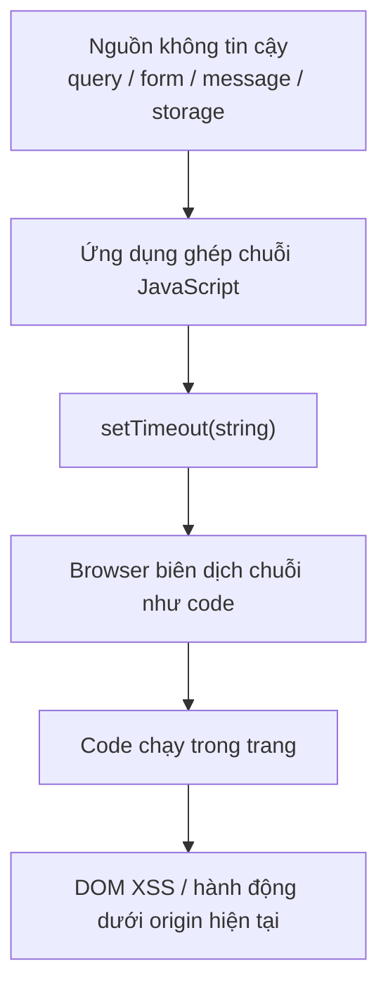

# setTimeout string: rủi ro thực thi mã động trong bộ hẹn giờ

## 1. setTimeout string là gì?

Trong JavaScript trên trình duyệt, `setTimeout()` dùng để lên lịch một callback chạy sau ít nhất một khoảng thời gian. Callback thường là một hàm:

```js
setTimeout(() => {
  console.log("Đã hết thời gian chờ");
}, 1000);
```

API cũ cũng cho phép truyền **chuỗi mã JavaScript** thay cho hàm:

```js
setTimeout("console.log('Đã hết thời gian chờ')", 1000);
```

Khi nhận chuỗi, trình duyệt phân tích và thực thi chuỗi đó như mã JavaScript khi timer chạy. Đây là hành vi giống một dạng `eval()` gián tiếp: dữ liệu được xử lý như **source code**, không còn là dữ liệu thông thường.

Nếu chuỗi được ghép từ query parameter, dữ liệu form, message, storage hoặc dữ liệu bên ngoài, attacker có thể thay đổi cú pháp của mã được thực thi. Lỗi này thường được gọi là **string timer injection** và có thể dẫn đến DOM-based XSS hoặc code injection trong trang.

**Quy tắc an toàn:** truyền một function callback vào `setTimeout()` hoặc `setInterval()`. Không truyền chuỗi mã JavaScript và không xây dựng source code từ dữ liệu người dùng.

Bài viết thuộc chương **DOM security** của module **SECURITY_APPLICATION_SECURITY_BROWSER_SECURITY**. Chủ đề kết nối các DOM execution sink với XSS, output encoding, CSP, Trusted Types, cookie và session. Phòng vệ cần giữ dữ liệu ở dạng dữ liệu, dùng API DOM an toàn và giới hạn các cơ chế biên dịch mã động.

Sau bài học, bạn có thể:

- Phân biệt `setTimeout(function, delay)` với `setTimeout(string, delay)`.
- Giải thích vì sao string timer là một execution sink tương tự `eval()` và `Function()`.
- Nhận diện luồng source → string construction → timer sink.
- Refactor string timer thành callback, closure hoặc tham số callback.
- Hiểu `setInterval()` có cùng rủi ro khi nhận chuỗi.
- Giải thích CSP `unsafe-eval` ảnh hưởng string timer như thế nào.
- Hiểu vai trò và giới hạn của Trusted Types.
- Kiểm chứng hành vi trong một lab local và xây dựng checklist review DOM sink.

## 2. Hai dạng callback của setTimeout

### 2.1. Function callback — cách nên dùng

`setTimeout()` nhận một hàm có thể gọi được và thời gian chờ tính bằng mili giây:

```js
function showMessage(message) {
  document.querySelector("#output").textContent = message;
}

const message = "Hoàn tất";
setTimeout(() => showMessage(message), 500);
```

Trình duyệt giữ tham chiếu đến function. Khi timer chạy, function được gọi. Dữ liệu `message` vẫn là giá trị dữ liệu được truyền vào hàm, không bị phân tích thành mã JavaScript.

Có thể truyền tham số trực tiếp sau delay:

```js
function showMessage(message) {
  document.querySelector("#output").textContent = message;
}

setTimeout(showMessage, 500, "Hoàn tất");
```

Cách này hữu ích khi callback không cần closure. Với closure, callback có thể truy cập biến trong lexical scope:

```js
const currentUser = { displayName: "An" };

setTimeout(() => {
  renderUser(currentUser);
}, 500);
```

### 2.2. String callback — không nên dùng

Ví dụ:

```js
setTimeout("showMessage('Hoàn tất')", 500);
```

Chuỗi phải được biên dịch như mã. Nó chạy trong global execution context liên quan đến môi trường timer, không phải closure của nơi gọi. Vì vậy, biến local trong lexical scope không tự nhiên khả dụng:

```js
function schedule() {
  const secretLabel = "private";

  // String không đóng lại lexical scope của schedule().
  setTimeout("console.log(secretLabel)", 0);
}
```

Function callback có thể truy cập biến local:

```js
function schedule() {
  const label = "public";

  setTimeout(() => {
    console.log(label);
  }, 0);
}
```

Đừng dựa vào khác biệt scope này như một biện pháp bảo mật. Điểm quan trọng là string callback biến chuỗi thành code, còn function callback giữ ranh giới giữa code đã được viết trong ứng dụng và dữ liệu runtime.

### 2.3. setInterval cũng có dạng string

`setInterval()` có cùng lựa chọn callback:

```js
// Không an toàn: chuỗi được thực thi như mã.
setInterval("refreshDashboard()", 5000);

// An toàn hơn: truyền function.
setInterval(refreshDashboard, 5000);
```

Nếu cần truyền dữ liệu:

```js
setInterval(() => {
  refreshDashboard(currentAccountId);
}, 5000);
```

Các API timer khác trong môi trường web hoặc runtime có thể có hành vi tương tự. Khi review, hãy tìm mọi nơi truyền string vào API nhận callback, không chỉ `setTimeout`.

## 3. Vì sao string timer tạo ra lỗ hổng?

### 3.1. Chuỗi dữ liệu bị chuyển thành source code

Giả sử ứng dụng nhận một thông báo từ URL và muốn hiển thị sau một khoảng trễ. Cách triển khai sai có thể là:

```js
const message = new URLSearchParams(location.search).get("message") ?? "";

setTimeout("showMessage('" + message + "')", 100);
```

Ứng dụng đang ghép dữ liệu vào giữa một chuỗi mã JavaScript. Nếu input chứa dấu nháy hoặc cú pháp JavaScript, attacker có thể kết thúc chuỗi, thêm biểu thức hoặc câu lệnh mới và làm thay đổi source code được timer thực thi.

Vấn đề không nằm ở việc chờ 100 mili giây. Vấn đề nằm ở việc **đưa dữ liệu vào vị trí source code**.

### 3.2. Chuỗi khai thác khái niệm



Khi script được thực thi, nó có quyền của môi trường trang đang chạy. Nếu đây là trang `https://app.example.com`, mã được thực thi trong origin đó và có thể truy cập các DOM/API mà script cùng origin được phép sử dụng.

### 3.3. Source và sink

| Thành phần | Ví dụ | Vai trò |
|---|---|---|
| Source | `location.search`, `location.hash`, `postMessage`, form input | Dữ liệu attacker có thể kiểm soát |
| Data flow | Nối chuỗi, encode/decode, lưu biến, template string | Biến đổi hoặc chuyển dữ liệu |
| Sink | `setTimeout(string)`, `setInterval(string)` | Biên dịch và thực thi chuỗi như mã |
| Impact | Thay DOM, gọi API, đọc dữ liệu cùng origin | Hành động với quyền của trang |

Không phải mọi string timer đều là lỗ hổng. Nếu chuỗi là literal cố định do ứng dụng kiểm soát, không chứa dữ liệu không tin cậy, nguy cơ injection trực tiếp thấp hơn. Tuy nhiên, string timer vẫn là sink thực thi mã động và làm tăng bề mặt tấn công, khiến CSP khó triển khai và việc review khó hơn.

## 4. Ví dụ lỗi và cách sửa

### 4.1. Ví dụ không an toàn

```js
const name = new URLSearchParams(location.search).get("name") ?? "";

// Không an toàn: dữ liệu được ghép vào JavaScript source.
setTimeout("renderGreeting('" + name + "')", 250);
```

Nếu `name` là dữ liệu bình thường, ứng dụng có vẻ hoạt động. Nhưng input có thể chứa cú pháp làm đóng string literal mà ứng dụng tạo ra. Khi timer chạy, browser parse toàn bộ chuỗi như JavaScript.

### 4.2. Sửa bằng closure

```js
const name = new URLSearchParams(location.search).get("name") ?? "";

// An toàn hơn: truyền function, dữ liệu vẫn là argument.
setTimeout(() => {
  renderGreeting(name);
}, 250);
```

Không có thao tác tạo JavaScript source từ `name`. Dù `name` chứa dấu nháy, dấu chấm phẩy hoặc chuỗi trông giống mã, nó vẫn được truyền như một giá trị.

### 4.3. Sửa bằng tham số callback

```js
const name = new URLSearchParams(location.search).get("name") ?? "";

setTimeout(renderGreeting, 250, name);
```

API timer hỗ trợ các tham số bổ sung được chuyển tới callback. Cách này rõ ràng khi callback đã tồn tại và không cần closure.

### 4.4. Sửa bằng DOM API an toàn

Bản thân `renderGreeting()` cũng phải xử lý dữ liệu đúng cách:

```js
function renderGreeting(name) {
  const output = document.querySelector("#greeting");
  output.textContent = "Xin chào, " + name;
}

const name = new URLSearchParams(location.search).get("name") ?? "";
setTimeout(renderGreeting, 250, name);
```

`textContent` đưa dữ liệu vào DOM dưới dạng văn bản. Nếu `renderGreeting()` tiếp tục ghép `name` vào `innerHTML`, `eval()` hoặc một sink khác, lỗ hổng vẫn có thể tồn tại ở sink đó. Sửa string timer không thay thế việc review toàn bộ data flow.

### 4.5. Nếu cần chọn hành động động

Không tạo tên hàm hoặc source code từ input. Dùng allowlist ánh xạ giá trị bên ngoài tới callback đã định nghĩa:

```js
const actions = {
  refresh: () => refreshDashboard(),
  help: () => openHelpPanel(),
  close: () => closeDialog(),
};

function scheduleAction(actionName) {
  const action = actions[actionName];

  if (typeof action !== "function") {
    throw new TypeError("Hành động không được hỗ trợ");
  }

  setTimeout(action, 100);
}
```

Input chỉ chọn một hành động trong tập đã định nghĩa. Nó không thể tạo câu lệnh JavaScript tùy ý.

## 5. String timer và các API thực thi mã động

`setTimeout(string)` không phải API duy nhất có thể biến dữ liệu thành mã.

| API / mẫu | Rủi ro | Cách ưu tiên |
|---|---|---|
| `setTimeout(string, delay)` | Chuỗi được biên dịch và thực thi | Function callback |
| `setInterval(string, delay)` | Lặp lại việc biên dịch/thực thi chuỗi | Function callback |
| `eval(string)` | Thực thi source code động | Tránh; xử lý dữ liệu có cấu trúc |
| `new Function(string)` | Tạo function từ source string | Hàm đã định nghĩa hoặc allowlist |
| `setTimeout("...")` qua wrapper | Sink có thể bị che sau abstraction | Truyền function qua wrapper |
| `setTimeout(() => eval(input), delay)` | Callback an toàn về kiểu nhưng vẫn gọi eval | Bỏ eval và xử lý input như data |

Ví dụ wrapper an toàn:

```js
function schedule(callback, delay, ...args) {
  if (typeof callback !== "function") {
    throw new TypeError("Callback phải là function");
  }

  return setTimeout(callback, delay, ...args);
}
```

Wrapper có thể giúp áp quy ước trong ứng dụng, nhưng không cứu được trường hợp caller đã tạo source code bằng `eval()` trước khi truyền callback.

### 5.1. setTimeout có thể nhận function nhưng function vẫn nguy hiểm

Ví dụ này không còn dùng string timer, nhưng vẫn có lỗi:

```js
setTimeout(() => {
  eval(userInput);
}, 100);
```

Đổi từ string callback sang function callback không tự làm mọi mã trong callback an toàn. Cần loại bỏ sink thực thi mã động bên trong callback và xử lý input như dữ liệu.

### 5.2. Không dùng JSON hoặc encoding để tạo code

Một số cách sửa sai là `JSON.stringify(input)`, URL-encode hoặc escape dấu nháy rồi tiếp tục nối chuỗi vào `setTimeout`. Cách này vẫn giữ kiến trúc nguy hiểm: dữ liệu đang được nhúng vào source code.

Hãy truyền giá trị dưới dạng tham số hàm hoặc giữ trong closure. JSON là định dạng dữ liệu; nó không phải lý do để biến dữ liệu thành source code JavaScript.

## 6. CSP và string timer

**Content Security Policy (CSP)** có thể chặn các cơ chế biên dịch mã động. Directive `script-src` (hoặc fallback phù hợp) điều khiển việc có cho phép các API kiểu eval hay không.

Ví dụ policy không cho phép eval-like execution:

```http
Content-Security-Policy: default-src 'self'; script-src 'self'
```

Với policy này, browser hiện đại chặn các dạng thực thi mã động như `eval()`, `Function()` và string timer. Một function callback thông thường vẫn hoạt động nếu script chứa callback được tải từ nguồn được phép.

### 6.1. unsafe-eval làm yếu CSP

Nếu thêm `'unsafe-eval'`:

```http
Content-Security-Policy: default-src 'self'; script-src 'self' 'unsafe-eval'
```

browser cho phép các API biên dịch chuỗi như `eval()`, `Function()` và string timer. Điều này làm giảm một lớp bảo vệ quan trọng trước injection.

Không thêm `'unsafe-eval'` chỉ để một thư viện cũ hoặc string timer tiếp tục hoạt động. Hãy tìm cách thay thế thư viện, cập nhật phiên bản hoặc refactor code để không cần biên dịch chuỗi.

### 6.2. unsafe-inline và unsafe-eval khác nhau

| CSP source expression | Ý nghĩa khái quát |
|---|---|
| `'unsafe-inline'` | Cho phép một số inline script/event handler hoặc inline style tùy directive |
| `'unsafe-eval'` | Cho phép một số API biên dịch chuỗi thành mã, gồm eval-like APIs và string timer |

Cho phép inline script không tự động đồng nghĩa cho phép string timer. Ngược lại, thêm `'unsafe-eval'` không phải cách hợp lệ để xử lý một inline script bị chặn. Cần xác định đúng loại vi phạm trong Console.

### 6.3. CSP không thay thế refactor

CSP là defense in depth. Nếu ứng dụng đang dùng `setTimeout(string)`, policy có thể chặn hành vi đó, nhưng code vẫn là một execution sink và có thể hoạt động lại khi policy bị nới lỏng hoặc một môi trường khác không áp policy tương đương.

Sửa gốc bằng function callback; sau đó giữ CSP không có `'unsafe-eval'` để giảm nguy cơ nếu một sink tương tự bị bỏ sót.

## 7. Trusted Types và script sink

**Trusted Types** giúp áp quy tắc kiểu dữ liệu cho một số sink có thể nhận nội dung thực thi. Trong các trình duyệt tích hợp enforcement cho timer string, chính sách `require-trusted-types-for 'script'` có thể yêu cầu chuỗi đưa vào sink phải mang kiểu tin cậy như `TrustedScript`.

Ví dụ header:

```http
Content-Security-Policy: require-trusted-types-for 'script'; trusted-types app
```

Phạm vi sink và mức hỗ trợ phụ thuộc browser/phiên bản. Cần kiểm thử trên trình duyệt mục tiêu, xem tài liệu Trusted Types và xác nhận `setTimeout`/`setInterval` string có được enforcement trong môi trường đó hay không.

### 7.1. Không tạo policy passthrough

Một policy chỉ trả lại input nguyên văn:

```js
const policy = trustedTypes.createPolicy("app", {
  createScript(input) {
    return input;
  },
});
```

không xác thực hoặc làm an toàn nội dung. Nếu dùng policy như vậy để tiếp tục thực thi string timer, ứng dụng đã bỏ qua mục tiêu bảo vệ.

Đối với timer, giải pháp đơn giản và bền vững vẫn là không tạo `TrustedScript` từ input. Truyền function callback và giữ dữ liệu ở dạng argument.

### 7.2. Trusted Types không phải cách thay thế callback

Trusted Types có ích khi một ứng dụng lớn cần kiểm soát tập trung các script sink còn tồn tại. Nhưng nó không làm cho code động trở thành thiết kế tốt, cũng không thay thế output encoding, DOM API an toàn hoặc kiểm tra quyền.

Nếu có thể loại bỏ string timer, không cần tạo policy để cho phép nó.

## 8. Tác động đối với origin, cookie và session

Khi string timer injection thành công trong một trang, mã chạy với quyền của môi trường trang đó.

### 8.1. SOP không ngăn code chạy cùng origin

Same-Origin Policy hạn chế script cross-origin truy cập DOM và dữ liệu. Nhưng với string timer injection, attacker đã khiến ứng dụng tự biên dịch chuỗi do attacker tác động thành mã trong trang. Code đó chạy trong origin của ứng dụng, vì vậy SOP không coi nó là script từ một website khác.

CORS cũng không bảo vệ khỏi script cùng origin. Script cùng origin có thể gọi API mà không cần CORS permission để đọc response cùng origin.

### 8.2. HttpOnly giảm việc đọc cookie, không ngăn hành động

Cookie phiên nên có thuộc tính phù hợp:

```http
Set-Cookie: __Host-session=OPAQUE_ID; Path=/; Secure; HttpOnly; SameSite=Lax
```

`HttpOnly` ngăn JavaScript đọc trực tiếp giá trị cookie qua `document.cookie`. Tuy nhiên browser vẫn tự gửi cookie trong request phù hợp. Script đã chạy trong trang có thể gọi API dưới phiên người dùng và thao tác dữ liệu theo quyền hiện tại.

Do đó, string timer injection có thể gây hậu quả nghiêm trọng ngay cả khi session cookie là HttpOnly. Cần phòng XSS ở gốc, giới hạn quyền server-side và xác nhận bổ sung cho hành động nhạy cảm.

### 8.3. Cần bảo vệ cả request thay đổi trạng thái

Nếu script injection tạo request thay đổi dữ liệu, server vẫn cần xác minh CSRF token, Origin/Fetch Metadata theo mô hình phù hợp và phân quyền từng hành động. Tuy nhiên, CSRF protection không phải biện pháp chống XSS cùng origin: script đã chạy trong origin có thể đọc token mà ứng dụng cung cấp cho trang và gửi request hợp lệ.

Lớp phòng vệ chính vẫn là ngăn dữ liệu không tin cậy trở thành JavaScript source.

## 9. Thực hành: tái hiện string timer injection trong local

Bài lab dùng một file HTML cục bộ. Nút đầu tiên cố ý ghép input vào chuỗi `setTimeout`; nút thứ hai truyền function callback. Payload chỉ thay đổi `data-injected` trên trang local để bạn quan sát.

### 9.1. Tạo file lab

Tạo file `settimeout-string-lab.html`:

```html
<!doctype html>
<html lang="vi">
<head>
  <meta charset="utf-8">
  <meta name="viewport" content="width=device-width, initial-scale=1">
  <title>String timer lab</title>
</head>
<body>
  <h1>setTimeout string lab</h1>

  <label for="message">Nội dung:</label>
  <input id="message" size="70" value="Xin chào">
  <button id="unsafe">Chạy string timer</button>
  <button id="safe">Chạy function callback</button>

  <p id="output" aria-live="polite"></p>
  <p id="status" aria-live="polite"></p>

  <script>
    const input = document.getElementById("message");
    const output = document.getElementById("output");
    const status = document.getElementById("status");

    function showMessage(message) {
      output.textContent = message;
    }

    document.getElementById("unsafe").addEventListener("click", () => {
      // DEMO CÓ LỖI: input được ghép vào JavaScript source.
      const code = "showMessage('" + input.value + "')";
      setTimeout(code, 0);
      status.textContent = "Đã lên lịch string timer.";
    });

    document.getElementById("safe").addEventListener("click", () => {
      const message = input.value;
      setTimeout(() => showMessage(message), 0);
      status.textContent = "Đã lên lịch function callback.";
    });
  </script>
</body>
</html>
```

Mở file bằng browser. Với input thông thường, cả hai nút đều hiển thị nội dung. Nút đầu tiên tạo source code từ input; nút thứ hai truyền input như dữ liệu.

### 9.2. Payload kiểm chứng vô hại

Nhập chính xác chuỗi sau vào trường Nội dung rồi nhấn **Chạy string timer**:

```text
'); document.body.dataset.injected='yes'; showMessage('
```

Source code được tạo có dạng:

```js
showMessage(''); document.body.dataset.injected='yes'; showMessage('')
```

Mở DevTools Console và kiểm tra:

```js
document.body.dataset.injected
```

Kết quả ở route demo có lỗi là `"yes"`. Để kiểm tra cách an toàn, tải lại trang trước, nhập cùng payload rồi nhấn **Chạy function callback**. Chuỗi được hiển thị như văn bản; thuộc tính `data-injected` không được tạo.

Thí nghiệm chỉ chạy trên trang local. Không gửi payload đến website, tài khoản hoặc hệ thống không thuộc quyền kiểm thử.

### 9.3. Quan sát call stack và DOM

Trong DevTools:

1. Mở tab **Elements** và theo dõi thuộc tính `data-injected` của `<body>`.
2. Mở **Console** để xem kết quả truy vấn.
3. Đặt breakpoint trong event listener của nút string timer và nút function callback.
4. So sánh biến `code` với biến `message`.
5. Quan sát callback của string timer được biên dịch như source, trong khi callback function là function đã tồn tại trong ứng dụng.
6. Thử input có dấu nháy, dấu chấm phẩy và chuỗi trông giống JavaScript; ở cách an toàn, chúng vẫn chỉ là text.

## 10. Kiểm chứng CSP với string timer

Có thể thử CSP bằng cách thêm meta element vào đầu `<head>` của file lab:

```html
<meta http-equiv="Content-Security-Policy"
      content="default-src 'self'; script-src 'unsafe-inline'">
```

Policy này cho phép inline script của lab chạy để bạn có thể thao tác nút, nhưng không cho phép string compilation. Khi nhấn nút **Chạy string timer**, browser hiện lỗi CSP liên quan eval-like execution; nút function callback vẫn hoạt động.

Để quan sát sự khác biệt, chỉ trong môi trường local, sửa policy thành:

```html
<meta http-equiv="Content-Security-Policy"
      content="default-src 'self'; script-src 'unsafe-inline' 'unsafe-eval'">
```

Lúc này string timer có thể chạy vì policy đã bật `'unsafe-eval'`. Sau thử nghiệm, bỏ `'unsafe-eval'` và giữ code dùng function callback.

Lưu ý: trong production, nên dùng CSP qua HTTP response header, tránh `'unsafe-inline'`, dùng nonce/hash cho script hợp lệ và không bật `'unsafe-eval'`. Meta CSP có giới hạn so với response header và không hỗ trợ mọi directive; ví dụ không thể dùng meta để triển khai `frame-ancestors` hoặc báo cáo CSP như cấu hình header đầy đủ.

## 11. Checklist review setTimeout và setInterval

Khi review JavaScript, tìm các trường hợp:

1. `setTimeout(` hoặc `setInterval(` có argument đầu tiên là string hay biểu thức tạo string không?
2. Chuỗi có nối `location`, query parameter, hash, form input, message hoặc storage không?
3. Có dùng template literal để tạo source code không?
4. Có wrapper nào nhận callback nhưng bên trong lại gọi `eval()` hoặc `Function()` không?
5. Có truyền callback function thực sự, không phải kết quả gọi hàm ngay lập tức không?
6. Có thể truyền dữ liệu qua closure hoặc tham số bổ sung của timer không?
7. Callback có đưa dữ liệu vào `innerHTML`, `document.write`, `eval` hoặc sink khác không?
8. Có xử lý dữ liệu hiển thị bằng `textContent` hoặc DOM API phù hợp không?
9. CSP có tránh `'unsafe-eval'` không?
10. Nếu ứng dụng dùng Trusted Types, policy có xác thực dữ liệu và sink coverage đã được kiểm thử chưa?
11. Có test input chứa dấu nháy, dấu ngoặc, dấu chấm phẩy và ký tự Unicode không?
12. Có log hoặc telemetry nào vô tình ghi nội dung nhạy cảm trong query/message không?

Tìm kiếm chuỗi trong source code có thể giúp định vị, nhưng review phải theo data flow. Một sink có thể được che sau helper hoặc abstraction, và một lời gọi `setTimeout` nhận function vẫn có thể gọi eval bên trong.

## 12. Những hiểu lầm phổ biến

| Nhận định sai | Cách hiểu đúng |
|---|---|
| "setTimeout chỉ nhận function." | Browser cũng hỗ trợ string callback, nhưng nên tránh dạng này. |
| "Chuỗi chỉ chạy sau delay nên không phải XSS." | Khi timer chạy, chuỗi được biên dịch và thực thi như JavaScript. |
| "URL-encode input là đủ." | Dữ liệu có thể được decode trước khi ghép vào source code. |
| "Escape dấu nháy sẽ làm string timer an toàn." | Vẫn là thiết kế biến dữ liệu thành source; dễ sai khi cú pháp thay đổi. |
| "Function callback luôn an toàn." | Callback có thể gọi eval hoặc đưa input vào DOM sink nguy hiểm khác. |
| "setInterval khác setTimeout về bảo mật." | Cả hai có thể nhận string và tạo rủi ro tương tự. |
| "'unsafe-inline' cho phép string timer." | String compilation cần quyền eval-like như `'unsafe-eval'`; hai directive khác nhau. |
| "CSP chặn sink thì không cần sửa code." | Policy có thể bị nới lỏng hoặc không áp dụng ở môi trường khác; refactor vẫn cần thiết. |
| "Trusted Types tự sửa string timer." | Trusted Types chỉ enforce các sink được browser tích hợp; không thay việc dùng callback. |
| "HttpOnly ngăn mọi tác động của XSS." | Script vẫn có thể gọi API với cookie browser tự gửi. |
| "SOP chặn script được tạo bởi input." | Script chạy trong trang bị lỗi, dưới origin của ứng dụng. |
| "JSON.stringify rồi nối vào timer là an toàn." | Chuỗi vẫn bị biến thành source code; truyền dữ liệu qua function argument. |

## 13. Câu hỏi ôn tập

1. Khác biệt cơ bản giữa `setTimeout(function, delay)` và `setTimeout(string, delay)` là gì?
2. Vì sao string timer được xem là eval-like execution sink?
3. Dữ liệu từ `location.search` có thể tạo lỗ hổng như thế nào khi ghép vào string timer?
4. Vì sao function callback có thể truy cập biến local trong closure còn string callback thì không?
5. `setInterval(string, delay)` có rủi ro gì?
6. Tại sao encode dấu nháy hoặc URL-encode không phải cách sửa gốc?
7. Làm sao truyền dữ liệu vào callback mà không tạo source code?
8. Vì sao callback function vẫn có thể chứa XSS nếu gọi `eval(input)`?
9. CSP `'unsafe-eval'` ảnh hưởng string timer như thế nào?
10. `'unsafe-inline'` và `'unsafe-eval'` khác nhau ra sao?
11. Trusted Types có vai trò gì và vì sao cần kiểm thử sink coverage?
12. HttpOnly và SOP có ngăn script injection trong chính origin không?

**Đáp án định hướng:** (1) Function callback gọi function đã định nghĩa; string callback được browser biên dịch thành code. (2) Vì chuỗi trở thành JavaScript source. (3) Attacker có thể phá vỡ string literal và thêm câu lệnh. (4) Closure giữ lexical environment; string được thực thi trong global context liên quan timer. (5) Cùng rủi ro nhưng lặp lại theo chu kỳ. (6) Vì dữ liệu vẫn được nhúng vào source và encoding không đúng với toàn bộ cú pháp. (7) Closure hoặc tham số bổ sung sau delay. (8) Vì eval vẫn biên dịch input thành code. (9) Cho phép các API biên dịch chuỗi như eval, Function và string timer. (10) Một directive liên quan inline code, directive kia liên quan dynamic compilation. (11) Có thể buộc một số sink nhận TrustedScript trên browser hỗ trợ; cần xác nhận implementation cụ thể. (12) Không; script chạy cùng origin, HttpOnly chỉ chặn đọc trực tiếp cookie.

## 14. Tài liệu tham khảo

- [MDN — setTimeout()](https://developer.mozilla.org/en-US/docs/Web/API/Window/setTimeout): Cú pháp timer, function callback, string callback và các lưu ý.
- [MDN — setInterval()](https://developer.mozilla.org/en-US/docs/Web/API/Window/setInterval): Timer lặp và callback.
- [WHATWG HTML — Timers](https://html.spec.whatwg.org/multipage/timers-and-user-prompts.html#timers): Mô hình timer của nền tảng web.
- [MDN — eval()](https://developer.mozilla.org/en-US/docs/Web/JavaScript/Reference/Global_Objects/eval): Rủi ro và các lựa chọn thay thế cho thực thi mã động.
- [MDN — Content Security Policy](https://developer.mozilla.org/en-US/docs/Web/HTTP/CSP): CSP và kiểm soát eval-like execution.
- [MDN — CSP script-src](https://developer.mozilla.org/en-US/docs/Web/HTTP/Reference/Headers/Content-Security-Policy/script-src): `'unsafe-eval'`, inline script và nguồn script.
- [MDN — Trusted Types API](https://developer.mozilla.org/en-US/docs/Web/API/Trusted_Types_API): Kiểu dữ liệu tin cậy cho các DOM/script injection sink được hỗ trợ.
- [OWASP — DOM based XSS Prevention Cheat Sheet](https://cheatsheetseries.owasp.org/cheatsheets/DOM_based_XSS_Prevention_Cheat_Sheet.html): Source, sink và cách giữ dữ liệu ngoài code.
- [OWASP — Cross Site Scripting Prevention Cheat Sheet](https://cheatsheetseries.owasp.org/cheatsheets/Cross_Site_Scripting_Prevention_Cheat_Sheet.html): Phòng XSS bằng output encoding và API an toàn.

**Kết nối với mô hình bảo mật web:** `setTimeout(string)` và `setInterval(string)` biến dữ liệu dạng chuỗi thành JavaScript source. Khi dữ liệu request hoặc message đi vào các sink này, script có thể chạy dưới origin của ứng dụng; SOP, CORS và HttpOnly không sửa được lỗi gốc. Truyền function callback, giữ input ở dạng argument, dùng DOM API an toàn và duy trì CSP không có `'unsafe-eval'` là các biện pháp trọng tâm.
