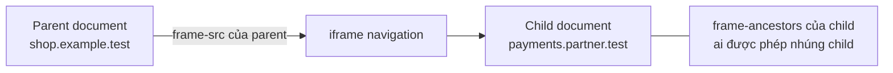

# frame-src: giới hạn nguồn tài liệu được nhúng vào frame

## Mục tiêu học tập

Sau bài học, người học có thể:

1. Giải thích vai trò của CSP directive **`frame-src`** trong việc giới hạn nguồn tài liệu mà một trang được phép tải vào frame.
2. Cấu hình source expression như `'self'`, `'none'`, scheme-source và host-source theo nhu cầu nhúng thực tế.
3. Hiểu thứ tự fallback từ `frame-src` sang `child-src` rồi `default-src` khi directive cụ thể bị thiếu.
4. Phân biệt `frame-src` với `frame-ancestors`, X-Frame-Options, `object-src`, `form-action` và CORS.
5. Phát hiện các cấu hình quá rộng như `https:`, wildcard subdomain hoặc `data:` và lựa chọn allowlist tối thiểu.
6. Triển khai CSP qua HTTP response header, kiểm thử bằng DevTools và chuyển dần từ Report-Only sang Enforce.

> **Bối cảnh:** Module Browser Security phân tích ranh giới giữa trình duyệt, origin, cookie và ứng dụng web để hiểu Same-Origin Policy, CORS và các cơ chế cách ly. CSP là một lớp phòng vệ phía browser, hỗ trợ giảm bề mặt tấn công XSS và kiểm soát tài nguyên. `frame-src` tập trung vào **nguồn mà trang hiện tại được phép nhúng**; nó cần phối hợp với `frame-ancestors`, sandbox, SOP và các security headers khác.

## 1. frame-src giải quyết vấn đề gì?

Một trang web có thể nhúng tài liệu từ origin khác bằng iframe:

```html
<iframe
  title="Trang thanh toán"
  src="https://payments.partner.test/checkout">
</iframe>
```

Nếu ứng dụng cho phép nhúng tùy ý, một lỗi injection hoặc một URL do người dùng kiểm soát có thể khiến trang tải nội dung từ website không mong muốn. Tài liệu được nhúng có thể hiển thị giao diện giả, kích hoạt luồng điều hướng hoặc tạo thêm bề mặt tấn công cho người dùng.

**CSP frame-src** cho phép server quy định browser được tải tài liệu từ những nguồn nào vào nested browsing context như iframe/frame. Khi một frame load không khớp policy, browser chặn request/navigation tương ứng và ghi thông tin vi phạm trong Console; nếu policy có cấu hình báo cáo, browser còn có thể gửi violation report.

Ví dụ:

```http
Content-Security-Policy: default-src 'self'; frame-src 'self' https://payments.partner.test
```

Với policy này, tài liệu của trang có thể được nhúng từ cùng origin và origin thanh toán đã chỉ định. Một iframe trỏ tới `https://evil.test` sẽ bị chặn.

### frame-src kiểm soát phía nào?

Giả sử trang `https://shop.example.test` nhúng `https://payments.partner.test`:



- **frame-src trên parent:** giới hạn nguồn tài liệu parent được tải vào frame.
- **frame-ancestors trên child:** giới hạn những ancestor nào được phép nhúng child.
- **X-Frame-Options trên child:** cơ chế tương thích cũ để hạn chế trang bị nhúng.

Hai đầu có thể cùng từ chối một lần nhúng. Parent cho phép một URL qua `frame-src` không buộc child phải đồng ý bị nhúng.

## 2. Cú pháp frame-src

Directive có dạng:

```http
Content-Security-Policy: frame-src <source-list>
```

Source list có thể chứa nhiều source expression:

```http
# Chỉ cho frame cùng origin
Content-Security-Policy: frame-src 'self'

# Không cho trang tải bất kỳ frame nào
Content-Security-Policy: frame-src 'none'

# Cho cùng origin và một origin đối tác cụ thể
Content-Security-Policy: frame-src 'self' https://payments.partner.test

# Cho các host dưới một subdomain cụ thể (cần đánh giá kỹ)
Content-Security-Policy: frame-src https://*.widgets.partner.test
```

Các thành phần thường gặp:

| Source expression | Ý nghĩa | Lưu ý bảo mật |
| --- | --- | --- |
| `'self'` | Origin của tài liệu hiện tại theo cách browser xác định | Không có nghĩa là mọi subdomain cùng site |
| `'none'` | Không cho tải nguồn frame nào | Dùng riêng; không ghép với nguồn khác |
| `https://host.example` | Cho host qua HTTPS theo điều kiện host/port/path của source expression | Hẹp hơn scheme-source `https:` |
| `https:` | Cho nguồn dùng scheme HTTPS | Rất rộng vì có thể bao phủ nhiều host |
| `https://*.example.test` | Cho các host phù hợp dưới wildcard subdomain | Không đồng nghĩa chỉ một subdomain; đánh giá tất cả host có thể khớp |
| `http://host.example:8080` | Nguồn khớp scheme, host và port được chỉ định | Tránh HTTP cho nội dung nhạy cảm |
| `data:` | Cho URL data | Có thể mở đường nhúng nội dung chủ động; tránh nếu không có nhu cầu |
| `blob:` | Cho URL blob phù hợp | Chỉ bật khi luồng ứng dụng thật sự cần và kiểm soát nguồn tạo blob |

Keyword như `'self'` và `'none'` phải có dấu nháy đơn. Scheme/host source không đặt trong dấu nháy.

### 'none' nên dùng riêng

Nếu source list chứa `'none'` cùng các nguồn khác, `'none'` không có tác dụng như một lệnh phủ định; browser xử lý các source expression còn lại. Vì vậy:

```http
# Đúng: không cho frame
Content-Security-Policy: frame-src 'none'

# Sai ý định: 'none' không phủ định các nguồn còn lại
Content-Security-Policy: frame-src 'none' https://payments.partner.test
```

Không dùng `'none'` như một deny-list đứng cạnh allowlist.

## 3. Fallback: frame-src, child-src và default-src

Khi policy không khai báo `frame-src`, browser tìm directive fallback theo thứ tự:

1. `frame-src` nếu có.
2. Nếu không có, `child-src` nếu có.
3. Nếu cả hai đều không có, `default-src` nếu có.
4. Nếu không có directive nào trong các directive trên, CSP không giới hạn frame bằng fallback này.

Ví dụ:

```http
# frame-src có độ ưu tiên cao nhất cho frame
Content-Security-Policy: default-src 'none'; child-src https://legacy.partner.test; frame-src 'self' https://payments.partner.test

# Không có frame-src: child-src được dùng làm fallback
Content-Security-Policy: default-src 'self'; child-src https://legacy.partner.test

# Không có frame-src/child-src: default-src được dùng
Content-Security-Policy: default-src 'self'
```

**Directive cụ thể ghi đè fallback của nó.** Ví dụ `default-src 'none'` không chặn frame nếu `frame-src https://payments.partner.test` cho phép nguồn đó.

`child-src` là directive cũ hơn và còn liên quan đến `worker-src` fallback trong CSP. Với policy mới, hãy khai báo `frame-src` tường minh cho frame và `worker-src` tường minh cho worker khi cần; không dựa vào `child-src` như một cấu hình chung khó đọc.

### frame-src không fallback sang script-src

`script-src` điều khiển script, không phải nguồn iframe. Tương tự:

- `img-src`: nguồn hình ảnh.
- `connect-src`: nguồn kết nối từ script như fetch/XHR/WebSocket/EventSource.
- `object-src`: nội dung nhúng qua object/embed.
- `form-action`: đích submit form.
- `frame-ancestors`: ai được phép nhúng tài liệu hiện tại.

Không suy ra policy frame từ `script-src` hoặc `connect-src`.

## 4. Phân biệt frame-src với frame-ancestors và X-Frame-Options

Đây là điểm dễ cấu hình nhầm nhất:

| Cơ chế | Đặt ở response của | Kiểm soát | Ví dụ |
| --- | --- | --- | --- |
| CSP frame-src | Parent | Parent được tải nguồn nào vào frame? | Shop chỉ nhúng payment provider |
| CSP frame-ancestors | Child | Ai được phép nhúng trang này? | Trang admin không được nhúng |
| X-Frame-Options | Child | Hạn chế trang bị nhúng theo cơ chế cũ | DENY hoặc SAMEORIGIN |
| iframe sandbox | Parent HTML | Hành vi/quyền của tài liệu bên trong frame | Giới hạn script, form, popup, top navigation |
| CORS | Server resource + browser | Script cross-origin có được đọc response không? | Cho phép frontend đọc API |

### Ví dụ hai phía cùng phối hợp

Response parent:

```http
Content-Security-Policy: default-src 'self'; frame-src 'self' https://payments.partner.test
```

Response child:

```http
Content-Security-Policy: frame-ancestors https://shop.example.test
```

Parent chỉ nhúng được tài liệu từ nguồn được `frame-src` cho phép. Child chỉ chấp nhận ancestor là `https://shop.example.test`. Nếu parent không nằm trong allowlist của child, việc nhúng vẫn thất bại.

### X-Frame-Options không thay frame-src

`X-Frame-Options: DENY` trên child ngăn child bị nhúng trong frame. Nó không giới hạn những nguồn mà parent được phép tải vào frame. Với policy mới, dùng CSP `frame-ancestors` để kiểm soát ancestor; XFO có thể được giữ làm lớp tương thích cho browser cũ theo nhu cầu.

### CORS không thay frame-src

Một tài liệu HTML có thể được tải và hiển thị trong iframe cross-origin mà không cần CORS cho việc điều hướng document thông thường. SOP vẫn giới hạn quyền parent đọc DOM child. CORS chủ yếu quyết định quyền JavaScript đọc response trong các cơ chế CORS; nó không phải allowlist nguồn frame.

## 5. Chọn source list tối thiểu

Bắt đầu từ nhu cầu sản phẩm, không bắt đầu bằng wildcard:

| Nhu cầu | Policy gợi ý |
| --- | --- |
| Trang không nhúng bất kỳ nội dung nào | `frame-src 'none'` |
| Chỉ nhúng trang cùng origin | `frame-src 'self'` |
| Nhúng app nội bộ và một payment provider | `frame-src 'self' https://payments.partner.test` |
| Nhúng nhiều môi trường đối tác | Liệt kê từng origin theo môi trường; tránh wildcard nếu không cần |
| Widget dùng blob URL do ứng dụng tạo | Chỉ thêm `blob:` sau khi xác định luồng và nguồn tạo blob |

### Tránh scheme-source quá rộng

Policy sau:

```http
Content-Security-Policy: frame-src https:
```

cho phép nguồn HTTPS trên nhiều host. Nó có thể bao gồm cả domain ngoài dự kiến nếu attacker kiểm soát được URL đầu vào. Nếu ứng dụng chỉ cần một nhà cung cấp, chỉ rõ host:

```http
Content-Security-Policy: frame-src https://payments.partner.test
```

### Cẩn thận với wildcard subdomain

```http
# Cho nhiều subdomain; chỉ dùng khi tất cả đều thuộc cùng ranh giới tin cậy
Content-Security-Policy: frame-src https://*.partner.test
```

Wildcard có thể bao phủ staging, preview, user-content hoặc subdomain cũ. Một subdomain yếu bảo mật có thể trở thành nơi nội dung không mong muốn được nhúng. Hãy lập danh sách origin cụ thể và loại bỏ host không còn sử dụng.

### Tránh data: trừ khi có lý do rõ

`data:` có thể chứa nội dung HTML chủ động. Cho phép `data:` trong frame-src mở rộng đáng kể loại tài liệu có thể nhúng. Nếu chỉ cần hiển thị dữ liệu, cân nhắc API/DOM an toàn hoặc một origin cách ly có sandbox thay vì cho phép mọi data URL.

## 6. Triển khai CSP qua HTTP response header

CSP nên được gửi bằng HTTP response header để browser nhận policy sớm và nhất quán:

```http
HTTP/1.1 200 OK
Content-Type: text/html; charset=utf-8
Content-Security-Policy: default-src 'self'; frame-src 'self' https://payments.partner.test; object-src 'none'; base-uri 'self'
```

Ví dụ trên còn khóa object-src và base-uri để thể hiện một policy cơ bản; hãy thiết kế các directive còn lại theo ứng dụng. Không sao chép nguyên policy vào production nếu chưa kiểm tra script, style, image, font, connect và các tích hợp thực tế.

### Nginx

Ví dụ trong cấu hình server/location:

```nginx
add_header Content-Security-Policy "default-src 'self'; frame-src 'self' https://payments.partner.test; object-src 'none'; base-uri 'self'" always;
```

Lưu ý Nginx:

- `always` giúp header xuất hiện trên nhiều response status hơn; kiểm tra hành vi kế thừa `add_header` khi location có cấu hình riêng.
- Tránh khai báo cùng policy ở cả CDN, proxy và ứng dụng khiến response có nhiều CSP header ngoài dự kiến.
- Kiểm tra response cuối cùng qua browser, không chỉ đọc file cấu hình.

### Node.js / Express

Có thể gắn header trước khi render trang:

```js
app.use((req, res, next) => {
  res.setHeader(
    "Content-Security-Policy",
    [
      "default-src 'self'",
      "frame-src 'self' https://payments.partner.test",
      "object-src 'none'",
      "base-uri 'self'"
    ].join("; ")
  );
  next();
});
```

Trong ứng dụng thực, nên dùng middleware CSP hoặc cấu hình tập trung để tránh route quên header. Đảm bảo policy phù hợp với response HTML cần bảo vệ và không bị middleware/proxy ghi đè.

### Meta tag có phải lựa chọn tương đương?

Có thể gặp:

```html
<meta
  http-equiv="Content-Security-Policy"
  content="default-src 'self'; frame-src 'self'">
```

Nhưng HTTP response header được ưu tiên vì browser nhận policy sớm hơn, bao phủ response rõ ràng và hỗ trợ các tính năng báo cáo tốt hơn. Meta policy chỉ có hiệu lực từ vị trí nó được parse; tài nguyên xuất hiện trước meta có thể đã được xử lý. Một số directive, trong đó có `frame-ancestors`, không được hỗ trợ trong meta CSP. Dùng header để triển khai chính sách production.

## 7. Report-Only trước khi enforce

Nếu bật CSP chặt ngay trên hệ thống đang chạy, các tích hợp hợp lệ có thể bị chặn. Có thể triển khai policy quan sát trước:

```http
Content-Security-Policy-Report-Only: default-src 'self'; frame-src 'self' https://payments.partner.test; report-uri /csp-report
```

Trong giai đoạn này browser báo vi phạm nhưng không chặn tài nguyên theo policy Report-Only. Hãy:

1. Thu thập báo cáo và Console violation trên các luồng người dùng quan trọng.
2. Xác định frame nào hợp lệ, host nào lỗi thời và request nào do extension/tool ngoài ứng dụng tạo.
3. Cập nhật allowlist tối thiểu; không thêm nguồn chỉ vì một báo cáo xuất hiện mà chưa xác minh.
4. Khi policy ổn định, chuyển sang `Content-Security-Policy` để enforce.
5. Tiếp tục theo dõi vi phạm sau khi enforce và quản lý thay đổi tích hợp.

`report-uri` là cơ chế cũ; hệ thống mới có thể dùng `report-to` với Reporting API khi browser/server hỗ trợ và đã cấu hình endpoint tương ứng. Việc nhận report phụ thuộc browser, chính sách riêng tư và cấu hình mạng; không coi report là log đầy đủ mọi vi phạm.

### Nhiều CSP policy cùng tồn tại

Nếu response có nhiều CSP header hoặc policy header và meta cùng áp dụng, browser thực thi **tất cả policy**; các policy không hợp nhất theo kiểu cộng thêm nguồn. Kết quả thực tế là giao của những gì từng policy cho phép.

Ví dụ:

```http
Content-Security-Policy: frame-src 'self' https://payments.partner.test
Content-Security-Policy: frame-src 'self'
```

Policy thứ hai tiếp tục giới hạn frame về cùng origin; payment provider bị chặn. Khi debug, kiểm tra tất cả CSP header trong response, không chỉ một dòng.

## 8. frame-src và các cơ chế frame khác

### iframe sandbox

frame-src chỉ quyết định **nguồn được tải**. Nó không giới hạn những gì tài liệu bên trong có thể làm sau khi tải. Với nội dung không hoàn toàn tin cậy, cân nhắc sandbox:

```html
<iframe
  title="Bản xem trước nội dung"
  sandbox
  src="https://preview.partner.test/document">
</iframe>
```

Sandbox có thể hạn chế script, form, popup, top navigation và origin tùy token được cấp. Cần chọn token tối thiểu theo chức năng; đừng mặc định thêm `allow-scripts allow-same-origin` cho nội dung cùng origin vì tổ hợp này có thể làm suy yếu cách ly sandbox.

### frame-src không thay object-src

`frame-src` áp dụng cho nested browsing context như iframe/frame. Nội dung nhúng qua `<object>` hoặc `<embed>` được kiểm soát bởi `object-src` (với fallback riêng). Ví dụ:

```http
Content-Security-Policy: frame-src 'self'; object-src 'none'
```

Nếu ứng dụng không dùng object/embed, `object-src 'none'` là lựa chọn chặt chẽ thường dùng. Không nghĩ rằng `frame-src 'none'` đã chặn mọi loại embedded content.

### frame-src không điều khiển form submission

Form gửi đến endpoint nào được kiểm soát bởi `form-action`, không phải frame-src. Ví dụ:

```http
Content-Security-Policy: default-src 'self'; frame-src 'self'; form-action 'self'
```

### frame-src không điều khiển popup/top-level navigation

`window.open()`, liên kết `target="_blank"` và điều hướng top-level không đồng nghĩa với việc tải tài liệu vào frame con. Không dùng frame-src như một allowlist tổng quát cho mọi navigation. Với popup/opener, xem thêm `noopener`/`noreferrer`, COOP và chính sách navigation thích hợp.

## 9. Thực hành: kiểm tra frame-src bằng hai trang local

Lab sử dụng một server local và một iframe để quan sát policy. Thực hiện trong máy thử nghiệm, không cần kết nối dịch vụ bên ngoài.

### Tạo server Node.js

Tạo file `frame-src-lab.mjs`:

```js
import http from "node:http";

const parentPage = [
  "<!doctype html>",
  '<html lang="vi">',
  '<meta charset="utf-8">',
  "<title>frame-src lab</title>",
  "<h1>Parent page</h1>",
  "<p>Thử đổi CSP header ở server rồi tải lại trang.</p>",
  '<iframe title="Child frame" src="/child" width="600" height="180"></iframe>',
  '<iframe title="External frame" src="https://example.org/" width="600" height="180"></iframe>',
  "</html>"
].join("\n");

const childPage = [
  "<!doctype html>",
  '<html lang="vi">',
  '<meta charset="utf-8">',
  "<title>Child page</title>",
  "<h2>Same-origin child đã tải</h2>",
  "</html>"
].join("\n");

http.createServer((request, response) => {
  const path = new URL(request.url, "http://localhost:8080").pathname;
  response.setHeader("Content-Type", "text/html; charset=utf-8");
  response.setHeader("Cache-Control", "no-store");

  if (path === "/") {
    response.setHeader(
      "Content-Security-Policy",
      "default-src 'self'; frame-src 'self'; object-src 'none'; base-uri 'self'"
    );
    response.end(parentPage);
    return;
  }

  if (path === "/child") {
    response.end(childPage);
    return;
  }

  response.writeHead(404);
  response.end("Not found");
}).listen(8080, "127.0.0.1", () => {
  console.log("Open http://127.0.0.1:8080/");
});
```

Chạy `node frame-src-lab.mjs`, sau đó mở `http://127.0.0.1:8080/`. Trang parent trả policy `frame-src 'self'`; iframe `/child` được tải, còn iframe `https://example.org/` bị browser chặn theo CSP.

### Thí nghiệm A — Cùng origin và cross-origin

1. Mở DevTools → Network, bật Preserve log.
2. Tải lại parent.
3. Chọn request `/child`; xác nhận response thành công và iframe hiển thị nội dung.
4. Tìm request `https://example.org/`; quan sát Console báo vi phạm `frame-src`.
5. Xem response parent để xác nhận policy thực tế được browser nhận.

### Thí nghiệm B — Cho phép đúng một origin

Đổi header trong server thành:

```js
response.setHeader(
  "Content-Security-Policy",
  "default-src 'self'; frame-src 'self' https://example.org; object-src 'none'; base-uri 'self'"
);
```

Khởi động lại server và tải lại parent. Frame `https://example.org/` có thể vượt qua kiểm tra frame-src; kết quả hiển thị cuối cùng còn phụ thuộc chính sách nhúng do response của example.org đặt ra, kết nối mạng và các chính sách browser khác. Điều đó giúp phân biệt parent cho phép tải với child có cho phép bị nhúng hay không.

### Thí nghiệm C — Chặn toàn bộ frame

Đổi directive thành:

```http
Content-Security-Policy: default-src 'self'; frame-src 'none'; object-src 'none'
```

Tải lại trang. Cả frame cùng origin và cross-origin đều bị chặn. Trang parent vẫn hiển thị bình thường vì `frame-src` chỉ điều khiển việc tải frame.

### Thí nghiệm D — Kiểm tra fallback

Thử từng policy:

```http
# A: child-src được dùng vì không có frame-src
Content-Security-Policy: default-src 'self'; child-src https://example.org

# B: default-src được dùng vì không có frame-src và child-src
Content-Security-Policy: default-src 'self'

# C: frame-src cụ thể ghi đè fallback
Content-Security-Policy: default-src 'none'; child-src https://example.org; frame-src 'self'
```

Quan sát iframe nào được phép tải và ghi lại directive đã quyết định. Sau mỗi lần thay header, tải lại document parent để browser nhận policy mới.

### Ma trận quan sát

| Policy parent | iframe / nguồn | Kết quả frame-src |
| --- | --- | --- |
| `frame-src 'self'` | `/child` | Cho phép |
| `frame-src 'self'` | `https://example.org/` | Chặn |
| `frame-src 'self' https://example.org` | `https://example.org/` | Cho phép tải; child policy vẫn có thể từ chối nhúng |
| `frame-src 'none'` | Cùng origin hoặc cross-origin | Chặn |
| Không có frame-src; `child-src https://example.org` | `https://example.org/` | Cho phép theo fallback |
| Không có frame-src/child-src; `default-src 'self'` | Cross-origin | Chặn theo fallback |

## 10. Đọc lỗi CSP và xử lý sự cố

Khi frame bị chặn, Console thường có thông báo cho biết nguồn không khớp với directive `frame-src` hoặc directive fallback. Khi điều tra:

1. Mở **Network → document của parent → Response Headers** và kiểm tra mọi `Content-Security-Policy` header.
2. Kiểm tra policy có nhiều header, meta CSP hoặc policy do CDN/proxy thêm vào không.
3. Xác định URL cuối cùng sau redirect; nguồn cuối có thể khác URL ban đầu trong iframe.
4. Kiểm tra scheme, host và port thực tế so với source expression.
5. Xác định lỗi là frame-src của parent, frame-ancestors/XFO của child, TLS/network hay một chính sách khác.
6. Không thêm wildcard ngay để làm hết lỗi; chỉ bổ sung origin sau khi xác minh chủ sở hữu và mục đích.

| Triệu chứng | Nguyên nhân có thể | Cách xác minh |
| --- | --- | --- |
| Console báo frame-src | URL không khớp source list hoặc fallback | Xem policy parent và URL cuối |
| Console báo frame-ancestors | Child không cho parent/ancestor nhúng | Xem response header của child |
| Console báo X-Frame-Options | Child gửi DENY/SAMEORIGIN không phù hợp | Xem response headers child và chính sách tương thích |
| Network có request nhưng iframe trống | Child lỗi, redirect, CSP/XFO, TLS hoặc script | Kiểm tra Console và response chain |
| Chỉ lỗi trên production | CDN/proxy thêm CSP hoặc origin khác môi trường | So sánh response header thực tế của từng môi trường |
| Sửa CSP nhưng không thay đổi | Cache hoặc nhiều policy cùng áp dụng | Disable cache, reload và kiểm tra tất cả header |

## 11. Sai lầm thường gặp

| Sai lầm | Hậu quả | Cách sửa |
| --- | --- | --- |
| Nhầm frame-src với frame-ancestors | Sửa sai phía parent/child | Xác định ai đang cho tải và ai đang cho bị nhúng |
| Dùng frame-src để chặn trang bị nhúng | Không bảo vệ trang của chính mình khỏi clickjacking | Dùng frame-ancestors trên child và XFO khi cần |
| Cho phép `https:` vì một đối tác | Mọi host HTTPS có thể được cho phép | Liệt kê host/origin cụ thể |
| Cho phép wildcard subdomain rộng | Nhúng được host staging/user-content không mong muốn | Exact allowlist hoặc wildcard hẹp đã đánh giá |
| Cho rằng `frame-src 'none'` chặn object/embed | Object/embed có directive riêng | Cấu hình `object-src 'none'` |
| Cho rằng frame-src sandbox nội dung | Nội dung được tải vẫn có thể chạy theo quyền bình thường | Dùng thuộc tính iframe sandbox khi cần |
| Cho rằng CORS điều khiển iframe | Nhầm quyền đọc response với quyền tải frame | Dùng frame-src và hiểu SOP/CORS riêng |
| Chỉ xem một CSP header | Policy thứ hai có thể tiếp tục giới hạn | Kiểm tra tất cả CSP header và meta policy |
| Thêm nguồn trong Report-Only rồi quên enforce | Policy chỉ báo cáo, không chặn | Chuyển sang Content-Security-Policy sau khi xác minh |
| Thêm `data:` hoặc `blob:` tùy tiện | Mở rộng loại nội dung có thể nhúng | Chỉ bật khi có use case và kiểm soát nguồn |

## 12. Câu hỏi củng cố

**Câu 1.** Trang shop trả `frame-src 'self'` và iframe trỏ tới `https://payments.partner.test`. Browser xử lý thế nào?

**Giải đáp:** Parent policy không cho phép origin đối tác nên browser chặn frame load. Muốn nhúng, thêm đúng origin đối tác vào frame-src sau khi xác minh nhu cầu.

**Câu 2.** Parent cho phép payment provider bằng frame-src. Điều đó có bảo đảm payment provider chấp nhận bị nhúng không?

**Giải đáp:** Không. Response của child có thể từ chối qua frame-ancestors hoặc X-Frame-Options. Parent permission và child permission là hai kiểm tra riêng.

**Câu 3.** Vì sao `frame-src https:` rộng hơn `frame-src https://payments.partner.test`?

**Giải đáp:** Scheme-source `https:` có thể cho nhiều host HTTPS; host-source chỉ định nguồn hẹp hơn. Ưu tiên allowlist origin cụ thể.

**Câu 4.** Nếu không khai báo frame-src nhưng có `default-src 'self'`, frame cross-origin có được tải không?

**Giải đáp:** Không theo fallback này. Khi frame-src và child-src thiếu, default-src được dùng để kiểm soát frame.

**Câu 5.** `frame-src 'none'` có chặn `<object>` không?

**Giải đáp:** Không. object/embed được kiểm soát bởi object-src; có thể dùng `object-src 'none'` nếu ứng dụng không cần chúng.

**Câu 6.** Vì sao policy Report-Only không đủ để bảo vệ production?

**Giải đáp:** Report-Only chỉ báo cáo vi phạm mà không enforce chặn tài nguyên. Sau khi kiểm tra tương thích, cần phát hành policy bằng Content-Security-Policy.

## 13. Tổng kết

**frame-src** là directive CSP của phía parent, giới hạn nguồn tài liệu được tải vào frame. Hãy bắt đầu bằng `frame-src 'none'` nếu không cần nhúng, hoặc `frame-src 'self'` cộng những origin HTTPS cụ thể thật sự cần. Khi frame-src không có mặt, browser fallback sang child-src rồi default-src; directive cụ thể có ưu tiên hơn fallback.

frame-src không quyết định ai được nhúng trang hiện tại, không sandbox nội dung, không kiểm soát object/embed, form submission hoặc popup, và không thay CORS. Dùng frame-ancestors/X-Frame-Options ở child, iframe sandbox khi cần cách ly, object-src cho object/embed và kiểm tra response header thực tế. Thử policy bằng Report-Only, sau đó enforce và theo dõi các luồng nhúng hợp lệ.

## Tài liệu tham khảo

1. [W3C — Content Security Policy Level 3: frame-src](https://www.w3.org/TR/CSP3/#directive-frame-src): định nghĩa directive và fallback.
2. [W3C — Content Security Policy Level 3: frame-ancestors](https://www.w3.org/TR/CSP3/#directive-frame-ancestors): kiểm soát ancestor được phép nhúng tài liệu.
3. [MDN — CSP frame-src](https://developer.mozilla.org/en-US/docs/Web/HTTP/Reference/Headers/Content-Security-Policy/frame-src): cú pháp, nguồn và fallback.
4. [MDN — CSP frame-ancestors](https://developer.mozilla.org/en-US/docs/Web/HTTP/Reference/Headers/Content-Security-Policy/frame-ancestors): bảo vệ trang khỏi bị nhúng.
5. [MDN — Content-Security-Policy](https://developer.mozilla.org/en-US/docs/Web/HTTP/Reference/Headers/Content-Security-Policy): triển khai CSP qua response header.
6. [MDN — Content-Security-Policy-Report-Only](https://developer.mozilla.org/en-US/docs/Web/HTTP/Reference/Headers/Content-Security-Policy-Report-Only): quan sát vi phạm trước khi enforce.
7. [OWASP — Content Security Policy Cheat Sheet](https://cheatsheetseries.owasp.org/cheatsheets/Content_Security_Policy_Cheat_Sheet.html): chiến lược triển khai và kiểm thử CSP.
