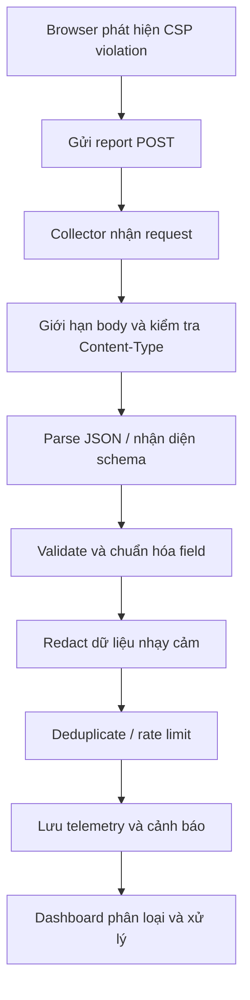

# Báo cáo CSP

> **Chương:** CSP nâng cao  
> **Bài học:** Báo cáo CSP — thu thập, đọc và xử lý vi phạm Content Security Policy  
> **Phạm vi module:** **SECURITY_APPLICATION_SECURITY_BROWSER_SECURITY** — phân tích ranh giới bảo mật giữa trình duyệt, origin, cookie và ứng dụng web để hiểu Same-Origin Policy (SOP), CORS và các cơ chế cách ly; thực hành phòng vệ XSS, CSRF, clickjacking bằng CSP, Trusted Types, security headers và kiểm chứng thực tế.

## Mục tiêu học tập

Sau bài này, bạn có thể:

1. Giải thích báo cáo CSP là gì và chúng giúp quan sát chính sách bảo mật như thế nào.
2. Phân biệt `Content-Security-Policy-Report-Only` với CSP enforcement.
3. Cấu hình `report-uri` cho browser cũ và `Reporting-Endpoints` kết hợp `report-to` cho Reporting API.
4. Nhận diện hai định dạng payload: CSP report legacy và Reporting API report.
5. Đọc các trường như document URL, blocked URL, effective directive, disposition và original policy.
6. Thiết kế collector có giới hạn kích thước, kiểm tra schema, chống spam và bảo vệ dữ liệu nhạy cảm.
7. Phân loại vi phạm thật, false positive, lỗi cấu hình và hành vi từ extension/bên thứ ba.
8. Dùng báo cáo để triển khai CSP theo giai đoạn mà không làm gián đoạn chức năng hợp lệ.

## 1. Báo cáo CSP là gì?

**Content Security Policy (CSP)** cho phép ứng dụng khai báo những nguồn tài nguyên và hành vi mà browser được phép sử dụng. Ví dụ, một policy có thể chỉ cho phép script cùng origin, chặn plugin, giới hạn nơi form được gửi hoặc ngăn trang bị nhúng trong iframe.

Khi một hành động vi phạm policy, browser có thể:

- Chặn hành động nếu policy đang ở chế độ enforcement.
- Ghi thông tin vi phạm vào Developer Tools Console.
- Gửi một báo cáo đến endpoint mà ứng dụng cấu hình.

Báo cáo CSP là dữ liệu chẩn đoán do browser tạo ra khi phát hiện một hành động không phù hợp với policy. Chúng giúp đội phát triển biết trang đang cố tải hoặc thực thi điều gì, directive nào đã áp dụng và nguồn nào bị chặn.

Ví dụ, ứng dụng đặt:

```http
Content-Security-Policy: default-src 'self'; script-src 'self'
```

Một trang có script inline:

```html
<script>
  initializePage();
</script>
```

Script inline không được policy cho phép. Browser có thể chặn nó và gửi báo cáo cho collector đã cấu hình.

**Báo cáo CSP không tự sửa ứng dụng và không phải bằng chứng chắc chắn rằng đã có tấn công thành công.** Một report có thể là lỗi tích hợp, tài nguyên hợp lệ bị policy chặn, script từ extension, hành vi của bên thứ ba hoặc một nỗ lực injection đã bị chặn.

## 2. Report-Only và enforcement

CSP có hai chế độ quan trọng khi triển khai:

| Chế độ | Header | Hành vi khi có vi phạm |
|---|---|---|
| Chỉ báo cáo | `Content-Security-Policy-Report-Only` | Browser không chặn hành động chỉ vì policy này, nhưng có thể gửi report |
| Thực thi | `Content-Security-Policy` | Browser áp dụng policy; hành động vi phạm bị chặn và có thể được báo cáo |

### 2.1. Report-Only dùng để quan sát

Ví dụ response:

```http
Content-Security-Policy-Report-Only: default-src 'self'; script-src 'self'; object-src 'none'; report-uri https://reports.example/csp
```

Trong chế độ này, script inline hoặc tài nguyên ngoài policy có thể vẫn chạy/tải, nhưng browser báo cáo vi phạm. Điều này giúp quan sát tác động trước khi chuyển policy sang enforcement.

**Report-Only không phải lớp chặn XSS.** Nếu một hành động nguy hiểm được policy đề xuất cấm, hành động đó vẫn có thể xảy ra trong giai đoạn chỉ báo cáo. Chỉ thử các policy Report-Only trên môi trường và dữ liệu phù hợp; không giả định việc bật report-only đã bảo vệ trang.

### 2.2. Enforcement vừa chặn vừa có thể báo cáo

Ví dụ:

```http
Content-Security-Policy: default-src 'self'; script-src 'self'; object-src 'none'; report-uri https://reports.example/csp
```

Khi có vi phạm, browser áp dụng chính sách và gửi report nếu cơ chế reporting hoạt động. Báo cáo có thể ghi `disposition` là `enforce`.

### 2.3. Có thể dùng cả hai trong cùng response

Một ứng dụng đang triển khai CSP có thể gửi một policy enforcement hiện tại và một policy Report-Only chặt hơn để đánh giá bước tiếp theo:

```http
Content-Security-Policy: default-src 'self'; script-src 'self'; object-src 'none'; report-uri https://reports.example/csp-enforced

Content-Security-Policy-Report-Only: default-src 'self'; script-src 'self' 'nonce-RANDOM_PER_RESPONSE'; object-src 'none'; report-uri https://reports.example/csp-next
```

Trong ví dụ này:

- Policy enforcement hiện tại tiếp tục chặn theo các quy tắc của nó.
- Policy Report-Only mới ghi nhận những hành động sẽ vi phạm policy chặt hơn.
- Cùng một hành động có thể tạo report từ nhiều policy khác nhau.

Không trộn hai policy thành một header rồi giả định browser hiểu policy đầu là enforcement và policy sau là report-only. Hai chế độ dùng hai response headers riêng.

### 2.4. Phải cấu hình bằng HTTP response header

`Content-Security-Policy-Report-Only` phải được gửi qua HTTP response header. Không thể bật chế độ Report-Only bằng thẻ `<meta http-equiv>` trong HTML.

CSP enforcement có thể được khai báo bằng header hoặc một số dạng meta được hỗ trợ, nhưng các chức năng reporting và một số directive quan trọng cần response header. Để triển khai báo cáo, hãy cấu hình tại server, reverse proxy hoặc CDN nơi tạo response.

## 3. Hai cơ chế gửi báo cáo

Có hai cách thường gặp trong hệ thống CSP:

- `report-uri`: cơ chế legacy, được nhiều browser hỗ trợ nhưng đã bị đánh dấu deprecated trong CSP hiện đại.
- `report-to`: directive kết nối CSP với Reporting API; tên endpoint group được khai báo trong response header `Reporting-Endpoints`.

Header `Report-To` đời cũ của Reporting API đã được thay thế dần bởi `Reporting-Endpoints`. Khi cần hỗ trợ nhiều browser, hãy kiểm tra ma trận tương thích thực tế và có thể cấu hình cả đường legacy lẫn đường mới trong giai đoạn chuyển đổi.

### 3.1. report-uri

Ví dụ:

```http
Content-Security-Policy-Report-Only: default-src 'self'; script-src 'self'; report-uri https://reports.example/csp
```

Khi browser hỗ trợ cơ chế này và phát hiện vi phạm, nó gửi HTTP POST đến URL được khai báo. Payload dùng định dạng CSP report legacy, thường có object `csp-report`.

`report-uri` có ưu điểm là cách cấu hình đơn giản và vẫn cần thiết cho một số browser/phiên bản cũ. Tuy nhiên, đây không phải lựa chọn duy nhất nên dùng cho triển khai mới nếu browser mục tiêu hỗ trợ Reporting API.

### 3.2. Reporting-Endpoints và report-to

Response có thể khai báo endpoint group:

```http
Reporting-Endpoints: csp-endpoint="https://reports.example/csp"
```

Sau đó CSP tham chiếu group name:

```http
Content-Security-Policy-Report-Only: default-src 'self'; script-src 'self'; object-src 'none'; report-to csp-endpoint
```

Ở đây:

- `csp-endpoint` là tên group, không phải URL.
- URL nhận report nằm trong `Reporting-Endpoints`.
- `report-to csp-endpoint` yêu cầu browser gửi report của policy đến group đó.
- Endpoint nên dùng HTTPS và được vận hành như một dịch vụ nhận dữ liệu đầu vào không tin cậy.

### 3.3. Cấu hình cả hai để hỗ trợ tương thích

Ví dụ:

```http
Reporting-Endpoints: csp-endpoint="https://reports.example/csp"

Content-Security-Policy-Report-Only: default-src 'self'; script-src 'self'; object-src 'none'; report-to csp-endpoint; report-uri https://reports.example/csp-legacy
```

Cách này cho phép browser mới dùng Reporting API và browser cũ dùng `report-uri` nếu hỗ trợ. Trong triển khai thực tế, khi browser hỗ trợ `report-to`, `report-uri` có thể bị bỏ qua theo cơ chế tương thích của CSP; vì vậy không giả định mọi browser sẽ gửi hai POST cho cùng một vi phạm.

`Reporting-Endpoints` và `report-to` có mức hỗ trợ khác nhau giữa browser. Kiểm thử browser mục tiêu, quan sát Network và duy trì legacy fallback trong thời gian cần thiết. Đừng xóa `report-uri` chỉ vì một browser thử nghiệm đã gửi được report qua Reporting API.

### 3.4. Không nhầm endpoint group với directive CSP

Ví dụ sai về ý nghĩa:

```http
Content-Security-Policy: report-to https://reports.example/csp
```

`report-to` nhận tên group, không nhận trực tiếp URL. URL phải được ánh xạ trong header `Reporting-Endpoints`.

## 4. Định dạng payload báo cáo

Hai cơ chế gửi report có thể dùng **hai cấu trúc JSON khác nhau**. Collector cần nhận biết định dạng thay vì giả định mọi request đều có cùng schema.

### 4.1. CSP report legacy từ report-uri

Một payload điển hình có object `csp-report`:

```json
{
  "csp-report": {
    "document-uri": "https://app.example/profile",
    "referrer": "https://app.example/home",
    "blocked-uri": "inline",
    "violated-directive": "script-src-elem",
    "effective-directive": "script-src-elem",
    "original-policy": "default-src 'self'; script-src 'self'; report-uri https://reports.example/csp",
    "disposition": "report",
    "script-sample": "initializePage()",
    "status-code": 200,
    "source-file": "https://app.example/profile",
    "line-number": 42,
    "column-number": 3
  }
}
```

Đây là ví dụ minh họa. Tùy browser và loại vi phạm, một số trường có thể vắng mặt, có giá trị rỗng hoặc được rút gọn vì lý do riêng tư.

Một số field quan trọng:

- `document-uri`: URL của document phát sinh vi phạm.
- `referrer`: referrer liên quan, nếu browser cung cấp.
- `blocked-uri`: nguồn hoặc loại nội dung bị chặn; có thể là `inline`, `eval`, một origin hoặc URL.
- `violated-directive`: directive được báo cáo theo định dạng legacy.
- `effective-directive`: directive thực tế áp dụng cho loại tài nguyên/hành động đó.
- `original-policy`: chuỗi policy đã tạo ra report.
- `disposition`: chế độ `enforce` hoặc `report`.
- `source-file`, `line-number`, `column-number`: vị trí nguồn nếu browser có thể xác định.
- `script-sample`: một đoạn mã ngắn nếu policy yêu cầu lấy sample và browser hỗ trợ.

Không phụ thuộc vào một field duy nhất. Browser có thể bỏ thông tin nguồn hoặc rút gọn URL, và một số loại vi phạm không có line/column hữu ích.

### 4.2. Reporting API payload

Với `Reporting-Endpoints` và `report-to`, browser sử dụng định dạng Reporting API. Request có thể chứa một mảng report, ví dụ:

```json
[
  {
    "age": 0,
    "type": "csp-violation",
    "url": "https://app.example/profile",
    "user_agent": "Example Browser",
    "body": {
      "documentURL": "https://app.example/profile",
      "referrer": "https://app.example/home",
      "blockedURL": "inline",
      "effectiveDirective": "script-src-elem",
      "originalPolicy": "default-src 'self'; script-src 'self'; report-to csp-endpoint",
      "disposition": "report",
      "statusCode": 200,
      "sourceFile": "https://app.example/profile",
      "lineNumber": 42,
      "columnNumber": 3,
      "sample": "initializePage()"
    }
  }
]
```

Cấu trúc trên có các lớp:

- Field ngoài `type` xác định loại report; với CSP violation thường là `csp-violation`.
- `url` cho biết URL document liên quan.
- `age` và `user_agent` là metadata do Reporting API cung cấp.
- `body` chứa chi tiết vi phạm CSP, thường dùng tên field camelCase.

Reporting API có thể gửi nhiều report trong một batch. Collector phải chấp nhận mảng, xử lý từng phần tử độc lập và không giả định mỗi HTTP POST tương ứng với đúng một vi phạm.

### 4.3. Khác biệt tên field cần chuẩn hóa

| Ý nghĩa | Legacy report-uri | Reporting API |
|---|---|---|
| Document URL | `document-uri` | `body.documentURL` và field ngoài `url` |
| URL bị chặn | `blocked-uri` | `body.blockedURL` |
| Directive hiệu lực | `effective-directive` | `body.effectiveDirective` |
| Policy gốc | `original-policy` | `body.originalPolicy` |
| Chế độ | `disposition` | `body.disposition` |
| File nguồn | `source-file` | `body.sourceFile` |
| Dòng / cột | `line-number`, `column-number` | `body.lineNumber`, `body.columnNumber` |
| Mẫu script | `script-sample` | `body.sample` |

Nên chuẩn hóa hai dạng về một schema nội bộ. Ví dụ các trường nội bộ có thể là `documentUrl`, `blockedUrl`, `effectiveDirective`, `originalPolicy`, `disposition`, `sourceFile`, `lineNumber`, `columnNumber` và `sample`.

## 5. Đọc một CSP violation report

Một report chỉ có ý nghĩa khi đặt nó vào ngữ cảnh của policy, trang và luồng tải tài nguyên.

### 5.1. effective-directive

Directive hiệu lực cho biết loại quy tắc đã tạo ra vi phạm. Một số giá trị thường gặp:

| Directive hiệu lực | Điều đang được kiểm soát |
|---|---|
| `script-src` | Script khi không có directive cụ thể hơn |
| `script-src-elem` | Phần tử script như `<script src>` hoặc inline script element |
| `script-src-attr` | Inline event handler trong attribute |
| `style-src-elem` | Phần tử style và stylesheet |
| `style-src-attr` | Inline style attribute |
| `img-src` | Ảnh |
| `connect-src` | Fetch, XHR, WebSocket và các kết nối tương ứng |
| `font-src` | Font |
| `frame-src` | Nội dung được nhúng trong frame |
| `frame-ancestors` | Nguồn nào được phép nhúng trang hiện tại |
| `form-action` | Đích gửi form |
| `base-uri` | URL base của document |
| `object-src` | Plugin/object content |
| `worker-src` | Worker và các loại worker liên quan |

Browser có thể báo directive cụ thể như `script-src-elem` thay vì fallback `script-src`. Khi phân loại, hãy xem cả directive hiệu lực và policy gốc để hiểu quy tắc nào thực sự được áp dụng.

### 5.2. blocked-uri

Giá trị này cho biết browser đã chặn hoặc phát hiện nội dung từ đâu. Một số trường hợp:

- `inline`: inline script/style hoặc event handler.
- `eval`: hành vi cần đánh giá chuỗi như mã.
- URL cùng origin hoặc URL bên ngoài.
- Một origin rút gọn thay vì đầy đủ URL.

Vì lý do riêng tư, browser có thể loại bỏ một phần path hoặc query của URL cross-origin. Không giả định `blocked-uri` luôn có đầy đủ thông tin để xác định tài nguyên.

### 5.3. disposition

`disposition` giúp phân biệt report đến từ policy đang thực thi hay policy chỉ báo cáo:

- `enforce`: policy enforcement đã áp dụng.
- `report`: policy Report-Only chỉ ghi nhận vi phạm.

Nếu đang bật đồng thời hai policy, cùng một hoạt động có thể tạo nhiều report với disposition khác nhau. Khi tổng hợp số liệu, tránh đếm chúng thành nhiều sự cố độc lập nếu chúng mô tả cùng một hành động.

### 5.4. original-policy

Đây là policy đã tạo ra report. Trường này hữu ích khi:

- Ứng dụng có nhiều policy theo route hoặc loại response.
- Policy thay đổi qua các lần deploy.
- Có cả enforcement và Report-Only.
- CDN hoặc reverse proxy thêm header CSP khác với origin server.

Lưu policy gốc cùng report giúp truy vết cấu hình tại thời điểm phát sinh. Có thể gắn thêm phiên bản deploy hoặc policy identifier ở hệ thống telemetry riêng nếu cần.

### 5.5. script sample và dữ liệu nhạy cảm

Directive token `report-sample` có thể yêu cầu browser đưa một đoạn ngắn của inline script/style vào report trong những trường hợp hỗ trợ.

Ví dụ:

```http
Content-Security-Policy-Report-Only: default-src 'self'; script-src 'self' 'report-sample'; report-uri https://reports.example/csp
```

Sample giúp xác định đoạn code nào vi phạm, nhưng có thể chứa dữ liệu người dùng, giá trị nội bộ hoặc nội dung nhạy cảm nếu ứng dụng sinh inline code từ dữ liệu động. Chỉ bật khi thật sự cần, giới hạn người truy cập report và áp dụng thời gian lưu phù hợp.

## 6. Xây dựng CSP report collector

Collector là endpoint nhận report từ browser, kiểm tra dữ liệu và chuyển report đến nơi lưu trữ/giám sát. Vì endpoint nhận dữ liệu do client gửi, hãy coi toàn bộ payload là **untrusted input**, kể cả khi browser tạo request tự động.

### 6.1. Luồng xử lý đề xuất



### 6.2. Những kiểm soát cần có ở collector

- Chỉ nhận phương thức cần thiết, thường là POST.
- Dùng HTTPS.
- Giới hạn kích thước body và số report trong một batch.
- Chỉ nhận Content-Type dự kiến như `application/csp-report` và `application/reports+json`.
- Parse JSON an toàn và từ chối payload sai cấu trúc.
- Kiểm tra kiểu và giới hạn độ dài các field.
- Không giả định field nào cũng có mặt.
- Rate limit và giám sát lưu lượng bất thường.
- Chuẩn hóa report trước khi lưu hoặc gửi sang hệ thống khác.
- Trả response nhỏ, không phản chiếu nội dung report về client.

Không nên yêu cầu session đăng nhập của người dùng để nhận report: browser gửi report tự động trong nền, không phải request API thông thường của ứng dụng. Bảo vệ dashboard và dữ liệu report bằng authentication/authorization riêng.

### 6.3. Ví dụ collector dạng pseudocode Node/Express

Đoạn dưới đây minh họa việc nhận cả payload legacy và Reporting API. Phần lưu trữ, rate limit và schema validation cần được nối với hạ tầng thực tế.

```js
app.post(
  '/csp-reports',
  express.text({
    type: ['application/csp-report', 'application/reports+json'],
    limit: '64kb',
  }),
  async (req, res) => {
    let payload;

    try {
      payload = JSON.parse(req.body || '');
    } catch {
      return res.sendStatus(400);
    }

    const entries = Array.isArray(payload) ? payload : [payload];

    if (entries.length === 0 || entries.length > 50) {
      return res.sendStatus(400);
    }

    for (const entry of entries) {
      if (!entry || typeof entry !== 'object' || Array.isArray(entry)) {
        return res.sendStatus(400);
      }

      const body = entry.body ?? entry['csp-report'] ?? entry;
      if (!body || typeof body !== 'object' || Array.isArray(body)) {
        return res.sendStatus(400);
      }

      const report = {
        type: entry.type ?? 'legacy-csp',
        documentUrl: body.documentURL ?? body['document-uri'] ?? entry.url,
        blockedUrl: body.blockedURL ?? body['blocked-uri'],
        effectiveDirective:
          body.effectiveDirective ??
          body['effective-directive'] ??
          body['violated-directive'],
        originalPolicy:
          body.originalPolicy ?? body['original-policy'],
        disposition: body.disposition,
        sourceFile: body.sourceFile ?? body['source-file'],
        lineNumber: body.lineNumber ?? body['line-number'],
        columnNumber: body.columnNumber ?? body['column-number'],
        sample: body.sample ?? body['script-sample'],
      };

      // Validate types, lengths, URL fields and allowed dispositions.
      // Redact query strings and sensitive samples according to policy.
      // Apply deduplication/rate limits before persistent storage.
      await storeValidatedReport(report);
    }

    return res.sendStatus(204);
  }
);
```

Đây là khung minh họa, không phải collector production hoàn chỉnh. Trong ứng dụng thật, hãy:

- Bảo đảm body parser được cấu hình đúng cho từng Content-Type.
- Xử lý trường hợp payload là primitive hoặc array chứa phần tử không hợp lệ.
- Validate URL bằng parser và giới hạn độ dài.
- Chỉ nhận các giá trị disposition đã biết hoặc lưu thành `unknown`.
- Giới hạn số record được xử lý trong một request.
- Bắt lỗi lưu trữ để không làm lộ stack trace hoặc dữ liệu nội bộ.
- Đặt timeout và quota cho pipeline downstream.

### 6.4. Chuẩn hóa report thành schema nội bộ

Một schema nội bộ có thể gồm:

| Field | Mục đích |
|---|---|
| `receivedAt` | Thời điểm collector nhận report |
| `reportType` | CSP legacy hoặc Reporting API |
| `documentUrl` | Trang phát sinh vi phạm |
| `blockedUrl` | Nguồn/loại tài nguyên bị chặn |
| `effectiveDirective` | Directive có hiệu lực |
| `disposition` | `enforce`, `report` hoặc `unknown` |
| `originalPolicy` | Policy tại thời điểm vi phạm |
| `sourceFile` | File nguồn nếu có |
| `lineNumber`, `columnNumber` | Vị trí nếu có |
| `sample` | Sample ngắn nếu được cung cấp và được phép lưu |
| `userAgent` | Thông tin browser nếu có |
| `deployVersion` | Phiên bản triển khai được bổ sung từ telemetry |

Không lưu nguyên payload vô thời hạn nếu không có nhu cầu. Hãy quyết định rõ field nào cần cho điều tra, field nào cần redaction và thời gian lưu bao lâu.

## 7. Bảo vệ chính collector và dữ liệu report

CSP report có thể chứa URL, referrer, policy, tên file, vị trí code và sample. Những giá trị này có thể làm lộ đường dẫn nội bộ, query parameter, định danh người dùng hoặc đoạn dữ liệu đã được nhúng trong inline script.

### 7.1. Giảm dữ liệu nhạy cảm

- Tránh đưa access token, session identifier hoặc dữ liệu cá nhân vào URL query.
- Cân nhắc bỏ query string và fragment khỏi document URL trước khi lưu.
- Chỉ bật `report-sample` khi có lý do rõ ràng.
- Redact token, email, ID cá nhân hoặc giá trị bí mật theo policy của tổ chức.
- Giới hạn quyền truy cập dashboard và export report.
- Đặt thời gian lưu hữu hạn, có quy trình xóa dữ liệu hết hạn.

Không giả định browser luôn loại bỏ mọi dữ liệu nhạy cảm. Collector cần tự áp dụng chính sách dữ liệu của mình.

### 7.2. Tránh Stored XSS trong dashboard báo cáo

Report có thể chứa chuỗi do trang web, extension hoặc bên thứ ba kiểm soát. Nếu dashboard render `blocked-uri`, `source-file`, `original-policy` hoặc `sample` bằng HTML sink, hệ thống báo cáo có thể trở thành nơi phát sinh Stored XSS.

Khi hiển thị report:

- Dùng text node hoặc template auto-escaping.
- Không đưa field report thẳng vào `innerHTML`.
- Nếu cần hiển thị HTML, sanitize bằng allowlist rõ ràng; thường report chỉ cần hiển thị text.
- Encode dữ liệu khi export HTML/CSV theo đúng format.
- Không tự động biến URL hoặc sample thành nội dung chủ động.

### 7.3. Chống spam và report flood

Một trang có nhiều tài nguyên bị chặn hoặc một script lặp có thể tạo số lượng report rất lớn. Endpoint công khai cũng có thể bị gửi request giả mạo từ client tùy ý.

Biện pháp:

- Rate limit theo nhiều tín hiệu phù hợp, không dựa duy nhất vào IP.
- Giới hạn body size, batch size và tốc độ xử lý.
- Deduplicate theo tổ hợp policy, directive, document, blocked source và khoảng thời gian.
- Gom nhóm report lặp để giảm noise.
- Đặt quota và cảnh báo khi lưu lượng tăng đột biến.
- Không gửi alert cho từng report riêng lẻ nếu có thể tổng hợp theo nhóm.

Không coi IP, User-Agent hoặc nội dung report là bằng chứng xác thực danh tính người gửi. Payload có thể bị giả mạo bởi client ngoài browser.

### 7.4. Báo cáo không phải audit log

CSP reports là telemetry về hành vi vi phạm policy. Chúng không thay thế:

- Audit log của thao tác nghiệp vụ.
- Log xác thực và phân quyền.
- Log request phía server.
- Error monitoring.
- Kiểm thử bảo mật.

Một report không chứng minh script đã thực thi thành công; report-only còn không chặn hành động. Hãy kết hợp report với Console, Network, server log, deploy history và tái hiện có kiểm soát.

## 8. Phân loại report: lỗi ứng dụng, tích hợp hay tín hiệu tấn công?

Không nên xử lý tất cả report theo cùng một cách. Một directive bị vi phạm cho biết hành động không phù hợp với policy; nó chưa cho biết tại sao hành động đó xảy ra.

### 8.1. Các nhóm nguyên nhân thường gặp

| Nhóm | Dấu hiệu | Cách điều tra |
|---|---|---|
| Tính năng hợp lệ bị chặn | Script/style/API của ứng dụng không hoạt động sau khi bật enforcement | Xác định route, component và nguồn tài nguyên thực sự cần |
| Cấu hình CSP chưa đầy đủ | Vi phạm tập trung ở một directive sau lần deploy | So sánh policy trước/sau deploy và cấu hình CDN |
| Inline code legacy | `blocked-uri` là `inline`, directive là `script-src-elem` hoặc `script-src-attr` | Chuyển sang file script, nonce/hash hoặc event listener |
| eval-like behavior | `blocked-uri` là `eval` hoặc directive script liên quan | Tìm `eval`, `Function`, thư viện template/runtime và thay bằng API an toàn |
| Tích hợp bên thứ ba | Tên miền vendor hoặc widget xuất hiện trong report | Xác minh nhà cung cấp, tài nguyên thực sự cần và hợp đồng tích hợp |
| Browser extension | Nguồn có scheme extension hoặc chỉ xuất hiện trên một profile | Tái hiện bằng profile sạch; không thêm extension vào allowlist production |
| Nội dung không tin cậy | URL lạ, inline code bất thường hoặc report gắn với input người dùng | Điều tra source/sink, request liên quan và khả năng XSS/injection |
| Nhiễu hoặc report giả | Payload thiếu field, URL bất thường hoặc lưu lượng tăng đột biến | Kiểm tra collector, giới hạn request và nhóm report |

### 8.2. Cách điều tra một report

Với một nhóm report đáng chú ý:

1. Xác định document URL và route bị ảnh hưởng.
2. Đọc effective directive và blocked URL.
3. Xem original policy cùng disposition.
4. Đối chiếu source file, line/column và sample nếu có.
5. Kiểm tra thời điểm deploy, thay đổi CDN, tag manager và script vendor.
6. Tái hiện trong profile browser sạch và môi trường test.
7. Xác minh hành động có phải tính năng hợp lệ hay dữ liệu không tin cậy đang đi vào sink.
8. Ghi nhận quyết định sửa ứng dụng, cập nhật policy hoặc loại bỏ report noise.

Không mở rộng allowlist chỉ để làm số report giảm. Nếu tài nguyên không cần thiết, hãy bỏ dependency; nếu là inline script hợp lệ, ưu tiên nonce/hash hoặc chuyển code ra file ngoài.

### 8.3. Browser extension và nội dung bên thứ ba

Extension có thể chèn script hoặc thay đổi DOM trong trang. Một số hoạt động có thể tạo report không xuất hiện ở profile sạch.

Cách kiểm tra:

- Mở trang trong profile mới hoặc cửa sổ không có extension.
- So sánh report theo browser và profile.
- Kiểm tra scheme của blocked URL/source file.
- Không thêm nguồn extension vào CSP của ứng dụng để làm sạch báo cáo.

Với vendor script, hãy xác minh chính xác host và chức năng cần thiết. Tránh allowlist cả domain dùng chung nếu có thể dùng host chuyên dụng hoặc self-host tài nguyên đã được kiểm tra.

## 9. Từ report-only đến enforcement

CSP nên được triển khai theo lộ trình có đo lường.

### Giai đoạn 1: Thiết lập baseline

- Liệt kê các loại tài nguyên và kết nối mà ứng dụng thực sự cần.
- Tạo policy khởi đầu có phạm vi phù hợp với kiến trúc.
- Gửi bằng `Content-Security-Policy-Report-Only`.
- Cấu hình `report-uri` và/hoặc `Reporting-Endpoints` + `report-to`.
- Kiểm tra collector nhận được report từ browser mục tiêu.

### Giai đoạn 2: Phân loại và sửa ứng dụng

- Nhóm report theo directive, document URL, blocked URL và policy.
- Loại bỏ dependency không cần thiết.
- Chuyển inline script sang file hoặc dùng nonce/hash.
- Loại bỏ `eval` và các API tương tự nếu có thể.
- Cấu hình đúng `connect-src`, `img-src`, `font-src`, `frame-src` và các directive liên quan.
- Kiểm tra trang đăng nhập, admin, editor, thanh toán, upload preview và tích hợp bên thứ ba.

### Giai đoạn 3: Thực thi có kiểm soát

- Chuyển policy đã kiểm chứng sang `Content-Security-Policy`.
- Có thể giữ policy chặt hơn ở Report-Only để đánh giá bước tiếp theo.
- Theo dõi lỗi tính năng và report mới sau deploy.
- Chuẩn bị rollback có kiểm soát nếu policy chặn chức năng thiết yếu.
- Không nới toàn bộ policy chỉ vì một nhóm report chưa được phân loại.

### Giai đoạn 4: Duy trì

- Theo dõi report theo phiên bản deploy.
- Rà soát định kỳ domain allowlist và script vendor.
- Kiểm tra policy trên các route/response khác nhau.
- Đặt ngưỡng cảnh báo theo nhóm report thay vì từng event.
- Xóa endpoint hoặc policy thử nghiệm không còn dùng.
- Cập nhật quy trình khi browser thay đổi hỗ trợ Reporting API.

### 9.1. Không dùng wildcard để xử lý nhanh

Khi thấy nhiều report, không vội thêm:

```http
script-src *
```

hoặc:

```http
script-src 'unsafe-inline' 'unsafe-eval'
```

Những giá trị này có thể làm policy mất phần lớn tác dụng. Hãy xác định nguồn chính xác, chọn directive nhỏ nhất cần thiết và dùng nonce/hash cho inline script hợp lệ.

### 9.2. Report-Only không thay thế kiểm thử

Report-only cho biết browser đã quan sát hành động vi phạm policy trên những lượt truy cập thực tế. Nó không chứng minh tất cả route, user role, browser, thiết bị hoặc trạng thái ứng dụng đã được kiểm tra.

Kết hợp telemetry với automated tests, manual browser testing, code review và kiểm thử các luồng ít dùng.

## 10. Troubleshooting: vì sao không nhận được report?

Nếu Console hiển thị vi phạm nhưng collector không thấy report, kiểm tra từng lớp:

1. **Header thực tế:** xem response header trong DevTools Network; bảo đảm policy và report endpoint được gửi trên đúng document response.
2. **Chế độ policy:** Report-Only chỉ báo cáo; enforcement cần cấu hình report destination nếu muốn thu thập.
3. **Directive reporting:** xác minh `report-uri` có URL hợp lệ hoặc `report-to` tham chiếu đúng group.
4. **Endpoint mapping:** với Reporting API, xác minh `Reporting-Endpoints` khai báo đúng group và HTTPS URL.
5. **Browser support:** kiểm tra browser/version có hỗ trợ cơ chế đang dùng không.
6. **Network:** tìm POST đến collector trong Network; xem status, redirect, DNS/TLS và lỗi kết nối.
7. **Collector:** kiểm tra Content-Type, body parser, giới hạn kích thước, rate limit và log lỗi.
8. **Thời điểm:** Reporting API có thể gửi theo batch hoặc trễ; report không nhất thiết xuất hiện ngay sau vi phạm.
9. **Privacy/browser policy:** browser có thể giới hạn, trì hoãn hoặc bỏ report; không phải mọi violation đều được bảo đảm giao tới server.
10. **Cache/CDN:** xác minh proxy không loại bỏ hoặc ghi đè CSP, Reporting-Endpoints hay policy version.

### 10.1. Report không đến không có nghĩa không có vi phạm

CSP reporting là kênh telemetry best-effort. Browser, extension, mạng, privacy setting, queue và collector đều có thể ảnh hưởng việc giao nhận.

Do đó, không dùng số report bằng zero làm tiêu chí duy nhất để kết luận CSP đã sạch hoặc không có XSS. Hãy kết hợp kiểm tra policy thực tế, Console, automated tests và quan sát hành vi ứng dụng.

## 11. Thực hành A — Bật Report-Only và quan sát inline script

Thực hiện trên trang HTML local hoặc staging do bạn kiểm soát, với dữ liệu giả.

### Bước 1: Cấu hình response header

```http
Reporting-Endpoints: csp-endpoint="https://reports.example/csp"

Content-Security-Policy-Report-Only: default-src 'self'; script-src 'self'; report-to csp-endpoint; report-uri https://reports.example/csp-legacy
```

Dùng endpoint test nhận report và ghi nhận payload. Nếu chỉ thử cơ chế legacy, có thể dùng riêng `report-uri`.

### Bước 2: Tạo một inline script vô hại

```html
<script>
  document.body.dataset.cspProbe = 'ran';
</script>
```

Mở trang và quan sát:

- Script vẫn chạy vì policy ở Report-Only.
- Console ghi nhận vi phạm script-src.
- Browser gửi report nếu cơ chế và endpoint được hỗ trợ.
- Collector ghi nhận disposition `report`.

### Kết quả mong đợi

Report-Only tạo telemetry về điều sẽ bị chặn nếu policy được enforce, trong khi không chặn hành động đó. Không dùng chế độ này để thử payload độc trên trang có người dùng thật.

## 12. Thực hành B — Chuyển cùng policy sang enforcement

Trong môi trường test, thay header Report-Only bằng:

```http
Content-Security-Policy: default-src 'self'; script-src 'self'; report-uri https://reports.example/csp
```

Tải lại trang và quan sát:

1. Inline script không được thực thi theo policy.
2. Thuộc tính `data-csp-probe` không được tạo.
3. Console ghi nhận hành động bị chặn.
4. Collector có thể nhận report với disposition `enforce`.
5. Các script hợp lệ từ file cùng origin vẫn hoạt động nếu phù hợp policy.

So sánh kết quả với bài A để thấy khác biệt giữa quan sát và enforcement.

## 13. Thực hành C — Kiểm tra Reporting API và payload

1. Trả header `Reporting-Endpoints` với group name `csp-endpoint`.
2. Trong policy, đặt `report-to csp-endpoint`.
3. Giữ `report-uri` làm fallback trong môi trường cần hỗ trợ browser cũ.
4. Tạo vi phạm CSP vô hại trong trang test.
5. Mở DevTools Network và tìm request tới collector.
6. Kiểm tra Content-Type và JSON body.
7. Xác minh collector nhận được batch array và chuẩn hóa field camelCase.
8. So sánh với payload legacy có object `csp-report`.

Report có thể đến trễ hoặc được gộp batch. Nếu chưa thấy ngay, kiểm tra header thực tế và khả năng hỗ trợ trước khi kết luận cấu hình sai.

## 14. Thực hành D — Phân loại false positive và report noise

Tạo một vài tình huống trong staging:

- Tài nguyên ảnh từ host chưa có trong `img-src`.
- API endpoint chưa có trong `connect-src`.
- Inline script legacy.
- Script vendor được tải từ host ngoài.
- Trang mở trong profile có extension.

Với mỗi report:

1. Ghi lại directive, blocked URL, document URL và disposition.
2. Tái hiện trong profile sạch.
3. Xác định tính năng có thật sự cần nguồn đó không.
4. Chọn sửa code, cập nhật allowlist chính xác hoặc loại bỏ dependency.
5. Ghi quyết định và lý do trong lịch sử thay đổi policy.

Không thêm extension hoặc domain không được kiểm soát vào allowlist chỉ để làm biến mất report.

## 15. Checklist trước khi triển khai CSP reporting

| Hạng mục | Câu hỏi kiểm tra |
|---|---|
| Policy | Đang thử nghiệm Report-Only hay enforce? |
| Header | Header được gửi trên đúng response HTML? |
| Legacy | Có `report-uri` cho browser cần fallback? |
| Reporting API | `Reporting-Endpoints` và group name trong `report-to` khớp nhau? |
| HTTPS | Collector có endpoint HTTPS ổn định? |
| Payload | Collector nhận cả legacy object và Reporting API batch? |
| Validation | Có giới hạn body, batch, field length và schema? |
| Privacy | Query, sample, referrer và định danh nhạy cảm có được redaction? |
| Abuse | Có rate limit, deduplication và quota? |
| Dashboard | Report được render bằng text/auto-escaping? |
| Triage | Có phân loại extension, vendor, app bug và dấu hiệu injection? |
| Rollout | Có quy trình baseline → sửa → enforce → monitor? |
| Coverage | Có kiểm thử browser, route, role và luồng nghiệp vụ quan trọng? |
| Observability | Có theo dõi report theo policy/deploy version? |
| Retention | Có giới hạn quyền truy cập và thời gian lưu report? |

## 16. Câu hỏi tự kiểm tra

**1.** Báo cáo CSP cho biết điều gì?  
**Đáp án:** Nó ghi nhận hành động mà browser quan sát là vi phạm một CSP policy; bản thân report không chứng minh có tấn công thành công.

**2.** Report-Only có chặn script vi phạm không?  
**Đáp án:** Không. Nó báo cáo nhưng không thực thi việc chặn theo policy đó.

**3.** Header nào dùng cho policy enforcement?  
**Đáp án:** `Content-Security-Policy`.

**4.** Header nào dùng cho chế độ chỉ báo cáo?  
**Đáp án:** `Content-Security-Policy-Report-Only`, được gửi qua HTTP response header.

**5.** `report-uri` và `report-to` khác nhau thế nào?  
**Đáp án:** `report-uri` chỉ URL nhận report theo cơ chế legacy; `report-to` tham chiếu endpoint group được khai báo trong `Reporting-Endpoints`.

**6.** `report-to` nhận URL trực tiếp hay tên group?  
**Đáp án:** Nhận tên group. URL được ánh xạ trong `Reporting-Endpoints`.

**7.** Vì sao collector phải chấp nhận nhiều định dạng payload?  
**Đáp án:** Legacy report-uri và Reporting API dùng schema, tên field và cách đóng gói khác nhau; Reporting API còn có thể gửi batch.

**8.** `disposition` có ý nghĩa gì?  
**Đáp án:** Phân biệt report từ policy enforcement (`enforce`) và policy chỉ báo cáo (`report`).

**9.** `blocked-uri` luôn chứa đầy đủ URL không?  
**Đáp án:** Không. Browser có thể rút gọn thông tin URL vì lý do riêng tư.

**10.** Có nên bật `report-sample` trên mọi trang không?  
**Đáp án:** Không mặc định. Sample có thể chứa dữ liệu nhạy cảm; chỉ bật khi cần và giới hạn truy cập/lưu trữ.

**11.** Vì sao dashboard CSP có nguy cơ Stored XSS?  
**Đáp án:** Field report là dữ liệu không tin cậy; nếu render qua HTML sink mà không escape, nó có thể trở thành nội dung thực thi.

**12.** Không nhận được report có chứng minh không có vi phạm?  
**Đáp án:** Không. Reporting là best-effort và có thể bị ảnh hưởng bởi browser support, privacy, mạng, queue hoặc collector.

## Ghi nhớ

**CSP reporting biến các vi phạm policy thành dữ liệu quan sát để đội phát triển có thể triển khai CSP an toàn hơn.** `Content-Security-Policy-Report-Only` giúp quan sát mà chưa chặn; `Content-Security-Policy` thực thi policy. `report-uri` là cơ chế legacy; `Reporting-Endpoints` cùng `report-to` là cách tích hợp Reporting API hiện đại hơn, nhưng cần kiểm tra hỗ trợ browser và duy trì fallback phù hợp.

Hãy nhận diện đúng schema, chuẩn hóa và kiểm tra payload, bảo vệ collector khỏi spam và Stored XSS, giảm dữ liệu nhạy cảm, rồi phân loại report trước khi thay đổi policy. Báo cáo không thay audit log, kiểm thử hoặc sửa sink XSS; chúng là một nguồn telemetry giúp phát hiện sai lệch giữa policy và hành vi thực tế của ứng dụng.

