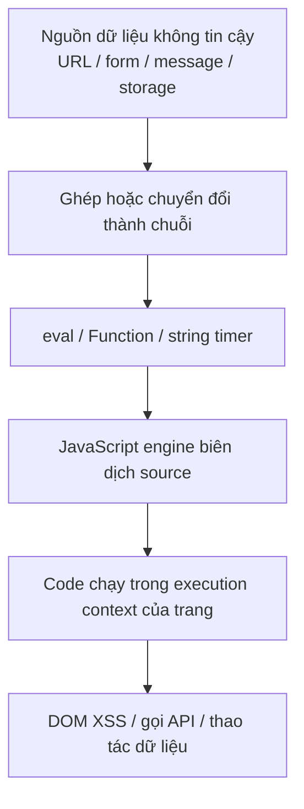

# Unsafe-eval: kiểm soát thực thi mã JavaScript động bằng CSP

## 1. Unsafe-eval là gì?

`'unsafe-eval'` là một source expression của **Content Security Policy (CSP)**. Khi được khai báo trong `script-src`, nó cho phép trang sử dụng một số API biên dịch chuỗi thành JavaScript code, chẳng hạn `eval()`, `Function()` và các dạng `setTimeout(string)` hoặc `setInterval(string)`.

Những API này nhận dữ liệu dạng chuỗi nhưng xử lý chuỗi như source code. Nếu dữ liệu đến từ URL, form, message, storage hoặc dịch vụ bên ngoài, attacker có thể làm thay đổi mã được thực thi. Đây là nhóm sink nguy hiểm thường liên quan đến DOM-based XSS và code injection.

Ví dụ:

```js
const input = new URLSearchParams(location.search).get("name") ?? "";

// Không an toàn: tạo JavaScript source từ dữ liệu.
setTimeout("showGreeting('" + input + "')", 100);
```

CSP có thể chặn kiểu biên dịch động này nếu policy không cho phép `'unsafe-eval'`. Nhưng nếu thêm source expression đó để một thư viện cũ hoạt động, trang sẽ mất một lớp phòng vệ quan trọng.

**Nguyên tắc:** chỉ bật `'unsafe-eval'` khi đã chứng minh một dependency bắt buộc cần nó, đã đánh giá rủi ro và có kế hoạch loại bỏ. Trong ứng dụng mới, hãy thiết kế để không cần biên dịch chuỗi runtime.

Bài viết thuộc chương **CSP nâng cao** của module **SECURITY_APPLICATION_SECURITY_BROWSER_SECURITY**. Chủ đề kết nối CSP với DOM execution sink, XSS, output encoding, Trusted Types, cookie, session và các cơ chế bảo vệ trình duyệt.

Sau bài học, bạn có thể:

- Giải thích CSP `'unsafe-eval'` cho phép những hành vi nào.
- Phân biệt `'unsafe-eval'`, `'unsafe-inline'` và `'wasm-unsafe-eval'`.
- Hiểu vai trò của `script-src` và quan hệ fallback với `default-src`.
- Phân biệt eval-like execution với việc tải script từ nguồn bên ngoài.
- Tìm dependency hoặc đoạn code đang yêu cầu dynamic evaluation.
- Thay thế eval, Function và string timer bằng API xử lý dữ liệu hoặc callback.
- Triển khai CSP Report-Only, thu thập vi phạm và kiểm thử policy.
- Hiểu Trusted Types hỗ trợ kiểm soát một số script sink như thế nào và giới hạn của nó.

## 2. CSP kiểm soát điều gì?

CSP là chính sách bảo mật do server gửi cho browser, thường qua HTTP response header:

```http
Content-Security-Policy: default-src 'self'; script-src 'self'
```

`default-src` là fallback cho nhiều nhóm tài nguyên khi directive chuyên biệt không được khai báo. `script-src` quy định nguồn script và một số hành vi thực thi mã liên quan. Các directive chuyên biệt hơn như `script-src-elem` và `script-src-attr` tập trung vào script element và event handler attribute.

Đối với `'unsafe-eval'`, hãy xem `script-src` là directive chính cần kiểm tra. `script-src-elem` chỉ kiểm soát script element; chỉ thêm nguồn vào directive này không phải cách cấp quyền eval-like execution. Nếu `script-src` không được khai báo, browser có thể dùng `default-src` làm fallback. Vì vậy, policy chỉ có `default-src 'self'` cũng có thể chặn dynamic evaluation theo quy tắc CSP.

CSP không thay thế xác thực, phân quyền, output encoding hoặc kiểm tra dữ liệu. Nó là một lớp bảo vệ ở phía browser, giúp giới hạn những gì tài liệu được phép thực hiện hoặc tải.

### 2.1. Các directive script liên quan

| Directive | Phạm vi chính |
|---|---|
| `script-src` | Nguồn script và các kiểm soát script liên quan, gồm eval-like execution |
| `script-src-elem` | Script được tải/thực thi qua phần tử `script` |
| `script-src-attr` | Inline event handler attribute như `onclick` |
| `default-src` | Fallback khi directive chuyên biệt tương ứng chưa được khai báo |

Hãy kiểm tra policy đầy đủ và các directive thực tế trong response. `script-src-elem` không phải fallback thay thế cho `script-src` khi browser kiểm tra eval-like execution.

## 3. Những API bị ảnh hưởng bởi unsafe-eval

### 3.1. eval()

`eval()` phân tích chuỗi thành JavaScript source và thực thi:

```js
const expression = "2 + 3";
const result = eval(expression); // 5
```

Dữ liệu có thể làm thay đổi chương trình được thực thi. Ngoài rủi ro injection, `eval()` còn làm khó phân tích tĩnh, tối ưu hóa và kiểm soát luồng dữ liệu.

Nếu cần đọc JSON, dùng `JSON.parse()`:

```js
const data = JSON.parse('{"theme":"dark","page":2}');
console.log(data.theme);
```

`JSON.parse()` phân tích định dạng dữ liệu JSON, không thực thi JavaScript expression. Tuy nhiên, dữ liệu sau parse vẫn phải được kiểm tra schema, kiểu và quyền nghiệp vụ trước khi sử dụng.

### 3.2. Function constructor

`Function()` tạo function mới từ chuỗi source:

```js
const calculate = new Function("a", "b", "return a + b");
console.log(calculate(2, 3));
```

Không ghép input vào body của function:

```js
// Không an toàn nếu input chịu ảnh hưởng từ người dùng.
const run = new Function("return " + userExpression);
```

Nếu cần chọn phép tính, ánh xạ tên phép tính tới function đã định nghĩa:

```js
const operations = {
  add: (a, b) => a + b,
  subtract: (a, b) => a - b,
  multiply: (a, b) => a * b,
};

function calculate(operation, a, b) {
  const fn = operations[operation];

  if (typeof fn !== "function") {
    throw new TypeError("Phép tính không được hỗ trợ");
  }

  return fn(a, b);
}
```

### 3.3. String timer

Các dạng timer nhận chuỗi cũng yêu cầu browser biên dịch chuỗi thành code:

```js
// Không an toàn.
setTimeout("refreshDashboard()", 1000);
setInterval("pollStatus()", 5000);

// Dùng function callback.
setTimeout(refreshDashboard, 1000);
setInterval(pollStatus, 5000);
```

Khi cần truyền dữ liệu, dùng closure hoặc tham số callback:

```js
const message = new URLSearchParams(location.search).get("message") ?? "";

setTimeout(() => {
  output.textContent = message;
}, 1000);
```

Dữ liệu vẫn là dữ liệu. Không cần serialize nó thành JavaScript source.

### 3.4. Bảng tổng hợp

| API | Hành vi | Cách thay thế thường phù hợp |
|---|---|---|
| `eval(string)` | Biên dịch và thực thi JavaScript source | `JSON.parse` cho JSON; parser riêng cho biểu thức; logic được định nghĩa trước |
| `new Function(string)` | Tạo function từ source string | Function đã viết sẵn, dispatch table, precompile lúc build |
| `setTimeout(string)` | Biên dịch chuỗi khi timer chạy | Callback function |
| `setInterval(string)` | Lặp lại việc biên dịch chuỗi | Callback function |
| `WebAssembly.compile()` / `new WebAssembly.Module()` | Biên dịch WebAssembly bytes | Xem `'wasm-unsafe-eval'` và nguồn module tin cậy |

Không phải mọi API xử lý dữ liệu hoặc tạo function đều là eval-like sink. Ví dụ `JSON.parse()` không phải `eval()`. `import()` tải module theo cơ chế module; nó không có nghĩa là cho phép eval chuỗi. Hãy phân loại theo hành vi thực tế thay vì chặn mọi API có từ "parse", "compile" hoặc "function" trong tên.

## 4. Phân biệt unsafe-eval, unsafe-inline và wasm-unsafe-eval

Ba source expression này có mục đích khác nhau.

| Source expression | Cho phép điều gì? | Không đồng nghĩa với |
|---|---|---|
| `'unsafe-eval'` | Các API biên dịch chuỗi thành JavaScript như `eval`, `Function` và string timer; trong browser hỗ trợ CSP cho WebAssembly compilation | Cho phép mọi inline script |
| `'unsafe-inline'` | Một số inline script, event handler hoặc inline style tùy directive và policy | Cho phép `eval()` hoặc string timer |
| `'wasm-unsafe-eval'` | WebAssembly compilation trong browser hỗ trợ keyword này | Cho phép JavaScript `eval()` hoặc `Function()` |

`'wasm-unsafe-eval'` là quyền hẹp hơn cho nhu cầu biên dịch WebAssembly. Nếu ứng dụng chỉ cần WebAssembly, hãy đánh giá dùng keyword này thay cho `'unsafe-eval'`. `'unsafe-eval'` rộng hơn và có thể cho phép cả JavaScript string evaluation.

`'unsafe-inline'` không giải quyết lỗi string timer. Một trang có thể cho phép inline script nhưng vẫn chặn `eval()`; ngược lại, cho phép `'unsafe-eval'` không tự động cho phép inline event handler.

### 4.1. Nonce và hash không cấp quyền eval

Ví dụ policy dùng nonce:

```http
Content-Security-Policy: default-src 'self'; script-src 'self' 'nonce-RANDOM_PER_RESPONSE'
```

Nonce cho phép một số script element có nonce phù hợp. Nó không biến chuỗi tùy ý đưa vào `eval()` hoặc string timer thành mã được phép. Hash cũng xác thực nội dung script cụ thể theo hash đã khai báo; nó không phải cách cấp quyền cho dynamic evaluation.

### 4.2. strict-dynamic không thay thế unsafe-eval

`'strict-dynamic'` điều chỉnh cách trust từ nonce/hash được lan truyền tới script được tải động trong browser hỗ trợ. Nó liên quan đến việc tải và tin cậy script element.

Nó không phải alias của `'unsafe-eval'` và không cho phép `eval()` hoặc string timer. Không thêm `'unsafe-eval'` chỉ vì policy dùng nonce hoặc `'strict-dynamic'`.

## 5. Vì sao unsafe-eval làm tăng rủi ro XSS?

Khi một ứng dụng cho phép dữ liệu không tin cậy đi vào eval-like sink, dữ liệu có thể trở thành source code. Nếu attacker điều khiển được dữ liệu đó, ứng dụng có nguy cơ thực thi câu lệnh ngoài ý muốn.

### 5.1. Luồng source → sink



Nếu code chạy trong trang `https://app.example.com`, nó có quyền của môi trường JavaScript tại origin đó. Same-Origin Policy không chặn script cùng origin. CORS cũng không bảo vệ khỏi script đã chạy trong origin được phép.

### 5.2. CSP là hàng rào, không phải cách sửa data flow

Policy không có `'unsafe-eval'` có thể chặn một số sink ngay cả khi code vô tình gọi chúng. Nhưng nếu ứng dụng phụ thuộc vào policy để ngăn input nguy hiểm, lỗi thiết kế vẫn tồn tại.

Một môi trường development có thể dùng policy nới lỏng hơn production; một reverse proxy có thể vô tình bỏ header; một trang con có thể được phục vụ từ origin khác với policy yếu hơn. Hãy sửa source-to-sink flow và triển khai CSP như một lớp bảo vệ bổ sung.

### 5.3. HttpOnly không ngăn script injection cùng origin

Cookie phiên có thể được bảo vệ:

```http
Set-Cookie: __Host-session=OPAQUE_ID; Path=/; Secure; HttpOnly; SameSite=Lax
```

`HttpOnly` ngăn script đọc trực tiếp cookie qua `document.cookie`. Nhưng script đã thực thi trong trang vẫn có thể gửi request; browser tự đính kèm cookie phù hợp. Vì vậy, ngăn eval-like injection vẫn quan trọng ngay cả khi cookie đã có HttpOnly.

## 6. Tại sao thư viện cần dynamic evaluation?

Một số thư viện hoặc hệ thống cũ có thể dùng dynamic evaluation vì các lý do lịch sử:

- Template engine biên dịch template thành JavaScript function tại runtime.
- Framework development mode tạo hàm hoặc biểu thức động để hỗ trợ debug.
- Thư viện biểu thức cho phép người dùng nhập công thức.
- Công cụ đo lường hoặc sandbox cũ dùng eval để thực thi cấu hình.
- Bộ chuyển đổi hoặc plugin dùng Function constructor để tạo callback.
- Một số runtime/WebAssembly loader cần quyền compilation riêng.

Không suy luận rằng mọi framework đều cần `'unsafe-eval'`. Nhu cầu phụ thuộc phiên bản, chế độ build, plugin và cách cấu hình. Cùng một thư viện có thể dùng dynamic evaluation ở development nhưng không cần ở production nếu dùng bản precompiled.

### 6.1. Tìm dependency yêu cầu unsafe-eval

Quy trình thực tế:

1. Đọc CSP violation trong Console và ghi nhận directive bị vi phạm.
2. Xem stack trace để tìm caller của `eval`, `Function` hoặc timer string.
3. Xác định file thuộc ứng dụng hay dependency.
4. Kiểm tra phiên bản và cấu hình production của dependency.
5. Tìm chế độ precompile, interpreter, build-time transform hoặc bản thư viện không cần eval.
6. Viết kiểm thử để xác nhận chức năng vẫn hoạt động khi policy không có `'unsafe-eval'`.
7. Chỉ cân nhắc ngoại lệ nếu không có giải pháp thay thế hợp lý và rủi ro đã được chấp nhận.

Không bật `'unsafe-eval'` toàn site chỉ để bỏ qua một lỗi console chưa được phân tích.

### 6.2. Development và production

Một số công cụ phát triển sử dụng dynamic code để tạo source map, hot reload hoặc debug function. Không vì vậy mà production phải giữ quyền này.

- Dùng build production và cấu hình compiler phù hợp.
- Precompile template ở CI/build time.
- Loại bỏ dev-only runtime, debug helper và plugin không cần thiết.
- Kiểm tra bundle cuối cùng, không chỉ source code.
- Chạy smoke test dưới CSP production thật.

Nếu dependency chỉ hoạt động khi có `'unsafe-eval'`, cân nhắc nâng cấp, thay thế hoặc cô lập tính năng đó trên một origin riêng với dữ liệu/quyền tối thiểu. Một origin riêng giảm phạm vi ảnh hưởng nhưng không biến dynamic evaluation thành an toàn.

## 7. Các phương án thay thế unsafe-eval

### 7.1. Dùng JSON.parse cho dữ liệu JSON

Không dùng eval để parse JSON:

```js
// Không an toàn và không cần thiết.
const settings = eval("(" + jsonText + ")");

// Phù hợp với JSON.
const settings = JSON.parse(jsonText);
```

Sau khi parse, kiểm tra schema:

```js
function readSettings(text) {
  const value = JSON.parse(text);

  if (
    value === null ||
    typeof value !== "object" ||
    Array.isArray(value)
  ) {
    throw new TypeError("Settings phải là object");
  }

  if (!["light", "dark"].includes(value.theme)) {
    throw new TypeError("Theme không hợp lệ");
  }

  return { theme: value.theme };
}
```

`JSON.parse` không thực thi function, getter hoặc biểu thức JavaScript. Nhưng không nên tin các field chỉ vì parse thành công; vẫn phải kiểm tra cấu trúc, kiểu và giới hạn.

### 7.2. Dùng dispatch table thay cho Function constructor

Nếu input chọn một hành động, dùng object/Map chứa callback được định nghĩa sẵn:

```js
const handlers = new Map([
  ["save", () => saveDocument()],
  ["preview", () => showPreview()],
  ["cancel", () => cancelEdit()],
]);

function handleAction(name) {
  const callback = handlers.get(name);

  if (!callback) {
    throw new TypeError("Action không hợp lệ");
  }

  callback();
}
```

Input chỉ chọn một key được phép. Nó không thể cung cấp code mới.

### 7.3. Dùng parser/interpreter giới hạn cho biểu thức

Nếu sản phẩm thật sự cần cho người dùng nhập biểu thức, đừng chuyển chuỗi đó trực tiếp vào eval hoặc Function. Dùng parser tạo AST và interpreter chỉ hỗ trợ các node cần thiết, ví dụ:

- Literal số.
- Phép cộng/trừ/nhân/chia.
- Biến trong allowlist.
- Hàm toán học được chọn trước.
- Giới hạn độ sâu, số node và thời gian tính toán.

Không expose `window`, `document`, `fetch`, constructor hoặc prototype cho biểu thức. Parser/interpreter cần được review và test riêng; một sandbox tự viết sơ sài có thể tạo lỗ hổng mới.

### 7.4. Precompile template ở build time

Nếu template engine biên dịch template thành JavaScript:

- Biên dịch template trong pipeline build.
- Phát hành function/module đã tạo sẵn.
- Không compile template do người dùng gửi ngay trong browser.
- Nếu hỗ trợ template do người dùng viết, xử lý chúng trong sandbox có giới hạn rõ ràng và không trao quyền của origin chính.

Precompile giúp production không cần tạo source code từ chuỗi runtime, đồng thời cho phép kiểm tra template trước khi phát hành.

### 7.5. WebAssembly: dùng quyền hẹp khi cần

Nếu ứng dụng cần compile WebAssembly tại runtime, đánh giá `'wasm-unsafe-eval'` trên browser hỗ trợ thay vì cấp `'unsafe-eval'` rộng hơn. Nguồn WebAssembly vẫn phải được kiểm soát, xác thực tính toàn vẹn và giới hạn quyền giao tiếp với trang.

Không cho rằng WebAssembly tự động an toàn chỉ vì nó không phải JavaScript. Module vẫn có thể tiêu thụ CPU/bộ nhớ hoặc thực hiện hành động thông qua các import mà ứng dụng cấp cho nó.

## 8. CSP policy mẫu không dùng unsafe-eval

Một policy có thể bắt đầu từ:

```http
Content-Security-Policy: default-src 'self'; script-src 'self' 'nonce-{RANDOM_NONCE}'; object-src 'none'; base-uri 'none'; frame-ancestors 'none'
```

Trong response HTML, nonce phải là giá trị ngẫu nhiên mật mã, mới cho mỗi response và khớp giữa header với script element hợp lệ:

```html
<script nonce="NONCE_CUA_RESPONSE">
  initializeApplication();
</script>
```

Ví dụ chỉ minh họa cấu trúc. Ứng dụng có thể cần thêm `connect-src`, `img-src`, `style-src`, `font-src`, `form-action` hoặc các directive khác theo chức năng thực tế. Tránh thêm `'unsafe-inline'` hay `'unsafe-eval'` để giải quyết lỗi mà chưa phân tích.

### 8.1. Không dùng nonce cố định

Nonce phải khó đoán và không tái sử dụng giữa các response. Nếu nonce bị hardcode trong HTML hoặc dùng chung qua nhiều phiên, attacker có thể dự đoán hoặc lấy lại nonce và làm suy yếu policy.

Tạo nonce ở server, chèn cùng một giá trị vào CSP header và các script element được phép trong đúng response. Không ghi nonce cùng các dữ liệu nhạy cảm vào log không cần thiết.

### 8.2. Kết hợp với các directive khác

`'unsafe-eval'` không thay thế các directive khác. Một policy hardening thường cân nhắc:

| Directive | Mục đích |
|---|---|
| `object-src 'none'` | Chặn plugin/object không cần thiết |
| `base-uri 'none'` | Ngăn thay đổi base URL bằng thẻ base |
| `frame-ancestors 'none'` | Ngăn trang bị nhúng nếu nghiệp vụ không cần |
| `form-action 'self'` | Giới hạn nơi form được gửi |
| `connect-src` | Giới hạn fetch/XHR/WebSocket/EventSource |
| `script-src` | Giới hạn nguồn script và eval-like execution |

Chọn policy theo kiến trúc thực tế. Ví dụ `frame-ancestors 'none'` không phù hợp nếu sản phẩm cần được nhúng trong portal đối tác; khi đó cần allowlist frame ancestor cụ thể.

## 9. Report-Only và báo cáo vi phạm

Trước khi áp policy thực thi trên ứng dụng lớn, có thể triển khai `Content-Security-Policy-Report-Only`:

```http
Content-Security-Policy-Report-Only: default-src 'self'; script-src 'self'; object-src 'none'; report-uri /csp-report
```

Policy Report-Only ghi nhận vi phạm nhưng không chặn hành vi. Nó giúp phát hiện script hợp lệ, dependency hoặc tính năng cũ đang dùng dynamic evaluation.

### 9.1. Thu thập report

Các cơ chế báo cáo CSP hiện đại có thể dùng `Reporting-Endpoints` cùng directive `report-to`; `report-uri` là cơ chế cũ hơn vẫn còn hữu ích cho tương thích browser.

Ví dụ cấu hình minh họa:

```http
Reporting-Endpoints: csp-endpoint="https://reports.example.com/csp"
Content-Security-Policy-Report-Only: default-src 'self'; script-src 'self'; report-to csp-endpoint; report-uri /csp-report
```

Khả năng gửi report phụ thuộc browser, phiên bản và cấu hình endpoint. Hãy kiểm thử thực tế thay vì giả định mọi browser đều gửi cùng định dạng.

### 9.2. Báo cáo có thể chứa dữ liệu nhạy cảm

CSP report có thể chứa document URL, blocked URL, directive, source file hoặc thông tin vị trí. Trước khi lưu:

- Loại bỏ query string hoặc fragment nhạy cảm khỏi URL nếu không cần.
- Không ghi cookie, authorization header hoặc token.
- Giới hạn kích thước request và xác thực endpoint nhận report.
- Chống spam và rate-limit.
- Phân quyền truy cập log/report.
- Không dùng dữ liệu report làm lệnh hoặc HTML mà không xử lý.

Report-Only là công cụ quan sát; không được xem là bằng chứng policy đã chặn hành vi.

### 9.3. Chuyển từ Report-Only sang enforcement

1. Thu thập report trong thời gian đủ đại diện cho traffic.
2. Phân nhóm theo directive và source file.
3. Xác định vi phạm do tính năng hợp lệ hay code không mong muốn.
4. Sửa dependency/code để loại bỏ eval-like execution.
5. Kiểm thử lại trên bản build production.
6. Chuyển sang CSP thực thi.
7. Tiếp tục giám sát report và kiểm thử regression.

Đừng thêm `'unsafe-eval'` vào policy chỉ để làm report biến mất. Mục tiêu là loại bỏ nhu cầu dynamic evaluation.

## 10. Nhiều CSP policy và hiệu lực thực tế

Browser có thể nhận nhiều CSP policy, chẳng hạn từ server và proxy. Các policy thực thi được áp dụng đồng thời; policy bổ sung thường **siết chặt thêm** quyền, không nới lỏng policy trước đó.

Ví dụ response có hai header:

```http
Content-Security-Policy: script-src 'self' 'unsafe-eval'
Content-Security-Policy: script-src 'self'
```

Policy thứ hai vẫn chặn eval-like execution. Việc thêm header mới có `unsafe-eval` không thể mở lại quyền mà một policy khác đang chặn.

Điều này quan trọng khi debug: kiểm tra toàn bộ CSP header, policy từ CDN/reverse proxy và policy của trang được nhúng. Một meta CSP có thể bổ sung policy cho document nhưng không thể nới lỏng policy header đã gửi.

### 10.1. Header và meta element

Ưu tiên HTTP response header:

```http
Content-Security-Policy: default-src 'self'; script-src 'self'
```

Meta element có thể hữu ích cho demo hoặc môi trường tĩnh:

```html
<meta http-equiv="Content-Security-Policy"
      content="default-src 'self'; script-src 'self'">
```

Meta CSP có giới hạn: không hỗ trợ Report-Only, không thể áp dụng cho nội dung đã được parse trước meta và không hỗ trợ một số directive như `frame-ancestors`. Vì vậy, production nên phát policy bằng response header.

## 11. Trusted Types và unsafe-eval

Trusted Types bổ sung kiểm soát kiểu dữ liệu cho một số sink có thể nhận source code hoặc HTML không tin cậy. Khi browser hỗ trợ, CSP có thể yêu cầu kiểu tin cậy cho các sink script:

```http
Content-Security-Policy: require-trusted-types-for 'script'; trusted-types app
```

Trusted Types không phải cách để cho phép input tùy ý đi qua eval. Một policy `createScript()` phải có quy tắc kiểm tra thực chất; policy passthrough chỉ trả lại input nguyên văn không làm nội dung an toàn.

Với string timer hoặc dynamic code, giải pháp tốt nhất vẫn là loại bỏ chuỗi source và truyền function callback. Trusted Types chỉ là lớp kiểm soát bổ sung cho các sink được browser hỗ trợ; mức enforcement cụ thể phụ thuộc trình duyệt.

Không nhầm `trusted-types` với `'unsafe-eval'`:

- `'unsafe-eval'` cấp quyền cho nhóm API biên dịch chuỗi.
- `require-trusted-types-for 'script'` yêu cầu kiểu tin cậy ở các sink được hỗ trợ.
- `trusted-types app` giới hạn tên policy được phép tạo.
- Không directive nào thay thế việc thiết kế data flow không biến dữ liệu thành code.

## 12. Thực hành: kiểm chứng unsafe-eval trong local

Bài lab dùng một trang HTML local có hai nút. Nút đầu tiên gọi string timer với một payload vô hại chỉ đặt thuộc tính `data-eval-demo` trên body. Nút thứ hai dùng callback function.

### 12.1. Tạo file lab

Tạo file `unsafe-eval-lab.html`:

```html
<!doctype html>
<html lang="vi">
<head>
  <meta charset="utf-8">
  <meta name="viewport" content="width=device-width, initial-scale=1">
  <title>unsafe-eval lab</title>
  <meta http-equiv="Content-Security-Policy"
        content="default-src 'self'; script-src 'unsafe-inline'">
</head>
<body>
  <h1>CSP unsafe-eval lab</h1>
  <label for="value">Dữ liệu:</label>
  <input id="value" size="60" value="Hello">
  <button id="string-timer">String timer</button>
  <button id="function-timer">Function callback</button>
  <p id="output"></p>

  <script>
    const input = document.getElementById("value");
    const output = document.getElementById("output");

    function show(value) {
      output.textContent = value;
    }

    document.getElementById("string-timer").addEventListener("click", () => {
      const code = "show('" + input.value + "')";
      setTimeout(code, 0);
    });

    document.getElementById("function-timer").addEventListener("click", () => {
      const value = input.value;
      setTimeout(() => show(value), 0);
    });
  </script>
</body>
</html>
```

Mở file bằng browser. Policy meta cho phép inline script để lab có thể khởi chạy, nhưng không khai báo `'unsafe-eval'`. Nút Function callback sẽ hoạt động; nút String timer bị CSP chặn trong browser hỗ trợ enforcement tương ứng.

### 12.2. Thử payload vô hại

Nhập chuỗi sau vào ô Dữ liệu:

```text
'); document.body.dataset.evalDemo='yes'; show('
```

Nhấn **String timer**. Vì CSP không cho phép eval-like execution, browser phải từ chối biên dịch chuỗi. Kiểm tra Console để xem thông báo vi phạm; thuộc tính `data-eval-demo` không được tạo.

Nhấn **Function callback** sau khi tải lại trang, dùng cùng chuỗi. Nội dung được hiển thị bằng `textContent`; không có mã nào được tạo từ input.

### 12.3. Bật unsafe-eval để quan sát khác biệt

Chỉ trong file local, sửa meta policy thành:

```html
<meta http-equiv="Content-Security-Policy"
      content="default-src 'self'; script-src 'unsafe-inline' 'unsafe-eval'">
```

Tải lại trang và nhấn String timer với payload ở trên. Browser có thể biên dịch chuỗi và đặt `data-eval-demo="yes"`. Điều này chứng minh `'unsafe-eval'` đã cấp quyền cho sink; nó không chứng minh payload là cách khai thác duy nhất.

Sau khi quan sát, bỏ `'unsafe-eval'` và giữ cách dùng callback function. Không triển khai policy thử nghiệm này lên website công khai.

### 12.4. Mở rộng kiểm tra eval và Function

Để kiểm tra các API khác, thêm hai nút vào trang local và đặt các lời gọi trong script của chính trang:

```html
<button id="test-eval">Test eval</button>
<button id="test-function">Test Function</button>
```

```js
document.getElementById("test-eval").addEventListener("click", () => {
  output.textContent = String(eval("1 + 2"));
});

document.getElementById("test-function").addEventListener("click", () => {
  const calculate = new Function("return 1 + 2");
  output.textContent = String(calculate());
});
```

Khi policy không có `'unsafe-eval'`, browser hỗ trợ CSP sẽ chặn các thao tác biên dịch chuỗi này. Khi thêm `'unsafe-eval'`, chúng có thể chạy. Hãy kiểm tra qua event handler trong trang; việc đánh giá trực tiếp biểu thức ở DevTools Console có thể có cách xử lý riêng và không phải phép thử đáng tin cậy cho policy của trang.

### 12.5. Quan sát CSP report

Để thử Report-Only, thay header CSP trên server local. Report-Only cần được gửi bằng HTTP response header:

```http
Content-Security-Policy-Report-Only: default-src 'self'; script-src 'self'; report-uri /csp-report
```

Quan sát Console và endpoint nhận report nếu đã cấu hình. Không dùng meta element để giả lập `Content-Security-Policy-Report-Only`; browser không triển khai Report-Only qua meta.

## 13. Checklist review unsafe-eval

1. **Policy:** Có `'unsafe-eval'` trong `script-src` hoặc fallback từ `default-src` không?
2. **API:** Source code có dùng `eval`, `Function`, string timer hoặc API biên dịch chuỗi khác không?
3. **Source:** Chuỗi có đến từ URL, form, message, storage, server response hoặc cấu hình người dùng không?
4. **Dependency:** Caller thuộc ứng dụng hay thư viện bên thứ ba? Phiên bản production có còn cần eval không?
5. **Build:** Template/compiler có thể precompile ở build time không?
6. **Data model:** Có thể thay expression string bằng JSON, enum, dispatch table hoặc AST interpreter giới hạn không?
7. **Timer:** Mọi `setTimeout`/`setInterval` đều nhận function callback chứ?
8. **CSP:** Có thể bỏ `'unsafe-eval'` mà không phá chức năng không?
9. **WebAssembly:** Nếu chỉ cần compile WebAssembly, có thể dùng `'wasm-unsafe-eval'` hẹp hơn không?
10. **Trusted Types:** Sink coverage và policy đã được kiểm tra trên browser mục tiêu chưa?
11. **Report-Only:** Đã quan sát vi phạm trên traffic đại diện và phân loại nguyên nhân chưa?
12. **Headers:** CDN, reverse proxy và application server có phát các CSP header nhất quán không?
13. **Multiple policies:** Có policy thứ hai đang siết hoặc làm thay đổi kết quả không?
14. **Regression:** Test chạy với CSP production không có `'unsafe-eval'` đã được thêm vào pipeline chưa?
15. **Monitoring:** Report endpoint có rate limit, lọc dữ liệu nhạy cảm và kiểm soát truy cập không?

## 14. Những hiểu lầm phổ biến

| Nhận định sai | Cách hiểu đúng |
|---|---|
| "'unsafe-eval' chỉ bật hàm eval." | Nó cho phép nhiều API biên dịch chuỗi, gồm Function và string timer. |
| "'unsafe-inline' và 'unsafe-eval' giống nhau." | Một directive liên quan inline code; directive kia liên quan dynamic compilation. |
| "Nonce cho script cũng cho phép eval." | Nonce cấp quyền cho script element cụ thể, không cấp quyền biên dịch chuỗi. |
| "strict-dynamic thay unsafe-eval." | strict-dynamic quản lý trust khi tải script; không cho phép eval. |
| "JSON.parse cần unsafe-eval." | JSON.parse phân tích JSON, không thực thi JavaScript source. |
| "Mọi framework đều cần unsafe-eval." | Nhu cầu phụ thuộc dependency, phiên bản, build và cấu hình. |
| "Report-Only đã chặn eval." | Report-Only chỉ báo cáo, không thực thi việc chặn. |
| "Thêm một CSP header mới có thể mở lại quyền bị chặn." | Các policy được áp dụng đồng thời; policy bổ sung có thể siết chặt thêm. |
| "Trusted Types khiến eval an toàn." | Trusted Types chỉ kiểm soát các sink được hỗ trợ và không thay thế callback/data flow. |
| "WebAssembly luôn cần unsafe-eval." | Browser hỗ trợ `wasm-unsafe-eval` có thể cấp quyền hẹp hơn cho WebAssembly compilation. |
| "Bỏ unsafe-eval chỉ là chỉnh header." | Dependency hoặc runtime có thể hỏng; cần xác định và thay thế nhu cầu dynamic evaluation. |
| "Nếu input đã encode thì eval an toàn." | Dữ liệu vẫn trở thành code; encoding không thay thế thiết kế không thực thi chuỗi. |

## 15. Câu hỏi ôn tập

1. `'unsafe-eval'` trong `script-src` cho phép nhóm hành vi nào?
2. Vì sao `setTimeout(string)` bị xem là eval-like sink?
3. Khác biệt giữa `'unsafe-eval'` và `'unsafe-inline'` là gì?
4. Nonce và hash có cấp quyền cho `eval()` không?
5. `script-src-elem` có thay thế `script-src` trong việc kiểm soát eval không?
6. Vì sao `JSON.parse()` thường là lựa chọn đúng hơn `eval()` để đọc JSON?
7. Khi nào có thể dùng `wasm-unsafe-eval` thay cho `unsafe-eval`?
8. Vì sao một dependency development có thể cần eval nhưng production build không cần?
9. Report-Only hỗ trợ quá trình triển khai policy như thế nào?
10. Vì sao cần kiểm tra nhiều CSP header trong response?
11. Trusted Types có thay thế việc refactor string timer không?
12. Nếu bỏ `unsafe-eval`, nên kiểm thử những gì trước khi phát hành?

**Đáp án định hướng:** (1) eval, Function constructor, string timer và các cơ chế biên dịch chuỗi liên quan. (2) Browser biên dịch chuỗi thành JavaScript source khi timer chạy. (3) Inline cho phép một số mã inline; unsafe-eval cho phép dynamic compilation. (4) Không. (5) Không; eval-like checks gắn với script-src/fallback. (6) JSON.parse đọc định dạng dữ liệu, không thực thi expression. (7) Khi chỉ cần WebAssembly compilation và browser hỗ trợ keyword hẹp hơn. (8) Development tool có thể tạo function động, còn production bundle có thể precompile. (9) Thu thập vi phạm mà chưa chặn để tìm dependency và sửa code. (10) Các policy được áp dụng đồng thời và có thể siết chặt lẫn nhau. (11) Không; truyền callback function vẫn là cách sửa gốc. (12) Các luồng dùng template, timer, thư viện, WebAssembly, chức năng build và các browser mục tiêu.

## 16. Tài liệu tham khảo

- [W3C — Content Security Policy Level 3](https://www.w3.org/TR/CSP3/): Định nghĩa `script-src`, eval checks, source expressions và báo cáo CSP.
- [MDN — CSP: script-src](https://developer.mozilla.org/en-US/docs/Web/HTTP/Reference/Headers/Content-Security-Policy/script-src): Nguồn script, `unsafe-eval`, `wasm-unsafe-eval`, nonce và hash.
- [MDN — Content Security Policy](https://developer.mozilla.org/en-US/docs/Web/HTTP/CSP): Cách triển khai CSP qua header, Report-Only và các directive.
- [MDN — eval()](https://developer.mozilla.org/en-US/docs/Web/JavaScript/Reference/Global_Objects/eval): Rủi ro của eval và phương án thay thế.
- [MDN — Function() constructor](https://developer.mozilla.org/en-US/docs/Web/JavaScript/Reference/Global_Objects/Function/Function): Tạo function từ source string và lưu ý bảo mật.
- [MDN — setTimeout()](https://developer.mozilla.org/en-US/docs/Web/API/Window/setTimeout): String callback và function callback.
- [MDN — Trusted Types API](https://developer.mozilla.org/en-US/docs/Web/API/Trusted_Types_API): Kiểu tin cậy và kiểm soát DOM/script sink.
- [OWASP — DOM based XSS Prevention Cheat Sheet](https://cheatsheetseries.owasp.org/cheatsheets/DOM_based_XSS_Prevention_Cheat_Sheet.html): Giữ dữ liệu ngoài code và tránh execution sink.
- [OWASP — Content Security Policy Cheat Sheet](https://cheatsheetseries.owasp.org/cheatsheets/Content_Security_Policy_Cheat_Sheet.html): Thiết kế, triển khai và giám sát CSP.

**Kết nối với mô hình bảo mật web:** `'unsafe-eval'` mở quyền biến chuỗi thành JavaScript source trong tài liệu. Nếu dữ liệu không tin cậy đi vào eval-like sink, mã có thể chạy dưới origin của ứng dụng; SOP, CORS và HttpOnly không sửa được luồng dữ liệu đó. Loại bỏ dynamic evaluation, dùng callback hoặc dữ liệu có cấu trúc, precompile dependency và triển khai CSP không có `'unsafe-eval'` giúp thu hẹp bề mặt XSS.
