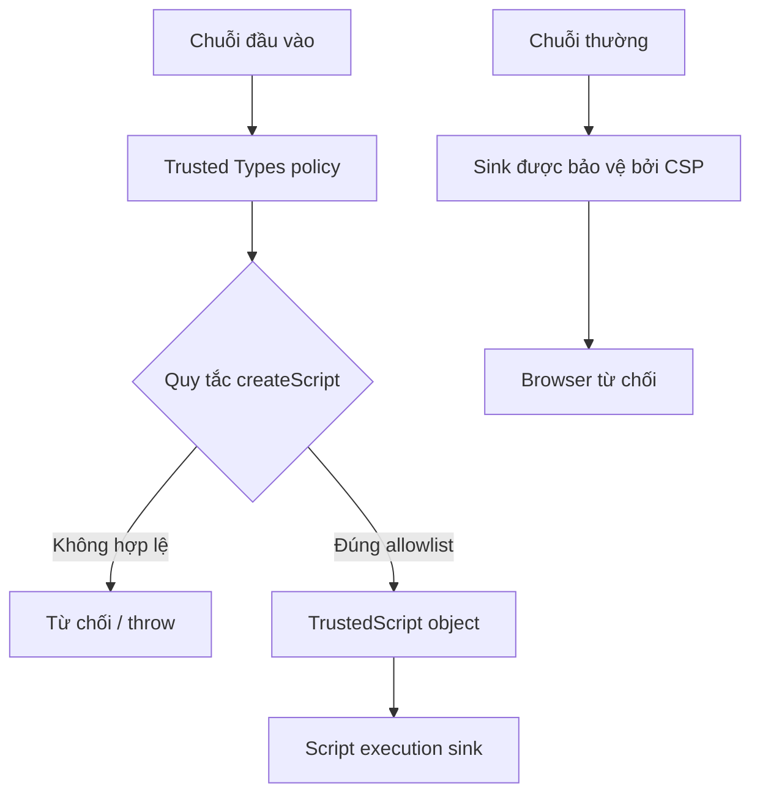

# TrustedScript: kiểm soát chuỗi JavaScript trước khi thực thi

## Mục tiêu học tập

Sau bài học, người học có thể:

1. Giải thích TrustedScript là kiểu dữ liệu đại diện cho JavaScript source đã được một Trusted Types policy chấp thuận.
2. Nhận diện các script execution sink nhận chuỗi, ví dụ `eval()` và các API timer dùng string callback.
3. Tạo policy bằng `trustedTypes.createPolicy()` và triển khai `createScript()` với quy tắc chấp nhận rõ ràng.
4. Kết hợp `require-trusted-types-for 'script'` với `trusted-types` để bắt buộc kiểu dữ liệu và giới hạn tên policy.
5. Phân biệt TrustedScript với TrustedHTML và TrustedScriptURL.
6. Thay thế việc thực thi chuỗi động bằng callback, hàm có tên hoặc bảng hành động an toàn; dùng TrustedScript có kiểm soát cho trường hợp legacy thật sự cần.
7. Kiểm thử enforcement bằng Chrome DevTools và nhận biết giới hạn hỗ trợ giữa các browser.

> **Bối cảnh:** Module Browser Security phân tích ranh giới bảo mật giữa trình duyệt, origin, cookie và ứng dụng web, đồng thời thực hành phòng vệ XSS, CSRF, clickjacking bằng CSP, Trusted Types và security headers. TrustedScript là một phần của Trusted Types, giúp browser phân biệt chuỗi JavaScript thông thường với giá trị đã đi qua policy được ứng dụng tin cậy. Nó giảm nguy cơ DOM XSS tại các sink thực thi code, nhưng policy vẫn phải được thiết kế an toàn.

## 1. Vì sao cần TrustedScript?

Một số API JavaScript có thể nhận chuỗi rồi diễn giải chuỗi đó như mã chương trình. Nếu chuỗi được ghép từ dữ liệu không tin cậy, dữ liệu có thể thoát khỏi vị trí dự kiến và trở thành code:

```js
// Không an toàn: input được ghép trực tiếp vào JavaScript source
const action = new URLSearchParams(location.search).get("action");
eval("runAction('" + action + "')");
```

Nếu giá trị `action` chứa cú pháp JavaScript, nội dung có thể thay đổi ý nghĩa của đoạn code được thực thi. Đây là một dạng DOM-based XSS hoặc code injection.

Một số sink khác cũng có thể nhận chuỗi JavaScript:

```js
// Không an toàn: string callback được browser diễn giải như JavaScript
setTimeout("refreshDashboard()", 1000);
```

Trong trường hợp này, callback được truyền dưới dạng source code thay vì function. Nếu ứng dụng chỉ cần gọi một hàm sau một khoảng thời gian, string execution là không cần thiết.

### Trusted Types thêm một ranh giới kiểu dữ liệu

Thông thường, browser nhận một chuỗi `string` ở sink. Trusted Types bổ sung các kiểu riêng như:

- `TrustedHTML`: giá trị được policy chấp thuận cho HTML injection sink.
- `TrustedScript`: giá trị được policy chấp thuận cho script execution sink.
- `TrustedScriptURL`: URL được policy chấp thuận cho sink tải script.

Khi CSP yêu cầu Trusted Types cho script, các sink được hỗ trợ có thể từ chối chuỗi thường và yêu cầu object đúng kiểu. Ứng dụng phải chủ động tạo object đó qua policy.

**TrustedScript không tự làm code an toàn.** Nó chỉ thể hiện rằng một policy được ứng dụng tin cậy đã quyết định chấp nhận nội dung. Nếu policy trả lại mọi chuỗi đầu vào mà không kiểm tra, lớp bảo vệ gần như mất ý nghĩa.

## 2. TrustedScript là gì?

`TrustedScript` là object chứa JavaScript source được tạo bởi `TrustedTypePolicy.createScript()`. Object này có thể được truyền vào các script execution sink hỗ trợ Trusted Types.

Luồng tổng quát:



TrustedScript giải quyết câu hỏi: **giá trị nào được phép đi vào một sink thực thi JavaScript?** Policy chịu trách nhiệm đưa ra quyết định. Browser thực thi ranh giới kiểu dữ liệu khi CSP được bật.

### So sánh ba kiểu Trusted Types thường gặp

| Kiểu | Mục đích | Ví dụ sink |
| --- | --- | --- |
| `TrustedHTML` | HTML đã được policy kiểm tra hoặc tạo an toàn | `element.innerHTML`, `insertAdjacentHTML()` |
| `TrustedScript` | JavaScript source được policy chấp thuận | `eval()` và các script sink nhận chuỗi được hỗ trợ |
| `TrustedScriptURL` | URL trỏ tới script đã được policy kiểm tra | `script.src` và các script URL sink được hỗ trợ |

Không dùng TrustedScript thay cho TrustedHTML hoặc TrustedScriptURL. Mỗi loại bảo vệ một nhóm sink và một ngữ cảnh khác nhau.

### TrustedScript không phải sanitizer tổng quát

HTML sanitizer xử lý cấu trúc HTML và loại bỏ hoặc biến đổi nội dung nguy hiểm theo policy. Với JavaScript source, không có một phép escape tổng quát nào biến code tùy ý thành code an toàn trong mọi ngữ cảnh.

Do đó, policy `createScript()` nên:

- Chỉ chấp nhận code hằng đã được review hoặc một tập mẫu source rất nhỏ.
- Từ chối input không nằm trong allowlist.
- Không ghép dữ liệu người dùng vào code source.
- Không cố "sanitize JavaScript" bằng replace các ký tự như dấu nháy, dấu chấm phẩy hoặc ngoặc.
- Ghi nhận các call site legacy để có thể loại bỏ dần.

Nếu mục tiêu là thực hiện một hành động dựa trên input, hãy ánh xạ input thành một hàm có sẵn thay vì tạo source code mới.

## 3. Tạo TrustedScript bằng policy

Trusted Types API được truy cập qua `window.trustedTypes` trong browser hỗ trợ:

```js
if (window.trustedTypes) {
  console.log("Trusted Types is available");
}
```

Policy được tạo bằng `createPolicy(name, rules)`. Rule `createScript(input)` nhận chuỗi và phải trả về JavaScript source mà policy chấp thuận. Browser đóng gói kết quả thành TrustedScript object.

### Ví dụ policy chỉ chấp nhận source cố định

Đây là ví dụ minh họa cách tạo TrustedScript cho một đoạn code hằng đã được review:

```js
const reviewedSource = "window.appReady = true;";

const scriptPolicy = trustedTypes.createPolicy("app-static-script", {
  createScript(input) {
    if (input !== reviewedSource) {
      throw new TypeError("Script source is not approved");
    }
    return input;
  }
});

const trustedCode = scriptPolicy.createScript(reviewedSource);
console.log(trustedTypes.isScript(trustedCode)); // true
```

Trong policy này:

1. Ứng dụng khai báo một source code cố định.
2. `createScript()` chỉ chấp nhận đúng chuỗi đã review.
3. Input khác bị từ chối.
4. Kết quả là một object TrustedScript, không còn là string thường.

Một sink nhận TrustedScript có thể sử dụng object này nếu các policy CSP khác cũng cho phép hành vi đó. Ví dụ gọi `eval(trustedCode)` vẫn chịu các giới hạn thực thi code của CSP `script-src`; Trusted Types không tự cấp quyền `eval()` nếu CSP đang chặn eval.

**Không thêm `'unsafe-eval'` vào production chỉ để làm ví dụ TrustedScript chạy được.** Với ứng dụng mới, ưu tiên loại bỏ eval và string-based execution.

### Policy không nên trả lại mọi input

Ví dụ nguy hiểm:

```js
// KHÔNG AN TOÀN: mọi chuỗi đầu vào đều được "tin cậy" mà không kiểm tra
const unsafePolicy = trustedTypes.createPolicy("unsafe-script", {
  createScript(input) {
    return input;
  }
});
```

Policy này chỉ đổi nhãn kiểu dữ liệu, không giảm rủi ro code injection. Nếu attacker kiểm soát input, attacker có thể đưa code của họ qua policy.

### Không ghép dữ liệu động vào JavaScript source

Không an toàn:

```js
const userName = getUserInput();
const code = "showProfile('" + userName + "')";
const trusted = scriptPolicy.createScript(code);
```

Ngay cả khi có policy, source vẫn chứa dữ liệu do người dùng kiểm soát. Policy phải phân tích hoặc allowlist code; cách tốt hơn là không tạo source:

```js
const userName = getUserInput();
showProfile(userName);
```

JavaScript đã có cơ chế truyền dữ liệu qua tham số hàm. Không cần biến dữ liệu thành code để gọi một hành động.

## 4. Bật enforcement bằng Content Security Policy

Trusted Types enforcement được bật qua CSP directive:

```http
Content-Security-Policy: require-trusted-types-for 'script'
```

Directive này yêu cầu các script injection sink được browser hỗ trợ nhận Trusted Types object phù hợp thay vì string thường.

Để giới hạn policy nào được phép tạo, dùng thêm directive `trusted-types`:

```http
Content-Security-Policy: require-trusted-types-for 'script'; trusted-types app-static-script
```

Hai directive có nhiệm vụ khác nhau:

| Directive | Vai trò |
| --- | --- |
| `require-trusted-types-for 'script'` | Bật enforcement tại các sink được Trusted Types bảo vệ |
| `trusted-types app-static-script` | Chỉ cho phép tạo policy có tên `app-static-script` |

Nếu ứng dụng cố tạo policy có tên không nằm trong danh sách, browser sẽ từ chối việc tạo policy theo CSP. Đây là cách giới hạn số nơi trong codebase có quyền chuyển chuỗi thường thành TrustedScript.

### Policy name là ranh giới quyền

Ví dụ header:

```http
Content-Security-Policy: require-trusted-types-for 'script'; trusted-types app-static-script app-template
```

Ứng dụng chỉ được tạo policy tên `app-static-script` và `app-template`. Hãy cấp tên riêng theo mục đích, không thêm wildcard hoặc cho phép tên policy do input runtime quyết định.

Directive `trusted-types` kiểm soát việc tạo policy, không phải allowlist URL của script và cũng không thay `script-src`.

### Trusted Types không thay script-src

CSP `script-src` tiếp tục kiểm soát nguồn script, inline script, nonce/hash và một số hành vi thực thi code như eval. Trusted Types thêm kiểm tra kiểu tại các sink:

```http
Content-Security-Policy: default-src 'self'; script-src 'self' 'nonce-{RANDOM_NONCE}'; object-src 'none'; base-uri 'self'; require-trusted-types-for 'script'; trusted-types app-static-script
```

Đây là ví dụ minh họa cấu trúc policy; nonce phải được sinh ngẫu nhiên cho từng response và gắn đúng vào script hợp lệ. Không dùng chuỗi literal `{RANDOM_NONCE}` trong production.

Nếu `script-src` không cho eval, truyền TrustedScript vào `eval()` không tự vượt qua giới hạn đó. Cần xem hai lớp riêng:

- Trusted Types: sink có nhận đúng kiểu dữ liệu không?
- CSP script-src: hành vi thực thi script đó có được policy cho phép không?

Trong ứng dụng mới, cấu hình script-src chặt và tránh eval vẫn là lựa chọn nên hướng tới.

## 5. Nhận diện script execution sink

TrustedScript liên quan đến sink nhận JavaScript source dưới dạng chuỗi. Một số ví dụ phổ biến trong browser hỗ trợ:

| Sink | Cách dùng có rủi ro | Cách thay thế nên ưu tiên |
| --- | --- | --- |
| `eval(string)` | Thực thi chuỗi như JavaScript | Gọi hàm trực tiếp hoặc dùng parser cho dữ liệu |
| `setTimeout(string, delay)` | Timer diễn giải string thành code | Truyền function callback |
| `setInterval(string, delay)` | Lặp lại việc thực thi string | Truyền function callback |
| Function constructor với source string | Tạo function từ chuỗi động | Viết function tĩnh và truyền tham số |

Danh sách sink được enforcement có thể khác theo browser và phiên bản. Hãy kiểm tra tài liệu Trusted Types/Fetch-compatible implementation của browser mục tiêu và thử trực tiếp trên các phiên bản được hỗ trợ.

### Thay string timer bằng function

Không an toàn:

```js
setTimeout("refreshDashboard()", 1000);
setInterval("pollStatus()", 5000);
```

An toàn và rõ ràng hơn:

```js
setTimeout(refreshDashboard, 1000);
setInterval(pollStatus, 5000);
```

Nếu cần truyền tham số:

```js
setTimeout(() => refreshDashboard(accountId), 1000);
```

Không có chuỗi source code nào được tạo hoặc parse lại.

### Thay eval bằng bảng hành động

Không an toàn:

```js
const action = new URLSearchParams(location.search).get("action");
eval("actions." + action + "()");
```

Thay bằng allowlist hàm:

```js
const actions = new Map([
  ["open-settings", () => showSettings()],
  ["refresh", () => refreshDashboard()],
  ["sign-out", () => signOut()]
]);

function runAction(name) {
  const action = actions.get(name);
  if (!action) {
    throw new TypeError("Unsupported action");
  }
  action();
}

const requestedAction = new URLSearchParams(location.search).get("action");
runAction(requestedAction);
```

Input chỉ chọn một hành động đã tồn tại trong map. Nó không thể tạo code mới, gọi property tùy ý hoặc chèn cú pháp JavaScript.

## 6. TrustedScript khác TrustedScriptURL và TrustedHTML

Các kiểu Trusted Types không thể thay thế lẫn nhau:

### Khi cần đưa HTML vào DOM

`innerHTML` là HTML injection sink. Dùng `TrustedHTML` và policy xử lý HTML theo yêu cầu sản phẩm. Không dùng TrustedScript để gán vào `innerHTML`.

### Khi cần tải file JavaScript

`script.src` nhận URL tới tài nguyên script, không phải source code của script. Đây là trường hợp của `TrustedScriptURL`:

```js
const script = document.createElement("script");
script.src = trustedScriptUrl;
document.head.append(script);
```

TrustedScriptURL policy cần kiểm tra URL, scheme, host và đường dẫn theo allowlist. Không dùng `TrustedScript` để đại diện URL.

### Khi cần thực thi code

Sink như `eval()` nhận JavaScript source; đây mới là phạm vi của TrustedScript. Tuy vậy, lựa chọn tốt nhất thường là loại bỏ sink thực thi chuỗi.

| Dữ liệu cần đưa vào | Kiểu phù hợp |
| --- | --- |
| Markup HTML đã qua policy | TrustedHTML |
| JavaScript source được policy chấp thuận | TrustedScript |
| URL của file script được policy chấp thuận | TrustedScriptURL |

## 7. Default policy và lộ trình migration

Trusted Types có khái niệm **default policy**. Nếu policy tên `default` được tạo và một string thường đi vào sink được bảo vệ, browser có thể gọi default policy để chuyển đổi chuỗi theo rule tương ứng. Cơ chế này hữu ích khi chuyển đổi một codebase lớn, vì nó cho phép quan sát call site legacy trước khi từ chối toàn bộ.

Tuy nhiên default policy có thể che giấu vị trí tạo dữ liệu không an toàn nếu nó âm thầm trả lại input:

```js
// Không dùng: biến mọi string thành TrustedScript mà không kiểm tra
trustedTypes.createPolicy("default", {
  createScript(input) {
    return input;
  }
});
```

Nếu buộc phải dùng trong migration:

- Ghi log sink name và call site nếu môi trường cho phép, không ghi nội dung nhạy cảm.
- Chỉ chuyển đổi những trường hợp đã phân tích và có quy tắc cụ thể.
- Trả về null hoặc throw đối với trường hợp không chấp nhận.
- Đặt thời hạn loại bỏ default policy và theo dõi số call site còn lại.
- Không để default policy identity trở thành cơ chế production lâu dài.

### Các bước migration đề xuất

1. **Inventory:** tìm `eval()`, timer dùng string, Function constructor và các API thực thi chuỗi khác.
2. **Phân loại:** xác định dữ liệu nào là hằng code, dữ liệu người dùng và code được tạo từ template.
3. **Loại bỏ sink không cần thiết:** thay bằng callback, function map, module import hoặc cấu trúc dữ liệu.
4. **Viết policy hẹp:** chỉ cho phép các trường hợp legacy đã review; đặt tên policy rõ ràng.
5. **Thử Report-Only:** quan sát vi phạm và các call site còn lại trong môi trường test.
6. **Enforce:** phát hành `require-trusted-types-for 'script'` và danh sách policy name tối thiểu.
7. **Retest:** kiểm tra luồng quan trọng, browser hỗ trợ và các bundle/third-party integration.

## 8. Ví dụ triển khai header

### Nginx

```nginx
add_header Content-Security-Policy "default-src 'self'; script-src 'self'; object-src 'none'; base-uri 'self'; require-trusted-types-for 'script'; trusted-types app-static-script" always;
```

Đây là mẫu policy minh họa cho ứng dụng không cần eval và chỉ có một policy name. Nếu ứng dụng có nonce, hash hoặc script host khác, điều chỉnh `script-src` theo inventory thực tế. Kiểm tra kế thừa `add_header` giữa server/location và bảo đảm CDN không thêm policy mâu thuẫn.

### Node.js / Express

```js
app.use((req, res, next) => {
  res.setHeader(
    "Content-Security-Policy",
    [
      "default-src 'self'",
      "script-src 'self'",
      "object-src 'none'",
      "base-uri 'self'",
      "require-trusted-types-for 'script'",
      "trusted-types app-static-script"
    ].join("; ")
  );
  next();
});
```

Trong production, cấu hình CSP tập trung và kiểm tra response HTML cuối cùng. Nếu tạo nonce động, middleware phải sinh nonce đủ ngẫu nhiên cho mỗi response, gắn nonce vào script được phép và đưa cùng nonce vào header. Không tái sử dụng nonce cố định.

### Java Servlet / Spring

Có thể phát header qua filter hoặc cấu hình security headers:

```java
import jakarta.servlet.Filter;
import jakarta.servlet.FilterChain;
import jakarta.servlet.ServletException;
import jakarta.servlet.ServletRequest;
import jakarta.servlet.ServletResponse;
import jakarta.servlet.http.HttpServletResponse;
import java.io.IOException;

public class TrustedTypesCspFilter implements Filter {
    @Override
    public void doFilter(
        ServletRequest request,
        ServletResponse response,
        FilterChain chain
    ) throws IOException, ServletException {
        HttpServletResponse http = (HttpServletResponse) response;
        http.setHeader(
            "Content-Security-Policy",
            "default-src 'self'; script-src 'self'; object-src 'none'; " +
            "base-uri 'self'; require-trusted-types-for 'script'; " +
            "trusted-types app-static-script"
        );
        chain.doFilter(request, response);
    }
}
```

Ví dụ minh họa cách gắn header. Trong ứng dụng Spring Security, ưu tiên cấu hình security headers tại một nơi tập trung và tránh để filter khác ghi đè hoặc phát thêm CSP không thống nhất.

## 9. Kiểm thử TrustedScript bằng Chrome DevTools

Thực hiện trên trang local hoặc môi trường thử nghiệm do bạn kiểm soát. Không chạy payload từ người dùng thật và không bật `'unsafe-eval'` trong production chỉ để hoàn thành lab.

### Bước 1 — Kiểm tra hỗ trợ API

Trong Console:

```js
console.log("trustedTypes" in window);
console.log(window.trustedTypes);
```

Nếu API không tồn tại, browser hiện tại không hỗ trợ phần API này hoặc tính năng không khả dụng trong context đang chạy. Không tự tạo polyfill identity để giả lập enforcement.

### Bước 2 — Bật CSP trong môi trường lab

Trả header sau cho trang lab:

```http
Content-Security-Policy: require-trusted-types-for 'script'; trusted-types demo-script
```

Policy tối giản này dùng để quan sát Trusted Types enforcement. Production phải kết hợp với `script-src`, `object-src`, `base-uri` và các directive cần thiết khác.

### Bước 3 — Thử string thường

Trong Console:

```js
try {
  eval("console.log('plain string')");
} catch (error) {
  console.error(error);
}
```

Với browser hỗ trợ và CSP enforcement được bật, sink được bảo vệ sẽ từ chối string thường và báo lỗi Trusted Types. Nếu browser không hỗ trợ, chuỗi có thể chạy; đó là lý do cần kiểm tra compatibility của browser mục tiêu.

### Bước 4 — Tạo TrustedScript từ policy giới hạn

```js
const approvedSource = "console.log('approved script')";

const policy = trustedTypes.createPolicy("demo-script", {
  createScript(input) {
    if (input !== approvedSource) {
      throw new TypeError("Source is not in the reviewed allowlist");
    }
    return input;
  }
});

const trustedCode = policy.createScript(approvedSource);
console.log(trustedTypes.isScript(trustedCode));
eval(trustedCode);
```

Trong lab không có `script-src` chặn eval, nên có thể quan sát đường đi TrustedScript. Trong ứng dụng production, CSP `script-src` có thể tiếp tục chặn eval; Trusted Types không bỏ qua kiểm soát đó.

### Bước 5 — Thử policy name ngoài allowlist

```js
trustedTypes.createPolicy("unlisted-policy", {
  createScript(input) {
    return input;
  }
});
```

Với header `trusted-types demo-script`, browser sẽ từ chối tạo policy không có tên được phép. Không sử dụng policy identity này trong ứng dụng thực.

### Bước 6 — Quan sát vi phạm

1. Mở DevTools → Console và Network.
2. Chọn document HTML, xem response header `Content-Security-Policy`.
3. Thử sink với string thường và object TrustedScript.
4. Quan sát lỗi và thông báo CSP/Trusted Types.
5. Thử trên các browser/phiên bản được sản phẩm hỗ trợ; ghi rõ trường hợp API không được hỗ trợ.

### Ma trận kiểm thử

| Ca kiểm thử | Thiết lập | Kết quả mong đợi trên browser hỗ trợ |
| --- | --- | --- |
| String thường vào sink được bảo vệ | Có `require-trusted-types-for 'script'` | Bị từ chối |
| TrustedScript từ policy được phép | Policy name nằm trong `trusted-types` | Vượt qua kiểm tra kiểu của sink |
| Policy name không được phép | Không nằm trong allowlist CSP | Không tạo được policy |
| Policy trả lại input tùy ý | createScript identity | Kiểu dữ liệu được tạo nhưng không bảo đảm an toàn; lỗi thiết kế |
| eval bị chặn bởi script-src | Không có quyền eval | Vẫn bị CSP chặn dù đầu vào là TrustedScript |
| Browser không hỗ trợ Trusted Types | API không có hoặc enforcement không được hỗ trợ | Không được bảo vệ bởi cơ chế này; cần fallback an toàn |

## 10. Sai lầm thường gặp

| Sai lầm | Hậu quả | Cách sửa |
| --- | --- | --- |
| Nghĩ TrustedScript tự sanitize JavaScript | Policy có thể chấp nhận code độc hại | Chỉ cho phép source đã review hoặc bỏ sink |
| Tạo policy identity | Mọi input string có thể trở thành TrustedScript | Allowlist nghiêm ngặt hoặc từ chối input |
| Dùng TrustedScript cho script.src | Nhầm source code với URL tải script | Dùng TrustedScriptURL và kiểm tra URL |
| Dùng TrustedScript cho innerHTML | Nhầm JavaScript source với HTML | Dùng TrustedHTML và policy HTML |
| Bật enforcement nhưng không kiểm kê sink | Ứng dụng có thể lỗi ở luồng legacy | Inventory và test trước khi enforce |
| Dùng default policy trả nguyên input | Che giấu sink nguy hiểm và giữ nguyên rủi ro | Dùng default policy chỉ để log/reject trong migration |
| Thêm unsafe-eval để sửa lỗi | Làm yếu CSP và cho phép nhiều dạng eval | Loại bỏ eval; chỉ dùng lab cô lập để quan sát |
| Cho rằng Trusted Types thay script-src | Mất kiểm soát nguồn script và eval policy | Kết hợp CSP đầy đủ |
| Chỉ kiểm tra Chrome mới | Bỏ sót browser không hỗ trợ | Feature detect và test toàn bộ browser matrix |
| Coi tên policy là bí mật | Mọi code trong origin có thể gọi policy được expose | Giới hạn nơi tạo policy, review code và giữ logic policy an toàn |

## 11. Câu hỏi củng cố

**Câu 1.** TrustedScript khác string thường ở điểm nào?

**Giải đáp:** TrustedScript là object được tạo qua Trusted Types policy. Khi CSP enforcement được hỗ trợ và bật, script sink có thể từ chối string thường và yêu cầu TrustedScript.

**Câu 2.** Nếu policy `createScript(input)` chỉ `return input`, ứng dụng có được bảo vệ không?

**Giải đáp:** Không. Policy đang chấp nhận mọi source mà không xác minh; attacker vẫn có thể đưa code tùy ý qua sink.

**Câu 3.** `TrustedScript` có thể gán vào `script.src` không?

**Giải đáp:** Không nên. `script.src` là URL sink, dùng TrustedScriptURL với policy kiểm tra URL; TrustedScript dành cho source code.

**Câu 4.** Bật `require-trusted-types-for 'script'` có cho phép eval khi CSP script-src đang chặn eval không?

**Giải đáp:** Không. Trusted Types kiểm soát kiểu dữ liệu vào sink; script-src vẫn có thể chặn hành vi eval.

**Câu 5.** Cách tốt nhất để xử lý `setTimeout("refresh()", 1000)` là gì?

**Giải đáp:** Truyền function callback, ví dụ `setTimeout(refresh, 1000)`. Không cần tạo JavaScript source từ chuỗi.

**Câu 6.** Tại sao cần directive `trusted-types` nếu đã có `require-trusted-types-for 'script'`?

**Giải đáp:** Directive đầu bật enforcement tại sink; directive sau giới hạn tên policy được phép tạo, giúp giảm số nơi có quyền biến string thành Trusted Types object.

## 12. Tổng kết

**TrustedScript** đại diện cho JavaScript source được một policy chấp thuận trước khi đi vào script execution sink. Bật `require-trusted-types-for 'script'` để browser yêu cầu kiểu dữ liệu phù hợp ở các sink được hỗ trợ; dùng `trusted-types` để giới hạn tên policy được tạo.

Policy là ranh giới tin cậy thực sự. Không dùng identity policy, không ghép dữ liệu người dùng vào source code và không xem TrustedScript là sanitizer tổng quát. Ưu tiên thay eval và string timer bằng function/callback; nếu phải giữ code legacy, chỉ chấp nhận source hằng đã review. Kết hợp Trusted Types với script-src chặt, kiểm thử browser matrix và theo dõi vi phạm trong quá trình migration.

## Tài liệu tham khảo

1. [W3C — Trusted Types](https://w3c.github.io/trusted-types/dist/spec/): định nghĩa TrustedScript, policy, sink và enforcement.
2. [MDN — TrustedScript](https://developer.mozilla.org/en-US/docs/Web/API/TrustedScript): kiểu dữ liệu cho JavaScript source đáng tin cậy.
3. [MDN — TrustedTypePolicy.createScript()](https://developer.mozilla.org/en-US/docs/Web/API/TrustedTypePolicy/createScript): tạo TrustedScript qua policy.
4. [MDN — require-trusted-types-for](https://developer.mozilla.org/en-US/docs/Web/HTTP/Reference/Headers/Content-Security-Policy/require-trusted-types-for): bật enforcement Trusted Types trong CSP.
5. [MDN — trusted-types CSP directive](https://developer.mozilla.org/en-US/docs/Web/HTTP/Reference/Headers/Content-Security-Policy/trusted-types): giới hạn policy name được phép.
6. [OWASP — DOM based XSS Prevention Cheat Sheet](https://cheatsheetseries.owasp.org/cheatsheets/DOM_based_XSS_Prevention_Cheat_Sheet.html): nhận diện sink và phòng DOM XSS.
7. [web.dev — Trusted Types](https://web.dev/articles/trusted-types): chiến lược triển khai và migration.
