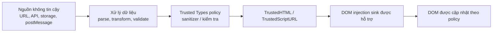

# DOM sink enforcement: dùng Trusted Types để kiểm soát điểm đưa dữ liệu vào DOM

Một ứng dụng web có thể nhận dữ liệu từ URL, API, storage, nội dung do người dùng tạo hoặc thành phần tích hợp. Khi dữ liệu được đưa vào DOM, cách gán dữ liệu quyết định trình duyệt coi nó là văn bản hay phân tích nó thành HTML, URL hoặc mã. Những API có thể khiến chuỗi được diễn giải theo cú pháp chủ động được gọi là **injection sink**. Nếu dữ liệu không tin cậy đi vào sink mà không được kiểm soát, lỗi DOM XSS có thể xuất hiện.

**Trusted Types** là một cơ chế của trình duyệt giúp áp đặt ranh giới tại một số DOM injection sink. Thay vì chấp nhận chuỗi tùy ý ở các API được hỗ trợ, trình duyệt có thể yêu cầu giá trị thuộc kiểu tin cậy như `TrustedHTML`, `TrustedScript` hoặc `TrustedScriptURL`. Ứng dụng tạo các giá trị này thông qua policy có kiểm soát. Khi kết hợp với CSP, Trusted Types giúp tìm và ngăn những đường dữ liệu không an toàn đi vào các sink được bảo vệ.

Trusted Types không tự làm sạch chuỗi và không tự chứng minh nội dung an toàn. Chất lượng bảo vệ phụ thuộc vào policy, sanitizer và cách ứng dụng sử dụng các giá trị tin cậy.

Bài học thuộc chương **Trusted Types**, trong phạm vi `SECURITY_APPLICATION_SECURITY_BROWSER_SECURITY`: phân tích ranh giới giữa trình duyệt, origin, cookie và ứng dụng web; hiểu Same-Origin Policy, CORS và các cơ chế cách ly; thực hành phòng vệ XSS, CSRF, clickjacking bằng CSP, Trusted Types, security headers và kiểm chứng hành vi thực tế.

## 1. Mục tiêu học tập

Sau bài học, người học có thể:

1. Nhận diện DOM injection sink và phân biệt sink với API chỉ đặt văn bản.
2. Giải thích ba kiểu dữ liệu `TrustedHTML`, `TrustedScript` và `TrustedScriptURL`.
3. Phân biệt vai trò của `require-trusted-types-for` và `trusted-types` trong CSP.
4. Tạo policy có tên, giới hạn chức năng và tích hợp sanitizer phù hợp.
5. Giải thích rủi ro của default policy và policy cho phép mọi chuỗi.
6. Lập kế hoạch migration từ string-based sink sang DOM API an toàn và Trusted Types.
7. Kiểm thử enforcement, vi phạm CSP và hành vi trên các trình duyệt mục tiêu.
8. Nhận diện những loại sink mà Trusted Types không thay thế URL validation, CSS validation hoặc authorization.

## 2. Injection sink là gì?

Một injection sink là API hoặc thuộc tính mà tại đó dữ liệu có thể được diễn giải theo một ngữ cảnh chủ động thay vì chỉ được lưu như văn bản. Ví dụ, `innerHTML` yêu cầu trình duyệt parse chuỗi thành markup; `script.src` có thể khiến trình duyệt tải mã; `eval()` có thể diễn giải chuỗi như JavaScript.

Không phải mọi thao tác cập nhật DOM đều là injection sink:

| Cách thao tác | Cách trình duyệt xử lý | Đánh giá |
| --- | --- | --- |
| `element.textContent = input` | Đặt nội dung dạng text | Ưu tiên cho văn bản thuần. |
| `input.value = userValue` | Đặt giá trị của form control | Phù hợp cho dữ liệu giá trị. |
| `element.setAttribute('title', input)` | Đặt giá trị thuộc tính văn bản cố định | Thường an toàn về cấu trúc; tên và ngữ nghĩa thuộc tính vẫn phải được kiểm soát. |
| `element.innerHTML = input` | Parse chuỗi thành HTML | Injection sink; cần tránh hoặc kiểm soát bằng sanitizer/Trusted Types. |
| `element.insertAdjacentHTML('beforeend', input)` | Parse chuỗi thành HTML rồi chèn vào DOM | Injection sink. |
| `script.src = input` | Tải script từ URL | Sink URL script; cần nguồn tin cậy và kiểm soát URL. |
| `eval(input)` | Parse chuỗi thành JavaScript | Dynamic code execution; không nên dùng với dữ liệu không tin cậy. |

Trusted Types tập trung vào một tập sink được trình duyệt hỗ trợ. Không được suy ra rằng mọi API có khả năng gây XSS đều tự động được bảo vệ.

### Luồng source-to-sink



Nếu dữ liệu không đi qua policy hợp lệ mà được gán thẳng vào sink, enforcement có thể từ chối thao tác. Nếu policy tin mọi chuỗi, ranh giới vẫn tồn tại về mặt kỹ thuật nhưng không còn giá trị bảo mật.

## 3. Các kiểu Trusted Types

Trusted Types cung cấp các kiểu đối tượng riêng cho những ngữ cảnh khác nhau:

| Kiểu | Ngữ cảnh | Ví dụ sử dụng |
| --- | --- | --- |
| `TrustedHTML` | Nội dung HTML được phép parse tại một số HTML injection sink | `container.innerHTML = trustedHtml` |
| `TrustedScript` | Script được phép đưa vào một số script injection sink | Các API thực thi script được trình duyệt hỗ trợ Trusted Types cho kiểu này |
| `TrustedScriptURL` | URL được phép dùng tại một số sink tải script | `script.src = trustedScriptUrl` |

Các kiểu này không thể thay thế lẫn nhau. `TrustedHTML` không phải URL tin cậy; `TrustedScriptURL` không phải HTML đã sanitize; `TrustedScript` không nên được dùng như một cách hợp thức hóa mã tùy ý.

### Giá trị tin cậy không phải chứng thư an toàn

Một object `TrustedHTML` chỉ chứng minh giá trị đã được tạo qua một policy được chấp nhận trong realm hiện tại. Nó không đảm bảo policy đó đúng. Ví dụ policy sau vô hiệu hóa mục đích bảo vệ:

```js
const unsafePolicy = trustedTypes.createPolicy('unsafe-html', {
  createHTML(input) {
    return input; // Không sanitize: mọi chuỗi đều được tin
  }
});
```

Đoạn này tạo `TrustedHTML` nhưng không loại bỏ script, event handler hay URL nguy hiểm. Đừng đặt tên policy là `safe` hoặc `trusted` rồi coi tên gọi là bằng chứng.

### Trusted Types không thay thế mọi loại validation

Trusted Types không phải bộ lọc chung cho tất cả thuộc tính và dữ liệu. Ứng dụng vẫn phải:

- Validate URL `href`, `src`, `action` và redirect theo scheme/host/origin cho phép.
- Kiểm soát CSS và giá trị đưa vào `style`.
- Kiểm tra tên thuộc tính động.
- Xác thực schema và quy tắc nghiệp vụ cho dữ liệu API.
- Kiểm tra authentication, authorization và CSRF ở server.

## 4. Bật DOM sink enforcement bằng CSP

Hai directive CSP có vai trò khác nhau:

- `require-trusted-types-for 'script'` yêu cầu các sink được hỗ trợ phải nhận Trusted Types thay vì chuỗi tùy ý.
- `trusted-types` giới hạn tên policy mà trang được phép tạo.

Ví dụ response header:

```http
Content-Security-Policy: default-src 'self'; object-src 'none'; base-uri 'none'; require-trusted-types-for 'script'; trusted-types app-html
```

Trong ví dụ:

- `require-trusted-types-for 'script'` bật enforcement cho các sink được triển khai theo Trusted Types.
- `trusted-types app-html` chỉ cho phép tạo policy có tên `app-html`.
- `default-src`, `object-src` và `base-uri` là các chỉ thị CSP riêng; chúng không phải điều kiện thay thế cho Trusted Types.

### Chỉ có trusted-types chưa bật enforcement

Ví dụ:

```http
Content-Security-Policy: trusted-types app-html
```

Directive này giới hạn tên policy được tạo, nhưng tự nó không yêu cầu sink từ chối chuỗi thông thường. Muốn áp dụng DOM sink enforcement, cần có `require-trusted-types-for 'script'` trên trình duyệt hỗ trợ.

### Chỉ có require-trusted-types-for cũng chưa giới hạn policy name

Ví dụ:

```http
Content-Security-Policy: require-trusted-types-for 'script'
```

Enforcement được bật cho sink hỗ trợ, nhưng ứng dụng chưa giới hạn tên policy được tạo bằng directive `trusted-types`. Khi triển khai production, thường nên kết hợp cả hai để giới hạn điểm tạo giá trị tin cậy.

### Không phải mọi trình duyệt đều hỗ trợ giống nhau

Trusted Types được triển khai trong Chromium và các trình duyệt dựa trên Chromium; mức hỗ trợ ở các engine khác có thể khác hoặc chưa có. Cần kiểm tra ma trận trình duyệt thực tế của sản phẩm. Khi trình duyệt không hỗ trợ, ứng dụng vẫn phải dựa vào DOM API an toàn, sanitizer và kiểm soát source-to-sink; không giả định header đã được thực thi chỉ vì server gửi nó.

## 5. Tạo policy có kiểm soát

Policy là nơi chuyển dữ liệu đầu vào thành giá trị Trusted Types. Một policy có thể định nghĩa các hook như `createHTML`, `createScript` và `createScriptURL`. Chỉ tạo những hook thực sự cần thiết.

### Ví dụ policy HTML kết hợp sanitizer

Giả sử sản phẩm có tính năng hiển thị nội dung HTML do người dùng tạo, chẳng hạn phần mô tả có định dạng. Nên dùng sanitizer HTML chuyên dụng, được duy trì và cấu hình theo allowlist phần tử/thuộc tính.

Ví dụ minh họa với DOMPurify:

```js
const htmlPolicy = trustedTypes.createPolicy('app-html', {
  createHTML(input) {
    return DOMPurify.sanitize(input, {
      ALLOWED_TAGS: [
        'p', 'br', 'strong', 'em', 'ul', 'ol', 'li', 'a'
      ],
      ALLOWED_ATTR: ['href', 'title', 'rel'],
      RETURN_TRUSTED_TYPE: false
    });
  }
});

function renderUserDescription(container, untrustedHtml) {
  const safeHtml = htmlPolicy.createHTML(untrustedHtml);
  container.innerHTML = safeHtml;
}
```

Đây là ví dụ minh họa, cần kiểm tra cấu hình DOMPurify theo phiên bản đang dùng và yêu cầu sản phẩm. Tùy tích hợp Trusted Types của sanitizer, `RETURN_TRUSTED_TYPE: false` giúp policy nhận về chuỗi đã sanitize rồi policy tạo `TrustedHTML`. Không tự thêm các thẻ/thuộc tính chủ động nếu không có nhu cầu.

Nếu nội dung chỉ là văn bản, không cần sanitizer hoặc TrustedHTML:

```js
function renderPlainDescription(container, userText) {
  container.textContent = userText;
}
```

Đây thường là lựa chọn đơn giản và an toàn hơn.

### Kiểm soát URL trong HTML đã sanitize

Sanitizer cần cấu hình xử lý URL trong `href`. Nếu ứng dụng chỉ cho phép liên kết HTTPS, cần giới hạn scheme và cân nhắc host. Việc một chuỗi đã trở thành `TrustedHTML` không có nghĩa mọi URL bên trong đều được phép theo chính sách sản phẩm.

Nếu yêu cầu rất cụ thể, có thể bỏ URL không thuộc allowlist hoặc chuẩn hóa link sau sanitize. Tránh tự viết bộ lọc URL bằng regex.

## 6. TrustedScriptURL và tải script

Một số sink như URL tải script cần kiểu `TrustedScriptURL` khi được bảo vệ bởi Trusted Types. Không lấy URL script từ query string hoặc API tùy ý rồi gán thẳng vào `script.src`.

Ví dụ mapping URL script đã được phê duyệt:

```js
const approvedScriptUrls = new Map([
  ['charts', new URL('/assets/charts.js', location.origin).href],
  ['reports', new URL('/assets/reports.js', location.origin).href]
]);

const scriptUrlPolicy = trustedTypes.createPolicy('app-script-url', {
  createScriptURL(input) {
    const approved = new Set(approvedScriptUrls.values());
    if (!approved.has(input)) {
      throw new TypeError('Script URL không được phép');
    }
    return input;
  }
});

function loadApprovedScript(name) {
  const url = approvedScriptUrls.get(name);
  if (!url) throw new Error('Module không được hỗ trợ');

  const script = document.createElement('script');
  script.src = scriptUrlPolicy.createScriptURL(url);
  document.head.append(script);
}
```

Mapping trong ví dụ được định nghĩa trong mã ứng dụng. Dữ liệu chỉ chọn tên module trong danh sách. Policy kiểm tra lại URL trước khi tạo `TrustedScriptURL`; không tạo policy chỉ trả về input.

Trong ứng dụng thực tế, cân nhắc dùng import tĩnh hoặc module loader đã được đóng gói nếu có thể. CSP `script-src` vẫn cần giới hạn nguồn script; TrustedScriptURL không thay thế allowlist nguồn của CSP.

## 7. TrustedScript và dynamic code execution

Một số API thực thi script có thể tích hợp Trusted Types và yêu cầu `TrustedScript` khi enforcement được bật. Tuy nhiên, dùng `TrustedScript` không phải cách khuyến nghị để cho phép người dùng gửi JavaScript tùy ý.

Nếu một tính năng đang cần `eval()` hoặc `Function()`:

1. Xác định mục đích thật: parse JSON, chọn hành động, tính biểu thức hay tải plugin.
2. Thay bằng parser dữ liệu, mapping allowlist, hàm cố định hoặc interpreter có grammar giới hạn.
3. Bỏ quyền `'unsafe-eval'` khỏi CSP nếu không còn dependency hợp lệ cần nó.
4. Chỉ dùng TrustedScript khi ứng dụng có một use case thực sự cần script động và nguồn mã đã được kiểm soát chặt chẽ.

Không tạo policy `createScript(input) { return input; }` để làm các lỗi enforcement biến mất. Cách này chỉ chuyển chuỗi bất kỳ thành kiểu được tin cậy, làm mất ý nghĩa bảo vệ.

## 8. Default policy: công cụ migration dễ bị lạm dụng

Trusted Types có thể có policy đặc biệt tên `default`. Khi policy này được tạo, một số sink có thể gọi hook tương ứng để chuyển chuỗi thông thường thành Trusted Type. Điều này có thể giúp ứng dụng cũ tiếp tục hoạt động trong giai đoạn migration, đồng thời tạo điểm quan sát các sink chưa được chuyển đổi.

Nhưng default policy có rủi ro lớn:

- Nó có thể che giấu các chỗ gọi sink bằng chuỗi tùy ý.
- Một policy quá rộng có thể vô tình tin dữ liệu không an toàn.
- Nhiều tính năng cũ có thể tiếp tục hoạt động mà không được review riêng.
- Nhóm phát triển có thể quên loại bỏ policy chuyển tiếp.

Không tạo default policy chỉ để trả lại input nguyên vẹn. Nếu dùng trong migration:

1. Chỉ bật trong giai đoạn có thời hạn và có chủ sở hữu.
2. Ghi nhận loại sink và call site được gọi.
3. Chỉ chuyển đổi theo từng nhóm tính năng.
4. Áp dụng sanitizer phù hợp cho HTML và kiểm tra riêng script/URL.
5. Theo dõi số lần gọi và đặt mục tiêu giảm dần về 0.
6. Xóa default policy khi các sink đã được chuyển đổi.

Policy `default` không phải một cách để tự động sanitize mọi ngữ cảnh bằng cùng một hàm. HTML, script và script URL có ngữ nghĩa khác nhau; phải xử lý riêng.

## 9. Những sai lầm khi thiết kế policy

| Sai lầm | Hậu quả | Cách khắc phục |
| --- | --- | --- |
| Policy trả nguyên input | Mọi chuỗi có thể trở thành Trusted Type | Chỉ tạo policy có validation/sanitization thực sự. |
| Một policy dùng cho HTML, script và URL | Trộn lẫn ngữ nghĩa và quy tắc bảo vệ | Tách policy/hook theo loại dữ liệu và nhu cầu. |
| Cho phép nhiều policy name tùy tiện | Mở rộng số điểm có thể tạo giá trị tin cậy | Giới hạn tên bằng CSP `trusted-types`. |
| Dùng `default` policy vĩnh viễn | Sink cũ không được sửa vẫn tiếp tục chạy | Dùng migration có thời hạn, telemetry và xóa policy sau cùng. |
| Sanitizer tùy chỉnh bằng regex | Bỏ sót cú pháp HTML phức tạp và parser edge case | Dùng sanitizer HTML chuyên dụng, cập nhật thường xuyên. |
| Nghĩ TrustedHTML xác thực URL | Có thể để lọt scheme/host không mong muốn trong link | Kiểm tra URL trong sanitizer hoặc logic riêng. |
| Nghĩ Trusted Types thay CSP | Nguồn script và dynamic execution vẫn có thể không được kiểm soát | Kết hợp CSP phù hợp, bỏ `unsafe-eval` và kiểm soát nguồn. |
| Chỉ kiểm tra ở Chromium | Trình duyệt khác có thể không thực thi enforcement tương đương | Kiểm thử fallback và phòng vệ nền trên mọi engine mục tiêu. |

## 10. Quy trình migration sang DOM sink enforcement

Không nên bật enforcement trong production khi ứng dụng còn hàng trăm sink chưa được kiểm kê. Migration có thể tiến hành theo các bước:

### Bước 1: Kiểm kê sink

Tìm các API có thể parse HTML, tạo script hoặc tải URL script. Bắt đầu với:

```bash
rg -n "innerHTML|outerHTML|insertAdjacentHTML|document\\.write|DOMParser|srcdoc|eval\\s*\\(|new Function|setTimeout\\s*\\(|setInterval\\s*\\(" src
```

Đây là truy vấn rà soát ban đầu. Cần đọc call site, wrapper, alias và thư viện; kết quả có thể chứa test hoặc mã không thực thi ở production. Không phải mọi API trong danh sách đều được Trusted Types bảo vệ giống nhau.

### Bước 2: Phân loại theo mục đích

Với từng sink, xác định:

- Nội dung có cần HTML phong phú không, hay chỉ là text?
- Có thể thay bằng `textContent`, `createElement`, `append` hoặc property assignment không?
- Nếu cần HTML, sanitizer nào phù hợp và allowlist ra sao?
- Nếu tải script, URL có thể chuyển thành mapping tĩnh không?
- Nếu thực thi chuỗi, có thể thay bằng parser hoặc function mapping không?

### Bước 3: Loại bỏ sink không cần thiết

Ưu tiên thay:

```js
container.innerHTML = userText;
```

bằng:

```js
container.textContent = userText;
```

Với giao diện phức tạp, tạo node rõ ràng bằng DOM API. Mỗi sink bị loại bỏ sẽ giảm số policy cần duy trì.

### Bước 4: Tạo policy tối thiểu

Chỉ tạo policy cho use case cần thiết, ví dụ một policy HTML gọi sanitizer đã kiểm chứng. Giới hạn tên policy trong CSP và không cấp quyền tạo policy cho module/plugin không đáng tin.

### Bước 5: Quan sát trước khi enforce

Có thể dùng CSP Report-Only với các directive Trusted Types trên trình duyệt hỗ trợ để quan sát vi phạm mà chưa chặn luồng ứng dụng. Kết hợp Console và báo cáo CSP để tìm call site còn dùng chuỗi. Report-Only chỉ phục vụ quan sát; nó không chứng minh sink đã được bảo vệ trong thực tế.

### Bước 6: Bật enforcement

Sau khi xử lý các sink quan trọng, triển khai:

```http
Content-Security-Policy: default-src 'self'; object-src 'none'; base-uri 'none'; require-trusted-types-for 'script'; trusted-types app-html app-script-url
```

Danh sách policy name phải đúng với các policy thực sự được ứng dụng tạo. Nếu policy không cần script URL, bỏ `app-script-url`. Không thêm tên policy dự phòng nếu không có use case rõ.

### Bước 7: Kiểm thử và duy trì

- Kiểm thử các luồng hiển thị nội dung phong phú, preview, editor và component bên thứ ba.
- Kiểm tra lỗi TypeError do sink nhận string.
- Kiểm tra CSP violation report sau deploy.
- Theo dõi thay đổi dependency có thêm sink mới.
- Xóa policy migration/default khi không còn cần.

## 11. Thực hành: quan sát DOM sink enforcement

Thực hành trong một trang lab local do người học kiểm soát. Không thử payload hoặc policy trên website không thuộc quyền quản trị.

### 11.1. Tạo trang thử nghiệm

Tạo một trang với phần tử:

```html
<div id="output"></div>
<p id="status">Chưa thử</p>
```

Chạy trong Console khi chưa bật enforcement:

```js
const output = document.querySelector('#output');
output.innerHTML = '<strong>Nội dung HTML thử nghiệm</strong>';
```

Trình duyệt parse chuỗi thành phần tử `strong`. Sau đó thử gán chuỗi không tin cậy vào cùng sink để quan sát rủi ro của HTML injection.

### 11.2. Bật enforcement

Cấu hình response header trên trang lab:

```http
Content-Security-Policy: require-trusted-types-for 'script'; trusted-types app-html
```

Tải lại trang. Thử lại:

```js
document.querySelector('#output').innerHTML =
  '<strong>Chuỗi thường</strong>';
```

Trong trình duyệt hỗ trợ enforcement, thao tác gán string vào sink được bảo vệ sẽ bị từ chối và thường phát sinh TypeError. Quan sát Console để xác định sink và lỗi.

### 11.3. Tạo policy cho nội dung đã sanitize

Trong lab có cài sanitizer đã được kiểm tra:

```js
const policy = trustedTypes.createPolicy('app-html', {
  createHTML(input) {
    return DOMPurify.sanitize(input, {
      ALLOWED_TAGS: ['strong', 'em', 'p', 'br'],
      ALLOWED_ATTR: [],
      RETURN_TRUSTED_TYPE: false
    });
  }
});

const candidate = '<p>Hello <strong>browser</strong></p>';
const trusted = policy.createHTML(candidate);
document.querySelector('#output').innerHTML = trusted;
```

Quan sát DOM: các phần tử được allowlist có thể được giữ lại; phần tử/thuộc tính ngoài allowlist bị loại bỏ theo cấu hình sanitizer. Kiểm tra phiên bản và cấu hình sanitizer thực tế trước khi áp dụng cho sản phẩm.

### 11.4. Thử policy name không được phép

Với CSP chỉ cho phép `app-html`, thử:

```js
trustedTypes.createPolicy('another-policy', {
  createHTML(input) {
    return input;
  }
});
```

Trong trình duyệt hỗ trợ directive `trusted-types`, việc tạo policy với tên không được phép sẽ bị chặn. Đây là tác dụng của allowlist policy name; nó không phải cơ chế sanitize nội dung.

### 11.5. Thử default policy có chủ đích

Trong một trang lab tách biệt, có thể tạo policy `default` để quan sát việc một số sink chuyển chuỗi qua hook mặc định. Chỉ dùng dữ liệu giả và policy sanitizer có kiểm soát. Sau khi quan sát, xóa policy mặc định và xác nhận string assignment lại bị từ chối. Không dùng policy trả input nguyên vẹn.

### 11.6. Kiểm tra hỗ trợ trình duyệt

Trong Console:

```js
const supported = typeof window.trustedTypes !== 'undefined';
console.log({ trustedTypesSupported: supported });
```

Đây chỉ là kiểm tra API có hiện diện. Cần kiểm tra thêm response CSP, hành vi của sink và kết quả trên từng browser engine. Nếu trình duyệt không hỗ trợ, phải xác nhận ứng dụng vẫn dùng DOM API an toàn và sanitizer đúng cách.

### 11.7. Bằng chứng cần lưu

| Bằng chứng | Điều cần xác nhận |
| --- | --- |
| Response headers | CSP có `require-trusted-types-for` và danh sách policy name phù hợp. |
| String assignment | Sink được hỗ trợ từ chối chuỗi thường khi enforcement hoạt động. |
| Policy output | Policy trả TrustedHTML sau khi sanitizer xử lý nội dung. |
| Disallowed policy | Policy name ngoài allowlist bị chặn trên trình duyệt hỗ trợ. |
| DOM sau sanitize | Không còn phần tử/thuộc tính chủ động ngoài allowlist. |
| Browser matrix | Ứng dụng vẫn an toàn khi Trusted Types không được hỗ trợ. |

## 12. Checklist production

| Hạng mục | Câu hỏi rà soát | Kết quả mong đợi |
| --- | --- | --- |
| Sink inventory | Đã kiểm kê các DOM/script injection sink chưa? | Có danh sách call site, owner và mục đích sử dụng. |
| Safe DOM API | Sink có thể thay bằng `textContent` hoặc DOM API không? | Loại bỏ sink không cần HTML động. |
| Policy | Policy có thực hiện sanitizer/validation thật không? | Không có policy trả nguyên input. |
| Policy names | CSP có giới hạn tên policy không? | Chỉ cho phép policy cần thiết. |
| Enforcement | Có `require-trusted-types-for 'script'` không? | Bật sau migration và kiểm thử trên browser hỗ trợ. |
| Default policy | Có default policy không? | Nếu có, chỉ là cơ chế chuyển tiếp có telemetry và thời hạn loại bỏ. |
| HTML sanitizer | Có allowlist element/attribute và URL policy không? | Dùng thư viện được duy trì, cập nhật và kiểm thử. |
| Script URL | Có thể dùng module mapping tĩnh không? | Không lấy URL script tùy ý từ dữ liệu ngoài. |
| Dynamic execution | Có còn eval/Function/string timer không? | Loại bỏ; không dùng TrustedScript để hợp thức hóa mã tùy ý. |
| CSP | `script-src`, `object-src`, `base-uri` có phù hợp không? | CSP và Trusted Types cùng được review. |
| Compatibility | Trình duyệt nào không hỗ trợ enforcement? | Có fallback an toàn và kiểm thử đa engine. |
| Monitoring | Có theo dõi violation report và lỗi TypeError không? | Có phân loại, chủ sở hữu và quy trình xử lý. |
| Regression | Dependency mới có thêm sink hoặc policy không? | CI/review kiểm tra sink và CSP sau nâng cấp. |

## 13. Câu hỏi tự kiểm tra

1. Injection sink khác gì với API như `textContent`?
2. `TrustedHTML`, `TrustedScript` và `TrustedScriptURL` được dùng cho những ngữ cảnh nào?
3. `require-trusted-types-for 'script'` khác `trusted-types app-html` như thế nào?
4. Vì sao chỉ khai báo `trusted-types` chưa đủ để bật DOM sink enforcement?
5. Vì sao một policy trả nguyên input vẫn tạo được TrustedHTML nhưng không bảo vệ XSS?
6. Tại sao sanitizer HTML phải có allowlist element/attribute và kiểm soát URL?
7. Default policy giúp migration như thế nào và vì sao không nên giữ nó vĩnh viễn?
8. Trusted Types có thay thế URL validation cho `href` hoặc CSS validation cho `style` không?
9. Vì sao `TrustedScriptURL` không thay thế CSP `script-src`?
10. Làm thế nào chứng minh sink từ chối chuỗi thường và chỉ chấp nhận giá trị được tạo bởi policy hợp lệ?

**Tiêu chí hoàn thành:** người học có thể xác định injection sink, bật DOM sink enforcement bằng CSP, thiết kế policy tối thiểu có sanitizer/validation thực sự, giới hạn policy name, xử lý default policy an toàn trong migration, và chứng minh bằng DevTools rằng sink được bảo vệ từ chối chuỗi thường trong trình duyệt hỗ trợ.
