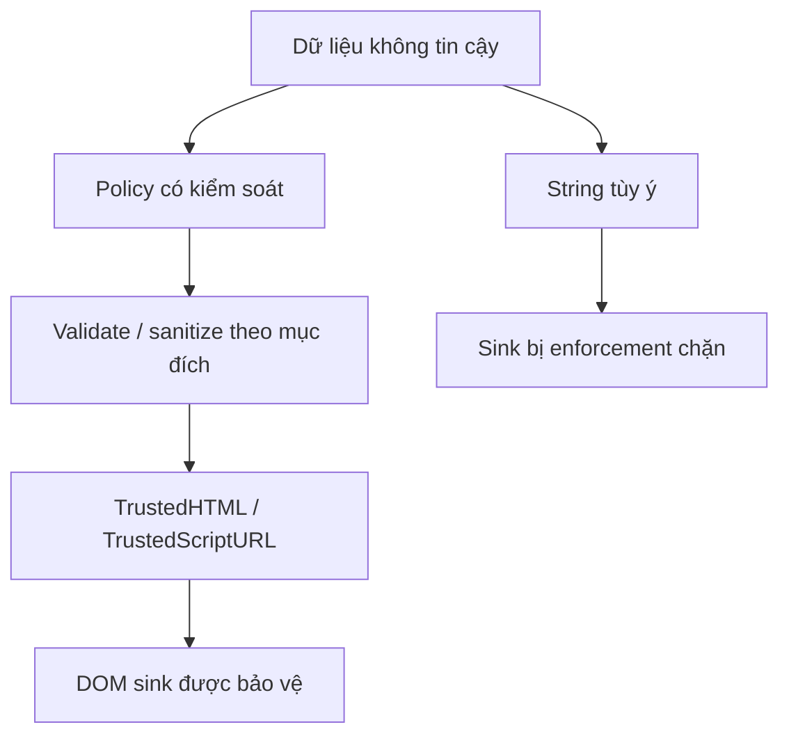

# Migration sang Trusted Types

> **Chương:** Trusted Types  
> **Học phần:** Application Security — Browser Security (`SECURITY_APPLICATION_SECURITY_BROWSER_SECURITY`)

Trusted Types giúp ứng dụng kiểm soát việc đưa chuỗi vào một số DOM injection sink như `innerHTML`, `outerHTML`, `insertAdjacentHTML` hoặc các API có thể diễn giải dữ liệu thành HTML/script. Khi bật enforcement bằng Content Security Policy (CSP), browser yêu cầu những sink được bảo vệ nhận giá trị Trusted Type phù hợp thay vì chuỗi tùy ý.

Trong một ứng dụng đã phát triển lâu năm, việc bật enforcement ngay có thể làm hỏng các luồng giao diện vì nhiều component, template hoặc thư viện bên thứ ba vẫn truyền string vào DOM sink. **Migration sang Trusted Types** là quá trình kiểm kê các sink, phân loại dữ liệu, thay thế cách render không an toàn, xây dựng policy có mục đích rõ ràng, quan sát vi phạm và bật enforcement theo từng giai đoạn.

Trusted Types không tự sanitize dữ liệu và không thay thế việc sửa DOM XSS. Một policy có thể biến mọi chuỗi thành `TrustedHTML`; nếu policy trả nguyên input, ứng dụng chỉ đổi kiểu dữ liệu mà không tăng bảo mật. Mục tiêu của migration là làm rõ nơi nào được phép tạo trusted value, dữ liệu nào được chấp nhận và vì sao.

## 1. Mục tiêu học tập

Sau bài học, bạn có thể:

1. Giải thích vai trò của Trusted Types và directive CSP dùng để bật enforcement.
2. Kiểm kê source, transform và sink trong ứng dụng.
3. Phân loại sink theo nhu cầu: text, HTML có định dạng, URL script hoặc dynamic code.
4. Thiết kế policy `createHTML`, `createScriptURL` và giới hạn việc dùng `createScript`.
5. Hiểu vai trò và rủi ro của default policy trong giai đoạn chuyển đổi.
6. Tích hợp sanitizer như DOMPurify vào policy đúng cách.
7. Xử lý code cũ, framework và thư viện bên thứ ba.
8. Triển khai Report-Only, kiểm thử, bật enforcement và theo dõi sau phát hành.
9. Thiết kế fallback an toàn cho browser chưa hỗ trợ Trusted Types.

## 2. Trusted Types giải quyết vấn đề gì?

DOM XSS thường xảy ra khi dữ liệu không tin cậy đi từ source tới một sink có khả năng tạo cấu trúc hoặc thực thi mã. Ví dụ:

```js
const message = new URLSearchParams(location.search).get("message") ?? "";
document.querySelector("#output").innerHTML = message;
```

`innerHTML` parse chuỗi thành HTML. Nếu ứng dụng không kiểm soát dữ liệu, browser có thể tạo DOM ngoài ý muốn.

Trusted Types bổ sung một ranh giới ở sink: thay vì cho phép string bất kỳ, browser yêu cầu giá trị có kiểu như `TrustedHTML` khi enforcement được bật. Một policy được ứng dụng tạo ra chịu trách nhiệm chuyển input thành trusted value theo quy tắc đã định nghĩa.



Trusted Types giúp giảm số nơi trong code có thể đưa string tùy ý vào sink. Nó không quyết định dữ liệu nào là hợp lệ về nghiệp vụ, không xác thực người dùng và không ngăn mọi loại XSS.

## 3. Các kiểu Trusted Type và policy

Browser cung cấp các kiểu trusted value chính:

| Kiểu | Mục đích | Ví dụ sink/ứng dụng |
| --- | --- | --- |
| `TrustedHTML` | Markup đã được policy kiểm soát | `innerHTML`, `outerHTML`, `insertAdjacentHTML` và một số API parse HTML |
| `TrustedScript` | Script đã được policy kiểm soát cho một số sink thực thi chuỗi | Các API dynamic code như `eval` hoặc `Function` trong môi trường có hỗ trợ enforcement |
| `TrustedScriptURL` | URL script đã được policy kiểm soát | Một số sink tải script như `script.src` hoặc API tương ứng |

Ứng dụng tạo trusted value thông qua `trustedTypes.createPolicy(name, rules)`. Policy có tên và các hàm chuyển đổi, ví dụ `createHTML`, `createScript` hoặc `createScriptURL`.

```js
const policy = trustedTypes.createPolicy("app-html", {
  createHTML(input) {
    return DOMPurify.sanitize(input);
  },
});

const trustedMarkup = policy.createHTML(untrustedHtml);
target.innerHTML = trustedMarkup;
```

Tên policy là một phần của cấu hình bảo mật. Directive CSP `trusted-types` có thể giới hạn những tên policy được phép tạo. Không nên để mọi module tùy ý tạo policy riêng hoặc tạo policy có tên chung chung mà không có chủ sở hữu.

## 4. Hai directive CSP cần hiểu

Trusted Types được bật bằng hai directive CSP có mục đích khác nhau:

```http
Content-Security-Policy: require-trusted-types-for 'script'; trusted-types app-html app-script-url
```

| Directive | Vai trò |
| --- | --- |
| `require-trusted-types-for 'script'` | Yêu cầu các DOM sink thuộc nhóm được bảo vệ nhận Trusted Type thay cho string tùy ý |
| `trusted-types app-html app-script-url` | Giới hạn tên policy mà ứng dụng được phép tạo |

`require-trusted-types-for 'script'` không có nghĩa chỉ bảo vệ file JavaScript. Từ `'script'` là nhóm sink trong CSP/Trusted Types; nó bao gồm nhiều sink HTML/script có khả năng injection. Phạm vi sink cụ thể phụ thuộc chuẩn và hỗ trợ của browser.

`trusted-types` không tự bật enforcement cho sink. Ngược lại, chỉ khai báo `require-trusted-types-for` mà không kiểm soát policy names có thể khiến ứng dụng tạo nhiều policy không cần thiết. Hai directive bổ sung cho nhau.

Không nhầm Trusted Types CSP với `script-src`: `script-src` kiểm soát nguồn/hành vi script; Trusted Types kiểm soát kiểu dữ liệu được đưa vào một số sink. Ứng dụng thường cần cả hai.

## 5. Bắt đầu migration bằng inventory source-to-sink

Trước khi viết policy, cần biết ứng dụng đang dùng những sink nào và dữ liệu đến từ đâu. Một lần tìm chuỗi bằng `grep` là điểm bắt đầu, không phải kết quả audit hoàn chỉnh: sink có thể được gọi gián tiếp qua wrapper, framework, helper hoặc dependency.

Các API cần kiểm kê gồm:

| Nhóm | API/vị trí cần tìm | Hướng xử lý ban đầu |
| --- | --- | --- |
| HTML parser sink | `innerHTML`, `outerHTML`, `insertAdjacentHTML`, `document.write` | Ưu tiên text/DOM API; nếu cần markup, sanitizer + `TrustedHTML` |
| HTML parsing API | `DOMParser.parseFromString`, `Range.createContextualFragment`, `iframe.srcdoc` | Xác định có cần parse HTML; giới hạn input và policy |
| Script URL | `script.src`, một số worker/script loading API | URL allowlist; `TrustedScriptURL` nếu sink được bảo vệ |
| Dynamic code | `eval`, `Function`, timer nhận string | Loại bỏ; truyền callback hoặc parse dữ liệu có schema |
| Framework wrapper | `dangerouslySetInnerHTML`, `v-html`, `{@html}`, `.html()` | Kiểm tra cách framework/thư viện chạm sink và cơ chế hỗ trợ TT |
| Dependency | Editor, chart, markdown renderer, widget, analytics | Xác định phiên bản, sink, cấu hình và khả năng nâng cấp |

Với từng vị trí, ghi nhận:

- File/module/component và người sở hữu.
- Source dữ liệu: URL, form, API, storage, `postMessage`, database hay cấu hình tĩnh.
- Sink cụ thể và loại Trusted Type cần thiết.
- Dữ liệu có cần markup hay chỉ là text.
- Có transform/sanitizer nào đang chạy; có bước decode hoặc nối chuỗi sau đó không.
- Đường chạy, tần suất và mức độ quan trọng của tính năng.
- Dependency nào sở hữu sink nếu code ứng dụng không gọi trực tiếp.

## 6. Phân loại sink trước khi tạo policy

Không phải mọi sink đều cần một policy chung. Phân loại theo mục đích giúp policy hẹp và dễ review:

| Trường hợp | Quyết định ưu tiên | Trusted Type/policy |
| --- | --- | --- |
| Hiển thị tên, tiêu đề, thông báo | Dùng `textContent` hoặc DOM node | Không cần `TrustedHTML` |
| Render Markdown/rich text | Dùng renderer và sanitizer với allowlist | Policy tạo `TrustedHTML` riêng cho rich text |
| Tải script từ asset nội bộ | Dùng URL cố định hoặc manifest build | Có thể cần `TrustedScriptURL` ở sink được bảo vệ |
| Thực thi code động | Loại bỏ dynamic execution | Tránh tạo `TrustedScript` nếu không có yêu cầu rất đặc biệt |
| HTML tĩnh do code kiểm soát | Cân nhắc DOM API hoặc template framework | Không tạo policy chỉ để hợp thức hóa mọi string |

Nếu một luồng chỉ cần văn bản, dùng `textContent` là cách đơn giản nhất. Không đưa text qua sanitizer rồi vào `innerHTML` chỉ để giữ lại định dạng không cần thiết.

## 7. Thay sink không cần HTML trước

Migration hiệu quả thường bắt đầu bằng việc loại bỏ các sink có thể bỏ được. Ví dụ:

```js
// Trước: dữ liệu từ API được parse thành HTML.
target.innerHTML = apiResponse.displayName;

// Sau: dữ liệu được hiển thị như văn bản.
target.textContent = apiResponse.displayName;
```

Nếu cần cấu trúc cố định, tạo node bằng DOM API:

```js
const heading = document.createElement("h2");
heading.textContent = apiResponse.title;

const description = document.createElement("p");
description.textContent = apiResponse.description;

target.replaceChildren(heading, description);
```

Đối với URL, parse và validate scheme/host trước khi gán. Đối với script động, thay `setTimeout("refresh()", 1000)` bằng `setTimeout(refresh, 1000)`. Những thay đổi này loại bỏ nhu cầu tạo trusted value và giảm số policy phải duy trì.

## 8. Tạo policy HTML có sanitizer

Nếu sản phẩm thực sự cần render HTML do người dùng hoặc hệ thống ngoài cung cấp, hãy tạo policy riêng và dùng sanitizer được duy trì.

Ví dụ với DOMPurify:

```js
const commentHtmlPolicy = trustedTypes.createPolicy("app-comment-html", {
  createHTML(input) {
    return DOMPurify.sanitize(input, {
      ALLOWED_TAGS: ["p", "strong", "em", "ul", "ol", "li", "a"],
      ALLOWED_ATTR: ["href", "title"],
      FORBID_ATTR: ["style"],
      RETURN_TRUSTED_TYPE: false,
    });
  },
});

function renderComment(target, untrustedHtml) {
  target.innerHTML = commentHtmlPolicy.createHTML(untrustedHtml);
}
```

Trong ví dụ, `RETURN_TRUSTED_TYPE: false` khiến DOMPurify trả về string từ callback. Trusted Types bọc kết quả callback thành `TrustedHTML` khi `createHTML` hoàn tất. Cách tích hợp cụ thể cần theo phiên bản DOMPurify; không sao chép tùy chọn mà chưa kiểm tra tài liệu phiên bản đang dùng.

Policy này phải có phạm vi rõ: nó dành cho nội dung bình luận rich text. Không tái sử dụng nó cho template ứng dụng, HTML email, SVG, `srcdoc` hoặc context khác nếu chưa đánh giá. Cấu hình allowlist cần kiểm soát URL/protocol và namespace theo nhu cầu; sanitizer không thay thế kiểm tra nghiệp vụ.

## 9. Tạo policy cho script URL

Một số ứng dụng tải module hoặc script theo route động. Nếu sink được bảo vệ yêu cầu `TrustedScriptURL`, policy cần giới hạn URL vào manifest hoặc đường dẫn asset đã kiểm soát.

Ví dụ chỉ cho phép script cùng origin trong thư mục asset:

```js
const scriptUrlPolicy = trustedTypes.createPolicy("app-script-url", {
  createScriptURL(input) {
    const url = new URL(input, location.origin);

    if (url.origin !== location.origin) {
      throw new TypeError("Script URL must be same-origin");
    }

    if (!url.pathname.startsWith("/assets/")) {
      throw new TypeError("Script URL is outside the asset directory");
    }

    return url.href;
  },
});

const script = document.createElement("script");
script.src = scriptUrlPolicy.createScriptURL(assetPath);
document.head.append(script);
```

Đây là ví dụ minh họa. Trong ứng dụng thực tế, nên tra cứu asset từ manifest cố định thay vì nhận URL tùy ý; cần kiểm tra redirect, path normalization, versioning và quyền tải module. `TrustedScriptURL` chỉ đáp ứng yêu cầu kiểu dữ liệu của sink; `script-src` vẫn quyết định nguồn script có được CSP cho phép hay không.

## 10. Tránh tạo `TrustedScript` nếu có thể

`TrustedScript` dành cho những sink thực thi JavaScript từ chuỗi. Hầu hết ứng dụng web không nên cần tạo code từ dữ liệu runtime. Những trường hợp như `eval`, `new Function` hoặc timer nhận string nên được thay bằng:

- Function callback đã có trong source code.
- JSON parsing cho dữ liệu cấu hình.
- Parser cho một ngôn ngữ biểu thức nhỏ có grammar và allowlist rõ ràng.
- Mapping từ action key sang function do ứng dụng định nghĩa.

Ví dụ:

```js
const actions = {
  refresh: refreshDashboard,
  close: closeDialog,
};

const action = actions[message.action];
if (action) action();
```

Nếu policy tạo `TrustedScript` chỉ để làm `eval(userInput)` chạy lại, migration đã bỏ qua mục tiêu bảo mật. Không tạo policy `createScript` trả nguyên input; hãy loại bỏ nhu cầu dynamic code hoặc thiết kế một ngôn ngữ dữ liệu giới hạn.

## 11. Default policy: cầu nối tạm thời, không phải đích đến

Trusted Types có cơ chế **default policy**. Khi một string được đưa vào sink được bảo vệ và ứng dụng đã tạo policy tên `default`, browser có thể gọi phương thức tương ứng của policy để chuyển đổi string. Cơ chế này có thể giúp ứng dụng cũ tiếp tục hoạt động trong lúc migration và ghi nhận nơi nào còn truyền string.

Ví dụ minh họa một default policy chỉ sanitize HTML và ghi nhận callsite:

```js
const defaultPolicy = trustedTypes.createPolicy("default", {
  createHTML(input) {
    console.warn("Legacy HTML sink reached", new Error().stack);
    return DOMPurify.sanitize(input, {
      ALLOWED_TAGS: ["p", "strong", "em", "a"],
      ALLOWED_ATTR: ["href", "title"],
      RETURN_TRUSTED_TYPE: false,
    });
  },
});
```

Policy mẫu chỉ minh họa việc quan sát và sanitize một loại HTML; ứng dụng còn có thể gặp sink yêu cầu kiểu khác. Không thêm `createScript` hoặc `createScriptURL` vào default policy để tự động chấp nhận mọi dữ liệu.

Rủi ro của default policy:

- Có thể che giấu callsite chưa được sửa vì string vẫn được chuyển đổi tự động.
- Một sanitizer tổng quát có thể không phù hợp với mọi context hoặc nhu cầu.
- Nếu trả nguyên input, default policy biến enforcement thành hình thức.
- Khi có nhiều nhóm phát triển, default policy có thể khiến trách nhiệm tạo trusted value không rõ ràng.

Chỉ dùng default policy như công cụ migration có thời hạn: log/đếm callsite, sanitize theo policy nghiêm ngặt, đặt mục tiêu loại bỏ và cuối cùng xóa policy. Khi default policy trả `null` hoặc không có phương thức phù hợp, thao tác sink tương ứng sẽ thất bại; hãy xử lý lỗi có chủ đích thay vì tự động cho qua.

## 12. Giới hạn tên policy bằng CSP

Ví dụ policy production:

```http
Content-Security-Policy: require-trusted-types-for 'script'; trusted-types app-comment-html app-script-url; object-src 'none'; base-uri 'self'
```

Trong đó:

- `require-trusted-types-for 'script'` bật yêu cầu Trusted Type cho các sink được hỗ trợ.
- `trusted-types app-comment-html app-script-url` chỉ cho phép tạo hai policy có tên đã khai báo.
- Các policy khác, bao gồm `default`, không được tạo nếu không nằm trong danh sách cho phép.

Tên policy cần ổn định, cụ thể theo mục đích và được quản lý tập trung. Không dùng tên wildcard hoặc cho phép mọi policy nếu không có lý do. Keyword `'allow-duplicates'` có thể nới quy tắc trùng tên policy; tránh bật nó chỉ để né lỗi tạo policy nhiều lần. Hãy tạo policy một lần ở module sở hữu và tái sử dụng instance đó.

Khi ứng dụng có nhiều CSP header từ server, reverse proxy hoặc CDN, browser thực thi các policy cùng lúc. Một header khác có thể làm policy chặt hơn hoặc gây lỗi ngoài dự kiến; hãy kiểm tra response header thực tế.

## 13. Dùng Report-Only để tìm phần code chưa migrate

Trước khi enforcement, triển khai CSP Report-Only trên môi trường thử nghiệm hoặc một nhóm người dùng phù hợp:

```http
Reporting-Endpoints: csp-endpoint="https://reports.example.com/csp"
Content-Security-Policy-Report-Only: require-trusted-types-for 'script'; trusted-types app-comment-html app-script-url; report-to csp-endpoint
```

Report-Only giúp quan sát những thao tác sẽ vi phạm policy mà chưa chặn chúng. Có thể bổ sung listener trong trang lab để quan sát sự kiện:

```js
document.addEventListener("securitypolicyviolation", (event) => {
  console.log({
    directive: event.effectiveDirective,
    blockedURI: event.blockedURI,
    disposition: event.disposition,
    sourceFile: event.sourceFile,
    lineNumber: event.lineNumber,
  });
});
```

Không log nội dung HTML, token hoặc dữ liệu cá nhân trong report. Endpoint báo cáo phải giới hạn kích thước, chống spam, kiểm soát truy cập và thời gian lưu. Report có thể chứa URL hoặc thông tin do người dùng kiểm soát nên cần được xử lý như dữ liệu không tin cậy.

Report-Only là một bước quan sát; nó không thay thế unit test và integration test. Một số browser chưa hỗ trợ Trusted Types có thể không tạo report hoặc không thực thi enforcement tương tự. Hãy kết hợp browser telemetry với kiểm thử tự động trên browser hỗ trợ.

## 14. Xử lý framework và thư viện bên thứ ba

Ứng dụng thường không gọi trực tiếp mọi sink. Framework hoặc dependency có thể thực hiện việc parse HTML bên trong.

| Công nghệ/vị trí | Điểm cần review |
| --- | --- |
| React `dangerouslySetInnerHTML` | Chỉ truyền HTML đã sanitize; kiểm tra hỗ trợ Trusted Types theo phiên bản và integration |
| Vue `v-html` | Xem dữ liệu đi vào directive và sanitizer; không dùng cho text thông thường |
| Svelte `{@html ...}` | Đánh giá nguồn dữ liệu và sanitizer trước khi render raw HTML |
| Angular bypass APIs như `bypassSecurityTrustHtml` | Đây là thao tác đánh dấu trusted, không phải sanitizer; chỉ dùng sau review đặc biệt |
| jQuery `.html()` | Có thể đi tới HTML parsing sink; thay bằng `.text()` hoặc node API khi phù hợp |
| Markdown/rich-text editor | Kiểm tra renderer, plugin, URL policy và sanitizer sau cùng |
| Analytics/widget/chat SDK | Xác định sink nội bộ, phiên bản, quyền truy cập DOM và khả năng thay thế/nâng cấp |

Không tắt enforcement cho toàn ứng dụng chỉ vì một thư viện cũ chưa tương thích. Hãy nâng cấp, cấu hình đúng, thay thư viện, bọc integration tại ranh giới hẹp hoặc cô lập nội dung không tin cậy trong một origin/iframe phù hợp.

Framework có thể cung cấp cơ chế Trusted Types integration riêng; cần đọc tài liệu đúng phiên bản. Một API tên `bypassSecurityTrust...` hoặc tương tự thường có nghĩa là ứng dụng tự chịu trách nhiệm về dữ liệu được đánh dấu trusted, không phải framework đã làm sạch dữ liệu đó.

## 15. Tổ chức policy theo trách nhiệm

Policy nên được tạo ở một module có quyền rõ ràng, thay vì để mọi component tự gọi `createPolicy`.

Ví dụ cấu trúc:

```text
security/
  trusted-types.ts       # Tạo và export policy được phê duyệt
  html-sanitizer.ts      # Cấu hình sanitizer theo loại nội dung
features/
  comments/
    render-comment.ts    # Chỉ dùng policy comment HTML
  assets/
    load-module.ts       # Chỉ dùng policy script URL
```

Các nguyên tắc:

- Mỗi policy có tên, mục đích, chủ sở hữu và test riêng.
- Không export factory cho phép caller tạo trusted value từ string bất kỳ.
- Không cung cấp một `trustAnything(value)` dùng chung.
- Không dùng cùng policy cho HTML, script và script URL.
- Kiểm tra dữ liệu trước khi chuyển thành trusted value; sau khi tạo trusted value, không sửa chuỗi bằng cách nối thêm nội dung.
- Giữ policy code nhỏ và dễ review; cập nhật sanitizer như dependency bảo mật.

TypeScript có thể giúp phân biệt `TrustedHTML` và `string` ở compile time nếu dùng đúng type definitions, nhưng kiểu tĩnh không thay thế enforcement runtime của browser. Không dùng type assertion như `as TrustedHTML` để né kiểm tra.

## 16. Fallback cho browser chưa hỗ trợ Trusted Types

Trusted Types không được hỗ trợ đồng đều trên mọi browser. Khi browser không hỗ trợ API hoặc CSP directive, code vẫn cần bảo vệ sink bằng DOM API và sanitizer. Không coi polyfill JavaScript là ranh giới bảo mật tương đương enforcement của browser: script khác cùng origin có thể đi vòng qua wrapper nếu vẫn truy cập sink trực tiếp.

Ví dụ wrapper có fallback:

```js
const sanitizeComment = (input) => DOMPurify.sanitize(input, {
  ALLOWED_TAGS: ["p", "strong", "em", "a"],
  ALLOWED_ATTR: ["href", "title"],
  RETURN_TRUSTED_TYPE: false,
});

const commentPolicy = window.trustedTypes
  ? window.trustedTypes.createPolicy("app-comment-html", {
      createHTML: sanitizeComment,
    })
  : null;

function renderComment(target, input) {
  const safeValue = commentPolicy
    ? commentPolicy.createHTML(input)
    : sanitizeComment(input);

  target.innerHTML = safeValue;
}
```

Ở browser có Trusted Types, sink nhận `TrustedHTML`; ở browser chưa hỗ trợ, sanitizer vẫn chạy và chỉ trả markup đã xử lý. Wrapper giúp giữ logic tập trung, nhưng code review và lint vẫn cần bảo đảm không có sink khác nhận input thô.

Không dùng fallback kiểu `trustedTypes ? policy.createHTML(input) : input`; nhánh không hỗ trợ phải tiếp tục sanitize hoặc dùng text/DOM API.

## 17. Lộ trình migration theo giai đoạn

Một lộ trình thực tế có thể chia thành các giai đoạn sau:

| Giai đoạn | Công việc | Tiêu chí hoàn thành |
| --- | --- | --- |
| 1. Baseline | Xác định browser mục tiêu, CSP hiện tại, framework và dependency | Có danh sách môi trường và rủi ro tương thích |
| 2. Inventory | Tìm source/sink, owner, dữ liệu và tần suất | Mỗi sink có phân loại và người chịu trách nhiệm |
| 3. Giảm sink | Chuyển text sang `textContent`, DOM API; bỏ dynamic code | Các sink không cần thiết được loại bỏ |
| 4. Xây policy | Tạo policy HTML/ScriptURL theo mục đích, tích hợp sanitizer | Policy nhỏ, allowlist tên bằng CSP và có test |
| 5. Compatibility | Nâng cấp framework/dependency, thêm fallback an toàn | Luồng chính hoạt động trên browser mục tiêu |
| 6. Report-Only | Thu thập violation, phân loại callsite và xử lý ngoại lệ | Không còn violation chưa giải thích trong luồng quan trọng |
| 7. Enforcement | Bật `require-trusted-types-for 'script'` và `trusted-types` | Sink string không được phép bị chặn; tính năng vẫn hoạt động |
| 8. Hardening | Xóa default policy, thu hẹp policy names, thêm lint/test | Không còn đường tắt trust rộng và có regression guard |
| 9. Monitor | Theo dõi lỗi, browser support và dependency update | Có quy trình xử lý violation sau phát hành |

Không nhất thiết phải migrate mọi route cùng lúc. Có thể bắt đầu từ một ứng dụng con hoặc nhóm trang có boundary rõ, nhưng tránh để các policy enforcement chồng chéo thiếu nhất quán qua nhiều response.

## 18. Kiểm thử migration

### 18.1 Unit test cho policy

Kiểm tra sanitizer/policy với các nhóm input:

- Text thuần và markup hợp lệ theo allowlist.
- Tag/attribute không được phép.
- URL scheme không được chấp nhận.
- Markup sai cấu trúc, SVG/MathML nếu sản phẩm hỗ trợ.
- Chuỗi rỗng, Unicode, ký tự điều khiển và input rất dài.

Unit test policy không chứng minh browser enforcement hoạt động; nó chỉ xác minh logic chuyển đổi.

### 18.2 Integration test với CSP enforcement

Trong browser hỗ trợ Trusted Types, xác minh:

- Gán string tùy ý vào sink được bảo vệ bị từ chối.
- Giá trị do policy được phép tạo có thể được sử dụng.
- Policy name không có trong `trusted-types` bị từ chối khi tạo.
- Default policy đã bị loại bỏ không còn âm thầm chuyển đổi string.
- Framework và dependency quan trọng không còn tạo violation.

Ví dụ kiểm tra trong trang test:

```js
const target = document.createElement("div");

let blocked = false;
try {
  target.innerHTML = "<b>plain string</b>";
} catch (error) {
  blocked = error instanceof TypeError;
}

console.assert(blocked, "Plain string should be rejected under enforcement");
```

Sau đó kiểm tra `TrustedHTML` do policy tạo được gán thành công. Test phải chạy trong document nhận đúng CSP header; mở file local hoặc chạy code trong Console không nhất thiết tái tạo policy production.

### 18.3 Regression và browser matrix

Chạy test trên browser/version mà sản phẩm hỗ trợ. Ghi rõ browser nào có enforcement Trusted Types và browser nào dựa vào fallback. Kiểm tra các luồng quan trọng: đăng nhập, điều hướng, rich text, editor, upload preview, modal, widget, trang admin và error state.

Đặt regression test cho mọi sink từng gây violation. Khi nâng cấp framework hoặc sanitizer, chạy lại bộ test và rà soát thay đổi behavior.

## 19. Những lỗi migration thường gặp

| Lỗi | Hệ quả | Cách xử lý |
| --- | --- | --- |
| Tạo default policy trả nguyên input | Enforcement mất ý nghĩa | Default policy chỉ dùng tạm, phải sanitize/log và xóa sau migration |
| Dùng một policy cho mọi sink | Không phân biệt HTML, URL và script | Tạo policy theo mục đích và kiểu trusted value |
| Cho phép mọi policy name | Module bất kỳ có thể tạo policy mới | Allowlist tên cụ thể trong CSP |
| Dùng `as TrustedHTML` trong TypeScript | Chỉ ép kiểu compile-time, không tạo trusted value runtime | Gọi policy đã được phê duyệt |
| Dùng polyfill như security boundary | Script khác vẫn có thể gọi sink trực tiếp | Dùng browser enforcement và giữ fallback an toàn |
| Bật enforcement trước khi inventory | Ứng dụng có thể hỏng ở luồng ít được test | Report-Only, inventory và rollout theo giai đoạn |
| Bỏ sanitizer vì đã có Trusted Types | Policy có thể đang tin mọi input | Policy phải validate/sanitize theo mục đích |
| Dùng `bypassSecurityTrust...` để sửa lỗi | Đánh dấu dữ liệu trusted mà không làm sạch | Xem lại nguồn dữ liệu và sanitizer |
| Bỏ qua dependency bên thứ ba | Violation hoặc đường bypass vẫn còn | Nâng cấp, cấu hình, thay thế hoặc cô lập dependency |
| Chỉ test unit | Không xác minh CSP enforcement trong browser | Thêm integration test trên browser thật |
| Giữ default policy mãi mãi | Sink cũ tiếp tục ẩn sau fallback | Đặt deadline, đo lường và loại bỏ |

## 20. Checklist trước khi bật enforcement

- [ ] Đã xác định browser/version mục tiêu và giới hạn hỗ trợ Trusted Types.
- [ ] Đã kiểm kê sink trực tiếp, gián tiếp, framework và dependency.
- [ ] Mỗi sink có source, mục đích và owner rõ ràng.
- [ ] Sink chỉ hiển thị text đã được chuyển sang `textContent`/DOM API khi phù hợp.
- [ ] Dynamic code (`eval`, `Function`, string timer) đã được loại bỏ hoặc có kế hoạch xử lý cụ thể.
- [ ] HTML có định dạng dùng sanitizer được duy trì và allowlist tối thiểu.
- [ ] Policy có tên cụ thể, ít quyền và được tạo tại module sở hữu.
- [ ] `trusted-types` chỉ cho phép policy names cần thiết.
- [ ] `require-trusted-types-for 'script'` đã được thử nghiệm trong Report-Only.
- [ ] Default policy (nếu có) chỉ là cầu nối tạm, không trả nguyên input và có kế hoạch xóa.
- [ ] Framework và thư viện bên thứ ba đã được nâng cấp/cấu hình/kiểm soát.
- [ ] Fallback cho browser chưa hỗ trợ vẫn sanitize hoặc dùng DOM API an toàn.
- [ ] Có unit test policy, integration test enforcement và regression test.
- [ ] Report endpoint được bảo vệ và không lưu credential/dữ liệu nhạy cảm.
- [ ] Có kế hoạch rollout, giám sát và rollback khi phát sinh lỗi chức năng.

## 21. Câu hỏi tự kiểm tra

1. Trusted Types bảo vệ ranh giới nào trong DOM và CSP directive nào bật enforcement?
2. `trusted-types` khác `require-trusted-types-for` như thế nào?
3. Vì sao nên kiểm kê source-to-sink trước khi tạo policy?
4. Khi nào nên dùng `textContent` thay cho policy `TrustedHTML`?
5. Vì sao DOMPurify callback thường dùng `RETURN_TRUSTED_TYPE: false` khi được gọi bên trong `createHTML`?
6. `TrustedScriptURL` có thay thế `script-src` không? Vì sao?
7. Default policy giúp migration thế nào và vì sao không nên giữ nó như giải pháp cuối cùng?
8. Vì sao `bypassSecurityTrustHtml` không đồng nghĩa với sanitize?
9. Browser chưa hỗ trợ Trusted Types cần fallback ra sao?
10. Những kiểm thử nào chứng minh enforcement runtime thực sự hoạt động?

## 22. Ghi nhớ

Migration sang Trusted Types bắt đầu bằng việc **tìm và phân loại mọi source-to-sink**, sau đó loại bỏ sink không cần thiết, dùng DOM API cho text, tạo policy hẹp cho HTML/URL thật sự cần thiết và tích hợp sanitizer. `require-trusted-types-for 'script'` bật enforcement cho sink được hỗ trợ; `trusted-types` giới hạn tên policy được phép tạo.

Hãy dùng default policy như công cụ chuyển đổi có thời hạn, xử lý framework/dependency, quan sát bằng Report-Only, kiểm thử trên browser mục tiêu rồi mới bật enforcement. Browser chưa hỗ trợ vẫn cần sanitizer và DOM API an toàn; polyfill không thay thế enforcement runtime. **Trusted Types tạo ranh giới để code chỉ định rõ nơi nào được phép biến dữ liệu thành giá trị có thể đi vào sink; chất lượng bảo mật phụ thuộc vào policy thực sự kiểm soát dữ liệu ra sao.**
