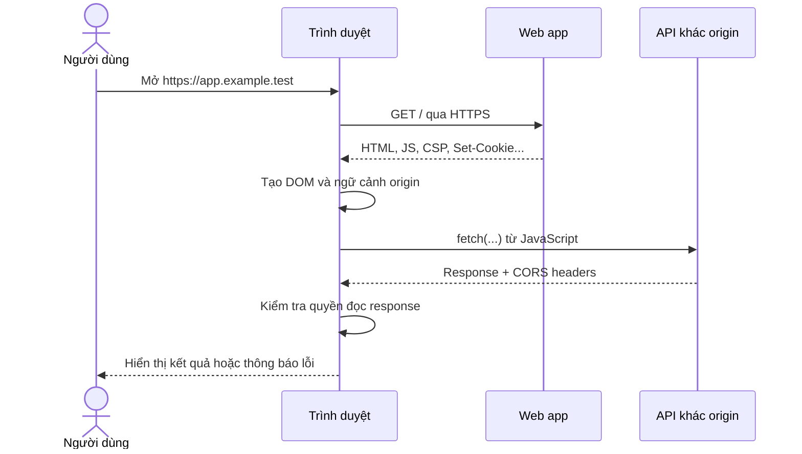

# User agent trong mô hình bảo mật web

> **Chương:** Mô hình bảo mật web  
> **Phạm vi module:** `SECURITY_APPLICATION_SECURITY_BROWSER_SECURITY` — phân tích ranh giới giữa trình duyệt, origin, cookie và ứng dụng web, từ Same-Origin Policy/CORS đến phòng vệ XSS, CSRF, clickjacking với CSP, Trusted Types và security headers.

## Mục tiêu học tập

Sau bài học, bạn có thể:

1. Giải thích *user agent* là gì và phân biệt phần mềm user agent với header `User-Agent`.
2. Xác định khi nào trình duyệt áp dụng Same-Origin Policy (SOP), CORS, chính sách cookie và các cơ chế cách ly.
3. Phân biệt **origin** với **site**, quyền **gửi request** với quyền **đọc response**.
4. Phân tích vai trò của user agent trong các biện pháp giảm thiểu XSS, CSRF và clickjacking.
5. Kiểm chứng hành vi cross-origin bằng một ví dụ chạy được và Developer Tools.

## 1. User agent là gì?

**User agent (UA)** là phần mềm đại diện người dùng để truy cập tài nguyên hoặc giao tiếp với dịch vụ. Trong web, trường hợp điển hình là trình duyệt (Chrome, Firefox, Safari, Edge). WebView trong ứng dụng, công cụ dòng lệnh như `curl` và bot cũng có thể là user agent, nhưng **không phải mọi user agent đều thực thi mô hình bảo mật của trình duyệt**.

Một trình duyệt hiện đại vừa là HTTP client, vừa là môi trường thực thi ứng dụng web:

- Gửi HTTP(S) request, điều hướng, xử lý redirect, tải HTML, CSS, JavaScript, ảnh và font.
- Tạo DOM, chạy JavaScript trong ngữ cảnh của tài liệu, quản lý iframe, tab, worker và storage.
- Quản lý cookie, quyền truy cập tính năng thiết bị và các giới hạn quyền của trang.
- Thực thi TLS, SOP, CORS, CSP, iframe sandbox và các chính sách từ response header.
- Cách ly nội dung theo origin và, tùy triển khai, phân tách tiến trình để tăng mức độ bảo vệ.

Ví dụ, khi mở `https://app.example.test`, browser nhận HTML/JavaScript từ server rồi xác định script của trang được phép đọc dữ liệu nào. **Trang không tự cấp cho mình quyền đọc DOM của origin khác.** Ngược lại, server không thể giả định request đến từ một browser đáng tin: client tùy biến có thể bỏ qua phần lớn kiểm tra chỉ áp dụng cho browser.

### Đừng nhầm user agent với chuỗi nhận diện của nó

| Khái niệm | Ý nghĩa | Có xác thực người dùng không? |
|---|---|---|
| *User agent* | Phần mềm đang thực hiện yêu cầu | Không |
| Header `User-Agent` | Chuỗi mô tả client được gửi trong HTTP request | Không; có thể tự đặt hoặc giả mạo |
| `navigator.userAgent` | Thông tin UA mà browser công bố cho JavaScript | Không; có thể bị giảm chi tiết, thay đổi hoặc giả mạo |
| `Sec-CH-UA` và các Client Hints | Metadata do browser hỗ trợ để thích nghi nội dung | Không; không phải cơ chế cấp quyền |

Không bảo vệ API bằng điều kiện kiểu “chỉ cho phép nếu `User-Agent` chứa Chrome”. Việc xác thực phải dựa trên session, token hoặc cơ chế danh tính thích hợp; server luôn kiểm tra quyền đối với tài nguyên.

## 2. Vị trí của UA trong một lần tải trang



Trong quy trình này, mỗi bên có trách nhiệm riêng:

| Bên | Trách nhiệm bảo mật |
|---|---|
| Browser/UA | Thực thi ranh giới mà nền tảng web quy định; quyết định JavaScript được đọc response, truy cập DOM và sử dụng API nào |
| Frontend | Sử dụng API trình duyệt đúng cách; xử lý dữ liệu không đáng tin; tránh DOM sink nguy hiểm |
| Backend/API | Xác thực, phân quyền, xác minh dữ liệu, chống CSRF, cấu hình security headers/CORS |
| Người dùng | Điều hướng, nhập dữ liệu, quyết định cấp quyền theo tình huống |

**Ranh giới tin cậy quan trọng:** CORS và SOP hạn chế **mã web chạy trong browser**. Một HTTP client như `curl` không bắt buộc tuân theo chúng. Quy tắc server như authentication, authorization và kiểm tra dữ liệu phải được áp dụng ngay cả khi không có browser.

## 3. Origin và site không giống nhau

### 3.1. Origin là bộ ba scheme–host–port

Với URL HTTP(S) thông thường:

`origin = (scheme, host, port)`

Origin của `https://app.example.test/dashboard` là `(https, app.example.test, 443)`. Đường dẫn, query và fragment không xác định origin.

| URL so với `https://app.example.test` | Cùng origin? | Lý do |
|---|---|---|
| `https://app.example.test/profile` | Có | Chỉ khác đường dẫn |
| `https://app.example.test:443/api` | Có | 443 là cổng mặc định của HTTPS |
| `http://app.example.test` | Không | Khác scheme |
| `https://api.example.test` | Không | Khác host |
| `https://app.example.test:8443` | Không | Khác port |

Một số tài liệu như `data:` hoặc iframe được sandbox mà không có `allow-same-origin` có thể dùng **opaque origin**, nên không áp dụng máy móc công thức bộ ba cho mọi loại URL.

### 3.2. Site là ranh giới dùng cho SameSite cookie

Với web HTTP(S), **schemeful site** thường được xác định bằng scheme và registrable domain (eTLD+1). Subdomain hoặc port có thể khác mà vẫn cùng site.

- `https://app.example.test` và `https://api.example.test`: **khác origin**, nhưng thường **cùng site**.
- `https://app.example.test` và `http://app.example.test`: khác origin **và** khác site do khác scheme.
- `http://localhost:3000` và `http://localhost:4000`: khác origin vì khác port; trong thử nghiệm localhost chúng vẫn thường được xem là cùng site.

Vì vậy:

- SOP/CORS trả lời: **Script của origin A có được đọc dữ liệu từ origin B không?**
- SameSite trả lời: **Cookie có được gửi trong ngữ cảnh request này không?**

Cookie được gửi không có nghĩa script được đọc response; “cross-origin” cũng không mặc nhiên đồng nghĩa “cross-site”.

## 4. SOP, CORS và việc browser xử lý request

### 4.1. SOP hạn chế quyền truy cập dữ liệu, không cấm mọi request

SOP ngăn JavaScript tùy ý đọc DOM hoặc dữ liệu thuộc origin khác. Ví dụ, script trong iframe `https://widget.example.test` không thể tự đọc `document.body` của trang cha `https://bank.example.test`.

Nhưng một trang vẫn có thể gửi/nạp một số tài nguyên cross-origin qua ảnh, stylesheet, form, điều hướng hoặc request mạng. Việc có gửi được và có đọc được là **hai quyết định khác nhau**. Chính vì form có thể gửi request cross-origin nên backend sử dụng cookie session phải phòng chống CSRF.

### 4.2. CORS cho phép đọc response cross-origin có điều kiện

Trang ở `https://app.example.test` chạy:

```js
const response = await fetch('https://api.example.test/profile', {
  credentials: 'include',
});
const profile = await response.json();
```

Request này khác origin. Để browser cho phép JavaScript đọc response có credentials, API cần trả chính sách phù hợp, ví dụ:

```http
Access-Control-Allow-Origin: https://app.example.test
Access-Control-Allow-Credentials: true
Vary: Origin
```

`Access-Control-Allow-Origin: *` không dùng được cho response mà script muốn đọc với credentials. `Vary: Origin` giúp cache không tái sử dụng sai phản hồi khi header CORS thay đổi theo origin. Chỉ phản chiếu origin nếu đã kiểm tra allowlist chính xác.

`credentials: 'include'` cho phép trình duyệt xét gửi credentials cross-origin, nhưng cookie thực sự được gửi còn phụ thuộc `SameSite`, `Secure`, phạm vi cookie và chính sách chặn/partition cookie của browser.

Nếu request dùng phương thức hoặc header không thuộc nhóm CORS-safelisted, browser thường gửi **preflight** trước:

```http
OPTIONS /profile HTTP/1.1
Origin: https://app.example.test
Access-Control-Request-Method: PUT
Access-Control-Request-Headers: content-type
```

Server phải cho phép phương thức/header tương ứng để browser gửi request chính. Trong khi đó, request đơn giản không cần preflight **có thể đã đến server và được xử lý** trước khi browser chặn JavaScript đọc response. Khi Console báo “blocked by CORS”, chưa thể kết luận API chưa nhận request.

**CORS không phải authentication hoặc authorization.** Một client ngoài browser có thể gửi request dù API không cấu hình CORS; server phải tự kiểm tra danh tính và quyền. CORS cũng không thay thế CSRF token vì nó không ngăn mọi request cross-origin được gửi.

### 4.3. Xử lý iframe và giao tiếp bằng postMessage

Một iframe cross-origin bị giới hạn quyền truy cập DOM của frame cha. Thuộc tính `sandbox` có thể thu hẹp thêm quyền chạy script, gửi form và danh tính origin của frame. Chỉ cấp các token `allow-*` cần thiết.

Khi hai origin cần trao đổi thông điệp, dùng `postMessage` và xác minh nguồn:

```js
const iframe = document.querySelector('#checkout');
const trustedOrigin = 'https://checkout.example.test';

iframe.contentWindow.postMessage({ type: 'START_CHECKOUT' }, trustedOrigin);

window.addEventListener('message', (event) => {
  if (event.origin !== trustedOrigin) return;
  if (event.source !== iframe.contentWindow) return;
  if (!event.data || event.data.type !== 'CHECKOUT_RESULT') return;

  // Kiểm tra tiếp cấu trúc và giá trị dữ liệu trước khi dùng.
  console.log('Thông điệp từ frame đã xác minh');
});
```

Không gửi đến `'*'` khi biết chính xác origin đích. Không tin một thông báo thanh toán chỉ vì nó chứa chuỗi `CHECKOUT_RESULT`: server vẫn phải xác minh trạng thái giao dịch.

## 5. Cookie và ranh giới quyền của UA

Ví dụ response tạo session cookie:

```http
Set-Cookie: __Host-session=<gia-tri-ngau-nhien>; Path=/; Secure; HttpOnly; SameSite=Lax
```

Prefix `__Host-` yêu cầu `Secure`, `Path=/` và không đặt `Domain`, giúp giới hạn cookie vào host phát hành.

| Thuộc tính | UA thực thi | Cần nhớ |
|---|---|---|
| `Secure` | Chỉ gửi cookie qua kết nối được coi là bảo mật | Có ngoại lệ triển khai cho localhost; không thay thế HTTPS |
| `HttpOnly` | Ngăn JavaScript đọc trực tiếp qua `document.cookie` | XSS vẫn có thể gửi request dùng session |
| `SameSite=Strict` | Hạn chế gửi cookie trong ngữ cảnh cross-site nghiêm ngặt | Có thể ảnh hưởng luồng điều hướng/đăng nhập |
| `SameSite=Lax` | Cho phép một số điều hướng top-level cross-site an toàn | Không chặn mọi CSRF, nhất là rủi ro từ origin khác nhưng cùng site |
| `SameSite=None; Secure` | Cho phép gửi cross-site nếu browser chấp nhận | Có thể chịu chính sách chặn/partition third-party cookie |
| `Domain` và `Path` | Quy định phạm vi gửi cookie | Không thay thế origin isolation hoặc phân quyền |

UA có thể tự đính cookie session vào request mà người dùng không chủ động nhập thông tin đăng nhập mỗi lần. Do đó request mang cookie vẫn phải được backend xác thực, kiểm tra quyền và chống CSRF đối với thao tác thay đổi dữ liệu.

## 6. UA thực thi phòng vệ XSS, CSRF và clickjacking như thế nào?

### XSS: script có thể chạy với quyền của origin bị chèn

Khi ứng dụng đưa dữ liệu không tin cậy vào HTML/JavaScript sai cách, script tấn công có thể chạy trong origin của ứng dụng. SOP không ngăn mã tấn công đọc dữ liệu mà **chính origin ấy** được phép đọc. `HttpOnly` chống đọc trực tiếp cookie, nhưng XSS vẫn có thể gọi API bằng session hiện có.

Khi chỉ hiển thị text:

```js
element.textContent = userProvidedName; // Hiển thị văn bản an toàn
// element.innerHTML = userProvidedName; // Nguy hiểm nếu dữ liệu không đáng tin
```

Kết hợp encoding theo ngữ cảnh, sanitizer allowlist nếu thật sự cần HTML, hạn chế DOM sink và triển khai CSP. Một ví dụ CSP định hướng:

```http
Content-Security-Policy: default-src 'self'; script-src 'self' 'nonce-<nonce-moi-response>'; object-src 'none'; base-uri 'none'; frame-ancestors 'none'
```

Nonce phải sinh ngẫu nhiên **mỗi response** và khớp thuộc tính `nonce` của script được cho phép. Không tái sử dụng một nonce cố định hoặc thêm `'unsafe-inline'` tùy tiện.

Với browser hỗ trợ **Trusted Types**, có thể thêm vào chính sách:

```http
Content-Security-Policy: require-trusted-types-for 'script'
```

Trusted Types giới hạn việc đưa chuỗi chưa được xử lý vào một số DOM sink dễ tạo XSS; policy tạo HTML tin cậy phải được kiểm soát. Mức hỗ trợ khác nhau giữa browser, nên vẫn cần xử lý dữ liệu đầu vào và output encoding đúng cách.

### CSRF: request được gửi kèm cookie không đồng nghĩa người dùng chủ ý

Site độc hại có thể khiến browser người đang đăng nhập gửi request đến ứng dụng khác. Nếu cookie được gửi và backend chỉ dựa vào session hợp lệ, hành động có thể bị thực hiện trái ý muốn. CORS thường không chặn việc **gửi** request đơn giản nên không phải cơ chế chống CSRF.

Phòng vệ nên kết hợp:

1. **CSRF token** gắn với phiên, hoặc mô hình double-submit được ràng buộc đúng, cho thao tác thay đổi trạng thái dùng cookie.
2. Kiểm tra `Origin` (cân nhắc `Referer` khi phù hợp) và Fetch Metadata như `Sec-Fetch-Site` tại server; không tin duy nhất `same-site` nếu có subdomain kém tin cậy.
3. Chọn `SameSite=Lax` hoặc `Strict` phù hợp; không thay đổi trạng thái qua `GET`; luôn xác thực và phân quyền độc lập.

Header như `Sec-Fetch-Site` có thể hỗ trợ phòng vệ theo ngữ cảnh browser, nhưng không thay cho CSRF token và kiểm tra nghiệp vụ khi cần.

### Clickjacking: ứng dụng bị nhúng vào giao diện đánh lừa người dùng

Kẻ tấn công có thể nhúng trang thật vào iframe rồi che, căn chỉnh hoặc làm mờ để người dùng nhấp lên nút ngoài ý muốn. Backend gửi chính sách; **UA thực thi** việc cấm nhúng:

```http
Content-Security-Policy: frame-ancestors 'none'
X-Frame-Options: DENY
```

Nếu cần cho phép đối tác nhúng trang, thay `'none'` bằng allowlist cụ thể trong `frame-ancestors`. `X-Frame-Options` là lớp tương thích với browser cũ, ít linh hoạt hơn CSP; script “phá iframe” không phải thay thế vững chắc.

## 7. Một số security header khác do UA thực thi

| Header/chính sách | Vai trò | Giới hạn và lưu ý |
|---|---|---|
| `Content-Security-Policy` | Giới hạn nguồn tài nguyên, script và các hành vi như nhúng frame | Cần kiểm thử trước khi bật policy chặt trên sản phẩm |
| `X-Content-Type-Options: nosniff` | Hạn chế MIME sniffing, nhất là với script/stylesheet | Server vẫn phải đặt `Content-Type` chính xác |
| `Referrer-Policy` | Giới hạn thông tin URL được gửi trong `Referer` | Không đặt bí mật vào URL |
| `Strict-Transport-Security` | Hướng browser tiếp tục dùng HTTPS với host sau khi nhận header hợp lệ qua HTTPS | Cân nhắc phạm vi subdomain và thời gian hiệu lực |
| `Cross-Origin-Opener-Policy` (COOP) | Kiểm soát quan hệ giữa các cửa sổ/browsing context group | Có thể ảnh hưởng popup hoặc luồng đăng nhập |
| `Cross-Origin-Embedder-Policy` (COEP) | Áp đặt yêu cầu với nội dung cross-origin được nhúng/tải | Cần kiểm tra tài nguyên bên thứ ba |
| `Cross-Origin-Resource-Policy` (CORP) | Cho phép server giới hạn một số request nhúng/tải cross-origin kiểu `no-cors` | **Không phải** cơ chế cấp quyền đọc `fetch` như CORS |
| `Permissions-Policy` | Hạn chế một số tính năng browser của document/iframe | Quyền còn phụ thuộc browser, ngữ cảnh và người dùng |

**Site isolation** là cơ chế triển khai tách tiến trình để giảm thiểu hậu quả của lỗi trong browser; **SOP** là quy tắc nền tảng web về truy cập dữ liệu. Hai tầng có liên quan nhưng không đồng nhất, và không thay thế kiểm tra bảo mật phía server.

## 8. Thực hành: quan sát CORS trong trình duyệt

Thí nghiệm dùng hai HTTP server local với Node.js, không cần thư viện ngoài. Mục tiêu là thấy **request đã đến API nhưng browser không cho JavaScript đọc response**, sau đó bật một header CORS để so sánh.

### Bước 1 — Tạo `demo.cjs`

```js
const http = require('node:http');

http.createServer((_req, res) => {
  res.writeHead(200, { 'Content-Type': 'text/html; charset=utf-8' });
  res.end(`<!doctype html>
<html lang="vi"><body>
  <button id="run">Đọc API khác origin</button>
  <pre id="result"></pre>
  <script>
    document.querySelector('#run').addEventListener('click', async () => {
      const out = document.querySelector('#result');
      try {
        const response = await fetch('http://localhost:4000/data');
        out.textContent = await response.text();
      } catch (error) {
        out.textContent = error.name + ': ' + error.message;
      }
    });
  </script>
</body></html>`);
}).listen(3000, () => console.log('App: http://localhost:3000'));

http.createServer((req, res) => {
  if (req.url !== '/data') {
    res.writeHead(404);
    return res.end('Not found');
  }
  const headers = {
    'Content-Type': 'application/json; charset=utf-8',
    'Cache-Control': 'no-store',
  };
  if (process.env.ALLOW_CORS === '1') {
    headers['Access-Control-Allow-Origin'] = 'http://localhost:3000';
    headers['Vary'] = 'Origin';
  }
  console.log('API nhận request từ Origin:', req.headers.origin);
  res.writeHead(200, headers);
  res.end(JSON.stringify({ message: 'Hello from :4000' }));
}).listen(4000, () => console.log('API: http://localhost:4000'));
```

Chạy `node demo.cjs`, mở `http://localhost:3000` trong browser, bật **Developer Tools → Network/Console** và nhấn nút. Network có thể hiển thị GET đến `http://localhost:4000/data` với HTTP 200 và terminal in log; nhưng JavaScript báo lỗi CORS vì response thiếu `Access-Control-Allow-Origin`.

### Bước 2 — Cấp quyền CORS cho origin cụ thể

Dừng server, rồi khởi động lại với biến môi trường `ALLOW_CORS=1`:

```sh
# macOS / Linux
ALLOW_CORS=1 node demo.cjs
```

```powershell
# Windows PowerShell
$env:ALLOW_CORS = '1'
node demo.cjs
```

Tải lại trang và nhấn nút. Bây giờ JavaScript đọc được JSON. Trong tab Network, so sánh `Origin` của request và `Access-Control-Allow-Origin` trong response.

| Tình huống | API nhận GET? | JavaScript đọc JSON? |
|---|---|---|
| Không trả `Access-Control-Allow-Origin` | Có | Không |
| Cho phép `http://localhost:3000` | Có | Có |
| Chỉ cho phép một origin khác | Có | Không |

Ví dụ cố tình dùng API công khai, không có session hoặc xác thực để cô lập hành vi CORS. **Đừng suy mọi loại request đều đến API:** nếu preflight thất bại, browser có thể không gửi request chính. Trên hệ thống thật, backend phải tự xác thực và phân quyền ngay cả khi đã cấu hình CORS.

### Bước 3 — Dự đoán rồi kiểm chứng

Thử đổi cổng API, đổi origin được cho phép hoặc dùng `PUT` với `Content-Type: application/json`. Quan sát khi nào Network xuất hiện `OPTIONS` preflight. Với `PUT`, server thử nghiệm chưa trả các header cho phép preflight, nên request chính sẽ không được gửi; hãy giải thích khác biệt với GET ở bước đầu.

## 9. Chẩn đoán lỗi dựa trên ranh giới của UA

Khi gặp “blocked by CORS”, cookie không được gửi hoặc iframe không hiển thị, phân tích theo thứ tự:

1. **Ai tạo request?** Điều hướng, ảnh, form, iframe, `fetch` hay worker? Quy tắc mỗi loại có thể khác nhau.
2. **Origin và site của nguồn/đích?** Ghi scheme, host, port và xét SameSite riêng.
3. **Request đã thực sự được gửi chưa?** Xem Network, preflight, redirect, trạng thái response và log server.
4. **Browser từ chối quyền nào?** Đọc CORS headers, CSP, sandbox, CORP/COEP, chính sách cookie hoặc quyền API tương ứng.
5. **Server từ chối điều gì?** Phân biệt browser chặn đọc response với HTTP 401/403, token CSRF sai hoặc từ chối phân quyền.
6. **Môi trường có khác nhau?** Browser, WebView, extension, privacy settings có thể thay đổi kết quả; kiểm chứng trên môi trường mục tiêu.

| Quan niệm sai | Cách hiểu đúng |
|---|---|
| “Không bật CORS thì không ai gọi API.” | CORS chủ yếu hạn chế browser cho JavaScript đọc response cross-origin |
| “SOP chặn mọi request tới domain khác.” | Nhiều request cross-origin vẫn được gửi; quyền đọc bị kiểm soát riêng |
| “Cùng site nghĩa là cùng origin.” | Subdomain hoặc port khác nhau vẫn có thể cùng site nhưng khác origin |
| “`HttpOnly` ngăn hoàn toàn XSS.” | XSS vẫn có thể thao tác ứng dụng và gọi API bằng session |
| “CORS thay thế CSRF token.” | Request có thể được gửi kèm cookie dù JavaScript không đọc response |
| “Chuỗi `User-Agent` chứng minh client hợp lệ.” | Chuỗi này tự khai báo và dễ giả mạo |

## 10. Câu hỏi tự kiểm tra

**1.** `https://shop.example.test` gọi `https://api.example.test`. Có cần CORS nếu script muốn đọc response không?  
**Trả lời:** Có, vì khác hostname nên khác origin dù thường cùng site.

**2.** Vì sao server log thấy request GET thành công nhưng Console báo CORS?  
**Trả lời:** Với GET không cần preflight, browser có thể gửi request rồi chặn JavaScript đọc response nếu header CORS không cho phép.

**3.** `HttpOnly; SameSite=Lax` có bảo đảm không có CSRF không?  
**Trả lời:** Không. `HttpOnly` ngăn đọc cookie trực tiếp; `SameSite=Lax` giảm một số request cross-site nhưng không thay kiểm tra CSRF phía server.

**4.** Có thể xử lý một thông báo `postMessage` chỉ dựa vào `type: 'PAYMENT_SUCCESS'` không?  
**Trả lời:** Không. Kiểm tra `event.origin`, `event.source`, nội dung dữ liệu và xác minh giao dịch ở backend.

**5.** Vì sao API vẫn cần authorization dù đã cấu hình CORS chính xác?  
**Trả lời:** CORS do browser thực thi để giới hạn việc đọc response; client khác có thể gọi API trực tiếp. Server phải xác nhận quyền trên từng tài nguyên.

## Tổng kết

Trong mô hình bảo mật web, user agent — đặc biệt là trình duyệt — là **bên thực thi nhiều ranh giới bảo mật**: SOP cách ly truy cập theo origin, CORS cho phép JavaScript đọc response cross-origin có điều kiện, cookie tuân theo phạm vi và chính sách trình duyệt, còn CSP/Trusted Types/security headers đặt thêm giới hạn cho script, iframe và tài nguyên. Các lớp này giúp giảm tấn công, nhưng không thay thế **xác thực, phân quyền, xử lý dữ liệu an toàn và chống CSRF tại server**.
