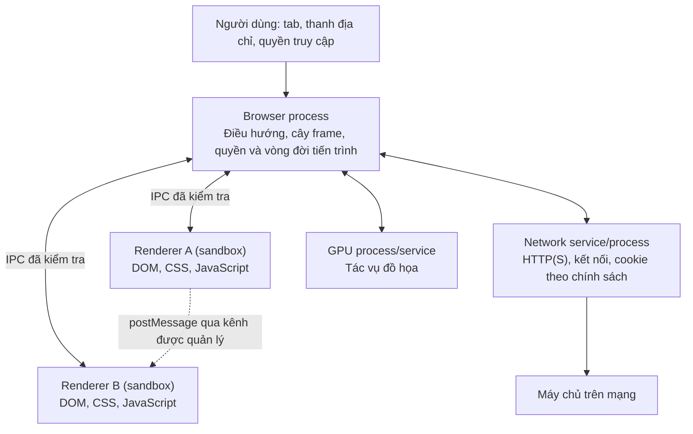

# Browser process trong mô hình bảo mật web

## 1. Browser process là gì?

Khi mở một trang web, trình duyệt không đơn thuần tải HTML rồi thực thi JavaScript trong cùng một chương trình có toàn quyền. Trình duyệt hiện đại thường chia công việc cho nhiều **tiến trình của hệ điều hành (OS process)**, mỗi tiến trình có không gian địa chỉ và mức đặc quyền riêng. Trong kiến trúc đa tiến trình, **browser process** là tiến trình điều phối các hoạt động quan trọng của trình duyệt: quản lý cửa sổ/tab, điều hướng, cây frame, vòng đời của các renderer và một số quyết định đặc quyền về quyền truy cập, thiết bị hoặc dữ liệu trình duyệt.

Nội dung HTML, CSS và JavaScript của trang web thường được xử lý trong **renderer process**. Đó là nội dung đến từ mạng, có thể chứa mã độc; vì vậy renderer thường được đặt trong **sandbox** để hạn chế khả năng truy cập trực tiếp vào tài nguyên của hệ điều hành. Browser process giữ vai trò điều phối và thực thi những kiểm tra không thể tin cậy giao hoàn toàn cho renderer.

Bài viết dùng **Chromium/Chrome** để minh họa vì kiến trúc của dự án này được tài liệu hóa rộng rãi. Firefox, Safari và các bản Chrome trên nền tảng khác có thể chia tiến trình và dịch vụ theo cách khác. Tên tiến trình, mức sandbox và số tiến trình thực tế không phải là một phần của chuẩn web.

**Mục tiêu sau bài học:**

- Phân biệt browser process, renderer process và các tiến trình dịch vụ như network/GPU.
- Hiểu ranh giới tin cậy giữa nội dung web không đáng tin và thành phần trình duyệt có đặc quyền.
- Giải thích vì sao **origin**, **site** và **process** là ba khái niệm khác nhau.
- Mô tả vai trò của browser process trong điều hướng, frame khác site, quyền truy cập và giao tiếp liên tiến trình.
- Liên hệ kiến trúc tiến trình với Same-Origin Policy (SOP), CORS, Site Isolation, XSS, CSRF, clickjacking và các lớp phòng vệ như CSP, Trusted Types.

## 2. Toàn cảnh kiến trúc đa tiến trình

Sơ đồ sau là mô hình khái niệm, không phải sơ đồ cố định cho mọi phiên bản trình duyệt:



| Thành phần | Trách nhiệm điển hình | Góc nhìn bảo mật |
|---|---|---|
| **Browser process** | Quản lý tab/cửa sổ, điều hướng, frame, vòng đời tiến trình; quyết định hay môi giới các thao tác đặc quyền | Phải coi dữ liệu và yêu cầu từ renderer là không đáng tin; kiểm tra nguồn gửi, quyền và ngữ cảnh |
| **Renderer process** | Phân tích và hiển thị tài liệu, chạy JavaScript, vận hành DOM và nhiều Web API | Xử lý nội dung có thể do kẻ tấn công kiểm soát; được giới hạn bằng sandbox và chính sách web |
| **Network service/process** | Xử lý kết nối, yêu cầu và phản hồi mạng, các kiểm tra liên quan đến request và cookie | Tài nguyên mạng và credential cần được kiểm soát theo origin, site, chế độ request và chính sách |
| **GPU process/service** | Hỗ trợ đồ họa và compositing | Phân tách mã xử lý đồ họa và driver khỏi các phần khác |
| **Utility/service process** | Thực hiện các tác vụ chuyên biệt, tùy nền tảng và bản triển khai | Giảm lượng chức năng có đặc quyền nằm chung trong một tiến trình |

**Lưu ý:** Bảng mô tả **vai trò logic**. Một phần chức năng có thể thuộc service process riêng hoặc được điều phối qua browser process; không nên suy ra rằng mọi HTTP request, cookie hay phép kiểm tra CORS đều được xử lý trực tiếp bằng mã chạy trong browser process.

### 2.1. Vì sao không để trang web chạy trong browser process?

Giả sử trang web từ `https://evil.example` khai thác lỗ hổng bộ máy JavaScript và chiếm quyền điều khiển renderer. Nếu renderer có thể tự đọc tập tin, truy cập thiết bị hay lấy cookie của mọi trang, hậu quả sẽ lan ra toàn bộ máy. Kiến trúc đa tiến trình kết hợp sandbox nhằm giảm khả năng đó:

1. Mã trang web chạy trong renderer có quyền hạn thấp hơn.
2. Khi cần thao tác đặc quyền, renderer phải đi qua API hoặc kênh **IPC (Inter-Process Communication)**.
3. Thành phần tiếp nhận ở phía trình duyệt xác minh request, nguồn gọi, frame/origin liên quan và chính sách trước khi thực hiện.
4. Các cơ chế phân tách renderer và Site Isolation bổ sung lớp bảo vệ khi mã thực thi trong renderer bị xâm phạm.

Ranh giới này hỗ trợ nguyên tắc **ít đặc quyền nhất (least privilege)** và **phòng vệ nhiều lớp (defense in depth)**. Nó không biến browser process thành bất khả xâm phạm; một lỗ hổng kiểm tra IPC ở phía đặc quyền vẫn có thể dẫn đến **sandbox escape**.

### 2.2. Browser process là ranh giới đặc quyền, không phải "người chạy JavaScript"

Một lời gọi JavaScript như `navigator.geolocation.getCurrentPosition(...)` xuất phát từ mã đang chạy trong renderer, nhưng quyền vị trí phải phụ thuộc vào ngữ cảnh bảo mật, quyền người dùng và chính sách của trình duyệt. Renderer không được tự khai rằng "người dùng đã cấp quyền". Tương tự, việc hiển thị một hộp thoại quyền thật của trình duyệt không nên do một trang web tự giả lập rồi được hệ thống mặc nhiên tin.

Cách diễn đạt chính xác là: **browser process phối hợp các quyết định nhạy cảm, còn từng Web API có thể được triển khai bởi nhiều thành phần hoặc service khác nhau**.

## 3. Origin, site và process: ba lớp phân tách dễ nhầm

Hiểu nhầm ba khái niệm này dẫn đến các kết luận sai về SOP, CORS và khả năng một iframe đọc nội dung trang cha.

### 3.1. Origin: danh tính bảo mật theo chuẩn web

Đối với URL HTTP(S) thông thường, origin được xác định bởi bộ ba **scheme + host + port**. Hai tài liệu cùng origin khi ba thành phần này tương đương theo quy tắc của nền tảng web.

| URL A | URL B | Cùng origin? | Vì sao |
|---|---|---|---|
| `https://app.example.com/a` | `https://app.example.com/b` | Có | Scheme, host, port mặc định giống nhau |
| `https://app.example.com` | `https://api.example.com` | Không | Khác host |
| `https://app.example.com` | `http://app.example.com` | Không | Khác scheme |
| `https://app.example.com` | `https://app.example.com:8443` | Không | Khác port |

Đối với `data:`, `blob:`, `file:` và tài liệu sandbox, quy tắc origin có những điểm đặc biệt. Đừng dùng mỗi hostname để suy luận origin.

**Same-Origin Policy** ràng buộc nhiều thao tác đọc/chỉnh sửa dữ liệu giữa các origin, chẳng hạn truy cập DOM của iframe khác origin. Nó là chính sách của nền tảng web và vẫn cần được áp dụng dù hai tài liệu tình cờ chạy trong cùng một OS process.

### 3.2. Site: đơn vị gần với quan hệ miền

Trong ngữ cảnh **schemeful same-site**, site của URL HTTP(S) thường gắn với scheme và **registrable domain** (eTLD+1, xác định dựa trên Public Suffix List). Vì vậy:

- `https://shop.example.com` và `https://api.example.com`: **khác origin nhưng cùng site**.
- `https://shop.example.com` và `https://login.example.org`: **khác site**.
- `http://shop.example.com` và `https://shop.example.com`: **khác schemeful site**.
- Khác port có thể làm khác origin mà không làm khác site.

Khái niệm site có vai trò trong **SameSite cookie** và trong nhiều quyết định của **Site Isolation**, nhưng thuật toán chính xác phụ thuộc cơ chế đang được xét.

### 3.3. Process: ranh giới hệ điều hành

Một **process** là đơn vị thực thi do hệ điều hành cung cấp. Trang và frame được ánh xạ vào renderer process tùy kiến trúc, chính sách cách ly, tính tương thích và nguồn lực của trình duyệt.

**Không có quy tắc chuẩn web nào nói "mỗi origin luôn có đúng một renderer process".** Nhiều frame có thể chia sẻ renderer; cùng một site cũng có thể có nhiều renderer; các site cần tách biệt có thể được trình duyệt đưa sang các renderer khác nhau. Trình duyệt còn có thể tái sử dụng hoặc thay thế process trong một số trường hợp.

| Ranh giới | Câu hỏi cần trả lời | Cơ chế tiêu biểu |
|---|---|---|
| **Origin** | Script này có được đọc/chỉnh sửa dữ liệu của tài liệu kia không? | SOP, CORS, quyền của Web API |
| **Site** | Hai URL có được xem là cùng site trong chính sách cụ thể không? | SameSite cookie, một số chính sách Site Isolation |
| **Process** | Mã có chạy trong cùng không gian địa chỉ OS không? | Phân bổ renderer, sandbox, cách ly bộ nhớ |
| **Browser ↔ renderer** | Mã web có thể yêu cầu thành phần đặc quyền làm gì? | IPC, kiểm tra quyền, kiểm tra frame/origin, sandbox |

Một **process boundary** không tự động cấp hoặc thu hồi quyền theo SOP. Một **origin boundary** cũng không tự nó bảo đảm hai trang được tách bằng hai process.

## 4. Browser process quản lý điều hướng như thế nào?

Xét người dùng nhập `https://bank.example` vào thanh địa chỉ:

1. **Khởi tạo điều hướng:** Browser process tiếp nhận thao tác mở URL hoặc yêu cầu điều hướng từ frame, gắn nó với tab và frame liên quan.
2. **Kiểm tra và sắp xếp:** Trình duyệt áp dụng các ràng buộc điều hướng và quyết định môi trường thực thi phù hợp; có thể cần renderer mới khi chuyển site.
3. **Tải tài nguyên:** Hệ thống network service thực hiện công việc mạng tương ứng, phối hợp xử lý redirect, cookie và các chính sách request/response.
4. **Commit tài liệu:** Khi điều hướng được phép commit, trình duyệt gắn tài liệu mới vào frame và renderer được chọn. Quy trình thực tế còn phụ thuộc loại điều hướng, cache, service worker và các cơ chế tối ưu.
5. **Render:** Renderer phân tích HTML, tạo DOM/CSSOM, thực thi script theo chính sách và hiển thị nội dung.

Quy trình này giúp tránh việc renderer của trang độc hại tự quyết định mình sẽ trở thành frame có quyền truy cập dữ liệu của một site khác. Các quyết định về **ai sở hữu frame, frame nào đang điều hướng đến đâu và request nào được phép** phải được bảo vệ tại ranh giới tin cậy.

### 4.1. Iframe khác site và OOPIF

Giả sử trang:

```text
https://shop.example.com (trang cha)
└── iframe: https://pay.example.net (khung thanh toán)
```

Trong Chromium có bật Site Isolation, iframe khác site có thể được đặt ở renderer khác trang cha. Cơ chế này thường được gọi là **Out-of-Process Iframe (OOPIF)**. Browser process duy trì cấu trúc frame xuyên các process và điều phối việc điều hướng, compositing, focus cũng như thông điệp cần thiết.

Việc iframe nằm ở process riêng **không làm mất chức năng nhúng**: hai frame vẫn có thể giao tiếp qua API được phép như `postMessage`. Ngược lại, dù hai iframe cùng nằm trong một process, SOP vẫn phải chặn truy cập DOM giữa hai origin không được phép.

### 4.2. Site Isolation bảo vệ điều gì?

**Site Isolation** nhằm giảm nguy cơ dữ liệu từ site này xuất hiện trong không gian thực thi của renderer đang xử lý nội dung site khác. Kết hợp với các kiểm tra request/response và IPC, cách ly này làm giảm hậu quả của một số kiểu renderer compromise và side-channel attack.

Nhưng Site Isolation không giải quyết mọi mối đe dọa:

- Nếu ứng dụng tin cậy bị **XSS**, script độc có thể chạy **trong chính origin của ứng dụng**; tách process giữa các site không tự cứu được dữ liệu của origin đó.
- Nếu endpoint thay đổi trạng thái thiếu bảo vệ **CSRF**, trình duyệt vẫn có thể gửi một số cross-site request hợp lệ ở cấp mạng; việc cách ly renderer không thay thế CSRF token.
- Nếu ứng dụng có lỗ hổng logic, phân quyền hoặc xác thực ở phía server, browser process không thể sửa hộ ứng dụng.

## 5. IPC: điểm giao tiếp và điểm cần kiểm tra tin cậy

**IPC** là cơ chế cho phép các process truyền thông tin qua nhau. Trong Chromium, nhiều lời gọi được đóng gói qua giao diện và thông điệp có cấu trúc; chi tiết như Mojo là đặc thù triển khai.

Một renderer bị kiểm soát bởi kẻ tấn công có thể gửi yêu cầu bất thường, giả mạo thứ tự thao tác hoặc cố sử dụng identifier không thuộc frame của nó. Vì vậy, kiểm tra ở thành phần có đặc quyền cần trả lời:

- Yêu cầu xuất phát từ process, frame và document nào? Đối tượng đó hiện còn tồn tại không?
- Frame này thực sự đang thuộc origin/site nào, và quyền đó có tương ứng yêu cầu không?
- Người dùng đã cấp quyền chưa; chính sách Permissions Policy, sandbox, secure context có áp dụng không?
- Dữ liệu đầu vào, kiểu đối tượng, thứ tự trạng thái và quyền sở hữu tài nguyên có hợp lệ không?

**Ví dụ tư duy:** Không thể chỉ tin vào trường văn bản `origin: "https://bank.example"` do renderer tự cung cấp để cho phép đọc credential. Phía nhận phải đối chiếu với trạng thái frame/document đáng tin cậy do trình duyệt quản lý.

Đây là khác biệt quan trọng giữa việc **một renderer thực thi logic giao diện** và việc **browser process/những service đặc quyền xác nhận một hành động nhạy cảm có hợp lệ hay không**.

## 6. Browser process liên hệ thế nào với các chính sách web?

Kiến trúc process là một lớp phòng vệ; các chính sách web là những lớp khác. Khi xây dựng ứng dụng, cần hiểu chúng bổ sung cho nhau.

| Chính sách/cơ chế | Mục tiêu chính | Liên hệ với browser process |
|---|---|---|
| **Same-Origin Policy (SOP)** | Giới hạn truy cập dữ liệu/DOM khác origin từ script | Phải được thực thi bất kể ánh xạ process; các ranh giới ở phía trình duyệt hỗ trợ kiểm soát dữ liệu |
| **CORS** | Cho phép server chỉ định origin nào được đọc response cross-origin trong request chịu CORS | Được thực thi bởi cơ chế fetch/network của trình duyệt; không phải quy tắc tạo process |
| **Site Isolation** | Giảm chia sẻ bộ nhớ renderer giữa những site cần tách biệt | Browser process phối hợp frame và renderer assignment |
| **SameSite cookie** | Hạn chế cookie được gửi trong ngữ cảnh cross-site theo chính sách cookie | Quyết định gắn với ngữ cảnh request/site, không dựa đơn thuần vào process |
| **CSP, Trusted Types** | Giảm khả năng chèn/thực thi mã nguy hiểm và lạm dụng DOM injection sink | Áp dụng ở cấp tài liệu/renderer và các thành phần liên quan; không thay thế sandbox |
| **COOP, COEP, CORP** | Kiểm soát quan hệ giữa browsing context và việc nhúng/chia sẻ tài nguyên cross-origin | Có thể tạo ranh giới cách ly bổ sung; không được diễn giải là cam kết mỗi origin có process riêng |
| **Permissions Policy** | Giới hạn tính năng Web API được phép trong tài liệu và iframe | Phối hợp với các kiểm tra quyền và ngữ cảnh của browser/service |
| **CSP frame-ancestors / X-Frame-Options** | Hạn chế ai được nhúng trang để giảm clickjacking | Kiểm tra ở quá trình tải/nhúng tài liệu; độc lập với việc iframe cùng hay khác process |

### 6.1. SOP khác CORS và khác Site Isolation

Ví dụ trang `https://shop.example.com` thực hiện:

```js
fetch("https://api.example.com/account", {
  credentials: "include"
})
  .then((response) => response.json())
  .then(console.log);
```

Hai host **khác origin**. Để JavaScript đọc response theo chế độ CORS thông thường, server phải cho phép origin gọi thông qua các header CORS phù hợp. Khi dùng credential, `Access-Control-Allow-Origin` cần là origin cụ thể được cho phép, đồng thời cần `Access-Control-Allow-Credentials: true`; không thể dùng wildcard `*` để cho phép response credentialed. Request có được gắn cookie hay không còn phụ thuộc thuộc tính cookie, SameSite, chính sách trình duyệt và bối cảnh request.

Việc hai host **cùng site** không làm chúng trở thành cùng origin và không bỏ qua CORS. Việc có hai renderer process cũng không thay đổi quy tắc đó.

**CORS không phải cơ chế chống CSRF tổng quát.** Nó chủ yếu kiểm soát khả năng script đọc response và một số loại request có preflight; những request gửi được dưới dạng đơn giản vẫn có thể kích hoạt hành động trên server nếu endpoint thiếu bảo vệ.

### 6.2. postMessage vượt ranh giới một cách có kiểm soát

Khi một iframe cần gửi thông tin lên trang cha khác origin, hãy dùng `postMessage`, chỉ định chính xác `targetOrigin` và kiểm tra phía nhận:

```js
// Ở iframe https://pay.example.net:
window.parent.postMessage(
  { type: "PAYMENT_READY" },
  "https://shop.example.com"
);

// Ở trang cha https://shop.example.com:
window.addEventListener("message", (event) => {
  if (event.origin !== "https://pay.example.net") return;
  if (event.source !== paymentFrame.contentWindow) return;
  if (event.data?.type !== "PAYMENT_READY") return;

  // Chỉ xử lý cấu trúc dữ liệu đã được kiểm tra.
  console.log("Khung thanh toán đã sẵn sàng");
});
```

Trong đoạn minh họa, `paymentFrame` là tham chiếu đến iframe hợp lệ đã được trang cha tạo trước đó. Với dữ liệu nhạy cảm, cần kiểm tra schema/payload chặt chẽ hơn và tuyệt đối không xem `postMessage` là cơ chế xác thực giao dịch. Việc đi qua process khác không tự biến message thành đáng tin cậy.

### 6.3. COOP/COEP và cross-origin isolation

Các response header như:

```http
Cross-Origin-Opener-Policy: same-origin
Cross-Origin-Embedder-Policy: require-corp
```

có thể giúp một trang đạt trạng thái **cross-origin isolated** khi đáp ứng thêm các yêu cầu liên quan (ví dụ môi trường bảo mật và tài nguyên nhúng hợp lệ). COOP ảnh hưởng quan hệ giữa các top-level browsing context; COEP yêu cầu tài nguyên nhúng cross-origin đáp ứng điều kiện CORS hoặc CORP thích hợp.

Những header này có thể làm hỏng tích hợp iframe, popup, font, script hoặc ảnh hiện có nếu áp dụng vội. Hãy kiểm tra `window.crossOriginIsolated` và Network/Console trong DevTools, đồng thời hiểu rằng đây là chính sách cách ly của web platform, không phải lời hứa về sơ đồ process tuyệt đối.

## 7. Kịch bản tấn công: browser process có giúp gì?

### 7.1. Renderer của trang độc hại bị chiếm quyền

**Tình huống:** Kẻ tấn công khai thác lỗi trong JS engine của renderer đang hiển thị `https://evil.example`.

**Điều mong muốn ở thiết kế an toàn:** Sandbox cản truy cập trực tiếp tài nguyên OS; Site Isolation hạn chế dữ liệu site khác nằm cùng không gian địa chỉ của renderer; các request IPC không hợp lệ bị phía có đặc quyền từ chối.

**Giới hạn:** Nếu có lỗ hổng sandbox escape, kiểm tra IPC, trình điều khiển hoặc thành phần đặc quyền, ranh giới vẫn có thể bị vượt qua. Cơ chế bảo vệ chỉ giảm rủi ro, không bảo đảm tuyệt đối.

### 7.2. XSS ngay trong origin có giá trị

**Tình huống:** Trang ngân hàng chèn input chưa xử lý vào HTML, cho phép script do kẻ tấn công tạo chạy như script của `https://bank.example`.

Script XSS có thể thao tác DOM, gửi request hợp lệ trong ngữ cảnh của origin và đọc dữ liệu mà script origin đó được phép đọc. **Browser process và Site Isolation không phân biệt được script "tốt" và script "xấu" cùng chạy dưới quyền origin đó.**

Đối sách ứng dụng: encode output theo ngữ cảnh; tránh API DOM nguy hiểm; sanitization khi phải hiển thị HTML; CSP phù hợp; Trusted Types ở những trình duyệt hỗ trợ; cookie `HttpOnly` giúp ngăn đọc cookie trực tiếp qua JavaScript nhưng không ngăn mọi hành động XSS.

### 7.3. CSRF qua phiên đăng nhập

**Tình huống:** Một trang khác site khiến trình duyệt gửi request thay đổi thông tin vào ứng dụng khi người dùng đang đăng nhập.

Process riêng không ngăn request được gửi. Phòng vệ phải có ở phía ứng dụng: CSRF token khó đoán và kiểm tra phía server, kiểm tra `Origin`/`Referer` khi phù hợp, cookie `SameSite`, tránh thay đổi trạng thái qua GET; có thể bổ sung Fetch Metadata (`Sec-Fetch-Site` và các header liên quan).

### 7.4. Clickjacking bằng iframe

**Tình huống:** Website độc nhúng giao diện của trang nhạy cảm rồi che phủ hoặc dẫn dụ người dùng nhấp sai.

Process boundary cũng không chặn được chiêu lừa giao diện này. Trang nhạy cảm cần cấu hình `Content-Security-Policy: frame-ancestors 'none'` hoặc danh sách bên nhúng được tin cậy; `X-Frame-Options` có thể hỗ trợ tương thích cũ. Thiết kế màn hình xác nhận hành động nhạy cảm vẫn quan trọng.

## 8. Thực hành quan sát trên trình duyệt

Thực hành sau giúp tách bạch hai câu hỏi: **trang khác origin có được truy cập DOM không?** và **trình duyệt cấp phát bao nhiêu process?**

### Bài A — Quan sát tiến trình

1. Trên Chrome desktop, mở một vài tab và một trang có iframe khác site.
2. Mở **Chrome Task Manager** (nhiều bản desktop dùng `Shift+Esc` hoặc menu của Chrome) và quan sát các mục Browser, Renderer, GPU, Network Service/Utility nếu được hiển thị.
3. Đóng hoặc điều hướng tab rồi quan sát renderer xuất hiện, biến mất hoặc được tái sử dụng.
4. Mở DevTools → **Security** và **Network** để xem origin, kết nối, response header của trang.

**Điều cần rút ra:** Số process quan sát được có thể thay đổi theo phiên bản, hệ điều hành, extensions, chế độ tối ưu tài nguyên và trạng thái Site Isolation. Không suy luận rằng hai origin luôn bằng hai process chỉ dựa trên một ảnh chụp Task Manager.

### Bài B — Kiểm chứng SOP trên hai origin cục bộ

Tạo hai thư mục `parent` và `child`. Lưu tệp sau ở `parent/index.html`:

```html
<!doctype html>
<meta charset="utf-8">
<title>Trang cha</title>
<h1>Parent: localhost:8000</h1>
<iframe id="child" src="http://localhost:8001/child.html"></iframe>
<script>
  const frame = document.getElementById("child");

  frame.addEventListener("load", () => {
    try {
      console.log(frame.contentWindow.document.body.textContent);
    } catch (error) {
      console.log("SOP chặn đọc DOM iframe:", error.name);
    }
  });

  window.addEventListener("message", (event) => {
    if (event.origin !== "http://localhost:8001") return;
    if (event.source !== frame.contentWindow) return;
    if (event.data?.type !== "READY") return;
    console.log("postMessage hợp lệ:", event.data);
  });
</script>
```

Lưu tệp sau ở `child/child.html`:

```html
<!doctype html>
<meta charset="utf-8">
<title>Trang con</title>
<p>Nội dung của iframe khác origin.</p>
<script>
  window.parent.postMessage(
    { type: "READY" },
    "http://localhost:8000"
  );
</script>
```

Mở hai terminal tại thư mục chứa `parent` và `child` tương ứng:

```bash
# Terminal 1, trong thư mục parent
python -m http.server 8000

# Terminal 2, trong thư mục child
python -m http.server 8001
```

Truy cập `http://localhost:8000/index.html` và mở DevTools → Console. Quan sát:

- Trang cha không đọc được `document.body` của iframe vì **port 8000 khác port 8001**, tức khác origin. Console ghi lỗi truy cập bị chặn.
- Trang cha nhận được thông điệp hợp lệ qua `postMessage` khi kiểm tra đúng `origin` và `source`.
- Hai URL vẫn thường được xem là **cùng site** dù khác origin. Vì thế thí nghiệm này kiểm chứng **SOP**, **không chứng minh** iframe đã được chuyển sang renderer khác process.

Dừng các HTTP server sau thực hành. Khi thử tình huống khác site hoặc OOPIF, cần môi trường với hai site thực sự khác nhau; trình duyệt và thiết lập Site Isolation quyết định cách phân bổ process.

### Bài C — Quan sát CORS độc lập với process

Từ Console của trang cha, thực hiện:

```js
fetch("http://localhost:8001/child.html")
  .then((response) => response.text())
  .then(console.log)
  .catch((error) => console.error("Không đọc được response:", error));
```

HTTP server đơn giản trong Bài B không mặc định trả `Access-Control-Allow-Origin` cho origin 8000. Trình duyệt có thể gửi request nhưng sẽ từ chối cho script đọc response vì thiếu cho phép CORS. Trong DevTools → Network, quan sát request/response và thông báo CORS. Kết quả này minh họa **chính sách đọc response**, không phải process allocation.

## 9. Sai lầm thường gặp và cách sửa

| Nhận định sai | Cách hiểu đúng |
|---|---|
| "Mỗi tab là một process duy nhất." | Tab có thể chứa nhiều renderer do iframe khác site; nhiều tab cũng có thể chia sẻ hoặc tái sử dụng process tùy trường hợp. |
| "Mỗi origin luôn có một process riêng." | Process assignment không trùng khít 1:1 với origin. |
| "Hai trang chạy khác process thì SOP không cần nữa." | SOP là ranh giới quyền truy cập của web, vẫn cần được thực thi. |
| "Cùng site nghĩa là cùng origin." | Các subdomain thường cùng site nhưng khác origin; port cũng ảnh hưởng origin. |
| "CORS ngăn website độc gửi request." | CORS chủ yếu giới hạn script đọc response và kiểm soát một số request qua preflight; không thay thế CSRF protection. |
| "Sandbox chống được XSS." | Sandbox giới hạn đặc quyền OS của renderer; XSS vẫn có thể thực thi với quyền của origin bị lỗi. |
| "Bật COOP/COEP là mọi iframe có process riêng." | COOP/COEP áp chính sách ngữ cảnh/tài nguyên; process mapping vẫn phụ thuộc triển khai. |
| "Một request IPC từ renderer đã được kiểm tra thì mọi trường dữ liệu đều đáng tin." | Phía có đặc quyền phải xác minh nguồn gửi và mọi thông số liên quan đến quyền, đối tượng và trạng thái. |

## 10. Checklist khi thiết kế hoặc đánh giá ứng dụng web

Khi phân tích luồng browser ↔ web application, hãy hỏi:

1. **Danh tính:** Origin của tài liệu/request là gì? Site của nó là gì? Có iframe, popup hay cross-origin request nào liên quan?
2. **Dữ liệu:** Script nào được đọc DOM, response, storage hoặc thông điệp từ frame khác? Đã dùng SOP/CORS đúng chưa?
3. **Request mang phiên:** Cookie có `Secure`, `HttpOnly`, `SameSite` phù hợp không? Endpoint thay đổi trạng thái đã có bảo vệ CSRF phía server chưa?
4. **Nội dung không tin cậy:** Dữ liệu từ người dùng/API đi vào DOM sink nào? Đã escape/encode đúng ngữ cảnh, kiểm soát HTML, đặt CSP và cân nhắc Trusted Types chưa?
5. **Nhúng và giao tiếp:** Ai được phép iframe trang? `postMessage` có giới hạn `targetOrigin`, xác minh `event.origin`, `event.source` và dữ liệu không?
6. **Cách ly bổ sung:** Có nhu cầu COOP/COEP/CORP hoặc iframe sandbox không? Các tính năng có phá vỡ tương tác hợp lệ không?
7. **Kiểm chứng:** Đã kiểm tra thực tế trên trình duyệt mục tiêu, DevTools và log server, thay vì giả định dựa vào số process, chưa?

## 11. Tự kiểm tra kiến thức

1. Vì sao renderer phải được coi là không đáng tin ngay cả khi nó do chính trình duyệt tạo ra?
2. Phân biệt origin, schemeful site và process qua cặp `https://a.example.com` và `https://b.example.com`.
3. Một iframe khác origin nhưng cùng site có được đọc DOM của trang cha không? Điều gì quyết định?
4. Browser process đóng vai trò gì khi một renderer yêu cầu điều hướng hoặc dùng quyền thiết bị?
5. Vì sao một lỗ hổng XSS vẫn nguy hiểm dù Site Isolation và sandbox đang hoạt động?
6. Tại sao response không có CORS header có thể đã được gửi qua mạng nhưng JavaScript không đọc được?
7. Nếu iframe dùng `postMessage`, phía nhận cần kiểm tra gì trước khi xử lý lệnh có ảnh hưởng bảo mật?

**Gợi ý trả lời:** (1) Vì renderer xử lý dữ liệu và script từ nguồn có thể độc hại. (2) Hai trang cùng site theo ví dụ, khác origin; không thể suy ra process. (3) Không, SOP chặn truy cập DOM trực tiếp trừ cơ chế ngoại lệ đặc thù được phép. (4) Phối hợp trạng thái frame/điều hướng và kiểm tra đặc quyền với các service liên quan. (5) XSS chạy dưới quyền của chính origin bị khai thác. (6) CORS kiểm soát quyền đọc response của script. (7) Kiểm tra `targetOrigin` phía gửi; phía nhận kiểm tra `origin`, `source`, kiểu và nội dung message, cùng quyền nghiệp vụ.

## 12. Tài liệu tham khảo để học sâu

- [Chromium — Multi-process Architecture](https://www.chromium.org/developers/design-documents/multi-process-architecture/): Tổng quan mô hình browser/renderer và cách tổ chức đa tiến trình.
- [Chromium — Site Isolation](https://www.chromium.org/Home/chromium-security/site-isolation/): Động cơ và thiết kế cách ly site.
- [MDN — Same-origin policy](https://developer.mozilla.org/en-US/docs/Web/Security/Same-origin_policy): Quy tắc và ngoại lệ của SOP.
- [MDN — Cross-Origin Resource Sharing](https://developer.mozilla.org/en-US/docs/Web/HTTP/CORS): Cách hoạt động của CORS, preflight và credential.
- [MDN — Cross-origin isolation](https://developer.mozilla.org/en-US/docs/Web/API/Window/crossOriginIsolated): COOP/COEP và trạng thái cross-origin isolation.
- [OWASP — Cross Site Scripting Prevention Cheat Sheet](https://cheatsheetseries.owasp.org/cheatsheets/Cross_Site_Scripting_Prevention_Cheat_Sheet.html), [CSRF Prevention Cheat Sheet](https://cheatsheetseries.owasp.org/cheatsheets/Cross-Site_Request_Forgery_Prevention_Cheat_Sheet.html): Biện pháp phòng vệ ở cấp ứng dụng.

**Kết nối với mô hình bảo mật web:** Browser process, renderer sandbox và Site Isolation tạo ra ranh giới tin cậy ở tầng kiến trúc trình duyệt. Origin/site và các chính sách SOP, CORS, CSP, SameSite, COOP/COEP cùng kiểm tra phía server tạo ra ranh giới quyền truy cập ở tầng web. Một ứng dụng an toàn cần hiểu và kiểm chứng **cả hai tầng**, vì không tầng nào thay thế hoàn toàn tầng còn lại.
