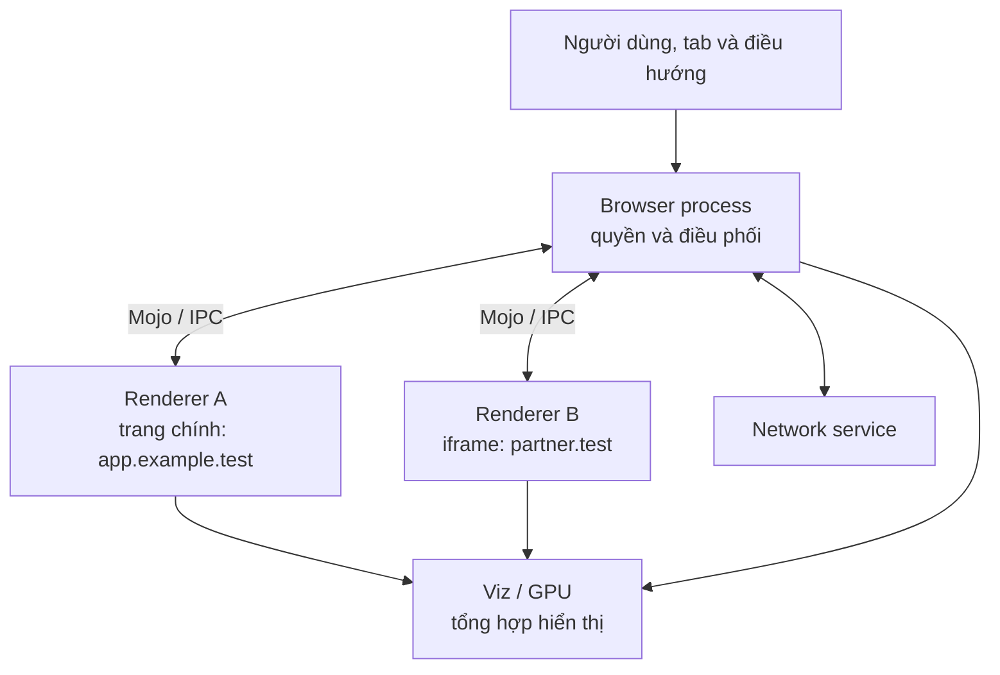
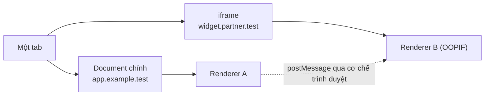
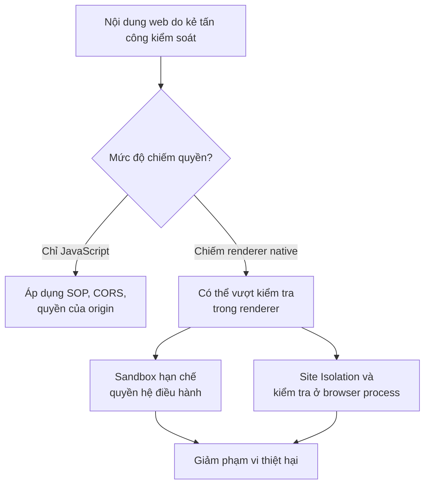

# Renderer process: tiến trình thực thi nội dung web trong mô hình bảo mật trình duyệt

## Mục tiêu học tập

Sau bài này, người học có thể:

1. Giải thích **renderer process** làm gì và phân biệt nó với **browser process**, network service và GPU/Viz process.
2. Phân biệt **origin**, **site**, **SiteInstance**, **frame** và **OS process**; không đồng nhất một tab với một renderer.
3. Mô tả cách **sandbox**, **Site Isolation** và kiểm tra quyền ở browser process phối hợp để giới hạn thiệt hại khi nội dung web độc hại hoặc renderer bị khai thác.
4. Giải thích vì sao renderer process không thay thế **Same-Origin Policy (SOP)**, **CORS**, **CSP**, phòng vệ **XSS/CSRF/clickjacking**.
5. Dùng công cụ có sẵn trong Chromium/Chrome để quan sát renderer của trang chính và `iframe` khác site, từ đó đánh giá đúng giới hạn của kết quả quan sát.

> **Phạm vi:** Bài dùng kiến trúc **Chromium/Chrome** làm ví dụ chính. Các trình duyệt khác cũng có cách tách tiến trình và sandbox, nhưng quy tắc phân bổ tiến trình, mức độ cách ly và công cụ chẩn đoán có thể khác nhau. Đây là một bài về **mô hình bảo mật web**: trọng tâm là ranh giới tin cậy giữa trình duyệt, origin, cookie và ứng dụng web, không phải tối ưu hiệu năng render.

## 1. Renderer process là gì?

**Renderer process** là một **tiến trình của hệ điều hành** được trình duyệt dùng để xử lý một hoặc nhiều tài liệu web. Trong Chromium, renderer thường thực thi JavaScript bằng **V8**, xử lý HTML/CSS/DOM/layout bằng **Blink**, chạy phần lớn logic ứng dụng phía trình duyệt và tạo thông tin hiển thị để hệ thống kết xuất hoàn thiện hình ảnh.

Trang web có thể cung cấp HTML, CSS, JavaScript và dữ liệu không đáng tin cậy. Vì vậy, Chromium đặt renderer vào **sandbox có quyền hạn chế**; những thao tác cần đặc quyền phải đi qua các dịch vụ và bước kiểm tra của trình duyệt.

Renderer process **không phải**:

- **Một tab:** Một tab có thể sử dụng nhiều renderer khi nhúng frame khác site; nhiều frame hoặc tài liệu có thể chia sẻ một renderer.
- **Một origin:** Hai origin khác nhau có thể thuộc cùng một site; ranh giới origin do chính sách web quyết định, còn cách phân bổ OS process phụ thuộc mô hình tiến trình.
- **Toàn bộ trình duyệt:** Thanh địa chỉ, điều phối điều hướng, quản lý nhiều quyền và một phần kiểm soát tài nguyên nằm bên ngoài renderer.
- **Một sandbox hoàn chỉnh cho mọi kiểu tấn công:** Renderer đã bị xâm nhập vẫn có thể tìm cách gửi thông điệp độc hại hoặc tác động đến dữ liệu mà nó được phép xử lý.

### Các thành phần liên quan

| Thành phần | Công việc chính | Ý nghĩa bảo mật |
| --- | --- | --- |
| **Browser process** | Điều phối tab, điều hướng, giao diện trình duyệt, cấp quyền và quản lý các tiến trình con | Là phía có đặc quyền hơn, xác minh yêu cầu từ renderer và ràng buộc tiến trình với site/origin được phép |
| **Renderer process** | Chạy mã web, DOM, JavaScript, style/layout và tạo nội dung để hiển thị | Xử lý dữ liệu không tin cậy; chạy trong sandbox |
| **Network service** | Thực hiện hoạt động mạng do trình duyệt điều phối | Renderer không được tùy ý mở kết nối mạng hệ điều hành; kiểm soát truy cập dữ liệu phải đi qua các lớp có thẩm quyền |
| **Viz/GPU process** | Tổng hợp và trình bày kết quả đồ họa từ nhiều thành phần | Tách công việc đồ họa khỏi việc thực thi JavaScript; không đồng nghĩa với một renderer cho toàn bộ màn hình |
| **Frame/document** | Một tài liệu được hiển thị trong trang chính hoặc `iframe` | Mỗi document có origin và quyền truy cập web riêng; frame khác site có thể chạy trong renderer khác |

Sơ đồ khái quát (các đường nối thể hiện luồng phối hợp, không phải toàn bộ luồng IPC thực tế):



**Luồng tin cậy:** JavaScript trong trang chạy ở phía renderer; khi cần truy cập một khả năng do trình duyệt quản lý, yêu cầu đi qua giao diện được cung cấp và có thể phát sinh **IPC** (inter-process communication) tới tiến trình/dịch vụ khác. Phía có đặc quyền phải kiểm tra yêu cầu dựa trên nguồn gửi, quyền và ngữ cảnh bảo mật; không được mặc nhiên tin nội dung từ renderer.

## 2. Origin, site và SiteInstance: ba khái niệm quyết định cách hiểu ranh giới

### Origin dùng để áp dụng chính sách truy cập web

Với URL HTTP(S) thông thường, một **origin** gồm **scheme + hostname + port**. Hai trang chỉ **same-origin** khi cả ba thành phần phù hợp (sau khi chuẩn hóa các cổng mặc định).

Ví dụ, origin của `https://shop.example.test/account` là `https://shop.example.test:443`; đường dẫn `/account` không phải thành phần của origin.

**Same-Origin Policy** chủ yếu hạn chế việc script ở một origin đọc hoặc điều khiển dữ liệu/DOM của origin khác. Một số kiểu tải tài nguyên hoặc giao tiếp xuyên origin được cho phép theo cơ chế riêng, chẳng hạn `postMessage` hoặc CORS khi máy chủ đích chấp thuận.

### Site dùng để tổ chức cách ly tiến trình

Trong ngữ cảnh Site Isolation của Chromium, **site** thường được xác định bằng **scheme + registrable domain (eTLD+1)**; thông thường không tính subdomain và port. Vì thế `https://app.example.test` và `https://api.example.test` là **same-site** nhưng **cross-origin**. Đây là khác biệt quan trọng: **same-site không cấp quyền đọc DOM cross-origin**.

| Cặp URL (so với `https://app.example.test`) | Same-origin? | Same-site? | Lý do |
| --- | :---: | :---: | --- |
| `https://app.example.test/profile` | Có | Có | Khác đường dẫn không tạo origin mới |
| `https://api.example.test/data` | Không | Có | Khác hostname, cùng scheme và registrable domain |
| `https://app.example.test:8443` | Không | Có | Khác port; site thông thường không xét port |
| `http://app.example.test` | Không | Không | Khác scheme; mô hình **schemeful site** xem là khác site |
| `https://widget.partner.test` | Không | Không | Khác registrable domain |

> Các tên miền `.test` trong bài chỉ dùng để minh họa; chúng không phải địa chỉ công khai có sẵn để thử truy cập. Với URL đặc biệt như `about:blank`, `data:`, `blob:` hoặc opaque origin, quy tắc xác định origin cần xét riêng.

### SiteInstance không tương đương một tiến trình

**SiteInstance** là khái niệm nội bộ Chromium để nhóm các tài liệu có quan hệ cần tương tác trực tiếp với nhau. Browser process ánh xạ SiteInstance và các frame tới renderer phù hợp với ràng buộc bảo mật và tài nguyên.

Một số hệ quả:

- Nhiều frame có thể cùng renderer nếu có thể chia sẻ tiến trình an toàn theo chính sách hiện hành.
- Hai lần mở cùng một site **không chắc** dùng cùng PID.
- Một trang chứa nhiều site có thể cần nhiều renderer thông qua **out-of-process iframe (OOPIF)**.
- Khả năng dùng chung tiến trình còn phụ thuộc nền tảng, phiên bản Chromium, quan hệ giữa tài liệu và ngân sách tiến trình; **không đoán PID chỉ từ hostname**.

## 3. Điều gì xảy ra khi tải một trang?

Giả sử người dùng mở `https://app.example.test/dashboard`, trong đó có một `iframe` nhúng `https://widget.partner.test/chart`.

1. **Bắt đầu điều hướng:** Browser process tiếp nhận yêu cầu điều hướng và điều phối tải nội dung qua network service; nó quyết định tài liệu sẽ được gắn với ngữ cảnh và tiến trình phù hợp.
2. **Chọn renderer:** Theo chính sách Site Isolation, trang chính thuộc site `https://example.test`. Frame nhúng thuộc site `https://partner.test` nên trên cấu hình Chromium desktop có Site Isolation đầy đủ, frame khác site được đưa sang **renderer riêng**.
3. **Dựng nội dung:** Renderer của từng document xử lý DOM, CSS, JavaScript, layout và kết quả kết xuất của phần mình; các phần được tổng hợp thành giao diện cuối cùng.
4. **Giao tiếp có kiểm soát:** Script trang chính không thể đọc trực tiếp DOM riêng tư của iframe cross-origin. Nếu cần trao đổi dữ liệu, hai phía có thể dùng `window.postMessage()` với kiểm tra origin và nguồn gửi.
5. **Điều hướng hoặc lỗi:** Điều hướng sang site khác có thể làm đổi renderer. Nếu một renderer bị crash, trình duyệt có thể hiển thị lỗi cho tab/frame bị ảnh hưởng, trong khi những tiến trình khác vẫn hoạt động.



Sơ đồ là **mô hình điển hình của Chrome desktop**. Nếu iframe bị chặn bởi `X-Frame-Options` hoặc CSP `frame-ancestors`, tài liệu đó sẽ không được nhúng thành công. Trên một số thiết bị và cấu hình, mức độ Site Isolation có thể khác.

## 4. Ba lớp phòng vệ quanh renderer process

### Lớp 1: Same-Origin Policy — ranh giới truy cập dữ liệu ở cấp web

Khi JavaScript thực thi trong một document, **SOP** kiểm soát quyền đọc hoặc thao tác với tài nguyên của origin khác. Ví dụ, trang từ `https://app.example.test` không được trực tiếp đọc `iframe.contentWindow.document` của `https://widget.partner.test`.

SOP vẫn cần thiết ngay cả khi hai document được tách thành các tiến trình khác nhau. Ngược lại, hai origin chia sẻ một renderer **không có nghĩa** JavaScript của chúng được quyền đọc dữ liệu lẫn nhau.

### Lớp 2: Renderer sandbox — ranh giới quyền đối với hệ điều hành

Renderer là nơi thực thi nội dung được tải từ Internet nên có mức tin cậy thấp. Sandbox dựa vào các cơ chế của hệ điều hành để hạn chế khả năng của tiến trình, ví dụ quyền truy cập tệp, thiết bị và thao tác mạng trực tiếp. Những khả năng cần đặc quyền được cung cấp thông qua các dịch vụ trình duyệt và yêu cầu có kiểm tra.

Sandbox có ý nghĩa ngay cả khi kẻ tấn công khai thác được lỗi trong engine và **chạy mã máy** bên trong renderer. Nhưng sandbox không bảo đảm ngăn mọi cách thoát sandbox hoặc mọi lạm dụng các API vốn được phép.

### Lớp 3: Site Isolation và browser-enforced checks — giảm dữ liệu và quyền của renderer

**Site Isolation** cố gắng giới hạn nội dung từ các site khác nhau vào các OS process khác nhau. Renderer có thể được **khóa vào một site hoặc origin**; browser process kiểm tra thông điệp từ renderer và giới hạn dữ liệu phản hồi nhạy cảm mà tiến trình ấy có thể nhận.

Kết hợp các lớp này, khi một renderer bị xâm nhập, kẻ tấn công không tự động có dữ liệu của tab hoặc site khác trong vùng nhớ của chính tiến trình đó. Các cơ chế như chặn việc chuyển nội dung phản hồi nhạy cảm không được phép cho renderer giúp thu hẹp bề mặt rò rỉ dữ liệu. Tuy nhiên, cách ly không thay thế việc vá lỗi trình duyệt và các kiểm soát ở ứng dụng.

| Câu hỏi bảo mật | Cơ chế trả lời chính |
| --- | --- |
| Script của site A có được đọc DOM site B không? | **SOP** và các quy tắc truy cập theo origin |
| JavaScript của site A có được đọc phản hồi API của origin B không? | **SOP/CORS**; phía API phải cho phép origin phù hợp nếu muốn chia sẻ |
| Renderer có được mở tùy ý tệp hệ thống không? | **Sandbox** và kiểm tra quyền ở tiến trình/dịch vụ có đặc quyền |
| Nếu renderer site A bị khai thác, dữ liệu site B có nằm cùng không gian nhớ với nó không? | **Site Isolation** nhằm tách các site, kết hợp kiểm tra quyền và lọc dữ liệu |
| Script XSS chạy ngay trong origin B có thể thao tác phiên đăng nhập B không? | **Renderer isolation không giải quyết**; cần phòng vệ XSS và bảo vệ session ở ứng dụng |

## 5. Mô hình đe dọa: nếu renderer bị chiếm quyền thì sao?

Phân biệt **script độc hại chạy trong trang** và **renderer bị xâm nhập ở cấp native code**:

- **Trường hợp A — JavaScript trên site tấn công:** Mã chạy theo quyền web của origin tấn công. SOP, CORS và các cơ chế browser khác hạn chế dữ liệu mà mã đọc được; dù có nhiều quyền trong trang của chính nó, JavaScript không mặc nhiên có quyền của máy chủ hay hệ điều hành.
- **Trường hợp B — XSS trên chính ứng dụng nạn nhân:** Mã tấn công chạy trong origin của ứng dụng bị ảnh hưởng. SOP xem đó là mã cùng origin với dữ liệu ứng dụng; Site Isolation không thể tự phân biệt JavaScript đáng tin và script XSS trong cùng trang.
- **Trường hợp C — khai thác lỗi engine để chiếm renderer:** Kẻ tấn công có thể vượt qua một số kiểm tra vốn do renderer thực hiện, thậm chí tạo IPC bất thường. Sandbox giới hạn quyền hệ điều hành; Site Isolation cùng các kiểm tra ở browser process hạn chế việc truy cập dữ liệu của site khác. Nếu có thêm lỗi ở sandbox/bộ phận có đặc quyền, mức độ ảnh hưởng có thể tăng.



**Tình huống:** Người dùng đang đăng nhập ngân hàng ở `https://bank.example.test` và mở thêm trang độc hại ở `https://malicious.partner.test`. Nếu trang độc hại chỉ có JavaScript bình thường, SOP không cho đọc DOM của ngân hàng. Nếu nó khai thác được renderer của chính nó, Site Isolation trên Chrome desktop giúp tránh việc document ngân hàng cùng nằm trong tiến trình đã bị chiếm và browser process còn kiểm tra các yêu cầu vượt quyền. Nhưng nếu kẻ tấn công cài được XSS ngay trên trang ngân hàng, các lớp cách ly tiến trình **không thay thế** việc chặn XSS.

**Giới hạn cần nhớ:** Site Isolation là phòng vệ theo chiều sâu trước lỗi engine, renderer bị xâm nhập và một số rủi ro kiểu Spectre; nó **không phải** cơ chế chữa XSS, CSRF, clickjacking hay mọi kiểu rò rỉ xuyên trang.

## 6. Giao tiếp giữa các frame: SOP, CORS và postMessage

Một `iframe` cross-origin vẫn có thể được hiển thị nếu chính sách nhúng cho phép. Việc hiển thị **không cấp quyền** đọc DOM cho frame cha. Ví dụ ở trang cha:

```html
<iframe id="widget" src="https://widget.partner.test/chart"></iframe>
<script>
  const frame = document.getElementById("widget");
  frame.addEventListener("load", () => {
    try {
      console.log(frame.contentWindow.document.title);
    } catch (error) {
      console.log(error.name); // Thông thường: "SecurityError"
    }
  });
</script>
```

Trong môi trường thực, thay miền `.test` bằng các origin truy cập được và bảo đảm site đích cho phép nhúng. Lỗi đọc DOM xuất phát từ **SOP**, không phải bằng chứng độc lập rằng iframe có PID khác.

Nếu hai phía cần trao đổi dữ liệu, dùng kênh được thiết kế cho cross-origin:

```js
// Ở trang cha https://app.example.test
const iframe = document.querySelector("#widget");
const widgetOrigin = "https://widget.partner.test";

iframe.contentWindow.postMessage(
  { type: "GET_SUMMARY" },
  widgetOrigin // Chỉ định origin nhận, tránh dùng "*" cho dữ liệu nhạy cảm
);

window.addEventListener("message", (event) => {
  if (event.origin !== widgetOrigin) return;
  if (event.source !== iframe.contentWindow) return;
  if (!event.data || event.data.type !== "SUMMARY") return;

  // Ứng dụng còn phải kiểm tra schema và nội dung dữ liệu nhận.
  console.log(event.data.payload);
});
```

Ở phía iframe, khi phản hồi phải kiểm tra `event.origin`, `event.source`, loại thông điệp và chỉ gửi đến `targetOrigin` cụ thể. **Tách renderer không ngăn giao tiếp hợp lệ**; trình duyệt hỗ trợ các thông điệp này qua ranh giới tiến trình khi cần.

Đối với yêu cầu HTTP như `fetch("https://api.example.test/data")`, **CORS** quyết định liệu JavaScript có thể đọc phản hồi cross-origin theo chính sách của server hay không. CORS **không** quyết định renderer của trang được phân bổ ở đâu và cũng **không** phải cơ chế xác thực người dùng. Cookie có các quy tắc riêng như `Secure`, `HttpOnly`, `SameSite`, phạm vi domain/path và điều kiện gửi credentials. Một yêu cầu có thể đã được gửi nhưng mã JavaScript vẫn không được đọc phản hồi vì CORS.

## 7. Renderer process liên hệ gì với các phòng vệ ở ứng dụng?

| Mục tiêu | Cơ chế phù hợp | Quan hệ với renderer |
| --- | --- | --- |
| Chặn việc script lạ thực thi hoặc giảm tác hại khi chèn HTML | **CSP**, escape/encode theo ngữ cảnh, tránh sink nguy hiểm, **Trusted Types** nơi hỗ trợ | Giảm khả năng tạo XSS **bên trong** một renderer |
| Giới hạn khả năng gọi hành động bằng phiên đăng nhập của nạn nhân | **CSRF token**, xác minh `Origin`/`Referer` khi phù hợp, `SameSite` cookie | CSRF vẫn là rủi ro dù mỗi site được tách tiến trình |
| Không cho website khác nhúng trang nhạy cảm để đánh lừa click | CSP **`frame-ancestors`**; `X-Frame-Options` cho môi trường cần hỗ trợ | Kiểm soát quyền **nhúng**, không chỉ là chọn tiến trình cho iframe |
| Kiểm soát ai được đọc phản hồi HTTP cross-origin | **CORS** và các quy tắc SOP | Không liên quan trực tiếp tới việc một hay nhiều renderer |
| Giới hạn website có thể nhúng tài nguyên cross-origin | **CORP**, **COEP** khi phù hợp | Bổ sung kiểm soát tài nguyên; cần kiểm thử vì có thể chặn tích hợp hợp lệ |
| Tách quan hệ opener và hỗ trợ môi trường cross-origin isolated | **COOP** kết hợp **COEP** và Permissions-Policy thích hợp | Có thể tăng cách ly ngữ cảnh; **`crossOriginIsolated` không đồng nghĩa với Site Isolation** |

Ví dụ một ứng dụng có yêu cầu dùng `SharedArrayBuffer` có thể cấu hình các response header sau, sau khi kiểm tra các tài nguyên cross-origin liên quan:

```http
Cross-Origin-Opener-Policy: same-origin
Cross-Origin-Embedder-Policy: require-corp
```

Trong console có thể xem `window.crossOriginIsolated`. Giá trị `true` phụ thuộc điều kiện của trang và chính sách quyền liên quan; **không dùng giá trị này để suy luận số lượng renderer**. Cấu hình COEP có thể khiến tài nguyên bên thứ ba bị chặn nếu không có chính sách CORS/CORP tương thích.

## 8. Thực hành: quan sát renderer và kiểm chứng ranh giới

### Bài thực hành A — Xem tiến trình của tab

1. Mở **Chrome/Chromium desktop** và truy cập hai website khác site trong hai tab.
2. Mở **Task Manager** của Chrome (menu **More tools → Task manager**; trên nhiều bản Windows/Linux có thể dùng `Shift+Esc`).
3. Bật hoặc xem cột **Process ID**; đối chiếu nhóm dòng của tab, frame và các tiến trình. Ghi lại liệu chúng có PID riêng không.
4. Mở `chrome://process-internals/#web-contents` trong thanh địa chỉ để xem các **SiteInstance** và liên hệ giữa document với tiến trình (đây là trang chẩn đoán nội bộ, giao diện có thể đổi theo phiên bản).
5. Tải lại hoặc chuyển trang; quan sát thay đổi. **Không kết luận cứ mở một tab là có đúng một renderer**, hoặc cứ cùng site là luôn cùng PID.

### Bài thực hành B — Trang có iframe khác site

Trong một ứng dụng thử nghiệm có hai hostname HTTPS khác registrable domain, đặt iframe ở trang chính:

```html
<h1>Trang chính</h1>
<iframe
  title="Widget đối tác"
  src="https://widget.partner.test/chart"
  width="600"
  height="300">
</iframe>
```

Thay các hostname ví dụ bằng hai miền đang kiểm soát hoặc được phép nhúng. Kiểm tra:

1. Iframe có tải được không? Nếu bị chặn bởi `frame-ancestors` hoặc `X-Frame-Options`, đó là một chính sách nhúng, **không** phải lỗi Site Isolation.
2. Trang cha có đọc được `iframe.contentWindow.document` không? Nếu khác origin, dự kiến bị SOP chặn.
3. Task Manager và `chrome://process-internals/#web-contents` có cho thấy renderer/PID khác không? Trên Chrome desktop có Site Isolation đầy đủ, iframe **khác site** thường sẽ ở OOPIF.
4. Thử iframe **cùng site nhưng khác origin** (chẳng hạn app và api subdomain). Dù có thể chia sẻ renderer, đọc DOM trực tiếp vẫn bị SOP chặn.

**Bảng ghi nhận mẫu** — điền theo kết quả thực tế, không suy ra trước:

| Trường hợp | Kết quả đọc DOM từ frame cha | PID trong Chrome Task Manager |
| --- | --- | --- |
| Iframe same-origin | Thông thường được phép nếu không có ràng buộc sandbox/chính sách khác | Ghi PID quan sát |
| Iframe same-site, cross-origin | Bị SOP chặn | Ghi PID quan sát |
| Iframe cross-site, cross-origin | Bị SOP chặn | Ghi PID quan sát; dự kiến riêng trên Chrome desktop Site Isolation đầy đủ |

### Bài thực hành C — Phân biệt vấn đề process với vấn đề response header

Mở DevTools → **Network** và **Console** của ứng dụng thử nghiệm:

- Thực hiện một `fetch` đến API cross-origin. Xem `Origin` trong request, `Access-Control-Allow-Origin` trong response và lỗi CORS (nếu có). Lỗi CORS nói về **quyền đọc phản hồi từ JavaScript**, không chứng minh có hay không có OOPIF.
- Kiểm tra response header `Cross-Origin-Opener-Policy`, `Cross-Origin-Embedder-Policy` và chạy `window.crossOriginIsolated`. Đây là phép thử **cross-origin isolation**, khác với việc đếm renderer.
- Với iframe không hiển thị, xem thông báo CSP `frame-ancestors` hoặc `X-Frame-Options` trong Console trước khi tìm nguyên nhân ở process.

### Khi đánh giá kết quả

Ghi rõ **phiên bản trình duyệt, hệ điều hành, URL nguồn/đích, quan hệ same-origin/same-site, chính sách iframe và PID**. Kết quả phân bổ process có thể khác theo nền tảng, cấu hình và phiên bản; các hạn chế SOP/CORS vẫn phải được kiểm tra độc lập.

## 9. Các ngộ nhận thường gặp

| Ngộ nhận | Cách hiểu đúng |
| --- | --- |
| “Mỗi tab có đúng một renderer process.” | Tab có thể chứa nhiều renderer qua OOPIF; renderer cũng có thể chứa nhiều document. |
| “Cùng renderer thì hai trang được đọc DOM của nhau.” | Quyền DOM dựa trên **origin** và chính sách web, không dựa riêng vào PID. |
| “Site Isolation thay SOP/CORS.” | Site Isolation là **phòng vệ theo chiều sâu** nếu một số lớp kiểm tra bị vượt qua; SOP/CORS vẫn quyết định hành vi web bình thường. |
| “Sandbox ngăn mọi cuộc tấn công trên ứng dụng.” | Sandbox giới hạn quyền hệ điều hành của tiến trình; không sửa được lỗi XSS, CSRF hay phân quyền API. |
| “Bật COOP/COEP thì chắc chắn mỗi tab có PID riêng.” | COOP/COEP liên quan đến browsing context và chính sách nhúng/tài nguyên; không phải phép ánh xạ một tab → một PID. |
| “Cross-site iframe bị lỗi tải vì nó nằm ở process khác.” | Kiểm tra trước CSP `frame-ancestors`, `X-Frame-Options`, CORS/CORP/COEP và lỗi mạng cụ thể. |

## 10. Tự kiểm tra kiến thức

**Tình huống 1:** `https://admin.example.test` nhúng `https://reports.example.test`. Hai frame có thể dùng cùng renderer trên một cấu hình, vậy trang admin có đọc trực tiếp DOM của reports không?

**Giải thích:** Không, vì chúng khác hostname nên khác origin. Việc cùng site hoặc cùng PID không làm mất ranh giới SOP.

**Tình huống 2:** Kẻ tấn công chiếm renderer của `https://evil.partner.test`. Vì sao Site Isolation có ích trong trường hợp này?

**Giải thích:** Trong cấu hình có Site Isolation, dữ liệu và document của site ngân hàng khác site được đặt ngoài không gian tiến trình bị chiếm; browser process còn áp dụng ràng buộc quyền và kiểm tra truy cập dữ liệu. Điều đó giảm khả năng tấn công lan sang site khác, dù không bảo đảm an toàn tuyệt đối.

**Tình huống 3:** Website bị XSS và script độc hại chạy trong chính origin đăng nhập. Có thể chỉ cần bật Site Isolation để khắc phục không?

**Giải thích:** Không. Script XSS chạy với quyền web của origin nạn nhân. Cần sửa điểm chèn script, encode đúng ngữ cảnh, CSP/Trusted Types thích hợp và bảo vệ phiên/endpoint.

## 11. Kết luận

Renderer process là môi trường xử lý nội dung web có mức tin cậy thấp. **Origin/SOP** phân định quyền của mã web, **sandbox** giảm quyền đối với hệ điều hành, còn **Site Isolation** và kiểm tra ở browser process bổ sung ranh giới tiến trình trước các lỗi nghiêm trọng của renderer. Phòng vệ ứng dụng như **CSP, chống XSS/CSRF, chống clickjacking, CORS và bảo vệ cookie** vẫn là các lớp độc lập, cần thiết.

Khi phân tích một lỗi bảo mật web, hãy hỏi lần lượt: **mã chạy dưới origin nào**, **nó có quyền web nào**, **document có thuộc site khác không**, **nó đang ở renderer nào**, và **bước nào do tiến trình có đặc quyền xác minh**. Cách đặt câu hỏi này tránh nhầm lẫn giữa quyền truy cập ứng dụng với vị trí thực thi của tiến trình.

## Tài liệu tham khảo

1. [Chromium — Process Model and Site Isolation](https://chromium.googlesource.com/chromium/src/+/main/docs/process_model_and_site_isolation.md): định nghĩa SiteInstance, giới hạn tiến trình, Site Isolation và công cụ quan sát.
2. [Chromium — Site Isolation](https://www.chromium.org/Home/chromium-security/site-isolation/): mục tiêu phòng vệ theo chiều sâu và giới hạn của Site Isolation.
3. [Chromium — Threat Model and Defenses Against Compromised Renderers](https://chromium.googlesource.com/chromium/src/+/main/docs/security/compromised-renderers.md): mô hình đe dọa với renderer bị chiếm quyền và kiểm tra phía browser.
4. [Chromium — Multi-process Architecture](https://www.chromium.org/developers/design-documents/multi-process-architecture/): trách nhiệm renderer/browser và cơ chế sandbox.
5. [MDN — Origin](https://developer.mozilla.org/en-US/docs/Glossary/Origin): định nghĩa origin và mối liên hệ với SOP.
6. [MDN — Cross-Origin-Opener-Policy](https://developer.mozilla.org/en-US/docs/Web/HTTP/Reference/Headers/Cross-Origin-Opener-Policy), [Cross-Origin-Embedder-Policy](https://developer.mozilla.org/en-US/docs/Web/HTTP/Reference/Headers/Cross-Origin-Embedder-Policy) và [Window.crossOriginIsolated](https://developer.mozilla.org/en-US/docs/Web/API/Window/crossOriginIsolated): phân biệt cross-origin isolation với Site Isolation.
