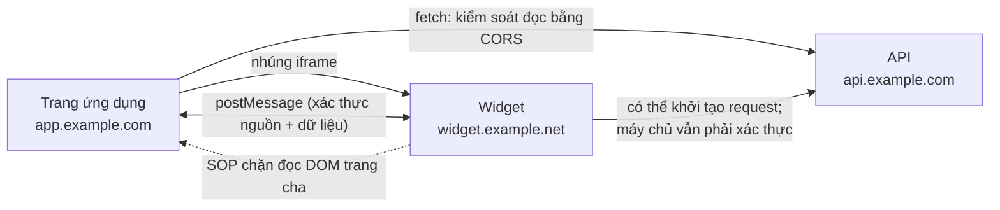

# Sandbox boundary: Ranh giới cách ly trong trình duyệt

Trong bảo mật ứng dụng web, **sandbox boundary** là ranh giới giới hạn những gì một tài liệu, đoạn JavaScript hoặc ngữ cảnh duyệt web được phép đọc, sửa, gọi và điều khiển. Trình duyệt sử dụng nhiều lớp ranh giới cùng lúc: **origin**, **Same-Origin Policy (SOP)**, quyền hạn của `<iframe sandbox>`, chính sách truy cập tài nguyên, quyền đối với cookie và bộ nhớ, cũng như một số cơ chế cách ly ở mức tiến trình.

Chủ đề này nằm trong chương **Mô hình bảo mật web** của mô-đun **SECURITY_APPLICATION_SECURITY_BROWSER_SECURITY**. Hiểu đúng sandbox boundary giúp xác định khi nào mã bên thứ ba có thể tác động đến ứng dụng, vì sao CORS không thay thế SOP, và cách phối hợp CSP, Trusted Types, security headers với phòng vệ XSS, CSRF và clickjacking.

## 1. Mục tiêu học tập và mô hình đe dọa

Sau bài học, bạn có thể:

1. Phân biệt **origin**, **site**, **browsing context** và **sandbox**; xác định ranh giới truy cập giữa trang cha, iframe và API.
2. Giải thích một tài liệu bị sandbox có thể và không thể làm gì, kể cả khi được cấp các token `allow-*`.
3. Thiết kế luồng giao tiếp xuyên origin bằng `postMessage` với kiểm tra người gửi và dữ liệu.
4. Phân biệt giới hạn của SOP, CORS, CSP và cookie để tránh dùng sai cơ chế phòng vệ.
5. Kiểm chứng hành vi thực tế của ranh giới bằng trình duyệt và DevTools.

Xét ứng dụng `https://app.example.com` tích hợp widget từ `https://widget.example.net` và gọi API tại `https://api.example.com`. Widget có thể chứa mã bị xâm nhập hoặc thuộc đơn vị ít được tin cậy hơn. Câu hỏi thiết kế là: **widget có được đọc DOM, token hoặc cookie của ứng dụng không; có được gửi thông điệp, mở cửa sổ mới, gửi yêu cầu HTTP hay đổi hướng trang cha không?**

Một sandbox boundary hữu ích phải trả lời **quyền cụ thể nào bị chặn**, chứ không chỉ khẳng định chung rằng nội dung “đã được sandbox”.

## 2. Origin là ranh giới nền tảng

Một **origin** gồm bộ ba **scheme + hostname + port**. Hai URL cùng origin khi cả ba thành phần trùng nhau (có tính đến cổng mặc định của giao thức).

| URL so với `https://app.example.com` | Cùng origin? | Giải thích |
| --- | --- | --- |
| `https://app.example.com/home` | Có | Khác đường dẫn nhưng cùng scheme, host, port mặc định 443 |
| `https://app.example.com:443/api` | Có | Cổng 443 là cổng mặc định của HTTPS |
| `https://api.example.com/data` | Không | Khác hostname |
| `http://app.example.com/home` | Không | Khác scheme |
| `https://app.example.com:8443/home` | Không | Khác port |
| `https://widget.example.net` | Không | Khác hostname và khác site |

**Site** phục vụ các quy tắc như `SameSite` cookie, thường dựa trên scheme và *registrable domain* (ví dụ `example.com`), **không** dựa trên port. Vì vậy `https://app.example.com` và `https://api.example.com` thường **cùng site nhưng khác origin**. Tương tự, `http://localhost:3000` và `http://localhost:4000` khác origin dù port không tạo ra khác biệt về site. Không được đồng nhất “cross-origin” với “cross-site”.

Một số URL có quy tắc origin đặc biệt. Chẳng hạn tài liệu `data:` thường có **opaque origin** (origin không trùng origin thông thường), trong khi `about:blank` có thể kế thừa origin từ ngữ cảnh tạo ra nó. Vì vậy phải xem cách tài liệu được tạo và chính sách sandbox thực tế, thay vì chỉ suy luận từ chuỗi URL.

### SOP hạn chế điều gì?

**Same-Origin Policy** ngăn JavaScript tại một origin tùy ý đọc hoặc sửa dữ liệu nhạy cảm của origin khác, như DOM của một iframe khác origin, nội dung phản hồi `fetch` chưa được cấp quyền CORS, hoặc `localStorage` của origin kia.

SOP **không** có nghĩa là mọi tương tác cross-origin đều bị chặn. Trình duyệt vẫn có thể tải ảnh, nhúng iframe, gửi form, tạo một số yêu cầu HTTP và trao đổi thông điệp bằng `postMessage` theo các quy tắc tương ứng. Một yêu cầu mạng được gửi đi **khác** với việc JavaScript được phép đọc phản hồi của yêu cầu đó.



## 3. Những lớp ranh giới khác nhau

| Cơ chế | Ranh giới hoặc quyền được kiểm soát | Không tự bảo đảm |
| --- | --- | --- |
| **SOP** | Đọc/ghi DOM và dữ liệu giữa các origin; giới hạn đọc phản hồi mạng | Không chặn tuyệt đối việc phát yêu cầu cross-origin |
| **`iframe sandbox`** | Giảm khả năng script, form, popup, navigation, origin identity… tùy token | Không là tường lửa mạng hoặc cơ chế xác thực máy chủ |
| **CORS** | Máy chủ cho phép JavaScript ở origin nào **đọc phản hồi** cross-origin | Không phải biện pháp chống CSRF; không mở quyền truy cập DOM iframe |
| **CSP** | Giới hạn nguồn script, kết nối, iframe, đối tượng nhúng, ancestor…; có directive `sandbox` | Không sửa được logic phân quyền API; không loại bỏ mọi XSS |
| **Trusted Types** | Giảm rủi ro đưa chuỗi không tin cậy vào một số DOM sink nguy hiểm | Không thay thế việc kiểm tra đầu vào, mã hóa đầu ra và CSP |
| **Cookie attributes** | Khi nào cookie được gửi/được JavaScript đọc; ràng buộc site, domain và đường truyền | Không thay thế CSRF token và kiểm tra phân quyền |
| **COOP / COEP / CORP** | Một số quan hệ giữa cửa sổ và việc nhúng tài nguyên cross-origin | Không thay thế `iframe sandbox` hoặc SOP |
| **Site Isolation** | Tăng cách ly trang giữa các tiến trình trình duyệt trên hệ thống hỗ trợ | Không phải hợp đồng API cho logic ứng dụng; mô hình tiến trình có thể thay đổi |

**Cách hiểu đúng:** các lớp này bổ sung cho nhau. Browser sandbox giới hạn quyền của ngữ cảnh chạy mã; origin và SOP quản lý truy cập dữ liệu; CORS quyết định khả năng lộ phản hồi qua API trình duyệt; máy chủ vẫn chịu trách nhiệm cuối cùng về xác thực, phân quyền, chống CSRF và kiểm soát nghiệp vụ.

## 4. `iframe sandbox`: cấp đúng năng lực cần thiết

HTML cho phép trang cha giảm quyền hạn của một iframe:

```html
<iframe
  src="https://widget.example.net/embed"
  sandbox=""
  title="Widget bên thứ ba"
  loading="lazy">
</iframe>
```

Sự có mặt của thuộc tính `sandbox` với giá trị rỗng **bật tập hạn chế mặc định**: script, form, popup, một số kiểu điều hướng và các khả năng khác bị chặn; tài liệu cũng bị đưa vào **opaque origin** trừ khi cho phép giữ origin. **Không có thuộc tính `sandbox`** là trường hợp khác hoàn toàn với `sandbox=""`.

Có thể nới từng năng lực bằng token. Một số token thường gặp:

| Token | Tác dụng chính | Điều cần cân nhắc |
| --- | --- | --- |
| `allow-scripts` | Cho phép script bên trong iframe chạy | Script vẫn có thể khởi tạo request hoặc gửi `postMessage` |
| `allow-same-origin` | Không ép tài liệu vào opaque origin; giữ origin thật của tài liệu | Không đồng nghĩa với “cho cùng origin với cha”; nguy hiểm khi kết hợp script trên nội dung thật sự cùng origin với cha |
| `allow-forms` | Cho phép gửi form | Có thể tạo tác động đến hệ thống nhận; cần chống CSRF phía máy chủ |
| `allow-popups` | Cho phép mở popup theo điều kiện trình duyệt | Tăng bề mặt điều hướng, lừa đảo |
| `allow-popups-to-escape-sandbox` | Cho phép popup mới không kế thừa các hạn chế sandbox | Chỉ cấp khi nhu cầu đã được đánh giá |
| `allow-top-navigation-by-user-activation` | Cho phép điều hướng top-level khi có kích hoạt từ người dùng | Giảm giới hạn chống chuyển hướng không mong muốn |
| `allow-downloads` | Cho phép tải xuống trong các tình huống được hỗ trợ | Có thể tạo tải xuống ngoài ý muốn nếu nội dung không đáng tin |

Danh sách này không bao gồm mọi token hoặc mọi khác biệt triển khai giữa các trình duyệt. **Nguyên tắc là cấp tối thiểu** và thử đúng tính năng cần thiết trên các trình duyệt mục tiêu.

Ví dụ nếu widget chỉ cần hiển thị giao diện động, nhưng không cần form, popup hoặc điều hướng top-level:

```html
<iframe
  src="https://widget.example.net/embed"
  sandbox="allow-scripts"
  referrerpolicy="no-referrer"
  title="Bảng thông tin">
</iframe>
```

Với cấu hình này, script của widget được chạy nhưng tài liệu iframe thường có **opaque origin**. Trang cha vẫn không thể tùy tiện đọc DOM của iframe, và chính widget cũng không được quyền đọc DOM trang cha. Giá trị `event.origin` của thông điệp từ một iframe opaque-origin thường là chuỗi `"null"`.

### Vì sao `allow-scripts allow-same-origin` cần xem xét kỹ?

Xét trường hợp **nguy hiểm**: iframe trỏ đến nội dung thực sự **cùng origin với trang cha**, rồi được cấp cả `allow-scripts` và `allow-same-origin`. Mã trong iframe có thể tiếp cận DOM cùng origin, gỡ thuộc tính `sandbox` khỏi phần tử iframe của chính nó qua trang cha và tải lại; việc này làm vô hiệu mục tiêu giới hạn sandbox. **Không dùng cặp quyền này để cô lập tài liệu không đáng tin cậy nhưng cùng origin với ứng dụng.**

Khi iframe nằm ở **origin khác** (tốt hơn là một site riêng, không dùng chung cookie), cặp token đó có thể được dùng có chủ đích nếu widget cần origin thật cho storage, CORS và giao tiếp xác thực bằng origin. Khi đó SOP vẫn ngăn iframe truy cập DOM trang cha, còn các hạn chế sandbox khác tiếp tục áp dụng theo token. Tuy nhiên việc giữ origin thật đồng nghĩa widget có quyền với tài nguyên tại **origin của chính nó**, nên phải đánh giá rủi ro ở bên đó.

Nếu nội dung là HTML do người dùng tải lên, một lựa chọn tốt là phục vụ nó từ **origin riêng** và cấp rất ít token, có thể chỉ `allow-scripts` nếu cần. Không đặt nội dung không đáng tin cậy trên cùng origin với ứng dụng chính rồi xem sandbox là lớp bảo vệ duy nhất.

**Lưu ý:** ngay cả iframe bị sandbox vẫn có thể tải một số tài nguyên hoặc tạo request theo khả năng được phép. Đây không phải cơ chế chặn toàn bộ kết nối mạng. Khi cần khống chế điểm đến, xem thêm `connect-src`, `img-src`, `form-action` trong CSP thích hợp và kiểm tra phía máy chủ.

## 5. Giao tiếp qua boundary bằng `postMessage`

Khi hai frame khác origin cần trao đổi dữ liệu, dùng `window.postMessage` để gửi thông điệp có cấu trúc. Quy tắc an toàn của bên nhận gồm:

- Kiểm tra `event.origin` đúng origin dự kiến nếu origin đó không opaque.
- Kiểm tra `event.source` đúng đối tượng cửa sổ/iframe dự kiến.
- Kiểm tra loại thông điệp, kiểu dữ liệu, phạm vi giá trị; bỏ qua loại lạ.
- Dùng `targetOrigin` **cụ thể** ở bên gửi thay vì `"*"` nếu biết origin đích.
- Không coi nội dung thông điệp là HTML đáng tin, lệnh thực thi hoặc bằng chứng đã được cấp quyền nghiệp vụ.

Ví dụ trang ứng dụng `https://app.example.com` nhúng widget ở **site riêng** `https://widget.example.net`. Widget cần script và origin thật nên cấu hình có chủ ý:

```html
<iframe
  id="partner-widget"
  src="https://widget.example.net/embed"
  sandbox="allow-scripts allow-same-origin"
  title="Widget đối tác">
</iframe>

<script>
  const frame = document.querySelector("#partner-widget");
  const widgetOrigin = "https://widget.example.net";

  window.addEventListener("message", (event) => {
    if (event.origin !== widgetOrigin) return;
    if (event.source !== frame.contentWindow) return;

    const data = event.data;
    if (!data || typeof data !== "object" || Array.isArray(data)) return;
    if (data.type !== "widget:resize") return;
    if (!Number.isInteger(data.height)) return;
    if (data.height < 200 || data.height > 800) return;

    frame.style.height = data.height + "px";
  });
</script>
```

Bên widget gửi thông điệp:

```javascript
window.parent.postMessage(
  { type: "widget:resize", height: 420 },
  "https://app.example.com"
);
```

Ở đây `event.source` khóa đúng instance iframe, `event.origin` khóa origin của widget, kiểm tra cấu trúc khóa ý nghĩa thông điệp và giới hạn 200–800 px tránh dữ liệu chiều cao bất thường. Trong thực tế, với thông điệp có tác động quan trọng hơn (ví dụ thanh toán), máy chủ cần xác thực trạng thái giao dịch thay vì tin vào `postMessage` từ phía client.

**Trường hợp iframe có opaque origin:** nếu dùng `sandbox="allow-scripts"` mà bỏ `allow-same-origin`, `event.origin` có thể là `"null"`. Không được coi `"null"` là một origin đáng tin, vì nhiều tài liệu opaque origin khác cũng có cùng chuỗi biểu diễn này. Hãy ràng buộc `event.source` với iframe đã tạo, kiểm tra dữ liệu nghiêm ngặt, và dùng nonce/khả năng phiên hoặc kênh `MessageChannel` khi giao thức yêu cầu tin cậy mạnh hơn. Khi gửi **đến** một cửa sổ opaque origin, có trường hợp phải dùng `targetOrigin="*"` vì không thể biểu diễn origin đích cụ thể; chỉ gửi dữ liệu ít nhạy cảm trong một luồng đã kiểm soát, tuyệt đối không phát rộng bí mật.

## 6. Ranh giới liên quan đến cookie, API và tài nguyên

### Cookie đi theo quy tắc của cookie, không đi theo khả năng đọc DOM

`HttpOnly` chặn JavaScript đọc cookie qua `document.cookie`, nhưng trình duyệt vẫn có thể đính kèm cookie vào **yêu cầu HTTP phù hợp**. `Secure` yêu cầu kênh bảo mật (với những ngoại lệ phát triển cục bộ được trình duyệt quy định). `SameSite=Lax/Strict/None` ảnh hưởng việc gửi cookie trong ngữ cảnh cross-site; `SameSite=None` thường yêu cầu `Secure`. `Path` và `Domain` quy định phạm vi cookie, nhưng **Path không phải ranh giới bảo mật mạnh giữa các ứng dụng cùng origin**.

Ví dụ `app.example.com` và `api.example.com` là hai origin nhưng thường cùng site. Nếu cookie dùng `Domain=example.com`, nhiều subdomain có thể nhận cookie đó tùy điều kiện; cần tránh cấp phạm vi rộng không cần thiết. Khi thích hợp, ưu tiên cookie host-only, tên tiền tố `__Host-` và các thuộc tính an toàn tương ứng.

Không được suy luận rằng khác origin thì mọi cookie tự động bị tách biệt. Ngược lại, **CORS không quyết định cookie có được gửi hay không**; cookie do chính sách cookie, chế độ credentials của yêu cầu và các cơ chế bảo vệ trình duyệt khác quyết định.

### CORS kiểm soát đọc phản hồi, không ngăn CSRF

Giả sử mã ở `https://app.example.com` gọi `fetch("https://api.example.com/profile")`. Vì API ở origin khác, trình duyệt áp dụng CORS cho việc JavaScript có được đọc phản hồi hay không. API có thể trả về:

```http
Access-Control-Allow-Origin: https://app.example.com
Access-Control-Allow-Credentials: true
Vary: Origin
```

Nếu dùng cookie cross-origin, client phải chọn `credentials` phù hợp (ví dụ `credentials: "include"`) và server phải cho phép credentials đúng cách. **Không** dùng `Access-Control-Allow-Origin: *` cùng phản hồi có credentials. Request không đáp ứng CORS vẫn có thể đã đến máy chủ trong một số trường hợp; với các yêu cầu có preflight, trình duyệt có thể chặn gửi yêu cầu chính nếu preflight không đạt.

Vì vậy:

- **Chống đọc dữ liệu cross-origin:** SOP + CORS chính xác.
- **Chống tác động trái phép do trình duyệt tự đính kèm cookie:** CSRF token, kiểm tra `Origin`/`Referer` phù hợp, `SameSite` và xác thực/phân quyền phía server.
- **Chống thao tác API vượt quyền:** kiểm tra quyền trên từng endpoint, bất kể origin và header CORS.

### Resource isolation và cửa sổ mới

`Cross-Origin-Resource-Policy (CORP)` cho tài nguyên chỉ định giới hạn tải kiểu `no-cors` từ site/origin khác. `Cross-Origin-Embedder-Policy (COEP)` tạo điều kiện kiểm soát tài nguyên được nhúng; `Cross-Origin-Opener-Policy (COOP)` có thể tách nhóm browsing context giữa các cửa sổ để giảm tương tác qua `window.opener`. Các header này quan trọng khi ứng dụng cần **cross-origin isolation** và một số API nhạy cảm, nhưng cấu hình quá chặt có thể làm hỏng widget, ảnh hoặc thư viện hợp lệ.

Với liên kết mở tab mới, nên dùng `rel="noopener"` (và `noreferrer` nếu muốn ẩn referrer). Không xem một popup là an toàn chỉ vì nó mở trong cửa sổ khác.

## 7. Sandbox không sửa được XSS, CSRF và clickjacking trong ứng dụng chính

Một lỗi **XSS chạy ngay trong `app.example.com`** mang quyền của chính origin ứng dụng. SOP không bảo vệ ứng dụng khỏi **mã đã chạy bên trong origin của nó**. Tương tự, nhúng JavaScript đối tác bằng `<script src="https://third-party.example/script.js">` khiến mã đó thực thi trong origin **trang nhúng**, chứ không tự sinh sandbox cho script.

Với dữ liệu không đáng tin cậy, ưu tiên hiển thị như text:

```javascript
// Dữ liệu nhập từ người dùng:
const displayName = userInput;

// Tốt: không diễn giải displayName là HTML.
element.textContent = displayName;

// Nguy hiểm nếu userInput chưa được xử lý đúng:
// element.innerHTML = displayName;
```

Nếu ứng dụng cần HTML phong phú, dùng bộ lọc HTML được duy trì tốt và áp dụng **Trusted Types** tại các DOM sink hỗ trợ; CSP giúp hạn chế đường thực thi script nhưng không thay thế thiết kế dữ liệu an toàn. Hỗ trợ Trusted Types khác nhau giữa các trình duyệt, nên cần kiểm chứng tương thích và triển khai theo giai đoạn.

Các header điển hình cho **trang ứng dụng chính**:

```http
Content-Security-Policy: default-src 'self'; script-src 'self'; object-src 'none'; base-uri 'self'; frame-src https://widget.example.net; frame-ancestors 'none'
X-Content-Type-Options: nosniff
Referrer-Policy: strict-origin-when-cross-origin
X-Frame-Options: DENY
```

Ý nghĩa các directive quan trọng:

| Cấu hình | Mục đích |
| --- | --- |
| `frame-src https://widget.example.net` | Trang ứng dụng được phép **nhúng** frame từ origin này |
| `frame-ancestors 'none'` | Trang ứng dụng **không cho website khác nhúng chính nó**; là phòng vệ clickjacking |
| `X-Frame-Options: DENY` | Tầng tương thích với trình duyệt cũ cho chống framing; CSP `frame-ancestors` là cơ chế linh hoạt hơn |
| `object-src 'none'`, `base-uri 'self'` | Giảm những điểm tải nội dung hoặc sửa base URL ngoài ý muốn |
| `script-src 'self'` | Chặn nhiều nguồn script không được phép; cấu hình CSP thực tế có thể cần nonce/hash để tránh script inline |
| `require-trusted-types-for 'script'` | Có thể bổ sung trong CSP để kiểm soát một số điểm nhận dữ liệu DOM nguy hiểm trên trình duyệt hỗ trợ |

Đây là **mẫu định hướng**, không phải header copy dùng nguyên xi cho mọi ứng dụng. Ví dụ `script-src 'self'` sẽ chặn script inline khi không có nonce/hash, và `frame-ancestors 'none'` không phù hợp nếu chính trang ứng dụng phải được nhúng hợp lệ. Header chống clickjacking phải được gửi trên **phản hồi của trang muốn bảo vệ**, không chỉ trên trang cha. Ngoài ra, có thể đặt directive `sandbox` trong **CSP response** để áp giới hạn lên tài liệu nhận phản hồi khi được hỗ trợ; cần hiểu riêng cơ chế này với thuộc tính `sandbox` của iframe.

Liên hệ đe dọa:

| Đe dọa | Điều sandbox boundary giúp ích | Phòng vệ vẫn phải có |
| --- | --- | --- |
| Widget bị XSS | Iframe origin riêng + sandbox giới hạn khả năng chạm đến trang cha | Kiểm tra thông điệp; CSP, xử lý đầu vào và phân quyền cho từng origin |
| XSS ở ứng dụng chính | Cách ly widget **không chữa** XSS ở origin chính | Output encoding, tránh DOM sink nguy hiểm, CSP, Trusted Types |
| CSRF | SameSite có thể giảm một số request cross-site | Token, xác minh nguồn và quyền trên server |
| Clickjacking | Hạn chế điều hướng của iframe widget | `frame-ancestors` hoặc `X-Frame-Options` trên trang cần bảo vệ |
| API đọc trái phép | SOP/CORS hạn chế JavaScript đọc kết quả | CORS allowlist, xác thực và kiểm tra quyền trên API |

## 8. Lab: quan sát boundary thực tế bằng DevTools

Thí nghiệm sau chỉ dùng Node.js có sẵn, không cần thư viện ngoài. Nó tạo **hai origin khác nhau** bằng hai port: ứng dụng ở `http://localhost:3000` và widget ở `http://localhost:4000`. Hai origin này phục vụ thử SOP, sandbox, CORS; **không phù hợp để kết luận hành vi cross-site của SameSite cookie**, vì thay đổi port không đồng nghĩa thay đổi site.

Tạo file `lab.mjs`:

```javascript
import { createServer } from "node:http";

const appPage = `<!doctype html>
<html lang="vi">
<meta charset="utf-8">
<title>App - localhost:3000</title>
<h1>Ứng dụng chính</h1>
<iframe id="widget" src="http://localhost:4000/"
        sandbox="allow-scripts" title="Widget"></iframe>
<p><button id="check">Thử đọc DOM của iframe</button></p>
<script>
  const frame = document.querySelector("#widget");
  document.querySelector("#check").onclick = () => {
    try {
      console.log("DOM iframe:", frame.contentWindow.document.body.textContent);
    } catch (error) {
      console.log("SOP/sandbox chặn đọc DOM:", error.name);
    }
  };
  window.addEventListener("message", event => {
    // Chỉ ghi log quan sát; không tin dữ liệu để ra quyết định.
    if (event.source === frame.contentWindow) {
      console.log("Widget message:", event.origin, event.data);
    }
  });
  fetch("http://localhost:4000/data")
    .then(response => response.text())
    .then(body => console.log("API result:", body))
    .catch(error => console.log("Fetch bị CORS chặn đọc:", error.name));
</script>
</html>`;

const widgetPage = `<!doctype html>
<html lang="vi">
<meta charset="utf-8">
<title>Widget - localhost:4000</title>
<h2>Widget khác origin</h2>
<script>
  console.log("Widget script đã chạy");
  parent.postMessage({ type: "widget:ready" }, "http://localhost:3000");
</script>
</html>`;

function send(res, type, body) {
  res.writeHead(200, { "Content-Type": type });
  res.end(body);
}

createServer((req, res) => {
  send(res, "text/html; charset=utf-8", appPage);
}).listen(3000, () => console.log("App: http://localhost:3000"));

createServer((req, res) => {
  console.log("Widget server nhận:", req.method, req.url);
  if (req.url === "/data") {
    send(res, "text/plain; charset=utf-8", "Du lieu tu API");
    return;
  }
  send(res, "text/html; charset=utf-8", widgetPage);
}).listen(4000, () => console.log("Widget: http://localhost:4000"));
```

Chạy `node lab.mjs`, mở `http://localhost:3000`, sau đó mở **DevTools → Console / Network**. Dự kiến:

1. Console trong iframe cho thấy **script đã chạy** vì có `allow-scripts`.
2. Trang cha nhận `widget:ready`; `event.origin` được in ra thường là `"null"` vì iframe bị ép vào opaque origin.
3. Nhấn **Thử đọc DOM của iframe**: truy cập `frame.contentWindow.document.body` bị chặn (thường là `SecurityError`), dù ứng dụng nhúng iframe thành công.
4. Yêu cầu `/data` xuất hiện trên Network/server log, nhưng JS không đọc được nội dung phản hồi do endpoint chưa gửi `Access-Control-Allow-Origin`. Đây là khác biệt giữa **gửi request** và **đọc response**.

Chỉnh **một yếu tố mỗi lần**, tải lại trang (trong lab, sửa chuỗi HTML trong `lab.mjs` rồi chạy lại chương trình):

| Thay đổi | Dự kiến quan sát | Kết luận |
| --- | --- | --- |
| `sandbox=""` | Script widget không chạy; không có `widget:ready` | Sandbox mặc định chặn script |
| `sandbox="allow-scripts"` | Script chạy; `event.origin` có thể là `"null"` | Script được phép nhưng origin bị opaque |
| `sandbox="allow-scripts allow-same-origin"` | Script chạy; `event.origin` là `http://localhost:4000`; cha vẫn không đọc được DOM widget | Giữ origin thật **không** làm hai port thành cùng origin |
| Bỏ hẳn thuộc tính `sandbox` | Script chạy; SOP vẫn chặn đọc DOM từ app tới widget | SOP và sandbox là hai lớp khác nhau |
| Thêm `Access-Control-Allow-Origin: http://localhost:3000` vào phản hồi `/data` | JS tại app có thể đọc phản hồi `/data` | CORS cho đọc API, không cấp quyền truy cập DOM iframe |

Khi thử header CORS, chỉ thêm header trên **phản hồi API `/data`**, không cần bật đại trà mọi endpoint. Lab không chứa phiên đăng nhập hoặc dữ liệu nhạy cảm và phần nhận message chỉ ghi log; hãy dùng bộ kiểm tra origin, source và payload ở mục 5 cho ứng dụng thật.

## 9. Những ngộ nhận dễ gây lỗ hổng

**“Khác origin là không gửi được request.”** Sai: nhiều kiểu request vẫn được gửi. Cần phân biệt quyền **gửi**, quyền **đọc** và tác động của request trên server.

**“Bật CORS là widget có quyền đọc DOM trang cha.”** Sai: CORS áp dụng cho nhiều luồng truy cập phản hồi tài nguyên, không mở quyền DOM qua iframe.

**“Mọi script tải từ domain đối tác đều bị cô lập.”** Sai: script tải bằng `<script src>` thực thi trong ngữ cảnh của trang nhúng; muốn giảm quyền phải chọn kiến trúc cô lập như iframe riêng origin.

**“Có sandbox là chặn mọi request, mọi hành vi nguy hiểm.”** Sai: sandbox là tập các hạn chế theo năng lực, không thay thế CSP, xác thực và bảo vệ API.

**“`allow-same-origin` làm iframe cùng origin với trang cha.”** Sai: token này giữ origin **vốn có** của tài liệu; nếu widget ở origin khác thì vẫn khác. Rủi ro đặc biệt xuất hiện khi tài liệu cùng origin với cha và đồng thời được phép chạy script.

**“`event.origin === 'null'` chứng minh message đến từ đúng iframe.”** Sai: nhiều opaque origin đều hiện thành `"null"`. Cần kiểm tra `event.source` và giao thức bổ sung.

**“`SameSite=Lax` hoặc CORS đã loại bỏ CSRF.”** Sai: phải thiết kế phòng vệ CSRF, kiểm tra nguồn yêu cầu và phân quyền trên server phù hợp với từng hành động.

## 10. Checklist thiết kế và tự kiểm tra

Trước khi nhúng nội dung của một bên ít được tin cậy, tự trả lời:

1. Nội dung chạy bằng `<script>` trong ứng dụng chính hay chạy trong iframe có **origin riêng**?
2. Iframe thật sự cần những token sandbox nào? Có đang cấp `allow-scripts allow-same-origin` cho tài liệu cùng origin với cha?
3. Những thông điệp `postMessage` nào được phép? Đã ràng buộc **origin**, **source**, cấu trúc và giới hạn dữ liệu chưa?
4. Cookie/session có bị dùng chung qua `Domain` hoặc các subdomain không mong muốn không? Request có được bảo vệ khỏi CSRF?
5. API đang dùng CORS để cấp quyền **đọc phản hồi** đúng cho origin cần thiết hay đang mở `*` tùy tiện?
6. Ứng dụng có CSP, xử lý dữ liệu HTML an toàn, Trusted Types nếu hỗ trợ, và header chống clickjacking trên **đúng phản hồi** không?
7. Đã xác nhận hành vi trên DevTools và các trình duyệt mục tiêu chưa, nhất là thay đổi sandbox và điều hướng?

**Tự đánh giá:** Nếu `https://app.example.com` nhúng `https://widget.example.net` bằng `sandbox="allow-scripts"`, widget có thể gửi `postMessage` cho cha nhưng không tự có quyền đọc DOM cha. Nếu đổi thành `sandbox="allow-scripts allow-same-origin"`, widget giữ origin `https://widget.example.net`, **không** trở thành cùng origin với `app.example.com`. Nếu máy chủ API bật CORS, điều đó chỉ có thể cho phép một số JavaScript đọc phản hồi API; mọi thay đổi dữ liệu quan trọng vẫn phải được server xác thực và phân quyền.

Điểm cốt lõi của **sandbox boundary** là quản lý **năng lực ở đúng ranh giới**: origin quyết định phạm vi tin cậy cơ bản; sandbox giới hạn khả năng của tài liệu; `postMessage` là giao thức đi qua ranh giới; CORS và cookie điều tiết những luồng dữ liệu khác nhau; CSP, Trusted Types và phòng vệ phía server giúp giảm hậu quả khi một lớp bị vượt qua.

