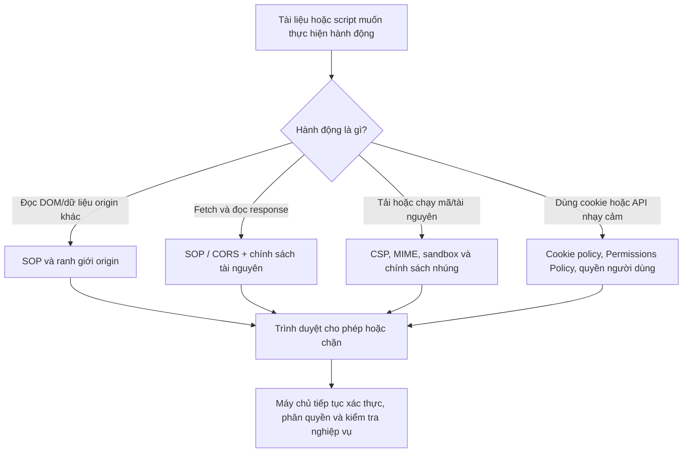

# Browser security policy — mô hình chính sách bảo mật của trình duyệt

> **Chương:** Mô hình bảo mật web  
> **Mục tiêu:** Hiểu trình duyệt quyết định tài liệu, script, request, cookie và tài nguyên nhúng được làm gì; xác định chính sách nào do trình duyệt mặc định thực thi, chính sách nào do ứng dụng khai báo; biết cấu hình và kiểm chứng các cơ chế bảo vệ phổ biến.

## 1. “Browser security policy” nghĩa là gì?

Một trang web có thể tải mã JavaScript từ mạng, gọi API, nhúng iframe, đọc dữ liệu được lưu trong trình duyệt và xin quyền truy cập thiết bị. Nếu mọi trang đều được làm mọi việc, một website có thể đọc thông tin đăng nhập của website khác hoặc thao tác tài nguyên của máy tính mà người dùng không đồng ý.

**Browser security policy** không phải tên của một header hay một thiết lập duy nhất. Đây là **tập quy tắc mà trình duyệt thực thi** để quyết định một hành động có được phép hay không: mã từ origin A có được đọc dữ liệu origin B? Response API có được JavaScript truy cập? Một tài liệu có được nhúng vào iframe? Một script có được chạy hoặc ghi HTML động? Cookie nào được gắn vào request?

Mô hình này gồm nhiều nguồn chính sách phối hợp:

1. **Quy tắc nền tảng của trình duyệt:** Same-Origin Policy (SOP), phân tách quyền giữa web và hệ điều hành, secure contexts, yêu cầu kích hoạt của người dùng đối với một số API.
2. **Chính sách do máy chủ khai báo qua response headers:** CSP, CORS, COOP, COEP, CORP, Permissions Policy, HSTS, Referrer Policy và các header khác.
3. **Chính sách của tài liệu nhúng và cách nhúng:** thuộc tính `iframe sandbox`, `allow` và giới hạn khi tài liệu khác origin.
4. **Quyền và trạng thái của người dùng:** phiên đăng nhập, quyền camera/microphone/vị trí, các lựa chọn trong cài đặt trình duyệt.
5. **Kiểm tra của ứng dụng phía máy chủ:** xác thực, phân quyền, CSRF token, kiểm tra dữ liệu đầu vào và ràng buộc nghiệp vụ. Các kiểm tra này độc lập và cần thiết dù browser policy hoạt động đúng.

Ví dụ, trình duyệt có thể cho phép trang gửi một request đến API nhưng không cho JavaScript đọc response nếu API không cho phép CORS. Cùng request đó vẫn có thể bị máy chủ từ chối do thiếu quyền truy cập. Hai cơ chế bảo vệ **hai ranh giới khác nhau**.

## 2. Xác định “chủ thể”, tài nguyên và ranh giới

Muốn biết chính sách nào áp dụng, hãy xác định bốn yếu tố:

| Câu hỏi | Ví dụ | Ý nghĩa bảo mật |
| --- | --- | --- |
| **Ai thực hiện?** | Script trong `https://app.example.com` | Origin và môi trường chạy của chủ thể |
| **Muốn truy cập gì?** | DOM iframe, API, cookie, camera, tệp | Tài nguyên và độ nhạy cảm |
| **Thao tác nào?** | Gửi request, đọc response, ghi DOM, điều hướng, xin quyền | “Gửi” và “đọc” là hai hành động khác nhau |
| **Ai quy định?** | Trình duyệt, response server, trang cha, người dùng, server nghiệp vụ | Xác định đúng nơi cần sửa và kiểm thử |

Trình duyệt nhận nhiều đầu vào để ra quyết định: URL và origin, loại request, response headers, thuộc tính HTML, trạng thái cookie, quyền API và ngữ cảnh của thao tác. Không có một header đơn lẻ giải quyết tất cả.



Sơ đồ là mô hình suy luận, không mô tả đúng thứ tự mọi sự kiện ở mức engine. Ví dụ, một request có thể đã được gửi và xử lý trước khi trình duyệt chặn quyền đọc response vì CORS.

## 3. Origin, site và Same-Origin Policy

**Origin** của một URL thông thường được xác định bởi bộ ba **scheme + host + port**. Với URL `https://shop.example.com:443/cart`, origin là `https://shop.example.com` (HTTPS mặc định dùng cổng 443).

| URL so với `https://shop.example.com/cart` | Cùng origin? | Vì sao? |
| --- | --- | --- |
| `https://shop.example.com/account` | Có | Scheme, host và port hiệu lực giống nhau |
| `http://shop.example.com/` | Không | Khác scheme |
| `https://api.example.com/` | Không | Khác host |
| `https://shop.example.com:8443/` | Không | Khác port |

**Site** khác **origin**. Trong mô hình *schemeful same-site*, `https://shop.example.com` và `https://api.example.com` có thể cùng site vì dùng cùng scheme và cùng tên miền có thể đăng ký (`example.com`), nhưng vẫn khác origin. Phân biệt này quan trọng với cookie `SameSite`, Fetch Metadata và những cơ chế cách ly.

Một số tài liệu có **opaque origin** (chẳng hạn iframe bị sandbox không có `allow-same-origin`). Opaque origin không thể được xem là cùng origin với website gốc theo cách thông thường, ngay cả khi nội dung ban đầu được lấy từ cùng host.

### SOP thực sự kiểm soát gì?

SOP giới hạn cách script của một origin tương tác với dữ liệu được bảo vệ thuộc origin khác. Chẳng hạn, một trang tin không thể dùng JavaScript tùy ý đọc DOM của iframe ngân hàng khác origin.

Tuy nhiên, SOP **không có nghĩa** mọi request chéo origin đều bị cấm. Trình duyệt vẫn có thể tải hình ảnh, stylesheet, iframe hoặc gửi một số request chéo origin theo những quy tắc riêng. Thao tác gửi request, nhúng tài nguyên và **đọc được nội dung trả về bằng JavaScript** là các quyền cần xem xét riêng.

Nếu hai tài liệu khác origin cần gửi dữ liệu cho nhau, có thể dùng `window.postMessage`. Bên gửi chọn `targetOrigin` cụ thể; bên nhận kiểm tra `event.origin`, `event.source` và cấu trúc thông điệp. `postMessage` là cơ chế giao tiếp có kiểm soát, không phải cách vô hiệu hóa SOP.

## 4. CORS: một chính sách cho phép script đọc phản hồi chéo origin

Giả sử giao diện tại `https://shop.example.com` gọi API `https://api.example.com/products`:

```js
fetch("https://api.example.com/products")
  .then((response) => response.json())
  .then((products) => console.log(products))
  .catch((error) => console.error("Không đọc được phản hồi:", error));
```

Đây là request **khác origin**. Để trình duyệt cho phép script đọc response, API có thể trả về:

```http
Access-Control-Allow-Origin: https://shop.example.com
Vary: Origin
```

`Vary: Origin` phù hợp khi server thay đổi giá trị `Access-Control-Allow-Origin` theo origin request, giúp cache phân biệt các biến thể response. Với endpoint công khai không dùng credentials, server có thể quyết định dùng `Access-Control-Allow-Origin: *` nếu chính sách chia sẻ dữ liệu của họ cho phép.

### Request đơn giản, preflight và credentials

Với một số phương thức hoặc header, trình duyệt gửi request `OPTIONS` **preflight** để hỏi server có cho phép request dự kiến hay không. Ví dụ một API cho phép `POST` với `Content-Type: application/json` có thể cần trả về:

```http
Access-Control-Allow-Origin: https://shop.example.com
Access-Control-Allow-Methods: POST
Access-Control-Allow-Headers: Content-Type
```

Nếu request dùng credentials, chẳng hạn `fetch(..., { credentials: "include" })`, cần thỏa các quy tắc riêng: origin được cho phép phải được chỉ rõ (không dùng `*`), server cần khai báo `Access-Control-Allow-Credentials: true`, và cookie còn phải đáp ứng các quy tắc riêng như `SameSite`, `Secure` hoặc chính sách chặn cookie của trình duyệt. Các yêu cầu đó **không đồng nghĩa** server đã xác thực người dùng.

**CORS không phải tường lửa API.** Chương trình ngoài trình duyệt thường không bị cơ chế CORS của browser chặn; một số request bị JavaScript từ chối đọc response nhưng có thể vẫn đã chạm server. Kiểm tra xác thực và phân quyền ở server luôn là bắt buộc.

## 5. CSP: giới hạn nguồn nội dung và đường thực thi nguy hiểm

**Content Security Policy (CSP)** là chính sách chủ yếu do máy chủ khai báo để trình duyệt giới hạn nguồn tài nguyên được tải, các kiểu thực thi script và một số hành vi nhạy cảm. CSP giúp **giảm tác động của XSS** khi được thiết kế và triển khai đúng; nó không thay thế việc encode output và xử lý dữ liệu không tin cậy.

Một CSP khởi đầu cho một ứng dụng đơn giản có thể là:

```http
Content-Security-Policy: default-src 'self'; script-src 'self'; object-src 'none'; base-uri 'self'; frame-ancestors 'none'; form-action 'self'
```

| Directive | Ý nghĩa điển hình |
| --- | --- |
| `default-src` | Nguồn mặc định cho nhiều loại tài nguyên nếu không có directive riêng |
| `script-src` | Kiểm soát nguồn và cách thực thi JavaScript |
| `style-src`, `img-src`, `connect-src` | Chính sách cho CSS, hình ảnh, kết nối như `fetch`/WebSocket |
| `object-src 'none'` | Ngăn tải nội dung plugin/object không cần thiết |
| `base-uri` | Giới hạn nguồn được dùng với phần tử `<base>` |
| `form-action` | Giới hạn đích gửi form |
| `frame-src` | Giới hạn nguồn iframe mà **trang này nhúng** |
| `frame-ancestors` | Giới hạn **ai được nhúng trang này**; phải được gửi qua response header |

Hai directive dễ nhầm nhất là `frame-src` và `frame-ancestors`. Ví dụ, website có thể cho phép nhúng widget đối tác bằng `frame-src https://widgets.example.net` nhưng đồng thời không cho website khác nhúng chính nó bằng `frame-ancestors 'none'`.

### Nonce, inline script và Trusted Types

Với ứng dụng cần script inline, một hướng triển khai CSP là dùng **nonce ngẫu nhiên riêng cho mỗi response**:

```http
Content-Security-Policy: script-src 'nonce-RANDOM_PER_RESPONSE'; object-src 'none'; base-uri 'self'
```

```html
<script nonce="RANDOM_PER_RESPONSE">
  initializePage();
</script>
```

`RANDOM_PER_RESPONSE` chỉ là ký hiệu minh họa: server phải sinh nonce khó đoán, khác nhau ở mỗi response, đồng thời điền **cùng giá trị** vào header và các script được cho phép. Không dùng chuỗi cố định trong môi trường thực. Cần lưu ý cache HTML và cách framework chèn script để tránh tái sử dụng nonce sai.

**Trusted Types** có thể giúp kiểm soát các thao tác ghi vào DOM sink nguy hiểm ở những trình duyệt hỗ trợ. Chẳng hạn:

```http
Content-Security-Policy: require-trusted-types-for 'script'
```

Khi chính sách được thực thi và môi trường hỗ trợ, việc đẩy chuỗi tùy ý vào một số DOM sink như `innerHTML` có thể bị từ chối nếu không được xử lý qua Trusted Types. Tuy vậy, **tạo một Trusted Types policy cho phép mọi HTML chưa được làm sạch vẫn có thể tạo XSS**. Thực tế nên ưu tiên `textContent` cho văn bản và dùng bộ làm sạch HTML được kiểm chứng khi thật sự phải hiển thị HTML động.

Chính sách nghiêm ngặt cần được thử với toàn bộ script, framework, tiện ích và tài nguyên hợp lệ của ứng dụng. Không nên thêm `'unsafe-inline'` hoặc mở wildcard chỉ để xóa lỗi mà chưa hiểu vì sao lỗi xuất hiện.

### Enforcement và Report-Only

Có thể quan sát tác động trước khi chặn bằng:

```http
Content-Security-Policy-Report-Only: default-src 'self'; script-src 'self'; object-src 'none'
```

`Content-Security-Policy-Report-Only` **không thực thi chặn**, mà cho phép theo dõi vi phạm qua DevTools và cơ chế báo cáo tương ứng nếu được cấu hình. Khi đã xử lý các vi phạm hợp lệ, triển khai chính sách thực thi bằng `Content-Security-Policy`. Nếu có nhiều chính sách CSP thực thi cùng áp dụng, chúng thường cộng dồn hạn chế; một chính sách khác không thể “mở” quyền mà chính sách chặt hơn đã chặn.

## 6. Chính sách nhúng và cách ly cross-origin

Khi một website nhúng tài nguyên ngoài, ta cần phân biệt *nhúng tài nguyên*, *truy cập dữ liệu bên trong* và *cách ly tiến trình/ngữ cảnh duyệt*.

### `iframe sandbox`

Trang cha có thể đặt quyền hạn chế cho iframe:

```html
<iframe
  src="https://widget.example.net/reviews"
  title="Đánh giá sản phẩm"
  sandbox="allow-scripts"
></iframe>
```

Mặc định khi có `sandbox`, một loạt hành vi như script, form, popup, điều hướng cấp cao và quyền giữ nguyên origin bị hạn chế. Token `allow-scripts` mở lại khả năng chạy script nhưng **không tự mở** những quyền còn lại. Nếu không có `allow-same-origin`, iframe thường có opaque origin.

Cần đặc biệt thận trọng khi kết hợp `allow-scripts` và `allow-same-origin` cho tài liệu **cùng origin với trang cha**: tài liệu có thể thao tác với phần tử iframe và làm vô hiệu hóa tác dụng hạn chế của sandbox sau khi tải lại.

### CORP, COEP và COOP giải quyết việc gì?

| Header | Quyền kiểm soát chính | Ví dụ |
| --- | --- | --- |
| `Cross-Origin-Resource-Policy` (**CORP**) | Server tài nguyên quy định bên nào được nhúng tài nguyên theo kiểu `no-cors` | `Cross-Origin-Resource-Policy: same-origin` |
| `Cross-Origin-Embedder-Policy` (**COEP**) | Tài liệu yêu cầu những tài nguyên cross-origin được nhúng phải thỏa điều kiện CORS/CORP (tùy chế độ) | `Cross-Origin-Embedder-Policy: require-corp` |
| `Cross-Origin-Opener-Policy` (**COOP**) | Điều khiển quan hệ browsing context giữa cửa sổ top-level với những cửa sổ khác | `Cross-Origin-Opener-Policy: same-origin` |

Ví dụ, khi muốn triển khai **cross-origin isolation** cho một tính năng cần nó, ứng dụng có thể cấu hình:

```http
Cross-Origin-Opener-Policy: same-origin
Cross-Origin-Embedder-Policy: require-corp
```

Sau đó kiểm tra `window.crossOriginIsolated` trong ngữ cảnh an toàn và trình duyệt mục tiêu. Cấu hình này có thể khiến script, ảnh, iframe hoặc tài nguyên từ bên thứ ba không còn tải được nếu chúng không đáp ứng chính sách nhúng. Cần rà soát toàn bộ tài nguyên và lựa chọn chế độ/headers phù hợp, không bật đại trà chỉ để “tăng bảo mật”.

**Không nhầm:** CORP/COEP/COOP không thay thế CORS; CORS quy định quyền script đọc response chéo origin. CORP giới hạn một số cách nhúng tài nguyên, COEP đặt yêu cầu cho tài nguyên mà trang nhúng, còn COOP điều khiển quan hệ với các cửa sổ khác.

### Chống clickjacking từ phía trang được nhúng

Để không cho website khác nhúng trang đăng nhập hay thanh toán:

```http
Content-Security-Policy: frame-ancestors 'none'
X-Frame-Options: DENY
```

`frame-ancestors` của CSP là hướng kiểm soát linh hoạt hơn; `X-Frame-Options` là cơ chế truyền thống hỗ trợ thêm một số môi trường. Đây là chính sách **do trang được nhúng trả về**, khác với `sandbox` do trang cha đặt trên iframe của mình.

## 7. Cookie và quyền API: ranh giới riêng, có yếu tố người dùng

SOP không tự quyết định việc cookie có được gửi trong mọi request. Cookie được chọn theo phạm vi host/domain, path, điều kiện bảo mật, thời hạn, SameSite và chính sách của trình duyệt.

Ví dụ cookie phiên:

```http
Set-Cookie: __Host-session=<opaque-session-id>; Path=/; Secure; HttpOnly; SameSite=Lax
```

Tên bắt đầu bằng `__Host-` yêu cầu các điều kiện gồm `Secure`, `Path=/`, không có thuộc tính `Domain` trong những trình duyệt hỗ trợ cookie prefix. `HttpOnly` ngăn JavaScript đọc giá trị cookie qua `document.cookie`; `Secure` giới hạn việc gửi cookie qua kết nối bảo mật; `SameSite` giảm việc gửi cookie trong một số ngữ cảnh cross-site. Cookie prefix và các thuộc tính cần được kiểm thử trên trình duyệt mục tiêu.

`SameSite=Lax` **không thay thế CSRF token** cho tất cả tình huống: khái niệm same-site khác same-origin, hành vi điều hướng top-level có ngoại lệ, và những rủi ro từ ứng dụng con cùng site vẫn cần đánh giá. Server phải tự xác minh người dùng, quyền thao tác và yêu cầu thay đổi trạng thái.

Các API nhạy cảm như camera, microphone và vị trí thường còn phụ thuộc **secure context**, quyền người dùng và Permissions Policy. Server có thể giới hạn tính năng bằng header:

```http
Permissions-Policy: camera=(), microphone=(), geolocation=()
```

Ví dụ trên chủ đích từ chối những tính năng này cho tài liệu trong phạm vi áp dụng. Khi muốn ủy quyền một tính năng cho iframe, cần xem cả Permissions Policy của trang cha, thuộc tính `allow` của iframe, origin và quyền người dùng. Cấp `allow="camera"` trên iframe không đồng nghĩa camera được tự động bật.

Đối với nhiều API và hành vi điều hướng gây phiền nhiễu, browser còn yêu cầu **kích hoạt của người dùng** (*user activation*), ví dụ thao tác click trực tiếp. Đây là một ranh giới hành vi, khác với kiểm tra origin.

## 8. Những security header thường gặp và phạm vi thực sự

| Cơ chế/header | Ví dụ | Phạm vi chính | Giới hạn cần biết |
| --- | --- | --- | --- |
| `Strict-Transport-Security` (HSTS) | `max-age=31536000` | Yêu cầu dùng HTTPS cho host sau khi trình duyệt nhận chính sách qua HTTPS | Chỉ phù hợp khi hạ tầng HTTPS đã sẵn sàng; `includeSubDomains` ảnh hưởng các subdomain |
| `X-Content-Type-Options` | `nosniff` | Ngăn một số trường hợp suy đoán MIME không an toàn | Server vẫn phải khai báo `Content-Type` đúng |
| `Referrer-Policy` | `strict-origin-when-cross-origin` | Kiểm soát thông tin URL gửi qua header `Referer` | Không có chức năng chặn đọc response hoặc xác thực |
| `Content-Security-Policy` | `object-src 'none'; base-uri 'self'` | Giới hạn tài nguyên/thực thi/hành vi được cấu hình | Không thay thế sửa lỗ hổng XSS tại nguồn |
| `Permissions-Policy` | `geolocation=()` | Giới hạn tính năng được phép dùng trong tài liệu/iframe | Không phải cơ chế cấp quyền thay người dùng |
| `X-Frame-Options` | `DENY` | Hạn chế website khác nhúng trang | Ít linh hoạt hơn CSP `frame-ancestors` |
| `Cross-Origin-Resource-Policy` | `same-origin` | Giới hạn một số ngữ cảnh nhúng `no-cors` | Không dùng làm API authorization |

Một số chính sách có thể khai báo qua thẻ `<meta http-equiv>`, nhưng **không phải mọi directive đều được hỗ trợ theo cách đó**. Ví dụ CSP `frame-ancestors` và chế độ CSP Report-Only không được áp dụng bằng meta theo cách của response header; HSTS cũng là response header. Với cơ chế quan trọng, cần kiểm tra tài liệu chuẩn và thực tế browser về vị trí khai báo.

## 9. Chính sách được áp dụng ở đâu, và ai có quyền sửa?

Trong một hệ thống thực tế, nhiều đội dễ cùng tác động lên policy: backend phát response, reverse proxy/CDN có thể bổ sung header, frontend dùng `fetch` hoặc tạo iframe, đội danh tính thiết kế session, browser thực thi chính sách và người dùng quản lý quyền.

Giả sử iframe đánh giá sản phẩm từ `https://reviews.partner.example` không hiển thị trong trang chủ `https://shop.example.com`. Có ít nhất bốn nguyên nhân khác nhau:

1. **Trang chủ không cho phép nhúng nguồn đó** qua CSP `frame-src`.
2. **Trang đối tác từ chối bị nhúng** qua `frame-ancestors` hoặc `X-Frame-Options`.
3. **Trang chủ áp dụng iframe sandbox quá chặt**, khiến script, form hay hành vi widget cần bị chặn.
4. **Các chính sách cách ly/tài nguyên**, ví dụ COEP, khiến tài nguyên phụ thuộc không tải được.

Cách giải quyết phụ thuộc nguyên nhân. Không thể sửa `frame-ancestors` của đối tác bằng cách chỉnh `frame-src` của mình; không thể sửa lỗi đọc response do CORS bằng cách tăng quyền `sandbox`; không thể sửa lỗi server từ chối quyền bằng cách mở CORS.

### Kiểm tra thứ tự và mức hiệu lực

- **Browser có chính sách mặc định:** ứng dụng không được tùy ý tắt SOP cho người dùng. CORS là cơ chế chia sẻ được định nghĩa trong mô hình này, không phải nút tắt SOP toàn cục.
- **Server khai báo giới hạn/ủy quyền:** response của tài nguyên thường quyết định CORS, CORP, CSP và những security header thuộc chính tài liệu đó.
- **Trang cha có thể bổ sung hạn chế:** iframe sandbox và Permissions Policy có thể tiếp tục thu hẹp quyền của tài liệu con.
- **Quyền người dùng và chính sách trình duyệt có thể chặn thêm:** dù một iframe được phép gọi camera, người dùng vẫn có thể từ chối.
- **Server nghiệp vụ quyết định truy cập dữ liệu:** quyền đọc response ở mức trình duyệt không đồng nghĩa quyền xem đơn hàng, chuyển tiền hay xóa tài khoản.

Chính sách nên được thiết kế như **các điều kiện đồng thời phải thỏa** tại mỗi ranh giới liên quan. Một thành phần cho phép không tự động hóa giải điều kiện hạn chế của thành phần khác.

## 10. Kiểm chứng hành vi thực tế bằng DevTools

Đừng chỉ nhìn vào cấu hình đã viết; phải kiểm tra **response cuối cùng đến trình duyệt** và hành vi xảy ra.

### Thí nghiệm A — CORS không phải kiểm tra phân quyền

1. Trên hai origin khác nhau do bạn kiểm soát, mở trang frontend và dùng Console gọi `fetch` đến API.
2. Trong tab **Network**, xem header `Origin` của request (khi có) và `Access-Control-Allow-Origin` của response; quan sát preflight `OPTIONS` nếu có.
3. Bỏ header CORS trên API và thử lại. Console có thể báo lỗi CORS dù Network cho thấy request đã gửi và server đã trả response.
4. Gọi API bằng một HTTP client ngoài trình duyệt và xác minh server vẫn phải tự kiểm tra quyền ứng dụng; HTTP client không phải bằng chứng rằng chính sách browser bị lỗi.

**Kết luận mong đợi:** CORS điều chỉnh việc script trong browser đọc response; xác thực và phân quyền được server thực thi riêng.

### Thí nghiệm B — CSP chặn script trái chính sách

Trên ứng dụng thử nghiệm, cấu hình:

```http
Content-Security-Policy: default-src 'self'; script-src 'self'; object-src 'none'; base-uri 'self'
```

Sau đó thử một đoạn script inline trong trang và quan sát Console. Nếu không có nonce/hash hay cơ chế cho phép khác, browser sẽ chặn script inline theo CSP. Tiếp theo chuyển chính sách sang `Content-Security-Policy-Report-Only` để quan sát sự khác biệt giữa **báo cáo vi phạm** và **chặn thực thi**.

**Lưu ý:** nếu có thêm CSP thực thi khác ở proxy/CDN hoặc trong ứng dụng, nó vẫn có thể chặn. Report-Only không vô hiệu hóa chính sách thực thi đang tồn tại.

### Thí nghiệm C — phân biệt `frame-src` và `frame-ancestors`

Sử dụng hai ứng dụng thử nghiệm trên hai origin. Ở trang cha, đặt CSP `frame-src` để chỉ cho phép origin của iframe. Trên tài liệu con, lần lượt trả:

```http
Content-Security-Policy: frame-ancestors 'none'
```

và một cấu hình `frame-ancestors` cho phép trang cha phù hợp. Quan sát lần lượt trường hợp bị từ chối nhúng và được phép nhúng. Sau đó giữ phép nhúng nhưng thêm `sandbox` trên iframe để thấy một **ranh giới riêng** giới hạn hành vi của tài liệu con.

### Mẫu ghi kết quả thử nghiệm

| Mục cần ghi | Ví dụ quan sát |
| --- | --- |
| Origin trang cha và tài liệu/API đích | `https://shop.example.com` → `https://api.example.com` |
| Hành động | `fetch`, truy cập DOM, tải script, nhúng iframe, xin quyền |
| Header/thuộc tính liên quan | CSP, CORS, COEP, `sandbox`, `allow`, cookie |
| Kết quả Network | Request có gửi không? status? response headers? |
| Kết quả Console/JS | Script chạy hay bị chặn? JavaScript đọc được response không? |
| Quyết định từ server | Xác thực/phân quyền chấp nhận hay từ chối? |

Chạy các thử nghiệm trên môi trường do bạn kiểm soát, bằng HTTPS khi cơ chế yêu cầu secure context. Thông báo lỗi có thể khác giữa các engine và phiên bản. **`curl` chỉ quan sát HTTP**, không thực thi toàn bộ SOP, CSP, CORS, iframe sandbox hay quyền API như trình duyệt, nên không thay thế thử nghiệm trong browser.

## 11. Một quy trình thiết kế browser security policy cho ứng dụng

Xét website thương mại điện tử có giao diện tại `shop.example.com`, API tại `api.example.com`, trang thanh toán và một widget đánh giá của đối tác:

1. **Lập bản đồ origin, site và dữ liệu nhạy cảm.** Xác định nơi lưu cookie phiên, endpoint thanh toán, các script bên thứ ba và nguồn iframe.
2. **Giữ kiểm tra quyền ở server.** Xác thực, phân quyền theo tài nguyên, chống CSRF cho thao tác thay đổi trạng thái và kiểm tra input/output phải được thiết kế độc lập với browser policy.
3. **Giới hạn nội dung tải vào.** Thiết kế CSP từ nhu cầu thật; ưu tiên script được kiểm soát, tránh inline nguy hiểm, đánh giá Trusted Types và giới hạn đích kết nối/form/iframe.
4. **Khai báo CORS có chủ đích.** API chỉ chia sẻ cho origin cần thiết, xử lý preflight và credentials đúng; kiểm tra cả hành vi request lẫn quyền đọc response.
5. **Kiểm soát nhúng và cách ly.** Dùng `frame-ancestors` cho trang nhạy cảm, `sandbox` cho widget phù hợp; chỉ cân nhắc COOP/COEP/CORP khi hiểu tác động đến tài nguyên cần tải.
6. **Giới hạn quyền trình duyệt và cookie.** Chọn `Secure`, `HttpOnly`, `SameSite` đúng nhu cầu; dùng Permissions Policy để hạn chế API không dùng tới.
7. **Phát hành và kiểm chứng theo giai đoạn.** Kiểm tra chính sách thực tế qua Network/Console; thử Report-Only nơi phù hợp, kiểm thử trình duyệt mục tiêu và giám sát vi phạm sau phát hành.

Thay vì hỏi “đã bật đủ security headers chưa?”, hãy hỏi: **đâu là đường dẫn mà dữ liệu hoặc quyền có thể vượt qua ranh giới, và mỗi đường dẫn đang được chính sách nào bảo vệ?** Một cấu hình tốt là cấu hình có chủ đích, hoạt động trên hệ thống thực và được kiểm thử với cả hành vi hợp lệ lẫn hành vi cần ngăn.

## 12. Những nhầm lẫn cần tránh

| Nhận định sai | Cách hiểu đúng |
| --- | --- |
| “CORS chặn mọi request từ website lạ.” | CORS chủ yếu kiểm soát quyền JavaScript đọc response chéo origin trong browser; server vẫn xử lý bảo mật của request. |
| “SOP không cho phép nhúng tài nguyên ngoài.” | Một số loại nhúng/request chéo origin vẫn được phép; quyền đọc và tương tác với nội dung có giới hạn riêng. |
| “CSP tự sửa được XSS.” | CSP là lớp giảm thiểu; encode theo ngữ cảnh, làm sạch dữ liệu và tránh DOM sink nguy hiểm vẫn cần thiết. |
| “`frame-src` ngăn website lạ nhúng trang của tôi.” | `frame-ancestors` (và X-Frame-Options tương ứng) kiểm soát ai được nhúng trang. |
| “`allow-scripts` cấp đầy đủ quyền cho iframe.” | Token chỉ gỡ hạn chế script của iframe sandbox; còn các hạn chế khác. |
| “`SameSite` đã thay CSRF token.” | Same-site khác same-origin, vẫn tồn tại các đường tấn công cần đánh giá và kiểm tra ở server. |
| “Có COOP/COEP là mọi tài nguyên cross-origin sẽ tải được.” | COEP có thể khiến tài nguyên bên thứ ba bị chặn nếu không có tín hiệu cho phép phù hợp. |
| “Header xuất hiện trong cấu hình máy chủ tức là browser đã áp dụng.” | Cần kiểm tra response cuối cùng, đúng ngữ cảnh, trình duyệt hỗ trợ và kết quả thực thi. |

## 13. Ghi nhớ

Mô hình bảo mật trình duyệt gồm **nhiều ranh giới đồng thời**: origin và SOP giới hạn truy cập dữ liệu giữa tài liệu; CORS điều chỉnh quyền chia sẻ response; CSP và Trusted Types kiểm soát các đường tải/thực thi nguy hiểm; sandbox, CORP/COEP/COOP và `frame-ancestors` quản lý những khía cạnh khác nhau của nhúng và cách ly; cookie và Permissions Policy điều tiết phiên và quyền API.

Một browser security policy hiệu quả cần trả lời ba câu hỏi xuyên suốt: **chủ thể nào được phép thực hiện hành động gì, trên tài nguyên nào, và chính sách nào thực thi điều đó?** Sau cùng, hãy kiểm tra bằng DevTools và kiểm thử phía server, vì chính sách bảo mật chỉ có giá trị khi hành vi thực tế khớp với thiết kế.
