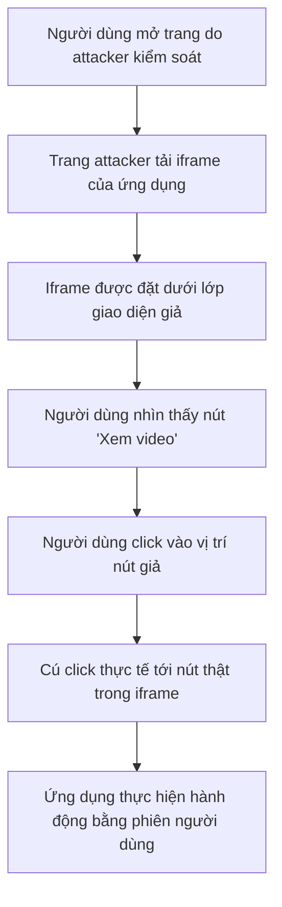

# UI redress — nhận diện và ngăn clickjacking

> **Chương:** Clickjacking  
> **Mục tiêu:** Hiểu UI redress và clickjacking, cách kẻ tấn công lợi dụng iframe và giao diện chồng lớp để khiến người dùng thao tác nhầm; phân biệt Same-Origin Policy với chính sách chống nhúng; cấu hình CSP `frame-ancestors` và `X-Frame-Options`; thiết kế an toàn khi cần nhúng đối tác và kiểm chứng bằng DevTools.

## 1. UI redress là gì?

**UI redress** là nhóm kỹ thuật làm người dùng hiểu sai giao diện hoặc vị trí của thao tác. Kẻ tấn công sắp xếp các thành phần giao diện để người dùng tưởng rằng họ đang bấm một nút, liên kết hoặc hộp thoại, trong khi thao tác thực tế tác động tới một thành phần khác.

**Clickjacking** là dạng UI redress phổ biến. Website của kẻ tấn công nhúng trang mục tiêu vào một iframe, sau đó dùng CSS để che, làm trong suốt hoặc căn chỉnh iframe dưới một giao diện giả. Người dùng bấm vào nút họ nhìn thấy, nhưng cú nhấp được chuyển tới nút thật của ứng dụng trong iframe.

Ví dụ về mục tiêu thường bị nhắm tới:

- Bật quyền truy cập camera, microphone hoặc vị trí.
- Thay đổi email, mật khẩu hoặc thiết lập bảo mật.
- Cấp quyền cho ứng dụng bên thứ ba.
- Thêm sản phẩm, xác nhận đơn hàng hoặc thực hiện giao dịch.
- Xóa dữ liệu, công khai nội dung hoặc thay đổi quyền chia sẻ.

Clickjacking không nhất thiết cần đọc nội dung trang bị nhúng. Kẻ tấn công có thể không đọc được DOM cross-origin nhưng vẫn khiến người dùng nhấn vào vị trí của một nút hợp lệ.

## 2. Một cuộc clickjacking diễn ra như thế nào?

Giả sử người dùng đã đăng nhập vào `https://app.example.com`. Kẻ tấn công tạo một trang khác, nhúng trang ứng dụng trong iframe và đặt một nút giả phía trên:



Ví dụ về cấu trúc trang nhúng:

```html
<iframe
  class="target-frame"
  src="https://app.example.test/settings"
  title="Ứng dụng thử nghiệm"
></iframe>
```

Trong một cuộc tấn công, iframe có thể được đặt trong suốt, dịch chuyển hoặc căn chỉnh dưới phần tử mà người dùng tưởng là nút của trang ngoài. Không cần khai thác lỗi JavaScript trong ứng dụng mục tiêu; giao diện hợp lệ của ứng dụng bị dùng làm công cụ thực hiện thao tác.

Chỉ nhúng iframe chưa đủ tạo ra clickjacking. Rủi ro xuất hiện khi người dùng bị đánh lừa để tương tác với nội dung được nhúng và ứng dụng cho phép trang ngoài nhúng nó.

## 3. Vì sao Same-Origin Policy không ngăn clickjacking?

Same-Origin Policy (SOP) giới hạn cách một document có thể đọc hoặc thao tác dữ liệu của document khác origin. Nó không mặc định cấm website khác hiển thị trang của bạn trong iframe.

Ví dụ:

- Trang attacker ở `https://attacker.example.net`.
- Ứng dụng ở `https://app.example.com`.
- Browser không cho trang attacker tùy ý đọc DOM của iframe cross-origin.
- Nhưng nếu response của ứng dụng cho phép framing, browser vẫn có thể hiển thị ứng dụng bên trong iframe.

Kẻ tấn công không cần đọc nội dung iframe để đặt một lớp giao diện bên ngoài và lừa người dùng click. Do đó, **SOP bảo vệ quyền đọc dữ liệu; chính sách chống framing bảo vệ cách trang được nhúng và trình bày**.

Đây là lý do ứng dụng cần chính sách rõ ràng về việc ai được phép nhúng trang của mình.

## 4. Các biến thể UI redress

Clickjacking không chỉ có một kiểu nút trong suốt:

| Biến thể | Cách đánh lừa |
| --- | --- |
| **Iframe overlay** | Đặt iframe mục tiêu dưới nút hoặc nội dung giả |
| **Opacity/visibility trick** | Làm iframe gần như trong suốt nhưng vẫn nhận click |
| **UI misalignment** | Căn lệch vị trí, kích thước hoặc cuộn trang để click tới control khác |
| **Cursorjacking** | Làm con trỏ hiển thị lệch so với vị trí tương tác thực tế |
| **Likejacking** | Đánh lừa người dùng bấm nút thích/theo dõi hoặc hành động tương tác xã hội |
| **Drag-and-drop redress** | Lợi dụng thao tác kéo-thả để đưa dữ liệu hoặc kích hoạt hành động ngoài ý muốn |
| **Touch/double-click redress** | Khai thác cách người dùng chạm hoặc nhấn nhiều lần trên thiết bị cảm ứng |
| **Nested-frame redress** | Dùng nhiều lớp iframe để làm nguồn và vị trí tương tác khó nhận biết |

Các biến thể có thể kết hợp với phishing, social engineering hoặc giao diện giả mạo. Phòng vệ cần kiểm soát việc nhúng trang, đồng thời thiết kế xác nhận phù hợp cho hành động nhạy cảm.

## 5. CSP frame-ancestors: kiểm soát ai được nhúng trang

Directive `frame-ancestors` trong Content Security Policy xác định những origin nào được phép làm ancestor (tổ tiên trong chuỗi frame) của tài liệu hiện tại.

Nếu ứng dụng không cần được nhúng:

```http
Content-Security-Policy: frame-ancestors 'none'
```

Nếu chỉ cho phép trang cùng origin nhúng:

```http
Content-Security-Policy: frame-ancestors 'self'
```

Nếu cần cho phép một portal đối tác cụ thể:

```http
Content-Security-Policy: frame-ancestors 'self' https://portal.partner.example
```

Ý nghĩa:

- `'none'`: không cho bất kỳ origin nào nhúng tài liệu.
- `'self'`: chỉ cho phép ancestor cùng origin với tài liệu.
- Origin được liệt kê: cho phép những trang có origin khớp với nguồn được khai báo.

Hãy dùng allowlist origin cụ thể. Không dùng wildcard rộng chỉ để tích hợp nhanh; một origin được phép nhúng trang có thể trở thành điểm khai thác nếu chính nó bị chiếm quyền hoặc cho phép nội dung người dùng kiểm soát.

### frame-ancestors kiểm tra toàn bộ chuỗi ancestor

Nếu trang được nhúng lồng qua nhiều iframe, browser kiểm tra tất cả ancestor trong chuỗi. Ví dụ policy chỉ cho phép `https://portal.partner.example`, nhưng portal này lại được nhúng bên trong `https://attacker.example.net`; chuỗi ancestor không thỏa policy và browser chặn việc hiển thị.

Điều này quan trọng khi tích hợp qua nhiều lớp portal, widget hoặc hệ thống quản trị.

### frame-ancestors không phải frame-src

Hai directive có hướng kiểm soát khác nhau:

| Directive | Kiểm soát |
| --- | --- |
| `frame-ancestors` | Ai được phép nhúng **trang hiện tại** vào frame |
| `frame-src` | Trang hiện tại được phép tải iframe/frame từ đâu |

Ví dụ, `frame-src 'self' https://video.example` giới hạn những frame mà trang của bạn tải. Nó không ngăn website khác nhúng trang của bạn. Để chống clickjacking, cần `frame-ancestors` trên response của trang cần bảo vệ.

**Lưu ý:** `frame-ancestors` không kế thừa từ `default-src`. Nếu muốn kiểm soát việc nhúng, phải khai báo directive này rõ ràng.

## 6. frame-ancestors phải được gửi bằng HTTP response header

Ví dụ response:

```http
HTTP/1.1 200 OK
Content-Type: text/html; charset=utf-8
Content-Security-Policy: frame-ancestors 'none'
```

Không dựa vào meta element:

```html
<!-- Không có hiệu lực để đặt frame-ancestors -->
<meta
  http-equiv="Content-Security-Policy"
  content="frame-ancestors 'none'"
>
```

`frame-ancestors` không được hỗ trợ qua meta CSP. Hãy cấu hình tại ứng dụng, reverse proxy hoặc CDN để response HTML thực sự mang header.

Nếu hệ thống đã có CSP, hãy thêm directive vào policy hiện có theo cách quản lý tập trung. Nhiều CSP enforcement header được áp dụng đồng thời; policy mới có thể làm hẹp quyền nhúng. Đừng vô tình tạo header thứ hai với giá trị xung đột hoặc ghi đè policy đang chứa các directive bảo vệ khác.

## 7. X-Frame-Options: lớp tương thích cho browser cũ

Trước khi CSP `frame-ancestors` phổ biến, ứng dụng thường dùng header `X-Frame-Options` (XFO):

```http
X-Frame-Options: DENY
```

Hai giá trị được sử dụng rộng rãi:

| Giá trị | Ý nghĩa |
| --- | --- |
| `DENY` | Không cho trang hiển thị trong frame, kể cả cùng origin |
| `SAMEORIGIN` | Chỉ cho phép frame từ cùng origin |

XFO là response header của trang được bảo vệ. Không đặt bằng meta tag.

Giá trị `ALLOW-FROM` từng được đề xuất để cho phép một origin cụ thể nhưng đã lỗi thời và không được browser hiện đại hỗ trợ nhất quán. Dùng CSP `frame-ancestors` để khai báo allowlist nhiều origin.

### CSP và X-Frame-Options khi cùng tồn tại

Trong browser hiện đại hỗ trợ CSP `frame-ancestors`, directive này được ưu tiên hơn XFO khi xác định quyền framing. XFO vẫn hữu ích như lớp tương thích cho browser cũ.

Chọn cấu hình theo nhu cầu:

- Không cho nhúng: `frame-ancestors 'none'` và `X-Frame-Options: DENY`.
- Chỉ cho cùng origin: `frame-ancestors 'self'` và `X-Frame-Options: SAMEORIGIN`.
- Cho phép đối tác khác origin: khai báo origin cụ thể trong `frame-ancestors`. XFO không biểu diễn được allowlist này; nếu đặt `SAMEORIGIN`, browser cũ hiểu XFO có thể chặn cả đối tác hợp lệ. Cần quyết định rõ yêu cầu tương thích và kiểm thử browser mục tiêu.

Không dùng `ALLOW-FROM` như một fallback đáng tin cậy cho đối tác.

## 8. Cấu hình theo loại ứng dụng

### Ứng dụng thông thường không cần iframe

```http
Content-Security-Policy: default-src 'self'; object-src 'none'; base-uri 'self'; frame-ancestors 'none'
X-Frame-Options: DENY
```

Đây là lựa chọn mặc định phù hợp cho trang đăng nhập, trang tài khoản và trang quản trị nếu không có yêu cầu nhúng hợp lệ.

### Ứng dụng chỉ được nhúng trong cùng origin

```http
Content-Security-Policy: frame-ancestors 'self'
X-Frame-Options: SAMEORIGIN
```

Chỉ dùng khi các trang cùng origin có mức tin cậy tương thích và việc nhúng thực sự cần thiết.

### Widget được nhúng bởi đối tác đã xác minh

```http
Content-Security-Policy: frame-ancestors 'self' https://portal.partner.example https://admin.partner.example
```

Chỉ liệt kê origin đã xác minh. Cần rà soát cả chuỗi ancestor, chính sách quản trị của đối tác và những trang nào tại đối tác có thể nhúng widget.

Không cấp quyền cho toàn bộ subdomain đối tác nếu không có yêu cầu cụ thể. Subdomain có thể do nhóm khác, tenant khác hoặc hệ thống nội dung người dùng quản lý.

## 9. Ví dụ cấu hình server

### Node.js/Express

Ví dụ middleware cho ứng dụng không cho phép framing:

```js
app.use((req, res, next) => {
  // Trong ứng dụng có CSP sẵn, hãy tích hợp directive này
  // vào policy hiện có thay vì ghi đè các directive khác.
  res.setHeader(
    "Content-Security-Policy",
    "default-src 'self'; object-src 'none'; base-uri 'self'; frame-ancestors 'none'"
  );
  res.setHeader("X-Frame-Options", "DENY");
  next();
});
```

Nếu ứng dụng đã có middleware CSP, hãy sửa cấu hình CSP tại một nơi duy nhất. Không để middleware khác ghi đè hoặc phát nhiều policy ngoài dự kiến.

### Nginx

Ví dụ cấu hình cho trang không cho phép nhúng:

```nginx
add_header Content-Security-Policy "frame-ancestors 'none'" always;
add_header X-Frame-Options "DENY" always;
```

Nếu CSP đã được cấu hình ở upstream hoặc một tầng khác, hãy hợp nhất directive và xác minh response cuối. Nginx có thể phát header ở nhiều location/server block; kiểm tra cấu hình kế thừa và header thực tế bằng DevTools hoặc HTTP client.

## 10. Vì sao frame-busting JavaScript không đủ?

Một số ứng dụng cũ dùng JavaScript để phát hiện mình đang nằm trong iframe:

```js
if (window.top !== window.self) {
  window.top.location = window.self.location;
}
```

Đây là kiểu **frame-busting script**. Nó có nhiều giới hạn:

- Có thể bị ảnh hưởng bởi sandbox attribute trên iframe.
- Browser có thể chặn điều hướng top-level nếu không có user activation hoặc không có quyền tương ứng.
- Code chạy sau khi một phần trang đã được tải hoặc tương tác có thể đã xảy ra.
- Có thể thất bại trong nested frame hoặc luồng điều hướng phức tạp.
- Logic có thể bị vô hiệu hóa bởi lỗi JavaScript hoặc script khác.

Frame-busting có thể là tín hiệu phụ trong một số ứng dụng legacy, nhưng không thay thế response header `frame-ancestors` hoặc XFO. Hãy để browser thực thi chính sách framing trước khi trang được hiển thị.

## 11. SameSite cookie và CSRF không thay thế chống framing

Cookie `SameSite=Strict` hoặc `Lax` có thể khiến cookie phiên không được gửi trong một số request cross-site bên trong iframe. Điều này giúp giảm một số tác động, nhưng không phải biện pháp chống clickjacking đáng tin cậy:

- Cookie `SameSite=None; Secure` có thể được gửi nếu browser cho phép cookie bên thứ ba.
- Trang sibling subdomain có thể cùng site nhưng khác origin.
- Chính sách third-party cookie thay đổi theo browser và thiết lập người dùng.
- Người dùng có thể đang tương tác với một chức năng không cần cookie hoặc có trạng thái khác.

CSRF token cũng không tự ngăn clickjacking. Người dùng có thể bị đánh lừa để bấm vào một form hoặc nút hợp lệ có CSRF token hợp lệ. Clickjacking là vấn đề **người dùng bị đánh lừa về giao diện và ý định**, còn CSRF token xác minh request có token phù hợp.

Hãy kết hợp chống framing với CSRF protection và authorization server-side.

## 12. Khi nào cần cho phép nhúng?

Một số sản phẩm có yêu cầu hợp lệ:

- Dashboard của doanh nghiệp nhúng báo cáo từ một ứng dụng nội bộ.
- Widget thanh toán hoặc xác thực được nhúng theo luồng do đối tác quản lý.
- Trang hỗ trợ hoặc công cụ quản trị cần hiển thị trong portal công ty.
- Ứng dụng SaaS cung cấp widget cho tenant.

Trước khi cho phép origin khác nhúng:

1. Xác định chính xác origin nào cần nhúng và vì sao.
2. Xác minh ai quản trị origin đó, ai có thể xuất bản nội dung và cách xử lý khi bị compromise.
3. Chỉ cho phép origin cần thiết trong `frame-ancestors`.
4. Kiểm tra toàn bộ ancestor chain; không chỉ kiểm tra frame trực tiếp.
5. Dùng giao thức giao tiếp rõ ràng nếu parent và child trao đổi dữ liệu.
6. Không dựa vào thông tin do parent gửi để cấp quyền nhạy cảm nếu chưa xác minh ở server.
7. Kiểm thử khi đối tác thay đổi domain, redirect hoặc cấu trúc portal.

Nếu cần hỗ trợ nhiều tenant, hãy thiết kế cách quản lý allowlist có kiểm soát, có xác minh quyền sở hữu domain và quy trình thu hồi. Không nhận một origin tùy ý từ query parameter rồi phản chiếu vào CSP.

## 13. iframe sandbox: giới hạn khả năng của nội dung được nhúng

Thuộc tính `sandbox` trên iframe cho phép **trang nhúng** giới hạn khả năng của nội dung bên trong iframe:

```html
<iframe
  src="https://widget.partner.example/"
  title="Widget đối tác"
  sandbox="allow-scripts"
></iframe>
```

Sandbox có thể hạn chế script, form submission, popup, navigation hoặc quyền truy cập origin tùy token được cấp. Không thêm token nếu chức năng không cần.

Cần phân biệt:

- `frame-ancestors` trên response của ứng dụng kiểm soát **ai được nhúng ứng dụng**.
- `sandbox` do trang cha đặt trên iframe kiểm soát **iframe con được làm gì**.

Sandbox không ngăn website khác nhúng trang của bạn. Nếu bạn cung cấp widget cho đối tác, sandbox là lớp bổ sung do phía nhúng kiểm soát; chính sách `frame-ancestors` vẫn do trang widget quyết định.

Không kết hợp tùy tiện `allow-scripts` và `allow-same-origin` cho nội dung không tin cậy cùng origin với trang cha; cấu hình này có thể làm suy yếu mục tiêu sandbox và cho phép nội dung thoát khỏi một số giới hạn.

## 14. postMessage trong tích hợp iframe

Khi ứng dụng cho phép đối tác nhúng widget và hai bên cần trao đổi dữ liệu, có thể dùng `postMessage`. Cần xác minh cả origin, source và cấu trúc dữ liệu:

```js
const partnerOrigin = "https://portal.partner.example";
const partnerFrame = document.querySelector("#partner-frame");

window.addEventListener("message", (event) => {
  if (event.origin !== partnerOrigin) return;
  if (event.source !== partnerFrame.contentWindow) return;
  if (!event.data || event.data.type !== "WIDGET_READY") return;

  markWidgetReady();
});

partnerFrame.contentWindow.postMessage(
  { type: "INITIALIZE", version: 1 },
  partnerOrigin
);
```

Không dùng target origin là `*` cho dữ liệu nhạy cảm. Không coi việc origin được phép nhúng đồng nghĩa mọi message từ origin đó đều hợp lệ. Message phải được kiểm tra schema và quyền nghiệp vụ.

## 15. Bảo vệ hành động nhạy cảm khỏi UI redress

Chặn framing là lớp chính để ngăn clickjacking, nhưng ứng dụng vẫn nên thiết kế các hành động nhạy cảm sao cho người dùng có thể hiểu rõ điều sắp xảy ra:

- Hiển thị rõ đối tượng, số tiền, quyền hoặc phạm vi thay đổi trước khi xác nhận.
- Với giao dịch quan trọng, yêu cầu bước xác nhận riêng hoặc xác thực lại.
- Ràng buộc xác nhận với chi tiết giao dịch cụ thể, không dùng một nút “Đồng ý” chung chung.
- Không để một cú click đơn giản trên control ít nổi bật lập tức cấp quyền lâu dài.
- Ghi audit event cho thao tác nhạy cảm.
- Giữ authorization và kiểm tra trạng thái ở server.

Xác thực lại không thay thế frame protection; nó là lớp giảm tác động khi giao diện bị lợi dụng hoặc khi người dùng thực sự thực hiện một thao tác có rủi ro cao.

## 16. Kiểm thử chống clickjacking

Thực hiện trong môi trường lab với hai origin do bạn kiểm soát. Không nhúng trang đăng nhập, tài khoản hoặc ứng dụng của bên thứ ba khi chưa được phép.

### Bước 1 — Kiểm tra response header

Mở DevTools → Network, chọn response HTML của trang cần bảo vệ. Kiểm tra:

- Có `Content-Security-Policy` với `frame-ancestors` không.
- Có `X-Frame-Options` không và giá trị có phù hợp không.
- Có nhiều CSP header hay không.
- Header có xuất hiện trên mọi route nhạy cảm, bao gồm trang login, account, settings và trang lỗi không.

Kiểm tra response cuối sau CDN/reverse proxy; cấu hình ở source chưa đảm bảo browser đã nhận đúng header.

### Bước 2 — Thử nhúng từ origin không được phép

Tạo trang lab trên origin attacker thử nghiệm:

```html
<!doctype html>
<html lang="vi">
  <meta charset="utf-8">
  <title>Frame policy test</title>
  <iframe
    src="https://app.example.test/lab"
    title="Trang mục tiêu trong lab"
  ></iframe>
</html>
```

Khi trang mục tiêu trả `frame-ancestors 'none'` hoặc chỉ cho phép origin khác, browser phải chặn việc hiển thị trong frame và ghi nhận lỗi CSP trong Console.

### Bước 3 — Thử cùng origin và đối tác được phép

Nếu policy dùng `'self'` hoặc allowlist đối tác, kiểm tra:

- Trang cùng origin có được nhúng như dự kiến không.
- Origin đối tác được cho phép có thể nhúng không.
- Origin không nằm trong allowlist bị chặn không.
- Nếu có nested iframe, mọi ancestor có nằm trong allowlist không.

### Bước 4 — Kiểm tra X-Frame-Options

Với ứng dụng không cho nhúng, xác minh `DENY`. Với ứng dụng chỉ cho cùng origin, xác minh `SAMEORIGIN`. Nếu cần nhúng đối tác, kiểm tra sự khác biệt giữa browser hiện đại hỗ trợ CSP và browser legacy dựa vào XFO.

### Bước 5 — Kiểm tra các route nhạy cảm

Đăng nhập, cài đặt, thanh toán và trang xác nhận có thể được phục vụ từ route hoặc subdomain khác nhau. Kiểm tra từng response, không giả định một header ở trang chủ tự bảo vệ mọi route.

## 17. Chẩn đoán lỗi thường gặp

| Hiện tượng | Nguyên nhân có thể | Cách xử lý |
| --- | --- | --- |
| Trang không hiển thị trong iframe cùng origin | `frame-ancestors 'none'` hoặc XFO DENY | Chọn policy phù hợp; chỉ cho phép self nếu thực sự cần |
| Đối tác được phép vẫn bị chặn | Origin không khớp, ancestor trung gian không được phép hoặc XFO SAMEORIGIN ở browser cũ | Kiểm tra toàn bộ ancestor chain và header XFO |
| Header có `default-src 'none'` nhưng trang vẫn được nhúng | `frame-ancestors` không fallback từ default-src | Khai báo frame-ancestors rõ ràng |
| Meta CSP không ngăn iframe | frame-ancestors không hoạt động qua meta | Gửi directive bằng HTTP response header |
| JavaScript frame-busting không chạy | Sandbox, điều hướng top-level bị chặn hoặc code chạy quá muộn | Dùng frame-ancestors/XFO |
| Cùng site nhưng khác origin vẫn gửi cookie | SameSite dựa trên site, không phải origin | Không dùng SameSite thay framing protection |
| CSRF token hợp lệ nhưng vẫn bị clickjacking | Người dùng bị lừa bấm vào control hợp lệ | Chặn framing và thiết kế xác nhận hành động |
| Chỉ một số route được bảo vệ | Header chỉ được thêm ở một route hoặc bị proxy ghi đè | Kiểm tra mọi response HTML và cấu hình edge |

## 18. Checklist phòng vệ UI redress

- Mặc định dùng `Content-Security-Policy: frame-ancestors 'none'` nếu ứng dụng không cần nhúng.
- Nếu chỉ cho phép cùng origin, dùng `frame-ancestors 'self'` và cân nhắc XFO SAMEORIGIN cho browser cũ.
- Nếu cho phép đối tác, liệt kê origin cụ thể và kiểm tra toàn bộ ancestor chain.
- Gửi `frame-ancestors` bằng HTTP response header; không dùng meta CSP.
- Không nhầm `frame-ancestors` với `frame-src`; chúng kiểm soát hai hướng khác nhau.
- Không dựa vào XFO ALLOW-FROM hoặc JavaScript frame-busting.
- Kiểm tra CSP và XFO trên mọi trang nhạy cảm, mọi response và sau CDN/reverse proxy.
- Dùng iframe sandbox để giới hạn widget không tin cậy khi bạn là bên nhúng; không coi nó là biện pháp chống website khác nhúng bạn.
- Với postMessage, xác minh origin, source, schema và targetOrigin.
- Không coi SameSite hoặc CSRF token là biện pháp chống framing.
- Với hành động nhạy cảm, hiển thị rõ chi tiết, yêu cầu xác nhận phù hợp và kiểm tra quyền ở server.
- Kiểm thử trên browser mục tiêu, bao gồm nested frames và trường hợp đối tác hợp lệ.

## 19. Câu hỏi tự kiểm tra

1. UI redress và clickjacking khác nhau thế nào?
2. Vì sao SOP không ngăn website khác hiển thị ứng dụng trong iframe?
3. Kẻ tấn công cần đọc DOM cross-origin để thực hiện clickjacking không?
4. `frame-ancestors 'none'` và `frame-ancestors 'self'` khác nhau ra sao?
5. Vì sao `frame-ancestors` phải được gửi bằng HTTP response header?
6. `frame-ancestors` khác `frame-src` ở hướng kiểm soát nào?
7. X-Frame-Options hỗ trợ những giá trị phổ biến nào và vì sao ALLOW-FROM không còn phù hợp?
8. Vì sao phải kiểm tra mọi ancestor trong chuỗi nested iframe?
9. Vì sao SameSite cookie và CSRF token không thay thế chính sách chống framing?
10. Khi cần nhúng đối tác, cần xác minh những gì trước khi đưa origin vào allowlist?

**Ghi nhớ:** Clickjacking là một dạng UI redress: người dùng tưởng mình tương tác với giao diện này nhưng cú click thực tế tác động tới trang được nhúng bên dưới. SOP không cấm framing, vì vậy hãy kiểm soát việc nhúng bằng CSP `frame-ancestors` và X-Frame-Options cho tương thích. Chỉ cho phép origin thực sự cần thiết, kiểm tra toàn bộ ancestor chain và bảo vệ hành động nhạy cảm bằng xác nhận rõ ràng cùng authorization phía server.
