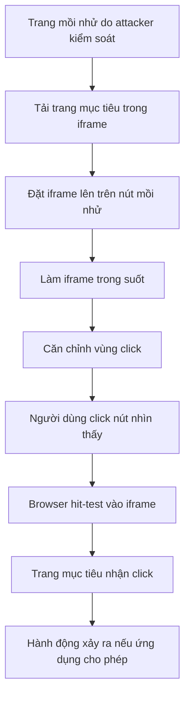

# Transparent overlay

> **Chương:** Clickjacking  
> **Học phần:** Application Security — Browser Security (`SECURITY_APPLICATION_SECURITY_BROWSER_SECURITY`)

**Transparent overlay** là một kỹ thuật thường dùng trong clickjacking: kẻ tấn công đặt trang web mục tiêu vào một `iframe`, làm khung này gần như trong suốt rồi căn chỉnh một nút hoặc vùng tương tác thật nằm phía trên một nút giả mà nạn nhân nhìn thấy. Người dùng tưởng mình đang bấm nút trên trang hiện tại, nhưng browser gửi cú click tới nội dung bên trong iframe.

Điểm nguy hiểm là trang mục tiêu có thể vẫn giữ phiên đăng nhập của người dùng. Nếu trang cho phép bị nhúng và thao tác nhạy cảm không có lớp xác nhận phù hợp, một cú click tưởng như vô hại có thể kích hoạt hành động trong tài khoản. Đây là một dạng **UI redressing**: giao diện được sắp xếp lại để người dùng hiểu sai nơi họ đang tương tác.

Phòng vệ chính nằm ở phía trang được bảo vệ: kiểm soát trang nào được phép nhúng nó bằng CSP `frame-ancestors`, dùng `X-Frame-Options` cho tương thích cần thiết, và yêu cầu xác nhận bổ sung cho hành động có hậu quả cao. `SameSite` và CSRF token có vai trò riêng; chúng không thay thế chính sách chống framing.

## 1. Mục tiêu học tập

Sau bài học, bạn có thể:

1. Mô tả clickjacking bằng transparent overlay và vai trò của iframe.
2. Giải thích vì sao browser chuyển cú click tới frame thật dù người dùng nhìn thấy lớp giao diện giả.
3. Xác định điều kiện để clickjacking có thể ảnh hưởng tới tài khoản đang đăng nhập.
4. Phân biệt clickjacking với CSRF, phishing và XSS.
5. Cấu hình `frame-ancestors` để từ chối hoặc giới hạn origin được nhúng trang.
6. Hiểu vai trò và giới hạn của `X-Frame-Options`, `SameSite` và JavaScript frame-busting.
7. Thiết kế xác nhận thao tác nhạy cảm và kiểm thử lớp chống framing.
8. Dựng một lab vô hại trên domain thử nghiệm để quan sát transparent overlay.

## 2. Clickjacking và transparent overlay là gì?

Clickjacking xảy ra khi người dùng bị đánh lừa để tương tác với một phần tử khác với phần tử họ nghĩ mình đang bấm. Trong kỹ thuật transparent overlay, trang của kẻ tấn công hiển thị một giao diện mồi nhử, còn trang mục tiêu được đặt trong iframe trong suốt và phủ lên đúng vùng người dùng sẽ click.

Ví dụ về ý tưởng giao diện:

```text
Người dùng nhìn thấy:
+--------------------------------------+
|             Trang xem video         |
|                                      |
|        [       PLAY       ]          |
|                                      |
+--------------------------------------+

Browser thực sự xếp lớp:
+--------------------------------------+
| Trang mục tiêu trong iframe          |
|        [ XÁC NHẬN / CHO PHÉP ]       |  <- nhận cú click
+--------------------------------------+
| Trang mồi nhử của attacker           |  <- nhìn thấy phía dưới
+--------------------------------------+
```

Người dùng nhìn thấy nút `PLAY`, nhưng hit-testing của browser xác định iframe trong suốt đang nằm trên cùng tại tọa độ đó. Sự kiện chuột được gửi tới nút thật trong iframe. JavaScript của trang mồi nhử không cần đọc DOM của trang mục tiêu; nó chỉ cần tạo bố cục khiến người dùng click nhầm.

## 3. Vì sao browser vẫn gửi click qua lớp trong suốt?

Browser phân biệt **cách vẽ phần tử** với **phần tử nhận tương tác**. Thuộc tính CSS `opacity` làm thay đổi độ trong suốt khi hiển thị, nhưng một element có `opacity: 0` vẫn có thể tham gia hit-testing và nhận pointer event nếu không bị loại khỏi tương tác theo cách khác.

Một iframe có thể được định vị phía trên nút mồi nhử bằng `position`, `z-index`, kích thước và tọa độ. Nếu iframe gần như trong suốt, người dùng khó nhận ra nó, nhưng browser vẫn xem nội dung iframe là lớp nằm trên cùng.

Các yếu tố thường được dùng trong kỹ thuật này:

- `iframe` tải trang mục tiêu.
- `position: fixed` hoặc `absolute` để đặt iframe đúng vị trí.
- `z-index` để đưa iframe lên trên giao diện mồi nhử.
- `opacity` rất thấp hoặc bằng 0 để che nội dung iframe.
- Kích thước và căn chỉnh để vùng điều khiển thật trùng với vùng người dùng định click.

`pointer-events: none` trên iframe sẽ khiến nó không nhận cú click, vì vậy không phải cách tạo overlay clickjacking. Điểm cốt lõi là iframe phải nằm trong hit-testing path ở vị trí người dùng bấm.

## 4. Mô hình các lớp trong một cuộc tấn công



Một lần click chỉ tạo ra tác động nếu trang mục tiêu có phần tử tương tác tại vị trí đó và hành động được server chấp nhận. Clickjacking không tự vượt qua mọi bước xác nhận, không tự cấp quyền API và không đảm bảo hành động thành công. Tuy nhiên, nó có thể làm người dùng chủ động kích hoạt một nút mà họ không nhìn thấy.

## 5. Điều kiện để clickjacking có tác động

Đánh giá rủi ro cần xem xét nhiều điều kiện:

1. **Trang mục tiêu cho phép framing:** response không có chính sách chống nhúng phù hợp, hoặc allowlist frame ancestor quá rộng.
2. **Nạn nhân truy cập trang mồi nhử:** trang mồi nhử có thể được mở qua liên kết, quảng cáo, email hoặc một trang khác.
3. **Nạn nhân có phiên hợp lệ:** browser có cookie hoặc credential phù hợp với request trong iframe.
4. **Có thao tác có giá trị:** ví dụ cấp quyền, bật tính năng, thay đổi cài đặt, xác nhận giao dịch hoặc xóa dữ liệu.
5. **Giao diện có thể căn chỉnh:** attacker có thể đặt vùng click thật trùng với vùng mồi nhử trong điều kiện viewport và layout cụ thể.
6. **Thiếu xác nhận bổ sung:** ứng dụng không yêu cầu bước xác nhận rõ ràng hoặc xác thực lại cho hành động nhạy cảm.

Nếu một điều kiện không tồn tại, khả năng khai thác hoặc mức độ tác động có thể giảm. Ví dụ, trang đã chặn mọi ancestor bằng `frame-ancestors 'none'` thì browser không hiển thị trang trong iframe; lớp mồi nhử không thể phủ lên nút của trang đó.

## 6. Vai trò của cookie và phiên đăng nhập

Clickjacking thường nhắm tới giao diện mà nạn nhân đã đăng nhập. Khi trang mục tiêu được tải trong iframe, browser quyết định có gửi cookie hay không dựa trên cookie scope, `SameSite`, `Secure`, credentials và chính sách quyền riêng tư.

Với iframe cross-site, cookie `SameSite=Lax` hoặc `Strict` thường không được gửi trong ngữ cảnh nhúng; cookie `SameSite=None` cần `Secure` và có thể vẫn bị chặn hoặc partition theo chính sách browser. Nếu trang mồi nhử và mục tiêu là same-site nhưng khác origin, quy tắc SameSite có thể cho phép cookie phù hợp được gửi.

Không nên dựa vào việc browser chặn cookie bên thứ ba như biện pháp chống clickjacking. Chính sách cookie thay đổi giữa browser và người dùng; same-site cross-origin vẫn tồn tại; trang công khai hoặc hành động không cần cookie cũng có thể bị nhắm tới. **Kiểm soát framing ở response của trang mục tiêu mới là lớp phòng vệ trực tiếp.**

## 7. Transparent overlay khác CSRF, phishing và XSS

| Kỹ thuật | Cách hoạt động | Kẻ tấn công cần đọc DOM mục tiêu? |
| --- | --- | --- |
| Clickjacking | Đánh lừa người dùng click vào giao diện thật bị che bởi lớp mồi nhử | Không |
| CSRF | Khiến browser gửi request có credential mà người dùng không chủ ý | Không |
| Phishing | Dựng giao diện giả để lừa người dùng nhập credential hoặc thông tin | Không cần đọc trang mục tiêu |
| XSS | Chạy script ngoài ý muốn trong origin của ứng dụng | Script chạy trong context mục tiêu |

Clickjacking có thể kết hợp với CSRF hoặc phishing, nhưng không đồng nghĩa với chúng. Trong clickjacking, người dùng thực sự tương tác với phần tử trong frame. Vì vậy, CSRF token có thể vẫn hiện diện trong form và request có thể hợp lệ về mặt token. Phòng vệ CSRF vẫn cần thiết cho các luồng khác, nhưng không thay thế việc ngăn trang không tin cậy nhúng giao diện nhạy cảm.

CORS cũng không phải biện pháp chống clickjacking. CORS quyết định JavaScript ở origin khác có được đọc response hay không; nó không ngăn browser hiển thị một trang trong iframe.

## 8. Lab an toàn: quan sát transparent overlay

Chỉ chạy bài thử này trên hai ứng dụng lab do bạn kiểm soát, ví dụ `https://app.lab.example.test` và `https://attacker.lab.example.test`. Trang mục tiêu chỉ nên có một nút vô hại như bật/tắt nhãn thử nghiệm; không dùng trang thanh toán, tài khoản thật hoặc website bên ngoài.

### 8.1 Trang mục tiêu

Trang mục tiêu có thể hiển thị một nút lab:

```html
<main>
  <h1>Ứng dụng mục tiêu trong lab</h1>
  <button id="lab-action" type="button">Bật nhãn thử nghiệm</button>
  <p id="lab-status">Chưa thay đổi</p>
</main>
<script>
  document.querySelector("#lab-action").addEventListener("click", () => {
    document.querySelector("#lab-status").textContent = "Đã bấm nút lab";
  });
</script>
```

Đây chỉ là thay đổi giao diện cục bộ, không gọi API và không sửa dữ liệu thật.

### 8.2 Trang mồi nhử mô phỏng

Trong một trang lab khác, tạo nút giả và đặt iframe mục tiêu lên trên nó. Ví dụ sau chỉ dùng domain `.test` dành cho môi trường thử nghiệm:

```html
<main class="decoy">
  <h1>Trang demo tương tác</h1>
  <p>Bấm nút để tiếp tục xem nội dung lab.</p>
  <button class="fake-button" type="button">PLAY DEMO</button>

  <iframe
    class="target-frame"
    src="https://app.lab.example.test/clickjacking-demo"
    title="Trang mục tiêu thử nghiệm"></iframe>
</main>
```

```css
.decoy {
  position: relative;
  width: 720px;
  min-height: 420px;
}

.fake-button {
  position: absolute;
  left: 250px;
  top: 190px;
  width: 220px;
  height: 64px;
  z-index: 1;
}

.target-frame {
  position: absolute;
  left: 250px;
  top: 190px;
  width: 220px;
  height: 64px;
  opacity: 0.02;
  border: 0;
  z-index: 2;
}
```

Nếu nút trong trang mục tiêu được căn đúng vị trí, click vào nút giả sẽ thực tế đi tới iframe. Trong lab, quan sát trạng thái của trang mục tiêu để xác nhận hit-testing. Nếu trang mục tiêu có CSP chống framing, iframe sẽ bị chặn và thử nghiệm không còn hoạt động.

### 8.3 Điều cần quan sát

- Tab Network cho thấy request tải tài liệu iframe.
- Console có thể hiển thị lỗi CSP `frame-ancestors` hoặc `X-Frame-Options`.
- Khi frame được phép, cú click đi tới nút của trang mục tiêu dù nội dung frame gần như không nhìn thấy.
- Khi frame bị chặn, browser không render trang mục tiêu bên trong iframe.

Không thêm code gửi dữ liệu ra ngoài, không dùng form thay đổi trạng thái thật và không nhắm vào website ngoài quyền kiểm soát.

## 9. Phòng vệ chính: CSP `frame-ancestors`

`frame-ancestors` là CSP directive quy định những ancestor nào được phép nhúng tài liệu hiện tại trong `frame`, `iframe`, `object` hoặc `embed`. Đây là biện pháp hiện đại và trực tiếp để ngăn clickjacking.

### 9.1 Chặn mọi trang nhúng

Nếu trang không cần được nhúng:

```http
Content-Security-Policy: frame-ancestors 'none'
```

`'none'` từ chối mọi ancestor. Đây thường là lựa chọn phù hợp cho trang tài khoản, quản trị, thanh toán và các trang có hành động nhạy cảm không cần tích hợp trong iframe.

### 9.2 Chỉ cho phép cùng origin

Nếu ứng dụng chỉ cần nhúng chính nó:

```http
Content-Security-Policy: frame-ancestors 'self'
```

`'self'` cho phép ancestor cùng origin. Origin bao gồm scheme, host và port; subdomain khác không tự được cho phép.

### 9.3 Cho phép một portal cụ thể

Nếu sản phẩm có nhu cầu nhúng trong một portal được quản lý:

```http
Content-Security-Policy: frame-ancestors 'self' https://portal.example.com
```

Chỉ thêm origin thực sự cần thiết. Tránh wildcard hoặc allowlist toàn bộ subdomain nếu có host chứa nội dung người dùng, tenant hoặc dịch vụ bên thứ ba.

### 9.4 Mọi ancestor trong chuỗi frame đều phải phù hợp

Nếu trang nằm trong nhiều lớp iframe lồng nhau, browser kiểm tra toàn bộ ancestor chain. Việc frame gần nhất được phép không đủ nếu một ancestor phía trên không khớp policy. Điều này ngăn một trang đáng tin cậy bị nhúng tiếp bên trong một trang không đáng tin.

## 10. Những điểm kỹ thuật quan trọng của `frame-ancestors`

- Phải gửi qua **HTTP response header** `Content-Security-Policy`.
- Không hỗ trợ khai báo `frame-ancestors` bằng thẻ `<meta http-equiv>` như một biện pháp tương đương.
- Không fallback về `default-src`; cần khai báo trực tiếp nếu muốn kiểm soát framing.
- Có thể dùng source expression như `'none'`, `'self'`, scheme hoặc host source phù hợp.
- Khi có nhiều CSP enforcement policy, browser áp dụng tất cả; policy khác không thể nới lỏng policy chặt hơn.
- Phải cấu hình trên response của **trang cần được bảo vệ**, không phải chỉ trên trang mồi nhử.

Một lỗi thường gặp là đặt `frame-src 'none'` rồi nghĩ đã ngăn người khác nhúng trang mình. `frame-src` kiểm soát những nguồn mà **trang hiện tại được phép tải vào frame**; `frame-ancestors` kiểm soát **ai được phép nhúng trang hiện tại**. Hai directive có hướng kiểm soát ngược nhau.

## 11. `X-Frame-Options` cho tương thích

`X-Frame-Options` là HTTP response header cũ được nhiều browser hỗ trợ để giới hạn framing:

```http
X-Frame-Options: DENY
```

Hoặc:

```http
X-Frame-Options: SAMEORIGIN
```

| Giá trị | Ý nghĩa |
| --- | --- |
| `DENY` | Không cho trang được hiển thị trong frame |
| `SAMEORIGIN` | Chỉ cho phép framing từ cùng origin theo cách triển khai browser |
| `ALLOW-FROM` | Cơ chế allowlist cũ, đã lỗi thời và không được hỗ trợ nhất quán |

Với ứng dụng hiện đại, ưu tiên CSP `frame-ancestors`. Có thể giữ `X-Frame-Options: DENY` hoặc `SAMEORIGIN` như lớp tương thích nếu policy thực tế phù hợp. Nếu cần cho phép một portal khác origin, `X-Frame-Options` không có cơ chế allowlist đa origin đáng tin cậy; cần kiểm tra hỗ trợ browser mục tiêu và tránh để giá trị XFO cũ vô tình chặn luồng nhúng hợp lệ.

Không dùng `ALLOW-FROM` như giải pháp hiện đại. Không đặt nhiều giá trị XFO tùy tiện; browser có thể xử lý không nhất quán.

## 12. JavaScript frame-busting không phải lớp phòng vệ chính

Một số ứng dụng cũ dùng JavaScript để phát hiện mình đang ở trong frame:

```js
if (window.top !== window.self) {
  window.top.location = window.self.location;
}
```

Đây là kỹ thuật *frame-busting*. Nó có thể thất bại hoặc bị vô hiệu hóa trong nhiều tình huống:

- Frame có thuộc tính `sandbox` giới hạn điều hướng top-level.
- Browser áp dụng chính sách điều hướng và quyền khác nhau.
- Có nhiều lớp iframe lồng nhau hoặc frame navigation xảy ra theo thời điểm khác.
- JavaScript bị tắt, lỗi hoặc chưa chạy trước khi người dùng tương tác.
- Trang có thể bị hiển thị trước khi script phát hiện và điều hướng.

Do đó, frame-busting chỉ nên được xem là biện pháp tương thích bổ sung trong hệ thống cũ. Browser cần nhận được policy chống framing ngay từ response header để từ chối render frame trước khi người dùng có thể tương tác.

## 13. `SameSite` và CSRF có thay thế frame protection không?

Không. Ba cơ chế xử lý các vấn đề khác nhau:

| Cơ chế | Câu hỏi được giải quyết |
| --- | --- |
| `frame-ancestors` / X-Frame-Options | Trang nào được phép nhúng giao diện này? |
| `SameSite` | Cookie có được gửi trong ngữ cảnh site hiện tại không? |
| CSRF token / kiểm tra Origin | Request thay đổi trạng thái có xuất phát từ luồng được phép không? |

Một trang same-site nhưng khác origin có thể được phép nhận cookie theo quy tắc SameSite và vẫn có thể bị nhúng nếu `frame-ancestors` cho phép. Ngược lại, một trang cross-site có thể không nhận cookie nhưng vẫn hiển thị nội dung công khai hoặc tạo click vào một phần tử không cần session.

CSRF token cũng không phải lớp chống clickjacking đầy đủ. Khi người dùng bấm nút trong iframe thật, form của ứng dụng có thể đã chứa CSRF token hợp lệ. Cần ngăn framing không mong muốn và bảo vệ hành động nhạy cảm theo ngữ cảnh.

## 14. Bảo vệ các hành động nhạy cảm

Chính sách chống framing là lớp đầu tiên. Với thao tác có hậu quả lớn, nên có xác nhận bổ sung được thiết kế để người dùng hiểu rõ hành động:

- Hiển thị trang xác nhận riêng với tên hành động, tài khoản nhận, số tiền hoặc tài nguyên bị thay đổi.
- Yêu cầu xác thực lại hoặc step-up authentication cho thao tác có rủi ro cao.
- Dùng WebAuthn/passkey với user verification khi phù hợp với luồng nghiệp vụ.
- Ràng buộc xác nhận với chi tiết giao dịch cụ thể; tránh một nút “Đồng ý” chung chung.
- Kiểm tra quyền và trạng thái nghiệp vụ ở server ngay tại thời điểm thực hiện.
- Dùng xác nhận ngoài kênh hoặc quy trình phê duyệt hai người cho thao tác đặc biệt quan trọng nếu mô hình rủi ro yêu cầu.

Một modal xác nhận đặt trong cùng iframe và có cùng khả năng bị phủ có thể vẫn bị clickjacking. Xác nhận phải được thiết kế cùng chính sách chống framing; không giả định thêm một nút là đủ.

## 15. Cho phép nhúng có kiểm soát

Một số sản phẩm cần nhúng dashboard, biểu đồ hoặc widget vào portal đối tác. Khi đó không nhất thiết phải cấm mọi framing, nhưng cần quản lý allowlist như một ranh giới tin cậy.

Nguyên tắc:

1. Xác định chính xác origin portal được phép, gồm scheme, host và port.
2. Xác minh chủ sở hữu và quy trình bảo mật của portal.
3. Chỉ cho phép các trang/route cần nhúng; các trang quản trị, thanh toán hoặc xác thực có thể dùng policy riêng.
4. Tránh cho phép wildcard subdomain nếu tenant hoặc người dùng có thể kiểm soát nội dung ở đó.
5. Kiểm thử toàn bộ ancestor chain, không chỉ parent trực tiếp.
6. Rà soát định kỳ và thu hồi origin khi tích hợp kết thúc.

Ví dụ:

```http
Content-Security-Policy: frame-ancestors https://portal.partner.example https://workspace.example
```

Chỉ những origin cụ thể được liệt kê mới được phép làm ancestor theo policy. Nếu cần hỗ trợ nhiều khách hàng, nên có cấu hình được quản trị và xác minh, không phản chiếu header `Origin` hoặc tự động tin mọi subdomain.

## 16. Các thuộc tính iframe và giới hạn của chúng

Thuộc tính `sandbox` trên iframe có thể giới hạn khả năng của nội dung được nhúng, ví dụ script, form, popup hoặc điều hướng top-level. Nhưng trong clickjacking, attacker là bên tạo iframe nên họ có thể chọn không bật sandbox hoặc cấp lại một số quyền cần thiết. Vì vậy, trang mục tiêu không thể dựa vào việc attacker tự sandbox iframe của họ.

Nếu chính ứng dụng nhúng nội dung bên thứ ba, hãy dùng `sandbox` với quyền tối thiểu và chỉ thêm token như `allow-scripts`, `allow-forms` hoặc `allow-same-origin` khi cần. Đánh giá tổ hợp `allow-scripts` và `allow-same-origin` cẩn thận, nhất là khi iframe cùng origin với trang cha.

`referrerpolicy`, `loading`, `allow` và các thuộc tính iframe khác không thay thế `frame-ancestors`. Thuộc tính `allow` chủ yếu liên quan tới quyền tính năng của Permissions Policy trong frame; nó không phải allowlist origin được phép nhúng trang.

## 17. Triển khai header trên server

Với trang không cần nhúng, response có thể chứa:

```http
HTTP/1.1 200 OK
Content-Security-Policy: frame-ancestors 'none'; object-src 'none'; base-uri 'self'
X-Frame-Options: DENY
```

Với trang chỉ cho phép cùng origin:

```http
Content-Security-Policy: frame-ancestors 'self'
X-Frame-Options: SAMEORIGIN
```

Đây là ví dụ header, không phải cấu hình copy nguyên cho mọi route. Cần bảo đảm:

- Header được gắn vào response HTML thực tế, kể cả response lỗi hoặc trang đăng nhập nếu chúng cũng cần bảo vệ.
- Reverse proxy/CDN không xóa hoặc ghi đè policy.
- Không chỉ thêm header vào một route trong khi trang nhạy cảm khác vẫn có thể bị nhúng.
- Các trang được phép nhúng có policy riêng, được review theo nhu cầu.
- Kiểm tra response sau redirect và các trang đích cuối cùng.

## 18. Kiểm thử và chẩn đoán

### 18.1 Kiểm tra response header

Trong DevTools → Network, chọn document response của trang mục tiêu và kiểm tra:

- `Content-Security-Policy` có `frame-ancestors` không?
- `X-Frame-Options` có giá trị phù hợp không?
- Có nhiều CSP header từ ứng dụng, proxy hoặc CDN không?
- Header có bị mất ở trang login, error page hoặc route nhạy cảm khác không?

Có thể dùng công cụ HTTP client trong môi trường được phép để kiểm tra header response, nhưng kết quả browser thực tế vẫn cần xác nhận vì redirect, cookie và policy có thể ảnh hưởng hành vi.

### 18.2 Ma trận kiểm thử framing

| Trang cha | Policy trang mục tiêu | Kết quả mong đợi |
| --- | --- | --- |
| Cùng origin | `frame-ancestors 'none'` | Bị chặn |
| Khác origin | `frame-ancestors 'none'` | Bị chặn |
| Cùng origin | `frame-ancestors 'self'` | Được phép |
| Khác origin | `frame-ancestors 'self'` | Bị chặn |
| Origin được allowlist | `frame-ancestors https://portal.example.com` | Được phép nếu toàn bộ ancestor chain phù hợp |
| Origin không được allowlist | Policy chỉ cho portal cụ thể | Bị chặn |

### 18.3 Dấu hiệu trong Console

Browser có thể ghi nhận violation cho biết trang bị từ chối hiển thị trong frame do `frame-ancestors` hoặc `X-Frame-Options`. Đọc directive và URL ancestor để xác định origin nào bị chặn. Không chỉ dựa vào việc iframe trống: lỗi mạng, TLS, redirect hoặc nội dung frame cũng có thể làm iframe không hiển thị.

## 19. Các lỗi phòng vệ thường gặp

| Lỗi | Vì sao chưa đủ | Cách xử lý |
| --- | --- | --- |
| Chỉ ẩn iframe bằng CSS ở trang mục tiêu | Attacker kiểm soát trang cha và CSS của họ | Gửi `frame-ancestors` từ server mục tiêu |
| Dùng `frame-src 'none'` để chặn người khác nhúng trang mình | Directive này kiểm soát frame mà trang hiện tại tải | Dùng `frame-ancestors` |
| Đặt `frame-ancestors` trong meta tag | Directive này không được thực thi qua meta | Gửi CSP bằng HTTP response header |
| Chỉ dựa vào JavaScript frame-busting | Có thể bị sandbox/chính sách browser hoặc timing vô hiệu | Dùng CSP và X-Frame-Options |
| Chỉ dựa vào SameSite | Same-site cross-origin và trang công khai vẫn có thể bị nhúng | Chặn framing ở response |
| Chỉ dựa vào CSRF token | Click thật trong frame có thể gửi token hợp lệ | Kết hợp frame protection và xác nhận hành động |
| Cho phép mọi `*.example.com` | Có thể tin subdomain do tenant/bên thứ ba kiểm soát | Exact allowlist origin cần thiết |
| Chỉ bảo vệ trang chính | Route đăng nhập, xác nhận hoặc lỗi có thể còn nhúng được | Kiểm kê và bảo vệ mọi trang nhạy cảm |
| Thêm XFO SAMEORIGIN dù cần portal khác origin | Có thể chặn tích hợp hợp lệ trên browser hỗ trợ XFO | Thiết kế CSP allowlist và chiến lược tương thích rõ ràng |

## 20. Checklist review chống transparent overlay

- [ ] Đã xác định trang nào không cần được nhúng và đặt `frame-ancestors 'none'`.
- [ ] Trang cần nhúng cùng origin dùng policy phù hợp như `frame-ancestors 'self'`.
- [ ] Portal đối tác được allowlist bằng origin chính xác, có chủ sở hữu và lý do.
- [ ] `frame-ancestors` được gửi qua HTTP response header, không đặt trong meta.
- [ ] Không nhầm `frame-src` với `frame-ancestors`.
- [ ] Đã kiểm tra toàn bộ ancestor chain và iframe lồng nhau.
- [ ] X-Frame-Options được cấu hình tương thích (`DENY`/`SAMEORIGIN`) khi phù hợp.
- [ ] Không dùng `ALLOW-FROM` hoặc JavaScript frame-busting làm lớp bảo vệ chính.
- [ ] Cookie `SameSite` và CSRF được đánh giá như các lớp riêng.
- [ ] Hành động nhạy cảm có xác nhận rõ, step-up hoặc ràng buộc giao dịch khi cần.
- [ ] Header có mặt trên trang đăng nhập, trang lỗi và mọi route nhạy cảm.
- [ ] Kiểm tra response sau proxy/CDN, redirect và trên browser mục tiêu.
- [ ] Có lab/test xác minh frame không được phép thực sự bị browser chặn.

## 21. Câu hỏi tự kiểm tra

1. Transparent overlay khiến người dùng click vào phần tử nào và vì sao?
2. `opacity: 0` có làm iframe ngừng nhận pointer event không?
3. Những điều kiện nào khiến clickjacking có thể thay đổi dữ liệu tài khoản?
4. Clickjacking khác CSRF ở điểm nào? Vì sao CSRF token không thay thế frame protection?
5. `frame-ancestors` khác `frame-src` ra sao?
6. Vì sao `frame-ancestors` phải được gửi qua HTTP header?
7. `X-Frame-Options: SAMEORIGIN` có phù hợp nếu cần nhúng từ portal khác origin không?
8. Vì sao không nên dựa vào SameSite hoặc browser chặn third-party cookie để chống clickjacking?
9. Khi cho phép portal đối tác nhúng trang, cần kiểm tra ancestor chain và chủ sở hữu như thế nào?
10. Những biện pháp nào nên bảo vệ hành động nhạy cảm ngay cả khi framing policy đã được cấu hình?

## 22. Ghi nhớ

Transparent overlay đặt một iframe gần như trong suốt lên trên giao diện mồi nhử. Người dùng nhìn thấy nút giả nhưng browser gửi cú click tới phần tử thật trong trang mục tiêu. Nếu trang mục tiêu cho phép bị nhúng, người dùng có phiên hợp lệ và thao tác không có xác nhận bổ sung, clickjacking có thể kích hoạt hành động ngoài ý muốn.

Hãy kiểm soát framing ngay tại response của trang mục tiêu bằng CSP `frame-ancestors` (`'none'`, `'self'` hoặc allowlist origin chính xác), giữ `X-Frame-Options` khi cần tương thích và bảo vệ riêng các thao tác nhạy cảm. `SameSite`, CSRF token, CORS và frame-busting JavaScript giải quyết những vấn đề khác nhau. **Browser phải từ chối hiển thị trang trong frame không được phép trước khi lớp giao diện mồi nhử có cơ hội chuyển hướng cú click.**
