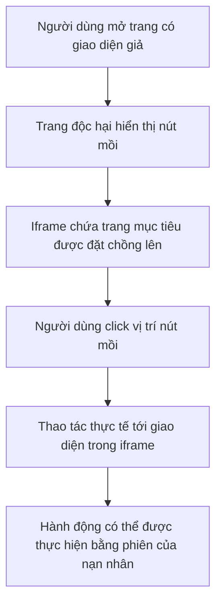

# Same-origin frame: hiểu quyền truy cập iframe và phòng vệ clickjacking

Ứng dụng web thường nhúng một trang khác bằng phần tử **iframe**: trang thanh toán, trình phát video, bảng điều khiển, bản xem trước hoặc một phần giao diện nội bộ. Khi tài liệu cha và tài liệu trong iframe có cùng origin, trình duyệt cho phép chúng tương tác với nhau ở mức rộng hơn so với hai tài liệu khác origin. Quyền này hữu ích cho ứng dụng, nhưng cũng có nghĩa iframe cùng origin không phải một ranh giới cách ly bảo mật.

Trong bối cảnh **clickjacking**, cần phân biệt hai câu hỏi: trang của mình có thể được nhúng trong frame của website khác hay không, và một trang cha có thể truy cập nội dung iframe của nó đến mức nào. Same-Origin Policy (SOP) giới hạn quyền đọc/ghi giữa các origin; các cơ chế như CSP **frame-ancestors** kiểm soát ai được phép nhúng tài liệu. SOP không tự ngăn người dùng bấm vào giao diện bị phủ bởi một iframe.

Bài học thuộc chương **Clickjacking**, trong phạm vi **SECURITY_APPLICATION_SECURITY_BROWSER_SECURITY**: phân tích ranh giới bảo mật giữa trình duyệt, origin, cookie và ứng dụng web; hiểu Same-Origin Policy, CORS và các cơ chế cách ly; thực hành phòng vệ XSS, CSRF, clickjacking bằng CSP, Trusted Types, security headers và kiểm chứng hành vi thực tế.

## 1. Mục tiêu học tập

Sau bài học, người học có thể:

1. Xác định hai tài liệu có cùng origin dựa trên scheme, host và port.
2. Mô tả quyền truy cập giữa parent document và same-origin iframe.
3. Phân biệt giới hạn SOP với khả năng nhúng và tương tác bằng chuột/bàn phím.
4. Giải thích vì sao SOP không tự phòng vệ clickjacking.
5. Phân biệt **frame-ancestors**, **frame-src** và **X-Frame-Options**.
6. Sử dụng **sandbox** và hiểu rủi ro khi kết hợp **allow-scripts** với **allow-same-origin**.
7. Thiết kế giao tiếp **postMessage** an toàn khi cần trao đổi với frame khác origin.
8. Kiểm thử framing policy và hành vi same-origin/cross-origin bằng DevTools.

## 2. Origin được xác định như thế nào?

Origin của một URL gồm ba thành phần:

- **Scheme:** ví dụ https hoặc http.
- **Host:** tên miền hoặc địa chỉ IP.
- **Port:** cổng kết nối; port mặc định được chuẩn hóa theo scheme.

Hai URL chỉ có cùng origin khi cả ba thành phần tương ứng khớp nhau sau khi chuẩn hóa:

| URL A | URL B | Cùng origin? | Lý do |
| --- | --- | --- | --- |
| https://app.example.com/a | https://app.example.com/b | Có | Khác path không làm thay đổi origin. |
| https://app.example.com | http://app.example.com | Không | Khác scheme. |
| https://app.example.com | https://api.example.com | Không | Khác host. |
| https://app.example.com:443 | https://app.example.com | Có | Port 443 là port mặc định của HTTPS. |
| https://app.example.com:8443 | https://app.example.com | Không | Khác port. |
| http://localhost:3000 | http://localhost:5173 | Không | Khác port. |

**Same-site không đồng nghĩa same-origin.** Hai subdomain có thể thuộc cùng site theo quy tắc cookie/SameSite nhưng vẫn khác origin. Không dùng SameSite để suy ra parent có thể đọc DOM của iframe.

## 3. Same-origin iframe cho phép điều gì?

Khi trang cha và iframe cùng origin, SOP cho phép JavaScript truy cập DOM và một số thuộc tính của tài liệu kia. Ví dụ, trang cha có thể lấy contentDocument hoặc contentWindow.document của iframe cùng origin:

```html
<iframe id="settings-frame" src="/settings/panel.html"></iframe>
```

```js
const frame = document.querySelector('#settings-frame');
const frameDocument = frame.contentDocument;
const heading = frameDocument.querySelector('h1');

console.log(heading.textContent);
```

Vì hai tài liệu cùng origin, mã của parent có thể đọc DOM trong iframe theo SOP. Chiều ngược lại, script trong iframe cùng origin cũng có thể truy cập parent.document và các đối tượng cùng origin được phép.

### Cùng origin nghĩa là cùng ranh giới tin cậy

Nếu một trang con cùng origin có XSS, script độc hại có thể có quyền truy cập rộng tới DOM của trang cha và các tài nguyên cùng origin mà SOP cho phép. Tách giao diện thành iframe cùng origin không tự cô lập script của nó khỏi ứng dụng chính.

Ví dụ, nếu app.example.com nhúng app.example.com/legacy-widget.html, widget đó vẫn nằm trong cùng origin. Một lỗi XSS ở widget có thể ảnh hưởng đến trang chính. Muốn tạo ranh giới origin, cần dùng host/subdomain khác và thiết kế xác thực, CORS, cookie cùng giao tiếp giữa hai bên một cách có chủ đích.

### Same-origin iframe và cookie

Request do iframe gửi tới cùng origin có thể mang cookie phù hợp với host, path, Secure và SameSite. JavaScript trong iframe cùng origin có thể truy cập tài nguyên DOM mà SOP cho phép; cookie HttpOnly vẫn không đọc được qua document.cookie, kể cả khi frame cùng origin.

Không nhầm quyền truy cập DOM với quyền đọc cookie. HttpOnly là giới hạn riêng của cookie; SOP là giới hạn truy cập giữa các tài liệu/origin.

## 4. Cross-origin iframe: SOP giới hạn quyền đọc, không cấm nhúng

Một trang có thể nhúng tài liệu từ origin khác:

```html
<iframe
  src="https://payments.example.net/checkout"
  title="Thanh toán">
</iframe>
```

Nếu parent ở https://shop.example.com, JavaScript của parent không thể tự do đọc DOM bên trong iframe cross-origin:

```js
const frame = document.querySelector('iframe');
console.log(frame.contentWindow.document.body); // Bị SOP chặn
```

Trình duyệt thường ném SecurityError khi mã cố truy cập các thuộc tính DOM bị giới hạn. Parent vẫn có thể giữ tham chiếu tới contentWindow, điều khiển một số thuộc tính được phép và gửi thông điệp qua postMessage; các thao tác đó không cấp quyền đọc DOM cross-origin.

### SOP không ngăn clickjacking

SOP bảo vệ tính bí mật và giới hạn tương tác script giữa các origin. Nó không đảm bảo người dùng nhìn thấy đúng giao diện mà họ đang tương tác.

Một website độc hại có thể đặt trang mục tiêu trong iframe cross-origin, làm iframe trong suốt hoặc che một phần, rồi đặt nút giả ở vị trí tương ứng. Khi người dùng tưởng mình bấm nút “Xem quà”, thao tác thực tế có thể rơi vào nút “Xác nhận” của trang mục tiêu.

Kẻ tấn công không cần đọc nội dung iframe để lợi dụng cú nhấp của người dùng. Vì vậy, việc contentWindow.document bị SOP chặn không phải bằng chứng rằng trang đã được bảo vệ khỏi clickjacking.

## 5. Clickjacking và UI redressing

**Clickjacking** là kỹ thuật đánh lừa người dùng tương tác với một giao diện bị che, phủ hoặc bố trí lệch so với điều họ nghĩ mình đang bấm. Tên gọi rộng hơn là **UI redressing**.

Một kịch bản thường gặp:

1. Kẻ tấn công tạo trang có nút hoặc nội dung hấp dẫn.
2. Trang mục tiêu được nhúng trong iframe ở lớp phía trên hoặc dưới giao diện giả.
3. Iframe được đặt opacity thấp, crop hoặc căn vị trí để nút thật nằm đúng nơi người dùng dự định bấm.
4. Người dùng click hoặc nhấn phím mà không nhận ra mục tiêu thật.
5. Trang mục tiêu thực hiện hành động bằng phiên đăng nhập hợp lệ của nạn nhân.



Sơ đồ chỉ mô tả nguyên lý. Không phải mọi iframe trong suốt đều là tấn công; điểm quan trọng là người dùng bị dẫn dụ tương tác với nội dung khác điều họ nhìn thấy.

### Các điều kiện làm tăng rủi ro

- Trang có chức năng nhạy cảm như đổi email, thay mật khẩu, cấp quyền, thanh toán hoặc xác nhận giao dịch.
- Người dùng thường đăng nhập và trình duyệt tự gửi cookie xác thực.
- Trang cho phép bị nhúng từ website không đáng tin.
- Giao diện không yêu cầu xác nhận lại hoặc kiểm tra ý định cho hành động quan trọng.
- Tính năng chỉ dựa vào click mà không có xác nhận bổ sung ở server.

SameSite có thể giảm một số request cross-site mang cookie, nhưng không phải biện pháp chống clickjacking hoàn chỉnh. Chính sách frame và xác nhận hành động nhạy cảm cần được xử lý riêng.

## 6. Phòng vệ bằng CSP frame-ancestors

**frame-ancestors** chỉ định những parent origin nào được phép nhúng tài liệu hiện tại bằng frame, iframe, object hoặc embed. Đây là một trong các biện pháp chính để phòng vệ clickjacking.

### Chặn mọi website nhúng trang

```http
Content-Security-Policy: frame-ancestors 'none'
```

Trang không được nhúng trong frame bởi bất kỳ origin nào. Dùng cho trang không có nhu cầu được nhúng, đặc biệt các trang quản trị hoặc hành động nhạy cảm.

### Chỉ cho phép cùng origin

```http
Content-Security-Policy: frame-ancestors 'self'
```

Chỉ tài liệu cùng origin được phép làm ancestor. Đây là lựa chọn phù hợp nếu ứng dụng có chức năng nhúng một trang nội bộ trong cùng origin.

Lưu ý: frame-ancestors 'self' cho phép same-origin frame. Nó không bảo vệ khỏi một trang cùng origin đã bị xâm nhập hoặc XSS; các trang cùng origin thuộc cùng ranh giới tin cậy.

### Cho phép một số portal cụ thể

```http
Content-Security-Policy: frame-ancestors 'self' https://portal.example.com
```

Chỉ các ancestor khớp một trong các source expression được phép. Hãy khai báo origin cụ thể và chỉ thêm portal thực sự cần. Không dùng wildcard rộng như https: hoặc * chỉ để tích hợp nhanh.

### Tất cả ancestor trong frame tree đều phải được phép

Nếu một trang nằm trong nhiều lớp iframe, trình duyệt kiểm tra chuỗi ancestor. Chỉ cần một ancestor không khớp policy, việc nhúng bị chặn. Không chỉ kiểm tra parent trực tiếp.

Ví dụ: trang mục tiêu cho phép https://portal.example.com, nhưng portal lại được nhúng trong một trang không được cho phép. Chuỗi ancestor có thể khiến tài liệu cuối cùng không được hiển thị trong frame.

### frame-ancestors không fallback từ default-src

frame-ancestors không dùng default-src làm fallback. Policy:

```http
Content-Security-Policy: default-src 'none'
```

không tự động chặn website khác nhúng tài liệu của bạn. Muốn chặn framing, phải khai báo riêng:

```http
Content-Security-Policy: default-src 'none'; frame-ancestors 'none'
```

### Phải gửi bằng HTTP response header

frame-ancestors không được hỗ trợ qua thẻ meta CSP. Hãy cấu hình trên HTTP response của chính tài liệu cần bảo vệ:

```http
Content-Security-Policy: frame-ancestors 'none'
```

Không đặt policy chỉ trên trang cha rồi kỳ vọng nó thay thế policy của tài liệu con. Trang mục tiêu phải tự khai báo ai được phép nhúng nó.

## 7. X-Frame-Options và khả năng tương thích

X-Frame-Options là header chống framing đời cũ:

| Giá trị | Hành vi |
| --- | --- |
| DENY | Không cho nhúng trang trong frame. |
| SAMEORIGIN | Chỉ cho phép nhúng từ cùng origin theo cách triển khai của trình duyệt. |
| ALLOW-FROM | Cơ chế cũ, không được hỗ trợ đồng đều; không nên dùng. |

Ví dụ:

```http
X-Frame-Options: DENY
```

Hoặc:

```http
X-Frame-Options: SAMEORIGIN
```

Với trình duyệt hiện đại, ưu tiên CSP frame-ancestors vì nó hỗ trợ allowlist nhiều origin cụ thể. Có thể duy trì X-Frame-Options như lớp tương thích cho trình duyệt cũ, nhưng cần tránh cấu hình mâu thuẫn và kiểm thử trên các trình duyệt mục tiêu. ALLOW-FROM không phải cách thay thế đáng tin cậy cho frame-ancestors.

Trong trình duyệt hỗ trợ CSP, khi response có cả frame-ancestors và X-Frame-Options, frame-ancestors được dùng để quyết định quyền nhúng. X-Frame-Options vẫn có thể hữu ích cho trình duyệt cũ không hiểu directive CSP này. Tránh gửi cấu hình mâu thuẫn, chẳng hạn frame-ancestors 'self' nhưng X-Frame-Options: DENY, vì trình duyệt cũ có thể chặn cả trường hợp nhúng cùng origin mà ứng dụng cần.

X-Frame-Options và frame-ancestors kiểm soát việc trang bị nhúng. Chúng khác với frame-src, vốn kiểm soát trang hiện tại được phép tải nội dung frame từ đâu.

## 8. Phân biệt frame-ancestors và frame-src

Hai directive có tên gần giống nhưng kiểm soát hai hướng ngược nhau:

| Directive | Kiểm soát | Câu hỏi |
| --- | --- | --- |
| frame-ancestors | Ai được phép nhúng tài liệu hiện tại | Website nào có thể đặt trang của tôi vào iframe? |
| frame-src | Nguồn iframe mà tài liệu hiện tại được phép tải | Trang của tôi được phép nhúng iframe từ website nào? |

Ví dụ trang ứng dụng chỉ được nhúng trong portal cùng origin, đồng thời chỉ được nhúng trang thanh toán từ một provider:

```http
Content-Security-Policy: default-src 'self'; frame-ancestors 'self'; frame-src 'self' https://payments.example.net
```

frame-ancestors bảo vệ trang ứng dụng khỏi bị website ngoài nhúng. frame-src kiểm soát các iframe mà ứng dụng tự tạo. Khai báo frame-src không thay thế frame-ancestors.

## 9. Dùng iframe sandbox đúng mục đích

Thuộc tính sandbox giới hạn khả năng của tài liệu bên trong iframe. Nếu có mặt mà không cấp token cho phép, browser áp dụng nhiều hạn chế, chẳng hạn chặn script, form submission, popup, top-level navigation và một số quyền khác.

Ví dụ:

```html
<iframe
  src="https://preview.example.net/document"
  sandbox
  title="Bản xem trước tài liệu">
</iframe>
```

Chỉ thêm các token cần thiết:

| Token | Quyền được cấp |
| --- | --- |
| allow-scripts | Cho phép script trong frame chạy. |
| allow-forms | Cho phép submit form. |
| allow-popups | Cho phép mở popup. |
| allow-downloads | Cho phép một số thao tác tải xuống. |
| allow-same-origin | Giữ origin thực của tài liệu thay vì làm nó thành opaque origin. |
| allow-top-navigation | Cho phép điều hướng top-level theo quyền rộng. |
| allow-top-navigation-by-user-activation | Cho phép điều hướng top-level khi có user activation phù hợp. |

Tên và hành vi token cần được kiểm tra theo browser mục tiêu; chỉ cấp quyền thực sự cần.

### Cẩn trọng với allow-scripts và allow-same-origin

Không kết hợp allow-scripts và allow-same-origin cho nội dung không tin cậy cùng origin với trang cha. Khi frame cùng origin và có thể chạy script, nội dung trong frame có thể truy cập DOM parent; trong nhiều trường hợp nó còn có thể thao tác để gỡ sandbox attribute rồi tải lại tài liệu, làm mất tác dụng cô lập mà nhà phát triển kỳ vọng.

Nếu cần chạy nội dung không tin cậy:

- Đặt nội dung trên origin riêng, không chia sẻ cookie xác thực với ứng dụng chính.
- Dùng sandbox với quyền tối thiểu.
- Không cấp allow-same-origin nếu cần opaque origin isolation.
- Chỉ bật allow-scripts khi thực sự cần và đã kiểm soát giao tiếp.
- Không cấp top navigation, popup hoặc form nếu tính năng không cần.

Sandbox là cơ chế giảm quyền của frame; nó không thay thế frame-ancestors để ngăn trang của mình bị nhúng bởi kẻ khác.

## 10. Giao tiếp giữa frame bằng postMessage

Khi parent và iframe khác origin cần trao đổi dữ liệu, dùng window.postMessage() thay vì cố truy cập DOM cross-origin.

### Gửi thông điệp với targetOrigin cụ thể

```js
const frame = document.querySelector('#payment-frame');
const paymentOrigin = 'https://payments.example.net';

frame.contentWindow.postMessage(
  {
    type: 'checkout:init',
    orderReference: 'ORDER-DEMO-001'
  },
  paymentOrigin
);
```

Không dùng '*' làm targetOrigin cho dữ liệu nhạy cảm. Nếu dùng wildcard, thông điệp có thể được gửi tới một tài liệu khác nếu frame điều hướng sang origin ngoài dự kiến trước thời điểm nhận.

### Xác minh origin, source và schema khi nhận

```js
const paymentOrigin = 'https://payments.example.net';
const paymentFrame = document.querySelector('#payment-frame');

window.addEventListener('message', (event) => {
  if (event.origin !== paymentOrigin) return;
  if (event.source !== paymentFrame.contentWindow) return;

  const message = event.data;
  if (
    !message ||
    typeof message !== 'object' ||
    message.type !== 'checkout:complete' ||
    typeof message.orderReference !== 'string'
  ) {
    return;
  }

  handleCheckoutComplete(message.orderReference);
});
```

Kiểm tra event.origin để xác minh origin gửi thông điệp, event.source để xác minh đúng browsing context và kiểm tra schema/loại dữ liệu trước khi xử lý. Không tin nội dung chỉ vì nó đến từ một iframe đang hiển thị trên trang.

Nếu nhận thông điệp từ frame có thể điều hướng, cân nhắc trạng thái navigation và xác minh lại origin theo từng message. Không đưa trực tiếp event.data vào innerHTML, eval, URL hoặc lệnh nhạy cảm.

## 11. Bảo vệ hành động nhạy cảm

Frame policy giảm khả năng một website khác phủ giao diện lên trang của bạn. Tuy nhiên, các hành động nhạy cảm vẫn cần kiểm soát phía server và xác nhận ý định phù hợp.

Với thao tác như chuyển tiền, thay email, cấp quyền hoặc xóa tài khoản:

- Dùng POST/PUT/DELETE phù hợp, không thực hiện thay đổi trạng thái bằng GET.
- Bảo vệ CSRF cho endpoint dựa trên cookie.
- Yêu cầu xác nhận rõ nội dung hành động, đặc biệt giá trị/đối tượng nhận.
- Với giao dịch rủi ro cao, yêu cầu xác thực lại hoặc xác nhận ngoài luồng theo mô hình sản phẩm.
- Kiểm tra authorization ở server trên từng hành động.
- Không dựa vào trạng thái nút bị disable hoặc JavaScript UI làm bằng chứng người dùng đã xác nhận.

Clickjacking và CSRF có thể kết hợp: iframe khiến người dùng vô tình kích hoạt một hành động, còn cookie được trình duyệt tự gửi. frame-ancestors và CSRF token xử lý hai phần khác nhau của rủi ro.

## 12. Thực hành: kiểm chứng same-origin frame và clickjacking defense

Thực hành trong môi trường local/staging do mình kiểm soát. Dùng dữ liệu giả, không nhúng website của bên thứ ba hoặc thử trên tài khoản thật.

### 12.1. Chuẩn bị hai trang cùng origin

Chạy một server local và tạo hai đường dẫn cùng origin:

- /parent.html: trang cha.
- /child.html: tài liệu được nhúng trong iframe.

Trong parent.html:

```html
<!doctype html>
<html lang="vi">
<meta charset="utf-8">
<title>Same-origin parent</title>
<h1>Parent</h1>
<iframe id="child" src="/child.html" title="Child frame"></iframe>
<script>
  const frame = document.querySelector('#child');
  frame.addEventListener('load', () => {
    const childTitle = frame.contentDocument.querySelector('h1').textContent;
    console.log('Đọc được từ same-origin child:', childTitle);
  });
</script>
</html>
```

Trong child.html:

```html
<!doctype html>
<html lang="vi">
<meta charset="utf-8">
<title>Same-origin child</title>
<h1>Child content</h1>
<p>Nội dung thử nghiệm</p>
</html>
```

Tải parent.html. Mở DevTools Console và xác nhận parent đọc được heading từ iframe cùng origin.

### 12.2. Đổi child sang origin khác

Chạy cùng nội dung child trên một port khác, ví dụ http://localhost:5174/child.html, trong khi parent vẫn ở port 5173. Đổi iframe src sang URL đó.

Thử đọc frame.contentDocument. Trình duyệt sẽ chặn truy cập DOM cross-origin. Quan sát SecurityError trong Console. Việc iframe vẫn hiển thị không có nghĩa parent được phép đọc nội dung.

### 12.3. Quan sát clickjacking trong lab

Tạo một trang mục tiêu lab có nút không gây tác động, ví dụ “Đổi màu thử nghiệm”. Trên một trang demo khác do mình quản lý, nhúng trang mục tiêu trong iframe và bố trí một nút mồi trùng vị trí. Chỉ dùng hành động vô hại và tài khoản/dữ liệu giả.

Quan sát rằng người dùng có thể tương tác với nút trong iframe ngay cả khi parent không đọc được DOM của frame cross-origin. Đây là điểm khác biệt giữa SOP và clickjacking.

### 12.4. Bật frame-ancestors

Trên response của trang mục tiêu, thử lần lượt:

```http
Content-Security-Policy: frame-ancestors 'none'
```

Sau đó:

```http
Content-Security-Policy: frame-ancestors 'self'
```

Và cuối cùng, nếu lab có portal được tin cậy:

```http
Content-Security-Policy: frame-ancestors 'self' http://localhost:5173
```

Tải lại parent và quan sát frame bị chặn/được phép. Header phải được gửi trên response của trang mục tiêu. Nếu kiểm tra frame-ancestors 'self', chỉ frame cùng origin mới được phép; khác port vẫn là cross-origin.

### 12.5. So sánh frame-src

Trên trang parent, đặt:

```http
Content-Security-Policy: frame-src 'self'
```

Quan sát parent không được tải child từ port khác. Thử thêm origin lab cụ thể vào frame-src để cho phép tải lại. Thao tác này kiểm soát frame mà parent tải; nó không thay đổi quyền của trang mục tiêu trong việc quyết định ai được nhúng nó.

### 12.6. Kiểm tra X-Frame-Options

Trên response của trang mục tiêu, thử:

```http
X-Frame-Options: DENY
```

Quan sát trình duyệt chặn việc nhúng. Sau đó thử SAMEORIGIN với parent cùng origin và parent khác origin. So sánh với CSP frame-ancestors và ghi nhận khác biệt giữa trình duyệt mục tiêu.

### 12.7. Kiểm tra sandbox

Thử iframe với sandbox trống, sau đó chỉ cấp allow-scripts và thử truy cập DOM parent. Tiếp theo, dùng một origin riêng cho child và thử cấp allow-scripts mà không có allow-same-origin. Quan sát frame vẫn chạy script nhưng có origin bị opaque, nên quyền truy cập tới parent bị giới hạn.

Không dùng nội dung không tin cậy cùng origin với allow-scripts allow-same-origin. Thí nghiệm chỉ nên dùng trang local vô hại.

### 12.8. Bằng chứng cần lưu

| Bằng chứng | Điều cần xác nhận |
| --- | --- |
| Same-origin parent/child | Parent đọc được DOM child cùng origin. |
| Cross-origin parent/child | Parent không đọc được DOM child khác origin dù iframe hiển thị. |
| Click interaction lab | Click có thể tới frame cross-origin mà parent không đọc DOM. |
| Response header mục tiêu | frame-ancestors hoặc X-Frame-Options được gửi từ trang cần bảo vệ. |
| frame-src | Parent chỉ tải được các iframe từ nguồn được policy cho phép. |
| sandbox | Quyền frame giảm theo token được cấp; kiểm tra opaque origin khi phù hợp. |

## 13. Checklist triển khai

| Hạng mục | Câu hỏi rà soát | Kết quả mong đợi |
| --- | --- | --- |
| Origin boundary | Đã xác định scheme/host/port của parent và child? | Không nhầm same-site với same-origin. |
| Trust boundary | Nội dung iframe có cùng mức tin cậy với ứng dụng? | Nếu không, dùng origin riêng và sandbox phù hợp. |
| Framing policy | Trang có cần được nhúng không? | frame-ancestors 'none' hoặc allowlist cụ thể. |
| Legacy header | Có cần hỗ trợ trình duyệt cũ? | X-Frame-Options phù hợp, không dùng ALLOW-FROM. |
| Direction | Đã phân biệt frame-src và frame-ancestors? | Cả hai được khai báo theo đúng hướng. |
| Meta CSP | frame-ancestors có bị đặt trong meta không? | Gửi bằng HTTP response header của tài liệu mục tiêu. |
| Sandbox | Token sandbox có tối thiểu không? | Không cấp quyền thừa; tránh allow-scripts allow-same-origin cho nội dung không tin cậy cùng origin. |
| postMessage | Có kiểm tra origin, source và schema? | Dùng targetOrigin cụ thể, xác minh message trước khi xử lý. |
| Sensitive actions | Hành động nhạy cảm có xác nhận và authorization phía server? | Có CSRF defense, reauthentication/confirmation khi cần. |
| Regression | Có kiểm tra frame tree và browser mục tiêu? | Có bằng chứng Network, Console và hành vi UI. |

## 14. Câu hỏi tự kiểm tra

1. Hai URL khác path nhưng cùng scheme, host và port có cùng origin không?
2. Vì sao iframe cùng origin không phải ranh giới cách ly giữa hai ứng dụng?
3. Parent có thể làm gì với same-origin iframe mà không thể làm với cross-origin iframe?
4. Vì sao SOP không ngăn clickjacking dù parent không đọc được DOM của iframe cross-origin?
5. frame-ancestors 'self' cho phép những trang nào nhúng tài liệu hiện tại?
6. Vì sao frame-ancestors phải nằm trong HTTP response header và không fallback từ default-src?
7. frame-src khác frame-ancestors ở hướng kiểm soát nào?
8. X-Frame-Options có những giá trị nào còn phù hợp và vì sao ALLOW-FROM không nên dùng?
9. Rủi ro của việc kết hợp allow-scripts và allow-same-origin với nội dung cùng origin là gì?
10. Khi dùng postMessage, vì sao phải kiểm tra event.origin, event.source và schema của event.data?

**Tiêu chí hoàn thành:** người học có thể phân tích đúng ranh giới same-origin/cross-origin của iframe, giải thích vì sao SOP không chống clickjacking, triển khai frame-ancestors và X-Frame-Options phù hợp, phân biệt frame-src, cấu hình sandbox với quyền tối thiểu và chứng minh bằng DevTools hành vi của parent/child frame.
