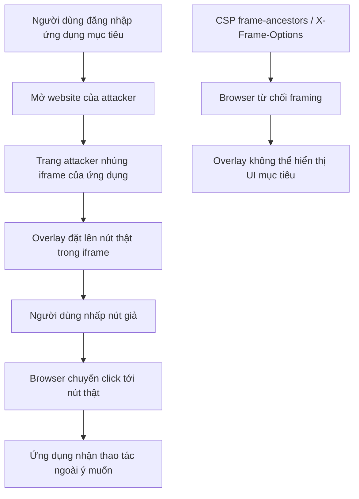

# Kiểm thử clickjacking: xác minh trang không bị nhúng và lừa nhấp

**Chương:** Clickjacking  
**Mô-đun:** `SECURITY_APPLICATION_SECURITY_BROWSER_SECURITY` — phân tích ranh giới bảo mật giữa trình duyệt, origin, cookie và ứng dụng web để hiểu Same-Origin Policy (SOP), CORS và các cơ chế cách ly; thực hành phòng vệ XSS, CSRF, clickjacking bằng CSP, Trusted Types, security headers và kiểm chứng hành vi thực tế.

**Kiểm thử clickjacking** là quá trình xác minh một trang nhạy cảm không thể bị website khác nhúng vào iframe rồi che phủ hoặc sắp xếp giao diện để dụ người dùng nhấp vào một thao tác mà họ không định thực hiện. Kiểm thử phải quan sát hành vi trong trình duyệt thật, xác nhận header bảo vệ có hiệu lực trên response cuối cùng và chứng minh trang tấn công không thể kích hoạt hành động ẩn.

Clickjacking (UI redressing) lợi dụng việc trình duyệt vẫn có thể hiển thị một trang trong frame dù script của trang cha không đọc được nội dung cross-origin. Kẻ tấn công đặt iframe của trang mục tiêu dưới một lớp giao diện đánh lạc hướng, căn chỉnh nút hoặc vùng tương tác rồi dụ nạn nhân nhấp. Nếu thao tác nhạy cảm được kích hoạt, người dùng có thể vô tình thay đổi cài đặt, cấp quyền, gửi nội dung hoặc xác nhận giao dịch.

Hai cơ chế response header quan trọng để ngăn nhúng trái phép là **CSP `frame-ancestors`** và **`X-Frame-Options`**. Kiểm thử cần xác minh các cơ chế này trên mọi route nhạy cảm, đồng thời đánh giá những luồng nhúng hợp lệ như cổng thanh toán, video hoặc widget đối tác.

## 1. Mục tiêu học tập

Sau bài học, bạn có thể:

1. Giải thích cách iframe overlay tạo ra clickjacking dù Same-Origin Policy vẫn được áp dụng.
2. Phân biệt clickjacking với CSRF, XSS và CORS.
3. Kiểm thử CSP `frame-ancestors` với `'none'`, `'self'` và allowlist origin cụ thể.
4. Kiểm thử `X-Frame-Options: DENY` và `SAMEORIGIN`, hiểu giới hạn tương thích.
5. Xác minh response header trên route, redirect, trang lỗi và response do CDN/proxy phục vụ.
6. Thiết kế test matrix cho browser, origin, nested frame, luồng nhúng hợp lệ và hành động nhạy cảm.
7. Dựng lab local an toàn để quan sát iframe bị chặn và overlay trong một ứng dụng giả lập.
8. Đưa kiểm thử clickjacking vào regression test và CI.

## 2. Mô hình đe dọa

Giả sử người dùng đã đăng nhập vào `https://app.example.test` và mở trang cài đặt bảo mật. Trang có nút **Tắt xác thực hai bước**. Kẻ tấn công vận hành `https://attacker.example.test` và tạo một trang trông như trò chơi hoặc khảo sát.

Trang tấn công có thể:

1. Nhúng trang cài đặt vào iframe.
2. Làm iframe trong suốt hoặc gần như trong suốt.
3. Đặt iframe lên trên một nút giả có nội dung hấp dẫn.
4. Dụ người dùng nhấp vào vị trí nút giả.
5. Thực tế cú nhấp được browser gửi tới nút của trang cài đặt bên trong iframe.

`SOP` giới hạn việc trang cha đọc DOM cross-origin, nhưng không mặc định cấm hiển thị iframe hoặc chuyển cú nhấp vào nội dung trong frame. CORS cũng không phải cơ chế chống clickjacking: CORS kiểm soát việc JavaScript đọc response cross-origin, không ngăn trang được nhúng.

`CSRF` và clickjacking có thể kết hợp nhưng là hai vấn đề khác nhau. CSRF làm server nhận request ngoài ý muốn nhờ credential tự động gửi; clickjacking lừa người dùng tương tác với UI thật. CSRF token có thể vẫn hợp lệ khi nạn nhân nhấp vào nút thật trong iframe, nên token đơn lẻ không thay thế bảo vệ chống framing.

### 2.1. Sơ đồ luồng clickjacking



## 3. Cơ chế phòng vệ cần kiểm thử

### 3.1. CSP `frame-ancestors`

Directive `frame-ancestors` xác định những origin nào được phép làm ancestor nhúng document hiện tại. Nó kiểm tra toàn bộ chuỗi ancestor, không chỉ frame cha trực tiếp. Nếu bất kỳ ancestor nào không khớp policy, browser chặn việc hiển thị document trong frame.

Ví dụ:

```http
Content-Security-Policy: frame-ancestors 'none'
```

Không cho phép bất kỳ website nào nhúng trang.

```http
Content-Security-Policy: frame-ancestors 'self'
```

Chỉ cho phép trang cùng origin nhúng. Origin bao gồm scheme, host và port; hai trang cùng hostname nhưng khác port vẫn là hai origin khác nhau.

```http
Content-Security-Policy: frame-ancestors 'self' https://portal.partner.example
```

Cho phép cùng origin và origin đối tác cụ thể. Hãy dùng origin allowlist chính xác; không mở wildcard nếu không có yêu cầu rõ ràng.

**`frame-ancestors` không kế thừa từ `default-src`.** Nếu muốn kiểm soát framing, phải khai báo directive này một cách tường minh. Nó cũng không được hỗ trợ qua thẻ `<meta http-equiv>`; phải gửi trong HTTP response header.

### 3.2. `X-Frame-Options`

`X-Frame-Options` là header cũ hơn để điều khiển framing:

| Giá trị | Hành vi |
| --- | --- |
| `DENY` | Không cho phép trang được hiển thị trong frame |
| `SAMEORIGIN` | Chỉ cho phép frame có cùng origin |
| `ALLOW-FROM` | Đã lỗi thời, không nên dùng; hỗ trợ browser không đáng tin cậy |

Ví dụ:

```http
X-Frame-Options: DENY
```

Hoặc:

```http
X-Frame-Options: SAMEORIGIN
```

Với ứng dụng hiện đại, ưu tiên CSP `frame-ancestors` vì nó hỗ trợ allowlist origin cụ thể. Có thể giữ `X-Frame-Options` để tương thích với browser cũ, nhưng cần hiểu cách browser xử lý khi cả hai header cùng xuất hiện. Trên browser hỗ trợ CSP `frame-ancestors`, directive này được ưu tiên cho quyết định framing; đừng dựa vào việc hai header luôn được kết hợp giống nhau trên mọi phiên bản.

### 3.3. Header phải nằm trên response của trang được nhúng

Header chống framing phải được gửi từ response của **document mục tiêu**. Đặt header `X-Frame-Options` hoặc CSP trên trang cha không bảo vệ document con. Một trang attacker vẫn có thể tạo iframe tới URL mục tiêu; browser kiểm tra policy của document trong frame.

Cần xác minh response cuối cùng sau redirect. Nếu `/settings` redirect tới `/account/security`, hãy kiểm tra header trên response của trang cuối; cũng kiểm tra các trang login, xác nhận giao dịch, trang lỗi và route thay đổi trạng thái. CDN, reverse proxy hoặc middleware có thể bỏ header trên một số response.


## 4. Clickjacking khác các lỗi bảo mật liên quan

| Cơ chế/vấn đề | Câu hỏi cần trả lời | Vai trò trong kiểm thử |
| --- | --- | --- |
| SOP | Trang cha có thể đọc DOM cross-origin không? | Giới hạn đọc dữ liệu, không tự chặn framing |
| CORS | JavaScript cross-origin có được đọc response không? | Không ngăn browser hiển thị trang trong iframe |
| CSRF | Request thay đổi trạng thái có bằng chứng hợp lệ không? | Bảo vệ request giả mạo; không ngăn người dùng bị lừa nhấp UI thật |
| XSS | Attacker có thể chạy script trong origin ứng dụng không? | Có thể phá nhiều lớp UI defense; cần test độc lập |
| Clickjacking | Trang khác có thể nhúng và che UI để dụ click không? | Kiểm tra `frame-ancestors`, XFO và thao tác nhạy cảm |

Một ứng dụng cần kiểm thử cả CSRF lẫn clickjacking. Ví dụ, một form chuyển tiền có CSRF token hợp lệ vẫn có thể được đặt trong iframe và nút Submit bị che phủ. Nếu nạn nhân đã đăng nhập, browser có thể gửi cookie cùng token trong thao tác click thật. Bảo vệ framing giúp ngăn kịch bản này ở lớp trình duyệt.

### 4.1. SameSite cookie không phải biện pháp chống framing

`SameSite` kiểm soát việc cookie được gửi trong một số ngữ cảnh cross-site. Nó không quyết định trang có được nhúng trong iframe hay không. Một frame có thể tải và hiển thị trang ngay cả khi cookie phiên không được gửi; điều này vẫn có thể làm lộ UI, gây nhầm lẫn hoặc tác động tới luồng không cần session. Kiểm soát framing bằng `frame-ancestors`/XFO.

### 4.2. JavaScript frame-busting không thay thế header

Các đoạn script kiểu `if (top !== self) top.location = self.location` có thể bị vô hiệu hóa hoặc hoạt động khác trong sandbox, nested frame và các tình huống browser đặc biệt. Chúng cũng có thể làm hỏng luồng nhúng hợp lệ. Hãy dùng response header làm cơ chế chính; JavaScript chỉ là lớp phụ khi có yêu cầu UX cụ thể.

## 5. Những điểm cần kiểm tra trong ứng dụng thực tế

### 5.1. Phân loại route theo nhu cầu nhúng

Lập danh sách route và quyết định framing policy theo chức năng:

- Trang đăng nhập, đổi mật khẩu, MFA, quản lý session và cài đặt bảo mật thường không cần được nhúng.
- Trang quản trị, thanh toán, chuyển tiền, thay đổi quyền hoặc xác nhận hành động nhạy cảm nên cấm framing nếu không có use case rõ.
- Trang public marketing hoặc tài liệu có thể cho phép nhúng nếu sản phẩm cần.
- Widget/portal đối tác chỉ nên cho phép origin đã được xác minh, có hợp đồng và owner.
- Trang có nội dung người dùng tạo cần đánh giá riêng vì việc cho phép embed có thể khiến UI bị dùng làm lớp đánh lừa.

Không chọn một policy giống nhau cho toàn bộ module mà không kiểm tra luồng sản phẩm. Nếu cho phép đối tác nhúng, chỉ cho phép origin cụ thể và kiểm thử nested ancestor.

### 5.2. Nested frames và toàn bộ ancestor chain

Giả sử trang A nhúng trang B, rồi B nhúng trang mục tiêu C. `frame-ancestors` trên C kiểm tra cả A và B. Việc B nằm trong allowlist không đủ nếu A không được phép. Test phải tạo ít nhất một kịch bản nested iframe để chứng minh ancestor không được phép bị chặn.

### 5.3. Redirect, cache và response lỗi

Header phải tồn tại trên response của document cuối. Kiểm tra:

- URL ban đầu và mọi response redirect;
- trang đăng nhập sau redirect do hết session;
- 401/403/404/500 nếu chúng trả HTML;
- response từ CDN, reverse proxy, gateway và cache;
- các route có server-side render và route SPA;
- các biến thể hostname, scheme và port được triển khai.

Nếu CSP được cấu hình ở nhiều tầng, xác minh header thực tế mà browser nhận được. Hai CSP enforced có thể cùng áp dụng; header bị thiếu ở một response có thể mở ra đường framing cho route đó.

### 5.4. Report-only không phải cách preview đáng tin cậy cho `frame-ancestors`

Không dựa vào `Content-Security-Policy-Report-Only` để xác minh việc chặn framing của `frame-ancestors`. Directive này bị bỏ qua trong Report-only policy ở browser theo hành vi chuẩn. Hãy kiểm thử policy `frame-ancestors` bằng header `Content-Security-Policy` enforced trên staging/test environment và quan sát kết quả iframe thật. Các directive CSP khác có thể dùng Report-only để preview, nhưng framing phải được xác nhận bằng enforcement.

## 6. Test matrix cho clickjacking

Bắt đầu bằng một positive control cho luồng nhúng hợp lệ nếu ứng dụng có hỗ trợ. Sau đó chạy các trường hợp phải bị chặn. Status code của trang trong iframe không đủ để kết luận; browser có thể tải response thành công rồi từ chối render frame do policy. Hãy quan sát nội dung frame và hành vi người dùng.

Giả sử có các route:

- `/account/security`: trang nhạy cảm, không được nhúng.
- `/help/embed`: nội dung được phép nhúng bởi cùng origin.
- `/partner/widget`: widget chỉ được nhúng bởi origin đối tác đã phê duyệt.

| ID | Tình huống | Policy/đầu vào | Kết quả mong đợi |
| --- | --- | --- | --- |
| CJ-01 | Trang bảo mật trong iframe cross-origin | `frame-ancestors 'none'` | Browser chặn render trong frame |
| CJ-02 | Trang bảo mật trong iframe same-origin | `frame-ancestors 'none'` | Vẫn bị chặn; `'none'` không cho ancestor nào |
| CJ-03 | Trang nội bộ cho phép same-origin | `frame-ancestors 'self'` | Frame cùng origin hiển thị |
| CJ-04 | Trang same-origin bị nhúng từ port khác | `frame-ancestors 'self'` | Bị chặn vì port khác tạo origin khác |
| CJ-05 | Widget cho phép partner cụ thể | `frame-ancestors https://portal.partner.example` | Partner đúng origin được phép |
| CJ-06 | Widget bị nhúng từ host gần giống partner | Host không nằm trong allowlist chính xác | Bị chặn |
| CJ-07 | Nested frame có ancestor ngoài allowlist | Ancestor chain chứa origin không được phép | Bị chặn |
| CJ-08 | Route redirect đến trang nhạy cảm | Kiểm tra response cuối | Trang cuối vẫn có policy và bị chặn |
| CJ-09 | Trang lỗi trả HTML | 403/404/500 | Header được áp dụng theo policy của trang |
| CJ-10 | Chỉ có `X-Frame-Options: DENY` | Browser hỗ trợ XFO | Bị chặn trong mọi frame |
| CJ-11 | Chỉ có `X-Frame-Options: SAMEORIGIN` | Parent khác origin | Bị chặn; same-origin được phép |
| CJ-12 | Có CSP `frame-ancestors` và XFO | Kiểm tra browser mục tiêu | Hành vi theo CSP trên browser hỗ trợ; kiểm tra fallback browser cũ |
| CJ-13 | Chỉ đặt `frame-ancestors` trong Report-only | Không có CSP enforced | Không coi là bảo vệ framing; xác nhận bằng enforced policy |
| CJ-14 | Trang không có header chống framing | Parent cross-origin | Lab có thể nhúng được; test chứng minh baseline dễ bị UI redress |
| CJ-15 | Nhấp overlay trong lab | Trang mục tiêu có nút demo | Khi protected, nút không thể được kích hoạt từ parent |
| CJ-16 | Người dùng mở route trực tiếp | Top-level navigation | Chức năng hợp lệ vẫn hoạt động |
| CJ-17 | Mở route qua redirect sau khi hết session | Redirect/login flow | Không xuất hiện route nhạy cảm không có policy |
| CJ-18 | Nhiều browser/version | Chromium, Firefox, WebKit theo support matrix | Policy nhất quán hoặc có fallback được ghi nhận |

### 6.1. Kiểm tra header trên HTTP response

Dùng request trực tiếp để xem header server gửi. Ví dụ:

```bash
curl -sS -D - -o /dev/null https://app.example.test/account/security
```

Xác minh:

- Header `Content-Security-Policy` có directive `frame-ancestors` đúng.
- `X-Frame-Options` có giá trị dự kiến nếu được dùng làm fallback.
- Không có response middleware/CDN nào ghi đè hoặc loại bỏ header.
- Redirect và response cuối có policy đúng.
- Không dùng `default-src` để suy ra `frame-ancestors`.

`curl` chỉ xác minh header; nó không thực thi thuật toán framing của browser. Phải tiếp tục kiểm thử iframe trong browser thật.

### 6.2. Kiểm tra trong DevTools

Mở trang parent và quan sát:

- Console có thông báo frame bị từ chối bởi CSP `frame-ancestors` hoặc XFO.
- Network cho thấy request document con và response header.
- Elements cho thấy iframe vẫn có trong DOM parent, nhưng document mục tiêu không được render bên trong.
- Nếu frame bị chặn, parent không thể đọc nội dung cross-origin để xác định chính xác trạng thái nội bộ; dùng console/network và endpoint kiểm thử.
- Trang mục tiêu mở top-level vẫn hoạt động bình thường.

Không dùng `iframe.onload` như bằng chứng duy nhất rằng frame đã được render. Event load có thể xảy ra trong những trường hợp document không hiển thị do policy; hãy kết hợp console, Network và kiểm tra trực quan.

### 6.3. Assertion nghiệp vụ

Đối với hành động nhạy cảm, tạo trạng thái ban đầu và kiểm tra sau mỗi lần thử:

- bộ đếm thao tác hoặc trạng thái demo không đổi khi frame bị chặn;
- không tạo giao dịch, không đổi cài đặt và không enqueue công việc;
- khi mở trực tiếp top-level, thao tác hợp lệ vẫn chạy;
- nếu sản phẩm cho phép một partner nhúng widget, chỉ partner đó được hiển thị và các ancestor không hợp lệ vẫn bị chặn.


## 7. Lab: thử iframe overlay trên ứng dụng local

Lab dùng hai server Node.js trên hai port của cùng host:

- Ứng dụng mục tiêu: `http://localhost:3000`.
- Trang parent mô phỏng attacker: `http://localhost:4000`.

Hai URL là **cross-origin** vì port khác nhau, nhưng thường vẫn **same-site** vì scheme và hostname giống nhau. Lab này kiểm tra origin policy và khả năng framing; nó không dùng để kết luận về SameSite cookie cross-site.

Lab chỉ có một nút demo tăng bộ đếm trong bộ nhớ. Không có tài khoản, giao dịch hay dữ liệu thật. Route `/vulnerable-action` cố ý không có header chống framing để thấy baseline có thể bị nhúng. Route `/protected-action` gửi cả CSP `frame-ancestors 'none'` và XFO DENY.

### 7.1. Tạo server

Tạo file `clickjacking-lab.mjs`:

```javascript
import { createServer } from "node:http";

let actionCount = 0;

function send(res, status, contentType, body, headers = {}) {
  res.writeHead(status, {
    "Content-Type": contentType,
    "Cache-Control": "no-store",
    ...headers
  });
  res.end(body);
}

const actionPage = `<!doctype html>
<html lang="vi">
<head>
  <meta charset="utf-8">
  <title>Target action demo</title>
  <style>
    body { margin: 0; font-family: sans-serif; }
    #action {
      position: absolute;
      left: 40px;
      top: 40px;
      z-index: 1;
      padding: 14px 18px;
    }
    #status { position: absolute; left: 40px; top: 100px; }
  </style>
</head>
<body>
  <button id="action">Confirm harmless demo action</button>
  <p id="status">Action count is stored by the local server.</p>
  <script>
    document.querySelector("#action").addEventListener("click", async () => {
      const response = await fetch("/demo-action", { method: "POST" });
      const state = await response.json();
      document.querySelector("#status").textContent =
        "Action count: " + state.actionCount;
    });
  </script>
</body>
</html>`;

const sameOriginParent = `<!doctype html>
<html lang="vi">
<meta charset="utf-8">
<title>Same-origin parent</title>
<h1>Parent cùng origin</h1>
<iframe title="Same-origin child" src="/same-origin" width="560" height="220"></iframe>
</html>`;


const appServer = createServer((req, res) => {
  if (req.method === "GET" && req.url === "/vulnerable-action") {
    return send(res, 200, "text/html; charset=utf-8", actionPage);
  }

  if (req.method === "GET" && req.url === "/protected-action") {
    return send(res, 200, "text/html; charset=utf-8", actionPage, {
      "Content-Security-Policy": "frame-ancestors 'none'; object-src 'none'; base-uri 'self'",
      "X-Frame-Options": "DENY"
    });
  }

  if (req.method === "GET" && req.url === "/same-origin") {
    return send(res, 200, "text/html; charset=utf-8", actionPage, {
      "Content-Security-Policy": "frame-ancestors 'self'",
      "X-Frame-Options": "SAMEORIGIN"
    });
  }

  if (req.method === "GET" && req.url === "/xfo-only") {
    return send(res, 200, "text/html; charset=utf-8", actionPage, {
      "X-Frame-Options": "DENY"
    });
  }

  if (req.method === "GET" && req.url === "/parent-same-origin") {
    return send(res, 200, "text/html; charset=utf-8", sameOriginParent);
  }

  if (req.method === "POST" && req.url === "/demo-action") {
    actionCount += 1;
    return send(res, 200, "application/json; charset=utf-8",
      JSON.stringify({ actionCount }));
  }

  if (req.method === "GET" && req.url === "/state") {
    return send(res, 200, "application/json; charset=utf-8",
      JSON.stringify({ actionCount }));
  }

  return send(res, 404, "text/plain; charset=utf-8", "Not found");
});


function attackerPage(targetPath) {
  const targetUrl = "http://localhost:3000" + targetPath;
  return `<!doctype html>
<html lang="vi">
<head>
  <meta charset="utf-8">
  <title>Parent overlay demo</title>
  <style>
    body { margin: 0; font-family: sans-serif; }
    #decoy {
      position: absolute;
      left: 40px;
      top: 40px;
      z-index: 1;
      padding: 14px 18px;
    }
    #overlay {
      position: absolute;
      left: 0;
      top: 0;
      width: 560px;
      height: 180px;
      opacity: 0.02;
      border: 0;
      z-index: 2;
    }
    #links { position: absolute; top: 220px; left: 20px; }
  </style>
</head>
<body>
  <h1>Trang parent mô phỏng giao diện đánh lạc hướng</h1>
  <button id="decoy">Click to claim a harmless prize</button>
  <iframe id="overlay" title="Target page overlay" src="` + targetUrl + `"></iframe>
  <div id="links">
    <p>Thử các route:</p>
    <a href="/">Không có header</a> |
    <a href="/protected">Protected: CSP + XFO</a> |
    <a href="/xfo">XFO only</a> |
    <a href="/same-origin">Same-origin policy từ port khác</a>
  </div>
</body>
</html>`;
}

const attackerServer = createServer((req, res) => {
  const routes = {
    "/": "/vulnerable-action",
    "/protected": "/protected-action",
    "/xfo": "/xfo-only",
    "/same-origin": "/same-origin"
  };

  const targetPath = routes[req.url];
  if (!targetPath) {
    return send(res, 404, "text/plain; charset=utf-8", "Not found");
  }

  return send(res, 200, "text/html; charset=utf-8", attackerPage(targetPath));
});

appServer.listen(3000, () => {
  console.log("Target app: http://localhost:3000");
  console.log("State: http://localhost:3000/state");
  console.log("Same-origin parent: http://localhost:3000/parent-same-origin");
});

attackerServer.listen(4000, () => {
  console.log("Attacker parent: http://localhost:4000");
});
```

Chạy:

```bash
node clickjacking-lab.mjs
```


### 7.2. Quan sát overlay không có bảo vệ

1. Mở `http://localhost:4000/`. Parent hiển thị nút giả **Click to claim a harmless prize**.
2. Iframe chứa trang mục tiêu trong suốt 98% và nằm trên nút giả.
3. Nhấp đúng vị trí nút giả. Thao tác thực tế được chuyển tới nút **Confirm harmless demo action** bên trong iframe.
4. Mở tab mới `http://localhost:3000/state`. Bộ đếm `actionCount` tăng lên 1.
5. Quay lại parent và thử nhấp lại; bộ đếm tiếp tục tăng.

Đây là baseline dễ bị UI redress. Iframe cross-origin vẫn nhận được click dù parent không thể đọc nội dung của nó.

### 7.3. Xác minh CSP `frame-ancestors` và XFO chặn overlay

1. Mở `http://localhost:4000/protected`. Route mục tiêu gửi `Content-Security-Policy: frame-ancestors 'none'` và `X-Frame-Options: DENY`.
2. Browser từ chối hiển thị document mục tiêu trong iframe; Console thường có thông báo vi phạm CSP hoặc XFO.
3. Nhấp vị trí nút giả. Không có thao tác nào được gửi tới `/demo-action`.
4. Mở `http://localhost:3000/state`. `actionCount` phải giữ nguyên.
5. Thử `http://localhost:4000/xfo` để quan sát route chỉ dùng XFO DENY. Frame cũng phải bị chặn trên browser hỗ trợ.

### 7.4. Kiểm tra `SAMEORIGIN`

- Mở `http://localhost:4000/same-origin`. Trang parent ở port 4000 khác origin với target port 3000, vì vậy route `/same-origin` bị chặn bởi `frame-ancestors 'self'` và `X-Frame-Options: SAMEORIGIN`.
- Mở `http://localhost:3000/parent-same-origin`. Parent và child cùng origin nên iframe được hiển thị.
- Nhấp nút demo trong iframe same-origin. Bộ đếm tăng và trang child cập nhật trạng thái.

Điều này cho thấy `SAMEORIGIN`/`'self'` so sánh origin gồm scheme, host và port, không chỉ hostname.

### 7.5. Kiểm tra response header trực tiếp

Trong terminal khác, chạy:

```bash
curl -sS -D - -o /dev/null http://localhost:3000/protected-action
curl -sS -D - -o /dev/null http://localhost:3000/same-origin
curl -sS -D - -o /dev/null http://localhost:3000/xfo-only
```

Xác nhận response:

- `/protected-action` có CSP `frame-ancestors 'none'` và XFO DENY.
- `/same-origin` có CSP `frame-ancestors 'self'` và XFO SAMEORIGIN.
- `/xfo-only` có XFO DENY.

### 7.6. Dọn lab

Dừng server bằng Ctrl+C. Lab không xác thực người dùng, không dùng cookie phiên và không được expose ra mạng. Không thay URL trong ví dụ thành website production hoặc thao tác nhạy cảm thật.


## 8. Phòng vệ bổ sung cho hành động nhạy cảm

Header chống framing là lớp phòng vệ chính. Với hành động có tác động lớn, nên kết hợp thêm các biện pháp sau:

### 8.1. Xác nhận thao tác theo ngữ cảnh

Với chuyển tiền, đổi thông tin bảo mật, cấp quyền hoặc xóa dữ liệu, yêu cầu xác nhận rõ ràng trên một màn hình phù hợp. Nội dung xác nhận phải nêu chính xác đối tượng và tác động, ví dụ người nhận và số tiền, không chỉ có nút chung chung như “Continue”.

Đối với thao tác có rủi ro cao, có thể yêu cầu xác thực lại hoặc xác nhận giao dịch gắn với chi tiết giao dịch. Điều này giúp giảm tác động khi người dùng bị đánh lừa nhấp vào một control. Không xem hộp thoại xác nhận thông thường là thay thế cho `frame-ancestors`.

### 8.2. Kiểm tra nguồn request và quyền phía server

Server vẫn phải xác thực session, phân quyền và áp dụng CSRF defense cho request thay đổi trạng thái. Các kiểm tra này xử lý những lớp tấn công khác nhau; clickjacking protection không thay thế chúng.

Nếu sản phẩm có luồng nhúng hợp lệ, xác thực message từ parent bằng `postMessage` cần kiểm tra chính xác `event.origin`, `event.source` và schema payload. Không dùng `*` cho target origin của message nhạy cảm và không tin mọi message chỉ vì nó đến từ một frame.

### 8.3. Tránh phụ thuộc vào overlay hoặc frame-busting JavaScript

Không dựa vào CSS overlay của ứng dụng, kiểm tra `window.top`, hoặc script tự điều hướng để làm cơ chế duy nhất. Các cách này có thể bị vô hiệu hóa, thay đổi bởi sandbox hoặc làm hỏng tích hợp hợp lệ. Browser phải thực thi framing policy từ response header.

### 8.4. Không mở rộng allowlist quá mức

Nếu widget chỉ cần được portal đối tác A nhúng, chỉ cho phép origin chính xác của portal đó. Tránh cho phép toàn bộ subdomain hoặc mọi HTTPS host. Một subdomain bị takeover hoặc do người dùng kiểm soát có thể trở thành ancestor không đáng tin.

Khi đối tác thay hostname, cập nhật allowlist theo quy trình có owner và kiểm thử. Không dùng CSP source expression rộng chỉ để tránh gián đoạn tạm thời.

## 9. Đưa kiểm thử clickjacking vào CI

### 9.1. Kiểm tra header tự động

Integration test có thể gọi từng route và kiểm tra header:

```javascript
const response = await fetch("https://app.example.test/account/security", {
  redirect: "manual"
});

const csp = response.headers.get("content-security-policy") || "";
const xfo = response.headers.get("x-frame-options");

assert.match(csp, /frame-ancestors 'none'/i);
assert.equal(xfo?.toLowerCase(), "deny");
```

Ví dụ này giả định test chạy trong môi trường có quyền truy cập ứng dụng và route trả trực tiếp response dự kiến. Nếu route redirect, theo dõi từng bước và kiểm tra response cuối. Đừng chỉ kiểm tra một route gốc rồi giả định mọi route đều có header.

### 9.2. Browser automation

Dùng browser automation để mở parent ở origin khác và kiểm tra:

- trang được bảo vệ không render trong iframe;
- Console ghi nhận framing violation;
- hành động demo hoặc trạng thái nghiệp vụ không thay đổi;
- route được phép nhúng vẫn hoạt động từ origin allowlist;
- cùng route vẫn mở trực tiếp top-level;
- nested ancestor ngoài allowlist làm frame bị chặn.

Với kiểm thử overlay, dùng nút demo và bộ đếm trong môi trường test. Không tự động hóa click vào thao tác thật của người dùng hoặc giao dịch production.

### 9.3. Pipeline regression

Chạy kiểm tra khi có thay đổi ở:

- middleware security header hoặc reverse proxy;
- route đăng nhập, quản trị, thanh toán và cài đặt;
- CSP, X-Frame-Options hoặc cấu hình CDN/cache;
- trang được nhúng bởi đối tác;
- frontend thay đổi layout hoặc thêm iframe;
- redirect và error handler.

Lưu lại route, response header, browser/version và kết quả framing. Khi fail, cung cấp đủ thông tin để tìm ra tầng đã bỏ hoặc ghi đè header.

## 10. Những ngộ nhận thường gặp

**“SOP đã ngăn clickjacking vì parent không đọc được iframe.”** Sai. Browser vẫn có thể hiển thị iframe và chuyển click đến nội dung bên trong.

**“CORS chặn website khác nhúng trang.”** Sai. CORS điều khiển việc đọc response cross-origin; chống framing cần CSP `frame-ancestors` hoặc XFO.

**“SameSite cookie là đủ.”** Sai. SameSite điều khiển gửi cookie trong một số ngữ cảnh, không phải quyền nhúng document.

**“Chỉ cần đặt X-Frame-Options trên trang parent.”** Sai. Header phải nằm trên response của document mục tiêu được nhúng.

**“`default-src 'none'` tự động cấm iframe.”** Sai. `frame-ancestors` không fallback từ `default-src`; khai báo directive này tường minh.

**“Có thể dùng meta tag cho frame-ancestors.”** Sai. Directive này phải được gửi qua HTTP response header.

**“Report-only sẽ cho biết frame-ancestors có chặn không.”** Sai. Không dựa vào Report-only để kiểm tra framing; dùng policy enforced trên staging và thử iframe thật.

**“ALLOW-FROM là cách allowlist origin hiện đại.”** Sai. Giá trị này lỗi thời và hỗ trợ không đáng tin cậy; dùng CSP `frame-ancestors`.

**“Nếu iframe.onload chạy thì trang đã được nhúng thành công.”** Sai. Load event không phải bằng chứng đủ để kết luận document được render; kiểm tra Console, Network và nội dung frame.

**“CSRF token ngăn được clickjacking.”** Sai. Người dùng có thể bị dụ nhấp vào UI thật, và request vẫn có token hợp lệ. Cần bảo vệ framing.

**“JavaScript frame-busting là đủ.”** Sai. Script có thể bị sandbox hoặc browser behavior làm vô hiệu; response header là cơ chế chính.

## 11. Checklist kiểm thử clickjacking

Trước khi phát hành, xác nhận:

1. **Route inventory:** liệt kê mọi trang có session hoặc hành động nhạy cảm và xác định có cần cho phép embed không.
2. **CSP:** `frame-ancestors` được khai báo tường minh; dùng `'none'`, `'self'` hoặc origin allowlist chính xác theo use case.
3. **Legacy fallback:** dùng `X-Frame-Options: DENY` hoặc `SAMEORIGIN` khi cần tương thích browser cũ; không dùng `ALLOW-FROM`.
4. **Response scope:** header có trên response document mục tiêu, route redirect cuối, trang login và error page.
5. **Deployment layers:** xác minh header sau CDN, reverse proxy, gateway và cache; tránh duplicate/conflicting header ngoài dự kiến.
6. **Origin precision:** kiểm thử scheme, hostname và port; không nhầm same-site với same-origin.
7. **Ancestor chain:** thử nested iframe và xác nhận mọi ancestor phải nằm trong allowlist.
8. **Report-only:** không dùng Report-only để kết luận `frame-ancestors` đã được enforce.
9. **Browser tests:** thử Chromium, Firefox, WebKit và phiên bản thuộc support matrix.
10. **Overlay behavior:** dùng lab/browser test để xác nhận click giả không kích hoạt nút mục tiêu.
11. **Business state:** xác minh không có thay đổi database, giao dịch, event hoặc queue khi frame bị chặn.
12. **Allowed embedding:** kiểm thử positive control cho portal/widget hợp lệ.
13. **Server controls:** giữ authentication, authorization, CSRF và xác nhận thao tác theo mức rủi ro.
14. **Monitoring:** ghi nhận thay đổi header, CSP violation và lỗi tích hợp sau release.
15. **CI regression:** tự động kiểm tra response header và browser framing trên route quan trọng.

## 12. Câu hỏi tự kiểm tra

**Câu 1.** Trang cha cross-origin không đọc được DOM của iframe. Nó có thể vẫn dụ người dùng nhấp nút bên trong iframe không?  
**Đáp án:** Có. SOP giới hạn đọc dữ liệu; nó không tự cấm framing hoặc chuyển click.

**Câu 2.** Directive CSP nào kiểm soát origin được phép nhúng document?  
**Đáp án:** `frame-ancestors`.

**Câu 3.** `frame-ancestors 'self'` có cho phép parent cùng hostname nhưng khác port không?  
**Đáp án:** Không. Origin gồm scheme, host và port.

**Câu 4.** Vì sao `default-src 'none'` không thay thế `frame-ancestors 'none'`?  
**Đáp án:** `frame-ancestors` không kế thừa từ `default-src`; cần khai báo riêng.

**Câu 5.** Header XFO phải được đặt ở response của trang cha hay trang được nhúng?  
**Đáp án:** Trang được nhúng.

**Câu 6.** Có nên dùng CSP Report-only để xác nhận `frame-ancestors` chặn iframe không?  
**Đáp án:** Không. Phải kiểm tra policy enforced trong browser thật.

**Câu 7.** Vì sao test `iframe.onload` không đủ?  
**Đáp án:** Event load không chứng minh nội dung document đã được render; cần xem Console, Network và nội dung frame.

**Câu 8.** Clickjacking có thể xảy ra dù CSRF token hợp lệ không?  
**Đáp án:** Có. Người dùng bị dụ nhấp UI thật và request có thể mang token hợp lệ.

## 13. Ghi nhớ cốt lõi

Clickjacking là tấn công đánh lừa người dùng tương tác với UI thật được nhúng trong một trang khác. SOP và CORS không ngăn việc framing hoặc chuyển click. Cơ chế chính để kiểm soát framing là CSP `frame-ancestors`; `X-Frame-Options` là lớp tương thích cũ hơn. Header phải được gửi trên response của document mục tiêu và phải được kiểm thử trên browser thật, kể cả nested ancestor, redirect và error route.

Một bài kiểm thử đầy đủ kết hợp kiểm tra header, browser framing, overlay click, positive control cho luồng embed hợp lệ và assertion trạng thái nghiệp vụ. Không dựa vào SameSite, CSRF token, meta tag, Report-only hoặc frame-busting JavaScript để thay thế header. **Kết quả cần chứng minh là website không được phép nhúng không thể hiển thị UI nhạy cảm và không thể kích hoạt hành động qua overlay.**

### Tài liệu tham khảo

- [MDN — CSP frame-ancestors](https://developer.mozilla.org/en-US/docs/Web/HTTP/Reference/Headers/Content-Security-Policy/frame-ancestors).
- [MDN — X-Frame-Options](https://developer.mozilla.org/en-US/docs/Web/HTTP/Reference/Headers/X-Frame-Options).
- [OWASP — Clickjacking Defense Cheat Sheet](https://cheatsheetseries.owasp.org/cheatsheets/Clickjacking_Defense_Cheat_Sheet.html).
- [OWASP — Web Security Testing Guide: Testing for Clickjacking](https://owasp.org/www-project-web-security-testing-guide/).
- [W3C — Content Security Policy Level 3](https://www.w3.org/TR/CSP3/).

