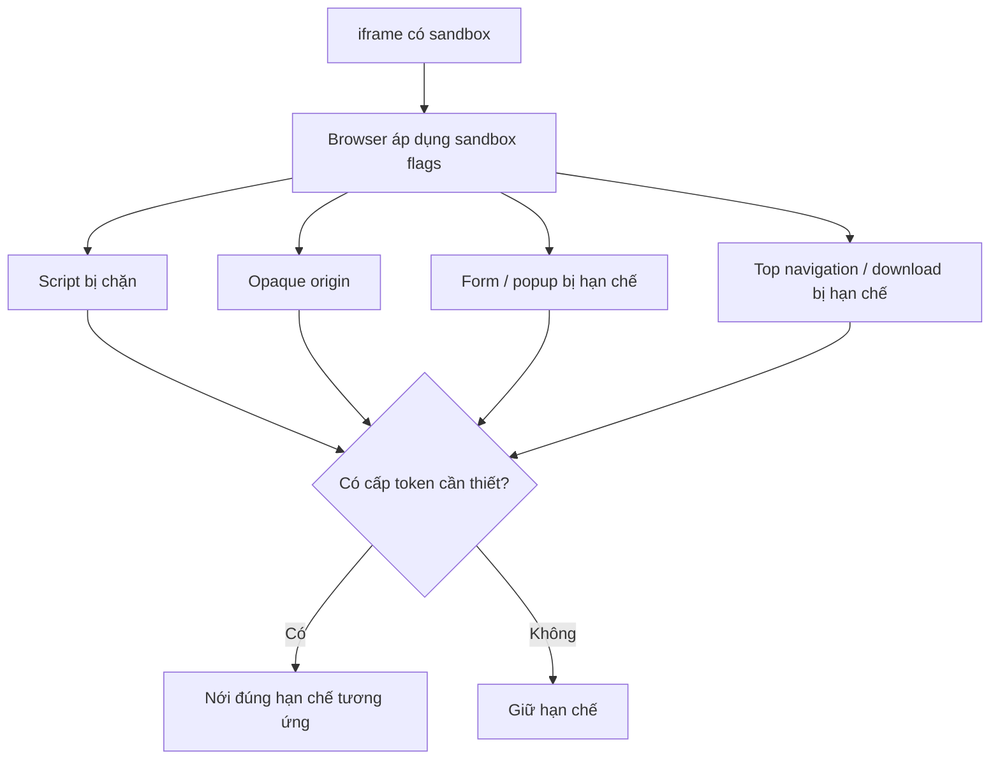

# sandbox attribute

> **Chương:** Iframe  
> **Bài học:** sandbox attribute — giới hạn quyền của nội dung được nhúng trong iframe  
> **Phạm vi module:** **SECURITY_APPLICATION_SECURITY_BROWSER_SECURITY** — phân tích ranh giới bảo mật giữa trình duyệt, origin, cookie và ứng dụng web để hiểu Same-Origin Policy (SOP), CORS và các cơ chế cách ly; thực hành phòng vệ XSS, CSRF, clickjacking bằng CSP, Trusted Types, security headers và kiểm chứng thực tế.

## Mục tiêu học tập

Sau bài này, bạn có thể:

1. Giải thích mục đích của thuộc tính `sandbox` trên `iframe` và các hạn chế mặc định mà browser áp dụng.
2. Đọc và chọn các token `allow-*` theo đúng chức năng mà nội dung nhúng thực sự cần.
3. Phân biệt origin thông thường với opaque origin được tạo bởi sandbox.
4. Nhận diện tổ hợp nguy hiểm `allow-scripts allow-same-origin` khi nội dung nhúng cùng origin với trang cha.
5. Phân biệt `sandbox` với thuộc tính `allow` của Permissions Policy và các directive CSP liên quan đến frame.
6. Thiết kế iframe cho nội dung không tin cậy, `srcdoc`, widget bên thứ ba và frame lồng nhau.
7. Kiểm soát giao tiếp `postMessage` giữa trang cha và frame bị sandbox.
8. Kiểm thử các hạn chế về script, form, popup, điều hướng, download và truy cập storage trong môi trường local.

## 1. sandbox attribute là gì?

`sandbox` là thuộc tính của phần tử `iframe` dùng để yêu cầu browser áp dụng một tập hạn chế lên tài liệu được nhúng. Nó tạo một ranh giới hạn chế quyền của browsing context bên trong iframe, giúp giảm tác động nếu nội dung nhúng có lỗi hoặc chứa mã không đáng tin cậy.

Ví dụ:

```html
<iframe
  src="https://preview.example.net/document/42"
  title="Bản xem trước tài liệu"
  sandbox
></iframe>
```

Viết `sandbox` không kèm giá trị tương đương `sandbox=""`: browser áp dụng các hạn chế sandbox và không cấp các ngoại lệ `allow-*`.

Có thể chỉ định những quyền cần thiết:

```html
<iframe
  src="https://widget.example.net/"
  title="Widget"
  sandbox="allow-scripts"
></iframe>
```

Trong ví dụ này, script được phép chạy trong frame, nhưng các hạn chế sandbox khác vẫn được giữ. Token được cấp là một ngoại lệ cụ thể; nó không tắt toàn bộ sandbox.

### 1.1. Sandbox giới hạn nội dung bên trong frame

Một trang cha có thể nhúng nhiều loại nội dung:

- Trang xem trước do ứng dụng tự tạo.
- HTML do người dùng gửi.
- Widget của đối tác.
- Trình soạn thảo, bản đồ hoặc video.
- Tài liệu hoặc công cụ chạy trong một origin khác.

Nếu nội dung bên trong bị khai thác, sandbox có thể ngăn một số hành vi như chạy script, gửi form, mở popup hoặc điều hướng top-level window. Mức bảo vệ phụ thuộc token đã cấp và các chính sách khác của browser.

### 1.2. Không có token nghĩa là hạn chế tối đa

| Cách khai báo | Ý nghĩa |
|---|---|
| Không có thuộc tính `sandbox` | Không áp dụng sandbox flags từ thuộc tính iframe |
| `sandbox` | Áp dụng sandbox, không cấp ngoại lệ `allow-*` |
| `sandbox=""` | Tương đương `sandbox` |
| `sandbox="allow-scripts"` | Chỉ nới hạn chế thực thi script trong phạm vi token đó |
| `sandbox="allow-forms allow-scripts"` | Cho phép thêm gửi form và chạy script; các hạn chế khác vẫn áp dụng |

Không nên bỏ hẳn sandbox chỉ vì một chức năng bị chặn. Hãy xác định đúng hành vi cần thiết và chỉ cấp token tương ứng.

## 2. Các hạn chế mặc định

Khi iframe có thuộc tính `sandbox`, browser áp dụng các sandbox flags. Những hạn chế quan trọng gồm:

- Script bị vô hiệu hóa nếu không có `allow-scripts`.
- Nội dung được đặt trong một opaque origin nếu không có `allow-same-origin`.
- Form submission bị chặn nếu không có `allow-forms`.
- Popup bị chặn nếu không có `allow-popups`.
- Điều hướng top-level bị hạn chế nếu không có token điều hướng phù hợp.
- Download bị hạn chế nếu không có `allow-downloads`.
- Một số API modal, pointer lock và orientation lock bị hạn chế.
- Nội dung nhúng không thể tự ý loại bỏ sandbox chỉ bằng cách thay đổi DOM của chính nó nếu không có quyền truy cập thích hợp vào phần tử iframe.

Danh sách chính xác và chi tiết hành vi có thể phụ thuộc browser, phiên bản và loại điều hướng. Hãy kiểm thử trên các browser mà sản phẩm hỗ trợ.

### 2.1. Sơ đồ quyền mặc định và ngoại lệ



Một số hạn chế không phải lúc nào cũng biểu hiện thành lỗi giống nhau. Ví dụ, truy cập API storage có thể ném exception vì opaque origin; một thao tác mở popup có thể trả về null hoặc bị browser chặn.

## 3. Các token allow-* thường dùng

Các token là ngoại lệ có chủ đích. Hãy chỉ cấp những gì nội dung nhúng cần để hoàn thành chức năng.

| Token | Quyền được nới | Cần cân nhắc |
|---|---|---|
| `allow-scripts` | Cho phép script chạy trong frame | Script có thể thao tác DOM và gửi request trong phạm vi quyền của frame |
| `allow-same-origin` | Không ép tài liệu thành opaque origin; giữ origin thực của tài liệu | Có thể khôi phục quyền same-origin với các tài liệu cùng origin |
| `allow-forms` | Cho phép gửi form | Form có thể gửi dữ liệu tới endpoint mà frame truy cập được |
| `allow-popups` | Cho phép mở popup/window mới | Popup thường kế thừa sandbox flags |
| `allow-popups-to-escape-sandbox` | Cho popup được mở ra không kế thừa sandbox flags của frame | Chỉ cấp khi popup thực sự cần hoạt động độc lập; thường đi cùng `allow-popups` |
| `allow-top-navigation` | Cho phép frame điều hướng top-level browsing context | Có thể chuyển người dùng khỏi trang cha mà không cần thao tác người dùng |
| `allow-top-navigation-by-user-activation` | Cho phép top navigation khi có user activation hợp lệ | Phù hợp hơn khi chức năng cần chuyển trang sau hành động rõ ràng |
| `allow-top-navigation-to-custom-protocols` | Cho phép điều hướng tới custom protocol trong các trường hợp được browser cho phép | Có thể kích hoạt ứng dụng ngoài browser; cần xem xét kỹ |
| `allow-downloads` | Cho phép nội dung frame khởi tạo download theo quy tắc browser | Download vẫn có thể chịu các giới hạn khác của browser |
| `allow-modals` | Cho phép một số modal API như `alert()`, `confirm()` và `prompt()` | Có thể gây gián đoạn giao diện hoặc lừa người dùng |
| `allow-pointer-lock` | Cho phép Pointer Lock API | Dùng trong game hoặc ứng dụng cần khóa con trỏ |
| `allow-orientation-lock` | Cho phép khóa hướng màn hình | Thường chỉ cần cho trải nghiệm toàn màn hình/thiết bị |
| `allow-presentation` | Cho phép dùng Presentation API | Chỉ cấp khi nội dung cần trình chiếu |
| `allow-storage-access-by-user-activation` | Cho phép frame yêu cầu Storage Access API sau user activation | Không tự cấp quyền cookie cross-site; browser vẫn áp dụng điều kiện riêng |

### 3.1. allow-scripts

Mặc định sandbox chặn JavaScript trong tài liệu nhúng. Khi thêm:

```html
<iframe src="https://widget.example.net/" sandbox="allow-scripts"></iframe>
```

script có thể chạy, nhưng tài liệu vẫn bị sandbox và thường có opaque origin vì chưa được cấp `allow-same-origin`.

Đây là cấu hình có thể dùng cho nội dung cần tương tác nhưng không cần chia sẻ origin với trang cha. Hãy tiếp tục giới hạn form, popup, top navigation và các quyền khác theo nhu cầu.

### 3.2. allow-same-origin

Nếu không có token này, browser ép tài liệu trong frame vào một **opaque origin** riêng. Khi thêm `allow-same-origin`, tài liệu giữ origin bình thường của URL mà nó được tải từ đó.

Ví dụ:

```html
<iframe
  src="https://preview.example.net/"
  sandbox="allow-same-origin"
></iframe>
```

Token này không tự cho phép script chạy. Nếu không có `allow-scripts`, script vẫn bị chặn bởi sandbox.

`allow-same-origin` thường cần khi nội dung nhúng cần dùng cookie, localStorage, IndexedDB hoặc các API phụ thuộc origin bình thường. Tuy nhiên, cấp token này làm thay đổi ranh giới cách ly; hãy xác định rõ origin của nội dung có được tin cậy hay không.

### 3.3. allow-forms

Mặc định form trong frame sandbox không được gửi. Token:

```html
<iframe
  src="https://forms.example.net/"
  sandbox="allow-forms"
></iframe>
```

cho phép form submission. Điều này không tự xác thực dữ liệu và không thay thế CSRF protection, authorization hoặc kiểm tra đích gửi form ở server.

### 3.4. allow-popups và allow-popups-to-escape-sandbox

`allow-popups` cho phép nội dung mở browsing context mới, ví dụ qua `window.open()` hoặc link có `target="_blank"`.

Popup thường kế thừa các sandbox restrictions của frame mở nó. Nếu thêm `allow-popups-to-escape-sandbox`, popup có thể không kế thừa sandbox flags đó.

Không cấp token escape chỉ để làm popup dễ hoạt động. Nếu chỉ cần mở liên kết, cân nhắc link điều hướng có kiểm soát hoặc xử lý sự kiện qua trang cha.

### 3.5. Top navigation

Mặc định frame bị hạn chế khi cố điều hướng trang cha hoặc top-level browsing context.

- `allow-top-navigation` cấp quyền điều hướng rộng hơn.
- `allow-top-navigation-by-user-activation` yêu cầu hành động người dùng đủ điều kiện.
- `allow-top-navigation-to-custom-protocols` liên quan các giao thức tùy chỉnh và có thể mở ứng dụng bên ngoài.

Một widget quảng cáo hoặc nội dung do người dùng tạo thường không cần quyền điều hướng top-level. Nếu chức năng cần chuyển trang, hãy để trang cha thực hiện điều hướng sau khi xác minh message và user action.

## 4. Opaque origin và allow-same-origin

Một trong những tác động quan trọng nhất của sandbox là origin.

### 4.1. Opaque origin là gì?

Origin thông thường được xác định bởi scheme, host và port, ví dụ:

```text
https://app.example:443
```

Khi sandbox không cấp `allow-same-origin`, tài liệu trong frame bị đặt vào một opaque origin. Opaque origin không được xem là cùng origin với URL ban đầu, kể cả khi URL có cùng host với trang cha.

Điều này có nghĩa:

- Same-Origin Policy hạn chế truy cập DOM giữa frame và trang cha.
- Storage API như localStorage có thể không khả dụng hoặc ném `SecurityError`.
- Request từ frame có thể mang origin được serialize thành `null`.
- CORS và server cần xử lý đúng nếu frame gọi API cross-origin.
- `event.origin` trong một số thông điệp `postMessage` từ frame opaque có thể là chuỗi `"null"`.

Chuỗi `"null"` không phải định danh duy nhất của một origin cụ thể. Nhiều opaque origin khác nhau có thể được serialize thành `"null"`.

### 4.2. allow-same-origin không làm frame cùng origin với parent một cách tự động

Giả sử:

- Trang cha: `https://app.example`
- Frame: `https://widget.vendor.example`
- Frame có `sandbox="allow-same-origin"`

Frame giữ origin `https://widget.vendor.example`. Nó vẫn khác origin với `https://app.example`. Token này không xóa Same-Origin Policy và không làm frame có quyền đọc DOM của trang cha.

Nó chỉ bỏ việc ép tài liệu vào opaque origin. Nếu URL frame thực sự cùng origin với parent, lúc đó Same-Origin Policy có thể cho phép truy cập lẫn nhau.

### 4.3. Vì sao opaque origin hữu ích?

Opaque origin giảm quyền truy cập của nội dung nhúng vào tài nguyên cùng origin của ứng dụng. Một đoạn HTML không tin cậy có thể hiển thị và chạy script (nếu được cấp `allow-scripts`) trong sandbox, nhưng không tự động nhận quyền đọc cookie/storage/DOM của ứng dụng chính.

Điều này hữu ích cho:

- HTML preview do người dùng tạo.
- Nội dung import cần xem trước.
- Widget chạy code mẫu.
- Tài liệu hoặc trang con không cần chia sẻ session với parent.

Sandbox vẫn không ngăn mọi request mạng hoặc mọi hành vi độc hại. Cần kết hợp CSP, giới hạn kết nối và kiểm soát giao tiếp.

## 5. Tổ hợp rủi ro: allow-scripts và allow-same-origin

Cấu hình sau cần được xem xét đặc biệt:

```html
<iframe
  src="/untrusted/user-content/preview"
  sandbox="allow-scripts allow-same-origin"
></iframe>
```

Nếu tài liệu trong frame **cùng origin với trang cha**, việc cấp cả hai token có thể làm mất phần lớn giá trị cách ly:

1. `allow-scripts` cho phép JavaScript chạy trong frame.
2. `allow-same-origin` giữ origin thật của tài liệu.
3. Vì frame cùng origin với parent, script có thể truy cập DOM của parent theo Same-Origin Policy.
4. Script có thể truy cập phần tử iframe thông qua `window.frameElement`.
5. Script có thể xóa thuộc tính `sandbox` trên iframe rồi điều hướng/tải lại tài liệu để chạy với các hạn chế đã bị gỡ.

Ví dụ minh họa trong môi trường local cùng origin:

```js
const frameElement = window.frameElement;

if (frameElement) {
  frameElement.removeAttribute('sandbox');
  window.location.reload();
}
```

Đây là lý do không nên nhúng nội dung không tin cậy cùng origin với ứng dụng chính rồi cấp cả `allow-scripts` và `allow-same-origin`.

### 5.1. Cách thiết kế an toàn hơn

- Phục vụ nội dung không tin cậy từ một origin riêng, không chia sẻ cookie với ứng dụng chính.
- Chỉ cấp `allow-scripts` nếu nội dung thật sự cần JavaScript.
- Không cấp `allow-same-origin` nếu nội dung không cần origin/storage bình thường.
- Giữ `allow-forms`, popup và top navigation bị hạn chế trừ khi có yêu cầu rõ.
- Dùng CSP cho cả trang cha và tài liệu nhúng.
- Kiểm tra `postMessage` ở parent theo source, origin và schema.
- Không dựa vào sandbox như biện pháp duy nhất để bảo vệ API hoặc dữ liệu server.

Tách origin chỉ có ích khi cấu hình cookie, DNS, CORS và các endpoint liên quan cũng được thiết kế đúng. Ví dụ, dùng subdomain nhưng cookie có `Domain=.example.com` có thể khiến cookie được chia sẻ rộng hơn dự kiến. Với nội dung không tin cậy, một site riêng biệt thường tạo ranh giới tốt hơn subdomain cùng site.

## 6. Ví dụ cấu hình iframe theo nhu cầu

### 6.1. Hiển thị HTML không tin cậy, không cần script

Đây là cấu hình khởi đầu chặt:

```html
<iframe
  src="https://usercontent-preview.example.net/item/42"
  title="Bản xem trước nội dung"
  sandbox
  referrerpolicy="no-referrer"
  loading="lazy"
></iframe>
```

Nội dung được hiển thị với các hạn chế mặc định. Nếu chỉ cần văn bản, tốt hơn là render bằng text node trong ứng dụng; iframe sandbox phù hợp hơn khi cần cô lập một tài liệu HTML hoàn chỉnh.

### 6.2. Widget cần script nhưng không cần truy cập origin thật

```html
<iframe
  src="https://widget.example.net/embed"
  title="Widget tương tác"
  sandbox="allow-scripts"
  referrerpolicy="strict-origin"
></iframe>
```

Script chạy được, nhưng origin của frame vẫn opaque và các quyền khác tiếp tục bị hạn chế.

### 6.3. Widget của đối tác cần cookie/storage riêng

Nếu một widget cần storage theo origin của chính nó, có thể cần `allow-same-origin`:

```html
<iframe
  src="https://widget.vendor.example/embed"
  title="Widget đối tác"
  sandbox="allow-scripts allow-same-origin"
></iframe>
```

Cấu hình này chỉ hợp lý sau khi đánh giá trust boundary. Vì widget nằm ở origin riêng, nó vẫn không cùng origin với parent. Tuy nhiên, script của widget có đầy đủ quyền trong origin riêng của nó; chỉ cấp token nếu nhà cung cấp và nội dung được tin cậy ở mức tương ứng.

### 6.4. Tách quyền điều hướng khỏi quyền script

Không cần cấp top navigation chỉ vì frame có script:

```html
<iframe
  src="https://widget.example.net/"
  title="Widget"
  sandbox="allow-scripts"
></iframe>
```

Nếu widget cần yêu cầu parent mở một trang, dùng message có schema rõ ràng. Parent kiểm tra đích URL theo allowlist rồi mới điều hướng sau một thao tác người dùng phù hợp.

## 7. sandbox, srcdoc và frame lồng nhau

### 7.1. srcdoc cũng chịu sandbox

`srcdoc` cho phép đặt nội dung HTML trực tiếp trong thuộc tính của iframe:

```html
<iframe
  title="Preview"
  sandbox
  srcdoc="&lt;h1&gt;Bản xem trước&lt;/h1&gt;&lt;p&gt;Nội dung mẫu&lt;/p&gt;"
></iframe>
```

Nội dung `srcdoc` là một document riêng trong browsing context của iframe. Khi sandbox được áp dụng và không có `allow-same-origin`, document này có opaque origin.

Không nên ghép dữ liệu người dùng vào chuỗi `srcdoc` rồi nghĩ sandbox sẽ làm cho mọi nội dung an toàn. Nội dung vẫn cần được xử lý đúng context, và sandbox không thay thế sanitization khi rich HTML là yêu cầu sản phẩm.

### 7.2. Frame lồng nhau không thể tự nới hạn chế của ancestor

Nếu một iframe bị sandbox và bên trong nó tạo thêm iframe, sandbox restrictions từ ancestor có thể được kế thừa bởi browsing context con. Frame lồng nhau không thể tự cấp lại quyền mà ancestor đã cấm.

Ví dụ, nếu frame ngoài không được phép chạy script, việc frame con tự khai báo `allow-scripts` không đủ để vượt qua hạn chế kế thừa từ frame ngoài.

Hãy thiết kế từ frame ngoài cùng: quyền của frame con chịu ảnh hưởng bởi các hạn chế tích lũy từ ancestor và policy của chính nó.

### 7.3. Thay đổi sandbox attribute khi trang đang chạy

Việc thêm/bớt token trên phần tử iframe không phải cách đáng tin để lập tức thay đổi quyền của document đã tải. Các sandbox flags được áp dụng theo vòng đời điều hướng; khi thay policy, hãy điều hướng/nạp lại frame và kiểm thử trạng thái mới.

Không dùng thao tác DOM trên thuộc tính sandbox như một cơ chế thu hồi tức thì đối với mã đã chạy. Nếu cần chấm dứt nội dung không tin cậy, có thể điều hướng frame sang trang trống hoặc loại bỏ frame, đồng thời thu hồi các capability/message channel liên quan ở parent.

## 8. postMessage với iframe sandbox

Khi frame bị sandbox và có opaque origin, trang cha thường không thể đọc DOM của frame do Same-Origin Policy. `postMessage` là cơ chế giao tiếp có kiểm soát giữa các browsing contexts.

### 8.1. Kiểm tra origin và source

Nếu frame có origin thông thường, parent nên kiểm tra cả `event.origin` và `event.source`:

```js
const frame = document.querySelector('#partner-frame');
const trustedOrigin = 'https://widget.vendor.example';

window.addEventListener('message', (event) => {
  if (event.origin !== trustedOrigin) return;
  if (event.source !== frame.contentWindow) return;

  const message = event.data;

  if (
    !message ||
    typeof message !== 'object' ||
    message.type !== 'resize' ||
    !Number.isInteger(message.height)
  ) {
    return;
  }

  const height = Math.min(Math.max(message.height, 120), 1000);
  frame.style.height = height + 'px';
});
```

Hai kiểm tra này phục vụ mục đích khác nhau:

- `event.origin` xác định origin gửi message.
- `event.source` xác định browsing context gửi message có phải frame dự kiến không.

Sau đó vẫn phải validate schema, kiểu dữ liệu, giới hạn số và quyền của từng message. Không dùng dữ liệu message để gán HTML trực tiếp.

### 8.2. Không dùng origin null như danh tính đáng tin

Frame không có `allow-same-origin` có thể gửi message với `event.origin` bằng chuỗi `"null"`. Không viết logic kiểu:

```js
if (event.origin === 'null') {
  trustMessage(event.data);
}
```

Nhiều opaque origin khác nhau đều có thể được serialize thành `"null"`. Giá trị này không xác định một website hay frame đáng tin cụ thể.

Nếu phải nhận message từ frame opaque:

- Kiểm tra `event.source` đúng với `iframe.contentWindow` đã tạo.
- Xác thực cấu trúc, kiểu và giới hạn dữ liệu.
- Chỉ cung cấp các capability hẹp, ví dụ yêu cầu đổi chiều cao hoặc báo trạng thái hoàn tất.
- Không cho frame yêu cầu URL bất kỳ, thao tác tài khoản hoặc hành động đặc quyền.
- Cân nhắc dùng `MessageChannel` để tạo kênh riêng sau khi parent chủ động thiết lập kết nối.
- Nếu cần xác minh danh tính theo origin, cân nhắc phục vụ nội dung từ một origin riêng ổn định thay vì opaque origin.

`event.source` xác định context đang gửi message trong quan hệ với frame đã nhúng, nhưng không tự chứng minh code bên trong frame là an toàn. Nội dung bị xâm nhập vẫn có thể gửi message từ chính context đó.

### 8.3. Chọn targetOrigin khi gửi message

Với frame có origin thông thường, dùng target origin chính xác:

```js
const frame = document.querySelector('#partner-frame');

frame.contentWindow.postMessage(
  { type: 'initialize', locale: 'vi' },
  'https://widget.vendor.example'
);
```

Không dùng `"*"` nếu đã biết origin đích. Nếu đích là opaque origin, không thể chỉ định một origin cụ thể bằng chuỗi origin thông thường; khi đó cần thiết kế giao thức message cẩn thận, giới hạn dữ liệu gửi và kiểm tra nguồn nhận ở phía bên kia.

### 8.4. Không biến message thành lệnh tùy ý

Tránh giao thức tổng quát như:

```json
{
  "type": "execute",
  "command": "..."
}
```

Hoặc message chứa HTML tùy ý để parent render. Hãy định nghĩa các message nhỏ theo nghiệp vụ:

```json
{
  "version": 1,
  "type": "resize",
  "height": 480
}
```

Parent chỉ chấp nhận loại message đã biết, kiểm tra version và giới hạn giá trị. Các hành động nhạy cảm phải được xác minh độc lập ở parent/server.

## 9. Phân biệt sandbox với các chính sách khác

Sandbox là một lớp trong mô hình bảo vệ iframe. Nó không thay thế CSP, Permissions Policy, Same-Origin Policy hay authorization ở server.

| Cơ chế | Vai trò | Ví dụ |
|---|---|---|
| iframe `sandbox` | Giới hạn quyền của browsing context được nhúng | Chặn script, form, popup hoặc top navigation trừ khi được cấp |
| Same-Origin Policy | Giới hạn truy cập DOM/storage/response giữa origin khác nhau | Widget khác origin không đọc DOM parent |
| CORS | Điều khiển JavaScript có thể đọc response cross-origin hay không | API cho phép origin widget đọc response cụ thể |
| CSP `frame-src` | Parent giới hạn nguồn iframe được tải | Chỉ cho phép frame từ origin preview |
| CSP `frame-ancestors` | Tài liệu được tải quy định ai có thể nhúng nó | Trang admin chỉ cho phép được nhúng bởi origin được duyệt |
| CSP `sandbox` | Áp dụng sandbox restrictions từ response của chính tài liệu | Server trả policy sandbox cho document |
| Permissions Policy / iframe `allow` | Giới hạn tính năng browser được cấp cho frame | camera, microphone, geolocation, autoplay |
| Server authorization | Kiểm tra quyền truy cập tài nguyên và hành động | API xác minh user có quyền đọc tài liệu |

### 9.1. frame-src và frame-ancestors

Trang cha có thể giới hạn nguồn frame:

```http
Content-Security-Policy: frame-src https://preview.example.net https://widget.vendor.example
```

Tài liệu được nhúng có thể giới hạn ai được phép nhúng nó:

```http
Content-Security-Policy: frame-ancestors https://app.example
```

Hai directive có hướng kiểm soát khác nhau:

- `frame-src` nằm ở policy của parent và kiểm soát nơi parent được tải frame.
- `frame-ancestors` nằm ở policy của tài liệu được nhúng và kiểm soát ancestor nào được phép chứa tài liệu đó.

### 9.2. CSP sandbox

Server của tài liệu có thể gửi:

```http
Content-Security-Policy: sandbox allow-scripts
```

Directive này áp dụng sandbox restrictions cho tài liệu theo policy của response. Nó là lớp kiểm soát do tài liệu/response đặt ra; parent không thể dùng thuộc tính iframe để nới một hạn chế CSP sandbox mà response đã áp dụng.

CSP sandbox cần được gửi bằng HTTP response header. Không dựa vào meta tag để triển khai directive này.

### 9.3. iframe allow và Permissions Policy

Ví dụ:

```html
<iframe
  src="https://meeting.example.net/"
  title="Cuộc họp"
  sandbox="allow-scripts"
  allow="camera; microphone"
></iframe>
```

`sandbox` và `allow` giải quyết hai nhóm quyền khác nhau:

- `sandbox` giới hạn các hành vi của browsing context.
- `allow` truyền Permissions Policy cho các tính năng như camera/microphone trong phạm vi được browser và policy cấp.

Việc thêm `allow="camera; microphone"` không tự bảo đảm thiết bị được cấp quyền; Permissions Policy ở ancestor, quyền người dùng và browser vẫn có thể chặn.

## 10. Sandbox không thay thế các biện pháp bảo vệ ứng dụng

### 10.1. Không thay output encoding và HTML sanitization

Nếu ứng dụng render HTML không tin cậy trong iframe sandbox, sandbox giảm quyền của document đó. Tuy vậy, nội dung vẫn có thể giả mạo giao diện bên trong frame, thực hiện hành vi được cấp và gây nhầm lẫn cho người dùng.

Khi hiển thị text, dùng `textContent`. Khi cần rich HTML, dùng sanitizer theo allowlist. Sandbox là lớp bổ sung cho nội dung cần chạy trong document riêng.

### 10.2. Không thay CSRF protection

Nếu frame được cấp `allow-forms` hoặc script có thể gửi request, các request vẫn cần được bảo vệ theo mô hình xác thực của server. Cookie SameSite, CSRF token, kiểm tra Origin/Referer phù hợp và authorization vẫn có vai trò riêng.

Không cho rằng sandbox mặc định sẽ bảo vệ mọi endpoint của ứng dụng khỏi request do các trang khác tạo ra.

### 10.3. Không thay clickjacking protection

Sandbox giới hạn hành vi của nội dung bên trong frame. Nó không tự ngăn trang của bạn bị một website khác nhúng.

Để kiểm soát ai được nhúng trang, dùng `frame-ancestors` trong CSP hoặc cơ chế header tương thích phù hợp. Với nội dung bạn nhúng, dùng `frame-src` để giới hạn nguồn và `sandbox` để giới hạn quyền của frame.

### 10.4. Không thay server-side authorization

Một frame bị sandbox vẫn có thể gọi những endpoint mà server cho phép theo credentials và chính sách của request. API phải tự xác minh danh tính, quyền sở hữu và quyền thực hiện hành động. Không dùng sandbox token hoặc trạng thái UI làm bằng chứng authorization.

## 11. Các tình huống thiết kế thường gặp

### 11.1. HTML preview do người dùng tạo

Mục tiêu là cho phép xem trước HTML nhưng không cho nội dung đó có quyền của ứng dụng chính.

Thiết kế gợi ý:

- Lưu nội dung như dữ liệu không tin cậy.
- Phục vụ preview từ origin riêng, không dùng chung cookie với ứng dụng chính.
- Dùng iframe có `sandbox` và chỉ cấp `allow-scripts` nếu preview cần script.
- Không cấp `allow-same-origin` nếu preview không cần storage/origin bình thường.
- Giới hạn tải tài nguyên bằng CSP của tài liệu preview.
- Dùng `frame-src` để parent chỉ tải preview từ origin đã chọn.
- Không đưa token phiên hoặc dữ liệu nhạy cảm vào URL preview.
- Dùng `postMessage` có schema nhỏ nếu cần đồng bộ chiều cao/trạng thái.

Nếu chỉ cần xem nội dung văn bản hoặc một tập rich text đơn giản, render đã sanitize trong một vùng của trang có thể ít phức tạp hơn iframe.

### 11.2. Widget thanh toán hoặc đăng nhập của đối tác

Widget có thể cần script, cookie riêng và giao tiếp với parent. Trước khi cấp token, hãy hỏi:

- Widget có chạy trên origin riêng do đối tác kiểm soát không?
- Nó có cần cookie/storage của origin riêng không?
- Nó có cần mở popup hoặc điều hướng top-level không?
- Nó có cần gửi form không?
- Nó có gửi message cho parent không?
- Có SDK hoặc luồng redirect được hỗ trợ chính thức không?

Chỉ cấp những quyền có lý do nghiệp vụ rõ ràng. Đặc biệt, không cấp top navigation hoặc popup escape chỉ vì tài liệu hướng dẫn cũ yêu cầu mà chưa đánh giá rủi ro.

### 11.3. Trình chạy code mẫu

Nếu ứng dụng cho người học chạy JavaScript/HTML do họ viết:

- Đặt nội dung chạy trong origin riêng.
- Dùng iframe sandbox.
- Cấp `allow-scripts` nếu mục tiêu là chạy code.
- Không cấp `allow-same-origin` nếu không cần quyền origin/storage.
- Hạn chế network bằng CSP của trang chạy code.
- Giới hạn thời gian, bộ nhớ và số lượng tài nguyên ở tầng hạ tầng nếu có.
- Không cung cấp secret, cookie hoặc API nội bộ cho frame.
- Dùng message protocol hẹp để gửi kết quả về parent.

Sandbox không phải một container hệ điều hành và không phải ranh giới tài nguyên hoàn chỉnh. Nếu chạy code không tin cậy có nguy cơ tiêu thụ CPU/memory hoặc truy cập mạng, cần thêm giới hạn ở server/hạ tầng.

## 12. Thực hành A — Quan sát sandbox mặc định

Thực hiện trong file HTML local riêng. Không dùng trang đang đăng nhập hoặc dữ liệu thật.

### Bước 1: Tạo trang cha

```html
<!doctype html>
<html lang="vi">
<head>
  <meta charset="utf-8">
  <title>Sandbox lab</title>
</head>
<body>
  <h1>Trang cha</h1>

  <iframe
    id="demo"
    title="Frame thử nghiệm"
    sandbox
    srcdoc="<p>Frame đã tải</p><script>document.body.dataset.ran='yes'</script>"
  ></iframe>
</body>
</html>
```

### Bước 2: Quan sát

1. Mở trang local trong browser.
2. Mở DevTools và chọn iframe trong Elements.
3. Kiểm tra nội dung frame có hiển thị không.
4. Kiểm tra `document.body.dataset.ran` trong frame nếu DevTools cho phép chọn execution context.
5. Quan sát Console để thấy script bị sandbox chặn.
6. Ghi nhận frame có thể hiển thị HTML dù script không chạy.

### Kết quả mong đợi

Document trong frame được hiển thị, nhưng script không chạy vì chưa cấp `allow-scripts`.

## 13. Thực hành B — Cấp allow-scripts và quan sát opaque origin

Trong file lab, đổi thành:

```html
<iframe
  id="demo"
  title="Frame thử nghiệm"
  sandbox="allow-scripts"
  srcdoc="<p>Frame đã tải</p><script>document.body.dataset.ran='yes'</script>"
></iframe>
```

1. Reload trang.
2. Quan sát script đã chạy bằng thuộc tính `data-ran`.
3. Thử truy cập localStorage trong execution context của frame.
4. Quan sát khả năng ném `SecurityError` do opaque origin.
5. Gửi một message từ frame về parent và kiểm tra `event.origin`.
6. Ghi nhận origin có thể được serialize thành `"null"`.

Không dùng `event.origin === "null"` làm điều kiện tin cậy. Đây chỉ là giá trị serialize của opaque origin.

## 14. Thực hành C — Kiểm tra allow-same-origin

Trong môi trường local cô lập, thay token thành:

```html
<iframe
  id="demo"
  title="Frame thử nghiệm"
  sandbox="allow-scripts allow-same-origin"
  src="/sandbox-lab/child.html"
></iframe>
```

Đặt file child ở cùng origin với trang cha. Kiểm tra:

1. Script trong child chạy.
2. Child giữ origin bình thường của URL.
3. Nếu cùng origin, child có thể truy cập `window.frameElement`.
4. Quan sát vì sao child có thể thay đổi thuộc tính sandbox của iframe cha.
5. Xác minh việc điều hướng/reload sau khi thay đổi có thể làm thay đổi các hạn chế áp dụng.

Chỉ thực hiện trên file local do bạn kiểm soát. Thí nghiệm cho thấy vì sao tổ hợp này không phù hợp cho nội dung không tin cậy cùng origin với ứng dụng.

## 15. Thực hành D — Kiểm tra form, popup và top navigation

Tạo một trang child local có form, nút mở popup và link điều hướng top-level:

```html
<form action="/sandbox-lab/submit" method="get">
  <button type="submit">Gửi form</button>
</form>

<button id="popup">Mở cửa sổ mới</button>

<a href="/sandbox-lab/destination" target="_top">Điều hướng trang cha</a>

<script>
  document.querySelector('#popup').addEventListener('click', () => {
    window.open('/sandbox-lab/popup', '_blank');
  });
</script>
```

Kiểm tra với các cấu hình:

- `sandbox` không token.
- `sandbox="allow-scripts"`.
- `sandbox="allow-scripts allow-forms"`.
- `sandbox="allow-scripts allow-popups"`.
- `sandbox="allow-scripts allow-top-navigation-by-user-activation"`.

Ghi lại thao tác nào được phép, thao tác nào bị browser chặn và Console báo gì. Thực hiện trên local để không vô tình gửi form hoặc điều hướng tới website thật.

## 16. Thực hành E — postMessage an toàn

Trang cha chỉ nhận message từ frame dự kiến và kiểm tra schema:

```js
const frame = document.querySelector('#demo');

window.addEventListener('message', (event) => {
  if (event.source !== frame.contentWindow) return;

  const data = event.data;

  if (
    !data ||
    typeof data !== 'object' ||
    data.version !== 1 ||
    data.type !== 'resize' ||
    !Number.isInteger(data.height)
  ) {
    return;
  }

  const height = Math.min(Math.max(data.height, 120), 900);
  frame.style.height = height + 'px';
});
```

Nếu frame có origin ổn định và được tin cậy ở mức phù hợp, bổ sung kiểm tra `event.origin` bằng origin chính xác. Nếu frame opaque, `event.origin` có thể là `"null"`; cần dựa vào context đã chọn, schema hẹp và capability đã cấp, không coi `"null"` là danh tính.

Kiểm thử:

- Gửi message hợp lệ với chiều cao trong giới hạn.
- Gửi message có type không biết.
- Gửi height là chuỗi, số âm hoặc số quá lớn.
- Gửi message từ một iframe khác.
- Xác minh parent chỉ thực hiện hành động đã định nghĩa.

## 17. Checklist khi cấu hình sandbox

| Hạng mục | Câu hỏi cần trả lời |
|---|---|
| Nguồn | Frame tải từ origin nào? Ai kiểm soát nội dung ở đó? |
| Trust boundary | Nội dung có cùng origin/site với parent không? |
| Default | Có thể dùng `sandbox` không token trước không? |
| Scripts | Có thật sự cần `allow-scripts` không? |
| Origin | Có thật sự cần `allow-same-origin` không? |
| Combination | Nếu cấp cả hai token, nội dung có cùng origin với parent không? |
| Forms | Có cần `allow-forms` không? Server có CSRF/authorization không? |
| Popups | Có cần `allow-popups`? Có cần popup escape không? |
| Navigation | Có cần top navigation? Có thể yêu cầu parent điều hướng sau user action không? |
| Downloads | Có cần `allow-downloads` không? |
| Storage | Có cần cookie/localStorage? Có thể dùng origin riêng không? |
| srcdoc | Dữ liệu có được encode/sanitize đúng context trước khi gán không? |
| Nested frames | Ancestor restrictions có được hiểu và kiểm thử không? |
| postMessage | Có kiểm tra source, origin, schema và giới hạn dữ liệu không? |
| CSP | Parent có `frame-src`, child có policy phù hợp và `frame-ancestors` không? |
| Permissions Policy | Có chỉ cấp camera/microphone/geolocation khi thật sự cần không? |
| Server | API có tự xác thực và phân quyền không? |
| Testing | Đã kiểm thử script, form, popup, navigation, storage và download trên browser mục tiêu chưa? |

## 18. Câu hỏi tự kiểm tra

**1.** Thuộc tính `sandbox` không có token có ý nghĩa gì?  
**Đáp án:** Browser áp dụng các sandbox restrictions mà không cấp các ngoại lệ `allow-*`.

**2.** `allow-scripts` cho phép điều gì?  
**Đáp án:** Cho phép script chạy trong frame; các hạn chế khác vẫn tiếp tục áp dụng.

**3.** Opaque origin xuất hiện khi nào trong iframe sandbox?  
**Đáp án:** Khi sandbox được áp dụng mà không có `allow-same-origin`, tài liệu bị ép vào một origin opaque.

**4.** `event.origin === "null"` có chứng minh message đến từ frame đáng tin không?  
**Đáp án:** Không. Nhiều opaque origin có thể serialize thành `"null"`.

**5.** `allow-same-origin` có làm iframe khác origin trở thành cùng origin với parent không?  
**Đáp án:** Không. Nó giữ origin thật của tài liệu; Same-Origin Policy vẫn phân biệt hai origin khác nhau.

**6.** Vì sao `allow-scripts allow-same-origin` nguy hiểm với nội dung cùng origin?  
**Đáp án:** Script có thể truy cập parent/iframe element, gỡ thuộc tính sandbox và reload trong một số cấu hình cùng origin, làm mất ranh giới dự kiến.

**7.** `allow-popups` và `allow-popups-to-escape-sandbox` khác nhau thế nào?  
**Đáp án:** Token đầu cho phép mở popup; token sau cho popup thoát khỏi sandbox flags được kế thừa.

**8.** `allow-forms` có thay CSRF protection không?  
**Đáp án:** Không. Nó chỉ nới hạn chế gửi form trong frame; server vẫn cần xác minh request.

**9.** `frame-src` và `frame-ancestors` khác nhau thế nào?  
**Đáp án:** `frame-src` kiểm soát nguồn frame mà parent được tải; `frame-ancestors` kiểm soát ai được phép nhúng tài liệu hiện tại.

**10.** Thuộc tính `allow` của iframe có giống `sandbox` không?  
**Đáp án:** Không. `allow` truyền Permissions Policy cho các tính năng browser như camera hoặc microphone; `sandbox` giới hạn browsing context.

**11.** Sandbox có ngăn trang của bạn bị clickjacking không?  
**Đáp án:** Không. Cần kiểm soát việc ai được nhúng trang bằng `frame-ancestors` hoặc header tương ứng.

**12.** Có thể dùng sandbox thay server-side authorization không?  
**Đáp án:** Không. Mỗi API vẫn phải tự xác minh danh tính và quyền truy cập.

## Ghi nhớ

**`sandbox` giới hạn quyền của document bên trong iframe theo nguyên tắc mặc định khóa và chỉ mở ngoại lệ cần thiết.** Không cấp token một cách tùy tiện. Đặc biệt, tránh kết hợp `allow-scripts` và `allow-same-origin` cho nội dung không tin cậy cùng origin với parent vì script có thể gỡ sandbox và tải lại frame.

Opaque origin giúp cô lập nội dung nhưng làm thay đổi hành vi storage, CORS và `postMessage`; giá trị origin `"null"` không phải danh tính. Hãy tách origin cho nội dung không tin cậy, dùng `frame-src`/`frame-ancestors` và CSP phù hợp, phân biệt `sandbox` với Permissions Policy, kiểm tra message theo source/origin/schema, và luôn giữ authorization ở server.

