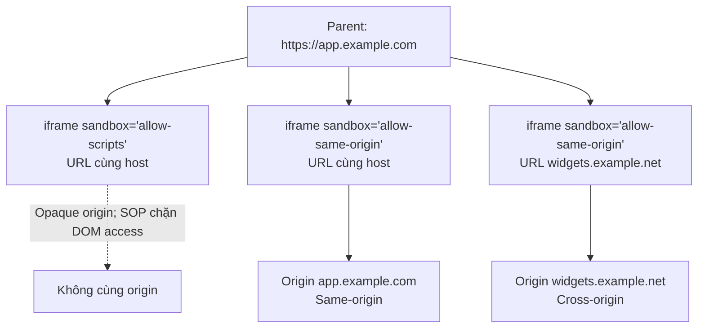

# Origin của sandbox frame: hiểu opaque origin và ranh giới tin cậy của iframe

## 1. Sandbox frame thay đổi origin như thế nào?

Thuộc tính **sandbox** của phần tử **iframe** áp dụng một tập hạn chế cho tài liệu được nhúng. Nếu không cấp token **allow-same-origin**, tài liệu trong frame bị ép dùng một **opaque origin** (origin mờ, không có định danh scheme/host/port thông thường), kể cả khi URL của frame cùng URL với trang cha.

Ví dụ:

```html
<iframe src="https://app.example.com/widget"></iframe>
```

Frame trên hoạt động theo origin bình thường của URL và vẫn chịu các chính sách khác. Nhưng:

```html
<iframe
  src="https://app.example.com/widget"
  sandbox="allow-scripts">
</iframe>
```

Frame được phép chạy script, nhưng do thiếu **allow-same-origin**, tài liệu bên trong có opaque origin. Nó không còn same-origin với trang cha, ngay cả khi hai URL có cùng scheme, host và port.

Một opaque origin được serialize thành chuỗi **"null"** trong một số API và header, ví dụ MessageEvent.origin hoặc request Origin. Chuỗi **"null"** không phải một origin cụ thể và không nên được xem là danh tính đáng tin cậy.

**Nguyên tắc:** sandbox không có allow-same-origin tạo ranh giới origin riêng cho nội dung nhúng. Chỉ thêm token này khi nội dung thực sự cần hành vi origin thông thường và đã đánh giá tác động với các token khác, đặc biệt allow-scripts.

Bài viết thuộc chương **Iframe** của module **SECURITY_APPLICATION_SECURITY_BROWSER_SECURITY**. Nội dung kết nối origin sandbox với Same-Origin Policy (SOP), CORS, cookie, storage, postMessage, CSP, XSS và cách cô lập nội dung nhúng.

Sau bài học, bạn có thể:

- Giải thích opaque origin được tạo ra khi sandbox thiếu allow-same-origin.
- Phân biệt origin bình thường, opaque origin và chuỗi serialization "null".
- Hiểu các token sandbox ảnh hưởng đến script, origin, form, popup và top-level navigation.
- Phân tích tác động đến SOP, DOM access, storage, cookie và CORS.
- Thiết kế trao đổi message an toàn hơn giữa parent và sandboxed frame.
- Nhận diện cấu hình nguy hiểm kết hợp allow-scripts và allow-same-origin trên nội dung cùng origin.
- Kiểm chứng hành vi bằng một lab local và DevTools.

## 2. Origin bình thường và opaque origin

### 2.1. Origin bình thường

Với URL HTTP(S), origin thông thường được xác định bởi ba thành phần:

- **Scheme:** ví dụ https.
- **Host:** ví dụ app.example.com.
- **Port:** cổng hiệu lực, ví dụ 443 hoặc 8443.

Ví dụ hai URL sau cùng origin:

```text
https://app.example.com/profile
https://app.example.com/settings
```

Path không thuộc origin. Hai URL khác port hoặc khác scheme là khác origin:

```text
https://app.example.com
https://app.example.com:8443
http://app.example.com
```

Same-Origin Policy sử dụng origin để giới hạn việc một tài liệu hoặc script truy cập dữ liệu của tài liệu khác.

### 2.2. Opaque origin

Opaque origin là một origin duy nhất không được biểu diễn bằng bộ ba scheme/host/port thông thường. Nó được dùng trong một số ngữ cảnh cô lập, bao gồm tài liệu bị sandbox mà không có allow-same-origin.

Đặc điểm quan trọng:

- Opaque origin không same-origin với origin của trang cha, kể cả khi URL frame có cùng hostname.
- Nó cũng không same-origin với một opaque origin khác.
- Khi serialize qua một số API, nó được biểu diễn bằng chuỗi "null".
- Không thể suy ra hai tài liệu cùng origin chỉ vì cả hai trả về chuỗi "null".

Ví dụ, hai iframe sandbox độc lập có thể cùng báo event.origin là "null", nhưng mỗi frame có opaque origin riêng. Chuỗi serialization giống nhau không có nghĩa chúng được cùng một vùng bảo mật.

### 2.3. So sánh các trường hợp

Giả sử trang cha ở https://app.example.com:

| Cấu hình frame | Origin của tài liệu trong frame | Same-origin với parent? |
|---|---|---:|
| Không có sandbox, URL cùng origin | Origin bình thường của app.example.com | Có |
| sandbox="", URL cùng origin | Opaque origin | Không |
| sandbox="allow-scripts", URL cùng origin | Opaque origin | Không |
| sandbox="allow-same-origin", URL cùng origin | Origin bình thường của app.example.com | Có |
| sandbox="allow-same-origin", URL ở widgets.example.net | Origin bình thường của widgets.example.net | Không |
| sandbox="allow-scripts allow-same-origin", URL cùng origin | Origin bình thường của app.example.com | Có; cần đặc biệt thận trọng |

allow-same-origin có nghĩa là không ép tài liệu sang opaque origin; tài liệu giữ origin mà URL của nó vốn có. Token này **không biến một website khác origin thành cùng origin với parent**.

### 2.4. Sơ đồ ranh giới origin



Sơ đồ giả định các URL được nêu và không có cơ chế khác thay đổi việc tạo tài liệu. Sandbox flags vẫn có thể hạn chế script, form, popup hoặc navigation ngay cả khi origin được giữ bình thường.

## 3. Token sandbox ảnh hưởng origin và khả năng nào?

Không có token nào được cấp nghĩa là browser áp dụng các hạn chế sandbox mặc định. Mỗi token gỡ bỏ một nhóm hạn chế cụ thể; chỉ cấp những quyền mà nội dung thực sự cần.

| Token | Hiệu lực khái quát | Liên quan origin? |
|---|---|---|
| allow-scripts | Cho phép script chạy trong tài liệu | Không tự bỏ opaque origin |
| allow-same-origin | Giữ origin bình thường của URL thay vì ép opaque origin | Có, trực tiếp |
| allow-forms | Cho phép submit form | Không trực tiếp |
| allow-popups | Cho phép mở popup/window | Không trực tiếp |
| allow-popups-to-escape-sandbox | Popup được mở có thể không kế thừa sandbox flags của frame mở nó | Ảnh hưởng phạm vi sandbox của popup |
| allow-top-navigation | Cho phép điều hướng top-level browsing context | Không trực tiếp |
| allow-top-navigation-by-user-activation | Cho phép điều hướng top-level khi có user activation | Không trực tiếp |
| allow-downloads | Cho phép tải xuống từ frame | Không trực tiếp |
| allow-modals | Cho phép một số modal dialog như alert/confirm/prompt | Không trực tiếp |
| allow-pointer-lock | Cho phép pointer lock | Không trực tiếp |
| allow-presentation | Cho phép presentation session | Không trực tiếp |
| allow-orientation-lock | Cho phép khóa orientation trong trường hợp hỗ trợ | Không trực tiếp |
| allow-storage-access-by-user-activation | Cho phép yêu cầu Storage Access API sau user activation trong điều kiện hỗ trợ | Liên quan quyền truy cập cookie/storage |

Token có thể khác nhau về hỗ trợ theo browser và phiên bản. Hãy kiểm tra compatibility và thử nghiệm trên các browser mà sản phẩm hỗ trợ.

### 3.1. allow-scripts không đồng nghĩa allow-same-origin

Cấu hình:

```html
<iframe src="/untrusted-widget" sandbox="allow-scripts"></iframe>
```

cho phép JavaScript chạy trong frame, nhưng tài liệu vẫn có opaque origin. Script không tự nhiên có quyền truy cập DOM của parent cùng URL như một tài liệu same-origin bình thường.

Đây là một cấu hình thường dùng khi cần nội dung có tương tác nhưng muốn giữ ranh giới origin do sandbox tạo ra. Tuy nhiên, frame vẫn có thể thực hiện các hành vi được sandbox hoặc các chính sách khác cho phép; không nên xem sandbox là cơ chế thay thế mọi kiểm soát quyền.

### 3.2. allow-same-origin không cấp quyền chạy script

Cấu hình:

```html
<iframe src="/untrusted-widget" sandbox="allow-same-origin"></iframe>
```

giữ origin bình thường của tài liệu nhưng không tự gỡ hạn chế script. Nếu thiếu allow-scripts, script vẫn bị sandbox chặn.

Với URL khác origin, allow-same-origin chỉ giữ origin riêng của URL đó; SOP vẫn ngăn frame truy cập DOM parent.

### 3.3. Kết hợp allow-scripts và allow-same-origin

Đây là cấu hình cần đánh giá kỹ:

```html
<iframe
  src="/untrusted-widget"
  sandbox="allow-scripts allow-same-origin">
</iframe>
```

Nếu nội dung frame cùng origin với parent, script trong frame có thể được hưởng quyền same-origin và truy cập DOM của parent. Trong một số cấu hình cùng origin, nội dung đó có thể truy cập phần tử iframe chứa nó, loại bỏ thuộc tính sandbox rồi điều hướng/tải lại để thoát khỏi các hạn chế sandbox.

Vì vậy, tài liệu HTML cảnh báo không nên kết hợp hai token này cho nội dung cùng origin nếu mục tiêu là cô lập. Nếu ứng dụng cần chạy script của bên thứ ba hoặc nội dung không tin cậy, hãy phục vụ nội dung trên origin riêng và chỉ cấp quyền tối thiểu.

## 4. Sandbox origin và Same-Origin Policy

### 4.1. Parent không thể đọc DOM của opaque-origin frame

Giả sử parent và iframe có cùng URL:

```html
<iframe id="child" src="/child.html" sandbox="allow-scripts"></iframe>
```

Do sandbox tạo opaque origin, parent không thể truy cập DOM nội bộ như với iframe cùng origin thông thường:

```js
const frame = document.getElementById("child");

// Truy cập document của frame sẽ bị chặn bởi SOP.
console.log(frame.contentWindow.document.body);
```

Browser sẽ ném lỗi bảo mật khi code cố đọc tài liệu cross-origin. Parent vẫn có thể giữ tham chiếu contentWindow và trao đổi message theo cơ chế postMessage.

### 4.2. Child cũng không thể đọc DOM parent

Script trong sandboxed frame với opaque origin không thể truy cập DOM của parent chỉ vì hai URL ban đầu giống nhau:

```js
// Chạy trong sandboxed frame không có allow-same-origin:
console.log(parent.document.body);
```

SOP áp dụng theo origin thực tế của tài liệu sau sandboxing. URL giống nhau không xóa được opaque origin.

### 4.3. about:blank và srcdoc

Một số URL đặc biệt có hành vi origin kế thừa trong điều kiện thông thường:

- about:blank thường kế thừa origin của creator/opener.
- srcdoc thường dùng origin của tài liệu nhúng tạo ra nó.

Khi các tài liệu này nằm trong iframe sandbox thiếu allow-same-origin, sandbox vẫn có thể ép chúng thành opaque origin. Không suy luận origin chỉ từ chuỗi URL hiển thị; hãy xét sandbox flags và ngữ cảnh tạo tài liệu.

### 4.4. document.domain không phải cách sửa

document.domain từng được dùng để nới lỏng SOP giữa một số subdomain, nhưng đã bị deprecated và không phải giải pháp cho opaque origin. Một tài liệu opaque không thể dùng document.domain để biến mình thành origin bình thường hoặc cùng origin với parent.

Thiết kế hiện đại nên dùng origin rõ ràng, postMessage với kiểm tra phù hợp hoặc API giao tiếp có quyền hẹp, thay vì nới lỏng ranh giới bằng document.domain.

## 5. Serialization "null" và các API web

### 5.1. "null" là cách biểu diễn, không phải danh tính

Một opaque origin thường serialize thành chuỗi "null". Ví dụ, script trong sandboxed frame có thể kiểm tra:

```js
console.log(location.origin); // "null" trong tài liệu opaque
```

Chuỗi này không chứa hostname, port hoặc scheme. Nhiều loại tài liệu khác cũng có thể có opaque origin và serialize giống nhau, tùy ngữ cảnh và browser.

Không dùng điều kiện sau làm allowlist tin cậy:

```js
if (event.origin === "null") {
  // Sai: không chứng minh sender là frame mong đợi.
}
```

Nếu ứng dụng chấp nhận message từ mọi sender có origin serialization là "null", nó có thể tin nhầm nhiều tài liệu opaque không liên quan.

### 5.2. Request Origin có thể là null

Một request phát sinh từ opaque-origin document có thể gửi header:

```http
Origin: null
```

Server có thể thấy giá trị này trong một số request CORS hoặc request có Origin header. null không xác định được website nào đã khởi tạo request.

Không cấu hình server phản chiếu mọi Origin vào Access-Control-Allow-Origin. Đặc biệt, không xem Origin: null là một client đáng tin và không bật credentialed CORS cho nó chỉ vì một ứng dụng nhúng cần hoạt động.

### 5.3. Opaque origin và storage

Một tài liệu opaque không có origin tuple ổn định để làm khóa storage như một website HTTP(S) thông thường. Các API như localStorage có thể ném SecurityError khi truy cập từ opaque origin; hành vi và giới hạn của từng storage API có thể khác nhau theo browser.

Không dựa vào localStorage/sessionStorage để lưu trạng thái bền vững cho một sandboxed opaque-origin document. Nếu frame cần dữ liệu, hãy truyền phần dữ liệu tối thiểu qua một kênh message được thiết kế rõ ràng hoặc dùng backend/API với quyền hạn giới hạn.

### 5.4. Cookie không được quyết định chỉ bởi chuỗi origin

Opaque origin không có nghĩa browser không có cookie jar hoặc mọi request chắc chắn không mang cookie. Cookie được gửi còn phụ thuộc URL đích, credentials mode, SameSite context, Secure, third-party cookie controls và chính sách riêng tư của browser.

Đối với fetch từ sandboxed document:

- credentials: "same-origin" không tự động gửi credential tới URL khác origin với opaque environment origin.
- credentials: "include" yêu cầu gửi credential theo chế độ include nhưng vẫn chịu quy tắc cookie, SameSite, CORS và third-party cookie controls.
- Điều hướng hoặc form submission có quy tắc gửi cookie khác với Fetch API.

Không dùng sandbox origin như một biện pháp duy nhất để bảo vệ session cookie. Cấu hình cookie an toàn và kiểm tra quyền/CSRF ở server vẫn cần thiết.

## 6. Sandbox, CORS và request từ frame

### 6.1. CORS kiểm soát việc đọc response

CORS quyết định JavaScript cross-origin có được đọc response hay không. Nó không phải cơ chế ngăn mọi request cross-origin được gửi.

Một sandboxed frame có thể bị hạn chế origin nhưng vẫn có thể gửi một số request bằng form, navigation, image hoặc fetch tùy quyền và chính sách. Nếu response không có CORS header phù hợp, script có thể không đọc được response, nhưng request vẫn có thể đã đến server.

### 6.2. Không allowlist Origin: null một cách rộng rãi

Ví dụ cấu hình nguy hiểm:

```http
Access-Control-Allow-Origin: null
Access-Control-Allow-Credentials: true
Access-Control-Allow-Methods: GET, POST
Access-Control-Allow-Headers: Content-Type
```

Nếu server cho phép null với credential, nhiều loại opaque-origin document có thể nằm trong nhóm được cho phép. Attacker có thể tạo một context opaque khác và thử gọi endpoint; việc có khai thác được hay không còn phụ thuộc cookie, request mode, SameSite, third-party cookie policy và các kiểm soát khác.

Hãy dùng allowlist origin cụ thể khi có thể. Nếu cần hỗ trợ nội dung sandbox, cân nhắc một origin riêng có tên miền rõ ràng thay vì dựa vào chuỗi null.

### 6.3. Form request và CSRF vẫn cần bảo vệ

Ngay cả khi CORS ngăn script đọc response, browser có thể gửi request thay đổi trạng thái qua form hoặc navigation nếu endpoint chấp nhận. Vì vậy:

- Không thay đổi trạng thái qua GET.
- Dùng CSRF token cho request cookie-authenticated phù hợp.
- Kiểm tra Origin/Referer theo allowlist chính xác khi có thể.
- Cân nhắc Fetch Metadata như một lớp bổ sung.
- Kiểm tra xác thực và phân quyền server-side cho từng thao tác.
- Không dựa vào CORS như CSRF protection.

Sandbox là một lớp giảm quyền của tài liệu; nó không tự chứng minh mọi request từ frame đều vô hại.

## 7. postMessage với sandboxed opaque-origin frame

postMessage là cơ chế phổ biến để parent và iframe trao đổi dữ liệu khi SOP ngăn truy cập DOM trực tiếp. Với opaque origin, cần chú ý cả phía gửi lẫn phía nhận.

### 7.1. event.origin có thể là "null"

Trong parent:

```js
window.addEventListener("message", (event) => {
  console.log(event.origin);
});
```

Message từ opaque-origin frame có thể có event.origin === "null". Không thể dùng giá trị đó để xác thực danh tính frame, vì nhiều opaque origin khác nhau có cùng serialization.

### 7.2. Kiểm tra source và schema

Parent có thể kiểm tra event.source có phải WindowProxy của iframe dự kiến, rồi xác thực chặt schema của message:

```js
const frame = document.getElementById("preview-frame");

window.addEventListener("message", (event) => {
  if (event.source !== frame.contentWindow) {
    return;
  }

  // event.origin có thể là "null" với opaque origin.
  // Không coi chuỗi này là danh tính đáng tin.
  const message = event.data;

  if (
    message === null ||
    typeof message !== "object" ||
    Array.isArray(message) ||
    message.type !== "PREVIEW_READY"
  ) {
    return;
  }

  // Chỉ xử lý thông điệp ít quyền, có schema rõ ràng.
});
```

event.source giúp phân biệt browsing context dự kiến với cửa sổ khác, nhưng WindowProxy có thể tồn tại qua navigation. Do đó, kiểm tra source và schema là biện pháp giới hạn đầu vào, không phải bằng chứng mật mã rằng tài liệu bên trong vẫn là phiên bản đã mong đợi.

Nếu cần xác thực danh tính origin mạnh, hãy dùng frame trên origin riêng ổn định để có thể kiểm tra event.origin chính xác.

### 7.3. Gửi message đến opaque origin

Với origin bình thường, sender nên chỉ định target origin cụ thể:

```js
frame.contentWindow.postMessage(
  { type: "SET_THEME", theme: "dark" },
  "https://widget.example.net"
);
```

Với opaque origin, không có origin tuple cụ thể để sender dùng làm targetOrigin. Trong trường hợp này phải dùng giá trị "*":

```js
frame.contentWindow.postMessage(
  { type: "SET_THEME", theme: "dark" },
  "*"
);
```

Wildcard làm giảm khả năng bảo đảm người nhận tại thời điểm message được giao: frame có thể đã điều hướng sang tài liệu khác nhưng vẫn dùng WindowProxy đó. Vì vậy:

- Chỉ gửi dữ liệu không nhạy cảm và có quyền hạn thấp.
- Không gửi access token, session secret hoặc dữ liệu riêng tư qua wildcard.
- Thiết kế message có schema hẹp, không cho child yêu cầu hành động tùy ý.
- Nếu cần gửi dữ liệu nhạy cảm, hãy dùng origin riêng ổn định và target origin chính xác, hoặc thiết kế lại luồng xác thực.

### 7.4. Không dùng "null" thay cho handshake

Một handshake mà parent chỉ kiểm tra event.origin === "null" không xác thực được frame. Nếu frame opaque là nội dung không tin cậy, parent nên coi mọi message là input không tin cậy, kiểm tra source, schema, kích thước, trạng thái và giới hạn hành động được phép.

Không cấp capability mạnh chỉ vì message có tên loại như READY hoặc AUTHENTICATED. Những chuỗi này có thể do bất kỳ script nào trong frame gửi.

## 8. Kiến trúc nhúng an toàn

### 8.1. Phục vụ nội dung không tin cậy từ origin riêng

Một thiết kế thường vững hơn là đặt nội dung nhúng trên một hostname riêng, ví dụ:

```text
Ứng dụng chính: https://app.example.com
Nội dung preview: https://preview.example.net
```

Sau đó nhúng với sandbox và chỉ cấp quyền cần thiết:

```html
<iframe
  src="https://preview.example.net/render/123"
  sandbox="allow-scripts"
  referrerpolicy="no-referrer"
  title="Bản xem trước nội dung">
</iframe>
```

Frame có opaque origin do thiếu allow-same-origin. Origin riêng còn giúp tách cookie, storage và các chính sách khác ở cấp hostname. Tuy nhiên, cần cấu hình đúng DNS, cookie domain, CORS, CSP, tài nguyên và quyền truy cập của origin riêng.

Nếu nội dung chỉ cần hiển thị tĩnh, hãy bỏ allow-scripts. Nếu cần form, popup hoặc download, đánh giá từng token và cấp đúng quyền cần thiết.

### 8.2. Dùng CSP để giới hạn tài liệu nhúng

Parent có thể giới hạn nguồn iframe bằng:

```http
Content-Security-Policy: frame-src https://preview.example.net
```

Đây là directive trên parent để kiểm soát tài liệu nào được tải vào frame. Ở phía nội dung nhúng, frame-ancestors kiểm soát website nào được phép nhúng nó:

```http
Content-Security-Policy: frame-ancestors https://app.example.com
```

Hai directive có hướng kiểm soát khác nhau:

- frame-src của parent: parent được tải frame từ đâu.
- frame-ancestors của child: ai được phép nhúng child.

Sandbox attribute của iframe và CSP là các lớp có thể phối hợp. CSP sandbox response directive cũng có thể áp sandbox flags cho tài liệu; cần xem xét cả response header thực tế nếu hệ thống sử dụng nó.

### 8.3. Cấp quyền theo nhu cầu tối thiểu

Không sao chép một danh sách token rộng cho mọi iframe. Ví dụ:

- Widget chỉ hiển thị: không cấp script, form, popup hay top navigation.
- Preview có tương tác: có thể cần allow-scripts, nhưng vẫn giữ opaque origin.
- Biểu mẫu riêng: chỉ cân nhắc allow-forms khi có CSRF/authentication phù hợp.
- Nội dung cần origin riêng: ưu tiên hostname riêng và xem xét kỹ allow-same-origin.
- Nội dung của bên thứ ba: tránh cùng origin với ứng dụng có session và dữ liệu nhạy cảm.

Hãy ghi rõ lý do cho từng token. Quyền không cần thiết làm giảm hiệu quả cô lập.

## 9. Lab local: quan sát opaque origin

Lab này minh họa cách một iframe có cùng URL host với parent vẫn có opaque origin khi thiếu allow-same-origin. Chạy qua HTTP local để có origin ổn định; tránh dựa vào hành vi khác nhau của file://.

### 9.1. Tạo hai file trong cùng thư mục

Tạo parent.html:

```html
<!doctype html>
<html lang="vi">
<head>
  <meta charset="utf-8">
  <title>Sandbox origin lab</title>
</head>
<body>
  <h1>Parent document</h1>
  <pre id="parent-result"></pre>

  <iframe
    id="child"
    src="/child.html"
    sandbox="allow-scripts"
    title="Opaque-origin child">
  </iframe>

  <script>
    const output = document.getElementById("parent-result");
    const frame = document.getElementById("child");

    output.textContent =
      "Parent origin: " + location.origin;

    window.addEventListener("message", (event) => {
      if (event.source !== frame.contentWindow) return;

      output.textContent +=
        "\nMessage origin: " + event.origin +
        "\nMessage data: " + JSON.stringify(event.data);
    });
  </script>
</body>
</html>
```

Tạo child.html:

```html
<!doctype html>
<html lang="vi">
<head>
  <meta charset="utf-8">
  <title>Sandboxed child</title>
</head>
<body>
  <p>Child document</p>
  <script>
    parent.postMessage({
      type: "CHILD_READY",
      childOrigin: location.origin
    }, "*");

    try {
      parent.document.body;
      document.body.dataset.parentReadable = "yes";
    } catch (error) {
      document.body.dataset.parentReadable = "no";
      console.log("Parent DOM blocked:", error.name);
    }
  </script>
</body>
</html>
```

### 9.2. Chạy local server

Trong thư mục chứa hai file, chạy một static server local bất kỳ, ví dụ Node:

```js
const http = require("node:http");
const fs = require("node:fs");
const path = require("node:path");

const root = process.cwd();

http.createServer((req, res) => {
  const pathname = new URL(req.url, "http://127.0.0.1:8080").pathname;
  const name = pathname === "/" ? "parent.html" : pathname.slice(1);
  const file = path.join(root, name);

  if (!["parent.html", "child.html"].includes(name)) {
    res.writeHead(404).end();
    return;
  }

  fs.readFile(file, (error, content) => {
    if (error) {
      res.writeHead(404).end();
      return;
    }

    res.writeHead(200, {
      "Content-Type": "text/html; charset=utf-8",
      "Cache-Control": "no-store"
    });
    res.end(content);
  });
}).listen(8080, "127.0.0.1");
```

Mở http://127.0.0.1:8080/. Parent và child có cùng URL origin bình thường trước khi xét sandbox, nhưng child bị ép opaque origin do sandbox thiếu allow-same-origin.

### 9.3. Quan sát kết quả

Trong DevTools:

1. Mở Console của parent và frame.
2. Xem location.origin của parent và child.
3. Child có thể báo "null"; parent báo http://127.0.0.1:8080.
4. Parent nhận message có event.origin là "null" và event.source là WindowProxy của iframe.
5. Child không đọc được parent.document do SOP.
6. Xóa token sandbox hoặc thêm allow-same-origin rồi tải lại để so sánh.
7. Thử thêm allow-scripts allow-same-origin trên cùng origin trong môi trường lab và quan sát cảnh báo/rủi ro; không dùng cấu hình đó cho nội dung không tin cậy.

Kết quả cụ thể của một số API storage hoặc cookie có thể khác giữa browser. Hãy dùng origin, SOP và message event làm bằng chứng chính của thí nghiệm.

## 10. Những lỗi cấu hình thường gặp

| Lỗi | Hậu quả | Cách khắc phục |
|---|---|---|
| Nghĩ URL cùng host thì sandbox frame luôn same-origin | Bỏ qua opaque origin do sandbox | Xét sandbox flags trước khi kết luận origin |
| Nghĩ allow-scripts tự cho phép DOM access parent | Nhầm quyền chạy script với quyền same-origin | Chỉ allow-same-origin mới giữ origin bình thường |
| Cấp allow-scripts allow-same-origin cho nội dung cùng origin không tin cậy | Frame có thể có quyền same-origin và thoát sandbox trong một số cấu hình | Dùng origin riêng hoặc bỏ một trong hai quyền |
| Tin event.origin === "null" | Nhiều opaque origin cùng serialize thành null | Kiểm tra source, schema và giới hạn quyền; không coi null là identity |
| Gửi token bằng targetOrigin "*" | Message có thể đến tài liệu khác sau navigation | Không gửi secret; dùng origin ổn định và target origin cụ thể |
| Cho phép CORS Origin: null cùng credentials | Mở quyền cho nhiều opaque-origin context | Allowlist origin cụ thể; tránh allow null rộng |
| Nghĩ CORS ngăn request được gửi | Form/navigation request vẫn có thể tới server | Bảo vệ CSRF và xác thực server-side |
| Nghĩ opaque origin có nghĩa không thể gửi request | Frame vẫn có thể phát request theo sandbox/policy | Kiểm tra từng API và request mode |
| Dùng storage như thể frame có origin bình thường | API có thể ném SecurityError hoặc không hoạt động như mong đợi | Không phụ thuộc storage của opaque-origin frame |
| Cấp mọi sandbox token cho tiện | Mở thêm form, popup, download hoặc navigation | Cấp quyền tối thiểu theo chức năng |

## 11. Checklist review iframe sandbox

Trước khi nhúng nội dung, hãy kiểm tra:

1. **Nguồn nội dung:** Ai kiểm soát HTML, script, URL và tài nguyên của frame?
2. **Origin:** Origin thực của frame là gì sau khi áp sandbox flags?
3. **Opaque origin:** Có cần giữ opaque origin bằng cách bỏ allow-same-origin không?
4. **Scripts:** Frame có thật sự cần JavaScript không?
5. **Same-origin pair:** Có đang kết hợp allow-scripts và allow-same-origin cho nội dung cùng origin không?
6. **Navigation:** Frame có cần popup, top navigation hoặc download không?
7. **Forms:** Frame có submit form và request có thể thay đổi trạng thái không?
8. **Storage:** Frame có dựa vào localStorage, IndexedDB hoặc cookie không?
9. **CORS:** Server có allowlist chính xác và tránh tin Origin: null không?
10. **postMessage:** Có kiểm tra event.source, origin khi xác thực được, schema, kích thước và quyền của message không?
11. **Target origin:** Có dùng target origin cụ thể cho frame có origin bình thường và tránh gửi secret tới opaque origin qua * không?
12. **CSP:** Parent có frame-src phù hợp; child có frame-ancestors phù hợp không?
13. **Cookie/session:** Cookie có Secure, HttpOnly, SameSite phù hợp; endpoint có CSRF và authorization không?
14. **Testing:** Đã thử trên các browser mục tiêu, kiểm tra navigation, storage, message và request thực tế chưa?

## 12. Câu hỏi ôn tập

1. Opaque origin là gì và khi nào iframe sandbox tạo ra nó?
2. Vì sao iframe có cùng URL với parent vẫn có thể cross-origin sau sandboxing?
3. Khác biệt giữa allow-scripts và allow-same-origin là gì?
4. allow-same-origin có làm iframe ở hostname khác trở thành same-origin với parent không?
5. Vì sao event.origin === "null" không xác thực được sender?
6. Hai opaque origin khác nhau có thể cùng serialize thành chuỗi nào?
7. Vì sao parent cần dùng targetOrigin "*" khi gửi message đến opaque-origin frame?
8. Wildcard target origin tạo ra rủi ro gì nếu frame điều hướng trước khi nhận message?
9. Vì sao allow-scripts allow-same-origin nguy hiểm với frame cùng origin không tin cậy?
10. CORS Access-Control-Allow-Origin: null có phải allowlist an toàn không?
11. Vì sao CORS không thay thế CSRF protection?
12. Sandbox opaque origin có đảm bảo mọi request không mang cookie không?
13. frame-src và frame-ancestors kiểm soát hai hướng nào?
14. Khi nào nên dùng origin riêng cho nội dung nhúng?

**Đáp án định hướng:** (1) Origin duy nhất không có tuple scheme/host/port; sandbox thiếu allow-same-origin có thể tạo nó. (2) Sandbox thay origin của tài liệu thành opaque. (3) allow-scripts cho chạy script; allow-same-origin giữ origin bình thường. (4) Không, nó chỉ giữ origin của URL frame. (5) Nhiều opaque origin khác nhau cùng serialize thành null. (6) "null". (7) Không có origin tuple cụ thể để đặt target origin chính xác. (8) Message có thể được giao cho tài liệu khác đã thay thế frame. (9) Script có quyền same-origin có thể truy cập parent/iframe element và trong một số cấu hình loại bỏ sandbox rồi tải lại. (10) Không. (11) CORS chủ yếu kiểm soát đọc response, không chặn mọi request gửi đi. (12) Không; cookie còn phụ thuộc URL đích, credentials, SameSite và chính sách browser. (13) frame-src giới hạn nguồn frame parent tải; frame-ancestors giới hạn ai được nhúng child. (14) Khi nội dung không tin cậy cần script hoặc cần tách biệt cookie/storage và origin khỏi ứng dụng chính.

## 13. Tài liệu tham khảo

- [WHATWG HTML — The iframe element](https://html.spec.whatwg.org/multipage/iframe-embed-object.html#the-iframe-element): Thuộc tính sandbox và các token hạn chế.
- [WHATWG HTML — Origin](https://html.spec.whatwg.org/multipage/browsers.html#origin): Origin của browsing context và opaque origin.
- [MDN — iframe: sandbox](https://developer.mozilla.org/en-US/docs/Web/HTML/Reference/Elements/iframe#sandbox): Các token sandbox và cảnh báo về allow-scripts cùng allow-same-origin.
- [MDN — Same-origin policy](https://developer.mozilla.org/en-US/docs/Web/Security/Same-origin_policy): Quy tắc truy cập giữa các origin.
- [MDN — Window.postMessage()](https://developer.mozilla.org/en-US/docs/Web/API/Window/postMessage): Gửi message giữa browsing context và kiểm tra nguồn.
- [MDN — MessageEvent.origin](https://developer.mozilla.org/en-US/docs/Web/API/MessageEvent/origin): Serialization origin của message sender.
- [MDN — CORS](https://developer.mozilla.org/en-US/docs/Web/HTTP/Guides/CORS): Cơ chế chia sẻ response cross-origin.
- [W3C — Content Security Policy Level 3](https://www.w3.org/TR/CSP3/): frame-src, frame-ancestors và CSP sandbox.
- [OWASP — HTML5 Security Cheat Sheet](https://cheatsheetseries.owasp.org/cheatsheets/HTML5_Security_Cheat_Sheet.html): Lưu trữ phía client và các lưu ý bảo mật web.

**Kết nối với mô hình bảo mật web:** Sandbox có thể biến tài liệu iframe thành opaque origin, khiến SOP coi nó là một principal riêng dù URL ban đầu giống parent. Serialization "null" không phải danh tính; CORS, cookie và postMessage cần được thiết kế theo giới hạn đó. Hãy giữ quyền sandbox tối thiểu, tránh kết hợp allow-scripts với allow-same-origin cho nội dung cùng origin không tin cậy, và dùng origin riêng ổn định khi cần trao đổi dữ liệu có xác thực.
