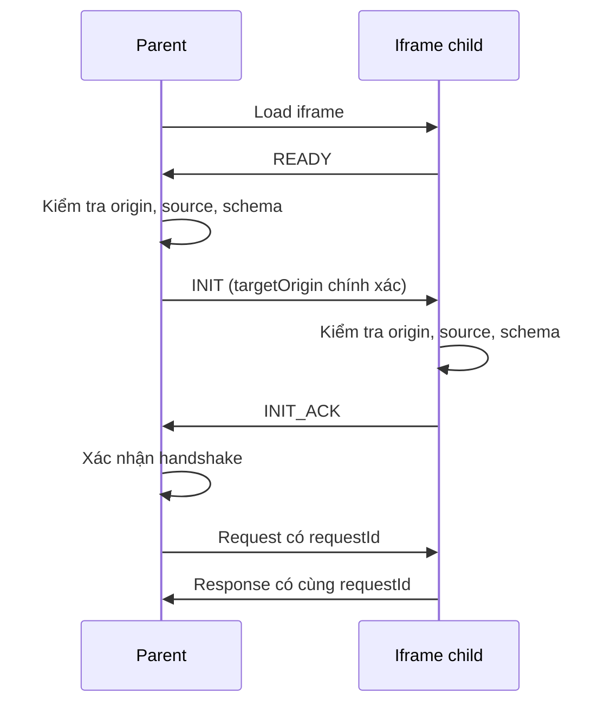

# Frame communication

> **Chương:** Iframe  
> **Chủ đề:** Frame communication  
> **Module:** SECURITY_APPLICATION_SECURITY_BROWSER_SECURITY — phân tích ranh giới bảo mật giữa trình duyệt, origin, cookie và ứng dụng web để hiểu Same-Origin Policy, CORS và các cơ chế cách ly. Thực hành phòng vệ XSS, CSRF, clickjacking bằng CSP, Trusted Types, security headers và kiểm chứng hành vi thực tế.

## Mục tiêu học tập

Sau bài học, bạn có thể:

1. Giải thích vì sao hai frame khác origin không thể tùy ý đọc DOM của nhau nhưng vẫn có thể gửi thông điệp.
2. Dùng `window.postMessage()` với `targetOrigin` cụ thể và xác minh cả `event.origin` lẫn `event.source`.
3. Xác thực cấu trúc, phiên bản và nội dung message trước khi xử lý.
4. Thiết kế request/response có correlation ID, timeout và chống message cũ.
5. Phân biệt `postMessage`, `MessageChannel` và giao tiếp cùng origin.
6. Hiểu ảnh hưởng của iframe sandbox, opaque origin và CSP `frame-ancestors`.
7. Kiểm thử luồng parent-child và phát hiện message giả mạo từ frame khác.

## 1. Vì sao frame cần giao tiếp?

Một trang có thể nhúng ứng dụng khác bằng `iframe`: ví dụ cổng thanh toán, bản đồ, trình soạn thảo, dashboard đối tác hoặc widget hỗ trợ. Parent và child có thể thuộc hai origin khác nhau.

Theo Same-Origin Policy (SOP), một trang không được tùy ý đọc DOM, JavaScript state hoặc dữ liệu riêng của frame khác origin. Giới hạn này ngăn widget không tin cậy đọc nội dung tài khoản của parent. Tuy nhiên, sản phẩm vẫn có thể cần trao đổi dữ liệu có kiểm soát:

- Parent gửi cấu hình hiển thị hoặc ngôn ngữ cho widget.
- Child báo chiều cao nội dung để parent điều chỉnh layout.
- Parent yêu cầu child đóng dialog hoặc chuyển bước.
- Child gửi kết quả một workflow hoặc trạng thái hoàn tất.
- Hai bên phối hợp xác thực hoặc cấp một capability giới hạn.

Browser cung cấp `window.postMessage()` để trao đổi dữ liệu giữa các browsing context mà không cần nới lỏng SOP cho việc đọc DOM. Cơ chế này mở một kênh gửi message; nó **không tự xác thực nội dung hoặc người gửi**.

## 2. postMessage hoạt động như thế nào?

Một cửa sổ gửi message tới cửa sổ khác bằng:

```js
targetWindow.postMessage(message, targetOrigin);
```

- `targetWindow` là đối tượng Window/WindowProxy của cửa sổ đích, thường là `iframe.contentWindow` hoặc `window.parent`.
- `message` là dữ liệu được structured clone; không phải chuỗi HTML cần render.
- `targetOrigin` giới hạn origin được phép nhận message. Browser chỉ gửi khi origin hiện tại của đích khớp giá trị này.

Bên nhận đăng ký:

```js
window.addEventListener('message', (event) => {
  console.log(event.origin);
  console.log(event.source);
  console.log(event.data);
});
```

| Trường | Ý nghĩa | Cách sử dụng |
|---|---|---|
| `event.origin` | Origin của cửa sổ gửi tại thời điểm gọi postMessage | So sánh chính xác với origin được phép |
| `event.source` | WindowProxy của cửa sổ gửi | So sánh với frame/cửa sổ cụ thể đã được tin cậy |
| `event.data` | Payload đã structured-clone | Kiểm tra schema và giá trị trước khi xử lý |

Origin gồm scheme, hostname và port. Ví dụ `https://widget.example.test:8443` khác `https://widget.example.test` và khác `http://widget.example.test:8443`. So sánh origin phải xét đủ ba thành phần.

### 2.1. targetOrigin phải cụ thể

Parent gửi cấu hình cho widget:

```js
const widgetOrigin = 'https://widget.example.test';
const frame = document.querySelector('#payment-widget');

frame.contentWindow.postMessage(
  { version: 1, type: 'SET_LANGUAGE', language: 'vi' },
  widgetOrigin
);
```

Tránh gửi dữ liệu nhạy cảm bằng wildcard:

```js
frame.contentWindow.postMessage(secretData, '*');
```

Message có thể tới document khác nếu frame điều hướng ngoài dự kiến. Không gửi session token, thông tin cá nhân, dữ liệu thanh toán hoặc secret bằng wildcard.

Trong production, lấy origin đích từ cấu hình tin cậy hoặc allowlist đã kiểm soát. Không lấy trực tiếp từ query string, message không tin cậy hoặc giá trị do người dùng tùy ý nhập.

### 2.2. Kiểm tra cả event.origin và event.source

Chỉ kiểm tra payload là không đủ:

```js
window.addEventListener('message', (event) => {
  if (event.data.type === 'PAYMENT_COMPLETE') {
    markOrderPaid(event.data.orderId);
  }
});
```

Một trang bất kỳ có thể gọi `postMessage` tới cửa sổ nếu nó có tham chiếu tới cửa sổ đó. Payload có vẻ hợp lệ không chứng minh người gửi đáng tin.

Mẫu kiểm tra cơ bản:

```js
const EXPECTED_ORIGIN = 'https://widget.example.test';
const widgetFrame = document.querySelector('#payment-widget');

window.addEventListener('message', (event) => {
  if (event.origin !== EXPECTED_ORIGIN) return;
  if (event.source !== widgetFrame.contentWindow) return;

  // Chỉ sau khi xác minh nguồn mới kiểm tra và xử lý payload.
});
```

Hai phép kiểm tra trả lời hai câu hỏi khác nhau:

- `event.origin`: message đến từ origin được cho phép không?
- `event.source`: message đến từ đúng browsing context mà ứng dụng đã nhúng không?

Kiểm tra cả hai giúp tránh nhận message từ iframe khác cùng origin, điều thường gặp khi trang có nhiều widget hoặc nhiều instance của cùng nhà cung cấp.

### 2.3. Origin phản ánh sender tại thời điểm gửi

`event.origin` phản ánh origin của sender lúc nó gọi `postMessage`. Cửa sổ có thể điều hướng sau đó; đối tượng `event.source` thường vẫn là WindowProxy đại diện cho browsing context đó. Vì vậy:

- Kiểm tra origin trên từng message.
- Không coi việc đã xác minh một lần là giấy phép nhận mọi message về sau.
- Khi frame có thể điều hướng, theo dõi navigation/load và chỉ gửi dữ liệu sau khi xác minh trạng thái tích hợp.
- Không gửi secret trước khi hoàn tất handshake và kiểm tra nguồn.

## 3. Xác thực message schema

Sau khi xác minh sender, kiểm tra payload theo giao thức có cấu trúc. Không giả định `event.data` luôn là object đúng định dạng.

Ví dụ:

```json
{
  "version": 1,
  "type": "RESIZE",
  "height": 420
}
```

Quy tắc kiểm tra:

1. Dữ liệu là object, không phải null hoặc array.
2. Có phiên bản giao thức được hỗ trợ.
3. `type` nằm trong danh sách message được phép.
4. Field bắt buộc có đúng kiểu.
5. Số có giới hạn min/max; chuỗi có giới hạn độ dài.
6. Không xử lý field lạ hoặc cấu trúc lồng nhau chưa được định nghĩa.
7. Message chỉ được phép yêu cầu hành động mà sender có quyền đề nghị.

Ví dụ kiểm tra message resize:

```js
function isResizeMessage(data) {
  if (data === null || typeof data !== 'object' || Array.isArray(data)) {
    return false;
  }
  const keys = Object.keys(data).sort();
  if (keys.join(',') !== 'height,type,version') return false;
  if (data.version !== 1 || data.type !== 'RESIZE') return false;
  if (!Number.isInteger(data.height)) return false;
  return data.height >= 100 && data.height <= 2000;
}

window.addEventListener('message', (event) => {
  if (event.origin !== 'https://widget.example.test') return;
  if (event.source !== widgetFrame.contentWindow) return;
  if (!isResizeMessage(event.data)) return;

  widgetFrame.style.height = event.data.height + 'px';
});
```

Đoạn code chỉ thay đổi chiều cao trong giới hạn. Không lấy message làm HTML và không đưa dữ liệu message vào `innerHTML`, `eval()` hoặc URL điều hướng mà chưa có kiểm tra riêng.

### 3.1. Thiết kế allowlist message type

| Type | Hướng | Mục đích | Dữ liệu cần xác thực |
|---|---|---|---|
| `READY` | Child → Parent | Báo child đã khởi tạo | Version, instance ID nếu có |
| `INIT` | Parent → Child | Gửi cấu hình ban đầu | Ngôn ngữ, theme, feature flag không nhạy cảm |
| `RESIZE` | Child → Parent | Báo kích thước nội dung | Số nguyên trong giới hạn |
| `REQUEST_CLOSE` | Child → Parent | Đề nghị đóng widget | Parent vẫn áp dụng policy của mình |
| `RESULT` | Child → Parent | Báo kết quả workflow | Request ID, trạng thái, dữ liệu đã xác minh server |
| `ERROR` | Child → Parent | Báo lỗi giao diện | Error code allowlist, không nhận stack/HTML để render |

Không thiết kế message tổng quát như `EXECUTE` hoặc `SET_HTML` cho phép child yêu cầu parent thực thi hành động tùy ý.

### 3.2. Message không phải bằng chứng authorization

Ngay cả khi message đến đúng iframe và đúng origin, parent vẫn cần kiểm tra quyền nghiệp vụ:

- `PAYMENT_COMPLETE` từ widget không đủ để đánh dấu đơn hàng đã thanh toán.
- `DELETE_ACCOUNT` không được thực thi chỉ vì iframe gửi yêu cầu.
- `NAVIGATE` không nên cho child điều hướng parent tới URL tùy ý.

Với kết quả thanh toán, parent nên xác minh trạng thái qua backend hoặc callback đã xác thực từ nhà cung cấp. Message chỉ là tín hiệu giao diện để parent làm mới trạng thái.

## 4. Request/response, correlation ID và message cũ

Giao tiếp hai chiều thường có dạng request/response:

1. Parent tạo request ID duy nhất.
2. Parent gửi request tới origin chính xác.
3. Child xử lý và trả response kèm request ID.
4. Parent chỉ chấp nhận response nếu ID đang chờ và type đúng.
5. Request hết hạn hoặc bị hủy thì response đến muộn bị bỏ qua.

Ví dụ khung request:

```js
const pending = new Map();
let nextId = 1;

function requestWidget(type, payload, timeoutMs = 5000) {
  const requestId = 'req-' + nextId++;

  return new Promise((resolve, reject) => {
    const timer = setTimeout(() => {
      pending.delete(requestId);
      reject(new Error('Widget request timeout'));
    }, timeoutMs);

    pending.set(requestId, {
      resolve,
      reject,
      timer,
      expectedType: type + '_RESULT',
    });

    widgetFrame.contentWindow.postMessage(
      { version: 1, type, requestId, payload },
      'https://widget.example.test'
    );
  });
}

window.addEventListener('message', (event) => {
  if (event.origin !== 'https://widget.example.test') return;
  if (event.source !== widgetFrame.contentWindow) return;

  const data = event.data;
  if (!data || typeof data !== 'object' || Array.isArray(data)) return;
  if (typeof data.requestId !== 'string') return;

  const item = pending.get(data.requestId);
  if (!item || data.type !== item.expectedType) return;

  clearTimeout(item.timer);
  pending.delete(data.requestId);
  item.resolve(data);
});
```

Đây là khung minh họa; production cần xác thực đầy đủ schema của request và response, giới hạn số request đang chờ, xử lý lỗi, hủy request và kiểm tra dữ liệu trả về trước khi cập nhật UI. Request ID chỉ ghép response với request đang chờ, không phải secret hoặc token xác thực.

### 4.1. Chống replay và xử lý trạng thái

Với message có thể gây tác động:

- Dùng request ID duy nhất trong phạm vi phiên giao tiếp.
- Lưu trạng thái request đã xử lý để từ chối message lặp.
- Đặt thời hạn và giới hạn số message.
- Chỉ cho phép chuyển trạng thái theo state machine đã định nghĩa.
- Không coi timestamp do sender cung cấp là bằng chứng xác thực.
- Với thao tác nhạy cảm, dùng nonce/challenge và xác minh ở server; không dựa vào cơ chế chống replay phía giao diện.

Nếu parent reload hoặc iframe được thay thế, xóa request đang chờ và thiết lập handshake mới. Không để response từ instance cũ cập nhật giao diện của instance mới.

## 5. Handshake an toàn giữa parent và child



Nguyên tắc:

- Không gửi dữ liệu nhạy cảm trước khi xác minh origin/source và hoàn tất handshake.
- Dùng protocol version để phát hiện hai phía không tương thích.
- Gắn instance ID để phân biệt nhiều iframe cùng origin.
- Đặt timeout nếu child không gửi READY hoặc không ACK.
- Nếu handshake thất bại, giữ widget ở trạng thái chưa kết nối và không xử lý message nghiệp vụ.

Không dùng riêng sự kiện `iframe.onload` để kết luận ứng dụng bên trong đã sẵn sàng. Load chỉ báo frame đã hoàn tất một giai đoạn tải; ứng dụng có thể còn đang khởi tạo.

## 6. MessageChannel khi cần kênh riêng

`MessageChannel` tạo hai port liên kết với nhau. Parent có thể chuyển một port cho child qua `postMessage`:

```js
const channel = new MessageChannel();
const childPort = channel.port1;

childPort.addEventListener('message', (event) => {
  // Vẫn phải xác thực schema và trạng thái của message.
  console.log(event.data);
});
childPort.start();

iframe.contentWindow.postMessage(
  { version: 1, type: 'CONNECT' },
  'https://widget.example.test',
  [channel.port2]
);
```

Child nhận port trong `event.ports`:

```js
window.addEventListener('message', (event) => {
  if (event.origin !== 'https://parent.example.test') return;
  if (event.source !== window.parent) return;
  if (!event.data || event.data.type !== 'CONNECT') return;
  if (event.ports.length !== 1) return;

  const port = event.ports[0];
  port.onmessage = (messageEvent) => {
    // Kiểm tra schema cho mọi message trên port.
    handleWidgetMessage(messageEvent.data);
  };
  port.start();
});
```

MessageChannel hữu ích khi cần kênh riêng, nhiều message liên tục hoặc quản lý vòng đời port. Port hoạt động như một capability: ai giữ port có thể giao tiếp qua kênh đó. Vì vậy, bước gửi port ban đầu vẫn cần xác minh sender và target origin. Không chuyển port cho frame không xác định.

## 7. Iframe sandbox và opaque origin

Thuộc tính `sandbox` giới hạn một số khả năng của nội dung nhúng:

```html
<iframe
  src="https://untrusted.example.test/widget"
  sandbox="allow-scripts"
  title="Widget không tin cậy">
</iframe>
```

Không có `allow-same-origin`, nội dung sandbox thường được gán **opaque origin**. Khi nó gửi message, parent có thể quan sát `event.origin` là chuỗi `"null"` thay vì origin URL thông thường.

### 7.1. Không xác thực bằng origin null

Nhiều document có opaque origin khác nhau đều có thể báo `event.origin` là `"null"`. Vì vậy, kiểm tra `event.origin === 'null'` không nhận diện duy nhất một iframe đáng tin.

Với nội dung sandbox opaque origin:

- Giữ dữ liệu gửi tới frame ở mức không nhạy cảm.
- Kiểm tra `event.source` đúng browsing context cụ thể.
- Xác thực schema và giới hạn hành động.
- Nếu cần cấp capability, thiết kế handshake rõ ràng và chỉ chuyển port sau khi xác minh context mà parent kiểm soát.
- Không dùng `targetOrigin: '*'` như lý do để gửi secret tới opaque-origin frame.

Một số opaque-origin context không thể được nhắm tới bằng origin tuple cụ thể, nên message ban đầu có thể buộc phải dùng wildcard. Nếu phải làm vậy, chỉ gửi dữ liệu công khai/không nhạy cảm và không cấp quyền chỉ dựa trên message đầu tiên.

### 7.2. Cẩn trọng với allow-scripts và allow-same-origin

Không cấp sandbox token tùy tiện. Đặc biệt, nếu iframe cùng origin với parent và được cấp cả `allow-scripts` lẫn `allow-same-origin`, nội dung có thể có đủ quyền để truy cập parent và gỡ thuộc tính sandbox trong một số cấu hình. Với nội dung không tin cậy, nên lưu trên origin riêng và chỉ cấp token tối thiểu cần thiết.

## 8. CSP frame-ancestors và quyền nhúng

Giao tiếp message không thay chính sách ai được phép nhúng iframe. Server của trang được nhúng nên kiểm soát embedding bằng CSP:

```http
Content-Security-Policy: frame-ancestors https://app.example.test
```

`frame-ancestors` quy định những ancestor origin nào được phép nhúng trang. Có thể liệt kê nhiều origin hoặc dùng `'none'` để cấm nhúng; `'self'` chỉ cho phép cùng origin. Directive này không được hỗ trợ qua meta element, cần gửi trong HTTP response header.

Phía parent có thể giới hạn nguồn iframe được tải bằng:

```http
Content-Security-Policy: frame-src https://widget.example.test
```

Hai directive giải quyết hai phía khác nhau:

- `frame-src` của parent giới hạn frame mà parent được tải.
- `frame-ancestors` của child giới hạn parent nào được phép nhúng child.

Không dựa vào việc iframe đã được nhúng thành công để tin message của nó. CSP kiểm soát embedding; kiểm tra origin/source/schema vẫn cần thiết cho protocol.

## 9. Các lỗi thiết kế thường gặp

| Lỗi | Vì sao nguy hiểm | Cách sửa |
|---|---|---|
| Dùng `targetOrigin: '*'` cho dữ liệu nhạy cảm | Message có thể tới document khác sau navigation | Dùng origin tuple chính xác |
| Không kiểm tra `event.origin` | Origin bất kỳ có thể gửi payload giả | So sánh chính xác scheme/host/port |
| Chỉ kiểm tra origin, không kiểm tra source | Frame khác cùng origin có thể giả message | So sánh `event.source` với đúng WindowProxy |
| Chỉ kiểm tra source một lần | Frame có thể điều hướng và gửi từ origin khác | Kiểm tra origin và source trên từng message |
| Tin mọi field trong `event.data` | Payload sai kiểu hoặc quá lớn có thể gây lỗi/logic abuse | Validate schema, kiểu, giới hạn và version |
| Đưa message vào `innerHTML` | Có thể tạo DOM XSS | Dùng textContent hoặc sanitizer được kiểm soát |
| Dùng message để xác nhận thanh toán | Sender UI không phải nguồn sự thật nghiệp vụ | Xác minh trạng thái ở backend |
| Không có request ID/timeout | Response cũ có thể gắn nhầm request hoặc giữ promise mãi | Correlation ID, timeout và state management |
| Chấp nhận origin null như một origin tin cậy | Nhiều opaque origin cùng có giá trị này | Kiểm tra context cụ thể, giảm dữ liệu và capability |
| Cấp sandbox token quá rộng | Frame có thể nhận quyền không cần thiết | Chỉ cấp token tối thiểu, tách origin không tin cậy |

## 10. Thực hành: lab postMessage giữa các frame

Lab dùng Node.js built-in, không cần thư viện ngoài. Nó chạy:

- Parent tại `http://localhost:3000`.
- Child đáng tin tại `http://localhost:4000/child`.
- Một iframe khác cùng origin child tại `http://localhost:4000/sibling`.
- Một iframe khác origin tại `http://localhost:4001/foreign`.

Parent chỉ chấp nhận message khi **cả origin và source đều đúng**. Frame sibling có origin hợp lệ nhưng source khác; frame foreign có origin khác. Cả hai gửi một PONG giả để kiểm chứng bộ lọc.

### Bước 1 — Tạo file `frame-communication-lab.cjs`

```js
const http = require('node:http');

const parentOrigin = 'http://localhost:3000';
const childOrigin = 'http://localhost:4000';

const parentHtml = `<!doctype html>
<html lang="vi">
<head><meta charset="utf-8"><title>postMessage parent lab</title></head>
<body>
  <h1>Parent frame</h1>
  <p>Chỉ message từ đúng child frame và đúng origin mới được chấp nhận.</p>
  <pre id="log"></pre>
  <iframe id="trusted-child" title="Trusted child"
    src="http://localhost:4000/child"></iframe>
  <iframe id="same-origin-sibling" title="Same-origin sibling"
    src="http://localhost:4000/sibling"></iframe>
  <iframe id="foreign-frame" title="Foreign origin"
    src="http://localhost:4001/foreign"></iframe>

  <script>
    const CHILD_ORIGIN = 'http://localhost:4000';
    const REQUEST_ID = 'demo-001';
    const trustedFrame = document.querySelector('#trusted-child');
    const logElement = document.querySelector('#log');
    let pingSent = false;
    let pongReceived = false;

    function log(message) {
      logElement.textContent += message + '\n';
    }

    function isRecord(value) {
      if (value === null || typeof value !== 'object' ||
          Array.isArray(value)) return false;
      const prototype = Object.getPrototypeOf(value);
      return prototype === Object.prototype || prototype === null;
    }

    function hasExactKeys(value, expected) {
      const actual = Object.keys(value).sort();
      const wanted = expected.slice().sort();
      return actual.length === wanted.length &&
        actual.every((key, index) => key === wanted[index]);
    }

    window.addEventListener('message', (event) => {
      const originOK = event.origin === CHILD_ORIGIN;
      const sourceOK = event.source === trustedFrame.contentWindow;

      if (!originOK || !sourceOK) {
        log('REJECT origin=' + event.origin +
          ' originOK=' + originOK + ' sourceOK=' + sourceOK);
        return;
      }

      const data = event.data;
      if (!isRecord(data) || data.version !== 1 ||
          typeof data.type !== 'string') {
        log('REJECT invalid message shape');
        return;
      }

      if (data.type === 'READY' &&
          hasExactKeys(data, ['version', 'type'])) {
        if (pingSent) return;
        pingSent = true;
        log('ACCEPT READY from trusted child');
        trustedFrame.contentWindow.postMessage(
          { version: 1, type: 'PING', requestId: REQUEST_ID },
          CHILD_ORIGIN
        );
        return;
      }

      if (data.type === 'PONG' &&
          hasExactKeys(data, ['version', 'type', 'requestId', 'text']) &&
          data.requestId === REQUEST_ID &&
          typeof data.text === 'string' && data.text.length <= 100) {
        if (pongReceived) {
          log('REJECT duplicate PONG');
          return;
        }
        pongReceived = true;
        log('ACCEPT PONG: ' + data.text);
        return;
      }

      log('REJECT unsupported or invalid message');
    });
  </script>
</body>
</html>`;

function childHtml(role) {
  const template = `<!doctype html>
<html lang="vi">
<head><meta charset="utf-8"><title>Child frame</title></head>
<body>
  <p>Frame role: __ROLE__</p>
  <script>
    const ROLE = __ROLE__;
    const PARENT_ORIGIN = 'http://localhost:3000';

    function isRecord(value) {
      if (value === null || typeof value !== 'object' ||
          Array.isArray(value)) return false;
      const prototype = Object.getPrototypeOf(value);
      return prototype === Object.prototype || prototype === null;
    }

    if (ROLE === 'child') {
      window.parent.postMessage(
        { version: 1, type: 'READY' },
        PARENT_ORIGIN
      );
    } else {
      window.parent.postMessage(
        {
          version: 1,
          type: 'PONG',
          requestId: 'demo-001',
          text: 'forged message from ' + ROLE
        },
        PARENT_ORIGIN
      );
    }

    window.addEventListener('message', (event) => {
      if (event.origin !== PARENT_ORIGIN) return;
      if (event.source !== window.parent) return;

      const data = event.data;
      if (!isRecord(data) || data.version !== 1 ||
          data.type !== 'PING' ||
          typeof data.requestId !== 'string') return;

      if (ROLE !== 'child') return;
      window.parent.postMessage(
        {
          version: 1,
          type: 'PONG',
          requestId: data.requestId,
          text: 'hello from verified child'
        },
        PARENT_ORIGIN
      );
    });
  </script>
</body>
</html>`;
  return template.replaceAll('__ROLE__', JSON.stringify(role));
}

const parentServer = http.createServer((req, res) => {
  const url = new URL(req.url, parentOrigin);
  if (url.pathname !== '/') {
    res.writeHead(404);
    return res.end('Not found');
  }
  res.writeHead(200, {
    'Content-Type': 'text/html; charset=utf-8',
    'Cache-Control': 'no-store',
    'Content-Security-Policy':
      "default-src 'none'; script-src 'unsafe-inline'; " +
      "frame-src http://localhost:4000 http://localhost:4001; " +
      "object-src 'none'; base-uri 'none'",
  });
  res.end(parentHtml);
});

function createChildServer() {
  return http.createServer((req, res) => {
    const url = new URL(req.url, childOrigin);
    const roles = {
      '/child': 'child',
      '/sibling': 'sibling',
      '/foreign': 'foreign',
    };
    const role = roles[url.pathname];
    if (!role) {
      res.writeHead(404);
      return res.end('Not found');
    }
    res.writeHead(200, {
      'Content-Type': 'text/html; charset=utf-8',
      'Cache-Control': 'no-store',
      'Content-Security-Policy':
        "default-src 'none'; script-src 'unsafe-inline'; " +
        "frame-ancestors http://localhost:3000; object-src 'none'; base-uri 'none'",
    });
    res.end(childHtml(role));
  });
}

const childServer = createChildServer();
const foreignServer = createChildServer();

parentServer.listen(3000, 'localhost', () => {
  console.log('Parent: http://localhost:3000');
});
childServer.listen(4000, 'localhost', () => {
  console.log('Child:  http://localhost:4000');
});
foreignServer.listen(4001, 'localhost', () => {
  console.log('Foreign: http://localhost:4001');
});
```

Chạy:

```sh
node frame-communication-lab.cjs
```

Mở `http://localhost:3000` trong browser. Lab chỉ chạy trên loopback/local machine; dừng server bằng Ctrl+C.

### Bước 2 — Quan sát message hợp lệ

Trong log của parent, kết quả mong đợi:

```text
ACCEPT READY from trusted child
ACCEPT PONG: hello from verified child
```

Child gửi READY. Parent xác minh origin `http://localhost:4000` và source đúng `trustedFrame.contentWindow`, sau đó gửi PING với target origin chính xác. Child xác minh parent origin và `event.source === window.parent` rồi trả PONG.

### Bước 3 — Quan sát message giả mạo cùng origin

Iframe `/sibling` có cùng origin `http://localhost:4000` với child đáng tin nhưng là browsing context khác. Nó gửi PONG giả.

Parent log phải cho thấy `originOK=true` nhưng `sourceOK=false` và từ chối message. Điều này chứng minh kiểm tra origin đơn lẻ chưa đủ khi trang nhúng nhiều iframe cùng origin.

### Bước 4 — Quan sát message từ origin khác

Iframe `/foreign` được tải qua `http://localhost:4001`. Hostname và scheme giống child đáng tin, nhưng port khác nên origin khác. Hai địa chỉ vẫn cùng site; postMessage kiểm tra origin chứ không kiểm tra site.

Parent phải từ chối message này với `originOK=false`. Quan sát cả `event.origin` và `event.source` trong log.

### Bước 5 — Thử thay đổi giao thức

Trong DevTools của child hoặc bằng cách chỉnh tạm lab local:

- Gửi message thiếu `version`.
- Gửi `height` dưới dạng chuỗi thay vì số nguyên.
- Gửi type không có trong allowlist.
- Gửi PONG với request ID khác.
- Gửi PONG có text quá dài.

Parent phải từ chối payload không đúng schema hoặc không khớp request đang chờ.

## 11. Kiểm thử và chẩn đoán trong ứng dụng thật

Khi tích hợp iframe của đối tác hoặc widget nội bộ, kiểm tra:

1. **Origin:** scheme, hostname và port chính xác ở cả hai phía.
2. **Source:** đúng iframe instance hoặc parent WindowProxy.
3. **Target:** mọi lần gửi message dùng target origin phù hợp; không dùng wildcard cho dữ liệu nhạy cảm.
4. **Schema:** version, type, field, kiểu dữ liệu, giới hạn độ dài và giá trị.
5. **State:** handshake, request ID, timeout, message lặp và navigation.
6. **Authorization:** message chỉ yêu cầu hành động; backend vẫn xác minh quyền và trạng thái nghiệp vụ.
7. **Rendering:** dữ liệu message không đi vào HTML/script/URL sink không an toàn.
8. **Sandbox:** chỉ cấp sandbox token cần thiết; hiểu opaque origin và giá trị null.
9. **Embedding:** CSP frame-src và frame-ancestors được cấu hình ở đúng phía.
10. **Compatibility:** kiểm thử browser/webview trong ma trận hỗ trợ của sản phẩm.

| Triệu chứng | Nguyên nhân có thể | Hướng xử lý |
|---|---|---|
| Không nhận được message | targetOrigin không khớp origin đích hiện tại | Kiểm tra scheme/host/port và URL thực tế của frame |
| Message đến nhưng bị từ chối | event.origin hoặc event.source không khớp | Log hai giá trị dưới dạng metadata và xác minh frame instance |
| event.origin là null | Frame có opaque origin do sandbox hoặc URL đặc biệt | Không tin origin null; thiết kế kênh với dữ liệu/capability giới hạn |
| Widget load nhưng không gửi READY | App child chưa khởi tạo, listener đăng ký muộn hoặc lỗi script | Kiểm tra Console, lifecycle và handshake timeout |
| Nhiều widget nhận cùng message | Chỉ kiểm tra origin, không kiểm tra source/instance | Xác minh WindowProxy của đúng iframe |
| Response cũ cập nhật UI mới | Thiếu request ID hoặc không hủy pending request khi navigation | Correlation ID, timeout và reset state khi thay frame |
| CSP chặn iframe | frame-src hoặc frame-ancestors không cho phép origin | Kiểm tra header của parent và child |
| Message hợp lệ nhưng thao tác trái phép | Tin message như authorization | Kiểm tra quyền và trạng thái ở backend |

## 12. Câu hỏi tự kiểm tra

**1.** Vì sao SOP không ngăn hoàn toàn giao tiếp giữa hai frame khác origin?  
**Trả lời:** SOP giới hạn quyền đọc tài nguyên/DOM; `postMessage` cung cấp kênh trao đổi dữ liệu có kiểm soát mà không cấp quyền đọc DOM chéo origin.

**2.** `targetOrigin` có vai trò gì?  
**Trả lời:** Giới hạn origin được phép nhận message; browser không gửi nếu origin hiện tại của đích không khớp.

**3.** Vì sao phải kiểm tra cả `event.origin` và `event.source`?  
**Trả lời:** Origin xác minh nơi gửi; source xác minh đúng browsing context/iframe instance. Iframe khác cùng origin có thể giả message nếu chỉ kiểm tra origin.

**4.** `event.origin` có phải luôn phản ánh URL hiện tại của sender khi receiver xử lý message không?  
**Trả lời:** Không. Nó phản ánh origin của sender tại thời điểm gọi `postMessage`; sender có thể điều hướng sau đó.

**5.** Vì sao không gửi token bí mật bằng `targetOrigin: '*'`?  
**Trả lời:** Frame có thể điều hướng sang document khác và message có thể tới origin ngoài dự kiến.

**6.** Trusted origin gửi message có nghĩa payload được tin hoàn toàn không?  
**Trả lời:** Không. Vẫn phải kiểm tra schema, giới hạn dữ liệu, state và quyền nghiệp vụ.

**7.** Vì sao `event.origin === 'null'` không xác thực được sandbox frame duy nhất?  
**Trả lời:** Nhiều opaque origin khác nhau có thể cùng được biểu diễn bằng chuỗi null.

**8.** MessageChannel khác postMessage thông thường ở điểm nào?  
**Trả lời:** MessageChannel tạo hai port liên kết để trao đổi nhiều message trên một kênh riêng; port là capability nên phải chuyển sau bootstrap đã xác minh.

**9.** `frame-src` và `frame-ancestors` khác nhau thế nào?  
**Trả lời:** frame-src của parent giới hạn frame parent được tải; frame-ancestors của child giới hạn origin nào được phép nhúng child.

**10.** Message PAYMENT_COMPLETE có đủ để backend đánh dấu đơn hàng đã thanh toán không?  
**Trả lời:** Không. Parent/backend phải xác minh trạng thái thanh toán qua nguồn server-side đã xác thực; message chỉ là tín hiệu giao diện.

## Tổng kết

Giao tiếp giữa iframe cần một giao thức nhỏ và có kiểm soát. Dùng `postMessage` với target origin cụ thể; ở bên nhận, kiểm tra **cả event.origin và event.source**, rồi xác thực schema, version, request ID và trạng thái trước khi xử lý. MessageChannel phù hợp khi cần kênh riêng dài hạn; sandbox và opaque origin đòi hỏi cách thiết kế riêng, đặc biệt không coi null là danh tính. Kết hợp CSP frame-src/frame-ancestors, giới hạn dữ liệu và xác minh nghiệp vụ ở backend để message không trở thành đường cấp quyền ngoài ý muốn.
