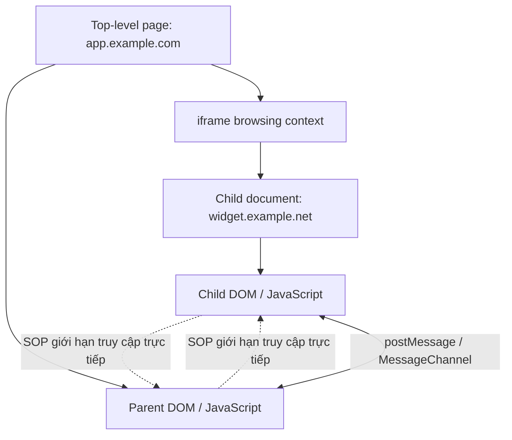

# Iframe isolation

> **Chương:** Iframe  
> **Học phần:** Application Security — Browser Security (`SECURITY_APPLICATION_SECURITY_BROWSER_SECURITY`)

`iframe` tạo một **browsing context** riêng bên trong trang hiện tại. Trang cha (parent) có thể nhúng nội dung từ một origin khác, nhưng browser áp dụng Same-Origin Policy (SOP), sandbox và các chính sách quyền để giới hạn những gì hai phía được phép làm. Đây là nền tảng để nhúng video, bản đồ, widget đối tác hoặc nội dung do người dùng cung cấp mà vẫn giữ ranh giới giữa các ứng dụng.

Tuy nhiên, `iframe` không tự động đồng nghĩa với một môi trường an toàn. Một frame cùng origin có thể có quyền truy cập DOM rộng; một frame cross-origin bị SOP giới hạn nhưng vẫn có thể hiển thị nội dung, gửi request và giao tiếp qua `postMessage`; sandbox có thể làm origin trở thành opaque và giới hạn script, form, popup hoặc điều hướng. Cấu hình phải xuất phát từ mức độ tin cậy của nội dung được nhúng và quyền mà tính năng thật sự cần.

## 1. Mục tiêu học tập

Sau bài học, bạn có thể:

1. Mô tả browsing context của iframe và quan hệ parent/child.
2. Giải thích SOP giới hạn truy cập DOM giữa các origin như thế nào.
3. Cấu hình thuộc tính `sandbox` theo nguyên tắc quyền tối thiểu.
4. Phân biệt sandboxed opaque origin với origin thực của tài liệu được nhúng.
5. Nhận diện rủi ro của tổ hợp `allow-scripts` và `allow-same-origin`.
6. Thiết kế giao tiếp `postMessage` có kiểm tra nguồn, đích và schema dữ liệu.
7. Phân biệt `frame-src`, `frame-ancestors`, Permissions Policy và iframe `allow`.
8. Đánh giá cookie, storage, điều hướng và popup trong iframe.
9. Kiểm chứng ranh giới parent/child trong môi trường lab.

## 2. Iframe tạo browsing context riêng

Khi tài liệu HTML chứa:

```html
<iframe src="https://widget.example.net/embed" title="Widget"></iframe>
```

browser tạo một browsing context con và tải tài liệu ở URL chỉ định. Tài liệu cha và tài liệu con có document, window, lịch sử điều hướng và lifecycle riêng. Parent có thể giữ tham chiếu tới `iframe.contentWindow`; nội dung con có thể tham chiếu `window.parent` hoặc `window.top` theo cấu trúc frame.



Một trang có thể chứa nhiều iframe lồng nhau. Mỗi frame là một context riêng; origin và policy được đánh giá cho từng tài liệu. Việc parent tin một frame con không tự làm cho những frame cháu do child nhúng trở nên đáng tin.

## 3. Origin là ranh giới truy cập chính

Origin được xác định bởi bộ ba:

```text
scheme + host + port
```

Ví dụ:

| URL | Quan hệ với `https://app.example.com` |
| --- | --- |
| `https://app.example.com/profile` | Same-origin |
| `https://app.example.com:8443/` | Cross-origin vì port khác |
| `http://app.example.com/` | Cross-origin vì scheme khác |
| `https://widget.example.com/` | Cross-origin vì host khác |
| `https://example.net/` | Cross-origin |

SOP giới hạn script ở một origin đọc hoặc sửa trực tiếp DOM và nhiều thuộc tính của tài liệu ở origin khác. Parent cross-origin không thể tùy ý đọc `iframe.contentDocument.body`, đọc biến JavaScript riêng của child hoặc truy cập cookie của child. Child cũng không thể tự do đọc DOM của parent.

SOP không ngăn browser tải iframe, hiển thị nội dung, gửi request hoặc cho phép hai bên giao tiếp có kiểm soát. Một số thuộc tính `Window` được thiết kế để giao tiếp cross-origin, trong đó có `postMessage`. Đây là lý do SOP là ranh giới truy cập DOM/API, không phải một lệnh cấm mọi tương tác mạng giữa hai origin.

## 4. Same-origin iframe và cross-origin iframe

Một iframe cùng origin với parent có thể có quyền truy cập rộng hơn nếu không bị sandbox giới hạn. Ví dụ, parent có thể đọc DOM child qua `contentDocument`, và child có thể truy cập một số thuộc tính của parent.

Với iframe cross-origin, truy cập DOM trực tiếp bị SOP chặn. Ví dụ:

```js
const frame = document.querySelector("#partner-frame");

try {
  // Chỉ thành công nếu tài liệu frame cùng origin và quyền phù hợp.
  console.log(frame.contentDocument.body.textContent);
} catch (error) {
  console.log("Không được phép đọc DOM cross-origin", error);
}
```

Không dùng việc truy cập DOM thất bại như cơ chế bảo vệ duy nhất. Cần giả định child vẫn có thể gửi request tới server của nó, hiển thị giao diện, điều hướng trong giới hạn browser và gửi message theo API mà ứng dụng công bố.

## 5. `sandbox` giới hạn năng lực của iframe

Thuộc tính `sandbox` yêu cầu browser áp dụng các hạn chế cho nội dung được nhúng. Nếu khai báo `sandbox` mà không có token cho phép, browser áp dụng một tập hạn chế mạnh, bao gồm sandboxed origin, chặn script, form submission, popup và top-level navigation theo các quy tắc sandbox.

Ví dụ giới hạn mạnh:

```html
<iframe
  src="https://untrusted.example.net/content"
  sandbox
  title="Nội dung chưa tin cậy"></iframe>
```

Frame vẫn có thể hiển thị nội dung, nhưng nhiều tính năng bị vô hiệu hóa. Khi ứng dụng cần một tính năng cụ thể, chỉ thêm token tương ứng sau khi đánh giá.

```html
<iframe
  src="https://widget.example.net/embed"
  sandbox="allow-scripts"
  title="Widget tương tác"></iframe>
```

Ví dụ này cho phép script chạy trong frame nhưng vẫn giữ các hạn chế sandbox khác, bao gồm sandboxed opaque origin nếu không có `allow-same-origin`.

## 6. Các token sandbox thường gặp

| Token | Quyền được nới lỏng | Cân nhắc bảo mật |
| --- | --- | --- |
| `allow-scripts` | Cho phép script trong frame chạy | Script có thể thay đổi DOM, gửi request và giao tiếp; chỉ bật khi cần |
| `allow-same-origin` | Giữ origin thực của tài liệu thay vì ép thành opaque origin | Làm mất lớp cô lập origin do sandbox tạo ra; đánh giá kỹ |
| `allow-forms` | Cho phép submit form | Form có thể gửi dữ liệu hoặc kích hoạt thao tác phía server |
| `allow-popups` | Cho phép mở popup | Popup có thể dẫn người dùng tới nội dung khác; xem thêm `allow-popups-to-escape-sandbox` |
| `allow-popups-to-escape-sandbox` | Popup được mở không kế thừa sandbox của frame | Quyền mạnh; chỉ cấp khi luồng popup thực sự cần |
| `allow-top-navigation` | Cho phép điều hướng top-level browsing context | Có thể đưa người dùng rời trang cha |
| `allow-top-navigation-by-user-activation` | Cho phép top-level navigation khi có user activation | Giới hạn hơn nhưng vẫn cần xem xét hành vi điều hướng |
| `allow-downloads` | Cho phép tải file từ frame | Có thể bị lợi dụng để tải nội dung không mong muốn |
| `allow-modals` | Cho phép `alert`, `confirm`, `prompt` | Có thể làm gián đoạn hoặc gây nhầm lẫn giao diện |
| `allow-pointer-lock` | Cho phép Pointer Lock API | Chỉ bật cho trải nghiệm cần điều khiển con trỏ |
| `allow-presentation` | Cho phép Presentation API | Chỉ cấp cho tính năng trình chiếu cần thiết |
| `allow-storage-access-by-user-activation` | Cho phép yêu cầu Storage Access API khi có user activation | Không phải quyền tự động truy cập mọi cookie bên thứ ba |

Danh sách token và hành vi có thể thay đổi theo chuẩn/browser. Hãy kiểm tra tài liệu và browser matrix của sản phẩm trước khi dựa vào một token cụ thể.

## 7. Opaque origin khi thiếu `allow-same-origin`

Một sandboxed iframe không có token `allow-same-origin` được đặt vào **opaque origin**. Nó không giữ origin tuple thông thường của URL tải nội dung để thực hiện so sánh same-origin. Điều này cô lập frame mạnh hơn với parent và các tài liệu khác.

Hệ quả có thể thấy:

- Tài liệu con không có cùng origin với parent chỉ vì URL nằm trên cùng host.
- Một số API lưu trữ hoặc truy cập tài nguyên theo origin có thể bị hạn chế hoặc hành xử khác.
- Khi child gửi `postMessage`, `event.origin` ở phía nhận thường là chuỗi `"null"` cho tài liệu có opaque origin.
- Parent không thể dùng một origin tuple cụ thể để xác thực sender từ frame opaque.
- Khi gửi message tới một target có opaque origin, thường phải dùng `targetOrigin: "*"` vì không có origin cụ thể để khớp.

Điểm cuối rất quan trọng: không gửi dữ liệu bí mật tới frame opaque chỉ vì biết URL ban đầu của iframe. Nếu cần giao tiếp, thiết kế giao thức capability hẹp, ràng buộc message với đúng `iframe.contentWindow`, chỉ gửi dữ liệu tối thiểu và không coi `event.origin === "null"` là danh tính đáng tin.

## 8. Rủi ro của `allow-scripts` kết hợp `allow-same-origin`

Tổ hợp sau cần đặc biệt thận trọng:

```html
<iframe
  src="/untrusted-content/preview"
  sandbox="allow-scripts allow-same-origin"
  title="Preview"></iframe>
```

Nếu tài liệu con **cùng origin với parent**, `allow-scripts` cho phép script chạy và `allow-same-origin` giữ origin thật. Khi đó child có thể có đủ quyền same-origin để truy cập parent và thao tác trên element iframe trong DOM cha, bao gồm gỡ thuộc tính `sandbox` rồi tải lại frame. Điều này có thể làm mất mục đích sandbox.

Nếu nội dung thật sự cần chạy script nhưng không cần quyền same-origin, giữ sandbox opaque bằng cách bỏ `allow-same-origin`. Nếu cần `allow-same-origin` cho một widget, hãy đặt widget trên origin riêng biệt với parent và kiểm soát nó như một ứng dụng độc lập; SOP vẫn ngăn widget cross-origin truy cập DOM parent.

Không coi một path như `/untrusted-content/` trên cùng host là ranh giới bảo mật. Origin không bao gồm path. Nội dung người dùng trên cùng scheme/host/port vẫn cùng origin dù nằm ở thư mục khác.

## 9. `srcdoc` và origin của nội dung inline

`srcdoc` cho phép đặt nội dung HTML trực tiếp trong thuộc tính của iframe:

```html
<iframe srcdoc="<p>Nội dung xem trước</p>" title="Preview"></iframe>
```

Tài liệu `srcdoc` thường kế thừa origin của trang nhúng nếu không bị sandbox ép thành opaque origin. Vì vậy, nếu đưa HTML không tin cậy vào `srcdoc` mà không sandbox, nội dung có thể chạy trong origin của ứng dụng và tạo DOM XSS nghiêm trọng.

Nếu phải hiển thị HTML không tin cậy bằng `srcdoc`, cần sandbox với quyền tối thiểu, thường bắt đầu bằng `sandbox` không có token, sau đó chỉ nới quyền cần thiết. Không nội suy dữ liệu người dùng vào thuộc tính `srcdoc` bằng nối chuỗi HTML. Hãy tạo document an toàn, serialize đúng context và kiểm thử sandbox/origin trong browser.

Một iframe `src` trỏ tới subdomain riêng cũng không tự động an toàn nếu server subdomain có thể bị takeover, nhận nội dung do người dùng kiểm soát hoặc chia sẻ credential với ứng dụng chính. Origin riêng cần được vận hành như một boundary thật: DNS, hosting, cookie scope, CSP và quy trình deploy đều phải được bảo vệ.

## 10. Giao tiếp parent/child bằng `postMessage`

Khi hai frame khác origin cần trao đổi, dùng `window.postMessage` thay vì cố đọc DOM trực tiếp. Sender chỉ định origin đích; receiver kiểm tra `origin`, `source` và cấu trúc message.

Ví dụ parent gửi tới widget có origin cố định:

```js
const frame = document.querySelector("#partner-frame");
const widgetOrigin = "https://widget.example.net";

frame.contentWindow.postMessage(
  { type: "SET_THEME", theme: "dark" },
  widgetOrigin
);
```

Child kiểm tra sender:

```js
const parentOrigin = "https://app.example.com";

window.addEventListener("message", (event) => {
  if (event.origin !== parentOrigin) return;
  if (event.source !== window.parent) return;

  const data = event.data;
  if (!data || data.type !== "SET_THEME") return;
  if (data.theme !== "light" && data.theme !== "dark") return;

  applyTheme(data.theme);
});
```

Kiểm tra `event.origin` xác nhận origin của sender tại thời điểm gửi message; kiểm tra `event.source` ràng buộc message với browsing context dự kiến. Cần validate schema và giá trị từng field vì một sender hợp lệ vẫn có thể gửi dữ liệu sai hoặc độc hại.

## 11. Các quy tắc bảo mật cho `postMessage`

- Dùng `targetOrigin` chính xác, không dùng `"*"` khi target có origin tuple đã biết.
- Receiver kiểm tra chính xác `event.origin`; không dùng `includes`, `endsWith` hoặc regex lỏng như `example.com`.
- Kiểm tra `event.source` nếu chỉ chấp nhận một frame/window cụ thể.
- Validate `event.data` theo schema: kiểu, field, enum, độ dài và giới hạn kích thước.
- Chỉ công bố những message type tối thiểu cần cho tính năng.
- Không gửi cookie, access token, refresh token hoặc bí mật dài hạn qua message.
- Không thực thi string nhận được bằng `eval`, `Function` hoặc `innerHTML`.
- Xử lý điều hướng/reload của iframe: cùng `WindowProxy` có thể tồn tại qua navigation, trong khi document bên trong đã thay đổi.
- Xác định rõ ai có thể khởi tạo handshake và quyền nào được cấp sau handshake.

Không xác thực origin bằng cách so sánh chuỗi con:

```js
// Sai: attacker.example.com.evil.test có thể chứa chuỗi này.
if (event.origin.includes("example.com")) {
  handleMessage(event.data);
}
```

Hãy so sánh exact origin:

```js
if (event.origin !== "https://widget.example.com") return;
```

## 12. `postMessage` với opaque origin

Nếu sandbox iframe không có `allow-same-origin`, origin của nó là opaque. Message từ frame này có thể đến parent với `event.origin === "null"`. Nhiều tài liệu khác nhau cũng có thể có opaque origin, nên chuỗi `"null"` không xác thực được danh tính.

Nếu phải hỗ trợ giao tiếp:

1. Xác nhận `event.source === iframe.contentWindow` để ràng buộc tới browsing context dự kiến.
2. Dùng handshake một lần và capability ngẫu nhiên, phạm vi hẹp, thời hạn ngắn nếu kiến trúc yêu cầu.
3. Chỉ gửi capability tới frame sau khi kiểm soát được URL/load lifecycle và không gửi bí mật tài khoản.
4. Không cấp quyền đọc dữ liệu hoặc hành động nhạy cảm chỉ dựa trên `origin === "null"`.
5. Nếu cần xác thực origin mạnh, cân nhắc chuyển widget sang origin riêng có tuple rõ ràng và dùng sandbox phù hợp.

Vì opaque target không có origin tuple để đối chiếu, sender có thể buộc phải dùng `targetOrigin: "*"`. Điều đó làm việc kiểm soát đích khó hơn; hãy tránh gửi message chứa dữ liệu nhạy cảm trong tình huống này.

## 13. Dùng `MessageChannel` khi cần kênh riêng

`MessageChannel` tạo hai `MessagePort` có thể chuyển cho hai context để giao tiếp qua một kênh riêng sau khi khởi tạo. Nó hữu ích khi cần giao thức hai chiều có trạng thái, nhưng không tự xác thực danh tính bên nhận.

Ví dụ parent tạo channel và chuyển một port cho child đã được xác định:

```js
const frame = document.querySelector("#partner-frame");
const widgetOrigin = "https://widget.example.net";
const channel = new MessageChannel();

channel.port1.onmessage = (event) => {
  const message = event.data;
  if (!message || message.type !== "READY") return;
  // Xử lý phản hồi theo schema đã định nghĩa.
};

frame.contentWindow.postMessage(
  { type: "INIT" },
  widgetOrigin,
  [channel.port2]
);
```

Child nhận port qua `event.ports[0]` sau khi xác minh parent origin/source. Mỗi message trên port vẫn phải validate. Không chuyển port có quyền mạnh cho frame chưa được xác thực; việc có port chỉ chứng minh bên nhận được chuyển capability, không chứng minh code bên trong an toàn.

## 14. Permissions Policy và thuộc tính `allow`

Iframe có thể yêu cầu quyền dùng một số tính năng browser như camera, microphone, geolocation hoặc fullscreen. Permissions Policy giúp parent và server giới hạn việc sử dụng những tính năng này.

Ví dụ response header của parent:

```http
Permissions-Policy: camera=(), microphone=(), geolocation=()
```

Header trên là ví dụ **từ chối hoàn toàn** các tính năng đó. Nếu parent thật sự cần delegate camera/microphone cho một frame đối tác cụ thể, header phải cho phép origin đó, ví dụ:

```http
Permissions-Policy: camera=(self "https://meeting.example.net"), microphone=(self "https://meeting.example.net"), geolocation=()
```

Ví dụ iframe chỉ được cấp quyền cần thiết:

```html
<iframe
  src="https://meeting.example.net/room"
  allow="camera https://meeting.example.net; microphone https://meeting.example.net; fullscreen https://meeting.example.net"
  title="Phòng họp"></iframe>
```

`allow` là cơ chế delegate/giới hạn tính năng cho frame; nó không thay thế `sandbox`, SOP hoặc `frame-ancestors`. Header Permissions Policy của parent đặt giới hạn tối đa; thuộc tính `allow` trên iframe có thể tiếp tục giới hạn hoặc cấp quyền trong phạm vi mà policy cho phép. Browser còn có thể yêu cầu user permission riêng.

Nếu header của parent đã đặt `camera=()` hoặc `microphone=()`, thuộc tính `allow` của iframe không thể mở lại quyền đó. Hai ví dụ header trên thể hiện hai policy khác nhau: một policy từ chối toàn bộ, một policy delegate cho origin cuộc họp cụ thể.

Không cấp `camera`, `microphone`, `geolocation` hoặc các capability khác cho mọi iframe theo mặc định. Chỉ delegate tính năng mà widget cần, và kiểm tra browser hỗ trợ directive tương ứng.

## 15. CSP: `frame-src` và `frame-ancestors`

Hai directive này có hướng kiểm soát khác nhau:

| Directive | Được cấu hình trên | Kiểm soát |
| --- | --- | --- |
| `frame-src` | Trang cha | Những nguồn mà trang hiện tại được phép tải vào iframe/frame |
| `frame-ancestors` | Trang con | Những origin nào được phép nhúng trang hiện tại |

Ví dụ parent chỉ tải frame từ widget được phê duyệt:

```http
Content-Security-Policy: default-src 'self'; frame-src 'self' https://widget.example.net
```

Ví dụ child chỉ cho phép portal cụ thể nhúng nó:

```http
Content-Security-Policy: frame-ancestors https://app.example.com
```

`frame-src` giúp parent kiểm soát nguồn frame, còn `frame-ancestors` giúp child chống clickjacking hoặc nhúng ngoài ý muốn. Một tích hợp an toàn thường cần cả hai phía được cấu hình đúng.

## 16. Sandbox bằng CSP response header

CSP có directive `sandbox` để server yêu cầu browser áp dụng sandbox restrictions cho chính tài liệu response. Ví dụ:

```http
Content-Security-Policy: sandbox allow-scripts
```

Directive này tương tự một số hạn chế của thuộc tính iframe `sandbox`, nhưng được gửi từ response của tài liệu. Nó hữu ích khi server muốn bảo đảm tài liệu luôn bị sandbox bất kể parent có thêm thuộc tính hay không. Không phải mọi token HTML sandbox đều được phép trong CSP sandbox; hãy kiểm tra grammar và browser support trước khi triển khai.

Thuộc tính `sandbox` trên iframe do parent đặt và CSP `sandbox` do tài liệu response gửi có thể cùng áp dụng. Hạn chế từ nhiều lớp không tự nới lỏng lẫn nhau; hãy kiểm tra kết quả thực tế khi policy chồng lấp.

## 17. Cookie, storage và xác thực trong iframe

Iframe không có cookie store riêng hoàn toàn tách biệt khỏi browser profile. Cookie được xét theo host/domain, path, `Secure`, `SameSite`, partitioning và chính sách browser. Do đó:

- Iframe same-origin có thể dùng cookie phù hợp với parent.
- Iframe cross-site có thể bị hạn chế cookie bên thứ ba; `SameSite=None; Secure` là điều kiện cần trong nhiều luồng nhưng không đảm bảo browser sẽ cho phép cookie.
- Storage access và partitioning có thể khác giữa browser và chế độ riêng tư.
- Sandbox opaque origin có thể làm API storage theo origin không hoạt động như một tài liệu có origin tuple.
- Không chuyển session token cho child qua query string hoặc `postMessage` chỉ để né hạn chế cookie.

Nếu widget cần đăng nhập, hãy thiết kế luồng tích hợp được hỗ trợ chính thức, xem xét top-level authentication, token ngắn hạn có audience/expiry phù hợp hoặc Storage Access API khi thực sự cần và được browser hỗ trợ. Không giả định iframe luôn có thể dùng session cookie giống top-level page.

## 18. Điều hướng, popup và form

Sandbox có thể chặn hoặc giới hạn các hành động như submit form, mở popup, tải file và điều hướng top-level. Chỉ cấp token khi tính năng yêu cầu:

```html
<iframe
  src="https://editor.example.net/embed"
  sandbox="allow-scripts allow-forms"
  title="Trình soạn thảo"></iframe>
```

Ví dụ cho phép script và form nhưng vẫn không cấp quyền top-level navigation hoặc popup. Nếu editor cần mở trang đăng nhập trong popup, hãy đánh giá `allow-popups` và việc popup có kế thừa sandbox hay không. Chỉ thêm `allow-popups-to-escape-sandbox` nếu có nhu cầu cụ thể và đã đánh giá nội dung popup.

Không thêm tất cả token để làm widget hoạt động nhanh. Hãy bật từng quyền, chạy test, ghi rõ lý do và owner. Với frame do người dùng kiểm soát, mặc định nên giữ quyền tối thiểu.

## 19. Tách origin để nhúng nội dung không tin cậy

Nếu ứng dụng cần hiển thị HTML do người dùng tạo, tài liệu preview hoặc widget có mức tin cậy thấp, nên cân nhắc host riêng, ví dụ `usercontent.example.net`, thay vì cùng origin với ứng dụng chính.

Một origin riêng giúp SOP ngăn script trong nội dung đó đọc DOM của `app.example.com`, với điều kiện:

- Không chia sẻ cookie qua `Domain=example.com` nếu không cần.
- Không dùng credential có quyền truy cập ứng dụng chính trong origin nội dung.
- Không cho phép CORS rộng tới API nhạy cảm.
- API backend vẫn xác thực và phân quyền độc lập.
- Host nội dung có CSP, TLS, DNS và quy trình deploy riêng.
- Parent dùng sandbox và `postMessage` có schema rõ khi cần giao tiếp.

Subdomain riêng không phải ranh giới tuyệt đối nếu cookie domain-wide, CORS, postMessage hoặc API được cấu hình quá rộng. Origin isolation là một lớp quan trọng, cần đi cùng quản lý credential và quyền server-side.

## 20. Browser process isolation không đồng nghĩa với SOP

Browser hiện đại có thể chạy các site khác nhau trong renderer process khác nhau như một biện pháp giảm tác động khi một process bị xâm nhập. Cơ chế triển khai này thường được gọi là site isolation. Tuy nhiên, ứng dụng web phải dựa vào SOP, sandbox, CSP và các chuẩn web được định nghĩa, không dựa vào giả định rằng mỗi iframe luôn nằm trong process riêng.

COOP và COEP có thể tham gia thiết lập cross-origin isolated environment cho một số API và khả năng như `SharedArrayBuffer` trong điều kiện phù hợp. Chúng không thay thế `sandbox`, `frame-ancestors` hoặc kiểm tra `postMessage`; cũng không tự biến một iframe thành sandbox an toàn.

## 21. Mẫu cấu hình iframe theo mức độ tin cậy

| Loại nội dung | Cấu hình khởi đầu | Lưu ý |
| --- | --- | --- |
| Nội dung HTML không tin cậy | `sandbox` không token; origin riêng nếu có thể | Không cấp script/form/storage nếu chưa cần |
| Widget cross-origin cần script | `sandbox="allow-scripts"` | Opaque origin; thiết kế message hạn chế |
| Widget cross-origin cần script và origin riêng của nó | Cân nhắc `allow-scripts allow-same-origin` | SOP vẫn ngăn truy cập parent cross-origin; kiểm tra các API và cookie của widget |
| Trang cùng origin cần nhúng chính nó | Ưu tiên không sandbox nếu không cần; nếu sandbox, tránh tổ hợp nguy hiểm | Cùng origin có thể có quyền DOM rộng |
| Video hoặc nội dung nhúng của nhà cung cấp | Sandbox/allow tối thiểu theo yêu cầu, CSP `frame-src` host cụ thể | Kiểm tra quyền fullscreen, autoplay và permissions |
| Trang thanh toán/xác thực | Chỉ nhúng khi nhà cung cấp thiết kế hỗ trợ rõ ràng | Kiểm soát framing, redirect, cookie và xác nhận giao dịch |

Ví dụ khởi đầu cho widget cross-origin tương tác nhưng không cần quyền same-origin với parent:

```html
<iframe
  id="partner-widget"
  src="https://widget.example.net/embed"
  sandbox="allow-scripts"
  referrerpolicy="strict-origin-when-cross-origin"
  title="Widget đối tác"></iframe>
```

Nếu sandbox opaque origin khiến widget không thể dùng một tính năng cần thiết, hãy đánh giá liệu widget có thể chạy trên origin riêng với `allow-same-origin` hay không. Không thêm quyền chỉ để né lỗi mà chưa hiểu ranh giới được nới lỏng.

## 22. Thực hành kiểm chứng trong môi trường lab

Chỉ sử dụng hai origin local/test do bạn kiểm soát, dữ liệu giả và hành động không có hậu quả. Không nhúng website thật hoặc gửi token thật vào iframe.

### Bài thử A — SOP chặn truy cập DOM cross-origin

Chạy parent trên `http://localhost:5173` và child trên `http://localhost:5174`. Parent nhúng child:

```html
<iframe id="child" src="http://localhost:5174/child.html"></iframe>
```

Thử đọc:

```js
const frame = document.querySelector("#child");
console.log(frame.contentWindow.location.href);
console.log(frame.contentDocument.body.textContent);
```

**Kỳ vọng:** Parent không được phép đọc các thuộc tính DOM cross-origin bị SOP bảo vệ. Sau đó chạy cả hai trên cùng origin để so sánh trong lab.

### Bài thử B — Sandbox opaque origin

Thêm:

```html
<iframe id="child" src="http://localhost:5174/child.html" sandbox="allow-scripts"></iframe>
```

Cho child gửi message đơn giản `{ type: "HELLO" }` về parent. Quan sát `event.origin`, `event.source` và quyền truy cập storage trong child.

**Kỳ vọng:** Script được chạy nhưng frame không có `allow-same-origin` nên có opaque origin; parent thường nhận `event.origin` là `"null"`. Không coi chuỗi này là danh tính xác thực.

### Bài thử C — Kiểm tra tổ hợp sandbox

Thử lần lượt `sandbox`, `sandbox="allow-scripts"`, `sandbox="allow-same-origin"` và `sandbox="allow-scripts allow-same-origin"` trên một child cùng origin trong lab. Ghi nhận script, storage và khả năng truy cập parent.

**Kỳ vọng:** Các token nới những quyền khác nhau. Tổ hợp `allow-scripts allow-same-origin` trên child cùng origin cần tránh vì child có thể loại bỏ sandbox qua DOM parent nếu các điều kiện same-origin cho phép.

### Bài thử D — Xác thực `postMessage`

Cho parent và child khác origin gửi message với `type` và field đã định nghĩa. Thử thay đổi `targetOrigin`, gửi từ một origin thứ ba, thay `event.source` và gửi object có field sai kiểu.

**Kỳ vọng:** Receiver từ chối origin/source không đúng và dữ liệu sai schema. Không xử lý message chỉ vì nó đến từ listener `message`.

### Bài thử E — CSP framing và Permissions Policy

Ở child, thử response header `frame-ancestors 'none'`, sau đó `'self'`. Ở parent, giới hạn `frame-src` chỉ tới child lab. Thử `allow="camera 'none'; microphone 'none'"` hoặc header Permissions Policy tương ứng nếu browser hỗ trợ.

**Kỳ vọng:** `frame-ancestors` quyết định ai được nhúng child; `frame-src` quyết định parent được tải frame từ đâu; Permissions Policy giới hạn tính năng trong frame. Quan sát Console và response header.

## 23. Các lỗi cấu hình thường gặp

| Lỗi | Hệ quả | Cách xử lý |
| --- | --- | --- |
| Nghĩ iframe tự động sandbox | Frame có thể có quyền rộng tùy origin và thuộc tính | Đặt sandbox theo threat model |
| Dùng `sandbox="allow-scripts allow-same-origin"` cho nội dung cùng origin | Child có thể gỡ sandbox nếu truy cập được parent DOM | Tách origin hoặc bỏ một token không cần thiết |
| Đặt nội dung không tin cậy trong `srcdoc` không sandbox | Nội dung có thể chạy với origin của parent | Sandbox opaque origin và serialize đúng context |
| Dùng `event.origin === "null"` để xác thực frame | Nhiều opaque origin có thể cho giá trị này | Ràng buộc source, capability và hạn chế dữ liệu |
| Dùng `targetOrigin: "*"` với target có origin rõ | Có thể gửi message tới document khác sau navigation | Dùng exact target origin |
| Kiểm tra origin bằng `includes`/`endsWith` | Có thể chấp nhận domain giả mạo | So sánh exact origin tuple |
| Tin mọi `event.data` | Message hợp lệ về nguồn vẫn có thể chứa dữ liệu sai | Validate schema, enum, size và quyền |
| Nghĩ `frame-src` chặn người khác nhúng trang mình | Nhầm hướng kiểm soát | Dùng `frame-ancestors` trên child |
| Nghĩ `allow` thay thế sandbox | Permissions Policy chỉ kiểm soát tính năng | Kết hợp sandbox, SOP, CSP và allow theo nhu cầu |
| Cho rằng subdomain riêng tự động an toàn | Cookie/CORS/API có thể nối hai origin lại | Rà soát cookie scope, CORS, credential và backend authorization |
| Chuyển token bí mật qua postMessage | Token có thể lộ cho child hoặc luồng sai | Không gửi credential; dùng capability tối thiểu và thời hạn ngắn |

## 24. Checklist review iframe isolation

- [ ] Xác định nội dung frame là first-party, partner hay không tin cậy.
- [ ] Xác định origin chính xác của parent và child (scheme, host, port).
- [ ] Dùng `sandbox` với tập token tối thiểu.
- [ ] Tránh `allow-scripts allow-same-origin` khi child cùng origin với parent.
- [ ] Không đưa HTML không tin cậy vào `srcdoc` mà không sandbox/kiểm soát context.
- [ ] Hiểu khi nào child có opaque origin và tác động tới storage/message.
- [ ] `postMessage` dùng exact `targetOrigin` khi có thể.
- [ ] Receiver kiểm tra `event.origin`, `event.source` và schema dữ liệu.
- [ ] Không coi `event.origin === "null"` là danh tính đáng tin.
- [ ] Không gửi cookie/token/secret qua message hoặc URL.
- [ ] `frame-src` của parent giới hạn nguồn frame được tải.
- [ ] `frame-ancestors` của child giới hạn nơi được phép nhúng.
- [ ] Permissions Policy và thuộc tính `allow` chỉ delegate tính năng cần thiết.
- [ ] Cookie, storage, CORS và API authorization được đánh giá độc lập.
- [ ] Có kiểm thử navigation, popup, form, download và nested frame.
- [ ] Có browser matrix và test regression cho các luồng tích hợp.

## 25. Câu hỏi tự kiểm tra

1. Iframe tạo browsing context nào và origin được xác định ra sao?
2. SOP ngăn parent cross-origin truy cập những gì, và nó vẫn cho phép những hoạt động nào?
3. `sandbox` không có token tạo ra những hạn chế cơ bản nào?
4. Opaque origin là gì và vì sao `event.origin` có thể là `"null"`?
5. Vì sao tổ hợp `allow-scripts allow-same-origin` nguy hiểm với iframe cùng origin?
6. `srcdoc` có thể kế thừa origin của parent trong trường hợp nào?
7. Receiver `postMessage` cần kiểm tra origin, source và schema như thế nào?
8. Khi nào `MessageChannel` hữu ích và vì sao nó không tự xác thực peer?
9. `frame-src` khác `frame-ancestors` ra sao?
10. Permissions Policy `allow` khác sandbox như thế nào?
11. Vì sao browser process isolation không phải ranh giới mà ứng dụng có thể tự giả định?
12. Những điều kiện nào cần rà soát khi nhúng nội dung người dùng từ subdomain riêng?

## 26. Ghi nhớ

Iframe tạo browsing context riêng, nhưng mức cô lập phụ thuộc origin, SOP, sandbox và các policy đi kèm. SOP giới hạn truy cập DOM cross-origin; `sandbox` nới quyền theo từng token và có thể ép tài liệu thành opaque origin. Đặc biệt, tránh kết hợp `allow-scripts` với `allow-same-origin` cho nội dung cùng origin vì child có thể làm mất tác dụng sandbox.

Khi parent và child cần giao tiếp, dùng `postMessage` với `targetOrigin` chính xác, kiểm tra `event.origin`, `event.source` và schema; opaque origin (`"null"`) không phải danh tính. Kết hợp `frame-src`, `frame-ancestors`, Permissions Policy, cookie scope và authorization server-side theo đúng vai trò. **Hãy cấp cho iframe đúng những quyền mà tính năng cần, giữ nội dung không tin cậy ở origin riêng và xem mọi message từ frame là dữ liệu cần xác thực.**
