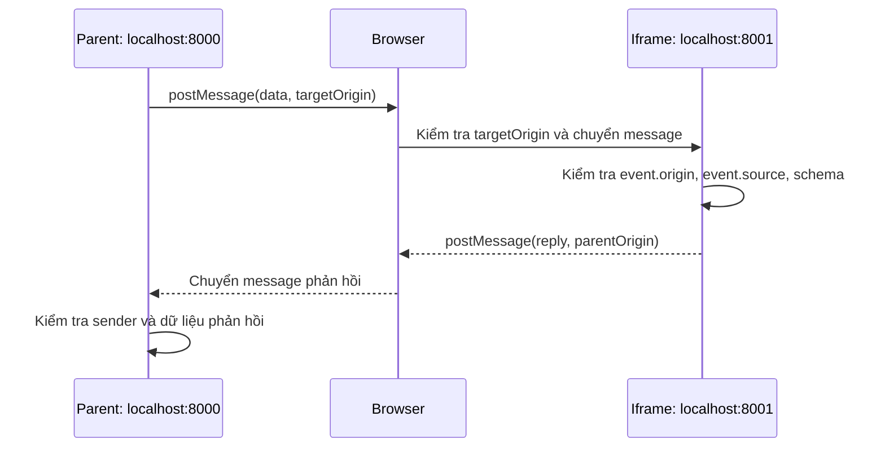

# postMessage là gì?

## 1. Giao tiếp giữa các browsing context

`window.postMessage()` là API của browser cho phép hai **browsing context** trao đổi dữ liệu có chủ đích. Một browsing context có thể là cửa sổ tab, popup hoặc iframe. API này đặc biệt hữu ích khi hai trang thuộc các origin khác nhau và Same-Origin Policy (SOP) không cho phép chúng đọc trực tiếp DOM của nhau.

Ví dụ: trang `https://shop.example` nhúng iframe thanh toán tại `https://pay.example`. Trang shop không thể tự do đọc DOM bên trong iframe thanh toán vì hai trang khác origin. Tuy nhiên, hai bên có thể thiết kế một giao thức message: trang shop gửi mã đơn hàng, iframe xác nhận đã nhận và gửi trạng thái hoàn tất.

`postMessage` không tắt SOP và không biến hai origin thành cùng origin. Nó tạo ra một kênh trao đổi dữ liệu rõ ràng, trong đó ứng dụng phải xác minh người gửi, kiểm tra nội dung và giới hạn hành động được phép.

Trong module `SECURITY_APPLICATION_SECURITY_BROWSER_SECURITY`, API này liên quan trực tiếp đến ranh giới origin, SOP, CORS và bảo vệ XSS. Bài học tập trung vào cách gửi/nhận message an toàn giữa cửa sổ và iframe, cách hiểu `origin`, `source`, `targetOrigin`, structured clone và các lỗi tin cậy thường gặp.

### Kết quả học tập

Sau bài này, người học có thể:

1. Giải thích `window.postMessage()` giải quyết vấn đề gì và giới hạn của nó.
2. Phân biệt origin, site, `event.origin`, `event.source` và `targetOrigin`.
3. Gửi message tới đúng origin bằng target origin cụ thể.
4. Xác minh sender và validate schema của `event.data`.
5. Hiểu structured clone, transferable objects và `MessageChannel`.
6. Nhận diện rủi ro của wildcard `*`, opaque origin và thông điệp từ popup/iframe.
7. Xây dựng và kiểm thử một giao thức message nhỏ trong môi trường local.

## 2. Vì sao cần postMessage?

SOP giới hạn việc một document truy cập trực tiếp dữ liệu của document khác origin. Ví dụ, trang cha tại `http://localhost:8000` không thể đọc `iframe.contentDocument` của iframe tại `http://localhost:8001`. Khác port đã tạo ra hai origin khác nhau, dù hostname giống nhau.

Nếu hai bên cần phối hợp, `postMessage` cho phép gửi một bản dữ liệu qua browser:



Một số tình huống sử dụng:

- Trang cha gửi cấu hình hiển thị cho iframe widget.
- Iframe thanh toán gửi trạng thái giao dịch về trang thương mại điện tử.
- Popup đăng nhập gửi kết quả hoàn tất xác thực về cửa sổ mở popup.
- Hai ứng dụng cùng tham gia một quy trình nhúng cần trao đổi trạng thái.
- Một trang gửi dữ liệu tới worker hoặc một kênh message phù hợp khác.

Nếu hai document cùng origin và cùng quyền truy cập, ứng dụng có thể dùng API trực tiếp. `postMessage` hữu ích khi cần một giao thức message tường minh hoặc khi hai browsing context bị cách ly bởi SOP.

`postMessage` không phải CORS. CORS điều khiển việc JavaScript đọc response của một số request cross-origin như `fetch` hoặc XMLHttpRequest thông qua response header của server. `postMessage` là API giao tiếp riêng của browser: sender chọn `targetOrigin`, receiver kiểm tra `event.origin` và `event.source`. Thêm `Access-Control-Allow-Origin` không làm cho một listener `message` an toàn hơn và cũng không cấp quyền đọc DOM của iframe.

## 3. Origin, site và ba giá trị quan trọng

### 3.1. Origin là gì?

Một origin được xác định bởi bộ ba:

- Scheme (giao thức), ví dụ `https`.
- Host (tên máy chủ), ví dụ `app.example.com`.
- Port (cổng), ví dụ `443` hoặc `8443`.

Ví dụ:

| URL | Origin | Quan hệ |
| --- | --- | --- |
| `https://app.example.com/home` | `https://app.example.com` | Origin A |
| `https://app.example.com:443/profile` | `https://app.example.com` | Cùng origin A; cổng HTTPS mặc định được chuẩn hóa |
| `http://app.example.com` | `http://app.example.com` | Khác A vì scheme |
| `https://api.example.com` | `https://api.example.com` | Khác A vì host |
| `https://app.example.com:8443` | `https://app.example.com:8443` | Khác A vì port |

Origin không bao gồm path, query hoặc fragment. Khi so sánh origin, không so sánh URL đầy đủ bằng chuỗi tùy tiện.

**Site** là khái niệm khác, thường dùng trong cookie `SameSite` và một số chính sách browser. Hai subdomain có thể được xem là same-site nhưng vẫn khác origin. `postMessage` cần kiểm tra origin chính xác theo scheme, host và port.

### 3.2. `targetOrigin`: nơi nhận được phép nhận message

Tham số `targetOrigin` trong lệnh gửi xác định origin mà browser được phép chuyển message tới:

```js
otherWindow.postMessage(
  { type: "READY" },
  "https://widget.example"
);
```

Browser chỉ chuyển message nếu origin của document đích khớp với target origin tại thời điểm message được phân phối. Giá trị nên là origin cụ thể, gồm scheme, host và port khi có.

Không thêm path vào `targetOrigin`:

```js
// Đúng: chỉ origin, không có path.
popup.postMessage({ type: "DONE" }, "https://login.example");

// Sai: đây là URL có path, không phải origin.
popup.postMessage({ type: "DONE" }, "https://login.example/callback");
```

Nếu cửa sổ đích đã điều hướng sang origin khác trước khi message được phân phối, target origin cụ thể giúp browser không gửi message tới document mới đó.

### 3.3. `event.origin`: origin của bên gửi

Ở phía nhận, `MessageEvent.origin` cho biết origin của document đã gọi `postMessage` tại thời điểm gửi. Hãy so sánh chính xác:

```js
const TRUSTED_ORIGIN = "https://widget.example";

window.addEventListener("message", event => {
  if (event.origin !== TRUSTED_ORIGIN) {
    return;
  }

  // Chỉ sau khi xác minh origin mới tiếp tục kiểm tra message.
  handleMessage(event.data);
});
```

`event.origin` không phải URL đầy đủ, không chứa path. Đừng dùng kiểm tra lỏng như:

```js
// Không an toàn: có thể khớp host giả có suffix giống nhau.
if (event.origin.endsWith("example.com")) {
  // ...
}
```

Một origin như `https://example.com.attacker.test` có thể làm kiểm tra suffix hoặc `includes()` sai lệch. Dùng allowlist origin chính xác.

### 3.4. `event.source`: browsing context gửi message

`event.source` tham chiếu browsing context đã gửi message. Có thể so sánh nó với cửa sổ cha, iframe hoặc popup mà ứng dụng đã giữ tham chiếu:

```js
function isExpectedSource(event, iframe) {
  if (event.source !== iframe.contentWindow) {
    return false;
  }
  return true;
}
```

Origin và source bổ sung cho nhau:

- `event.origin` xác minh origin của document gửi tại thời điểm gửi.
- `event.source` xác minh browsing context mà ứng dụng mong đợi.

Không nên chỉ kiểm tra một trong hai khi giao thức có thể xác định cả hai.

`event.source` thường là `WindowProxy`, đại diện cho browsing context. Cửa sổ đó có thể điều hướng sang document khác trong vòng đời của nó; vì vậy source reference không thay thế việc kiểm tra `event.origin` trên từng message.

## 4. Gửi message bằng postMessage

### 4.1. Cú pháp cơ bản

Dạng phổ biến:

```js
targetWindow.postMessage(message, targetOrigin);
```

Có thể truyền transferable objects ở tham số thứ ba:

```js
targetWindow.postMessage(message, targetOrigin, transferList);
```

Các browser hiện đại cũng hỗ trợ dạng options:

```js
targetWindow.postMessage(message, {
  targetOrigin: "https://widget.example",
  transfer: []
});
```

`targetWindow` thường là `window`, `window.parent`, `window.opener` hoặc `iframe.contentWindow`. Message được xếp lịch để browser chuyển tới browsing context đích; đây là giao tiếp bất đồng bộ.

Ví dụ gửi message tới iframe:

```js
const frame = document.querySelector("#payment-frame");
const paymentOrigin = "https://pay.example";

frame.contentWindow.postMessage(
  {
    type: "PAYMENT_INIT",
    version: 1,
    orderId: "ORDER-2026-001"
  },
  paymentOrigin
);
```

### 4.2. Chờ iframe sẵn sàng

Không nên giả định iframe đã cài listener ngay khi phần tử vừa được tạo. Một cách đơn giản là gửi message khi iframe load, sau đó để hai bên có bước handshake rõ ràng:

```js
const frame = document.querySelector("#widget-frame");
const widgetOrigin = "https://widget.example";

frame.addEventListener("load", () => {
  frame.contentWindow.postMessage(
    { type: "HOST_HELLO", version: 1 },
    widgetOrigin
  );
});
```

Trong ứng dụng thực tế, iframe có thể reload hoặc điều hướng. Giao thức nên xử lý việc khởi tạo lại, timeout và message lặp. Không gửi bí mật chỉ vì sự kiện `load` đã xảy ra; phía nhận vẫn phải xác minh sender và nội dung.

### 4.3. Tránh wildcard `*`

Không dùng `*` khi message chứa dữ liệu riêng tư, token, thông tin tài khoản hoặc lệnh có quyền hạn:

```js
// Không nên gửi dữ liệu nhạy cảm bằng wildcard.
popup.postMessage(
  { type: "AUTH_RESULT", accessToken: token },
  "*"
);
```

Nếu cửa sổ đích điều hướng hoặc bị điều khiển theo cách không dự kiến, wildcard có thể khiến dữ liệu được chuyển tới document có origin khác. Dùng origin cụ thể:

```js
popup.postMessage(
  { type: "AUTH_COMPLETE" },
  "https://app.example"
);
```

Wildcard chỉ nên được cân nhắc khi dữ liệu thực sự công khai, không mang bí mật hoặc quyền thực hiện hành động, và ứng dụng chấp nhận mọi origin đích. Trường hợp thường cần wildcard là một số document có opaque origin; khi đó nên xem xét lại thiết kế và không gửi dữ liệu nhạy cảm.

## 5. Nhận và xác minh message an toàn

Một listener an toàn cần thực hiện nhiều bước trước khi sử dụng `event.data`:

1. Kiểm tra `event.origin` với allowlist chính xác.
2. Kiểm tra `event.source` nếu biết browsing context hợp lệ.
3. Kiểm tra cấu trúc, phiên bản và kiểu dữ liệu.
4. Chỉ cho phép loại message đã định nghĩa.
5. Giới hạn kích thước và tần suất nếu message có thể gây tiêu tốn tài nguyên.
6. Không diễn giải dữ liệu thành HTML hoặc JavaScript.
7. Kiểm tra authorization ở server cho hành động nhạy cảm.

Ví dụ:

```js
const PARENT_ORIGIN = "https://shop.example";

function isRecord(value) {
  return value !== null &&
    typeof value === "object" &&
    !Array.isArray(value);
}

function parsePaymentMessage(data) {
  if (!isRecord(data)) return null;
  if (data.version !== 1) return null;
  if (data.type !== "PAYMENT_STATUS") return null;
  if (typeof data.orderId !== "string") return null;
  if (data.orderId.length < 1 || data.orderId.length > 64) return null;
  if (!["pending", "paid", "failed"].includes(data.status)) return null;

  return {
    type: data.type,
    orderId: data.orderId,
    status: data.status
  };
}

window.addEventListener("message", event => {
  if (event.origin !== PARENT_ORIGIN) return;
  if (event.source !== window.parent) return;

  const message = parsePaymentMessage(event.data);
  if (!message) return;

  document.querySelector("#status").textContent =
    "Đơn " + message.orderId + ": " + message.status;
});
```

Ví dụ trên minh họa allowlist loại message và kiểm tra schema. Trong ứng dụng thật, phải kiểm tra `orderId` có thuộc phiên/ngữ cảnh giao dịch hiện tại không. Không cập nhật trạng thái thanh toán chỉ dựa vào message của browser; server cần xác minh giao dịch với nguồn có thẩm quyền.

### 5.1. Kiểm tra cả sender và payload

Chỉ kiểm tra `event.origin` chưa đủ. Nhiều ứng dụng có nhiều trang hoặc nhiều script cùng origin; một XSS hoặc một endpoint bị chiếm quyền trong origin đáng tin vẫn có thể gửi message giả.

Ngược lại, chỉ kiểm tra `event.source` cũng chưa đủ. Cùng một iframe browsing context có thể điều hướng sang origin khác. Kiểm tra source và origin cùng nhau giúp ràng buộc message với đúng browsing context và document origin mong đợi.

### 5.2. Message là dữ liệu, không phải lệnh tùy ý

Không viết handler kiểu:

```js
window.addEventListener("message", event => {
  window[event.data.method](...event.data.args);
});
```

Cách này biến dữ liệu nhận được thành tên hàm và tham số điều khiển hành vi. Thay bằng dispatch rõ ràng theo loại message:

```js
const handlers = {
  CLOSE_WIDGET(message) {
    closeWidget();
  },
  RESIZE_WIDGET(message) {
    if (!Number.isInteger(message.height)) return;
    if (message.height < 100 || message.height > 1200) return;
    resizeWidget(message.height);
  }
};

function dispatchMessage(message) {
  if (!isRecord(message) || typeof message.type !== "string") return;
  const handler = handlers[message.type];
  if (!handler) return;
  handler(message);
}
```

Không dùng `eval`, `Function`, `innerHTML` hoặc dynamic property access để diễn giải message. Nếu hiển thị nội dung, dùng `textContent` hoặc DOM API phù hợp.

## 6. Structured clone và transferable objects

### 6.1. Structured clone là gì?

`postMessage` không chuyển object bằng cách chia sẻ trực tiếp cùng một tham chiếu JavaScript. Browser dùng **structured clone algorithm** để tạo bản sao dữ liệu ở phía nhận.

Các loại dữ liệu phổ biến được hỗ trợ gồm:

- Primitive values như string, number, boolean, `null`, `undefined`, bigint.
- Object và array thông thường.
- `Date`, `RegExp`, `Map`, `Set`.
- `ArrayBuffer`, typed arrays và một số đối tượng dữ liệu browser như `Blob`, tùy loại.
- Một số cấu trúc lồng nhau có tham chiếu vòng.

Function, DOM node và một số đối tượng không hỗ trợ structured clone sẽ gây `DataCloneError`. Prototype tùy chỉnh, getter/setter hoặc hành vi của class không được chuyển như một object JavaScript dùng chung. Vì vậy, hãy thiết kế message theo schema dữ liệu đơn giản, rõ ràng.

Ví dụ:

```js
const message = {
  type: "PROFILE_SUMMARY",
  version: 1,
  profile: {
    displayName: "Lan",
    roles: ["viewer"]
  }
};

iframe.contentWindow.postMessage(
  message,
  "https://widget.example"
);
```

Bên nhận nhận dữ liệu đã clone. Việc dữ liệu được clone không đồng nghĩa nó đáng tin; vẫn phải validate schema và quyền.

### 6.2. Transferable objects

Một số object có thể được **chuyển quyền sở hữu** thay vì clone, thông qua transfer list. Ví dụ `ArrayBuffer` sau khi chuyển sẽ bị detach ở phía gửi; phía nhận sở hữu buffer được chuyển.

```js
const buffer = new ArrayBuffer(1024);
const view = new Uint8Array(buffer);
view[0] = 42;

workerOrWindow.postMessage(
  { type: "BINARY_DATA", buffer },
  targetOrigin,
  [buffer]
);

// Sau khi transfer, buffer phía gửi đã bị detach.
```

Transfer có thể giảm chi phí sao chép dữ liệu lớn. Tuy nhiên, ứng dụng cần hiểu rõ ownership: bên gửi không thể tiếp tục sử dụng buffer như trước sau khi transfer thành công.

Một số transferable phổ biến gồm `ArrayBuffer`, `MessagePort` và `ImageBitmap`. Chỉ transfer các object mà giao thức thực sự cần chuyển quyền sở hữu.

### 6.3. `MessageChannel` cho một kênh riêng

`MessageChannel` tạo hai đầu `MessagePort` có thể chuyển cho hai bên. Mô hình này hữu ích khi cần một kênh hai chiều riêng sau khi xác minh một lần bằng `window.postMessage`.

```js
const channel = new MessageChannel();

channel.port1.onmessage = event => {
  console.log("Reply:", event.data);
};

iframe.contentWindow.postMessage(
  { type: "CONNECT_PORT", version: 1 },
  "https://widget.example",
  [channel.port2]
);

channel.port1.start();
```

Phía iframe nhận port qua `event.ports`:

```js
window.addEventListener("message", event => {
  if (event.origin !== "https://shop.example") return;
  if (event.source !== window.parent) return;
  if (!event.data || event.data.type !== "CONNECT_PORT") return;
  if (event.ports.length !== 1) return;

  const port = event.ports[0];
  port.onmessage = messageEvent => {
    handlePortMessage(messageEvent.data);
  };
  port.start();
});
```

Sau khi port được chuyển, hai bên giao tiếp qua `MessagePort`. Port hoạt động như một capability: ai sở hữu port có thể gửi message qua kênh đó. Không chuyển port cho bên không đáng tin và vẫn validate mọi message đi qua port. Message trên port không nên được xác minh bằng `event.origin` như window message; hãy dựa vào handshake đã xác thực, quyền sở hữu port và schema giao thức.

## 7. Opaque origin, sandbox và giá trị null

Một số document có **opaque origin**, nghĩa là origin của chúng không được biểu diễn như một tuple scheme/host/port thông thường. Ví dụ có thể gồm tài liệu `data:` và iframe bị sandbox mà không có `allow-same-origin`.

Với các document như vậy:

- `event.origin` có thể là chuỗi `"null"`.
- Không thể dùng một origin cụ thể thông thường để target opaque origin.
- Một số trường hợp gửi tới opaque origin buộc phải dùng `targetOrigin: "*"`.

Không được coi `"null"` là một origin đáng tin. Nhiều loại document opaque không liên quan có thể cùng được serialize thành chuỗi `"null"`. Nếu ứng dụng chấp nhận message chỉ vì `event.origin === "null"`, ranh giới xác thực gần như bị bỏ qua.

Khuyến nghị:

- Tránh gửi bí mật tới opaque-origin document.
- Nếu cần nhúng nội dung không tin cậy, thiết kế giao thức capability riêng với dữ liệu tối thiểu và quyền giới hạn.
- Cân nhắc dùng một origin HTTPS riêng, được kiểm soát, cho widget cần trao đổi dữ liệu.
- Với iframe sandbox, chỉ thêm `allow-same-origin` khi hiểu rõ tác động bảo mật; không nới sandbox chỉ để né vấn đề origin.
- Kiểm tra `event.source` và message schema, nhưng nhớ rằng chúng không biến opaque origin thành danh tính đã xác thực.

## 8. Popup, iframe và điều hướng

### 8.1. Giao tiếp với popup

Khi mở popup bằng `window.open`, cửa sổ cha có thể giữ tham chiếu tới popup và dùng `postMessage` để trao đổi dữ liệu:

```js
const loginOrigin = "https://login.example";
const popup = window.open(
  loginOrigin + "/authorize",
  "login",
  "width=500,height=650"
);

window.addEventListener("message", event => {
  if (event.origin !== loginOrigin) return;
  if (event.source !== popup) return;
  if (!event.data || event.data.type !== "LOGIN_COMPLETE") return;

  finishLoginFlow();
});
```

Nếu ứng dụng dùng `Cross-Origin-Opener-Policy` (COOP) hoặc cơ chế `noopener`, quan hệ opener có thể bị tách. Khi đó `window.opener` có thể là `null` và mô hình giao tiếp phải được thiết kế lại. Không hạ COOP chỉ để làm popup hoạt động mà chưa đánh giá các hệ quả về isolation.

Đối với luồng OAuth/OIDC, không tự xây dựng giao thức xác thực chỉ dựa trên một message `LOGIN_COMPLETE`. Phải dùng flow chuẩn, kiểm tra `state`, PKCE và xác minh kết quả ở server theo thư viện/provider phù hợp.

### 8.2. Điều hướng sau khi gửi message

`event.origin` phản ánh origin của sender tại thời điểm gọi `postMessage`. `event.source` là tham chiếu browsing context, có thể tiếp tục tồn tại khi document trong cửa sổ đó điều hướng. Vì vậy mỗi message cần kiểm tra origin, không chỉ ghi nhớ source reference từ lần đầu.

Ở phía gửi, `targetOrigin` cụ thể giúp tránh gửi message tới document đã điều hướng sang origin khác. Ở phía nhận, kiểm tra cả `origin` và `source` giúp tránh nhận message từ document ngoài dự kiến.

## 9. Các lỗi bảo mật thường gặp

### 9.1. Dùng wildcard cho dữ liệu nhạy cảm

```js
// Sai: gửi thông tin phiên tới mọi origin đích.
window.opener.postMessage(
  { type: "SESSION", token: sessionToken },
  "*"
);
```

Dùng origin chính xác và chỉ gửi dữ liệu tối thiểu cần thiết. Thông thường không gửi access token hoặc session secret qua message nếu có thể thiết kế callback an toàn hơn.

### 9.2. Không xác minh `event.origin`

```js
// Sai: bất kỳ cửa sổ nào gửi message cũng được xử lý.
window.addEventListener("message", event => {
  updateAccount(event.data);
});
```

Một trang bất kỳ có thể mở hoặc nhúng trang của bạn rồi gửi message. Kiểm tra origin allowlist trước khi đọc payload.

### 9.3. Chỉ xác minh origin bằng suffix

```js
// Sai: kiểm tra tên miền không chính xác.
if (event.origin.includes("trusted.example")) {
  process(event.data);
}
```

Dùng so sánh origin đầy đủ với giá trị cố định hoặc allowlist đã parse/chuẩn hóa. Không tự tạo quy tắc suffix để đại diện cho subdomain nếu chưa kiểm soát ranh giới DNS và host.

### 9.4. Tin payload chỉ vì origin hợp lệ

Origin hợp lệ chỉ xác định document gửi message đang thuộc origin đó tại thời điểm gửi. Nếu origin có XSS, script bị xâm nhập hoặc một trang khác cùng origin có quyền gửi message, payload vẫn có thể độc hại.

Validate schema, giới hạn message type, kiểm tra context hiện tại và authorization ở server. Không coi postMessage là cơ chế cấp quyền cho người dùng.

### 9.5. Chèn message vào DOM như HTML

```js
// Sai: message có thể chứa markup hoặc event handler.
result.innerHTML = event.data.message;
```

Dùng:

```js
result.textContent = event.data.message;
```

Nếu sản phẩm cần rich HTML, dùng sanitizer chuyên dụng với allowlist và policy rõ ràng. Không dùng regex để lọc HTML.

### 9.6. Message handler quá quyền

Không cho message gọi trực tiếp các hàm tùy ý, thay đổi `location` tới URL không kiểm tra, cập nhật quyền tài khoản hoặc thực hiện thanh toán mà không xác minh phía server. Thiết kế tập message nhỏ, mỗi loại có schema, điều kiện và tác dụng rõ ràng.

### 9.7. Không giới hạn tài nguyên

Một sender có thể gửi nhiều message hoặc payload lớn liên tục. Nếu handler thực hiện parse nặng, render nhiều DOM node hoặc gọi API cho mỗi message, có thể gây quá tải. Giới hạn kích thước, tần suất, số lượng item và xử lý bất đồng bộ có kiểm soát.

## 10. Thực hành: parent và iframe ở hai origin

Bài lab dùng hai origin local khác port: `http://localhost:8000` và `http://localhost:8001`. Tạo hai trang tĩnh và phục vụ chúng trên hai cổng khác nhau bằng static server mà bạn đang sử dụng. Hai port khác nhau tạo hai origin khác nhau, đủ để quan sát việc kiểm tra origin.

### 10.1. Trang parent tại port 8000

Tạo `parent.html`:

```html
<!doctype html>
<meta charset="utf-8">
<title>postMessage parent lab</title>
<h1>Parent origin :8000</h1>
<iframe
  id="child"
  src="http://localhost:8001/child.html"
  title="Child lab">
</iframe>
<p id="status">Đang chờ iframe...</p>
<script>
  const CHILD_ORIGIN = "http://localhost:8001";
  const frame = document.querySelector("#child");
  const status = document.querySelector("#status");

  function isRecord(value) {
    return value !== null &&
      typeof value === "object" &&
      !Array.isArray(value);
  }

  frame.addEventListener("load", () => {
    frame.contentWindow.postMessage(
      { type: "HOST_HELLO", version: 1 },
      CHILD_ORIGIN
    );
  });

  window.addEventListener("message", event => {
    if (event.origin !== CHILD_ORIGIN) return;
    if (event.source !== frame.contentWindow) return;
    if (!isRecord(event.data)) return;
    if (event.data.version !== 1) return;
    if (event.data.type !== "CHILD_READY") return;
    if (typeof event.data.label !== "string") return;
    if (event.data.label.length > 40) return;

    status.textContent = "Đã nhận: " + event.data.label;
    frame.contentWindow.postMessage(
      { type: "PARENT_ACK", version: 1 },
      CHILD_ORIGIN
    );
  });
</script>
```

### 10.2. Trang child tại port 8001

Tạo `child.html`:

```html
<!doctype html>
<meta charset="utf-8">
<title>postMessage child lab</title>
<h2>Iframe origin :8001</h2>
<p id="child-status">Đang khởi tạo...</p>
<script>
  const PARENT_ORIGIN = "http://localhost:8000";
  const status = document.querySelector("#child-status");

  window.addEventListener("message", event => {
    if (event.origin !== PARENT_ORIGIN) return;
    if (event.source !== window.parent) return;
    if (!event.data || typeof event.data !== "object") return;
    if (event.data.version !== 1) return;

    if (event.data.type === "HOST_HELLO") {
      window.parent.postMessage(
        {
          type: "CHILD_READY",
          version: 1,
          label: "Widget đã sẵn sàng"
        },
        PARENT_ORIGIN
      );
      return;
    }

    if (event.data.type !== "PARENT_ACK") return;
    status.textContent = "Parent đã xác nhận kết nối";
  });
</script>
```

### 10.3. Chạy và quan sát

1. Phục vụ `parent.html` ở `http://localhost:8000/parent.html`.
2. Phục vụ `child.html` ở `http://localhost:8001/child.html`.
3. Mở parent page trong browser.
4. Quan sát parent nhận `CHILD_READY` và gửi `PARENT_ACK`.
5. Quan sát iframe nhận ACK và cập nhật trạng thái.
6. Mở DevTools → Console và thêm log tạm thời để xem `event.origin`, `event.source`, `event.data`.
7. Thử đổi `CHILD_ORIGIN` thành một origin sai; parent phải bỏ qua message.
8. Thử gửi object sai schema; parent không được cập nhật giao diện.

Nếu hai trang được phục vụ cùng một origin, bài lab không còn kiểm chứng ranh giới cross-origin. Hãy xác nhận scheme, host và port trong thanh địa chỉ.

## 11. Ma trận kiểm thử

| Mã | Tình huống | Kết quả mong muốn |
| --- | --- | --- |
| PM-01 | Message từ đúng origin và đúng iframe | Được xử lý nếu schema hợp lệ |
| PM-02 | Message từ origin không nằm trong allowlist | Bị bỏ qua |
| PM-03 | Message từ cửa sổ khác nhưng cùng origin | Bị từ chối nếu source không đúng |
| PM-04 | `event.data` không phải object theo schema | Bị từ chối an toàn |
| PM-05 | Message có type không hỗ trợ | Không thực hiện hành động |
| PM-06 | Trường string vượt giới hạn | Bị từ chối |
| PM-07 | `targetOrigin` cụ thể nhưng iframe điều hướng sang origin khác | Browser không chuyển message tới document khác origin |
| PM-08 | `targetOrigin` là `*` | Chỉ chấp nhận trong trường hợp dữ liệu công khai/thiết kế opaque-origin đã đánh giá |
| PM-09 | Sender có opaque origin (`event.origin === "null"`) | Không được tin chỉ dựa trên chuỗi null |
| PM-10 | Message chứa HTML markup | Hiển thị như text hoặc bị sanitizer xử lý theo policy |
| PM-11 | Message lặp/tần suất cao | Có giới hạn và không làm treo giao diện |
| PM-12 | Transfer ArrayBuffer | Bên nhận nhận buffer; bên gửi không tiếp tục dùng buffer đã detach |
| PM-13 | MessageChannel port không hợp lệ | Không mở kênh; đóng port nếu không dùng |
| PM-14 | Sender origin hợp lệ nhưng payload giả | Schema/context/authorization vẫn phải từ chối |

## 12. Checklist thiết kế giao thức postMessage

- [ ] Dùng `targetOrigin` cụ thể, chính xác scheme/host/port.
- [ ] Không dùng wildcard `*` cho dữ liệu nhạy cảm hoặc message có quyền hạn.
- [ ] Kiểm tra `event.origin` bằng allowlist chính xác.
- [ ] Kiểm tra `event.source` với iframe, popup hoặc parent dự kiến.
- [ ] Không tin chuỗi origin `"null"` như danh tính.
- [ ] Định nghĩa message type, version và schema rõ ràng.
- [ ] Validate mọi trường, độ dài, miền giá trị và kích thước payload.
- [ ] Không dùng message làm authorization; server vẫn kiểm tra quyền.
- [ ] Không dùng `eval`, dynamic function dispatch hoặc `innerHTML` với payload.
- [ ] Dùng structured clone cho dữ liệu có cấu trúc; hiểu ownership khi transfer.
- [ ] Chỉ chuyển `MessagePort` cho bên đã xác minh và validate message trên port.
- [ ] Xử lý iframe reload, popup đóng, timeout và message lặp.
- [ ] Có giới hạn tần suất/kích thước cho message có thể gây tải.
- [ ] Kiểm thử trên browser mục tiêu và quan sát message event trong DevTools.

### Ghi nhớ

`postMessage` là kênh giao tiếp có chủ đích giữa các browsing context, giúp ứng dụng trao đổi dữ liệu khi SOP ngăn truy cập DOM trực tiếp. An toàn phụ thuộc vào việc gửi tới `targetOrigin` cụ thể, xác minh `event.origin` và `event.source`, kiểm tra schema của `event.data`, rồi chỉ thực hiện các hành động được định nghĩa. Structured clone giúp chuyển dữ liệu giữa context; nó không chứng minh dữ liệu đáng tin. Wildcard, opaque origin, script cùng origin bị xâm nhập và message handler quá quyền đều cần được xử lý trong thiết kế giao thức.
