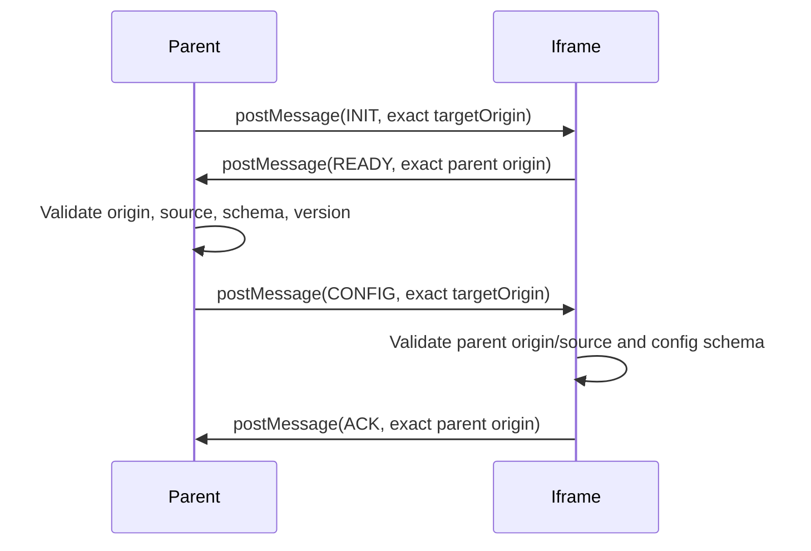

# targetOrigin — gửi postMessage đúng origin nhận

> **Chương:** postMessage  
> **Mục tiêu:** Hiểu vai trò của tham số `targetOrigin` trong `window.postMessage()`, cách browser so khớp scheme/host/port của cửa sổ nhận, vì sao wildcard có thể làm lộ dữ liệu khi cửa sổ điều hướng, cách phân biệt targetOrigin với `event.origin`, và cách kiểm tra nguồn gửi, schema payload, iframe cùng window.opener.

## 1. targetOrigin giải quyết vấn đề gì?

`window.postMessage()` cho phép hai browsing context trao đổi dữ liệu kể cả khi chúng khác origin. Ví dụ thường gặp là trang cha giao tiếp với iframe, cửa sổ popup hoặc một ứng dụng đối tác.

Khi gửi thông điệp, code cần chỉ định **origin mà cửa sổ nhận phải có tại thời điểm browser giao thông điệp**. Tham số đó là `targetOrigin`:

```js
const partnerWindow = document.querySelector("#partner").contentWindow;

partnerWindow.postMessage(
  { type: "INITIALIZE", version: 1 },
  "https://widget.partner.example"
);
```

Browser chỉ giao thông điệp nếu cửa sổ nhận đang có origin khớp với `https://widget.partner.example`. Nếu cửa sổ đã điều hướng sang origin khác trước lúc thông điệp được giao, browser không gửi thông điệp đó.

Đây là một kiểm soát quan trọng khi cửa sổ nhận là iframe hoặc popup có thể điều hướng. Nếu gửi dữ liệu nhạy cảm bằng wildcard, dữ liệu có thể tới một document khác với document mà ứng dụng dự định giao tiếp.

## 2. Origin gồm những thành phần nào?

Với URL HTTP(S), origin được xác định bởi bộ ba:

- **Scheme:** ví dụ `https` hoặc `http`.
- **Host:** hostname hoặc địa chỉ IP.
- **Port:** cổng hiệu lực của kết nối.

Ví dụ:

| URL | Origin |
| --- | --- |
| `https://app.example.com/profile` | `https://app.example.com` |
| `https://app.example.com:443/settings` | `https://app.example.com` |
| `http://app.example.com` | `http://app.example.com` |
| `https://app.example.com:8443` | `https://app.example.com:8443` |
| `https://api.example.com` | `https://api.example.com` |

Path, query và fragment không thuộc origin. Port mặc định được chuẩn hóa theo scheme: HTTPS dùng 443, HTTP dùng 80. Vì vậy, `https://app.example.com` và `https://app.example.com:443` có cùng origin; HTTP và HTTPS khác origin; port 8443 khác origin với port mặc định.

`targetOrigin` phải là origin, không phải URL đầy đủ có path. Hãy dùng giá trị dạng `https://widget.partner.example`, không dùng `https://widget.partner.example/embed/page`.

## 3. So khớp chính xác, không so khớp gần đúng

Origin là ranh giới bảo mật. Khi gửi message, hãy dùng giá trị origin chính xác đã được cấu hình:

```js
const PARTNER_ORIGIN = "https://widget.partner.example";

partnerWindow.postMessage(
  { type: "REFRESH" },
  PARTNER_ORIGIN
);
```

Không tạo targetOrigin bằng phép nối chuỗi từ dữ liệu người dùng và không dùng wildcard hostname. Các cách kiểm tra sau không tương đương với origin matching:

```js
// Không an toàn: kiểm tra hậu tố có thể nhận hostname giả.
if (location.hostname.endsWith("partner.example")) {
  // ...
}

// Không an toàn: includes có thể khớp ở path hoặc query.
if (someUrl.includes("partner.example")) {
  // ...
}
```

Nếu cấu hình origin đến từ một URL, parse rồi lấy origin:

```js
const configuredUrl = new URL(
  "https://widget.partner.example/embed",
);
const targetOrigin = configuredUrl.origin;
```

Với nhiều đối tác, dùng allowlist origin đã được kiểm duyệt. So sánh chính xác `event.origin` với chuỗi origin chuẩn hóa; không dùng regex hoặc kiểm tra tên miền theo hậu tố nếu chưa xử lý ranh giới domain và Public Suffix List.

## 4. targetOrigin khác event.origin như thế nào?

Hai giá trị này nằm ở hai phía khác nhau của giao thức:

| Giá trị | Ai dùng? | Câu hỏi được trả lời |
| --- | --- | --- |
| `targetOrigin` | Bên gửi, truyền vào `postMessage()` | Browser được phép giao message tới cửa sổ nhận khi nó đang ở origin nào? |
| `event.origin` | Bên nhận, đọc từ message event | Document gửi message có origin nào tại thời điểm gọi postMessage? |
| `event.source` | Bên nhận | Cửa sổ/browsing context nào đã gửi message? |

`targetOrigin` không xác minh người gửi. `event.origin` không giới hạn nơi bên gửi chuyển dữ liệu tới. Một ứng dụng an toàn thường cần cả hai:

1. Bên gửi dùng `targetOrigin` cụ thể để không gửi dữ liệu sang document khác origin.
2. Bên nhận kiểm tra `event.origin` và `event.source` để chỉ xử lý message từ cửa sổ mong đợi.
3. Bên nhận xác minh schema, loại message và quyền nghiệp vụ trước khi thực hiện hành động.

Không giả định rằng việc đã đặt targetOrigin đúng ở một phía sẽ làm mọi message từ phía kia đáng tin.

## 5. Vì sao wildcard '*' nguy hiểm?

Giá trị `"*"` có nghĩa browser có thể giao message bất kể origin hiện tại của cửa sổ nhận. Điều này hữu ích trong một số trường hợp đặc biệt, nhưng nguy hiểm nếu payload chứa dữ liệu riêng tư hoặc capability:

```js
// Rủi ro nếu payload chứa token hoặc dữ liệu tài khoản.
popup.postMessage(
  { type: "AUTH_RESULT", accessToken },
  "*"
);
```

Giả sử ứng dụng mở popup tới một đối tác tin cậy. Trước khi message được giao, popup có thể bị điều hướng sang một trang khác. Với wildcard, browser vẫn có thể gửi payload tới document mới đang nằm trong cửa sổ đó.

Hãy dùng targetOrigin cụ thể:

```js
popup.postMessage(
  { type: "AUTH_RESULT", code: shortLivedCode },
  "https://login.partner.example"
);
```

Ngay cả khi dùng origin cụ thể, chỉ gửi dữ liệu tối thiểu cần thiết. Không gửi access token dài hạn, refresh token hoặc bí mật không cần cho giao thức.

### Khi nào wildcard có thể cần thiết?

Một số browsing context có **opaque origin**, ví dụ tài liệu từ `data:` URL hoặc iframe sandbox không có `allow-same-origin`. Không thể biểu diễn opaque origin bằng một origin HTTP(S) cụ thể; trong những trường hợp đó, wildcard có thể là cách duy nhất để gửi message tới context.

Nếu buộc phải dùng `"*"`:

- Không gửi bí mật hoặc dữ liệu có thể cấp quyền ngay trong message đầu tiên.
- Giữ URL và nội dung iframe trong quyền kiểm soát của ứng dụng.
- Dùng sandbox phù hợp và giới hạn khả năng điều hướng của frame.
- Kiểm tra `event.source` ở phía nhận; lưu ý `event.origin` của opaque origin thường là `"null"` và không thể dùng để xác thực một website cụ thể.
- Thiết kế handshake/capability riêng có phạm vi và thời hạn ngắn; không coi wildcard là xác thực.
- Cân nhắc dùng một origin HTTPS riêng, ổn định nếu giao thức cần trao đổi dữ liệu nhạy cảm.

## 6. Cửa sổ có thể điều hướng giữa lúc gửi và lúc nhận

`postMessage()` gửi message theo cơ chế bất đồng bộ. Cửa sổ nhận có thể điều hướng sau khi bên gửi giữ tham chiếu tới nó nhưng trước khi browser giao message.

Ví dụ:

```js
const popup = window.open(
  "https://login.partner.example/start",
  "partner-login",
);

// Một thời điểm sau đó, ứng dụng gửi kết quả.
popup.postMessage(
  { type: "COMPLETE", result: "ok" },
  "https://login.partner.example"
);
```

Nếu popup đã chuyển sang origin khác, browser không giao message khi targetOrigin không khớp. Đây là lý do targetOrigin cụ thể có giá trị ngay cả khi code đã kiểm tra URL popup trước đó.

Một kiểm tra trước khi gửi như `popup.location.origin` không thay thế targetOrigin:

- Việc đọc location của cửa sổ khác origin có thể bị SOP chặn.
- Cửa sổ có thể điều hướng ngay sau bước kiểm tra.
- TargetOrigin được browser kiểm tra tại thời điểm giao message.

TargetOrigin chỉ ràng buộc origin, không ràng buộc path hoặc một document cụ thể. Nhiều ứng dụng có thể cùng origin; nếu origin đó phục vụ nội dung không tin cậy hoặc cho phép user-controlled navigation, vẫn cần kiểm soát chặt nội dung và giao thức ở phía nhận.

## 7. Trường hợp cùng origin và targetOrigin '/'

Khi hai browsing context cùng origin, có thể chỉ định chính xác origin:

```js
const child = document.querySelector("iframe").contentWindow;
child.postMessage({ type: "PING" }, location.origin);
```

Một số overload hiện đại cho phép dùng `"/"` như shorthand cho origin của bên gửi. Dù vậy, trong code nghiệp vụ, truyền origin cụ thể thường dễ đọc và dễ audit hơn:

```js
child.postMessage({ type: "PING" }, window.location.origin);
```

Không nhầm `"/"` với wildcard `"*"`. Dấu slash là shorthand cùng origin theo API; wildcard bỏ qua kiểm tra origin đích. Khi đọc code cũ hoặc hỗ trợ browser mục tiêu, hãy kiểm tra overload được sử dụng và không bỏ qua targetOrigin trong các message nhạy cảm.

## 8. Gửi message tới iframe

Trang cha thường lấy browsing context của iframe qua `contentWindow`:

```html
<iframe
  id="payment-widget"
  src="https://pay.partner.example/widget"
  title="Thanh toán"
></iframe>
```

Sau khi iframe sẵn sàng theo giao thức, trang cha gửi message:

```js
const frame = document.querySelector("#payment-widget");
const PAYMENT_ORIGIN = "https://pay.partner.example";

frame.contentWindow.postMessage(
  {
    type: "INITIALIZE",
    version: 1,
    locale: "vi",
  },
  PAYMENT_ORIGIN,
);
```

Bên trong iframe, kiểm tra nguồn gửi:

```js
const PARENT_ORIGIN = "https://shop.example.com";

window.addEventListener("message", (event) => {
  if (event.origin !== PARENT_ORIGIN) return;
  if (event.source !== window.parent) return;
  if (!event.data || event.data.type !== "INITIALIZE") return;
  if (event.data.version !== 1) return;
  if (event.data.locale !== "vi" && event.data.locale !== "en") return;

  initializeWidget(event.data);
});
```

Kiểm tra `event.source === window.parent` giúp xác nhận message đến từ cửa sổ cha trực tiếp. Nếu giao thức cho phép nhiều parent hoặc nhiều iframe, hãy xác định rõ danh tính browsing context cần tin cậy.

## 9. Gửi message tới popup và window.opener

Khi một cửa sổ được mở bằng `window.open()`, trang popup có thể dùng `window.opener` để gửi message về trang mở nó:

```js
const OPENER_ORIGIN = "https://app.example.com";

if (window.opener) {
  window.opener.postMessage(
    { type: "LOGIN_COMPLETE", status: "success" },
    OPENER_ORIGIN,
  );
}
```

Trang mở nhận message:

```js
const LOGIN_ORIGIN = "https://login.partner.example";
const expectedPopup = loginPopup;

window.addEventListener("message", (event) => {
  if (event.origin !== LOGIN_ORIGIN) return;
  if (event.source !== expectedPopup) return;
  if (!event.data || event.data.type !== "LOGIN_COMPLETE") return;
  if (event.data.status !== "success") return;

  finishLoginFlow();
});
```

`window.opener` có thể bị cắt bởi `noopener` hoặc COOP tùy cách mở và chính sách cross-origin opener. Nếu giao thức cần opener, hãy thiết kế rõ ràng; không loại bỏ các bảo vệ opener một cách tùy tiện chỉ để message hoạt động.

Đối với OAuth/OIDC, ưu tiên luồng chuẩn: kiểm tra `state`, PKCE, issuer, redirect URI và authorization code. Không coi message “login complete” đơn lẻ là bằng chứng xác thực; server hoặc client phải hoàn tất kiểm tra giao thức trước khi tạo phiên đăng nhập.

## 10. Bên nhận phải kiểm tra event.origin và event.source

Một listener nhận message có thể được gọi bởi nhiều cửa sổ. Không xử lý message chỉ dựa trên `event.data`:

```js
window.addEventListener("message", (event) => {
  if (event.origin !== "https://widget.partner.example") return;
  if (event.source !== expectedFrame.contentWindow) return;

  handlePartnerMessage(event.data);
});
```

So sánh origin chính xác gồm scheme, host và port. Ví dụ `http://widget.partner.example` không khớp `https://widget.partner.example`; port 8443 cũng khác port mặc định.

`event.origin` phản ánh origin của document gửi tại thời điểm nó gọi `postMessage()`. Nó không bảo đảm document đó vẫn còn ở origin đó khi receiver xử lý message. `event.source` là tham chiếu browsing context, có thể vẫn giữ nguyên qua navigation.

Do đó, với luồng nhạy cảm:

- Dùng targetOrigin cụ thể ở bên gửi.
- Kiểm tra origin và source ở bên nhận.
- Có handshake/versioning nếu cần đồng bộ trạng thái.
- Không tin message cũ sau khi frame/popup đã điều hướng hoặc phiên đã kết thúc.
- Xác minh trạng thái nghiệp vụ ở server trước hành động quan trọng.

## 11. Kiểm tra schema của message payload

Structured clone truyền dữ liệu giữa browsing context mà không yêu cầu JSON stringify/parse. Nhưng structured clone **không xác thực ý nghĩa hoặc độ an toàn của payload**.

Ví dụ payload có schema:

```js
{
  type: "SET_THEME",
  version: 1,
  theme: "dark"
}
```

Receiver nên kiểm tra:

1. Payload là object theo cấu trúc mong đợi.
2. `type` nằm trong allowlist message type.
3. `version` được hỗ trợ.
4. Các field bắt buộc có đúng kiểu.
5. Chuỗi, mảng và object có giới hạn kích thước.
6. Giá trị enum nằm trong tập cho phép.
7. Message có hợp lệ trong trạng thái hiện tại của giao thức không.

Ví dụ:

```js
function parseThemeMessage(data) {
  if (!data || typeof data !== "object") return null;
  if (data.type !== "SET_THEME") return null;
  if (data.version !== 1) return null;
  if (data.theme !== "light" && data.theme !== "dark") return null;

  return { theme: data.theme };
}
```

Không dùng `eval`, `Function` hoặc `innerHTML` để xử lý payload. Nếu cần hiển thị text, dùng `textContent`; nếu cần URL, parse và allowlist; nếu cần thay đổi trạng thái tài khoản, xác minh quyền ở server.

## 12. Structured clone và transferable objects

`postMessage()` dùng structured clone algorithm để sao chép nhiều loại dữ liệu như object, array, string, number, Map, Set và một số built-in objects. Function và DOM node không thể được clone theo cách thông thường.

Một số đối tượng có thể được chuyển quyền sở hữu qua transfer list, ví dụ `MessagePort` hoặc `ArrayBuffer`:

```js
const channel = new MessageChannel();

partnerWindow.postMessage(
  { type: "CONNECT" },
  PARTNER_ORIGIN,
  [channel.port2],
);

channel.port1.onmessage = (event) => {
  handleChannelMessage(event.data);
};
```

Transferable có thể hiệu quả hơn khi truyền dữ liệu lớn hoặc thiết lập một kênh riêng. Tuy nhiên:

- Transfer không xác thực peer.
- MessagePort vẫn cần protocol và schema validation.
- ArrayBuffer được chuyển có thể bị detach khỏi phía gửi.
- Không chuyển credential hoặc dữ liệu nhạy cảm nếu chưa xác minh bên nhận.

## 13. Handshake và trạng thái giao thức

Không nên gửi message nhạy cảm ngay khi iframe vừa được tạo nếu chưa biết document đích đã sẵn sàng và đúng phiên bản. Có thể thiết kế handshake:



Handshake có thể bao gồm:

- Protocol version.
- Nonce/correlation ID để ghép request với response.
- Trạng thái khởi tạo và timeout.
- Danh sách message type được phép.
- Xác nhận source/origin ở mỗi chiều.

Correlation ID giúp ghép response với request nhưng không phải bí mật xác thực. Không dùng một giá trị dễ đoán làm bằng chứng danh tính. Nếu cần capability token, giới hạn quyền, thời gian sống và phạm vi sử dụng; không gửi nó qua wildcard tới một context có thể điều hướng.

## 14. MessageChannel: tạo kênh giao tiếp riêng

Sau khi xác minh được iframe hoặc popup đúng, ứng dụng có thể tạo `MessageChannel` và chuyển một port cho bên kia:

```js
const channel = new MessageChannel();
const frame = document.querySelector("#partner");

channel.port1.onmessage = (event) => {
  const data = event.data;
  if (!data || data.type !== "STATUS") return;
  if (typeof data.value !== "string") return;
  updateStatus(data.value);
};

frame.contentWindow.postMessage(
  { type: "CONNECT", version: 1 },
  "https://widget.partner.example",
  [channel.port2],
);
```

MessageChannel tạo kênh hai chiều riêng qua port, giúp tránh phải dùng global message listener cho mọi message sau khi kết nối. Tuy nhiên, việc chuyển port ban đầu vẫn phải gửi tới đúng cửa sổ bằng targetOrigin cụ thể và xác minh handshake.

Port là capability: ai có port có thể gửi message trên kênh đó. Không chuyển port cho document không xác định, không chia sẻ port với script không tin cậy và đóng port khi phiên kết thúc:

```js
channel.port1.close();
```

## 15. Opaque origin và sandboxed iframe

Một iframe có thuộc tính `sandbox` nhưng không có `allow-same-origin` thường nhận opaque origin. Khi gửi message tới context như vậy, không thể dùng origin HTTP(S) cụ thể làm targetOrigin. Message event có thể mang `event.origin` là `"null"`.

Ví dụ iframe sandbox:

```html
<iframe
  id="isolated-widget"
  src="https://widget.partner.example/"
  sandbox="allow-scripts"
  title="Widget cô lập"
></iframe>
```

Trong cấu hình này, script có thể chạy nhưng document bị đặt vào opaque origin theo sandbox. Nếu giao thức cần giao tiếp:

- Chỉ dùng wildcard khi thực sự không thể chỉ định origin.
- Không gửi bí mật ngay trong message đầu tiên.
- Kiểm tra `event.source` đúng iframe dự kiến và xác minh trạng thái handshake.
- Giữ URL iframe cố định, hạn chế navigation và chỉ cấp sandbox token cần thiết.
- Có thể chuyển một MessagePort sau khi xác minh kênh khởi tạo; port cũng cần được coi là capability nhạy cảm.
- Nếu cần trao đổi thông tin đăng nhập hoặc dữ liệu tài khoản, cân nhắc một origin HTTPS chuyên biệt thay cho opaque origin.

Không chấp nhận mọi event có `event.origin === "null"`. Chuỗi `"null"` không định danh duy nhất một trang hoặc một bên gửi đáng tin.

## 16. Điều hướng, redirect và danh tính cửa sổ

TargetOrigin ràng buộc origin tại thời điểm giao message, nhưng không ràng buộc path hay ứng dụng cụ thể trên origin đó. Nếu một origin dùng chung nhiều ứng dụng hoặc có redirect không kiểm soát, hãy đánh giá:

- Host có phục vụ nội dung người dùng hoặc tenant khác không?
- Một route có thể redirect sang trang không tin cậy cùng origin không?
- Cửa sổ có thể điều hướng tới ứng dụng khác cùng origin không?
- Có thể dùng origin riêng cho widget hoặc auth callback không?
- Có cần xác minh trạng thái phiên/giao dịch qua server thay vì tin message client không?

Nếu mở popup với URL động, validate đích trước khi mở. Sau khi popup điều hướng, tiếp tục dùng targetOrigin cụ thể cho mọi message. Không dùng kiểm tra path ở client như bằng chứng duy nhất rằng document hiện tại là đúng ứng dụng.

## 17. Ví dụ hoàn chỉnh: parent và widget đối tác

Trang cha:

```html
<iframe
  id="widget"
  src="https://widget.partner.example/embed"
  title="Widget đối tác"
></iframe>
```

```js
const frame = document.querySelector("#widget");
const WIDGET_ORIGIN = "https://widget.partner.example";
let initialized = false;

window.addEventListener("message", (event) => {
  if (event.origin !== WIDGET_ORIGIN) return;
  if (event.source !== frame.contentWindow) return;
  if (!event.data || typeof event.data !== "object") return;

  if (event.data.type === "READY" && event.data.version === 1) {
    if (initialized) return;
    initialized = true;

    frame.contentWindow.postMessage(
      { type: "CONFIG", version: 1, locale: "vi" },
      WIDGET_ORIGIN,
    );
    return;
  }

  if (event.data.type === "STATUS" && typeof event.data.value === "string") {
    document.querySelector("#widget-status").textContent =
      event.data.value.slice(0, 100);
  }
});
```

Widget đối tác:

```js
const PARENT_ORIGIN = "https://shop.example.com";

window.addEventListener("message", (event) => {
  if (event.origin !== PARENT_ORIGIN) return;
  if (event.source !== window.parent) return;
  if (!event.data || typeof event.data !== "object") return;
  if (event.data.type !== "CONFIG" || event.data.version !== 1) return;
  if (event.data.locale !== "vi" && event.data.locale !== "en") return;

  setLocale(event.data.locale);
});

window.parent.postMessage(
  { type: "READY", version: 1 },
  PARENT_ORIGIN,
);
```

Đây là ví dụ giao thức tối giản. Ứng dụng thực cần quản lý timeout, lỗi, trạng thái nhiều lần khởi tạo, origin theo môi trường, quyền của từng message và kiểm tra server-side cho hành động nhạy cảm.

## 18. Kiểm thử targetOrigin bằng DevTools

Thực hành trên hai origin lab do bạn kiểm soát, ví dụ `https://parent.example.test` và `https://child.example.test`. Không gửi token hoặc dữ liệu người dùng thật.

### Bước 1 — Gửi message với origin đúng

Trang cha lấy `iframe.contentWindow` và gửi một message vô hại với targetOrigin chính xác. Trang con ghi nhận `event.origin`, `event.source` và nội dung payload.

Kỳ vọng: message được giao khi iframe đang ở origin đã chỉ định.

### Bước 2 — Thử origin sai

Gửi message với targetOrigin dùng sai scheme hoặc port. Quan sát rằng trang con không nhận message.

### Bước 3 — Điều hướng iframe trước khi giao message

Trong lab, gửi message tới iframe rồi điều hướng nó sang một origin khác trước khi message được giao. Với targetOrigin cụ thể, browser không giao message cho document ở origin mới.

### Bước 4 — So sánh wildcard

Lặp lại thử nghiệm bằng `"*"` với payload giả lập không nhạy cảm. Quan sát message vẫn có thể được giao sau khi iframe điều hướng. Không thử với token hoặc thông tin thật.

### Bước 5 — Kiểm tra phía nhận

Gửi message từ origin khác và từ một iframe khác. Xác minh listener từ chối khi `event.origin` hoặc `event.source` không khớp.

### Bước 6 — Kiểm tra payload

Gửi message thiếu field, sai version, sai enum hoặc chuỗi quá dài. Receiver phải từ chối mà không gọi sink HTML, không thực thi code và không thay đổi trạng thái nghiệp vụ.

## 19. Lỗi thường gặp

| Lỗi | Rủi ro | Cách sửa |
| --- | --- | --- |
| Dùng `"*"` cho token hoặc dữ liệu tài khoản | Message có thể tới document khác sau navigation | Dùng targetOrigin cụ thể và gửi dữ liệu tối thiểu |
| Dùng URL đầy đủ có path làm targetOrigin | Nhầm URL với origin; kiểm tra không theo path | Parse URL và dùng `url.origin` |
| Chỉ kiểm tra targetOrigin ở bên gửi | Không xác minh message đến từ ai | Receiver kiểm tra `event.origin` và `event.source` |
| Chỉ kiểm tra event.origin | Cửa sổ khác cùng origin có thể gửi message | Kiểm tra thêm event.source và protocol state |
| So khớp hostname bằng hậu tố | Chấp nhận hostname giả hoặc origin ngoài dự kiến | So sánh origin chính xác |
| Tin `event.origin === "null"` | Nhiều opaque origin khác nhau cùng biểu diễn null | Dùng thiết kế riêng, source check và capability có giới hạn |
| Coi structured clone là validation | Payload có thể sai schema hoặc vượt giới hạn nghiệp vụ | Validate type, version, field, size và state |
| Dùng innerHTML với event.data | Message có thể tạo DOM XSS | Dùng textContent hoặc sanitizer đúng yêu cầu |
| Gửi message ngay khi iframe vừa tạo | Document có thể chưa sẵn sàng hoặc chưa đúng state | Thiết kế handshake và timeout |
| Tin message xác nhận thanh toán/đăng nhập | Client message có thể giả mạo hoặc phát lại | Xác minh giao dịch ở server bằng protocol chuẩn |
| Chuyển MessagePort mà không xác minh peer | Port trở thành capability bị trao cho sai document | Xác minh origin/source trước khi chuyển port |

## 20. Checklist bảo mật postMessage targetOrigin

- Dùng targetOrigin chính xác gồm scheme, host và port.
- Dùng `new URL(...).origin` khi cần chuẩn hóa URL cấu hình.
- Không dùng wildcard cho message chứa dữ liệu nhạy cảm hoặc capability.
- Chỉ dùng wildcard cho opaque origin khi không có lựa chọn phù hợp hơn; hạn chế payload và navigation.
- Phân biệt targetOrigin với event.origin và event.source.
- Receiver xác minh origin chính xác, source mong đợi và trạng thái giao thức.
- Xác thực schema, version, message type, độ dài và enum của payload.
- Không dùng message payload trực tiếp trong eval, innerHTML, URL hoặc CSS sink.
- Có handshake/timeout và correlation ID khi luồng bất đồng bộ cần ghép request-response.
- Dùng MessageChannel khi cần kênh riêng, nhưng xác minh peer trước khi chuyển port.
- Không coi message là bằng chứng duy nhất cho đăng nhập, thanh toán hoặc thay đổi quyền; xác minh ở server.
- Kiểm thử navigation race, sai scheme/port, nested iframe, popup và browser mục tiêu.

## 21. Câu hỏi tự kiểm tra

1. targetOrigin kiểm soát điều gì tại thời điểm browser giao message?
2. Origin gồm những thành phần nào và vì sao path không thuộc origin?
3. targetOrigin khác event.origin và event.source như thế nào?
4. Vì sao wildcard có thể làm lộ message khi popup hoặc iframe điều hướng?
5. Khi nào opaque origin khiến ứng dụng không thể chỉ định targetOrigin cụ thể?
6. Vì sao event.origin bằng `"null"` không xác định được một bên gửi tin cậy?
7. Vì sao receiver cần kiểm tra cả origin và source?
8. Structured clone giải quyết việc truyền dữ liệu nào và không thay thế kiểm tra nào?
9. MessageChannel giúp ích gì và vì sao port vẫn là capability?
10. Vì sao message “login complete” hoặc “payment success” không thay xác minh server-side?

**Ghi nhớ:** `targetOrigin` là bộ lọc origin ở phía gửi: browser chỉ giao message nếu cửa sổ nhận đang ở đúng scheme, host và port tại thời điểm giao. Nó không xác minh người gửi; phía nhận vẫn phải kiểm tra `event.origin`, `event.source` và schema payload. Dùng origin cụ thể thay cho wildcard, đặc biệt khi gửi dữ liệu nhạy cảm; với opaque origin, giới hạn dữ liệu, kiểm soát navigation và thiết kế handshake riêng. Không dùng postMessage làm bằng chứng duy nhất cho quyền hoặc trạng thái giao dịch.
