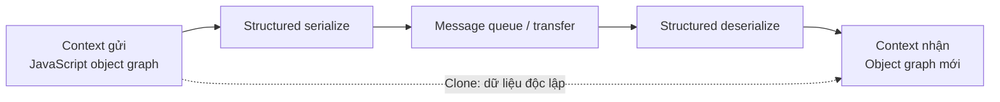

# Structured clone: sao chép dữ liệu giữa các context trình duyệt

Khi một cửa sổ gửi dữ liệu cho iframe, worker hoặc một cửa sổ khác bằng postMessage(), trình duyệt không chuyển nguyên object JavaScript đang nằm trong bộ nhớ của bên gửi. Nó dùng **structured clone algorithm** để tuần tự hóa cấu trúc dữ liệu thành một biểu diễn có thể truyền, rồi tạo một bản sao tương ứng ở phía nhận. Cơ chế này cũng được dùng bởi các API như structuredClone(), Worker.postMessage(), BroadcastChannel và IndexedDB.

Structured clone hỗ trợ nhiều kiểu dữ liệu JavaScript và đối tượng nền tảng hơn JSON, có thể giữ quan hệ tham chiếu và xử lý cấu trúc vòng. Tuy vậy, không phải mọi giá trị JavaScript đều clone được; prototype tùy chỉnh, descriptor và hành vi của object không được giữ nguyên. Khi truyền dữ liệu giữa các origin, bản clone cũng không trở thành dữ liệu đáng tin chỉ vì trình duyệt đã tạo nó.

Bài học thuộc chương **postMessage**, trong phạm vi **SECURITY_APPLICATION_SECURITY_BROWSER_SECURITY**: phân tích ranh giới bảo mật giữa trình duyệt, origin, cookie và ứng dụng web; hiểu Same-Origin Policy, CORS và các cơ chế cách ly; thực hành phòng vệ XSS, CSRF, clickjacking bằng CSP, Trusted Types, security headers và kiểm chứng hành vi thực tế.

## 1. Mục tiêu học tập

Sau bài học, người học có thể:

1. Mô tả hai giai đoạn serialize/deserialize của structured clone.
2. Giải thích vì sao object được clone thành một graph mới, kể cả khi có vòng tham chiếu.
3. Nhận diện các kiểu dữ liệu clone được và các giá trị gây DataCloneError.
4. Phân biệt clone với transfer, đặc biệt với ArrayBuffer và MessagePort.
5. Giải thích hành vi của prototype, property descriptor, getter và RegExp.lastIndex.
6. Sử dụng structuredClone() và postMessage() đúng mục đích.
7. Kiểm tra schema, origin, source và quyền của message trước khi xử lý.
8. Nhận diện rủi ro khi dùng SharedArrayBuffer, transferable và dữ liệu không tin cậy.

## 2. Structured clone giải quyết vấn đề gì?

JavaScript object là cấu trúc trong bộ nhớ của một realm. Một object có thể chứa tham chiếu tới object khác, nhiều thuộc tính cùng trỏ tới một object, hoặc vòng tham chiếu quay về chính nó. Một cửa sổ khác hay worker không thể nhận trực tiếp cùng object reference như thể hai context dùng chung một heap JavaScript.

Structured clone tạo một bản sao dữ liệu có thể tái dựng ở phía nhận:

1. Trình duyệt duyệt object graph và serialize những kiểu được hỗ trợ.
2. Khi có yêu cầu transfer, trình duyệt chuyển quyền sở hữu các transferable được chỉ định.
3. Message được xếp hàng để xử lý bất đồng bộ ở phía nhận.
4. Trình duyệt deserialize dữ liệu thành object mới trong realm nhận.



Với clone thông thường, object phía nhận có identity riêng. Thay đổi object clone không làm thay đổi object gốc. Ngoại lệ quan trọng là SharedArrayBuffer: các context có thể cùng nhìn vào một vùng nhớ được chia sẻ, nếu môi trường đáp ứng điều kiện bảo mật.

### Structured clone được dùng ở đâu?

| API | Cách dùng structured clone |
| --- | --- |
| window.postMessage() | Gửi dữ liệu giữa cửa sổ, iframe hoặc popup. |
| Worker.postMessage() / MessagePort.postMessage() | Gửi dữ liệu tới worker hoặc qua message port. |
| BroadcastChannel.postMessage() | Phát dữ liệu tới các context cùng tham gia channel. |
| structuredClone(value) | Tạo bản sao sâu của giá trị trong cùng context. |
| IndexedDB | Lưu và khôi phục các giá trị thuộc nhóm structured-cloneable. |

Chi tiết kiểu dữ liệu và transferable được hỗ trợ có thể phụ thuộc browser engine và loại API. Khi xây dựng tính năng cần hỗ trợ nhiều trình duyệt, hãy kiểm tra ma trận browser mục tiêu.

## 3. Clone object graph, không chỉ copy từng thuộc tính độc lập

Structured clone theo dõi những object đã gặp trong quá trình serialize. Nhờ vậy, nó giữ được quan hệ tham chiếu và xử lý được cấu trúc có chu kỳ.

### Vòng tham chiếu

Ví dụ object tự tham chiếu:

```js
const original = {
  name: 'document'
};
original.self = original;

const copy = structuredClone(original);

console.log(copy !== original); // true
console.log(copy.self === copy); // true
```

Object mới khác identity với object gốc, nhưng quan hệ vòng bên trong bản sao vẫn được giữ.

### Hai thuộc tính cùng trỏ tới một object

```js
const shared = { id: 7 };
const original = {
  first: shared,
  second: shared
};

const copy = structuredClone(original);

console.log(copy.first === copy.second); // true
console.log(copy.first === shared); // false
```

Bản sao vẫn có một object dùng chung cho cả first và second; nó không tạo hai bản sao độc lập cho cùng một object nguồn.

### Quan hệ giữa typed array và ArrayBuffer

Nếu nhiều view cùng tham chiếu một ArrayBuffer, quá trình clone giữ quan hệ dùng chung buffer trong graph đã clone:

```js
const buffer = new ArrayBuffer(16);
const bytes = new Uint8Array(buffer, 0, 8);
const words = new Uint16Array(buffer, 4, 4);

const copy = structuredClone({ buffer, bytes, words });

console.log(copy.bytes.buffer === copy.buffer); // true
console.log(copy.words.buffer === copy.buffer); // true
console.log(copy.buffer !== buffer); // true
```

Đây là một lý do structured clone hữu ích cho dữ liệu nhị phân phức tạp: nó giữ quan hệ giữa các view trong object graph.

## 4. Những kiểu dữ liệu thường clone được

Structured clone hỗ trợ các primitive và nhiều built-in/platform object. Các nhóm thường gặp:

| Nhóm | Ví dụ |
| --- | --- |
| Primitive | null, undefined, boolean, number, string, bigint. |
| Object và collection | Plain object, array, Map, Set. |
| Ngày và biểu thức | Date, RegExp. |
| Bộ nhớ nhị phân | ArrayBuffer, DataView, typed arrays như Uint8Array, Float32Array. |
| Bộ nhớ chia sẻ | SharedArrayBuffer trong môi trường đáp ứng điều kiện bảo mật và hỗ trợ. |
| File và media | Blob, File, ImageData, ImageBitmap và một số đối tượng media khác. |
| Đối tượng nền tảng | Một số loại DOMException, Error và platform object có bước serialize được định nghĩa. |

Danh sách không phải cam kết rằng mọi browser hoặc mọi API đều hỗ trợ giống nhau. Một platform object chỉ clone được nếu chuẩn web định nghĩa serialization steps cho kiểu đó và browser triển khai chúng.

### Map và Set

Map và Set giữ kiểu dữ liệu và các phần tử:

```js
const original = {
  roles: new Set(['reader', 'editor']),
  labels: new Map([
    ['vi', 'Xin chào'],
    ['en', 'Hello']
  ])
};

const copy = structuredClone(original);

console.log(copy.roles instanceof Set); // true
console.log(copy.labels instanceof Map); // true
console.log(copy.labels.get('vi')); // Xin chào
```

Đây là khác biệt đáng kể so với JSON serialization, vốn không biểu diễn trực tiếp Map và Set theo cách giữ nguyên kiểu.

### Date và RegExp

```js
const original = {
  createdAt: new Date('2026-01-15T10:30:00Z'),
  pattern: /browser-security/gi
};

const copy = structuredClone(original);

console.log(copy.createdAt instanceof Date); // true
console.log(copy.createdAt.toISOString());
console.log(copy.pattern instanceof RegExp); // true
```

Lưu ý: RegExp.lastIndex không được bảo toàn như trạng thái thực thi của biểu thức chính quy. Nếu ứng dụng phụ thuộc vào vị trí match hiện tại, hãy truyền giá trị đó riêng và khôi phục có chủ đích.

## 5. Những giá trị không clone được

Không phải mọi giá trị JavaScript đều có dạng biểu diễn phù hợp cho structured clone. Những ví dụ thường gặp:

| Giá trị | Clone được? | Lý do/ghi chú |
| --- | --- | --- |
| Function | Không | Mã thực thi và lexical closure không được serialize. |
| Symbol | Không | Symbol value không thuộc nhóm structured-cloneable. |
| DOM Node | Không | Node gắn với document và trạng thái DOM cụ thể. |
| WeakMap, WeakSet | Không | Ngữ nghĩa tham chiếu yếu không thể tái dựng như collection thông thường. |
| Proxy | Không | Proxy có trap và hành vi tùy chỉnh không được serialize. |
| Một số platform object | Tùy loại | Chỉ hỗ trợ nếu chuẩn định nghĩa cách serialize. |

Ví dụ:

```js
const value = {
  id: 1,
  callback() {
    console.log('hello');
  }
};

try {
  structuredClone(value);
} catch (error) {
  console.log(error.name); // DataCloneError
}
```

Khi một giá trị không hỗ trợ xuất hiện trong graph cần serialize, thao tác có thể thất bại với DataCloneError. Không nên dựa vào việc browser tự bỏ qua field không clone được.

### Không gửi function để yêu cầu context khác thực thi

Thay vì gửi callback:

```js
worker.postMessage({
  callback: () => calculateResult()
});
```

hệ thống nên gửi một message data-only:

```js
worker.postMessage({
  type: 'calculate',
  payload: {
    input: [4, 8, 12]
  }
});
```

Worker nhận message, kiểm tra type và schema, sau đó gọi function đã được định nghĩa sẵn trong mã của worker. Message chọn một thao tác có allowlist; nó không mang mã tùy ý để thực thi.

## 6. Prototype và property descriptor không được giữ nguyên

Structured clone tập trung vào dữ liệu, không tái tạo đầy đủ hành vi object JavaScript.

### Custom class không giữ prototype

```js
class Account {
  constructor(id, label) {
    this.id = id;
    this.label = label;
  }

  display() {
    return this.id + ': ' + this.label;
  }
}

const original = new Account(42, 'demo');
const copy = structuredClone(original);

console.log(copy.id); // 42
console.log(copy instanceof Account); // false
console.log(typeof copy.display); // undefined
```

Các thuộc tính dữ liệu có thể được clone, nhưng prototype chain tùy chỉnh và method của class không được tái tạo. Đối tượng nhận không phải một instance Account theo nghĩa ban đầu.

Nếu cần khôi phục domain object, gửi DTO (Data Transfer Object) có schema rõ ràng rồi gọi constructor/factory phía nhận sau khi validate:

```js
function accountFromMessage(data) {
  if (
    !data ||
    !Number.isInteger(data.id) ||
    typeof data.label !== 'string'
  ) {
    throw new TypeError('Account payload không hợp lệ');
  }

  return new Account(data.id, data.label);
}
```

### Descriptor và accessor không được bảo toàn

Structured clone không giữ nguyên writable/configurable/enumerable flags, getter/setter hay property descriptor tùy chỉnh. Với các thuộc tính enumerable của object thông thường, giá trị được đọc để serialize rồi dựng lại thành thuộc tính dữ liệu thông thường.

Ví dụ:

```js
const original = {};
Object.defineProperty(original, 'secretLabel', {
  value: 'internal',
  enumerable: true,
  writable: false,
  configurable: false
});

const copy = structuredClone(original);
const descriptor = Object.getOwnPropertyDescriptor(copy, 'secretLabel');

console.log(descriptor.value); // internal
console.log(descriptor.writable); // true
console.log(descriptor.configurable); // true
```

Getter có thể được gọi khi giá trị thuộc tính được đọc trong lúc serialize. Vì vậy, tránh gửi object tùy ý có getter với side effect hoặc Proxy không tin cậy; hãy tạo plain data object mới chỉ chứa những field cần thiết.

### Các trạng thái đặc biệt không nhất thiết được giữ

Ngoài prototype và descriptor:

- RegExp.lastIndex không được bảo toàn.
- Method và private field của class không được tái tạo.
- Các thuộc tính không enumerable hoặc symbol-keyed không nên được dùng làm dữ liệu giao tiếp.
- Một số built-in có trạng thái nội bộ riêng được serialize theo quy tắc đặc thù của kiểu đó.

Thiết kế message như một schema dữ liệu ổn định, không dựa vào việc clone sẽ giữ nguyên object behavior.

## 7. DataCloneError và xử lý lỗi

DataCloneError thường xuất hiện khi graph chứa giá trị không thể serialize, transfer list không hợp lệ hoặc có transferable không được phép chuyển trong ngữ cảnh hiện tại.

Ví dụ lỗi do function:

```js
try {
  window.postMessage(
    { type: 'update', handler: () => {} },
    location.origin
  );
} catch (error) {
  if (error.name === 'DataCloneError') {
    console.error('Message chứa dữ liệu không clone được');
  } else {
    throw error;
  }
}
```

Trong postMessage, serialization xảy ra trong lúc gọi API; lỗi serialize có thể được ném đồng bộ ngay tại nơi gọi. Việc message được nhận và xử lý lại diễn ra bất đồng bộ qua message event.

Không bắt mọi lỗi rồi bỏ qua. Cần phân biệt:

- Payload có field không được hỗ trợ.
- Transfer list chứa object không transferable.
- Transferable đã được chuyển hoặc detached.
- Lỗi lập trình do schema/message không đúng.

Không log nguyên message nếu nó có thể chứa token, dữ liệu cá nhân hoặc bí mật.

## 8. Clone và transfer là hai cách truyền khác nhau

Structured clone thường tạo bản sao độc lập. Với một số loại dữ liệu lớn hoặc tài nguyên có quyền sở hữu, browser cho phép **transfer** thay vì copy. Transfer chuyển quyền sở hữu tài nguyên sang context nhận; phía gửi không tiếp tục sử dụng tài nguyên theo cách cũ.

| Đặc điểm | Clone | Transfer |
| --- | --- | --- |
| Kết quả | Bản sao dữ liệu ở phía nhận | Quyền sở hữu transferable chuyển sang phía nhận |
| Dữ liệu gốc | Thường vẫn dùng được | Có thể bị detached/neutered ở phía gửi |
| Chi phí | Có thể phải copy dữ liệu | Thường tránh copy vùng dữ liệu lớn |
| Ví dụ | Object, Date, Map, ArrayBuffer được clone | ArrayBuffer, MessagePort, ImageBitmap và transferable được hỗ trợ |
| Dùng khi | Cần hai bên giữ bản dữ liệu riêng | Cần chuyển tài nguyên hoặc bộ nhớ cho context khác |

Transfer list được truyền riêng với message. Việc một object có thể clone không đồng nghĩa nó tự động được transfer; chỉ những loại được định nghĩa là transferable mới được đưa vào transfer list.

## 9. Transfer ArrayBuffer

Với buffer lớn, transfer có thể hiệu quả hơn clone vì không cần sao chép toàn bộ bytes.

```js
const buffer = new ArrayBuffer(1024 * 1024);
const bytes = new Uint8Array(buffer);
bytes[0] = 99;

worker.postMessage(
  { type: 'process-buffer', buffer },
  [buffer]
);

console.log(buffer.byteLength); // 0: buffer phía gửi đã detached
```

Worker nhận buffer:

```js
self.addEventListener('message', (event) => {
  const message = event.data;
  if (
    !message ||
    message.type !== 'process-buffer' ||
    !(message.buffer instanceof ArrayBuffer)
  ) {
    return;
  }

  const bytes = new Uint8Array(message.buffer);
  console.log(bytes[0]); // 99
});
```

Sau transfer, ArrayBuffer phía gửi bị detached; không thể tiếp tục đọc/ghi vùng nhớ như trước. Hãy xác định rõ context nào sở hữu buffer ở mỗi giai đoạn.

### Transfer list không phải danh sách field cần clone

Trong ví dụ:

```js
worker.postMessage({ buffer }, [buffer]);
```

Object message vẫn được serialize theo structured clone. Danh sách [buffer] chỉ định transferable cần chuyển quyền sở hữu. Nếu bỏ transfer list, ArrayBuffer được clone và cả hai phía có bản dữ liệu riêng.

Không thêm cùng một transferable nhiều lần hoặc chuyển một tài nguyên đã bị detached. Trường hợp transfer không hợp lệ có thể gây DataCloneError.

## 10. Transfer MessagePort để tạo kênh giao tiếp

MessageChannel tạo hai cổng liên lạc có thể gửi cho context khác bằng transfer:

```js
const channel = new MessageChannel();

channel.port1.addEventListener('message', (event) => {
  console.log('Phản hồi từ worker:', event.data);
});
channel.port1.start();

worker.postMessage(
  { type: 'attach-port' },
  [channel.port2]
);
```

Phía worker:

```js
self.addEventListener('message', (event) => {
  if (event.data?.type !== 'attach-port') return;

  const port = event.ports[0];
  if (!port) return;

  port.postMessage({
    type: 'ready',
    version: 1
  });
});
```

MessagePort là capability: bên nhận có một kênh có thể gửi message tới bên kia. Chỉ transfer port cho context đã được xác thực và có quyền sử dụng; sau khi thiết lập, vẫn validate schema của từng message trên port. Đóng port khi không còn cần.

## 11. SharedArrayBuffer: chia sẻ vùng nhớ thay vì clone độc lập

SharedArrayBuffer khác ArrayBuffer thông thường. Khi được hỗ trợ và cho phép, structured clone tạo tham chiếu ở context nhận tới cùng vùng nhớ chia sẻ; hai bên có thể đọc/ghi cùng dữ liệu. Nó không được chuyển theo cơ chế ownership transfer như ArrayBuffer.

Việc chia sẻ bộ nhớ làm phát sinh vấn đề đồng bộ:

- Một context có thể đọc khi context khác đang ghi.
- Thứ tự thao tác có thể không như ứng dụng giả định.
- Cần dùng Atomics cho các thao tác đồng bộ phù hợp trên shared memory.
- Tránh dùng shared state cho dữ liệu nhạy cảm nếu không có mô hình quyền và đồng bộ rõ.

### Cross-origin isolation

Trong các trình duyệt hiện đại, khả năng sử dụng SharedArrayBuffer trên web thường yêu cầu document ở trạng thái cross-origin isolated. Cấu hình thường liên quan tới các response header:

```http
Cross-Origin-Opener-Policy: same-origin
Cross-Origin-Embedder-Policy: require-corp
```

Cross-Origin-Embedder-Policy: credentialless có thể là lựa chọn khác trong những trường hợp phù hợp và được trình duyệt hỗ trợ. Ứng dụng cần xử lý tài nguyên cross-origin theo yêu cầu COEP; việc bật isolation có thể ảnh hưởng popup, embed và dependency bên thứ ba.

Có thể kiểm tra trạng thái:

```js
console.log(window.crossOriginIsolated);
```

Đây là điều kiện môi trường, không phải kiểm tra authorization. Đừng giả định mọi trình duyệt, webview hoặc môi trường nhúng đều cho phép SharedArrayBuffer.

## 12. structuredClone() trong cùng context

structuredClone(value) dùng cùng structured clone algorithm để tạo deep clone:

```js
const original = {
  profile: {
    name: 'Lan'
  },
  tags: new Set(['security', 'browser']),
  createdAt: new Date()
};

const copy = structuredClone(original);

copy.profile.name = 'Minh';
copy.tags.add('web');

console.log(original.profile.name); // Lan
console.log(original.tags.has('web')); // false
```

Có thể transfer transferable trong lần clone:

```js
const buffer = new ArrayBuffer(32);
const copy = structuredClone(
  { buffer },
  { transfer: [buffer] }
);

console.log(buffer.byteLength); // 0
console.log(copy.buffer.byteLength); // 32
```

structuredClone() không phải giải pháp cho mọi deep clone. Nó không clone function, không giữ custom prototype/descriptor và có thể ném DataCloneError. Nếu cần clone domain object, hãy định nghĩa DTO hoặc factory rõ ràng.

### So sánh structured clone và JSON stringify/parse

| Khả năng | Structured clone | JSON stringify/parse |
| --- | --- | --- |
| Circular reference | Hỗ trợ | JSON.stringify() ném lỗi |
| Map/Set | Giữ kiểu | Không giữ trực tiếp kiểu |
| Date | Giữ Date | Thường thành chuỗi ISO qua toJSON() |
| BigInt | Hỗ trợ | JSON.stringify() mặc định ném lỗi |
| undefined trong object | Có thể giữ | Bị bỏ qua |
| Function/Symbol | Không clone | Function/symbol thường bị bỏ qua hoặc chuyển thành null trong array tùy vị trí |
| Custom prototype/method | Không giữ | Không giữ |
| Transferable | Có thể transfer | Không có cơ chế transfer |

JSON vẫn phù hợp cho trao đổi dữ liệu qua API và định dạng lưu trữ cần tương thích rộng. Structured clone phù hợp với các API browser cần truyền object graph giữa context hoặc clone dữ liệu có kiểu phức tạp.

## 13. Structured clone không phải validation hay sanitizer

Đây là điểm bảo mật quan trọng nhất: structured clone chỉ bảo đảm dữ liệu được chuyển theo quy tắc serialization của trình duyệt. Nó không xác nhận dữ liệu có hợp lệ, đáng tin hay được phép dùng cho hành động nào.

Ví dụ:

```js
window.addEventListener('message', (event) => {
  // Không an toàn: clone thành công không có nghĩa payload đáng tin.
  document.querySelector('#output').innerHTML = event.data.html;
});
```

Nếu bên gửi kiểm soát html, nội dung vẫn có thể chứa markup hoặc thuộc tính nguy hiểm. Việc structured clone tạo object mới không loại bỏ XSS.

### Kiểm tra origin và source

Với message từ window/iframe, xác minh origin gửi và browsing context dự kiến:

```js
const expectedOrigin = 'https://widget.example.net';
const expectedFrame = document.querySelector('#widget-frame');

window.addEventListener('message', (event) => {
  if (event.origin !== expectedOrigin) return;
  if (event.source !== expectedFrame.contentWindow) return;

  // Chỉ sau các bước kiểm tra mới xử lý event.data.
});
```

Origin check không thay thế schema validation. Một origin được phép vẫn có thể gửi message sai định dạng do lỗi, compromise hoặc version mismatch.

### Validate schema và allowlist field

```js
function parseWidgetMessage(data) {
  if (!data || typeof data !== 'object' || Array.isArray(data)) {
    throw new TypeError('Message phải là object');
  }

  if (data.type !== 'widget:resize') {
    throw new TypeError('Message type không hợp lệ');
  }

  if (
    !Number.isInteger(data.payload?.width) ||
    data.payload.width < 200 ||
    data.payload.width > 1600
  ) {
    throw new TypeError('Width không hợp lệ');
  }

  return {
    type: 'widget:resize',
    width: data.payload.width
  };
}

window.addEventListener('message', (event) => {
  if (event.origin !== 'https://widget.example.net') return;
  if (event.source !== expectedFrame.contentWindow) return;

  let message;
  try {
    message = parseWidgetMessage(event.data);
  } catch {
    return;
  }

  resizeWidget(message.width);
});
```

Tạo object mới chỉ chứa field đã kiểm tra thay vì chuyển nguyên payload sâu vào logic ứng dụng. Cách này giúp giảm dữ liệu thừa và tránh vô tình dùng field không được dự kiến.

### Tránh merge object không tin cậy vào cấu hình đặc quyền

Không đưa message trực tiếp vào các thao tác merge đệ quy tùy biến hoặc object cấu hình nhạy cảm. Những key đặc biệt như __proto__, constructor hoặc prototype có thể gây vấn đề nếu thư viện merge xử lý không an toàn. Dùng schema allowlist, map field tường minh và thư viện merge đã được review.

### Giới hạn kích thước và tần suất

Structured clone có thể tốn CPU và bộ nhớ với object graph lớn, sâu hoặc nhiều phần tử. Ứng dụng nên:

- Giới hạn số phần tử, độ sâu và kích thước payload theo use case.
- Không gửi ảnh/array lớn lặp lại nếu có thể transfer buffer hoặc dùng kênh chuyên dụng.
- Rate limit message từ frame/worker không đáng tin.
- Xử lý lỗi clone và lỗi schema có kiểm soát.
- Không log token, cookie, PII hoặc toàn bộ payload nhạy cảm.

## 14. Thực hành: kiểm chứng structured clone và postMessage

Thực hành trong trang local hoặc môi trường staging do người học kiểm soát. Dùng dữ liệu giả; không gửi token hoặc thông tin cá nhân thật.

### 14.1. Clone một object graph

Mở DevTools Console và chạy:

```js
const shared = { label: 'shared-node' };
const source = {
  left: shared,
  right: shared,
  createdAt: new Date()
};
source.self = source;

const cloned = structuredClone(source);

console.log(cloned !== source);
console.log(cloned.left === cloned.right);
console.log(cloned.left !== shared);
console.log(cloned.self === cloned);
console.log(cloned.createdAt instanceof Date);
```

Kết quả mong đợi: object gốc và clone khác nhau; hai nhánh clone vẫn trỏ cùng node; vòng tham chiếu được giữ; Date vẫn là Date.

### 14.2. Kiểm tra giá trị không clone được

```js
try {
  structuredClone({
    id: 1,
    callback: () => 'not cloneable'
  });
} catch (error) {
  console.log(error.name);
}
```

Kết quả mong đợi: DataCloneError. Thử gửi function trong payload postMessage() và xác nhận lỗi xảy ra tại phía gọi.

### 14.3. So sánh clone với transfer

```js
const originalBuffer = new ArrayBuffer(64);
const cloneBuffer = structuredClone(originalBuffer);
console.log(originalBuffer.byteLength); // 64
console.log(cloneBuffer.byteLength); // 64

const transferredBuffer = new ArrayBuffer(64);
const received = structuredClone(
  { buffer: transferredBuffer },
  { transfer: [transferredBuffer] }
);
console.log(transferredBuffer.byteLength); // 0
console.log(received.buffer.byteLength); // 64
```

Kết quả mong đợi: clone giữ buffer gốc dùng được; transfer làm buffer phía gửi detached.

### 14.4. Truyền message tới iframe

Tạo parent và child trên hai origin local khác nhau. Parent gửi message:

```js
const frame = document.querySelector('#child-frame');
const childOrigin = 'http://localhost:5174';

frame.contentWindow.postMessage(
  {
    type: 'demo:hello',
    payload: {
      requestId: 12,
      label: 'structured-clone'
    }
  },
  childOrigin
);
```

Child nhận:

```js
window.addEventListener('message', (event) => {
  if (event.origin !== 'http://localhost:5173') return;
  if (event.source !== window.parent) return;

  const data = event.data;
  if (
    data?.type !== 'demo:hello' ||
    !Number.isInteger(data.payload?.requestId) ||
    typeof data.payload?.label !== 'string'
  ) {
    return;
  }

  event.source.postMessage(
    {
      type: 'demo:reply',
      payload: {
        requestId: data.payload.requestId,
        accepted: true
      }
    },
    event.origin
  );
});
```

Thay port và origin theo server local thực tế. Mở Network/Console và quan sát event ở cả hai context. event.data là object được structured clone; nó không phải cùng object reference với bên gửi.

### 14.5. Quan sát prototype và descriptor

Clone một instance class và một thuộc tính non-writable như các ví dụ trước. So sánh instanceof, method và Object.getOwnPropertyDescriptor(). Xác nhận clone giữ dữ liệu cần thiết nhưng không tái tạo đầy đủ hành vi object.

### 14.6. Bằng chứng cần lưu

| Bằng chứng | Điều cần xác nhận |
| --- | --- |
| Object graph clone | Vòng tham chiếu và shared reference được giữ trong bản clone. |
| DataCloneError | Function hoặc giá trị không hỗ trợ làm thao tác thất bại. |
| Prototype/descriptor | Custom prototype và descriptor không được giữ nguyên. |
| ArrayBuffer clone | Buffer gốc và clone đều dùng được, dữ liệu độc lập. |
| ArrayBuffer transfer | Buffer phía gửi bị detached sau transfer. |
| postMessage | Hai context nhận dữ liệu clone, xác minh origin/source và schema trước xử lý. |

## 15. Checklist thiết kế message

| Hạng mục | Câu hỏi rà soát | Kết quả mong đợi |
| --- | --- | --- |
| Data contract | Message có schema và version rõ ràng không? | Chỉ gửi DTO/data-only object. |
| Cloneability | Payload có function, symbol, DOM node hoặc Proxy không? | Loại bỏ giá trị không clone được. |
| Object behavior | Có phụ thuộc custom prototype, getter/setter hoặc descriptor không? | Tạo plain object và khôi phục domain object sau validation. |
| Graph size | Payload có thể quá lớn hoặc quá sâu không? | Giới hạn kích thước, độ sâu và số phần tử. |
| Target origin | Có dùng targetOrigin cụ thể không? | Không dùng wildcard cho dữ liệu nhạy cảm. |
| Sender validation | Có kiểm tra event.origin và event.source không? | Chỉ nhận từ origin và browsing context dự kiến. |
| Schema validation | Có kiểm tra type, field, kiểu và miền giá trị không? | Từ chối message sai cấu trúc; chỉ dùng field allowlist. |
| DOM sinks | Có đưa message vào innerHTML, eval hoặc URL không validate không? | Dùng DOM API an toàn và validation theo ngữ cảnh. |
| Transfer | Có cần chuyển quyền sở hữu ArrayBuffer/MessagePort không? | Transfer đúng loại; xử lý trạng thái detached/port ownership. |
| Shared memory | Có dùng SharedArrayBuffer không? | Xác minh cross-origin isolation và đồng bộ bằng Atomics khi cần. |
| Capability | MessagePort có được gửi cho đúng context không? | Xác thực bên nhận và đóng port khi hoàn tất. |
| Observability | Có log toàn bộ payload nhạy cảm không? | Log metadata tối thiểu, không ghi credential/PII. |

## 16. Câu hỏi tự kiểm tra

1. Structured clone khác việc truyền cùng object reference giữa hai context như thế nào?
2. Vì sao structured clone có thể giữ circular reference và quan hệ hai field cùng trỏ tới một object?
3. Những kiểu dữ liệu nào thường clone được và những kiểu nào gây DataCloneError?
4. Vì sao function không thể được clone dù nó có thể được gọi trong context gửi?
5. Custom class instance sau clone còn là instance của class gốc không? Method và private field có được giữ không?
6. Getter và property descriptor được xử lý như thế nào trong quá trình clone?
7. Clone ArrayBuffer khác transfer ArrayBuffer ở trạng thái phía gửi như thế nào?
8. Vì sao MessagePort được xem là capability và cần kiểm soát việc transfer?
9. SharedArrayBuffer khác ArrayBuffer ra sao và điều kiện cross-origin isolation có vai trò gì?
10. Vì sao structured clone không thay thế kiểm tra event.origin, event.source, schema và validation trước khi dùng message?

**Tiêu chí hoàn thành:** người học có thể giải thích structured clone theo object graph, nhận diện giá trị cloneable và uncloneable, chọn clone hay transfer phù hợp, xử lý DataCloneError, và xây dựng luồng postMessage dùng DTO có schema, kiểm tra origin/source và không đưa dữ liệu không tin cậy vào DOM hoặc execution sink.
