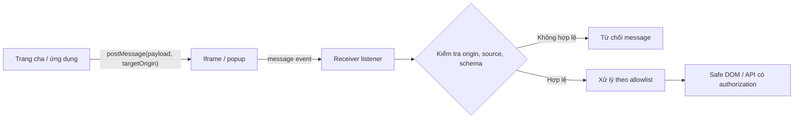
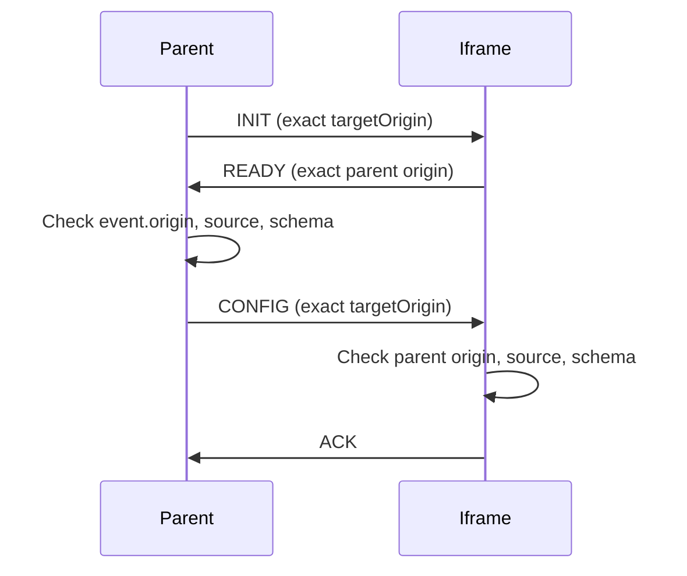

# postMessage abuse — nhận diện và ngăn lạm dụng giao tiếp giữa các cửa sổ

> **Chương:** postMessage  
> **Mục tiêu:** Nhận diện các lỗi bảo mật thường gặp trong giao tiếp `window.postMessage()`: thiếu xác minh origin/source, dùng wildcard, kiểm tra origin lỏng, xử lý payload không an toàn và biến message thành quyền thực thi hành động. Biết cách xây dựng receiver an toàn, giới hạn message, xử lý opaque origin, chống replay và kiểm thử bằng DevTools.

## 1. Vì sao postMessage có thể trở thành bề mặt tấn công?

`postMessage` cho phép các browsing context trao đổi dữ liệu kể cả khi chúng khác origin. Đây là cơ chế browser cung cấp để iframe, popup và cửa sổ cha có thể tích hợp với nhau mà không cần phá bỏ Same-Origin Policy (SOP).

Giao tiếp này hữu ích, nhưng mỗi message là dữ liệu đi qua một ranh giới tin cậy. Một trang có thể nhận message từ nhiều cửa sổ, iframe hoặc popup; message có thể chứa dữ liệu do người dùng kiểm soát; và cửa sổ nhận có thể điều hướng trong lúc giao tiếp.

Các lỗi thường dẫn tới:

- **Data disclosure:** gửi token hoặc dữ liệu riêng tư tới cửa sổ không còn thuộc origin dự kiến.
- **DOM XSS:** đưa payload message vào HTML sink hoặc script sink.
- **Confused deputy:** receiver dùng quyền của chính ứng dụng để thực hiện hành động theo yêu cầu từ một sender không đủ quyền.
- **Privilege escalation:** message không được xác minh làm thay đổi role, cấu hình, trạng thái đăng nhập hoặc quyền truy cập.
- **Replay và state confusion:** message cũ hoặc message lặp lại kích hoạt hành động nhiều lần hoặc sai thứ tự.
- **Denial of service:** message quá lớn, quá nhiều hoặc khiến receiver thực hiện công việc tốn tài nguyên.

`postMessage` không tự xác thực sender, không xác thực ý nghĩa payload và không cấp authorization. Ứng dụng phải xây dựng những kiểm tra đó ở hai đầu giao tiếp.

## 2. Mô hình tấn công: sender, receiver và trust boundary

Một tích hợp điển hình có trang cha và widget iframe:



Hãy phân tích riêng hai chiều:

1. **Bên gửi:** cửa sổ đích có đúng origin dự kiến không? Message có chứa dữ liệu tối thiểu cần thiết không?
2. **Bên nhận:** document nào gửi message? Nó có đúng browsing context dự kiến không? Payload có đúng schema và có hợp lệ trong trạng thái hiện tại không?

Một kiểm tra ở bên gửi không thay cho kiểm tra ở bên nhận. Tương tự, receiver xác minh sender không ngăn sender gửi dữ liệu bí mật tới nhầm cửa sổ nếu targetOrigin được đặt quá rộng.

## 3. Lỗi 1: receiver không kiểm tra event.origin

Một listener nhận message mà xử lý mọi payload sẽ tin bất kỳ cửa sổ nào có thể gửi message tới nó:

```js
// Không an toàn: không xác minh nguồn gửi.
window.addEventListener("message", (event) => {
  if (event.data.type === "SET_ACCOUNT_EMAIL") {
    updateAccountEmail(event.data.email);
  }
});
```

Trang khác có thể gửi message giả dạng giao thức mà ứng dụng mong đợi. Nếu receiver thực hiện hành động có đặc quyền, nó có thể trở thành confused deputy: dùng phiên đăng nhập và quyền của người dùng hiện tại để thực hiện yêu cầu do trang khác điều khiển.

Sửa bằng cách so sánh origin chính xác:

```js
const TRUSTED_ORIGIN = "https://portal.partner.example";

window.addEventListener("message", (event) => {
  if (event.origin !== TRUSTED_ORIGIN) return;
  // Tiếp tục kiểm tra source và payload trước khi xử lý.
});
```

`event.origin` chứa origin của document gửi tại thời điểm nó gọi `postMessage`. Với HTTP(S), origin gồm scheme, host và port; path không thuộc origin. So sánh chính xác giúp phân biệt HTTPS với HTTP và port mặc định với port khác.

## 4. Lỗi 2: kiểm tra origin bằng substring hoặc hậu tố lỏng

Kiểm tra chuỗi không chính xác có thể chấp nhận hostname ngoài dự kiến:

```js
// Không an toàn: "notpartner.example" cũng kết thúc bằng chuỗi này.
if (event.origin.endsWith("partner.example")) {
  handleMessage(event.data);
}

// Không an toàn: hostname hoặc path có thể chứa chuỗi này.
if (event.origin.includes("partner.example")) {
  handleMessage(event.data);
}
```

Hãy dùng allowlist origin đầy đủ:

```js
const TRUSTED_ORIGINS = new Set([
  "https://portal.partner.example",
  "https://admin.partner.example",
]);

if (!TRUSTED_ORIGINS.has(event.origin)) {
  return;
}
```

Nếu origin được cấu hình dưới dạng URL, chuẩn hóa bằng URL API trước khi đưa vào allowlist:

```js
const partnerOrigin = new URL(
  "https://portal.partner.example/embed",
).origin;
```

Không dùng regex hoặc suffix matching để cho phép toàn bộ subdomain trừ khi đó là yêu cầu đã được đánh giá và có quy tắc ranh giới domain chặt chẽ. Một subdomain có thể do tenant, nhóm khác hoặc hệ thống nội dung người dùng quản lý.

## 5. Lỗi 3: không kiểm tra event.source

Origin xác minh document gửi thuộc origin nào, nhưng một origin có thể có nhiều cửa sổ và iframe. Nếu ứng dụng chỉ kiểm tra origin, một cửa sổ khác cùng origin vẫn có thể gửi message tới listener.

Ví dụ receiver chỉ cho phép partner origin nhưng không kiểm tra cửa sổ:

```js
window.addEventListener("message", (event) => {
  if (event.origin !== "https://portal.partner.example") return;
  handlePartnerCommand(event.data);
});
```

Nếu ứng dụng chỉ dự định nhận message từ một iframe cụ thể, kiểm tra thêm `event.source`:

```js
const partnerFrame = document.querySelector("#partner-frame");
const PARTNER_ORIGIN = "https://portal.partner.example";

window.addEventListener("message", (event) => {
  if (event.origin !== PARTNER_ORIGIN) return;
  if (event.source !== partnerFrame.contentWindow) return;

  handlePartnerCommand(event.data);
});
```

Với popup, so sánh `event.source` với tham chiếu cửa sổ được tạo bằng `window.open()`. Với iframe, so sánh với `iframe.contentWindow`. Với trang con, có thể kiểm tra `event.source === window.parent` nếu giao thức chỉ chấp nhận cửa sổ cha trực tiếp.

`event.source` thường là WindowProxy. Tham chiếu này có thể tồn tại qua navigation; vì vậy phải kiểm tra cả origin và source, đồng thời xử lý trạng thái giao thức khi frame/popup điều hướng hoặc khởi tạo lại.

## 6. Lỗi 4: gửi dữ liệu nhạy cảm với targetOrigin là '*'

Wildcard `"*"` cho phép browser giao message bất kể origin hiện tại của cửa sổ nhận:

```js
// Không an toàn nếu payload có thông tin nhạy cảm.
popup.postMessage(
  { type: "AUTH_RESULT", accessToken },
  "*",
);
```

Một popup ban đầu mở tới đối tác tin cậy có thể điều hướng sang document khác trước lúc message được giao. Nếu targetOrigin là wildcard, dữ liệu có thể tới document mới.

Hãy chỉ định origin chính xác:

```js
popup.postMessage(
  { type: "AUTH_RESULT", code: shortLivedCode },
  "https://login.partner.example",
);
```

TargetOrigin được browser kiểm tra tại thời điểm giao message. Kiểm tra URL popup trước đó không thay thế cơ chế này vì popup có thể điều hướng ngay sau bước kiểm tra.

Chỉ dùng wildcard khi không thể chỉ định origin, chẳng hạn một số opaque-origin context. Trong trường hợp đó, không gửi bí mật trong message đầu tiên; giới hạn payload, kiểm soát navigation và thiết kế một handshake/capability có phạm vi ngắn. Nếu giao thức cần trao đổi dữ liệu nhạy cảm thường xuyên, cân nhắc dùng origin HTTPS riêng, ổn định.

## 7. Lỗi 5: chấp nhận opaque origin bằng cách tin chuỗi "null"

Một số document có opaque origin, ví dụ tài liệu `data:` hoặc iframe sandbox không có `allow-same-origin`. Khi nhận message từ chúng, `event.origin` có thể là chuỗi `"null"`.

Không làm:

```js
// Không an toàn: nhiều document không liên quan có thể có opaque origin.
if (event.origin === "null") {
  acceptMessage(event.data);
}
```

Chuỗi `"null"` không định danh duy nhất một website hay một ứng dụng đáng tin. Nó có thể xuất hiện từ nhiều nguồn opaque-origin khác nhau.

Nếu phải giao tiếp với iframe opaque:

- Xác minh `event.source` đúng iframe dự kiến.
- Giữ URL iframe và sandbox policy trong quyền kiểm soát.
- Không gửi credential hoặc dữ liệu nhạy cảm trong message ban đầu.
- Dùng handshake và payload giới hạn; nếu cần, chuyển MessagePort sau khi thiết lập kênh.
- Không coi `event.origin === "null"` là xác thực.

Nếu có thể, dùng một origin HTTPS chuyên biệt thay cho opaque origin khi giao thức cần danh tính origin ổn định.

## 8. Lỗi 6: không xác thực schema và message type

Sau khi xác minh origin/source, payload vẫn là dữ liệu đầu vào. Đừng gọi thẳng handler theo một field chưa kiểm tra:

```js
// Không an toàn: type và các field không được xác minh.
window.addEventListener("message", (event) => {
  handlers[event.data.type](event.data);
});
```

Kẻ gửi có thể gửi type không tồn tại, field sai kiểu, object quá lớn hoặc giá trị nằm ngoài trạng thái giao thức. Hãy dùng allowlist và kiểm tra schema:

```js
function parseWidgetMessage(data) {
  if (data === null || typeof data !== "object" || Array.isArray(data)) {
    return null;
  }

  if (data.type === "SET_THEME") {
    if (data.version !== 1) return null;
    if (data.theme !== "light" && data.theme !== "dark") return null;
    return { type: "SET_THEME", theme: data.theme };
  }

  if (data.type === "CLOSE_WIDGET") {
    if (data.version !== 1) return null;
    return { type: "CLOSE_WIDGET" };
  }

  return null;
}
```

Chỉ sao chép những trường đã được kiểm tra sang object mới. Tránh merge payload tùy ý vào object cấu hình/quyền của ứng dụng bằng `Object.assign` hoặc deep merge không kiểm soát; các key đặc biệt như `__proto__`, `constructor` và `prototype` cần được xử lý theo schema thay vì được nhập tự do.

Giới hạn thêm:

- Độ dài chuỗi và số phần tử mảng.
- Miền giá trị số và enum.
- Số lượng field và độ sâu object nếu giao thức cho phép cấu trúc lồng.
- Phiên bản protocol và trạng thái hiện tại của widget.
- Tần suất message và chi phí xử lý.

Structured clone chỉ truyền dữ liệu; nó không xác nhận schema, quyền hoặc ý định người dùng.

## 9. Lỗi 7: đưa event.data vào DOM sink nguy hiểm

Một lỗi phổ biến là hiển thị message bằng `innerHTML`:

```js
// Không an toàn: payload có thể chứa HTML không tin cậy.
window.addEventListener("message", (event) => {
  document.querySelector("#status").innerHTML = event.data.message;
});
```

Ngay cả khi sender origin được cho phép, payload vẫn có thể đến từ dữ liệu người dùng mà partner lưu hoặc hiển thị. Origin allowlist không làm cho mọi chuỗi do partner gửi trở thành HTML an toàn.

Nếu chỉ cần hiển thị văn bản:

```js
window.addEventListener("message", (event) => {
  if (event.origin !== PARTNER_ORIGIN) return;
  if (event.source !== partnerFrame.contentWindow) return;

  const message = parseStatusMessage(event.data);
  if (!message) return;

  document.querySelector("#status").textContent = message.text;
});
```

Nếu sản phẩm thật sự cần render rich HTML, dùng sanitizer được duy trì như DOMPurify với cấu hình tối thiểu và cân nhắc Trusted Types. Không tự viết sanitizer bằng regex và không dùng output đã sanitize cho URL, JavaScript hoặc CSS context.

## 10. Lỗi 8: dùng message làm lệnh có đặc quyền

Receiver có thể vô tình trở thành **confused deputy** nếu message từ một cửa sổ bên ngoài được quyền điều khiển hành động của ứng dụng:

```js
// Nguy hiểm: message tự khai báo quyền và yêu cầu thay đổi tài khoản.
window.addEventListener("message", (event) => {
  if (event.data.type === "SET_ROLE") {
    currentUser.role = event.data.role;
  }
});
```

Không tin các field như `role`, `isAdmin`, `accountId` hoặc `authorized` do message gửi tới. Browser message không phải bằng chứng về quyền. Quyền phải được xác minh ở server dựa trên session/token hợp lệ, resource ownership và policy hiện hành.

Một giao thức an toàn nên giới hạn message vào những yêu cầu giao diện cần thiết, ví dụ `RESIZE`, `READY` hoặc `SET_THEME`. Với hành động nhạy cảm:

- Không để message tự xác nhận giao dịch hoặc cấp quyền.
- Hiển thị rõ nội dung và yêu cầu người dùng xác nhận trong giao diện đáng tin cậy.
- Gửi yêu cầu tới server qua API bình thường.
- Server xác minh session, authorization, CSRF và trạng thái nghiệp vụ.
- Dùng idempotency key hoặc transaction state nếu thao tác có thể được gửi lại.

## 11. Lỗi 9: replay, message cũ và sai thứ tự

Một message hợp lệ có thể bị gửi nhiều lần hoặc tới muộn sau khi giao diện đã chuyển trạng thái. Chỉ kiểm tra origin/source không ngăn replay từ cùng cửa sổ.

Ví dụ rủi ro:

- Message `PAYMENT_CONFIRMED` được xử lý hai lần.
- Message `LOGIN_COMPLETE` cũ tới sau khi người dùng đã logout.
- Response của request trước ghi đè trạng thái của request mới.
- Hai message thay đổi thiết lập tới sai thứ tự.

Biện pháp:

1. Thiết kế state machine cho giao thức: message nào hợp lệ ở trạng thái nào.
2. Dùng request ID/correlation ID để ghép response với request đang chờ.
3. Với thao tác một lần, dùng nonce hoặc transaction ID một lần được server xác minh và hết hạn.
4. Thực hiện idempotency ở server cho giao dịch có tác động.
5. Hủy listener, đóng MessagePort và đánh dấu session giao tiếp đã kết thúc khi widget/popup đóng hoặc điều hướng.

Correlation ID chỉ ghép request và response; nó không xác thực sender và không tự chống replay. Giá trị chống replay phải được ràng buộc với giao dịch, thời hạn và trạng thái ở phía server khi hành động có giá trị bảo mật.

## 12. Lỗi 10: message flood và payload quá lớn

Một listener có thể nhận nhiều message liên tục. Nếu mỗi message kích hoạt parse phức tạp, render lớn hoặc request API, ứng dụng có thể bị chậm hoặc cạn tài nguyên.

Hãy:

- Giới hạn độ dài string, số phần tử và kích thước dữ liệu theo giao thức.
- Từ chối message type không hỗ trợ càng sớm càng tốt.
- Tránh parse hoặc render cấu trúc lồng sâu không cần thiết.
- Giới hạn tần suất cho các message không cần xử lý liên tục.
- Gộp các cập nhật giao diện có thể gộp.
- Không tạo một request mạng đắt tiền cho mỗi message không được kiểm soát.
- Đóng channel hoặc bỏ listener khi không còn cần.

Rate limit phía client giúp bảo vệ trải nghiệm và tài nguyên của tab. Các hành động có tác động tới hệ thống vẫn cần rate limit và authorization ở server.

## 13. Receiver an toàn: ghép origin, source và schema

Một mẫu receiver có thể dùng làm điểm bắt đầu:

```js
const PARTNER_ORIGIN = "https://widget.partner.example";
const partnerFrame = document.querySelector("#partner-frame");
const statusElement = document.querySelector("#partner-status");

function parseMessage(data) {
  if (data === null || typeof data !== "object" || Array.isArray(data)) {
    return null;
  }

  if (data.type !== "STATUS" || data.version !== 1) {
    return null;
  }

  if (typeof data.value !== "string" || data.value.length > 100) {
    return null;
  }

  return { value: data.value };
}

window.addEventListener("message", (event) => {
  if (event.origin !== PARTNER_ORIGIN) return;
  if (event.source !== partnerFrame.contentWindow) return;

  const message = parseMessage(event.data);
  if (!message) return;

  statusElement.textContent = message.value;
});
```

Mẫu này giới hạn một message type và một trường text. Ứng dụng thực cần thêm trạng thái khởi tạo, timeout, xử lý navigation, giới hạn tần suất và logic đóng widget.

## 14. Sender an toàn: targetOrigin cụ thể và payload tối thiểu

Sender cần chọn đúng browsing context và targetOrigin:

```js
const frame = document.querySelector("#partner-frame");
const PARTNER_ORIGIN = "https://widget.partner.example";

function sendInitialize() {
  frame.contentWindow.postMessage(
    {
      type: "INITIALIZE",
      version: 1,
      locale: "vi",
    },
    PARTNER_ORIGIN,
  );
}
```

Nguyên tắc:

- Dùng origin đầy đủ gồm scheme, host và port.
- Không dùng wildcard cho dữ liệu nhạy cảm.
- Không gửi session cookie, refresh token hoặc access token dài hạn trong message nếu giao thức không yêu cầu.
- Chỉ gửi field cần thiết, không gửi toàn bộ object user/session.
- Nếu popup hoặc iframe có thể điều hướng, vẫn dùng targetOrigin cụ thể ở mỗi lần gửi.
- Không xem việc message được giao là bằng chứng receiver đã xử lý an toàn.

Nếu cần chia sẻ dữ liệu xác thực, ưu tiên một flow chuẩn với authorization code ngắn hạn, PKCE, state và xác minh server-side thay vì truyền token bearer qua message.

## 15. Handshake và MessageChannel không tự xác thực peer

Handshake có thể xác nhận hai bên đã sẵn sàng và thống nhất phiên bản:



Handshake cần kiểm tra origin/source ở từng chiều, version, trạng thái và timeout. Một message `READY` không chứng minh đối tác đã xác thực người dùng hoặc có quyền thực hiện hành động nhạy cảm.

`MessageChannel` có thể tạo một kênh riêng sau khi xác minh cửa sổ ban đầu:

```js
const channel = new MessageChannel();

partnerFrame.contentWindow.postMessage(
  { type: "CONNECT", version: 1 },
  PARTNER_ORIGIN,
  [channel.port2],
);

channel.port1.onmessage = (event) => {
  const message = parseMessage(event.data);
  if (!message) return;
  statusElement.textContent = message.value;
};
```

MessagePort là **capability**: bên sở hữu port có thể gửi message trên kênh. Xác minh origin/source trước khi chuyển port, chỉ chuyển cho đúng context và đóng port khi giao thức kết thúc. Message trên port vẫn cần schema validation, giới hạn payload và authorization.

## 16. postMessage và các ranh giới bảo mật khác

Không nhầm postMessage với những cơ chế khác:

| Cơ chế | Vai trò | Điều nó không làm |
| --- | --- | --- |
| Same-Origin Policy | Hạn chế đọc/thao tác DOM và dữ liệu cross-origin | Không tự xác thực payload postMessage |
| postMessage | Cho phép truyền dữ liệu có chủ đích giữa browsing context | Không cấp authorization hoặc sanitize dữ liệu |
| CORS | Kiểm soát việc JavaScript đọc response cross-origin theo policy server | Không thay origin/source checks cho message |
| CSP | Hạn chế nguồn và cách thực thi nội dung | Không xác minh message sender |
| Trusted Types | Kiểm soát string đi vào một số DOM injection sink | Không xác thực message schema hoặc quyền nghiệp vụ |
| CSRF protection | Xác minh request thay đổi trạng thái theo cơ chế của ứng dụng | Không ngăn UI redress hoặc message giả mạo tự thân |

postMessage được thiết kế để vượt qua giới hạn đọc cross-origin của SOP một cách có kiểm soát. Vì thế, ứng dụng cần tự định nghĩa giao thức và trust boundary rõ ràng.

## 17. Thực hành: kiểm thử các lỗi postMessage trong lab

Thực hiện trên hai origin thử nghiệm do bạn kiểm soát, ví dụ `https://parent.example.test` và `https://child.example.test`. Dùng payload giả lập, không dùng token hoặc dữ liệu người dùng thật.

### Bước 1 — Tạo receiver không kiểm tra

Tạo trang cha có listener ghi nội dung message vào một phần tử. Trong lab, gửi một chuỗi text vô hại từ iframe. Quan sát listener nhận message mà không phân biệt sender.

### Bước 2 — Thêm origin và source validation

Chỉ chấp nhận origin dự kiến và `event.source` đúng iframe. Gửi message từ một origin khác hoặc một iframe thứ hai; receiver phải bỏ qua.

### Bước 3 — Thử origin matching lỏng

Trong lab, so sánh một allowlist chính xác với kiểm tra `endsWith`/`includes`. Tạo hostname thử nghiệm gần giống để thấy vì sao so khớp chuỗi có thể nhận nhầm. Không dùng domain của bên thứ ba.

### Bước 4 — So sánh targetOrigin cụ thể và wildcard

Mở popup thử nghiệm, gửi message vô hại với targetOrigin chính xác rồi thử điều hướng popup sang origin lab khác trước khi gửi. Quan sát message bị bỏ khi origin không khớp. Lặp lại với wildcard và chỉ dùng payload công khai.

### Bước 5 — Thử schema validation

Gửi các payload:

- Thiếu `type`.
- Sai `version`.
- Field có kiểu không đúng.
- Enum không nằm trong allowlist.
- Chuỗi dài hơn giới hạn.
- Message type không được hỗ trợ.

Receiver phải từ chối trước khi cập nhật UI hoặc gọi API.

### Bước 6 — Kiểm tra DOM sink

Thử message chứa markup vô hại như `<strong>Lab</strong>`. So sánh `innerHTML` với `textContent`; xác nhận ứng dụng chỉ hiển thị nội dung dưới dạng text nếu không có yêu cầu rich HTML.

### Bước 7 — Kiểm tra replay và cleanup

Gửi cùng một message nhiều lần và sau khi widget đóng. Xác minh receiver xử lý idempotent theo giao thức, bỏ message ngoài trạng thái hợp lệ, bỏ listener và đóng MessagePort khi kết thúc.

## 18. Checklist phòng vệ postMessage

- Sender dùng targetOrigin chính xác, không dùng wildcard cho dữ liệu nhạy cảm.
- Receiver kiểm tra `event.origin` bằng allowlist origin đầy đủ.
- Receiver kiểm tra `event.source` đúng iframe, popup hoặc parent dự kiến.
- Không chấp nhận `event.origin === "null"` như danh tính đáng tin.
- Kiểm tra type, version, field, kiểu dữ liệu, độ dài, enum và trạng thái giao thức.
- Chỉ sao chép trường đã xác minh; tránh merge object message tùy ý vào cấu hình đặc quyền.
- Dùng `textContent` cho text; tránh `innerHTML` với message không tin cậy.
- Parse/allowlist URL trước khi gán vào URL sink hoặc tải script.
- Không dùng message làm bằng chứng duy nhất cho login, payment, role hoặc quyền truy cập.
- Dùng state machine, correlation ID và idempotency cho luồng bất đồng bộ/nhạy cảm.
- Giới hạn payload, tần suất và chi phí xử lý; cleanup listener/channel.
- Xác minh peer trước khi chuyển MessagePort và coi port là capability.
- Kiểm thử navigation race, sibling windows, nested iframe, opaque origin và browser mục tiêu.
- Xác minh hành động có tác động ở server bằng session, authorization và CSRF controls phù hợp.

## 19. Câu hỏi tự kiểm tra

1. Vì sao postMessage tạo ra trust boundary dù browser đã áp dụng SOP?
2. Khác biệt giữa kiểm tra event.origin và event.source là gì?
3. Vì sao endsWith/includes có thể chấp nhận origin giả?
4. Wildcard targetOrigin có thể làm lộ dữ liệu trong tình huống navigation race như thế nào?
5. Vì sao event.origin bằng `"null"` không phải danh tính?
6. Structured clone có thay thế schema validation không?
7. Làm thế nào message có thể biến receiver thành confused deputy?
8. Vì sao event.data không nên được đưa trực tiếp vào innerHTML?
9. Correlation ID có tự chống replay hoặc xác thực sender không?
10. MessageChannel là capability gì và cần bảo vệ lúc chuyển port ra sao?
11. Vì sao message báo “payment success” không thể thay xác minh server-side?
12. Cần kiểm tra những gì trước khi cho một message thay đổi trạng thái ứng dụng?

**Ghi nhớ:** Lạm dụng postMessage thường bắt đầu từ một trust boundary bị bỏ qua: receiver không kiểm tra origin/source, sender dùng wildcard, payload không có schema hoặc message được dùng như lệnh có đặc quyền. Hãy giới hạn targetOrigin, xác minh sender bằng origin và browsing context, validate payload theo allowlist, dùng sink an toàn và ràng buộc message với trạng thái giao thức. Những hành động ảnh hưởng tài khoản, quyền hoặc giao dịch vẫn phải được xác minh và phân quyền ở server.
