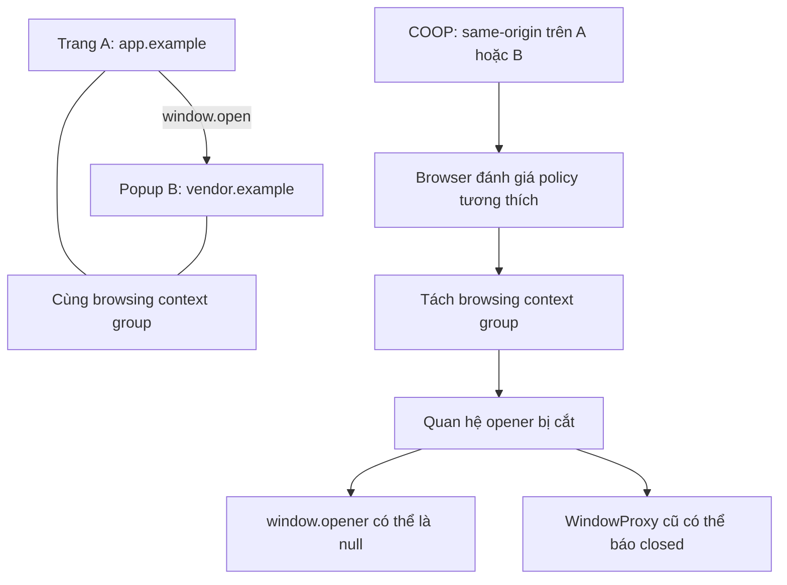

# COOP (Cross-Origin-Opener-Policy)

> **Chương:** Cross-origin isolation  
> **Bài học:** COOP — cô lập browsing context và kiểm soát quan hệ opener giữa các cửa sổ  
> **Phạm vi module:** **SECURITY_APPLICATION_SECURITY_BROWSER_SECURITY** — phân tích ranh giới bảo mật giữa trình duyệt, origin, cookie và ứng dụng web để hiểu Same-Origin Policy (SOP), CORS và các cơ chế cách ly; thực hành phòng vệ XSS, CSRF, clickjacking bằng CSP, Trusted Types, security headers và kiểm chứng hành vi thực tế.

## Mục tiêu học tập

Sau bài này, bạn có thể:

1. Giải thích mục đích của **Cross-Origin-Opener-Policy (COOP)** và khái niệm browsing context group.
2. Mô tả cách COOP tách các trang top-level khỏi opener không tương thích và ảnh hưởng đến `window.opener`, `window.open()`, `WindowProxy` và `postMessage`.
3. Phân biệt các giá trị `unsafe-none`, `same-origin` và `same-origin-allow-popups`.
4. Chọn policy phù hợp với trang thông thường, ứng dụng có popup, OAuth và luồng thanh toán.
5. Giải thích vì sao COOP khác Same-Origin Policy, CORS, COEP, CORP và CSP.
6. Triển khai `Cross-Origin-Opener-Policy-Report-Only` để quan sát trước khi enforcement.
7. Hiểu vai trò của COOP trong cross-origin isolation và giới hạn của việc chỉ bật COOP.
8. Kiểm tra hành vi opener, popup và trạng thái `crossOriginIsolated` trên browser mục tiêu.

## 1. COOP giải quyết vấn đề gì?

Một trang web có thể mở cửa sổ hoặc tab mới bằng link, `window.open()` hoặc form target. Browser có thể duy trì mối quan hệ **opener** giữa trang mở và trang được mở:

- Trang mở giữ tham chiếu đến cửa sổ mới qua giá trị trả về từ `window.open()`.
- Trang được mở có thể truy cập `window.opener`.
- Hai phía có thể gửi message qua `postMessage`.
- Theo Same-Origin Policy, quyền đọc DOM và các thuộc tính nhạy cảm vẫn phụ thuộc origin.

Mối quan hệ opener có thể tạo ra rủi ro khi trang của bạn mở nội dung bên ngoài hoặc bị một trang bên ngoài mở. Một trang được mở có thể điều hướng cửa sổ opener trong một số tình huống, tạo ra kiểu tấn công **reverse tabnabbing**. Ngoài ra, việc nhiều trang không cùng mức tin cậy chia sẻ browsing context group có thể ảnh hưởng đến khả năng cô lập tài nguyên và các API hiệu năng.

**Cross-Origin-Opener-Policy (COOP)** là HTTP response header cho phép tài liệu top-level yêu cầu browser đặt nó vào browsing context group phù hợp, tách khỏi các trang cross-origin không tương thích về COOP.

COOP chủ yếu điều khiển **quan hệ giữa các browsing context top-level và opener**. Nó không phải cơ chế cấp quyền truy cập DOM thay cho SOP, và cũng không phải quy tắc cho phép JavaScript đọc response cross-origin như CORS.

### 1.1. Ví dụ vấn đề opener

Trang A mở trang B:

```js
const popup = window.open('https://outside.example', '_blank');
```

Nếu không có biện pháp tách opener phù hợp, trang B có thể có tham chiếu:

```js
window.opener
```

Trang B không tự động đọc được DOM của A nếu khác origin, nhưng có thể có một số khả năng tương tác qua WindowProxy, bao gồm điều hướng opener trong những điều kiện browser cho phép.

Đối với link mở tab mới, có thể dùng:

```html
<a
  href="https://outside.example"
  target="_blank"
  rel="noopener noreferrer"
>
  Mở trang bên ngoài
</a>
```

`noopener` ngăn thiết lập quan hệ opener cho lần mở đó. `noreferrer` đồng thời không gửi referrer và cũng hàm ý `noopener` trong hành vi hiện đại. Đây là biện pháp theo từng lần mở; COOP là policy ở cấp response của tài liệu top-level.

### 1.2. COOP không thay Same-Origin Policy

SOP giới hạn việc một document truy cập DOM và dữ liệu của document thuộc origin khác. COOP quyết định những tài liệu top-level nào có thể ở cùng browsing context group và giữ quan hệ opener.

Hai trang vẫn có thể khác origin dù được mở từ cùng một tab flow. Ngược lại, COOP có thể cắt quan hệ opener ngay cả khi mục tiêu chính là ngăn một trang cross-origin kiểm soát cửa sổ.

## 2. Browsing context group và opener

### 2.1. Browsing context là gì?

Browsing context là môi trường browser hiển thị một document, chẳng hạn tab, cửa sổ hoặc iframe. Một top-level browsing context có thể mở các auxiliary browsing context như popup.

Các browsing context có thể được liên kết thông qua quan hệ opener và được tổ chức thành **browsing context group (BCG)**. Có thể hiểu BCG là nhóm các context mà browser giữ một số mối quan hệ điều phối và tham chiếu với nhau.

COOP có thể yêu cầu browser chuyển một top-level document sang BCG khác khi policy của nó không tương thích với document đã mở nó hoặc với popup liên quan.

### 2.2. Điều gì xảy ra khi BCG bị tách?

Khi browser tách một trang sang BCG khác:

- Quan hệ opener giữa hai phía có thể bị cắt.
- `window.opener` ở document mới có thể là `null`.
- Tham chiếu `WindowProxy` mà phía mở giữ có thể trở nên không còn truy cập được như trước; thuộc tính `closed` có thể trả về `true` sau khi tách.
- Giao tiếp `postMessage` qua tham chiếu đã bị cắt không còn hoạt động theo luồng cũ.
- Các thao tác popup/OAuth dựa vào opener có thể bị ảnh hưởng.

Chi tiết quan sát có thể khác theo cách mở, điều hướng và browser. Không nên dựa vào một giá trị return duy nhất của `window.open()` để xác định COOP đã hoạt động; cần kiểm tra cả hai phía và luồng nghiệp vụ.

### 2.3. Sơ đồ quan hệ trước và sau COOP



Hình minh họa khái quát. Kết quả cụ thể phụ thuộc COOP của cả hai document và cách điều hướng.

## 3. Các giá trị COOP

COOP thường được cấu hình bằng một trong ba giá trị phổ biến sau:

| Giá trị | Hành vi tổng quát | Trường hợp sử dụng |
|---|---|---|
| `unsafe-none` | Hành vi mặc định; cho phép quan hệ opener theo quy tắc browser nếu không có policy khác yêu cầu tách | Tương thích với trang cũ và luồng popup |
| `same-origin` | Chỉ chia sẻ BCG với tài liệu top-level có policy tương thích và cùng origin; tách khỏi opener cross-origin không tương thích | Ứng dụng muốn cô lập cửa sổ khỏi nội dung cross-origin |
| `same-origin-allow-popups` | Giữ một ngoại lệ tương thích cho popup được mở bởi trang có policy này, đặc biệt popup dùng `unsafe-none`; vẫn cô lập trong các trường hợp policy không tương thích khác | Ứng dụng cần popup OAuth/payment bên thứ ba |

Nếu response không gửi COOP, giá trị mặc định về mặt hành vi là `unsafe-none`.

### 3.1. unsafe-none

Đây là mặc định khi trang không thiết lập COOP. Trang có thể duy trì opener relationship với các trang khác theo quy tắc browser và policy của phía còn lại.

Ví dụ:

```http
Cross-Origin-Opener-Policy: unsafe-none
```

Khai báo tường minh thường không cần thiết. Một số luồng legacy dựa vào popup, opener và callback có thể cần giữ hành vi mặc định, nhưng ứng dụng cần đánh giá nguy cơ reverse tabnabbing và các rủi ro liên quan.

### 3.2. same-origin

Ví dụ:

```http
Cross-Origin-Opener-Policy: same-origin
```

Với policy này, browser cô lập document top-level khỏi các browsing context có origin không tương thích. Nếu trang A mở trang B khác origin và B được tải với COOP `same-origin`, browser có thể tách B sang BCG mới và cắt opener relationship.

Đây là policy thường được dùng khi ứng dụng muốn thiết lập ranh giới opener nghiêm ngặt. Tuy nhiên, nó có thể phá vỡ các tích hợp dựa vào popup, ví dụ:

- OAuth popup gửi kết quả về trang mở.
- Widget thanh toán mở trang xác thực rồi gọi callback qua opener.
- Trang đăng nhập bên thứ ba cần dùng `window.opener.postMessage()`.
- Luồng ứng dụng cũ theo dõi popup qua WindowProxy.

Không bật trên production mà chưa kiểm thử các luồng popup và callback.

### 3.3. same-origin-allow-popups

Ví dụ:

```http
Cross-Origin-Opener-Policy: same-origin-allow-popups
```

Policy này là lựa chọn tương thích khi ứng dụng cần giữ một số quan hệ với popup cross-origin có policy `unsafe-none`. Nó giúp trang mở popup như OAuth provider có thể tiếp tục nhận callback theo mô hình opener trong các trường hợp tương thích.

Nó không phải cách cho phép mọi trang cross-origin chia sẻ BCG. Popup cũng có thể tự khai báo policy khác và khiến browser tách nhóm.

Dùng policy này khi có yêu cầu popup rõ ràng, đã xác minh provider và hiểu rằng mức cô lập opener sẽ khác với `same-origin`.

### 3.4. So sánh lựa chọn

| Yêu cầu | Hướng xem xét |
|---|---|
| Trang ứng dụng thông thường, không phụ thuộc popup opener | `same-origin` |
| Trang mở OAuth/payment popup cần callback qua opener | `same-origin-allow-popups` nếu tương thích với provider |
| Trang legacy phụ thuộc opener từ nhiều nguồn | Đánh giá giữ `unsafe-none` trong giai đoạn chuyển đổi, đồng thời sửa luồng tích hợp |
| Chỉ cần mở link ngoài, không cần callback | Dùng `noopener` ở link/window.open; COOP vẫn được thiết kế riêng cho document |
| Cần cross-origin isolation cho API hiệu năng | COOP `same-origin` kết hợp COEP phù hợp, rồi xác minh `crossOriginIsolated` |

## 4. COOP và các luồng popup thực tế

COOP thường được phát hiện rõ nhất khi ứng dụng dùng popup. Những luồng này cần được kiểm thử từ đầu đến cuối vì trang mở và popup có thể do các tổ chức khác nhau vận hành.

### 4.1. OAuth popup

Một luồng OAuth kiểu popup thường hoạt động như sau:

1. Ứng dụng mở cửa sổ đăng nhập của identity provider.
2. Người dùng xác thực tại popup.
3. Provider chuyển hướng popup về callback URL của ứng dụng.
4. Callback dùng `window.opener.postMessage()` để gửi kết quả về trang ban đầu.
5. Trang ban đầu xác minh message rồi hoàn tất đăng nhập.

Nếu COOP khiến popup và trang mở bị tách BCG, tham chiếu opener có thể bị cắt. Callback không còn gửi message qua `window.opener` như trước.

Các phương án xử lý:

- Dùng `same-origin-allow-popups` cho trang mở nếu provider và luồng popup tương thích với policy này.
- Ưu tiên redirect-based OAuth khi không cần popup.
- Dùng callback cùng origin làm điểm hoàn tất, rồi chuyển trạng thái qua server hoặc một cơ chế được thiết kế rõ.
- Không hạ policy trên toàn ứng dụng chỉ để sửa một popup; xem xét tách route hoặc origin dành riêng cho luồng tích hợp nếu kiến trúc cho phép.

Với OAuth, vẫn phải kiểm tra `state`, PKCE, redirect URI chính xác và xác thực kết quả ở server. COOP không thay thế các biện pháp bảo vệ giao thức đăng nhập.

### 4.2. Widget thanh toán và xác thực

Widget thanh toán có thể mở popup tới trang ngân hàng hoặc nhà cung cấp xác thực. Nếu SDK dựa vào opener để báo kết quả, COOP có thể làm luồng đó không hoạt động.

Trước khi đổi policy:

- Đọc hướng dẫn tích hợp hiện hành của nhà cung cấp.
- Xác định popup có cần gọi ngược parent qua opener hay không.
- Kiểm tra popup có tự gửi COOP header riêng không.
- Kiểm tra callback có dùng `postMessage` và xác minh origin/source hay không.
- Chạy thử thanh toán thành công, thất bại, hủy và timeout.

Không cấp ngoại lệ popup rộng hơn mức cần thiết chỉ vì một lần thử nghiệm bị lỗi.

### 4.3. Link ngoài và reverse tabnabbing

Nếu trang chỉ mở một website ngoài để người dùng đọc thêm, thường không cần giữ opener. Dùng `rel="noopener noreferrer"` trên link `target="_blank"` hoặc tính năng `noopener` cho `window.open()`.

COOP `same-origin` tạo ranh giới ở cấp tài liệu top-level và giúp tách opener không tương thích. `noopener` là cách chặn opener ngay tại điểm mở. Hai cơ chế có thể bổ trợ nhau.

## 5. COOP được cấu hình ở đâu?

COOP được gửi bằng **HTTP response header** của tài liệu top-level:

```http
Cross-Origin-Opener-Policy: same-origin
```

Không thể bật COOP bằng thẻ `<meta http-equiv>` trong HTML. Header phải có trên response thực tế của document cần bảo vệ.

### 5.1. Cấu hình trên server

Ví dụ Node/Express:

```js
app.use((req, res, next) => {
  res.setHeader('Cross-Origin-Opener-Policy', 'same-origin');
  next();
});
```

Đây chỉ là ví dụ cho ứng dụng có thể dùng `same-origin` trên mọi route. Nếu một số trang cần popup OAuth hoặc tích hợp legacy, cần cấu hình theo route và kiểm thử luồng tương ứng trước khi triển khai.

Ví dụ Nginx:

```nginx
add_header Cross-Origin-Opener-Policy "same-origin" always;
```

Tùy hệ thống, header cũng có thể được thêm ở reverse proxy, ingress hoặc CDN. Cần kiểm tra response cuối cùng từ browser vì nhiều lớp có thể ghi đè hoặc thêm header trùng lặp.

### 5.2. Chỉ áp dụng cho top-level document

COOP được thiết kế để kiểm soát browsing context group của tài liệu top-level. Không dùng header COOP trên response của iframe với kỳ vọng nó sẽ cô lập frame theo cùng cách. Đối với tài liệu nhúng, hãy xem xét `sandbox`, SOP, CSP, COEP và các chính sách liên quan.

### 5.3. Các route cần kiểm tra

Đừng chỉ kiểm tra trang chủ. Xác minh COOP trên:

- Trang đăng nhập và callback OAuth.
- Trang thanh toán và callback provider.
- Trang mở popup hoặc dashboard nhiều cửa sổ.
- Trang lỗi, redirect và landing page.
- Các route được phục vụ từ CDN hoặc sub-application.
- Trang có tích hợp widget bên thứ ba.

Policy không nhất quán giữa các response top-level có thể tạo hành vi khác nhau theo từng bước điều hướng.

## 6. COOP Report-Only và báo cáo vi phạm

Trước khi enforce `same-origin`, có thể quan sát tác động bằng:

```http
Cross-Origin-Opener-Policy-Report-Only: same-origin; report-to="coop"
Reporting-Endpoints: coop="https://reports.example/coop"
```

Trong ví dụ, group `coop` được ánh xạ tới endpoint qua `Reporting-Endpoints`. Browser có thể gửi report khi quan sát một tình huống mà policy đề xuất sẽ yêu cầu tách browsing context group.

**Report-Only không cắt opener relationship và không áp dụng việc tách BCG theo policy đó.** Nó giúp phát hiện luồng popup có thể bị ảnh hưởng trước khi chuyển sang enforcement.

### 6.1. Kết hợp Report-Only với policy đang thực thi

Một response có thể giữ COOP hiện tại và thêm policy thử nghiệm:

```http
Cross-Origin-Opener-Policy: unsafe-none

Cross-Origin-Opener-Policy-Report-Only: same-origin; report-to="coop"
Reporting-Endpoints: coop="https://reports.example/coop"
```

Policy đang thực thi vẫn quyết định hành vi thực tế. Policy Report-Only ghi nhận các tình huống cần đánh giá nếu chuyển sang `same-origin`.

### 6.2. Đọc và xử lý report

COOP reports là telemetry về quan hệ opener/BCG có thể bị ảnh hưởng. Tùy browser, báo cáo có thể chứa thông tin về:

- Policy đang áp dụng và disposition.
- URL của document liên quan.
- Giá trị hoặc thuộc tính liên quan đến opener.
- Nguồn điều hướng và context liên quan.
- Thông tin vị trí nguồn nếu browser cung cấp.

Không giả định mọi browser gửi cùng schema hoặc mọi report đều có đầy đủ field. Hãy kiểm tra định dạng từ browser mục tiêu và xử lý payload như dữ liệu không tin cậy.

Collector cần:

- Chỉ nhận POST qua HTTPS.
- Giới hạn body size, batch size và độ dài field.
- Parse/validate JSON và schema trước khi lưu.
- Redact query, fragment hoặc định danh nhạy cảm khi cần.
- Rate limit, deduplicate và đặt thời gian lưu.
- Hiển thị report bằng text/auto-escaping để tránh Stored XSS trong dashboard.

### 6.3. Report không phải bằng chứng tấn công thành công

Một report có thể phản ánh tích hợp popup hợp lệ, điều hướng bình thường hoặc hành vi của trang bên thứ ba. Report-Only không chặn hành động. Hãy đối chiếu với route, thời điểm deploy, browser, Network và luồng nghiệp vụ trước khi thay policy.

## 7. COOP và cross-origin isolation

COOP là một thành phần quan trọng trong kiến trúc **cross-origin isolation**, nhưng chỉ bật COOP chưa đủ để trang trở thành cross-origin isolated.

Cross-origin isolation giúp browser cung cấp một số API mạnh hơn hoặc giảm một số kênh chia sẻ tài nguyên giữa các context. Một ví dụ quan trọng là `SharedArrayBuffer` trong các browser yêu cầu cross-origin isolation.

Để bật chế độ này, một cấu hình thường gặp là:

```http
Cross-Origin-Opener-Policy: same-origin
Cross-Origin-Embedder-Policy: require-corp
```

Một lựa chọn COEP khác trong browser hỗ trợ là:

```http
Cross-Origin-Embedder-Policy: credentialless
```

Ứng dụng cần chạy trong secure context (thường là HTTPS, hoặc localhost trong môi trường phát triển) và đáp ứng các điều kiện của browser.

### 7.1. Kiểm tra trạng thái từ JavaScript

```js
if (window.crossOriginIsolated) {
  console.log('Document đang cross-origin isolated');
} else {
  console.log('Document chưa cross-origin isolated');
}
```

`crossOriginIsolated` là tín hiệu runtime hữu ích để kiểm tra kết quả. Đừng suy ra trạng thái chỉ từ việc server đã gửi một header; browser có thể không chấp nhận cấu hình vì tài nguyên nhúng hoặc điều kiện khác.

### 7.2. COOP và COEP có vai trò khác nhau

| Header | Trách nhiệm chính |
|---|---|
| `Cross-Origin-Opener-Policy` | Tách browsing context group và quan hệ opener của top-level document |
| `Cross-Origin-Embedder-Policy` | Kiểm soát việc document nạp tài nguyên cross-origin |
| `Cross-Origin-Resource-Policy` | Chủ tài nguyên quy định tài nguyên có thể được nhúng từ origin/site nào trong các request phù hợp |
| `Access-Control-Allow-Origin` | Server cho phép origin nào đọc response qua CORS |

COOP kiểm soát quan hệ cửa sổ. COEP kiểm soát việc nhúng tài nguyên. CORP là header trên tài nguyên để kiểm soát việc tài nguyên được tải trong một số ngữ cảnh cross-origin. CORS là cơ chế chia sẻ response cross-origin có điều kiện.

### 7.3. COEP ảnh hưởng tài nguyên bên thứ ba

Khi dùng `Cross-Origin-Embedder-Policy: require-corp`, các tài nguyên cross-origin được nạp theo chế độ no-CORS cần có chính sách CORP phù hợp hoặc được tải bằng CORS với response cho phép thích hợp.

Các tài nguyên có thể bị ảnh hưởng:

- Ảnh và font từ CDN.
- Script/style của nhà cung cấp.
- Video, audio và tài liệu nhúng.
- Worker và các file phụ trợ.
- Pixel/analytics hoặc tài nguyên tracking.

Với `credentialless`, browser có thể thực hiện một số request no-CORS mà không gửi credentials, tùy loại request và hỗ trợ browser. Điều này có thể giúp tích hợp một số tài nguyên nhưng thay đổi hành vi cookie/credentials; phải kiểm thử trước khi triển khai.

### 7.4. Quy trình chuyển sang cross-origin isolation

1. Bật COOP `same-origin` trong môi trường thử nghiệm.
2. Bật COEP `require-corp` hoặc `credentialless` theo yêu cầu và khả năng tương thích.
3. Kiểm kê mọi tài nguyên cross-origin.
4. Yêu cầu nhà cung cấp cấu hình CORS/CORP phù hợp hoặc tự host tài nguyên có thể kiểm soát.
5. Kiểm tra iframe, popup, worker, CDN, analytics và thanh toán.
6. Kiểm tra Console và Network để tìm tài nguyên bị chặn.
7. Đọc `window.crossOriginIsolated` trong browser mục tiêu.
8. Chỉ bật các API phụ thuộc cross-origin isolation sau khi trạng thái runtime đã được xác nhận.

COOP một mình không bật SharedArrayBuffer trong những browser yêu cầu cả COOP và COEP.

## 8. Các lỗi triển khai thường gặp

### 8.1. Bật same-origin rồi popup ngừng hoạt động

Đây là lỗi thường thấy khi ứng dụng có OAuth hoặc thanh toán bằng popup. Policy mới tách browsing context group, khiến callback dựa vào `window.opener` không còn hoạt động.

Cách xử lý:

1. Xác định chính xác popup nào cần opener.
2. Kiểm tra COOP header trên cả trang mở, trang provider và callback.
3. Kiểm thử `same-origin-allow-popups` nếu popup bên thứ ba dùng `unsafe-none` và luồng cần giữ opener.
4. Nếu provider cũng enforce `same-origin`, xem xét redirect flow hoặc một cơ chế callback khác.
5. Giữ policy nghiêm ngặt ở các route không cần popup.

Không nên xóa COOP trên toàn bộ ứng dụng chỉ vì một tích hợp cũ chưa tương thích.

### 8.2. Chỉ đặt header trên trang chủ

COOP được xử lý theo response của tài liệu top-level đang được điều hướng. Nếu callback, trang lỗi hoặc route phụ không có policy như dự kiến, quan hệ opener có thể thay đổi giữa các bước.

Kiểm tra response cuối cùng sau redirect, không chỉ response đầu tiên. Đặc biệt, route callback OAuth thường có cấu hình khác với trang ứng dụng chính.

### 8.3. Nghĩ rằng COOP bảo vệ mọi iframe

COOP không phải sandbox cho iframe. Đối với nội dung nhúng, hãy dùng các cơ chế tương ứng:

- `iframe sandbox` để giới hạn hành vi của browsing context con.
- `frame-src` để parent kiểm soát nguồn iframe.
- `frame-ancestors` để tài liệu quy định ai được nhúng nó.
- SOP/CORS để kiểm soát truy cập giữa các origin.
- COEP/CORP khi cần kiểm soát việc nhúng tài nguyên cross-origin.

### 8.4. Nghĩ rằng COOP một mình bật cross-origin isolation

Nếu mục tiêu là SharedArrayBuffer hoặc API yêu cầu cross-origin isolation, COOP thường phải đi cùng COEP phù hợp và secure context. Sau khi triển khai, xác minh `window.crossOriginIsolated` trong runtime.

Nếu thuộc tính vẫn là `false`, kiểm tra tài nguyên cross-origin bị chặn, worker, header COEP, response redirect và hỗ trợ browser.

### 8.5. Dùng Report-Only như thể đã được bảo vệ

`Cross-Origin-Opener-Policy-Report-Only` chỉ báo cáo các tình huống policy đề xuất sẽ tác động. Nó không cắt opener relationship và không tạo cross-origin isolation theo policy thử nghiệm.

Chỉ coi policy đã được áp dụng khi response thực tế có header enforcement và hành vi runtime đã được xác minh.

## 9. Quy trình triển khai COOP an toàn

Một lộ trình thực tế:

1. **Kiểm kê opener:** tìm `window.open()`, `window.opener`, popup, link target blank và callback dựa vào opener.
2. **Phân loại luồng:** tách luồng không cần opener, luồng OAuth/payment cần popup và tích hợp legacy.
3. **Đặt baseline:** ghi nhận COOP hiện tại ở các route top-level quan trọng.
4. **Bật Report-Only:** gửi policy thử nghiệm và endpoint báo cáo trong staging hoặc phạm vi người dùng phù hợp.
5. **Phân loại report:** xác định popup hợp lệ, provider, route và browser bị ảnh hưởng.
6. **Sửa tích hợp:** thêm `noopener` cho link ngoài; chuyển popup legacy sang callback an toàn hoặc redirect nếu phù hợp.
7. **Chọn policy:** dùng `same-origin` cho các trang không cần opener cross-origin; dùng `same-origin-allow-popups` khi có nhu cầu tương thích đã xác minh.
8. **Enforce theo route:** cấu hình header ở server/proxy và xác minh response cuối cùng.
9. **Kiểm thử luồng:** OAuth, thanh toán, mở tab ngoài, popup, callback, back/forward và redirect.
10. **Nếu cần cross-origin isolation:** bổ sung COEP, xử lý tài nguyên cross-origin và xác minh `crossOriginIsolated`.
11. **Theo dõi sau deploy:** giám sát lỗi popup, report và hành vi trên các browser hỗ trợ.
12. **Duy trì:** rà soát tích hợp mới và policy khi thêm provider hoặc route.

## 10. Thực hành A — Quan sát opener khi chưa có COOP

Thực hiện trên hai origin local do bạn kiểm soát, ví dụ hai port khác nhau trên localhost. Không dùng tài khoản hoặc dữ liệu thật.

### Bước 1: Tạo trang mở

```html
<button id="open">Mở popup</button>
<pre id="status"></pre>

<script>
  let popup;

  document.querySelector('#open').addEventListener('click', () => {
    popup = window.open('http://localhost:4000/popup.html', 'coop-demo');
    document.querySelector('#status').textContent =
      popup ? 'Popup đã mở' : 'Popup bị browser chặn';
  });

  window.addEventListener('message', (event) => {
    document.querySelector('#status').textContent =
      'Message từ: ' + event.origin;
  });
</script>
```

### Bước 2: Tạo popup

```html
<p>Popup demo</p>
<button id="notify">Gửi message về opener</button>

<script>
  document.querySelector('#notify').addEventListener('click', () => {
    if (window.opener) {
      window.opener.postMessage(
        { type: 'ready', version: 1 },
        'http://localhost:3000'
      );
    }
  });
</script>
```

### Bước 3: Quan sát

1. Mở trang cha và bấm nút.
2. Kiểm tra `window.opener` trong popup.
3. Bấm nút gửi message.
4. Kiểm tra trang cha nhận message.
5. Ghi nhận hai port tạo ra hai origin khác nhau dù cùng hostname.

Trang cha thật cần xác minh `event.origin` và `event.source` cùng schema trước khi xử lý message. Lab này chỉ quan sát mối quan hệ opener.

## 11. Thực hành B — Quan sát COOP same-origin tách popup

Giữ hai trang local, thêm response header vào popup:

```http
Cross-Origin-Opener-Policy: same-origin
```

Tải lại trang cha rồi mở popup:

1. Kiểm tra `window.opener` ở popup.
2. Kiểm tra tham chiếu popup ở trang cha.
3. Quan sát thuộc tính `closed` của WindowProxy nếu browser đã tách BCG.
4. Thử gửi message và xác minh callback qua opener không còn hoạt động theo luồng cũ.
5. Xem Console và Network để xác nhận header được gửi trên response popup.

Lặp lại bằng cách đặt COOP trên trang cha để quan sát ảnh hưởng từ phía opener. Kết quả cần được ghi nhận theo browser/version và policy trên cả hai response.

## 12. Thực hành C — Kiểm tra same-origin-allow-popups

Trên trang cha, cấu hình:

```http
Cross-Origin-Opener-Policy: same-origin-allow-popups
```

Để popup local thử nghiệm không gửi COOP header (tương đương `unsafe-none`):

1. Mở popup khác origin.
2. Kiểm tra `window.opener` ở popup.
3. Thử `postMessage` về parent.
4. So sánh với kết quả của lab B.
5. Thêm COOP `same-origin` vào popup và quan sát sự khác biệt.

Lab này giúp thấy ngoại lệ tương thích dành cho popup có policy mặc định. Không suy ra mọi popup của mọi provider sẽ giữ opener; policy riêng của popup có thể làm thay đổi kết quả.

## 13. Thực hành D — Dùng COOP Report-Only

Trên staging, cấu hình:

```http
Reporting-Endpoints: coop="https://reports.example/coop"

Cross-Origin-Opener-Policy-Report-Only: same-origin; report-to="coop"
```

1. Mở các luồng popup đang dùng trong ứng dụng test.
2. Quan sát Console và Network.
3. Kiểm tra request report nếu browser hỗ trợ Reporting API.
4. Nhóm report theo route, provider và loại popup.
5. Xác định luồng nào sẽ bị ảnh hưởng khi enforce.
6. Sửa hoặc thay thế tích hợp trước khi bật header enforcement.

Report-Only không thay đổi quan hệ opener hiện tại. Không dùng nó làm bằng chứng rằng trang đã được cô lập.

## 14. Thực hành E — Xác minh cross-origin isolation

Trên môi trường HTTPS thử nghiệm, cấu hình:

```http
Cross-Origin-Opener-Policy: same-origin
Cross-Origin-Embedder-Policy: require-corp
```

Trong Console:

```js
console.log({
  secureContext: window.isSecureContext,
  crossOriginIsolated: window.crossOriginIsolated,
  sharedArrayBufferAvailable: typeof SharedArrayBuffer !== 'undefined',
});
```

1. Kiểm tra secure context.
2. Kiểm tra `crossOriginIsolated`.
3. Mở Network và tìm tài nguyên cross-origin bị chặn.
4. Kiểm tra CORS/CORP của ảnh, font, script, worker và các tài nguyên bên thứ ba.
5. Sửa response của tài nguyên hoặc thay cách tải theo yêu cầu COEP.
6. Kiểm tra lại trên browser mục tiêu.

Nếu ứng dụng không cần API yêu cầu cross-origin isolation, không cần bật COEP chỉ để có một giá trị header trông chặt hơn; mỗi policy cần gắn với yêu cầu sản phẩm cụ thể.

## 15. Checklist review COOP

| Hạng mục | Câu hỏi cần trả lời |
|---|---|
| Header | COOP có được gửi trên response top-level thực tế không? |
| Scope | Route nào cần COOP? Có route callback/redirect riêng không? |
| Policy | `same-origin`, `same-origin-allow-popups` hay `unsafe-none` phù hợp? |
| Opener | Ứng dụng có dùng `window.opener` hoặc WindowProxy không? |
| Popup | OAuth/payment/provider có cần callback qua opener không? |
| Link ngoài | Link `target="_blank"` đã dùng `noopener` khi không cần opener chưa? |
| Reporting | Có Report-Only và collector để quan sát trước khi enforce không? |
| Browser | Đã kiểm thử các browser/version mục tiêu chưa? |
| Redirect | Policy trên response cuối cùng sau redirect đã được xác minh chưa? |
| Iframe | Có nhầm COOP với iframe sandbox hoặc `frame-ancestors` không? |
| COEP | Nếu cần cross-origin isolation, COEP đã được cấu hình và tài nguyên đã tương thích chưa? |
| Runtime | `window.crossOriginIsolated` có đúng trạng thái mong muốn không? |
| Operations | Có dashboard, triage và rollback cho lỗi popup không? |

## 16. Câu hỏi tự kiểm tra

**1.** COOP điều khiển điều gì?  
**Đáp án:** COOP kiểm soát việc tài liệu top-level chia sẻ browsing context group và quan hệ opener với các tài liệu khác.

**2.** COOP có thay Same-Origin Policy không?  
**Đáp án:** Không. SOP giới hạn truy cập dữ liệu/DOM giữa origin; COOP tách browsing context group và opener.

**3.** Giá trị mặc định của COOP khi không có header là gì?  
**Đáp án:** Hành vi tương ứng `unsafe-none`.

**4.** `same-origin` có tác động gì đến popup cross-origin?  
**Đáp án:** Browser có thể tách popup sang browsing context group khác và cắt quan hệ opener nếu policy không tương thích.

**5.** `same-origin-allow-popups` hữu ích khi nào?  
**Đáp án:** Khi trang cần giữ một số quan hệ opener với popup cross-origin dùng policy `unsafe-none`, ví dụ một số luồng OAuth/payment.

**6.** COOP có làm mất mọi khả năng giao tiếp giữa hai origin không?  
**Đáp án:** Nó có thể cắt opener reference và làm hỏng kênh dựa vào WindowProxy; các kênh khác phải được thiết kế riêng. SOP/CORS vẫn là cơ chế riêng.

**7.** `noopener` khác COOP thế nào?  
**Đáp án:** `noopener` chặn opener tại một lần mở cụ thể; COOP là policy response của tài liệu top-level ảnh hưởng đến BCG.

**8.** COOP có thể đặt bằng meta tag không?  
**Đáp án:** Không. Cần gửi HTTP response header.

**9.** COOP Report-Only có tách browsing context group không?  
**Đáp án:** Không. Nó ghi nhận tác động tiềm năng mà không enforce policy đó.

**10.** COOP một mình có bật `crossOriginIsolated` không?  
**Đáp án:** Không trong các browser yêu cầu thêm COEP và secure context; cần xác minh runtime.

**11.** COEP và CORP khác nhau thế nào?  
**Đáp án:** COEP là policy của document về tài nguyên nhúng; CORP là policy trên response tài nguyên quy định các ngữ cảnh cross-origin được phép nhúng nó.

**12.** Vì sao không nên bật `same-origin` mà chưa kiểm thử OAuth popup?  
**Đáp án:** Popup hoặc callback có thể mất opener relationship, khiến luồng đăng nhập không gửi được kết quả về trang mở.

## Ghi nhớ

**COOP kiểm soát quan hệ opener bằng cách đặt tài liệu top-level vào browsing context group phù hợp.** `same-origin` tăng cô lập khỏi popup/opener cross-origin không tương thích; `same-origin-allow-popups` giữ một ngoại lệ hữu ích cho một số popup dùng policy mặc định; `unsafe-none` là hành vi mặc định.

Hãy kiểm kê mọi popup và callback trước khi enforce. Dùng COOP Report-Only để quan sát, xác minh header trên response cuối cùng và kiểm thử OAuth/thanh toán trên browser mục tiêu. Nếu mục tiêu là cross-origin isolation, kết hợp COOP với COEP phù hợp và kiểm tra `window.crossOriginIsolated`; COOP một mình không thay CORS, CORP, iframe sandbox hoặc server authorization.
