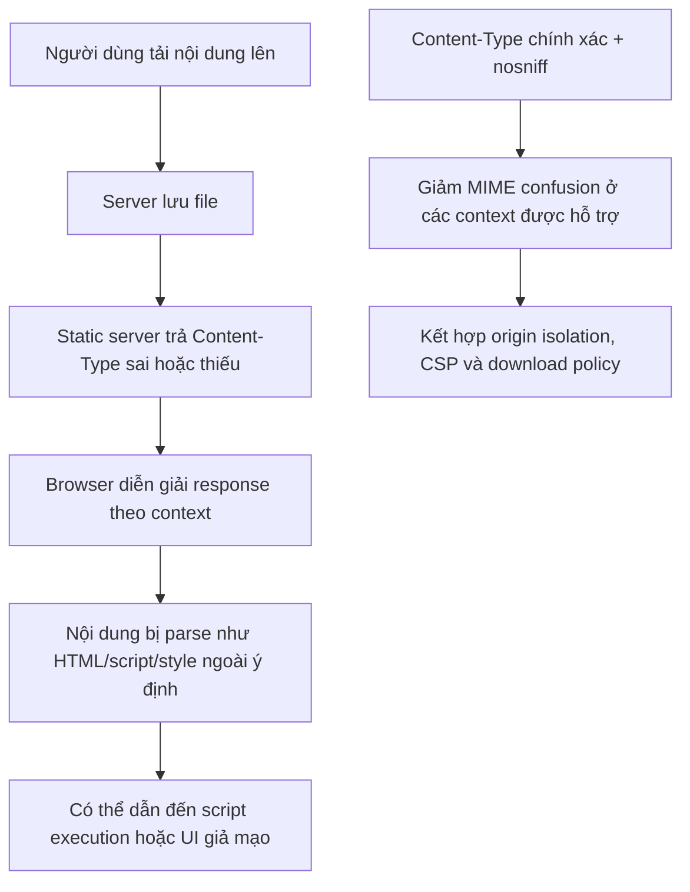

# Header nosniff: ngăn trình duyệt tự suy đoán MIME type

**Chương:** Security headers  
**Mô-đun:** `SECURITY_APPLICATION_SECURITY_BROWSER_SECURITY` — phân tích ranh giới bảo mật giữa trình duyệt, origin, cookie và ứng dụng web để hiểu Same-Origin Policy (SOP), CORS và các cơ chế cách ly; thực hành phòng vệ XSS, CSRF, clickjacking bằng CSP, Trusted Types, security headers và kiểm chứng hành vi thực tế.

`X-Content-Type-Options: nosniff` là HTTP response header yêu cầu trình duyệt tôn trọng MIME type được server khai báo thay vì tự suy đoán một loại nội dung khác trong những ngữ cảnh được tiêu chuẩn quy định. Header này đặc biệt quan trọng với JavaScript và CSS: khi response có `nosniff`, browser áp dụng kiểm tra MIME nghiêm ngặt và chặn script hoặc stylesheet nếu `Content-Type` không thuộc loại được phép cho request đó.

Nếu server trả một file JavaScript với `Content-Type: text/plain`, nhưng trang lại tải file bằng thẻ `<script src>`, browser có thể từ chối thực thi file khi response có `X-Content-Type-Options: nosniff`. Điều này giúp ngăn một số tình huống MIME confusion, chẳng hạn file người dùng tải lên bị phục vụ với loại nội dung không phù hợp rồi bị browser diễn giải như mã hoặc nội dung chủ động.

`nosniff` không sửa MIME type sai, không làm sạch HTML, không thay thế CSP và cũng không bảo đảm mọi loại nội dung đều không thể bị diễn giải theo cách khác. Server vẫn phải gửi đúng `Content-Type` cho từng response, tách nội dung người dùng khỏi origin ứng dụng khi cần và kiểm thử các luồng tải file thực tế.

## 1. Mục tiêu học tập

Sau bài học, bạn có thể:

1. Giải thích MIME type và vì sao browser đôi khi cần suy đoán loại nội dung.
2. Mô tả vai trò của `X-Content-Type-Options: nosniff` và phạm vi tác động của nó.
3. Cấu hình đúng `Content-Type` cho JavaScript, CSS, HTML, JSON, ảnh, font và file tải xuống.
4. Hiểu strict MIME checking đối với request destination là script và style.
5. Nhận diện rủi ro khi server phục vụ upload, static asset hoặc API với MIME type không chính xác.
6. Kiểm tra header bằng curl, DevTools, browser test và integration test.
7. Thiết kế test matrix để chứng minh file đúng MIME được tải và file sai MIME bị chặn trong ngữ cảnh tương ứng.
8. Kết hợp nosniff với CSP, Content-Disposition, phân tách origin và các security header liên quan.

## 2. MIME type là gì?

MIME type (media type) mô tả định dạng của nội dung HTTP response. Server thường gửi nó qua header `Content-Type`. Ví dụ:

| Nội dung | Content-Type thường dùng |
| --- | --- |
| HTML | `text/html; charset=utf-8` |
| JavaScript | `text/javascript` |
| CSS | `text/css` |
| JSON | `application/json` |
| PNG | `image/png` |
| JPEG | `image/jpeg` |
| SVG | `image/svg+xml` |
| WOFF2 font | `font/woff2` |
| PDF | `application/pdf` |
| Văn bản thuần | `text/plain; charset=utf-8` |
| Dữ liệu nhị phân không xác định | `application/octet-stream` |

MIME type có dạng `type/subtype`, có thể đi kèm tham số như charset. Browser dùng thông tin này cùng request destination, context, nội dung response và các quy tắc của nền tảng web để quyết định cách xử lý dữ liệu.

Ví dụ, cùng một chuỗi byte có thể được phục vụ dưới các loại khác nhau:

- `text/plain`: hiển thị như văn bản.
- `text/html`: parse thành document HTML.
- `application/json`: được xử lý như JSON trong API hoặc download.
- `application/octet-stream`: thường biểu thị dữ liệu nhị phân chung, không phải một định dạng hiển thị cụ thể.

Khai báo MIME type là trách nhiệm của server. Phần mở rộng file như `.js`, `.css` hoặc `.png` là tín hiệu hữu ích khi cấu hình static server, nhưng không thay thế response header.

### 2.1. MIME sniffing là gì?

MIME sniffing là quá trình browser phân tích một phần byte của response để suy đoán loại nội dung khi thông tin server cung cấp thiếu, không rõ ràng hoặc trong một số context được phép sniff. Hành vi lịch sử này giúp hiển thị nội dung trên web khi server cấu hình MIME chưa chuẩn, nhưng cũng tạo ra rủi ro bảo mật nếu nội dung bị diễn giải theo loại nguy hiểm hơn dự kiến.

Ví dụ, ứng dụng cho phép người dùng tải lên file văn bản nhưng server trả sai `Content-Type`. Nếu browser suy đoán nội dung là HTML trong một context có thể parse document, dữ liệu do người dùng kiểm soát có thể trở thành markup chủ động. Rủi ro cụ thể phụ thuộc loại response, browser, cách URL được mở và chính sách origin/cookie.

Không nên dựa vào việc browser “có lẽ sẽ hiểu đúng” dựa trên nội dung file. Hãy khai báo MIME type chính xác và dùng nosniff để browser không tự chuyển sang cách diễn giải khác trong những context được bảo vệ.

### 2.2. Vì sao MIME confusion có thể trở thành vấn đề bảo mật?

Một file upload có thể được lưu trong storage và phục vụ lại qua HTTP. Nếu server dùng sai MIME type, browser có thể xử lý nội dung khác với ý định của ứng dụng.

Ví dụ về đường đi rủi ro:



Đây là một nhóm rủi ro liên quan đến cách browser diễn giải response. Nó khác với việc người dùng tải file độc hại về máy và tự mở bằng ứng dụng desktop; nosniff không phải antivirus và không quét file.

## 3. Header X-Content-Type-Options

### 3.1. Cú pháp

Giá trị được dùng là `nosniff`:

```http
X-Content-Type-Options: nosniff
```

Header là response header. Server gửi nó cùng response của tài nguyên cần bảo vệ, ví dụ HTML document, JavaScript, CSS, API response hoặc file upload. Có thể cấu hình ở ứng dụng, web server, reverse proxy hoặc CDN, nhưng cần kiểm tra response cuối cùng mà browser nhận được.

Không có giá trị `true`, `false` hay `on` để bật/tắt. Dùng đúng token `nosniff`. Không cần gửi header lặp lại nhiều lần; cấu hình ở nhiều tầng có thể tạo header trùng hoặc khó xác định nguồn cấu hình.

### 3.2. Header làm gì?

Ở những context được quy định, `nosniff` ngăn browser MIME-sniff response và yêu cầu MIME type phải phù hợp với loại request. Các kiểm tra nổi bật:

- Với request destination là **script**, browser chặn response có MIME type không phải JavaScript MIME type được công nhận.
- Với request destination là **style**, browser chặn response stylesheet nếu MIME type không phải `text/css` theo strict MIME checking.
- Một số browser còn có các biện pháp bảo vệ bổ sung liên quan đến việc không cho cross-origin response dạng HTML/XML/JSON bị đọc như dữ liệu khác; chi tiết có thể khác theo browser và cơ chế như CORB. Không nên suy rộng điều này thành cam kết mọi loại response đều bị chặn sniff trong mọi context.

Vì vậy, kiểm thử nosniff nên tập trung vào response thực tế và request destination. Chỉ thấy header trong Network tab chưa chứng minh browser đã áp dụng nó đúng.

### 3.3. Những điều nosniff không làm

`nosniff` không:

- kiểm tra file có chứa mã độc hay không;
- sanitize hoặc escape HTML;
- chặn mọi JavaScript hợp lệ trên trang;
- thay thế CSP `script-src` hoặc `style-src`;
- thay thế CORS, CORP, COEP hoặc SOP;
- thay đổi MIME type sai thành MIME type đúng;
- bảo đảm một file upload được tải xuống thay vì hiển thị;
- ngăn người dùng tải và tự mở file bằng ứng dụng khác.

Hãy xem nó là một lớp kiểm soát cách browser diễn giải response, được dùng cùng cấu hình MIME chính xác và chính sách phân phối nội dung.

## 4. Strict MIME checking với script và stylesheet

### 4.1. JavaScript

Ví dụ response JavaScript đúng:

```http
HTTP/1.1 200 OK
Content-Type: text/javascript
X-Content-Type-Options: nosniff

console.log("script loaded");
```

Khi trang tải file bằng:

```html
<script src="/assets/app.js"></script>
```

browser nhận request destination là script. MIME type `text/javascript` hợp lệ nên file có thể được thực thi, nếu các policy khác như CSP cho phép.

Ví dụ response sai:

```http
HTTP/1.1 200 OK
Content-Type: text/plain
X-Content-Type-Options: nosniff

console.log("script loaded");
```

Dù body trông giống JavaScript, browser phải từ chối dùng response này làm script do MIME type không phù hợp. Console thường hiển thị lỗi strict MIME type checking.

### 4.2. CSS

Stylesheet nên được phục vụ với `Content-Type: text/css`:

```http
HTTP/1.1 200 OK
Content-Type: text/css
X-Content-Type-Options: nosniff

body { color: teal; }
```

Trang tải:

```html
<link rel="stylesheet" href="/assets/site.css">
```

Nếu server trả `text/plain` hoặc MIME type không phải `text/css` cùng `nosniff`, browser chặn stylesheet. Điều này có thể khiến giao diện mất style; cần sửa MIME mapping ở static server hoặc CDN.

### 4.3. MIME JavaScript hợp lệ

Browser chấp nhận một tập JavaScript MIME type được định nghĩa trong nền tảng web, bao gồm loại hiện đại `text/javascript` và một số MIME type legacy. Với triển khai mới, ưu tiên `text/javascript` để nhất quán. Đừng tự tạo MIME type riêng cho file script.

Nếu server trả JavaScript bằng `text/plain`, `text/html` hoặc `application/octet-stream`, hãy sửa cấu hình server thay vì bỏ nosniff. Khi một response script bị chặn, kiểm tra URL, redirect, response thực tế, Content-Type và header do CDN/proxy gửi.


## 5. Content-Type chính xác cho các loại response khác

### 5.1. JSON API

API trả JSON nên khai báo:

```http
Content-Type: application/json; charset=utf-8
X-Content-Type-Options: nosniff
```

Client dùng `fetch()` có thể đọc response và parse bằng `response.json()`. Nosniff không thay thế kiểm tra schema, authorization hay output encoding. Khi JSON được render vào DOM, vẫn phải dùng sink an toàn; dữ liệu JSON có thể chứa nội dung do người dùng kiểm soát.

Không trả JSON với `text/html` chỉ để browser hiển thị dễ hơn. Cũng không phục vụ HTML như `application/json` rồi trông chờ nosniff biến nó thành dữ liệu vô hại.

### 5.2. HTML document

Trang HTML cần `Content-Type: text/html; charset=utf-8`. Header nosniff nên được gửi cùng response HTML, nhưng nó không phải HTML sanitizer và không thay CSP. Nếu ứng dụng render nội dung người dùng, vẫn cần encoding/sanitization theo context.

### 5.3. Ảnh, font và media

Static server phải map extension hoặc metadata lưu trữ sang MIME type phù hợp. Ví dụ:

- PNG: `image/png`.
- JPEG: `image/jpeg`.
- WebP: `image/webp`.
- SVG: `image/svg+xml`.
- WOFF2: `font/woff2`.
- MP4: `video/mp4`.

Không dùng `text/plain` hoặc `application/octet-stream` cho mọi tài nguyên chỉ để tránh phải quản lý MIME mapping. MIME type sai có thể khiến tài nguyên không tải hoặc không hiển thị đúng; nosniff sẽ làm một số lỗi cấu hình lộ rõ hơn.

### 5.4. File tải xuống và nội dung do người dùng tải lên

Đây là khu vực cần chú ý vì nội dung do người dùng kiểm soát có thể chứa HTML, SVG hoặc định dạng chủ động khác.

Nếu nghiệp vụ chỉ cần người dùng tải file về máy, hãy cân nhắc:

```http
Content-Type: application/octet-stream
Content-Disposition: attachment; filename="user-file.bin"
X-Content-Type-Options: nosniff
```

`Content-Disposition: attachment` yêu cầu browser xử lý response như file tải xuống thay vì hiển thị inline theo cách thông thường. `application/octet-stream` là MIME type chung cho dữ liệu nhị phân. Kết hợp với nosniff giúp tránh một số cách browser diễn giải response sai mục đích.

Nếu sản phẩm cần preview ảnh, hãy kiểm tra định dạng bằng parser đáng tin, giới hạn kích thước, giải mã rồi encode lại sang định dạng raster cho phép. Không tin extension hoặc `Content-Type` do client gửi. SVG có thể chứa cấu trúc chủ động; không hiển thị SVG do người dùng tải lên inline trong origin ứng dụng nếu chưa có thiết kế xử lý riêng.

### 5.5. Upload không nên được phục vụ từ origin ứng dụng nhạy cảm

Một biện pháp mạnh là lưu file người dùng ở origin riêng, không chia sẻ cookie xác thực với ứng dụng chính. Nếu người dùng có thể upload HTML hoặc SVG, việc mở trực tiếp trên cùng origin với ứng dụng có thể tạo stored XSS hoặc UI giả mạo dù response có nosniff.

Tách origin, dùng download attachment khi phù hợp, validate/re-encode file và áp dụng CSP riêng cho nội dung preview. `nosniff` là một lớp bổ sung, không phải biện pháp duy nhất để phục vụ file không tin cậy.

## 6. Cấu hình header trong ứng dụng và web server

### 6.1. Node.js HTTP server

Ví dụ helper để thêm header cho response:

```javascript
function setSecurityHeaders(res) {
  res.setHeader("X-Content-Type-Options", "nosniff");
}

function sendJson(res, status, data) {
  setSecurityHeaders(res);
  res.statusCode = status;
  res.setHeader("Content-Type", "application/json; charset=utf-8");
  res.end(JSON.stringify(data));
}
```

Đặt header tập trung giúp tránh bỏ sót endpoint, nhưng vẫn cần kiểm tra route đặc biệt, static file, redirect và response lỗi. Không ghi đè `Content-Type` đã được static middleware xác định bằng một giá trị chung.

### 6.2. Express

Có thể thêm middleware toàn cục:

```javascript
app.use((req, res, next) => {
  res.setHeader("X-Content-Type-Options", "nosniff");
  next();
});
```

Đặt middleware trước các route và static middleware để header có mặt trên response. Kiểm tra middleware xử lý lỗi, route download và proxy/CDN để bảo đảm header không bị mất. Static middleware vẫn phải trả đúng MIME type cho từng file.

### 6.3. Nginx

Ví dụ cấu hình:

```nginx
server {
    listen 443 ssl;
    server_name app.example.test;

    add_header X-Content-Type-Options "nosniff" always;

    location /assets/ {
        root /srv/app/public;
    }
}
```

Từ khóa `always` giúp header được thêm cả trên các response status không thuộc nhóm mặc định của `add_header`. Lưu ý quy tắc kế thừa `add_header` giữa các context của Nginx: một `add_header` ở location lồng có thể làm thay đổi việc kế thừa từ server block tùy cấu hình/phiên bản. Hãy kiểm tra response thật sau khi reload.

### 6.4. CDN, reverse proxy và nhiều tầng cấu hình

Một ứng dụng có thể thêm header ở cả app, ingress, reverse proxy và CDN. Tránh cấu hình nhiều nơi với giá trị khác nhau hoặc phát header trùng. Xác định một tầng chịu trách nhiệm chính, rồi kiểm tra response cuối từ edge và origin.

Đừng chỉ kiểm tra trang chủ. Static assets có thể được CDN phục vụ riêng; file upload có thể đi qua storage gateway; API và error response có thể dùng middleware khác. Kiểm kê theo loại response và route.

## 7. Kết hợp nosniff với các cơ chế bảo vệ khác

| Cơ chế | Vai trò | Quan hệ với nosniff |
| --- | --- | --- |
| CSP `script-src` / `style-src` | Kiểm soát nguồn và cách tải/thực thi script, style | Bổ sung kiểm soát nội dung được phép; không sửa MIME mapping |
| `Content-Disposition: attachment` | Gợi ý tải file thay vì render inline | Hữu ích với file người dùng không cần preview |
| Origin isolation | Phân tách nội dung không tin cậy khỏi cookie và quyền ứng dụng | Giảm hậu quả nếu file chủ động được mở |
| CORP / COEP | Kiểm soát một số cách tài nguyên cross-origin được nhúng và yêu cầu cross-origin isolation | Chính sách khác với MIME checking |
| CORS | Điều khiển việc JavaScript đọc response cross-origin | Không thay thế nosniff và không sửa MIME type |
| Output encoding / sanitizer | Bảo vệ khi render dữ liệu vào HTML/DOM | Xử lý nội dung trước khi đưa vào sink; nosniff không làm việc này |
| `X-Frame-Options` / CSP `frame-ancestors` | Kiểm soát trang có được nhúng trong frame | Bảo vệ clickjacking, không phải MIME checking |

Ví dụ, CSP `script-src` có thể giới hạn script được tải từ đâu, còn nosniff kiểm tra MIME type của response script. Một script từ host allowlist nhưng trả `text/plain` vẫn phải bị strict MIME check từ chối. Ngược lại, response JavaScript đúng MIME không có nghĩa nguồn đó đáng tin; CSP và kiểm soát supply chain vẫn cần thiết.


## 8. Test matrix cho Header nosniff

Một bài test nên kiểm tra cả header lẫn hành vi của browser. Chỉ xác nhận server gửi `X-Content-Type-Options: nosniff` chưa đủ; cần chứng minh MIME type được khai báo chính xác và request script/style sai MIME bị từ chối.

| ID | Request/response | Kết quả mong đợi |
| --- | --- | --- |
| NS-01 | HTML document có `text/html` và nosniff | Trang render bình thường |
| NS-02 | JavaScript có `text/javascript` và nosniff | Script tải và chạy nếu CSP cho phép |
| NS-03 | JavaScript trả `text/plain` và nosniff | Browser chặn script do strict MIME checking |
| NS-04 | CSS trả `text/css` và nosniff | Stylesheet được áp dụng |
| NS-05 | CSS trả `text/plain` và nosniff | Browser chặn stylesheet |
| NS-06 | JSON API trả `application/json` và nosniff | Fetch đọc và parse JSON bình thường |
| NS-07 | JSON API trả sai MIME | Client/test phát hiện contract sai; không giả định nosniff tự sửa response |
| NS-08 | Upload HTML phục vụ attachment + octet-stream + nosniff | Browser xử lý như download theo Content-Disposition |
| NS-09 | Upload SVG/HTML được mở inline cùng origin ứng dụng | Kiến trúc phải từ chối hoặc cô lập; không coi nosniff là đủ |
| NS-10 | Static file qua CDN | Header và MIME mapping giống policy đã định |
| NS-11 | Redirect tới asset | Response cuối có Content-Type và nosniff chính xác |
| NS-12 | 404/500 HTML response | Có nosniff nếu policy áp dụng cho response đó; Content-Type vẫn đúng |
| NS-13 | File extension không khớp nội dung | Server từ chối hoặc chuẩn hóa theo pipeline upload; không tin extension |
| NS-14 | Browser mục tiêu khác nhau | Hành vi script/style strict MIME được xác nhận trên support matrix |
| NS-15 | CSP chặn nguồn script dù MIME đúng | Script vẫn bị CSP chặn; chứng minh hai lớp hoạt động độc lập |

### 8.1. Kiểm tra header bằng curl

Lấy response header của từng loại tài nguyên:

```bash
curl -sS -D - -o /dev/null https://app.example.test/
curl -sS -D - -o /dev/null https://app.example.test/assets/app.js
curl -sS -D - -o /dev/null https://app.example.test/assets/site.css
curl -sS -D - -o /dev/null https://app.example.test/api/profile
curl -sS -D - -o /dev/null https://app.example.test/uploads/file
```

Với từng response, kiểm tra:

- `X-Content-Type-Options` có đúng một giá trị `nosniff`.
- `Content-Type` phù hợp loại dữ liệu thực tế.
- Redirect và response cuối có header như dự kiến.
- Static assets, API, file download và error response không bị bỏ sót.
- Header sau CDN/proxy giống với policy đã cấu hình ở origin.

`curl` không mô phỏng MIME checking của browser. Nó chỉ xác minh response header và body; bước browser test vẫn bắt buộc.

### 8.2. Kiểm tra bằng DevTools

Trong Network:

1. Chọn request script hoặc stylesheet.
2. Mở Response Headers và xác nhận `Content-Type` cùng `X-Content-Type-Options`.
3. Quan sát request destination trong thông tin request nếu DevTools hiển thị.
4. Mở Console để xem lỗi strict MIME type checking khi server trả sai loại.
5. Kiểm tra script/style đúng MIME vẫn hoạt động và file sai MIME không được áp dụng.
6. Nếu tài nguyên bị chặn, kiểm tra cả CSP, mixed content, CORS, lỗi mạng và status response trước khi kết luận do nosniff.

Không dùng ảnh chụp header đơn lẻ làm bằng chứng hoàn chỉnh. Hãy ghi nhận URL, status, MIME type, nosniff, browser/version và kết quả render/thực thi.

### 8.3. Integration test cho response contract

Có thể kiểm tra response bằng test runner phía server:

```javascript
const response = await fetch("http://localhost:3000/assets/app.js");

assert.equal(response.status, 200);
assert.equal(
  response.headers.get("x-content-type-options"),
  "nosniff"
);
assert.match(
  response.headers.get("content-type") || "",
  /^text\/javascript\b/i
);
```

Với stylesheet, thay MIME assertion thành `text/css`. Với JSON endpoint, xác nhận `application/json`. Những test này kiểm tra server contract; browser automation cần thêm để chứng minh strict MIME behavior.


## 9. Lab: kiểm tra strict MIME checking trong browser

Lab dùng Node.js built-in và chạy tại `http://localhost:3000`. Trang thử nghiệm tải một script đúng MIME, một script sai MIME, một stylesheet đúng MIME, một stylesheet sai MIME và gọi một JSON endpoint.

Kết quả cần quan sát:

- Script `text/javascript` được tải và thay đổi marker.
- Script `text/plain` bị chặn do `nosniff`.
- CSS `text/css` được áp dụng.
- CSS `text/plain` bị chặn.
- JSON `application/json` vẫn được fetch và parse.
- File download dùng `application/octet-stream` và `Content-Disposition: attachment`.

### 9.1. Tạo server

Tạo file `nosniff-lab.mjs`:

```javascript
import { createServer } from "node:http";

function send(res, status, contentType, body, extraHeaders = {}) {
  res.writeHead(status, {
    "Content-Type": contentType,
    "X-Content-Type-Options": "nosniff",
    "Cache-Control": "no-store",
    ...extraHeaders
  });
  res.end(body);
}

const page = `<!doctype html>
<html lang="vi">
<head>
  <meta charset="utf-8">
  <title>nosniff lab</title>
  <link rel="stylesheet" href="/assets/good.css">
  <link rel="stylesheet" href="/assets/wrong.css">
</head>
<body>
  <h1>Header nosniff lab</h1>

  <h2>JavaScript</h2>
  <p id="goodScript">Good script: not loaded</p>
  <p id="wrongScript">Wrong MIME script: not loaded</p>
  <script src="/assets/good.js"></script>
  <script src="/assets/wrong.js"></script>

  <h2>Stylesheet</h2>
  <p id="goodStyle">Good CSS should add a green border.</p>
  <p id="wrongStyle">Wrong MIME CSS should not add a red border.</p>

  <h2>JSON API</h2>
  <pre id="apiState">Loading...</pre>

  <p><a href="/download">Download sample binary file</a></p>

  <script>
    fetch("/api/data")
      .then(response => {
        if (!response.ok) throw new Error("API request failed");
        return response.json();
      })
      .then(data => {
        document.querySelector("#apiState").textContent =
          JSON.stringify(data, null, 2);
      })
      .catch(error => {
        document.querySelector("#apiState").textContent = error.message;
      });
  </script>
</body>
</html>`;

const server = createServer((req, res) => {
  if (req.method === "GET" && req.url === "/") {
    return send(res, 200, "text/html; charset=utf-8", page);
  }

  if (req.method === "GET" && req.url === "/assets/good.js") {
    return send(res, 200, "text/javascript; charset=utf-8",
      'document.querySelector("#goodScript").textContent = "Good script: executed";');
  }

  if (req.method === "GET" && req.url === "/assets/wrong.js") {
    return send(res, 200, "text/plain; charset=utf-8",
      'document.querySelector("#wrongScript").textContent = "Wrong MIME script: executed";');
  }

  if (req.method === "GET" && req.url === "/assets/good.css") {
    return send(res, 200, "text/css; charset=utf-8",
      "#goodStyle { border: 3px solid green; padding: 8px; }");
  }

  if (req.method === "GET" && req.url === "/assets/wrong.css") {
    return send(res, 200, "text/plain; charset=utf-8",
      "#wrongStyle { border: 8px solid red; padding: 8px; }");
  }

  if (req.method === "GET" && req.url === "/api/data") {
    return send(res, 200, "application/json; charset=utf-8",
      JSON.stringify({ status: "ok", message: "JSON response served with nosniff" }));
  }

  if (req.method === "GET" && req.url === "/download") {
    return send(res, 200, "application/octet-stream",
      Buffer.from("Sample user download\n", "utf8"), {
        "Content-Disposition": 'attachment; filename="sample.bin"'
      });
  }

  return send(res, 404, "text/plain; charset=utf-8", "Not found");
});

server.listen(3000, () => {
  console.log("Open http://localhost:3000");
});
```

Chạy:

```bash
node nosniff-lab.mjs
```

### 9.2. Quan sát kết quả

Mở `http://localhost:3000` trong browser:

1. `goodScript` đổi thành `Good script: executed`.
2. `wrongScript` vẫn là `Wrong MIME script: not loaded`.
3. `goodStyle` có viền xanh.
4. `wrongStyle` không có viền đỏ.
5. JSON endpoint hiển thị object trong phần API.
6. Nhấn liên kết download để tải file `sample.bin`.

Mở DevTools → Network, chọn từng request và xác nhận:

| URL | Content-Type | X-Content-Type-Options | Kết quả |
| --- | --- | --- | --- |
| `/assets/good.js` | `text/javascript` | `nosniff` | Script chạy |
| `/assets/wrong.js` | `text/plain` | `nosniff` | Script bị chặn |
| `/assets/good.css` | `text/css` | `nosniff` | CSS áp dụng |
| `/assets/wrong.css` | `text/plain` | `nosniff` | CSS bị chặn |
| `/api/data` | `application/json` | `nosniff` | JSON parse thành công |
| `/download` | `application/octet-stream` | `nosniff` | File được tải xuống |

Console có thể hiển thị lỗi strict MIME type checking cho script và stylesheet sai MIME. Câu chữ cụ thể tùy browser.

### 9.3. Kiểm tra bằng curl

Trong terminal khác:

```bash
curl -sS -D - -o /dev/null http://localhost:3000/assets/good.js
curl -sS -D - -o /dev/null http://localhost:3000/assets/wrong.js
curl -sS -D - -o /dev/null http://localhost:3000/assets/good.css
curl -sS -D - -o /dev/null http://localhost:3000/assets/wrong.css
curl -sS -D - -o /dev/null http://localhost:3000/api/data
curl -sS -D - -o /dev/null http://localhost:3000/download
```

Xác nhận header trong từng response khớp với bảng ở trên. curl không thực thi script hoặc CSS; chỉ browser mới chứng minh strict MIME checking.

### 9.4. Dọn lab

Dừng server bằng Ctrl+C. Lab chỉ chạy trên localhost, không dùng dữ liệu người dùng thật và không được expose ra Internet. Trong ứng dụng thực tế, sửa MIME mapping và policy upload thay vì cố ý phục vụ sai MIME.


## 10. Những giới hạn và ngộ nhận thường gặp

**“Có nosniff thì browser không thể parse HTML từ file upload.”** Sai. Nếu server khai báo `Content-Type: text/html`, đó là MIME type HTML đúng với document HTML; browser vẫn parse nội dung HTML. Nosniff không phải sanitizer và không vô hiệu hóa nội dung chủ động có MIME type hợp lệ.

**“Chỉ cần nosniff, không cần Content-Type.”** Sai. Nosniff không tự đoán hoặc sửa MIME type đúng cho ứng dụng. Server phải gửi `Content-Type` chính xác cho từng loại response.

**“File có đuôi .js chắc chắn là JavaScript.”** Sai. Extension có thể sai hoặc do người dùng đặt. Server cần kiểm soát asset build và pipeline upload; không tin tên file hay header do client gửi.

**“Nếu script bị chặn thì chắc chắn do nosniff.”** Sai. CSP, CORS, mixed content, lỗi mạng, redirect, status code và MIME policy khác cũng có thể làm script không tải. Cần kiểm tra response header và Console.

**“Nosniff thay thế CSP.”** Sai. Nosniff kiểm tra MIME trong những context nhất định; CSP kiểm soát nguồn và cách thực thi script/style cùng nhiều loại tài nguyên.

**“Nosniff quét file độc hại.”** Sai. Header không phân tích virus, macro, exploit hay nội dung file. Cần upload scanning hoặc xử lý file riêng nếu nghiệp vụ yêu cầu.

**“Có thể trả mọi file dưới application/octet-stream.”** Sai. Cách đó làm mất MIME semantics cho ảnh, font, CSS, JavaScript và các tài nguyên cần browser xử lý. Chọn đúng MIME type; dùng octet-stream cho dữ liệu nhị phân chung hoặc luồng download phù hợp.

**“Header trên trang chủ bảo vệ cả static asset và upload.”** Sai. Mỗi response có thể được phục vụ bởi tầng khác nhau. Phải kiểm tra asset, API, file download, redirect và error response riêng.

**“Nosniff bảo vệ upload HTML trên cùng origin.”** Sai. Nếu response được khai báo `text/html`, browser sẽ parse HTML. Dùng origin riêng, Content-Disposition attachment, kiểm tra/re-encode file và CSP riêng cho preview.

### 10.1. Ví dụ quan trọng: MIME đúng nhưng nội dung vẫn chủ động

Giả sử người dùng tải lên một file HTML có nội dung do họ kiểm soát. Server trả:

```http
Content-Type: text/html; charset=utf-8
X-Content-Type-Options: nosniff
```

Browser nhận MIME type `text/html` và có thể parse thành document HTML. Đây không phải MIME mismatch nên nosniff không phải cơ chế ngăn nội dung đó chạy. Nếu URL thuộc cùng origin ứng dụng, nội dung có thể có quyền theo origin đó. Vì vậy, không phục vụ file HTML/SVG không tin cậy inline trên origin chứa session và dữ liệu nhạy cảm.

## 11. Checklist triển khai Header nosniff

Trước khi phát hành, xác nhận:

1. **Global header:** `X-Content-Type-Options: nosniff` được thêm vào các response phù hợp.
2. **MIME mapping:** JavaScript dùng `text/javascript`, CSS dùng `text/css`, JSON dùng `application/json` và các loại file khác có MIME type chính xác.
3. **Static assets:** kiểm tra response từ static server/CDN, không chỉ response HTML.
4. **Script strict check:** script đúng MIME chạy; script sai MIME bị browser chặn trong test nosniff.
5. **Style strict check:** stylesheet đúng `text/css` được áp dụng; stylesheet sai MIME bị chặn.
6. **API contract:** JSON endpoint có đúng Content-Type và client parse theo schema.
7. **Upload validation:** không tin extension, tên file hoặc Content-Type do client gửi; xác minh nội dung bằng parser phù hợp.
8. **Download policy:** file không cần preview được phục vụ với Content-Disposition attachment và MIME type phù hợp.
9. **Origin isolation:** nội dung HTML/SVG do người dùng tạo được tách khỏi origin ứng dụng nhạy cảm.
10. **CSP:** giữ CSP để kiểm soát nguồn script/style; nosniff không thay thế CSP.
11. **Error/redirect:** kiểm tra 3xx, 4xx, 5xx, login redirect và response cuối.
12. **Proxy/CDN:** xác minh header và MIME type sau mọi tầng triển khai.
13. **Browser coverage:** kiểm thử browser/version trong support matrix bằng Network và Console.
14. **Regression:** tự động test header và MIME mapping khi thay đổi build pipeline, static server hoặc upload/download route.

## 12. Câu hỏi tự kiểm tra

**Câu 1.** Header nào bật chế độ nosniff?  
**Đáp án:** `X-Content-Type-Options: nosniff`.

**Câu 2.** JavaScript được tải bằng script element nên có MIME type nào?  
**Đáp án:** Dùng `text/javascript` cho triển khai mới; browser còn nhận một số JavaScript MIME type legacy.

**Câu 3.** Response script có `Content-Type: text/plain` và nosniff được xử lý thế nào?  
**Đáp án:** Browser chặn response khi request destination là script do strict MIME checking.

**Câu 4.** Stylesheet cần MIME type nào?  
**Đáp án:** `text/css`.

**Câu 5.** Nosniff có tự sửa `Content-Type` sai không?  
**Đáp án:** Không. Server phải cấu hình MIME type đúng.

**Câu 6.** Một file HTML được phục vụ với `Content-Type: text/html` và nosniff có bị chuyển thành text thuần không?  
**Đáp án:** Không. Browser vẫn parse nó như HTML; nosniff không phải sanitizer.

**Câu 7.** Vì sao file upload nhạy cảm nên được phục vụ từ origin riêng?  
**Đáp án:** Để nội dung chủ động do người dùng kiểm soát không chạy trong origin có session/cookie và quyền của ứng dụng chính.

**Câu 8.** Nosniff có thay thế CSP `script-src` không?  
**Đáp án:** Không. Nosniff kiểm tra MIME trong các context nhất định; CSP kiểm soát nguồn và quyền tải/thực thi tài nguyên.

## 13. Ghi nhớ cốt lõi

`X-Content-Type-Options: nosniff` yêu cầu browser không MIME-sniff trong những context được quy định và thực hiện strict MIME checking cho request script/style. JavaScript cần MIME type hợp lệ, CSS cần `text/css`; response sai MIME sẽ bị chặn thay vì được diễn giải như tài nguyên mong muốn.

Triển khai nosniff cùng `Content-Type` chính xác, kiểm tra response qua CDN/proxy, và kiểm thử bằng browser thật. Với file người dùng tải lên, kết hợp xác thực định dạng, re-encode khi cần, `Content-Disposition: attachment` và origin riêng cho nội dung chủ động. **Nosniff giảm MIME confusion; nó không sanitize nội dung và không thay thế CSP hay upload security.**

### Tài liệu tham khảo

- [MDN — X-Content-Type-Options](https://developer.mozilla.org/en-US/docs/Web/HTTP/Reference/Headers/X-Content-Type-Options).
- [MDN — MIME types](https://developer.mozilla.org/en-US/docs/Web/HTTP/Guides/MIME_types).
- [WHATWG — Fetch Standard: X-Content-Type-Options](https://fetch.spec.whatwg.org/#x-content-type-options-header).
- [WHATWG — MIME Sniffing Standard](https://mimesniff.spec.whatwg.org/).
- [OWASP — HTTP Headers Cheat Sheet](https://cheatsheetseries.owasp.org/cheatsheets/HTTP_Headers_Cheat_Sheet.html).
- [OWASP — File Upload Cheat Sheet](https://cheatsheetseries.owasp.org/cheatsheets/File_Upload_Cheat_Sheet.html).

