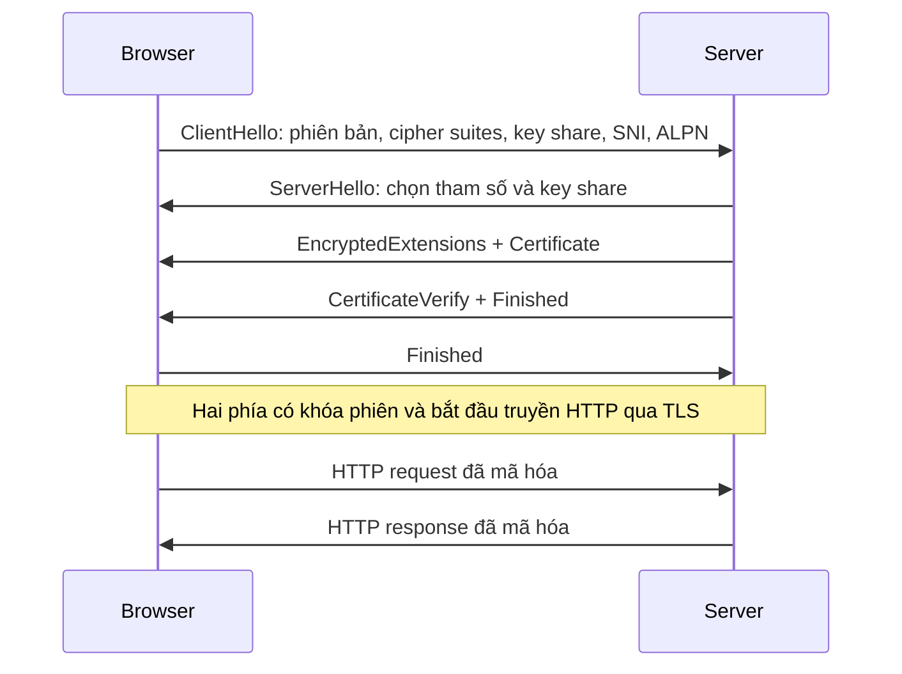

# HTTPS trong browser

> **Chương:** HSTS và TLS  
> **Bài học:** HTTPS trong browser — cách trình duyệt thiết lập và xác minh kết nối an toàn  
> **Phạm vi module:** **SECURITY_APPLICATION_SECURITY_BROWSER_SECURITY** — phân tích ranh giới bảo mật giữa trình duyệt, origin, cookie và ứng dụng web để hiểu Same-Origin Policy (SOP), CORS và các cơ chế cách ly; thực hành phòng vệ XSS, CSRF, clickjacking bằng CSP, Trusted Types, security headers và kiểm chứng thực tế.

## Mục tiêu học tập

Sau bài này, bạn có thể:

1. Giải thích HTTPS là HTTP chạy trên TLS và nêu các bảo đảm chính của kết nối.
2. Mô tả ở mức khái quát quá trình TLS handshake giữa browser và server.
3. Giải thích browser xác minh chứng thư số, tên miền, chuỗi CA và thời hạn như thế nào.
4. Phân biệt TLS encryption, xác thực server và an toàn của chính ứng dụng web.
5. Hiểu vì sao HTTP và HTTPS là hai origin khác nhau, ảnh hưởng đến cookie, storage, SOP và API browser.
6. Nhận diện mixed content và cách browser xử lý tài nguyên HTTP trên trang HTTPS.
7. Phân biệt HTTPS, secure context, cookie Secure, HSTS và CSP.
8. Dùng DevTools để kiểm tra certificate, giao thức, mixed content và cookie.
9. Xử lý các lỗi certificate phổ biến trong môi trường production và local development.

## 1. HTTPS là gì?

**HTTPS** là HTTP được truyền qua một kết nối bảo vệ bằng **Transport Layer Security (TLS)**. Browser dùng TLS để thiết lập một kênh có mã hóa và kiểm tra tính toàn vẹn giữa client và đầu cuối TLS của dịch vụ.

Khi truy cập:

```text
https://shop.example/
```

browser thường thực hiện các bước khái quát:

1. Phân giải tên miền và thiết lập kết nối mạng tới server hoặc điểm kết thúc TLS.
2. Thương lượng phiên TLS và xác minh chứng thư số của server.
3. Thiết lập khóa phiên để mã hóa dữ liệu truyền đi.
4. Gửi HTTP request bên trong kênh TLS.
5. Nhận HTTP response và các tài nguyên tiếp theo qua kênh đã bảo vệ.

Với HTTP/1.1 và HTTP/2, TLS thường chạy trên kết nối TCP. HTTP/3 chạy trên QUIC, trong đó TLS 1.3 được tích hợp vào quá trình thiết lập kết nối. Chi tiết transport khác nhau, nhưng browser vẫn cần xác thực endpoint và bảo vệ dữ liệu ứng dụng.

### 1.1. HTTPS cung cấp những bảo đảm nào?

| Bảo đảm | Ý nghĩa |
|---|---|
| Confidentiality — tính bí mật | Người quan sát trên đường truyền khó đọc nội dung request/response đã mã hóa |
| Integrity — tính toàn vẹn | Thay đổi dữ liệu trên đường truyền sẽ bị phát hiện |
| Server authentication — xác thực server | Browser xác minh server có chứng thư hợp lệ cho hostname đang truy cập và chuỗi chứng thư được tin cậy |
| Session key protection | Khóa phiên được thiết lập qua handshake và dùng cho mã hóa dữ liệu |

Những bảo đảm này giúp chống nghe lén và sửa đổi dữ liệu trên đường truyền, ví dụ khi người dùng truy cập qua Wi-Fi công cộng.

### 1.2. HTTPS không bảo đảm điều gì?

HTTPS không tự chứng minh:

- Website là doanh nghiệp hợp pháp hoặc nội dung trên trang là đúng.
- Server không bị xâm nhập hoặc không có mã độc.
- JavaScript của ứng dụng không có XSS.
- API đã kiểm tra quyền người dùng đúng cách.
- Ứng dụng không có CSRF, IDOR hoặc lỗi nghiệp vụ.
- Người dùng đang truy cập đúng thương hiệu thay vì một tên miền giả mạo có certificate hợp lệ.
- Mọi metadata kết nối đều được giữ bí mật.

TLS bảo vệ đường truyền tới endpoint được xác thực. Nếu endpoint là CDN hoặc reverse proxy, TLS thường kết thúc tại đó; đường truyền từ proxy đến backend cần được bảo vệ riêng theo kiến trúc.

## 2. Browser thiết lập kết nối TLS như thế nào?

TLS handshake là quá trình browser và server thống nhất phiên bản TLS, thuật toán mật mã, trao đổi khóa và xác thực danh tính server trước khi trao đổi HTTP data.

### 2.1. TLS 1.3 handshake ở mức khái quát



Các thành phần chính:

- **ClientHello:** browser gửi các phiên bản TLS, cipher suites, key share và extension mà nó hỗ trợ.
- **SNI (Server Name Indication):** browser thường cho server biết hostname cần truy cập để server chọn certificate phù hợp. ECH có thể bảo vệ thêm một phần thông tin ClientHello trong các môi trường hỗ trợ.
- **ALPN (Application-Layer Protocol Negotiation):** browser và server thống nhất giao thức ứng dụng như HTTP/2 hoặc HTTP/1.1; HTTP/3 dùng QUIC và ALPN tương ứng.
- **ServerHello:** server chọn tham số TLS và cung cấp key share.
- **Certificate:** server gửi chứng thư và thường cả intermediate certificates cần thiết.
- **CertificateVerify:** server chứng minh đang nắm private key tương ứng với certificate.
- **Finished:** hai phía xác nhận handshake và các tham số đã thống nhất.

Sau handshake, dữ liệu HTTP được bảo vệ bằng khóa phiên đối xứng. TLS 1.3 mã hóa phần lớn thông điệp handshake sau ServerHello; một số metadata ban đầu vẫn có thể quan sát được tùy cấu hình và việc hỗ trợ ECH.

### 2.2. TLS 1.2 và TLS 1.3

TLS 1.3 đơn giản hóa handshake, loại bỏ nhiều thuật toán cũ và giảm số lượt trao đổi trong kết nối mới. TLS 1.2 vẫn được hỗ trợ rộng rãi trong nhiều môi trường và có thể an toàn khi cấu hình đúng.

Ứng dụng nên:

- Ưu tiên TLS 1.3 và duy trì TLS 1.2 nếu cần tương thích.
- Tắt SSL và các phiên bản TLS cũ đã lỗi thời.
- Dùng cấu hình cipher suite hiện đại do nền tảng TLS/browser hỗ trợ.
- Cập nhật thư viện TLS, hệ điều hành, reverse proxy và load balancer.
- Không tự xây thuật toán hoặc giao thức mã hóa.

Không cần tự cấu hình từng cipher suite trong frontend. TLS thường được cấu hình ở web server, CDN, ingress hoặc load balancer.

### 2.3. Session resumption và 0-RTT

Browser và server có thể dùng session ticket hoặc pre-shared key để nối lại phiên TLS nhanh hơn, giảm chi phí handshake.

TLS 1.3 có thể hỗ trợ **0-RTT early data** trong một số lần nối lại. Early data có thể bị phát lại (replay) trong những điều kiện nhất định, vì vậy server không nên cho phép các thao tác không idempotent hoặc nhạy cảm chạy dựa trên 0-RTT nếu chưa có cơ chế chống replay phù hợp.

Đây là quyết định ở tầng hạ tầng. Người dùng ứng dụng không cần thay đổi cách gửi form chỉ vì server bật session resumption.

## 3. Browser xác minh certificate như thế nào?

TLS certificate là chứng thư số liên kết public key với một hoặc nhiều danh tính, thường là hostname. Browser không chỉ kiểm tra xem server có gửi một file certificate hay không; nó đánh giá certificate và chuỗi tin cậy theo chính sách PKI của browser/nền tảng.

### 3.1. Chuỗi chứng thư (certificate chain)

Một cấu trúc phổ biến:

```text
Website certificate
        |
        v
Intermediate CA certificate
        |
        v
Trusted Root CA certificate
        |
        v
Browser / operating system trust store
```

- **Leaf certificate:** certificate của hostname mà browser đang truy cập.
- **Intermediate CA:** CA trung gian ký certificate website hoặc certificate CA cấp dưới.
- **Root CA:** trust anchor được browser hoặc hệ điều hành tin cậy.
- **Trust store:** danh sách root CA và chính sách tin cậy mà browser sử dụng.

Server thường gửi leaf certificate và intermediate certificates. Root CA thường đã có trong trust store nên không cần server gửi lại để browser tin cậy.

### 3.2. Các kiểm tra quan trọng

Browser có thể kiểm tra:

| Kiểm tra | Câu hỏi |
|---|---|
| Hostname | SAN trong certificate có khớp hostname trên URL không? |
| Chain | Có thể xây chuỗi chữ ký tới một trust anchor được chấp nhận không? |
| Validity | Certificate hiện tại đã có hiệu lực và chưa hết hạn chưa? |
| Signature | Chữ ký và thuật toán có hợp lệ, đủ mạnh theo chính sách không? |
| Key usage | Certificate có mục đích sử dụng phù hợp cho server authentication không? |
| Revocation/status | Có thông tin thu hồi hoặc trạng thái không tin cậy mà browser áp dụng không? |

Hostname hiện đại được kiểm tra chủ yếu qua **Subject Alternative Name (SAN)**. Không nên dựa vào Common Name cũ để cấu hình certificate mới.

Certificate cho `www.example.com` không mặc nhiên hợp lệ cho `api.example.com`, trừ khi SAN hoặc wildcard hợp lệ bao phủ hostname đó.

### 3.3. CA và mức độ tin cậy

CA ký certificate sau khi xác minh danh tính theo loại certificate và quy trình của họ. Với certificate DV phổ biến, việc xác minh chủ yếu chứng minh quyền kiểm soát domain theo quy trình CA; nó không chứng minh doanh nghiệp có uy tín hay nội dung website đáng tin.

Browser và hệ điều hành quản lý trust store, chính sách thuật toán, certificate constraints và danh sách thu hồi theo cơ chế riêng. Ứng dụng không nên tự chấp nhận mọi certificate chỉ vì nó được ký bởi một CA nào đó.

### 3.4. Certificate revocation không phải lúc nào cũng là truy vấn trực tiếp

PKI có các cơ chế như CRL, OCSP và OCSP stapling để phân phối trạng thái thu hồi. Browser có thể dùng thêm danh sách hoặc cơ chế cập nhật riêng của nhà cung cấp.

Không phải mọi browser đều thực hiện một truy vấn OCSP trực tiếp cho từng kết nối; hành vi có thể khác nhau theo browser, nền tảng, chính sách riêng tư và tình trạng mạng. Vì vậy, đừng xem việc certificate chưa hết hạn là bằng chứng duy nhất rằng nó vẫn được tin cậy.

## 4. Khi certificate không hợp lệ

Nếu browser không xác minh được certificate, nó có thể hiển thị trang cảnh báo như “Your connection is not private” hoặc thông báo tương tự. Đây là tín hiệu quan trọng: browser không thể xác nhận danh tính endpoint theo trust model hiện tại.

### 4.1. Những lỗi certificate phổ biến

| Lỗi | Nguyên nhân thường gặp | Cách xử lý đúng |
|---|---|---|
| Hostname mismatch | SAN không bao phủ hostname trong URL | Cấp certificate đúng hostname hoặc sửa DNS/URL |
| Certificate expired | Certificate hết hạn hoặc đồng hồ client/server sai | Kiểm tra thời gian, gia hạn và triển khai certificate mới |
| Not yet valid | Thời gian hệ thống sai hoặc certificate được cấp với mốc hiệu lực tương lai | Đồng bộ clock và kiểm tra certificate |
| Unknown issuer / authority invalid | Thiếu intermediate, CA không được tin cậy hoặc certificate tự ký | Cài đầy đủ chain và dùng CA được tin cậy |
| Weak signature / key | Thuật toán hoặc key không đáp ứng chính sách browser | Cấp lại certificate và key theo cấu hình hiện đại |
| Revoked | Certificate bị CA hoặc browser đánh dấu thu hồi | Ngừng dùng certificate và cấp mới sau khi xử lý nguyên nhân |

### 4.2. Không bỏ qua cảnh báo certificate trên website thật

Không nên hướng dẫn người dùng bấm “Proceed”, thêm exception hoặc tắt kiểm tra certificate để tiếp tục truy cập website thật. Cảnh báo có thể do cấu hình sai, captive portal, proxy TLS inspection hoặc một cuộc tấn công trung gian.

Cách xử lý:

1. Kiểm tra URL và hostname đã gõ có chính xác không.
2. Kiểm tra ngày giờ và múi giờ của thiết bị.
3. Thử mạng đáng tin cậy khác nếu nghi captive portal.
4. Kiểm tra certificate chain và SAN bằng DevTools hoặc công cụ quản trị.
5. Liên hệ quản trị hệ thống nếu thiết bị thuộc tổ chức có TLS inspection.
6. Chờ chủ website sửa certificate nếu lỗi nằm ở server.

Trong môi trường doanh nghiệp, proxy kiểm tra TLS có thể ký lại certificate bằng CA nội bộ. Thiết bị chỉ nên tin CA đó khi tổ chức triển khai và quản lý nó qua quy trình quản trị đáng tin cậy.

### 4.3. Certificate self-signed trong development

Certificate tự ký không được browser tin cậy mặc định. Trong môi trường phát triển, có thể tạo local CA và cài CA đó vào trust store của máy dev bằng công cụ phù hợp, chẳng hạn `mkcert`.

Ví dụ quy trình khái quát:

1. Cài công cụ local certificate theo hướng dẫn chính thức.
2. Tạo và cài local development CA vào trust store của máy phát triển.
3. Cấp certificate cho hostname local như `localhost` hoặc hostname dev đã chọn.
4. Cấu hình local server dùng certificate và private key đó.
5. Mở URL HTTPS và kiểm tra browser không còn báo certificate error.
6. Không đưa private key hoặc local CA root lên repository hay production.

Dùng HTTPS local giúp kiểm thử secure context, cookie Secure, service worker và các API browser cần secure context. Không tắt certificate verification trong browser như một cách sửa lỗi lâu dài.

## 5. HTTPS tạo ra origin như thế nào?

Browser xác định origin thông thường dựa trên **scheme, host và port**. Vì vậy, HTTP và HTTPS là hai origin khác nhau dù cùng hostname.

Ví dụ:

| URL | Origin |
|---|---|
| `http://app.example` | `http://app.example:80` |
| `https://app.example` | `https://app.example:443` |
| `https://app.example:8443` | `https://app.example:8443` |
| `https://api.example` | `https://api.example:443` |

Origin được chuẩn hóa theo default port tương ứng. Thay đổi scheme, host hoặc port đều có thể tạo origin khác.

### 5.1. HTTP và HTTPS không chia sẻ same-origin privileges

Giả sử người dùng mở:

```text
http://app.example
https://app.example
```

Hai trang này khác origin. SOP không cho phép trang HTTP đọc DOM hoặc dữ liệu same-origin của trang HTTPS chỉ vì hostname giống nhau.

Các vùng lưu trữ phía browser cũng gắn với origin hoặc site theo quy tắc riêng:

- localStorage và IndexedDB được phân tách theo origin.
- Service worker yêu cầu secure context trong các browser hiện đại và có scope theo origin/path.
- Cache Storage và các API web khác có quy tắc tương ứng.
- Cookie không dùng cùng quy tắc origin với localStorage: cookie được quản lý theo domain/path/flags, nên cần xem xét riêng.

Không giả định chuyển từ HTTP sang HTTPS sẽ tự mang theo mọi state phía client. Ứng dụng cần thiết kế migration, redirect và session phù hợp.

### 5.2. CORS vẫn áp dụng trên HTTPS

HTTPS không tự cho phép một origin đọc response của origin khác. Nếu JavaScript từ `https://app.example` gọi API tại `https://api.example`, browser vẫn áp dụng CORS.

Server API phải trả các CORS headers phù hợp nếu muốn cho phép origin gọi đọc response. TLS bảo vệ kết nối; CORS quyết định quyền đọc response cross-origin trong browser.

### 5.3. Secure context

Một **secure context** là môi trường browser xem là đủ đáng tin cậy để cấp một số API nhạy cảm. HTTPS là cách phổ biến để có secure context trên website production.

Một số origin loopback/local như `http://localhost` được browser xem là potentially trustworthy để hỗ trợ development, dù không dùng certificate công khai. Quy tắc cụ thể có thể khác theo API và browser.

Một số API thường yêu cầu secure context:

- Service Worker.
- Geolocation.
- getUserMedia cho camera/microphone.
- Web Crypto API với các chức năng nhạy cảm.
- Một số Clipboard API và API phần cứng.
- Một số tính năng yêu cầu cross-origin isolation.

Có secure context không có nghĩa người dùng đã cấp quyền camera/location; browser vẫn áp dụng permission prompt và policy tương ứng.

### 5.4. Kiểm tra secure context trong JavaScript

```js
if (window.isSecureContext) {
  console.log('Trang đang chạy trong secure context');
} else {
  console.log('Trang không được xem là secure context');
}
```

Dùng giá trị này để kiểm tra môi trường runtime. Không suy ra chỉ từ biểu tượng khóa hoặc từ chuỗi URL trong một log; hãy kiểm tra trực tiếp trên browser mục tiêu.

## 6. Mixed content: trang HTTPS tải tài nguyên HTTP

**Mixed content** xảy ra khi một document được tải qua HTTPS nhưng cố tải một tài nguyên qua HTTP không được bảo vệ. Khi đó, nội dung trang có thể bị trộn giữa kênh an toàn và không an toàn.

Ví dụ:

```html
<!-- Trang chính là https://app.example -->
<script src="http://cdn.example/library.js"></script>

<iframe src="http://legacy.example/"></iframe>
```

Một kẻ tấn công có thể sửa tài nguyên HTTP trên đường truyền. Nếu tài nguyên đó là script, stylesheet hoặc document nhúng, tác động có thể lan tới trang HTTPS.

### 6.1. Blockable mixed content

Browser hiện đại chặn nhiều loại mixed content có thể thay đổi hành vi hoặc cấu trúc trang, ví dụ:

- Script tải qua HTTP.
- Stylesheet tải qua HTTP.
- iframe/document tải qua HTTP.
- Fetch/XHR và các kết nối tương tự qua HTTP.
- WebSocket không mã hóa qua `ws://`.
- Một số worker hoặc tài nguyên chủ động khác.

Tên phân loại và hành vi chi tiết đã thay đổi qua các phiên bản chuẩn/browser, nhưng quy tắc triển khai nên là: **mọi tài nguyên của trang HTTPS phải được tải qua HTTPS hoặc cơ chế an toàn được browser hỗ trợ**.

### 6.2. Upgradable mixed content

Một số tài nguyên thụ động như ảnh, audio hoặc video có thể được browser tự nâng URL từ HTTP lên HTTPS trong các trường hợp được hỗ trợ.

Ví dụ trang có:

```html

```

Browser có thể thử tải:

```text
https://images.example/banner.jpg
```

Nếu host không phục vụ HTTPS hoặc tài nguyên không tồn tại tại URL HTTPS, tài nguyên sẽ không tải được. Không dựa vào việc browser tự nâng cấp để giữ URL HTTP trong source code.

### 6.3. Vì sao mixed content nguy hiểm?

Khi trang chính dùng HTTPS nhưng script hoặc iframe dùng HTTP:

- Kẻ tấn công trên đường truyền có thể sửa mã hoặc nội dung tải về.
- Script bị sửa có thể chạy trong context của trang HTTPS.
- Nội dung iframe có thể giả mạo giao diện hoặc điều hướng người dùng.
- Browser có thể chặn tài nguyên, làm ứng dụng lỗi.
- Cookie Secure không làm cho request tải script HTTP trở nên an toàn.

Một trang có biểu tượng HTTPS nhưng vẫn phụ thuộc tài nguyên không an toàn cần được xử lý.

### 6.4. Sửa mixed content

Ưu tiên:

1. Đổi URL tài nguyên sang HTTPS thực sự.
2. Xác minh certificate và cấu hình HTTPS của host tài nguyên.
3. Nếu host không hỗ trợ HTTPS, chuyển tài nguyên sang CDN/origin do tổ chức kiểm soát.
4. Không proxy tùy tiện URL người dùng cung cấp; proxy cần allowlist và chống SSRF.
5. Kiểm tra CSS vì stylesheet có thể tham chiếu ảnh/font HTTP gián tiếp.
6. Kiểm tra iframe, worker, media và các request được tạo động.
7. Dùng DevTools Console/Network để xác nhận không còn mixed content.

## 7. HSTS: yêu cầu browser luôn dùng HTTPS

**HTTP Strict Transport Security (HSTS)** là response header yêu cầu browser chỉ truy cập hostname qua HTTPS trong một khoảng thời gian. HSTS bổ sung cho HTTPS bằng cách giúp browser tự nâng cấp điều hướng HTTP đã biết sang HTTPS trước khi gửi request HTTP.

Ví dụ:

```http
Strict-Transport-Security: max-age=31536000; includeSubDomains
```

Browser chỉ chấp nhận HSTS từ response HTTPS hợp lệ. Header gửi qua HTTP bị bỏ qua để tránh một bên trung gian có thể tự ý đặt hoặc xóa policy.

### 7.1. HSTS hoạt động như thế nào?

Khi browser nhận HSTS từ một hostname:

1. Browser lưu policy cùng thời hạn `max-age`.
2. Những lần truy cập sau tới hostname đó bằng HTTP được nâng thành HTTPS trước khi request HTTP được gửi.
3. Nếu certificate HTTPS không hợp lệ, browser hiển thị lỗi nghiêm trọng thay vì cho người dùng dễ dàng bỏ qua như một trang HTTP thông thường.
4. Khi `max-age` hết hạn, browser không còn áp dụng policy đã lưu nếu chưa nhận lại header mới.

HSTS giúp giảm nguy cơ SSL stripping/downgrade trên các lần truy cập sau khi browser đã biết policy.

### 7.2. Các directive của HSTS

| Directive | Ý nghĩa |
|---|---|
| `max-age` | Thời gian tính bằng giây mà browser lưu policy |
| `includeSubDomains` | Áp dụng policy cho các subdomain của hostname |
| `preload` | Tín hiệu để chủ website yêu cầu đưa domain vào danh sách preload; không tự thêm domain vào browser |

Ví dụ:

```http
Strict-Transport-Security: max-age=31536000; includeSubDomains; preload
```

Chỉ dùng `includeSubDomains` khi mọi subdomain thuộc phạm vi đều phục vụ HTTPS ổn định. Một subdomain legacy chỉ hỗ trợ HTTP có thể bị người dùng không truy cập được sau khi policy được áp dụng.

`preload` không phải cơ chế browser tự động tải danh sách ngay từ header. Chủ website cần đáp ứng điều kiện của chương trình preload và gửi yêu cầu qua quy trình tương ứng. Việc gỡ domain khỏi danh sách preload cũng cần thời gian để lan tới các phiên bản browser.

### 7.3. First visit và HSTS preload

HSTS động chỉ được browser học sau khi nhận response HTTPS có header hợp lệ. Trước lần đó, một người dùng mới vẫn có thể bắt đầu từ HTTP nếu không có cơ chế khác nâng cấp.

Danh sách **HSTS preload** được tích hợp sẵn trong browser giúp áp dụng HTTPS ngay từ lần truy cập đầu tiên cho các domain đã được đưa vào danh sách. Preload là quyết định vận hành dài hạn; cần chuẩn bị toàn bộ hostname/subdomain và certificate trước khi đăng ký.

### 7.4. HSTS khác redirect HTTP sang HTTPS

Server thường chuyển HTTP sang HTTPS bằng redirect 301 hoặc 308:

```text
HTTP request
    |
    v
301/308 redirect
    |
    v
HTTPS request
```

Redirect chỉ xảy ra sau khi browser đã gửi request HTTP đầu tiên. Nếu request đầu có chứa dữ liệu nhạy cảm, dữ liệu đó đã đi qua HTTP.

HSTS trên browser đã biết policy sẽ nâng URL trước khi request HTTP được gửi. Preload giúp bảo vệ lần truy cập đầu với domain đã có trong danh sách. Vì vậy, redirect vẫn cần cho khả năng tương thích, nhưng không thay thế HSTS.

### 7.5. Triển khai HSTS theo giai đoạn

1. Xác minh toàn bộ hostname cần dùng đều phục vụ HTTPS và certificate hợp lệ.
2. Chuyển hướng HTTP sang HTTPS ở server.
3. Bắt đầu với `max-age` ngắn trên phạm vi phù hợp để kiểm tra.
4. Chỉ tăng thời hạn khi đã kiểm tra các subdomain và luồng vận hành.
5. Thêm `includeSubDomains` sau khi xác nhận mọi subdomain tương thích.
6. Chỉ cân nhắc preload khi đáp ứng yêu cầu và hiểu quy trình gỡ.
7. Theo dõi lỗi certificate và khả năng truy cập sau khi triển khai.

Không bật thời hạn dài và `includeSubDomains` trên toàn domain nếu chưa kiểm kê subdomain, môi trường cũ và hệ thống của bên thứ ba.

## 8. Cookie và HTTPS

Cookie có các thuộc tính điều khiển cách browser lưu và gửi cookie. HTTPS là điều kiện quan trọng cho cookie phiên, nhưng từng flag giải quyết một mục tiêu khác nhau.

Ví dụ cookie phiên:

```http
Set-Cookie: __Host-session=opaque-value; Path=/; Secure; HttpOnly; SameSite=Lax
```

### 8.1. Secure

`Secure` yêu cầu browser chỉ gửi cookie qua kênh được xem là an toàn, thường là HTTPS. Nó giảm nguy cơ cookie bị gửi qua HTTP không mã hóa.

Tuy nhiên, `Secure` không tự chuyển mọi URL HTTP thành HTTPS. Nếu người dùng truy cập một hostname chưa có HSTS qua HTTP, cookie Secure sẽ không được gửi trên request HTTP đó, nhưng các nội dung khác vẫn có thể bị downgrade hoặc can thiệp.

### 8.2. HttpOnly

`HttpOnly` ngăn JavaScript đọc cookie qua `document.cookie`. Nó giúp giảm nguy cơ script XSS lấy trực tiếp giá trị cookie phiên.

HttpOnly không ngăn script XSS gửi request same-origin; browser vẫn có thể tự đính kèm cookie phù hợp. Vì vậy, vẫn phải phòng XSS và kiểm soát hành động phía server.

### 8.3. SameSite

`SameSite` điều khiển việc cookie có được gửi trong các ngữ cảnh cross-site hay không:

- `Strict` hạn chế cookie trong nhiều luồng điều hướng cross-site.
- `Lax` cho phép một số điều hướng top-level an toàn, đồng thời hạn chế nhiều request cross-site khác.
- `None` cho phép cookie trong ngữ cảnh cross-site, nhưng cookie phải có `Secure` theo quy tắc hiện đại.

SameSite hỗ trợ phòng CSRF nhưng không thay CSRF token, kiểm tra Origin hoặc authorization cho thao tác nhạy cảm.

### 8.4. Cookie prefix __Host-

Prefix `__Host-` yêu cầu các điều kiện chặt hơn trên browser hỗ trợ:

- Cookie phải có `Secure`.
- Cookie phải có `Path=/`.
- Cookie không được có thuộc tính `Domain`.

Điều này giúp cookie gắn với host cụ thể và giảm nguy cơ subdomain khác ghi đè cookie cùng tên ở phạm vi domain rộng.

### 8.5. Các flag không thay thế nhau

| Thuộc tính | Mục tiêu chính |
|---|---|
| `Secure` | Chỉ gửi cookie trên kênh an toàn |
| `HttpOnly` | Ngăn JavaScript đọc trực tiếp cookie |
| `SameSite` | Kiểm soát cookie trong ngữ cảnh same-site/cross-site |
| `Path` / `Domain` | Giới hạn phạm vi gửi cookie theo URL/host |
| HSTS | Yêu cầu browser dùng HTTPS cho hostname đã ghi nhận policy |

Dùng các flag phù hợp cùng HTTPS/HSTS. Không dựa vào một flag duy nhất để bảo vệ phiên đăng nhập.

## 9. CSP và nâng cấp tài nguyên HTTP

CSP có directive `upgrade-insecure-requests` để yêu cầu browser nâng các URL tài nguyên không an toàn thành HTTPS trước khi tải.

Ví dụ:

```http
Content-Security-Policy: upgrade-insecure-requests
```

Directive này hữu ích khi ứng dụng còn URL tài nguyên HTTP legacy và host đó đã hỗ trợ HTTPS. Tuy nhiên:

- Nó không thay thế việc sửa URL trong source code và dữ liệu lưu trữ.
- Nó không bảo đảm tài nguyên sẽ tồn tại hoặc có certificate hợp lệ trên HTTPS.
- Nó không phải cơ chế redirect mọi điều hướng top-level HTTP của người dùng.
- Nó không thay thế HSTS.

Không dựa vào `block-all-mixed-content` như giải pháp triển khai mới; hành vi của directive này đã lỗi thời trong browser hiện đại. Hãy sửa URL tài nguyên và dùng chính sách browser hiện hành.

## 10. Quan sát HTTPS bằng DevTools

DevTools giúp xác minh browser thực sự đã dùng HTTPS, certificate nào được nhận và tài nguyên nào bị chặn.

### 10.1. Network panel

Mở DevTools → Network, tải lại trang và kiểm tra:

- Request URL bắt đầu bằng HTTPS.
- Cột Protocol cho biết HTTP/1.1, h2 hoặc h3 nếu DevTools hiển thị.
- Status code và redirect chain.
- Request/response headers như HSTS, CSP và Set-Cookie.
- Tài nguyên nào vẫn được gọi qua HTTP.
- Cookie nào bị browser chặn hoặc loại bỏ, cùng lý do hiển thị trong DevTools.

### 10.2. Security panel và certificate viewer

Trong browser có Security panel hoặc certificate viewer, kiểm tra:

- Connection secure hay có lỗi certificate.
- Hostname trong certificate.
- Issuer và certificate chain.
- Thời hạn hiệu lực.
- TLS version và thông tin kết nối nếu browser hiển thị.
- Mixed content hoặc tài nguyên không an toàn.

Tên menu có thể khác theo browser/version. Nếu không có Security panel, mở thông tin site từ thanh địa chỉ hoặc xem certificate qua công cụ quản trị phù hợp.

### 10.3. Console

Tìm các thông báo:

- Mixed content blocked hoặc upgraded.
- Certificate/network errors.
- Resource bị chặn do CSP.
- API yêu cầu secure context.
- Cookie bị loại vì thiếu Secure/SameSite hoặc do third-party cookie policy.

Console là tín hiệu chẩn đoán. Hãy mở request tương ứng trong Network để xác định URL và response thực tế.

## 11. Những lỗi triển khai HTTPS thường gặp

### 11.1. Chỉ redirect HTTP sang HTTPS nhưng vẫn nhận dữ liệu nhạy cảm qua HTTP

Nếu trang đăng nhập nhận request POST qua HTTP rồi mới redirect, thông tin có thể đã đi qua mạng không mã hóa. Hãy điều hướng người dùng sang HTTPS trước khi hiển thị form và không xử lý credential/session trên HTTP.

HSTS giúp browser đã ghi nhận policy tự nâng cấp trước request; preload có thể bảo vệ lần truy cập đầu cho domain đã đăng ký. Server vẫn cần redirect HTTP để tương thích, nhưng redirect không thể bảo vệ dữ liệu đã gửi trong request HTTP đầu tiên.

### 11.2. Certificate đúng cho root domain nhưng sai subdomain

Certificate cho `example.com` không mặc nhiên bao phủ `www.example.com` hoặc `api.example.com`. Hãy kiểm tra SAN, wildcard và hostname thực tế trong URL. Một certificate wildcard chỉ bao phủ cấp subdomain theo quy tắc wildcard; không giả định nó bao phủ mọi tầng hostname.

### 11.3. Thiếu intermediate certificate

Server có thể gửi leaf certificate nhưng quên intermediate CA. Một số browser có thể tìm được intermediate qua cache hoặc cơ chế khác, trong khi browser khác báo lỗi chain.

Cấu hình server để gửi đầy đủ chain theo hướng dẫn CA. Không yêu cầu người dùng cài intermediate/root certificate thủ công để sửa website production.

### 11.4. Có HTTPS nhưng còn mixed content

Một trang chính tải qua HTTPS vẫn có thể gọi ảnh, script, CSS, iframe hoặc API qua HTTP. Hãy kiểm tra cả URL được tạo động, CSS import, font, worker và tài nguyên do bên thứ ba cung cấp.

Sửa URL gốc và cấu hình host tài nguyên. CSP `upgrade-insecure-requests` có thể hỗ trợ migration, nhưng không thay việc xử lý dependency.

### 11.5. Nhầm HTTPS với CORS hoặc CSRF protection

HTTPS mã hóa đường truyền; nó không tự cho phép origin khác đọc response và không ngăn một trang khác tạo request có credentials.

- CORS kiểm soát việc JavaScript cross-origin đọc response.
- CSRF protection kiểm soát request thay mặt người dùng đã đăng nhập.
- SameSite cookie hỗ trợ giảm CSRF.
- XSS protection kiểm soát dữ liệu không tin cậy đi vào sink thực thi.
- TLS bảo vệ dữ liệu trên đường truyền.

Các cơ chế này bổ sung cho nhau.

### 11.6. Bật HSTS quá rộng quá sớm

`includeSubDomains` có thể khiến những subdomain chưa sẵn sàng HTTPS không thể truy cập. Thời hạn dài khiến việc khắc phục lỗi cấu hình khó hơn vì browser đã lưu policy.

Bắt đầu ở phạm vi và thời hạn có thể kiểm soát, kiểm kê toàn bộ subdomain, rồi mới tăng thời hạn hoặc đăng ký preload.

## 12. Thực hành A — Kiểm tra certificate và TLS trong browser

Dùng một website HTTPS bạn được phép kiểm tra hoặc staging của chính bạn.

1. Mở DevTools → Network và tải lại trang.
2. Chọn document request chính.
3. Xác minh URL dùng HTTPS và kiểm tra protocol nếu browser hiển thị.
4. Mở thông tin certificate từ Security panel hoặc site information.
5. Kiểm tra hostname/SAN, issuer, thời hạn và certificate chain.
6. Kiểm tra Console có lỗi certificate, mixed content hoặc tài nguyên bị chặn không.
7. Ghi lại response headers liên quan như HSTS và CSP.

Kết quả mong đợi: browser xác minh được certificate cho hostname, request chính dùng HTTPS và không có mixed content ngoài dự kiến.

## 13. Thực hành B — Quan sát mixed content

Thực hiện trên staging hoặc hai host thử nghiệm do bạn kiểm soát. Không đưa tài nguyên HTTP độc hại vào website production.

1. Phục vụ trang chính qua HTTPS.
2. Tạo một tham chiếu thử nghiệm tới ảnh HTTP và một tham chiếu tới script HTTP.
3. Mở trang và quan sát Console.
4. Kiểm tra Network để xem browser đã block hay upgrade tài nguyên.
5. Đổi URL tài nguyên sang HTTPS có certificate hợp lệ.
6. Tải lại và xác nhận warning đã biến mất.

Kết quả mong đợi: browser chặn hoặc nâng cấp tài nguyên tùy loại mixed content và chính sách hiện hành. Sau khi sửa, mọi dependency được tải qua HTTPS.

## 14. Thực hành C — Kiểm tra cookie Secure, HttpOnly và SameSite

Trên ứng dụng staging có tài khoản test, cấu hình cookie phiên:

```http
Set-Cookie: __Host-session=test-value; Path=/; Secure; HttpOnly; SameSite=Lax
```

Sau đó:

1. Mở DevTools → Application/Storage → Cookies.
2. Xem cookie có cờ Secure, HttpOnly và SameSite như dự kiến.
3. Trong Console, thử đọc `document.cookie` và xác minh cookie HttpOnly không xuất hiện.
4. Kiểm tra request HTTPS trong Network có gửi cookie khi đúng phạm vi.
5. Kiểm tra request HTTP không gửi cookie Secure.
6. Thử luồng điều hướng cross-site trong môi trường test để hiểu tác động SameSite.

Không dùng giá trị cookie thật hoặc chia sẻ ảnh chụp chứa session identifier. Hãy xóa dữ liệu test sau khi hoàn thành.

## 15. Thực hành D — Kiểm tra secure context trên local

Có thể dùng công cụ như `mkcert` để tạo certificate local được máy phát triển tin cậy:

```bash
mkcert -install
mkcert localhost 127.0.0.1 ::1
```

Cấu hình local development server dùng certificate và private key được tạo. Sau đó:

1. Mở trang qua HTTPS trên localhost.
2. Kiểm tra `window.isSecureContext`.
3. Kiểm tra các API yêu cầu secure context trong browser mục tiêu.
4. So sánh với một host HTTP local không thuộc ngoại lệ potentially trustworthy.
5. Xác minh browser không hiển thị cảnh báo certificate.
6. Không commit private key hoặc local CA root vào repository.

Localhost được browser xem là potentially trustworthy trong nhiều trường hợp; lab này giúp phân biệt secure context với việc website production có certificate CA công khai.

## 16. Thực hành E — Quan sát HSTS trên hostname thử nghiệm

Chỉ thực hiện trên hostname staging riêng do bạn kiểm soát. Không thử HSTS thời hạn dài hoặc preload trên domain production chưa được kiểm kê.

Trên response HTTPS của hostname thử nghiệm, cấu hình:

```http
Strict-Transport-Security: max-age=300
```

1. Mở hostname bằng HTTPS để browser nhận header.
2. Mở lại hostname bằng HTTP.
3. Quan sát browser tự nâng cấp sang HTTPS nếu policy đã được lưu.
4. Kiểm tra response HTTPS vẫn có certificate hợp lệ.
5. Chờ policy hết hạn hoặc xóa trạng thái HSTS qua công cụ browser dành cho môi trường test.
6. Thử lại và ghi nhận sự khác biệt.

HSTS không thể được học từ response HTTP. Thử nghiệm phải bắt đầu bằng một response HTTPS hợp lệ.

## 17. Checklist review HTTPS trong browser

| Hạng mục | Câu hỏi cần trả lời |
|---|---|
| URL | Form đăng nhập và trang nhạy cảm có luôn bắt đầu bằng HTTPS không? |
| TLS | Server hỗ trợ TLS 1.2/1.3 theo cấu hình hiện đại? |
| Certificate | SAN có khớp hostname, chain đầy đủ và certificate còn hiệu lực? |
| Trust | Certificate được CA/trust store phù hợp chấp nhận? |
| Redirect | HTTP được chuyển sang HTTPS trước khi người dùng nhập dữ liệu nhạy cảm? |
| HSTS | Có `max-age` phù hợp? `includeSubDomains` đã được đánh giá toàn bộ chưa? |
| Preload | Có thật sự cần preload và đã hiểu quy trình đăng ký/gỡ chưa? |
| Mixed content | Script, CSS, iframe, fetch, worker và media có dùng HTTPS? |
| CSP | Có cần `upgrade-insecure-requests` trong giai đoạn migration không? |
| Cookie | Session cookie có `Secure`, `HttpOnly`, `SameSite` phù hợp? |
| Origin | Có hiểu HTTP và HTTPS là hai origin khác nhau? |
| CORS | API cross-origin có policy rõ ràng, không nhầm với TLS? |
| Secure context | Các API nhạy cảm có được kiểm tra trên HTTPS/localhost? |
| DevTools | Network, Security và Console không có lỗi ngoài dự kiến? |
| Infrastructure | TLS có kết thúc tại CDN/proxy? Đường proxy-to-backend có được bảo vệ? |
| Operations | Có tự động gia hạn certificate và cảnh báo trước ngày hết hạn? |

## 18. Câu hỏi tự kiểm tra

**1.** HTTPS là gì?  
**Đáp án:** HTTP được truyền qua TLS để bảo vệ tính bí mật, toàn vẹn và xác thực server của kết nối.

**2.** TLS certificate chứng minh website là doanh nghiệp hợp pháp không?  
**Đáp án:** Không. Certificate xác thực hostname theo PKI; nó không chứng minh nội dung hoặc chủ website đáng tin.

**3.** Browser kiểm tra hostname trong certificate qua trường nào?  
**Đáp án:** Chủ yếu qua Subject Alternative Name (SAN).

**4.** Vì sao server cần gửi intermediate certificate?  
**Đáp án:** Để browser xây dựng chuỗi tin cậy từ leaf certificate tới root CA được chấp nhận.

**5.** HTTP và HTTPS cùng hostname có phải same-origin không?  
**Đáp án:** Không. Scheme khác nhau nên origin khác nhau.

**6.** HTTPS có thay thế CORS không?  
**Đáp án:** Không. TLS bảo vệ kết nối; CORS quyết định JavaScript cross-origin có thể đọc response hay không.

**7.** Mixed content là gì?  
**Đáp án:** Trang HTTPS tải một hoặc nhiều tài nguyên qua HTTP, khiến nội dung trang phụ thuộc vào kênh không an toàn.

**8.** Vì sao browser chặn script HTTP trên trang HTTPS?  
**Đáp án:** Script có thể bị sửa trên đường truyền và chạy trong context của trang HTTPS, làm mất tính toàn vẹn của ứng dụng.

**9.** HSTS khác redirect HTTP sang HTTPS như thế nào?  
**Đáp án:** Redirect xảy ra sau request HTTP đầu; HSTS trên browser đã biết policy nâng URL trước khi gửi request HTTP.

**10.** Cookie Secure có thay HttpOnly và SameSite không?  
**Đáp án:** Không. Secure giới hạn kênh gửi cookie; HttpOnly ngăn JavaScript đọc trực tiếp; SameSite kiểm soát ngữ cảnh gửi cross-site.

**11.** Vì sao không nên bỏ qua cảnh báo certificate?  
**Đáp án:** Browser không xác minh được danh tính endpoint; tiếp tục có thể khiến người dùng gửi dữ liệu cho server giả mạo hoặc bị can thiệp.

**12.** HTTPS có ngăn XSS và CSRF không?  
**Đáp án:** Không. HTTPS bảo vệ đường truyền; XSS và CSRF cần các biện pháp phòng vệ ở ứng dụng, browser policy và server.

## Ghi nhớ

**HTTPS là HTTP chạy trên TLS; browser chỉ nên gửi dữ liệu nhạy cảm sau khi xác minh được kết nối và certificate của hostname.** TLS cung cấp mã hóa, toàn vẹn và xác thực endpoint, nhưng không chứng minh ứng dụng an toàn hoặc chủ website đáng tin.

HTTP và HTTPS là hai origin khác nhau. Browser chặn nhiều loại mixed content, yêu cầu secure context cho một số API và áp dụng các cookie flags theo mục tiêu riêng. HSTS giúp browser đã ghi nhận policy tự nâng cấp truy cập HTTP; redirect vẫn cần cho tương thích nhưng không bảo vệ request HTTP đầu tiên. Hãy kiểm tra certificate, response headers, cookies và tài nguyên trong DevTools, đồng thời giữ CORS, CSRF protection, XSS prevention và authorization như các lớp bảo vệ độc lập.

