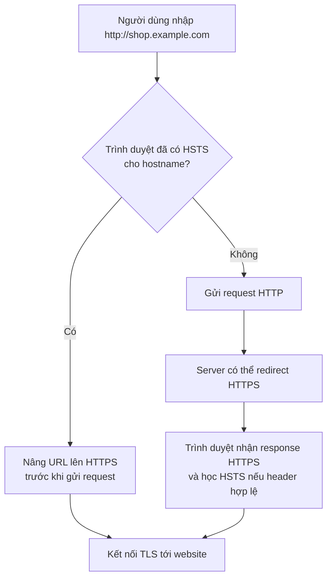

# HSTS: buộc trình duyệt sử dụng HTTPS cho một hostname

HTTP Strict Transport Security (HSTS) là cơ chế để website thông báo cho trình duyệt rằng trình duyệt phải truy cập hostname đó bằng HTTPS trong một khoảng thời gian. Khi trình duyệt đã ghi nhận chính sách HSTS hợp lệ, nó tự nâng các lần điều hướng HTTP tiếp theo lên HTTPS trước khi gửi request mạng. Điều này giảm nguy cơ người dùng bị hạ cấp kết nối hoặc bị tấn công kiểu SSL stripping khi truy cập một website đã biết.

HSTS được khai báo bằng response header **Strict-Transport-Security**. Header chỉ được trình duyệt chấp nhận từ response nhận qua kết nối HTTPS hợp lệ. Một redirect HTTP sang HTTPS vẫn hữu ích, nhưng redirect chỉ có tác dụng sau khi request HTTP đầu tiên đã tới server; HSTS đã được lưu trước đó có thể nâng cấp request ngay trong trình duyệt.

Bài học thuộc chương **HSTS và TLS**, trong phạm vi **SECURITY_APPLICATION_SECURITY_BROWSER_SECURITY**: phân tích ranh giới bảo mật giữa trình duyệt, origin, cookie và ứng dụng web để hiểu Same-Origin Policy, CORS và các cơ chế cách ly; thực hành phòng vệ XSS, CSRF, clickjacking bằng CSP, Trusted Types, security headers và kiểm chứng hành vi thực tế.

## 1. Mục tiêu học tập

Sau bài học, người học có thể:

1. Giải thích HSTS giảm rủi ro hạ cấp HTTP như thế nào.
2. Xác định điều kiện để trình duyệt chấp nhận **Strict-Transport-Security**.
3. Cấu hình và giải thích **max-age** cùng **includeSubDomains**.
4. Phân biệt HSTS được học qua response với HSTS preload có sẵn trong browser.
5. Hiểu khoảng trống bảo vệ ở lần truy cập đầu tiên.
6. Triển khai HSTS theo từng giai đoạn và rollback có kiểm soát.
7. Xác minh header, TLS và hành vi nâng cấp bằng DevTools.
8. Nhận diện những gì HSTS không thay thế: TLS certificate validation, redirect, Secure cookie, CSP, CORS và CSRF protection.

## 2. Rủi ro HSTS giúp giảm thiểu

Một website có thể phục vụ cả HTTP và HTTPS. Nếu người dùng gõ một hostname hoặc nhấp liên kết bắt đầu bằng HTTP, trình duyệt có thể gửi request HTTP trước khi server trả redirect sang HTTPS.

Kẻ tấn công có khả năng can thiệp mạng có thể chặn request HTTP đầu tiên, giữ người dùng ở kết nối không mã hóa hoặc thay đổi nội dung redirect. Kiểu hạ cấp này thường được gọi là **SSL stripping**. Cookie không có thuộc tính Secure hoặc dữ liệu nhạy cảm gửi qua HTTP có thể bị lộ hoặc bị sửa đổi.

HSTS cho trình duyệt biết rằng hostname phải được dùng qua HTTPS. Sau khi chính sách được ghi nhận, trình duyệt tự nâng cấp điều hướng HTTP trước khi gửi request tới server.



HSTS bảo vệ các lần truy cập sau khi trình duyệt đã biết chính sách. Nếu hostname chưa có HSTS state và chưa nằm trong preload list, request HTTP đầu tiên vẫn có thể bị can thiệp trước khi server kịp gửi redirect hoặc header.

## 3. Header Strict-Transport-Security

Một response HTTPS có thể gửi:

```http
Strict-Transport-Security: max-age=31536000
```

Header này yêu cầu trình duyệt ghi nhớ chính sách HSTS cho hostname trong 31.536.000 giây, tương đương một năm, tính từ thời điểm nhận response.

Các directive chính:

| Directive | Ý nghĩa |
| --- | --- |
| **max-age** | Bắt buộc. Thời gian tính bằng giây mà browser ghi nhớ HSTS cho hostname. |
| **includeSubDomains** | Tùy chọn. Mở rộng chính sách từ hostname hiện tại xuống các hostname con. |
| **preload** | Từ khóa không thuộc cơ chế HSTS chuẩn để tự nạp preload list; thường được dùng như tín hiệu khi đăng ký hostname vào preload program. |

Ví dụ policy một năm cho hostname hiện tại:

```http
Strict-Transport-Security: max-age=31536000
```

Ví dụ policy hai năm cho hostname hiện tại và tất cả subdomain:

```http
Strict-Transport-Security: max-age=63072000; includeSubDomains
```

Không bật thời hạn dài hoặc **includeSubDomains** chỉ vì đây là cấu hình phổ biến. Phải xác minh toàn bộ hostname thuộc phạm vi ảnh hưởng đều hoạt động HTTPS ổn định.

### HSTS được chấp nhận từ HTTPS response

Trình duyệt chỉ xử lý header HSTS nhận qua kết nối an toàn đã vượt qua kiểm tra chứng chỉ TLS. Nếu server gửi:

```http
Strict-Transport-Security: max-age=31536000
```

trên một response HTTP thuần, browser bỏ qua header đó. Kẻ tấn công trên đường truyền không thể tự gửi một HSTS header giả qua HTTP để áp đặt chính sách cho hostname.

Vì vậy, cần triển khai HTTPS và chứng chỉ hợp lệ trước, sau đó mới phát HSTS trên response HTTPS.

### HSTS gắn với hostname, không gắn path

HSTS được ghi nhớ theo hostname. Nó không chỉ áp dụng cho một path như /login, và cũng không được giới hạn theo một path cụ thể. Khi hostname đã có policy, các URL HTTP tới hostname đó được nâng cấp bất kể path.

Chính sách không tự động bao phủ hostname cha hoặc sibling. Ví dụ HSTS được học từ **app.example.com** không tự áp dụng cho **example.com** hay **api.example.com**; muốn bao phủ subdomain bên dưới một hostname, cần **includeSubDomains** trên chính hostname cha phù hợp.

## 4. Trình duyệt nâng cấp URL như thế nào?

Khi HSTS policy còn hiệu lực cho hostname:

1. Trình duyệt xác định hostname có HSTS state trực tiếp hoặc được bao phủ bởi policy **includeSubDomains** từ hostname cha.
2. Nếu URL dùng scheme HTTP, browser thay scheme thành HTTPS trước khi gửi request.
3. Nếu URL chỉ rõ port HTTP mặc định 80, browser đổi sang port HTTPS mặc định 443.
4. Port không mặc định được xử lý theo quy tắc HSTS của trình duyệt; không giả định mọi port tùy chỉnh đều được đổi sang 443.
5. Trình duyệt thực hiện TLS handshake và xác minh chứng chỉ như một kết nối HTTPS bình thường.

HSTS không bỏ qua kiểm tra chứng chỉ. Nếu certificate hết hạn, không khớp hostname hoặc chain không đáng tin, browser có thể chặn truy cập. Với hostname đang bị HSTS bảo vệ, người dùng thường không thể bỏ qua cảnh báo chứng chỉ theo cách thông thường.

### HSTS và redirect khác nhau

| HSTS | HTTP redirect |
| --- | --- |
| Browser nâng URL trước khi gửi request HTTP khi policy đã biết. | Server nhận request rồi mới trả response redirect. |
| Chính sách được lưu trong browser theo thời hạn. | Redirect được xử lý theo từng response; bản thân redirect không tạo HSTS state. |
| Có thể giảm nguy cơ SSL stripping sau khi đã học policy. | Lần truy cập HTTP đầu tiên vẫn có thể bị can thiệp trước redirect. |
| Được học từ HTTPS response hợp lệ hoặc preload list. | Có thể được gửi từ HTTP hoặc HTTPS server. |

Website vẫn nên redirect HTTP sang HTTPS để xử lý browser chưa có HSTS state, URL cũ và client không hỗ trợ HSTS. HSTS và redirect bổ trợ nhau.

## 5. max-age: thời gian ghi nhớ chính sách

**max-age** là thời lượng tính bằng giây. Khi hostname gửi một HSTS header mới hợp lệ, thời hạn được tính lại từ thời điểm browser nhận response.

| Giá trị | Thời gian xấp xỉ | Cách dùng |
| --- | --- | --- |
| **max-age=300** | 5 phút | Thử nghiệm ban đầu trong staging hoặc hostname kiểm thử. |
| **max-age=86400** | 1 ngày | Giai đoạn rollout sớm. |
| **max-age=604800** | 7 ngày | Giai đoạn tăng thời hạn sau khi xác minh. |
| **max-age=2592000** | 30 ngày | Giai đoạn ổn định. |
| **max-age=31536000** | 1 năm | Chính sách dài hạn sau khi toàn bộ đường truy cập HTTPS đã ổn định. |
| **max-age=63072000** | 2 năm | Thời hạn dài thường dùng khi đáp ứng yêu cầu preload. |

Các mốc trên là ví dụ rollout, không phải yêu cầu bắt buộc. Chọn thời hạn theo khả năng vận hành chứng chỉ, DNS, subdomain và hạ tầng.

### max-age=0 dùng để làm gì?

Response HTTPS có:

```http
Strict-Transport-Security: max-age=0
```

yêu cầu browser xóa HSTS policy động đã lưu cho chính hostname gửi header. Đây là cách thu hồi policy trong quá trình rollback.

Tuy nhiên:

- Header **max-age=0** phải được nhận qua HTTPS hợp lệ.
- Nó xóa policy trực tiếp của hostname; policy **includeSubDomains** được học từ một hostname cha vẫn có thể bao phủ hostname này.
- Entry được tích hợp sẵn trong preload list của browser không bị xóa chỉ nhờ response **max-age=0**.
- Browser có thể đã lưu policy ở nhiều profile hoặc thiết bị; rollback trên một browser không xóa state ở nơi khác.

Do đó, trước khi bật HSTS dài hạn, phải có kế hoạch rollback và hiểu phạm vi policy cha/con.

## 6. includeSubDomains: mở rộng tới hostname con

Ví dụ:

```http
Strict-Transport-Security: max-age=31536000; includeSubDomains
```

Nếu response đến từ **example.com**, browser áp dụng HSTS cho **example.com** và các subdomain như:

- **www.example.com**
- **app.example.com**
- **api.example.com**
- **legacy.example.com**

Các hostname con không cần gửi cùng header để được bao phủ bởi policy của parent trong thời hạn policy parent còn hiệu lực.

### Rủi ro khi bật includeSubDomains quá sớm

Một tổ chức có thể có subdomain cũ hoặc ít được quản lý:

- Hostname chỉ phục vụ HTTP.
- Thiết bị hoặc ứng dụng legacy không có TLS.
- Subdomain dùng chứng chỉ hết hạn hoặc cấu hình TLS yếu.
- DNS trỏ tới dịch vụ bên thứ ba không hỗ trợ HTTPS.
- Hostname staging/dev được truy cập bằng HTTP.
- Subdomain không còn hoạt động nhưng vẫn được sử dụng trong một tích hợp cũ.

Khi parent bật **includeSubDomains**, browser có thể nâng cấp request tới các hostname đó lên HTTPS và người dùng không thể quay về HTTP bình thường trong thời gian policy còn hiệu lực.

### Phạm vi parent và child

Nếu **app.example.com** gửi **includeSubDomains**, policy đó bao phủ các hostname bên dưới **app.example.com**, ví dụ **admin.app.example.com**. Nó không bao phủ **example.com**, **api.example.com** hoặc sibling khác.

Nếu **example.com** gửi **includeSubDomains**, policy có thể bao phủ tất cả hostname con trong cây domain. Đây là quyết định ở cấp domain tổ chức và cần inventory toàn bộ subdomain.

### max-age=0 ở child không hủy policy của parent

Giả sử **example.com** có policy **includeSubDomains**, còn **legacy.example.com** trả **max-age=0**. Header của child có thể xóa policy được lưu trực tiếp cho **legacy.example.com**, nhưng browser vẫn có thể áp dụng policy của **example.com** xuống child. Muốn loại hostname khỏi phạm vi, cần thay đổi policy parent và chờ policy cũ hết hạn hoặc cập nhật; không thể chỉ đặt **max-age=0** ở child để ghi đè.

## 7. HSTS preload và khoảng trống lần truy cập đầu

HSTS thông thường chỉ được browser học sau khi nhận HTTPS response hợp lệ. Trước đó, một người dùng lần đầu gõ **http://example.com** vẫn có thể gửi request HTTP.

**HSTS preload** giảm khoảng trống này bằng cách đưa hostname vào danh sách HSTS được tích hợp sẵn trong browser. Browser biết phải nâng cấp lên HTTPS ngay từ lần truy cập đầu, trước khi nhận response từ website.

### Preload không phải một directive tự kích hoạt

Token **preload** trong header không tự làm browser thêm hostname vào preload list. Nó thường là tín hiệu rằng chủ sở hữu muốn đăng ký hostname vào chương trình preload. Việc đưa vào danh sách cần đáp ứng tiêu chí của chương trình, được gửi xét duyệt và được phát hành trong các phiên bản browser.

Một header thường dùng khi chuẩn bị preload:

```http
Strict-Transport-Security: max-age=63072000; includeSubDomains; preload
```

Trước khi đăng ký, cần kiểm tra tiêu chí hiện hành của chương trình preload vì yêu cầu và quy trình có thể thay đổi. Các yêu cầu thường bao gồm thời hạn dài, **includeSubDomains**, HTTPS hợp lệ trên toàn bộ subdomain và redirect HTTP sang HTTPS.

### Chi phí vận hành của preload

Preload có thể làm việc chuyển một subdomain trở lại HTTP khó hơn nhiều. Sau khi hostname được tích hợp vào browser release, thay đổi header ở server không xóa ngay entry trong các browser đã cài danh sách đó. Việc gỡ preload cần quy trình removal và chờ browser cập nhật danh sách.

Không đăng ký preload chỉ để tăng điểm kiểm tra bảo mật. Trước hết phải xác minh toàn bộ domain tree, chứng chỉ, dịch vụ bên thứ ba, môi trường legacy và quy trình vận hành dài hạn.

## 8. TLS vẫn là nền tảng của HSTS

HSTS chỉ buộc browser dùng HTTPS. Nó không tự tạo TLS, không cấp chứng chỉ và không sửa cấu hình TLS yếu.

Trước khi triển khai HSTS, cần bảo đảm:

- Chứng chỉ hợp lệ cho mọi hostname trong phạm vi policy.
- SAN khớp hostname người dùng truy cập.
- Certificate chain được browser tin cậy.
- Chứng chỉ được gia hạn tự động và có monitoring hết hạn.
- TLS configuration chỉ bật protocol/cipher phù hợp với browser mục tiêu.
- HTTP được redirect sang HTTPS trên mọi route cần hỗ trợ.
- CDN, load balancer, reverse proxy và origin server phát hành header đúng.

### HSTS không bảo vệ khi TLS bị cấu hình sai

Nếu certificate bị cấp nhầm, private key bị lộ hoặc endpoint HTTPS bị compromise, HSTS không thể tự khắc phục các vấn đề đó. Browser vẫn cần dựa vào hệ thống xác thực certificate và bảo mật TLS.

Nếu certificate không hợp lệ, HSTS làm browser từ chối kết nối thay vì cho người dùng tiếp tục bằng HTTP. Đây là hành vi fail-closed có chủ đích.

## 9. HSTS phía sau reverse proxy hoặc load balancer

Trong kiến trúc phổ biến, TLS được kết thúc tại CDN, load balancer hoặc reverse proxy, sau đó request nội bộ tới ứng dụng có thể dùng HTTP. Nếu ứng dụng chỉ dựa vào scheme của kết nối nội bộ để quyết định phát HSTS, header có thể bị bỏ sót.

Ví dụ:

```text
Browser --HTTPS--> Load balancer --HTTP nội bộ--> Application
```

Hãy cấu hình HSTS tại edge hoặc đảm bảo ứng dụng nhận thông tin scheme bên ngoài từ proxy đáng tin cậy. Không tin một header **X-Forwarded-Proto** do client tùy ý gửi nếu proxy chưa xóa và ghi lại header đó.

### Kiểm tra response cuối cùng

Điều quan trọng là response thực tế tới browser phải có:

```http
Strict-Transport-Security: max-age=31536000
```

Kiểm tra cả:

- Trang chính và các route xác thực.
- Response redirect HTTPS.
- Response lỗi được phục vụ qua HTTPS.
- Subdomain nằm trong phạm vi **includeSubDomains**.
- Response qua CDN và các vùng triển khai khác nhau.

Header có trong cấu hình framework nhưng không có trong Network response nghĩa là trình duyệt chưa nhận được chính sách đó.

## 10. HSTS, Secure cookie và các cơ chế khác

HSTS và cookie Secure có liên quan tới HTTPS nhưng giải quyết các vấn đề khác nhau:

| Cơ chế | Vai trò |
| --- | --- |
| HSTS | Yêu cầu browser nâng cấp truy cập HTTP tới hostname đã biết thành HTTPS. |
| Cookie **Secure** | Chỉ gửi cookie qua kênh an toàn theo quy tắc cookie. |
| Cookie **HttpOnly** | Ngăn JavaScript đọc cookie qua document.cookie. |
| Cookie **SameSite** | Kiểm soát một số trường hợp gửi cookie trong ngữ cảnh cross-site. |
| TLS | Mã hóa và xác thực kênh truyền giữa client và server. |
| HTTP redirect | Chuyển request HTTP sang URL HTTPS ở tầng server. |
| CSP | Giới hạn nguồn tài nguyên và một số hành vi của tài liệu. |
| CSRF token / origin checks | Bảo vệ endpoint thay đổi trạng thái khỏi request giả mạo theo mô hình ứng dụng. |

Một cookie phiên nên có thuộc tính phù hợp, ví dụ:

```http
Set-Cookie: session=opaque-value; Path=/; Secure; HttpOnly; SameSite=Lax
```

**Secure** vẫn cần thiết kể cả khi HSTS đã bật. HSTS có thể chưa được học trên browser mới, không bao phủ hostname ngoài phạm vi hoặc bị client không hỗ trợ bỏ qua. Cookie Secure tạo thêm một lớp giới hạn việc gửi credential qua HTTP.

HSTS không ngăn XSS đọc dữ liệu trong DOM, không thay thế CSRF protection và không quyết định JavaScript cross-origin được đọc response hay không.

## 11. Triển khai HSTS theo từng giai đoạn

Không nên bắt đầu ngay với thời hạn hai năm và **includeSubDomains** trên domain lớn chưa được kiểm kê. Một lộ trình thận trọng:

### Giai đoạn 1: kiểm kê HTTPS

- Liệt kê hostname chính và toàn bộ subdomain đang sử dụng.
- Xác minh DNS, chứng chỉ, redirect và tài nguyên trên từng hostname.
- Xác định host legacy, staging, thiết bị hoặc tích hợp bên thứ ba.
- Kiểm tra luồng HTTP cũ còn được sử dụng không.

### Giai đoạn 2: phát HSTS ngắn hạn trên hostname đã ổn định

Ví dụ:

```http
Strict-Transport-Security: max-age=300
```

Quan sát hành vi browser và log. Thử trên hostname staging riêng trước khi áp dụng cho domain production.

### Giai đoạn 3: tăng max-age

Sau khi xác minh không có lỗi, tăng thời hạn theo từng bước, ví dụ một ngày, một tuần, một tháng rồi một năm. Mỗi lần tăng cần có thời gian quan sát đủ để phát hiện client cũ, hostname ít truy cập hoặc certificate renewal issue.

### Giai đoạn 4: cân nhắc includeSubDomains

Chỉ bật sau khi toàn bộ hostname con cần được bao phủ đã hỗ trợ HTTPS liên tục. Xác nhận cả subdomain ít dùng, dịch vụ bên thứ ba, hostname dùng cho email/webmail hoặc thiết bị đặc thù nếu chúng được người dùng mở bằng browser.

### Giai đoạn 5: cân nhắc preload

Chỉ đăng ký khi domain tree đã ổn định, đáp ứng tiêu chí preload hiện hành và tổ chức chấp nhận thời gian/chi phí gỡ bỏ. Có người chịu trách nhiệm cho chứng chỉ, DNS, subdomain mới và thay đổi kiến trúc.

## 12. Thực hành: kiểm tra HSTS bằng trình duyệt

Thực hành trên hostname thử nghiệm do người học kiểm soát, có HTTPS và certificate hợp lệ. Dùng domain riêng hoặc staging; tránh bật HSTS dài hạn trên domain production chỉ để thử.

### 12.1. Kiểm tra response header

Phục vụ một trang HTTPS với:

```http
Strict-Transport-Security: max-age=300
```

Mở DevTools → **Network**, tải trang và chọn request document. Kiểm tra Response Headers có **Strict-Transport-Security** hay không. Xác nhận response thực sự dùng HTTPS và certificate hợp lệ.

### 12.2. Quan sát browser nâng cấp HTTP

Sau khi browser nhận HSTS policy, nhập URL HTTP của cùng hostname:

```text
http://hsts-lab.example.test/
```

Quan sát address bar chuyển sang HTTPS. Trong Network, request được thực hiện qua HTTPS; không nhất thiết có một HTTP request rồi mới nhận 301 vì browser đã nâng cấp trước khi gửi.

Nếu browser chưa có policy, request HTTP đầu tiên có thể được gửi và server mới trả redirect. Dùng một hostname thử nghiệm mới hoặc browser profile sạch để phân biệt hai trường hợp.

### 12.3. Kiểm tra includeSubDomains

Trên response HTTPS của hostname cha **example.test**, thử:

```http
Strict-Transport-Security: max-age=300; includeSubDomains
```

Sau khi browser nhận policy, truy cập **http://child.example.test**. Nếu child có DNS và HTTPS hợp lệ, browser sẽ nâng cấp request. Hostname con phải được chuẩn bị TLS trước khi thực hiện phép thử.

Thử lại với policy không có **includeSubDomains** để quan sát child không được bao phủ chỉ bởi policy của parent.

### 12.4. Kiểm tra max-age=0

Trên HTTPS response của chính hostname đã học policy, gửi:

```http
Strict-Transport-Security: max-age=0
```

Sau đó dùng browser profile thử nghiệm để kiểm tra chính sách động đã được xóa cho hostname đó. Nếu một hostname cha vẫn có **includeSubDomains**, child vẫn có thể được nâng cấp do policy cha.

### 12.5. Kiểm tra TLS failure

Trong môi trường thử nghiệm riêng, dùng hostname có certificate không hợp lệ để quan sát browser từ chối kết nối khi HSTS policy đã có hiệu lực. Không thay đổi certificate hoặc cấu hình TLS trên production để tạo lỗi thử nghiệm.

### 12.6. Bằng chứng cần lưu

| Bằng chứng | Điều cần xác nhận |
| --- | --- |
| HTTPS response | Header HSTS được gửi từ response HTTPS hợp lệ. |
| Browser navigation | URL HTTP được nâng cấp trước khi request mạng được gửi sau khi policy đã được học. |
| First visit | Profile/hostname chưa có policy vẫn có thể gửi request HTTP đầu tiên nếu chưa preload. |
| Subdomain | **includeSubDomains** bao phủ hostname con theo đúng phạm vi. |
| max-age=0 | Policy động của hostname được xóa qua HTTPS; policy parent/preload được đánh giá riêng. |
| TLS error | Browser không cho tiếp tục bằng HTTP khi HSTS đang áp dụng và TLS validation thất bại. |

## 13. Những lỗi triển khai thường gặp

| Lỗi | Hậu quả | Cách xử lý |
| --- | --- | --- |
| Gửi HSTS trên HTTP và nghĩ browser sẽ lưu | Browser bỏ qua header | Phát HSTS từ HTTPS response hợp lệ. |
| Bật **includeSubDomains** mà chưa kiểm kê | Subdomain legacy có thể không truy cập được | Inventory toàn bộ domain tree và rollout từng bước. |
| Tăng max-age quá nhanh | Khó rollback nếu một route/subdomain chưa sẵn sàng | Bắt đầu ngắn hạn, quan sát rồi tăng dần. |
| Nghĩ redirect thay thế HSTS | Lần truy cập HTTP đầu vẫn có thể bị can thiệp | Dùng redirect cùng HSTS; cân nhắc preload. |
| Nghĩ token **preload** tự đưa domain vào browser | Domain chưa chắc có trong preload list | Thực hiện quy trình đăng ký và xác minh trạng thái list. |
| Dùng **max-age=0** ở child để thoát parent policy | Policy **includeSubDomains** của parent vẫn áp dụng | Điều chỉnh policy ở parent và chờ hết hạn/cập nhật. |
| Chỉ kiểm tra cấu hình ứng dụng | Proxy/CDN có thể bỏ header | Xác minh response cuối trong DevTools/Network. |
| Quên Secure cookie | Cookie có thể được gửi qua HTTP nếu browser chưa có HSTS hoặc hostname ngoài phạm vi | Đặt Secure cho cookie nhạy cảm. |
| Đăng ký preload khi subdomain chưa sẵn sàng | Nhiều người dùng có thể bị khóa khỏi hostname HTTP-only | Chỉ preload sau khi kiểm tra toàn bộ domain tree và quy trình gỡ. |

## 14. Checklist production

| Hạng mục | Câu hỏi rà soát | Kết quả mong đợi |
| --- | --- | --- |
| HTTPS | Mọi hostname trong phạm vi có TLS hợp lệ không? | Certificate đúng SAN, chain hợp lệ và có gia hạn tự động. |
| Redirect | HTTP có redirect sang HTTPS trên mọi route không? | Không còn endpoint nhạy cảm phục vụ HTTP. |
| Header | HSTS có trên response HTTPS cuối cùng không? | Network xác nhận **Strict-Transport-Security**. |
| max-age | Thời hạn đã được tăng dần chưa? | Chọn theo mức độ ổn định và kế hoạch rollback. |
| Subdomains | Đã kiểm kê mọi hostname con chưa? | **includeSubDomains** chỉ bật khi toàn bộ phạm vi sẵn sàng. |
| Preload | Domain có thật sự đáp ứng tiêu chí và chấp nhận chi phí gỡ không? | Chỉ đăng ký sau review và kiểm tra tiêu chí hiện hành. |
| Proxy/CDN | Header có bị strip/ghi đè ở edge không? | Xác minh từ response tới browser ở nhiều route/vùng. |
| Cookies | Cookie phiên có Secure và thuộc tính phù hợp không? | Không dựa vào HSTS để thay Secure. |
| TLS operations | Có monitoring expiry, chain và hostname không? | Cảnh báo và quy trình gia hạn được kiểm thử. |
| Rollback | Đã hiểu max-age=0, parent policy và preload chưa? | Có kế hoạch khôi phục theo từng hostname và browser state. |
| Compatibility | Các client/browser mục tiêu hỗ trợ HSTS không? | Có kiểm tra thực tế và xử lý client legacy. |

## 15. Câu hỏi tự kiểm tra

1. HSTS ngăn SSL stripping bằng cách nào sau khi browser đã học policy?
2. Vì sao browser chỉ chấp nhận HSTS header từ HTTPS response hợp lệ?
3. **max-age** được tính như thế nào và **max-age=0** có tác dụng gì?
4. **includeSubDomains** áp dụng tới hostname nào? Nó có bao phủ parent hoặc sibling không?
5. Vì sao **max-age=0** trên child không ghi đè policy **includeSubDomains** của parent?
6. HSTS có bảo vệ request HTTP đầu tiên không? Preload giải quyết khoảng trống đó thế nào?
7. Token **preload** trong header có tự đưa hostname vào browser preload list không?
8. Vì sao **includeSubDomains** và preload cần kiểm kê toàn bộ domain tree?
9. HSTS khác redirect HTTPS và cookie Secure ở điểm nào?
10. Làm thế nào xác minh HSTS được gửi từ response cuối qua CDN/reverse proxy và browser thực sự nâng cấp URL?

**Tiêu chí hoàn thành:** người học có thể giải thích cơ chế HSTS và giới hạn bảo vệ, cấu hình **max-age**/**includeSubDomains** theo phạm vi đã kiểm kê, phân biệt HSTS state với preload, triển khai và rollback theo từng giai đoạn, đồng thời xác minh bằng DevTools rằng browser nâng cấp HTTP và từ chối kết nối TLS không hợp lệ khi policy áp dụng.
