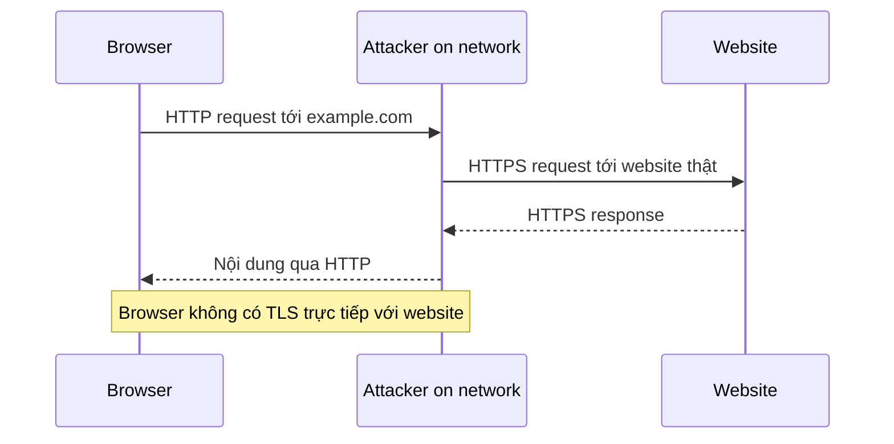

# Downgrade attack

> **Chương:** HSTS và TLS  
> **Học phần:** Application Security — Browser Security (`SECURITY_APPLICATION_SECURITY_BROWSER_SECURITY`)

**Downgrade attack** là kiểu tấn công khiến kết nối hoặc phiên giao tiếp sử dụng một mức bảo vệ yếu hơn mức mà client và server có thể hỗ trợ. Trong ứng dụng web, có hai tình huống cần phân biệt: attacker can thiệp quá trình chuyển từ HTTP sang HTTPS để người dùng tiếp tục dùng kết nối không mã hóa (*SSL stripping/HTTPS downgrade*), hoặc can thiệp thương lượng TLS để client và server rơi xuống phiên bản giao thức hay bộ mã hóa yếu hơn (*TLS protocol/cipher downgrade*).

HTTP redirect sang HTTPS là cần thiết nhưng chưa đủ để bảo vệ lần truy cập đầu tiên. Nếu browser bắt đầu bằng `http://`, attacker đứng giữa mạng có thể chặn request trước khi server gửi redirect. **HTTP Strict Transport Security (HSTS)** giúp browser ghi nhớ rằng một host chỉ được truy cập qua HTTPS và tự nâng cấp điều hướng HTTP trước khi gửi request mạng. Để bảo vệ ngay lần truy cập đầu, domain có thể được đưa vào HSTS preload list của browser, sau khi đáp ứng điều kiện và chấp nhận các hệ quả vận hành.

HSTS bảo vệ đường đi HTTP/HTTPS ở phía browser; TLS configuration bảo vệ quá trình handshake và mã hóa kết nối. Hai lớp này bổ sung cho nhau, không thay thế chứng chỉ hợp lệ, kiểm tra certificate, cấu hình TLS hiện đại, cookie an toàn hay kiểm soát nội dung.

## 1. Mục tiêu học tập

Sau bài học, bạn có thể:

1. Phân biệt SSL stripping với TLS protocol/cipher downgrade.
2. Giải thích vì sao HTTP redirect không bảo vệ được lần truy cập đầu qua HTTP.
3. Mô tả HSTS và cách browser tự nâng cấp request sang HTTPS.
4. Cấu hình `Strict-Transport-Security` với `max-age`, `includeSubDomains` và `preload`.
5. Hiểu giới hạn first-visit và vai trò của HSTS preload.
6. Giải thích cách TLS downgrade xảy ra và những cơ chế chống downgrade hiện đại.
7. Kết hợp HSTS với TLS version/cipher policy, redirect, cookie và mixed-content controls.
8. Triển khai HSTS an toàn qua reverse proxy/CDN và xác minh response thực tế.
9. Kiểm thử hành vi HSTS trong một môi trường domain thử nghiệm.

## 2. Downgrade attack là gì?

Trong một kết nối an toàn, client và server thống nhất dùng giao thức, thuật toán và thuộc tính bảo mật phù hợp. Downgrade attack tìm cách làm một bên chấp nhận lựa chọn yếu hơn, thường bằng cách can thiệp thông điệp thương lượng hoặc khiến client khởi đầu bằng một giao thức không an toàn.

Mục tiêu của attacker có thể là:

- Làm người dùng truy cập phiên bản HTTP không mã hóa của website.
- Quan sát hoặc sửa nội dung request/response khi kết nối không được bảo vệ.
- Làm lộ cookie hoặc dữ liệu ứng dụng được gửi qua HTTP nếu cookie không có `Secure`.
- Khai thác TLS cũ, cipher yếu hoặc hành vi fallback không an toàn.
- Làm giảm hiệu lực của cơ chế xác thực server nếu người dùng bỏ qua cảnh báo certificate hoặc client có cấu hình sai.

Downgrade không nhất thiết có nghĩa attacker giải mã được một phiên TLS hiện đại. Nhiều trường hợp attacker chỉ cần ngăn browser sử dụng HTTPS ngay từ đầu hoặc khai thác một cấu hình cũ còn cho phép giao thức yếu.

## 3. SSL stripping: hạ từ HTTPS xuống HTTP

Một website thường hỗ trợ cả HTTP và HTTPS. Khi người dùng nhập domain hoặc bấm một liên kết `http://example.com`, browser gửi request HTTP trước. Server có thể trả:

```http
HTTP/1.1 301 Moved Permanently
Location: https://example.com/
```

Nếu attacker kiểm soát đường truyền trước khi redirect tới browser, họ có thể chặn request HTTP và ngăn browser nhận redirect. Một biến thể SSL stripping giữ browser giao tiếp HTTP với attacker trong khi attacker giao tiếp HTTPS với server thật. Browser hiển thị một trang HTTP, nên người dùng không có mã hóa end-to-end tới website.

Sơ đồ luồng:



Attacker có thể đọc hoặc sửa nội dung trao đổi giữa browser và họ. TLS ở đoạn attacker → server không bảo vệ đoạn browser → attacker. Đây là lý do website chỉ redirect HTTP sang HTTPS vẫn còn khoảng trống ở lần truy cập đầu.

## 4. Vì sao redirect không đủ?

Redirect chỉ được áp dụng sau khi browser gửi request tới URL ban đầu. Nếu URL ban đầu là HTTP, request đầu tiên đã đi qua mạng không mã hóa.

Một redirect như sau:

```http
HTTP/1.1 308 Permanent Redirect
Location: https://app.example.com/login
```

giúp browser chuyển sang HTTPS khi nhận được response thật. Nhưng nó không thể bảo vệ request HTTP trước đó khỏi một attacker có khả năng chặn hoặc thay response.

Các nguồn tạo ra lần truy cập HTTP đầu tiên gồm:

- Người dùng tự gõ domain mà không có scheme.
- Liên kết trong email, tin nhắn hoặc website khác ghi `http://`.
- Bookmark cũ.
- Redirect từ một domain khác.
- Tài nguyên hoặc script của ứng dụng tạo URL HTTP.
- Một subdomain chưa được cấu hình HTTPS đồng nhất.

HSTS giải quyết khoảng trống này sau khi browser đã biết policy của host: browser tự đổi URL HTTP thành HTTPS trước khi gửi request mạng. HSTS preload mở rộng khả năng bảo vệ để browser biết policy ngay cả trước lần truy cập đầu.

## 5. HSTS hoạt động như thế nào?

HSTS là policy do website gửi bằng HTTP response header:

```http
Strict-Transport-Security: max-age=31536000
```

Browser chỉ chấp nhận và lưu HSTS policy khi header được nhận qua một kết nối HTTPS hợp lệ. Header HSTS nhận qua HTTP không được dùng để tạo policy, vì attacker trên đường HTTP có thể tự chèn hoặc sửa header.

Khi browser đã lưu policy cho host, một điều hướng tới `http://host` sẽ được nâng cấp nội bộ thành HTTPS trước khi request HTTP được gửi ra mạng. Người dùng không cần nhận redirect HTTP từ server nữa.

Ví dụ:

```text
Người dùng nhập: http://app.example.com/account
                 |
                 v
Browser tra HSTS policy đã lưu
                 |
                 v
Browser đổi thành: https://app.example.com/account
                 |
                 v
TLS handshake và HTTPS request
```

Nếu TLS certificate không hợp lệ, browser sẽ hiển thị lỗi bảo mật và HSTS khiến người dùng không thể dễ dàng bỏ qua cảnh báo theo cách thông thường. Điều này ngăn attacker dùng certificate sai để giả mạo website mà người dùng vẫn tiếp tục truy cập.

## 6. Các thành phần của HSTS header

Header có các directive chính:

| Directive | Ý nghĩa | Lưu ý |
| --- | --- | --- |
| `max-age` | Thời gian tính bằng giây mà browser ghi nhớ policy | Bắt buộc; `0` yêu cầu xóa policy đã lưu cho host khi nhận qua HTTPS |
| `includeSubDomains` | Áp dụng policy của host cho các subdomain | Chỉ bật khi mọi subdomain cần truy cập đều hỗ trợ HTTPS |
| `preload` | Tín hiệu thể hiện mong muốn tham gia preload list | Chỉ thêm khi domain đáp ứng điều kiện của chương trình preload; bản thân directive không tự đưa domain vào browser list |

Ví dụ policy dài hạn:

```http
Strict-Transport-Security: max-age=63072000; includeSubDomains
```

Ví dụ có thêm tín hiệu preload:

```http
Strict-Transport-Security: max-age=63072000; includeSubDomains; preload
```

Hai năm (`63072000` giây) là giá trị thường gặp trong các yêu cầu preload, nhưng không nên bật thời hạn dài và `includeSubDomains` trước khi xác minh toàn bộ hạ tầng. Hãy bắt đầu bằng thời hạn ngắn hơn trên môi trường thử nghiệm hoặc giai đoạn rollout nếu chưa chắc chắn.

## 7. `max-age`: thời gian browser ghi nhớ policy

`max-age` là số giây browser tiếp tục áp dụng HSTS kể từ khi nhận header qua HTTPS. Ví dụ:

```http
Strict-Transport-Security: max-age=86400
```

Browser ghi nhớ policy trong một ngày. Khi host gửi lại header với `max-age` mới qua HTTPS, thời gian được cập nhật theo giá trị mới.

Một số mức thời gian thường dùng trong rollout:

| Giai đoạn | Ví dụ `max-age` | Mục tiêu |
| --- | ---: | --- |
| Kiểm tra ban đầu | `300` hoặc `3600` | Xác minh redirect, certificate và subdomain trong thời gian ngắn |
| Thử nghiệm mở rộng | `86400` | Theo dõi một ngày hoạt động thực tế |
| Vận hành ổn định | `31536000` | Ghi nhớ policy một năm |
| Điều kiện preload phổ biến | `63072000` | Hai năm, kết hợp các điều kiện preload liên quan |

Đây là gợi ý rollout, không phải yêu cầu cho mọi hệ thống. Khi `max-age` lớn, nếu một subdomain bị bỏ quên hoặc certificate hết hạn, người dùng có thể bị chặn truy cập cho tới khi policy hết hạn hoặc được cập nhật qua HTTPS.

Đặt `max-age=0` trong response HTTPS để yêu cầu browser xóa HSTS policy đã lưu cho host hiện tại. Không thể dựa vào một response HTTP để xóa policy vì browser không chấp nhận HSTS header từ kết nối không an toàn. Việc xóa policy của host cha cũng không nhất thiết xóa mọi policy độc lập mà subdomain đã lưu.

## 8. `includeSubDomains`: phạm vi ảnh hưởng

Khi response của `example.com` gửi:

```http
Strict-Transport-Security: max-age=31536000; includeSubDomains
```

browser áp dụng policy đó cho `example.com` và các subdomain của nó. Ví dụ:

- `www.example.com`
- `api.example.com`
- `legacy.example.com`
- `tenant.example.com`

Điều này có thể làm hỏng những subdomain chưa hỗ trợ HTTPS, chỉ có HTTP nội bộ, dùng certificate không hợp lệ hoặc được vận hành bởi nhóm khác.

Trước khi bật `includeSubDomains`, hãy kiểm kê:

- Tất cả DNS record và subdomain đang hoạt động.
- Subdomain do đối tác, tenant hoặc người dùng kiểm soát.
- Dịch vụ cũ, trang staging, môi trường test và endpoint thiết bị.
- Certificate, renewal, redirect và TLS configuration của từng host.
- Các dịch vụ không phải website nhưng dùng cùng namespace domain.

Nếu chưa kiểm soát được toàn bộ subdomain, triển khai HSTS riêng trên từng host hoặc hoãn `includeSubDomains`. Không bật chỉ vì domain chính đã có HTTPS.

## 9. HSTS preload và bảo vệ lần truy cập đầu

HSTS dynamic chỉ có hiệu lực sau khi browser nhận policy qua HTTPS. **HSTS preload** giải quyết khoảng trống first-visit bằng cách đưa domain vào danh sách HSTS được phân phối cùng browser. Browser biết trước rằng domain phải dùng HTTPS, kể cả khi người dùng chưa truy cập domain đó.

Để tham gia chương trình preload, domain thường phải đáp ứng các điều kiện nghiêm ngặt, chẳng hạn:

- Có certificate HTTPS hợp lệ và phục vụ HTTPS trên các host liên quan.
- HTTP được redirect sang HTTPS.
- HSTS có `max-age` đủ dài theo yêu cầu hiện hành của chương trình.
- Có `includeSubDomains`.
- Có directive `preload` trong header.
- Các subdomain cần thiết đáp ứng yêu cầu của chương trình.

Điều kiện cụ thể có thể thay đổi theo chương trình preload và browser. Việc thêm `preload` vào header **không tự động** cập nhật danh sách trong mọi browser. Domain cần được gửi, kiểm tra và chấp nhận theo quy trình của danh sách preload; sau đó danh sách được tích hợp vào các bản browser.

Preload tăng khả năng bảo vệ first-visit nhưng làm việc rút khỏi danh sách chậm và phức tạp. Browser cần phát hành phiên bản mới để cập nhật danh sách; người dùng vẫn có thể dùng browser cũ hoặc môi trường không cập nhật. Hãy xem preload là cam kết vận hành dài hạn, không phải một checkbox.

## 10. Giới hạn của HSTS

HSTS rất hữu ích nhưng không giải quyết mọi vấn đề:

- Không bảo vệ lần truy cập đầu nếu domain chưa được preload và browser chưa học policy.
- Không bảo vệ domain giả mạo/lookalike như `examp1e.com`.
- Không sửa certificate sai hoặc bảo vệ khỏi mọi sự cố CA; nó buộc browser tuân thủ xác minh TLS nghiêm ngặt hơn.
- Không ngăn XSS chạy trong origin HTTPS.
- Không thay thế CSP, CSRF token, cookie `Secure`/`HttpOnly`/`SameSite` hoặc authorization.
- Không tự bảo vệ ứng dụng client không phải browser nếu client đó không triển khai HSTS.
- Không bảo vệ một subdomain chưa thuộc phạm vi policy, trừ khi policy cha có `includeSubDomains` hoặc subdomain tự gửi policy.
- Không bảo vệ tài nguyên được tải từ một domain khác không có HSTS policy riêng.

HSTS bảo vệ việc browser kết nối tới host qua HTTPS. Ứng dụng vẫn cần quản lý TLS certificate, cấu hình server, session và dữ liệu ở các lớp khác.

## 11. TLS protocol downgrade

TLS handshake là quá trình client và server thương lượng phiên bản TLS, cipher suite và các tham số kết nối. Nếu server còn cho phép phiên bản cũ hoặc client có cơ chế fallback yếu, attacker trên mạng có thể tìm cách khiến kết nối sử dụng mức bảo vệ thấp hơn.

Các rủi ro lịch sử gồm:

- SSL 2.0/3.0 và các phiên bản TLS cũ có điểm yếu đã biết.
- Cipher suite yếu hoặc thuật toán không còn an toàn.
- Client tự retry bằng phiên bản thấp hơn sau khi handshake thất bại mà không có cơ chế chống downgrade phù hợp.
- Middlebox hoặc proxy cũ can thiệp vào handshake, làm mất extension cần thiết.

TLS hiện đại có các cơ chế chống downgrade trong handshake. TLS 1.3 còn sử dụng downgrade sentinel trong `ServerHello.random` khi server chọn TLS 1.2 hoặc thấp hơn trong một số điều kiện, để client hiện đại phát hiện một số nỗ lực ép hạ phiên bản. TLS_FALLBACK_SCSV cũng được thiết kế để ngăn fallback retry bị attacker ép xuống phiên bản thấp hơn mức server hỗ trợ.

Các cơ chế này không thay thế cấu hình server đúng. Nếu server chủ động cho phép TLS cũ hoặc cipher yếu, client tương thích cũ có thể vẫn kết nối bằng lựa chọn yếu đó.

## 12. Phòng vệ TLS downgrade

Server nên:

1. Chỉ bật các phiên bản TLS còn được chấp nhận theo baseline hiện hành, thường là TLS 1.2 và TLS 1.3.
2. Tắt SSLv2, SSLv3, TLS 1.0 và TLS 1.1.
3. Chọn cipher suite hiện đại, loại bỏ thuật toán yếu hoặc lỗi thời.
4. Dùng certificate hợp lệ, chuỗi certificate đầy đủ và quy trình renewal tự động.
5. Không cấu hình fallback xuống giao thức cũ chỉ để hỗ trợ client không còn được duy trì.
6. Cập nhật thư viện TLS, reverse proxy, load balancer và hệ điều hành.
7. Kiểm tra cấu hình từ Internet ở endpoint thực tế, không chỉ cấu hình tại application server.

Client phải xác minh certificate, hostname và chain trust; không tắt certificate validation để “sửa” lỗi kết nối. Nếu TLS handshake thất bại, cần điều tra nguyên nhân thay vì tự động hạ phiên bản không có kiểm soát.

## 13. HSTS và TLS downgrade bổ sung cho nhau

| Vấn đề | Lớp phòng vệ chính | Ví dụ |
| --- | --- | --- |
| Browser bắt đầu bằng HTTP | HSTS / preload | Tự nâng cấp URL trước khi gửi request |
| HTTP endpoint vẫn được truy cập trực tiếp | Redirect HTTPS và HSTS | Chuyển traffic hợp lệ sang HTTPS |
| Server chấp nhận TLS quá cũ | TLS version policy | Chỉ cho TLS 1.2/1.3 theo baseline |
| Client bị ép fallback | TLS downgrade protections | TLS_FALLBACK_SCSV và downgrade sentinel |
| Cookie phiên bị gửi qua HTTP | Cookie `Secure` và HTTPS-only | Browser chỉ gửi cookie Secure qua secure transport |
| Nội dung HTTP bị nhúng trong trang HTTPS | Mixed content controls/CSP | Sửa URL tài nguyên, dùng HTTPS |

Không dùng HSTS để bù cho TLS server yếu; cũng không dùng TLS 1.3 để bù cho website vẫn cho browser gửi request đăng nhập qua HTTP.

## 14. Cookie và dữ liệu phiên

Cookie xác thực nên có thuộc tính `Secure` để browser chỉ gửi cookie qua kênh an toàn. Ví dụ:

```http
Set-Cookie: session=opaque-value; Path=/; Secure; HttpOnly; SameSite=Lax
```

Các thuộc tính có vai trò khác nhau:

- `Secure`: hạn chế gửi cookie qua kết nối không an toàn.
- `HttpOnly`: ngăn JavaScript đọc cookie qua `document.cookie`.
- `SameSite`: kiểm soát việc cookie được gửi trong một số ngữ cảnh site khác nhau, hỗ trợ giảm CSRF.
- `Path`/`Domain`: xác định phạm vi cookie.

HSTS và `Secure` bổ sung cho nhau. HSTS giúp browser nâng cấp điều hướng HTTP tới host đã biết; `Secure` bảo vệ cookie khỏi bị gửi qua HTTP. Không bỏ `Secure` chỉ vì đã bật HSTS, vì có thể còn client hoặc subdomain/host khác không thuộc policy.

Không đặt session token trong URL. URL có thể xuất hiện trong history, log, analytics, referrer hoặc hệ thống quan sát. Dùng cookie có thuộc tính phù hợp hoặc cơ chế credential an toàn khác.

## 15. Mixed content và URL HTTP

Một trang HTTPS có thể vô tình tham chiếu tài nguyên HTTP:

```html

<script src="http://cdn.example.net/app.js"></script>
```

Browser hiện đại chặn nhiều loại active mixed content và có thể tự nâng cấp hoặc chặn một số loại passive content theo quy tắc cụ thể. Tuy nhiên, ứng dụng không nên dựa vào hành vi tự động của browser để sửa URL.

Biện pháp:

- Chuyển mọi asset, API, form action và link nội bộ sang HTTPS.
- Dùng CSP `upgrade-insecure-requests` trong giai đoạn chuyển đổi nếu phù hợp, nhưng vẫn sửa URL nguồn.
- Dùng `block-all-mixed-content` chỉ khi còn cần tương thích với browser cũ; directive này đã trở nên ít cần thiết trong browser hiện đại.
- Kiểm tra redirect chain và URL cuối của tài nguyên.
- Theo dõi Console và Network để tìm request HTTP còn sót.

`upgrade-insecure-requests` là CSP directive nâng cấp request tài nguyên không an toàn trong tài liệu; nó không tương đương HSTS và không thay thế việc nâng cấp điều hướng top-level hay policy HSTS của host.

## 16. Redirect và TLS termination tại proxy/CDN

Trong hệ thống production, TLS có thể kết thúc ở load balancer, reverse proxy hoặc CDN, rồi proxy chuyển request tới application server qua mạng nội bộ. HSTS phải được gửi trên response HTTPS mà browser nhận.

Các lỗi thường gặp:

- Application server chỉ nhìn thấy HTTP nội bộ nên không tạo redirect/header đúng.
- Proxy không chuyển tiếp hoặc ghi đè `Strict-Transport-Security`.
- Header chỉ được gắn cho response `200`, nhưng thiếu trên trang đăng nhập hoặc một số response khác.
- Redirect tạo vòng lặp do ứng dụng không nhận biết scheme bên ngoài.
- CDN cache HTML/header không đồng bộ.
- Một subdomain dùng chung wildcard certificate nhưng renewal hoặc routing chưa hoàn chỉnh.

Hãy xác định một lớp chịu trách nhiệm chính cho redirect và HSTS header. Nếu proxy là TLS termination point, cấu hình trusted proxy/scheme forwarding chính xác và chỉ tin header từ proxy được kiểm soát; không tin `X-Forwarded-Proto` do client tùy ý gửi trực tiếp.

## 17. Ví dụ cấu hình server

### 17.1 Nginx

```nginx
server {
    listen 80;
    server_name app.example.com;
    return 308 https://$host$request_uri;
}

server {
    listen 443 ssl;
    server_name app.example.com;

    # TLS certificate/key và TLS version policy được cấu hình riêng.
    add_header Strict-Transport-Security "max-age=31536000" always;

    location / {
        proxy_pass http://application_backend;
    }
}
```

Đây là ví dụ minh họa cho một host đã xác minh HTTPS hoạt động. Chỉ thêm `includeSubDomains` sau khi mọi subdomain trong phạm vi đã sẵn sàng. Cần kiểm tra inheritance của `add_header` trong các `location` block để header không bị mất khi có cấu hình riêng.

### 17.2 Express sau reverse proxy

```js
app.set("trust proxy", 1); // Chỉ phù hợp khi đúng một proxy tin cậy đứng trước app.

app.use((req, res, next) => {
  if (req.secure) {
    res.setHeader(
      "Strict-Transport-Security",
      "max-age=31536000"
    );
  }
  next();
});
```

Giá trị `trust proxy` phải khớp topology thực tế; không bật tin cậy proxy tùy tiện khi client có thể gửi header giả. Nhiều hệ thống nên đặt HSTS tại ingress/proxy thay vì trong application middleware, để response lỗi và redirect cũng có header nhất quán.

### 17.3 Giai đoạn trước khi bật includeSubDomains

Có thể bắt đầu bằng:

```http
Strict-Transport-Security: max-age=300
```

Sau khi xác minh certificate, redirect, subdomain và vận hành, tăng dần `max-age`. Chỉ bật `includeSubDomains` hoặc preload khi đã có inventory và chủ sở hữu rõ cho toàn bộ phạm vi.

## 18. Kiểm tra cấu hình TLS và HSTS

Kiểm tra ở browser:

1. Mở DevTools → Network và kiểm tra response HTTPS có `Strict-Transport-Security`.
2. Truy cập host qua HTTP sau khi browser đã học policy; xác nhận URL được nâng cấp trước khi request HTTP được gửi.
3. Kiểm tra certificate, hostname, expiry và chain trust.
4. Kiểm tra mọi subdomain nếu dùng `includeSubDomains`.
5. Kiểm tra Console/Network để tìm mixed content và redirect loop.
6. Kiểm tra popup, API, callback, tài nguyên CDN và endpoint đăng nhập.

Kiểm tra response header từ terminal:

```bash
curl -sSI https://app.example.com/
```

Lệnh này giúp xem header HTTPS, nhưng `curl` không nhất thiết chia sẻ HSTS state với browser và không chứng minh browser đã lưu policy. Cần kiểm tra hành vi trong browser thật. Khi kiểm tra HTTP redirect:

```bash
curl -sSI http://app.example.com/
```

Kết quả mong đợi là redirect sang HTTPS. Tuy nhiên, redirect thành công vẫn không chứng minh first-visit đã được bảo vệ; cần xác minh HSTS đã học hoặc domain đã được preload.

## 19. HSTS state, xóa policy và khôi phục

Browser lưu HSTS state theo host và thời hạn. Khi server đổi policy, browser chỉ nhận thay đổi khi truy cập HTTPS thành công và nhận header mới.

Nếu một host gặp sự cố do HSTS, có thể gửi:

```http
Strict-Transport-Security: max-age=0
```

trên response HTTPS hợp lệ của host đó để yêu cầu xóa policy đã lưu cho host. Đây không phải nút rollback tức thời cho mọi client: browser phải truy cập được HTTPS để nhận header, client offline hoặc không quay lại host vẫn giữ state cũ cho tới khi hết hạn. Nếu domain nằm trong preload list, việc gỡ khỏi danh sách cần quy trình riêng và cập nhật browser.

Vì vậy, trước khi tăng `max-age` dài hạn hoặc bật preload, hãy chuẩn bị:

- Certificate renewal và cảnh báo expiry.
- DNS/subdomain ownership inventory.
- Quy trình khôi phục endpoint HTTPS bị lỗi.
- Kênh liên lạc với chủ sở hữu subdomain/đối tác.
- Kế hoạch xử lý preload removal nếu đã đăng ký.

## 20. Các lỗi cấu hình thường gặp

| Lỗi | Hệ quả | Cách xử lý |
| --- | --- | --- |
| Chỉ dùng HTTP 301/308 sang HTTPS | Request HTTP đầu tiên vẫn có thể bị can thiệp | Dùng HSTS; cân nhắc preload cho first-visit |
| Gửi HSTS trên HTTP | Browser bỏ qua header | Gửi trên response HTTPS hợp lệ |
| Bật `includeSubDomains` quá sớm | Subdomain chưa hỗ trợ HTTPS bị khóa truy cập | Inventory và xác minh mọi subdomain trước |
| Thêm `preload` nhưng chưa đăng ký/được chấp nhận | Browser chưa chắc biết policy ở first visit | Thực hiện quy trình preload chính thức và xác minh trạng thái |
| Dùng `max-age` dài ngay khi thử nghiệm | Khó rollback khi hạ tầng chưa sẵn sàng | Rollout tăng dần và theo dõi |
| Cho phép TLS 1.0/1.1 hoặc SSL cũ | Tạo cơ hội downgrade/khai thác lỗi giao thức cũ | Chỉ bật TLS version hiện đại theo baseline |
| Tắt certificate validation ở client | Cho phép MITM với certificate không hợp lệ | Sửa trust chain/hostname/renewal; không bỏ kiểm tra |
| Tin HSTS thay cho cookie Secure | Cookie có thể vẫn bị gửi qua host/kênh ngoài phạm vi | Đặt `Secure` cho cookie nhạy cảm |
| Bỏ qua HTTP URL trong asset/form | Mixed content hoặc request không an toàn còn sót | Sửa URL, kiểm tra CSP và Network |
| Proxy không thêm HSTS cho error response | Một số response thiếu policy | Đặt header ở ingress phù hợp và kiểm tra `always` |
| Tin `X-Forwarded-Proto` từ mọi client | Attacker có thể giả scheme nếu proxy trust sai | Chỉ tin proxy thực sự kiểm soát |

## 21. Thực hành kiểm chứng trong môi trường lab

Chỉ sử dụng domain thử nghiệm do bạn kiểm soát, certificate lab hợp lệ và dữ liệu giả. Không thực hiện MITM hoặc downgrade trên mạng công cộng, website bên ngoài hay thiết bị của người khác.

### Bài thử A — Redirect không đồng nghĩa HSTS

1. Tạo host lab hỗ trợ HTTP và HTTPS.
2. Cấu hình HTTP redirect sang HTTPS nhưng chưa gửi HSTS.
3. Dùng browser profile mới truy cập URL `http://` của host lab.
4. Quan sát Network để thấy request HTTP ban đầu và redirect.
5. Thêm HSTS trên response HTTPS, truy cập lại bằng HTTPS để browser học policy.
6. Điều hướng tới HTTP trong cùng profile và quan sát URL được nâng cấp.

**Kỳ vọng:** Trước khi học HSTS, browser gửi request HTTP rồi nhận redirect. Sau khi học HSTS, browser tự nâng cấp trước khi gửi request HTTP.

### Bài thử B — `max-age` và cập nhật policy

Trong lab, đặt `max-age=300`, truy cập HTTPS rồi thay header thành `max-age=0`. Truy cập lại HTTPS và thử điều hướng HTTP.

**Kỳ vọng:** Browser cập nhật/xóa policy khi nhận header mới qua HTTPS. Không thể xóa HSTS bằng response HTTP.

### Bài thử C — `includeSubDomains`

Tạo hai host lab như `example.test` và `legacy.example.test`, bảo đảm cả hai có HTTPS hợp lệ trước khi thử. Gửi HSTS `includeSubDomains` từ host cha và điều hướng subdomain qua HTTP.

**Kỳ vọng:** Browser áp dụng policy của host cha cho subdomain. Lặp lại trong lab với một subdomain chưa sẵn sàng HTTPS để quan sát rủi ro vận hành; không làm trên domain production.

### Bài thử D — Mixed content

Tạo trang HTTPS lab tham chiếu một ảnh hoặc script HTTP trên server lab. Quan sát Console/Network, sau đó chuyển URL sang HTTPS và thử `upgrade-insecure-requests` trong CSP nếu phù hợp.

**Kỳ vọng:** Browser có thể chặn hoặc nâng cấp tài nguyên mixed content theo loại resource và chính sách. Sửa URL nguồn vẫn là giải pháp cần làm.

### Bài thử E — TLS version policy

Trên server TLS lab riêng, cấu hình lần lượt chỉ cho phép TLS 1.2/1.3 và kiểm tra handshake bằng công cụ kiểm thử TLS được phê duyệt. Xác nhận client không thể kết nối bằng phiên bản đã tắt.

**Kỳ vọng:** Server từ chối phiên bản TLS cũ; ứng dụng vẫn hoạt động với client được hỗ trợ. Không bật giao thức yếu để thử trên endpoint production.

## 22. Checklist review HSTS và TLS downgrade

- [ ] Mọi route đăng nhập và dữ liệu nhạy cảm đều dùng HTTPS.
- [ ] HTTP redirect sang HTTPS tồn tại nhưng không được xem là biện pháp first-visit duy nhất.
- [ ] HSTS được gửi trên response HTTPS hợp lệ.
- [ ] `max-age` được tăng theo giai đoạn và có kế hoạch rollback.
- [ ] `includeSubDomains` chỉ bật sau khi kiểm kê và xác minh toàn bộ subdomain.
- [ ] Preload chỉ được đăng ký khi đáp ứng điều kiện và có owner vận hành dài hạn.
- [ ] Certificate có hostname, chain và thời hạn hợp lệ; renewal được giám sát.
- [ ] Server chỉ bật TLS version/cipher suite hiện đại theo baseline.
- [ ] Không có fallback tự động xuống TLS cũ ngoài thiết kế.
- [ ] Cookie phiên có `Secure`, cùng `HttpOnly`/`SameSite` phù hợp.
- [ ] Không còn URL HTTP trong form, API, script, stylesheet và tài nguyên nhúng.
- [ ] Proxy/CDN gửi HSTS nhất quán trên response cuối.
- [ ] `X-Forwarded-Proto` chỉ được tin từ proxy được kiểm soát.
- [ ] Đã kiểm thử HSTS state trên browser profile sạch và profile đã học policy.
- [ ] Có quy trình xử lý subdomain/certificate lỗi và preload removal.

## 23. Câu hỏi tự kiểm tra

1. SSL stripping khác TLS protocol downgrade ở điểm nào?
2. Vì sao redirect HTTP sang HTTPS vẫn để lộ request đầu tiên?
3. Browser làm gì khi host đã có HSTS policy nhưng người dùng điều hướng tới HTTP?
4. Vì sao browser chỉ chấp nhận HSTS header từ response HTTPS?
5. `max-age=0` có tác dụng gì và cần điều kiện nào để browser nhận thay đổi?
6. `includeSubDomains` có thể gây sự cố gì với subdomain cũ?
7. HSTS preload giải quyết first-visit như thế nào và vì sao khó rollback?
8. HSTS có bảo vệ khỏi domain giả mạo hoặc XSS không?
9. TLS_FALLBACK_SCSV và downgrade sentinel giúp chống tình huống nào?
10. Vì sao cookie `Secure` vẫn cần thiết khi HSTS đã bật?
11. `upgrade-insecure-requests` khác HSTS ra sao?
12. Cần kiểm tra những gì khi TLS kết thúc tại CDN/reverse proxy?

## 24. Ghi nhớ

Downgrade attack làm kết nối sử dụng mức bảo vệ yếu hơn, thường gặp dưới hai dạng: SSL stripping khiến browser tiếp tục dùng HTTP, và TLS downgrade ép handshake về phiên bản/cipher yếu. Redirect HTTP → HTTPS không bảo vệ request đầu tiên. HSTS giúp browser ghi nhớ host chỉ được truy cập qua HTTPS và tự nâng cấp URL trước khi gửi request; preload có thể bảo vệ ngay first visit nhưng cần cam kết vận hành dài hạn.

Hãy gửi HSTS trên response HTTPS, tăng `max-age` theo giai đoạn, chỉ bật `includeSubDomains` khi mọi subdomain sẵn sàng và chỉ đăng ký preload sau khi kiểm tra điều kiện. Đồng thời tắt TLS cũ, dùng certificate hợp lệ, đặt cookie `Secure`, sửa mixed content và kiểm tra header tại proxy/CDN. **HSTS bảo vệ quyết định dùng HTTPS của browser; cấu hình TLS bảo vệ handshake; cả hai phải được triển khai cùng các lớp bảo mật ứng dụng khác.**
