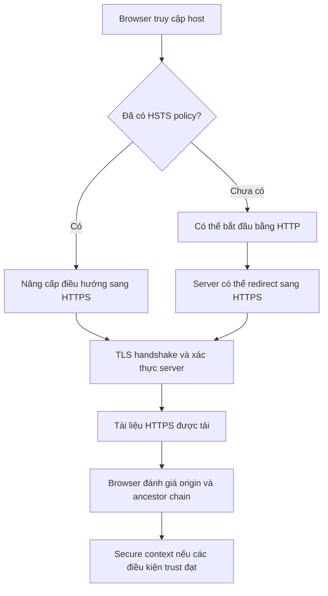

# Secure context: khi nào trình duyệt coi một trang là ngữ cảnh an toàn?

## 1. Secure context là gì?

**Secure context** (ngữ cảnh an toàn) là một môi trường web mà browser xem là đủ đáng tin để cấp quyền sử dụng các Web API có khả năng tác động tới thiết bị, dữ liệu hoặc quyền riêng tư của người dùng. Những API này thường được gọi là **powerful features**.

Ví dụ, các tính năng như Geolocation, camera/microphone, Service Worker, Clipboard API và Web Crypto Subtle API thường yêu cầu secure context. Lý do là website không được phép dễ dàng yêu cầu vị trí, truy cập thiết bị hoặc đăng ký mã chạy nền khi nội dung có thể bị kẻ khác can thiệp trên đường truyền.

Trong trường hợp phổ biến, trang HTTPS với chứng chỉ hợp lệ là secure context. Nhưng HTTPS không phải con đường duy nhất: browser cũng xem `localhost` và các địa chỉ loopback như `127.0.0.1` hoặc `::1` là đáng tin trong môi trường phát triển, dù dùng HTTP.

Ngược lại, chỉ nhìn thấy URL bắt đầu bằng `https://` chưa đủ để kết luận mọi tài liệu con bên trong đều là secure context. Browser còn xét origin của tài liệu và chuỗi ancestor browsing context. Một trang HTTPS được nhúng bên trong trang HTTP không đáng tin cậy có thể không được xem là secure context.

**Nguyên tắc:** secure context là điều kiện nền tảng để browser cân nhắc cấp một số API nhạy cảm. Nó không chứng minh ứng dụng không có XSS, không thay thế authentication/authorization và không tự bật quyền truy cập thiết bị.

Bài viết thuộc chương **HSTS và TLS** của module **SECURITY_APPLICATION_SECURITY_BROWSER_SECURITY**. Chủ đề kết nối TLS, HSTS và secure context với origin, ancestor chain, mixed content, Permissions Policy và các Web API được bảo vệ.

Sau bài học, bạn có thể:

- Giải thích secure context và khái niệm potentially trustworthy origin.
- Nhận diện HTTPS, localhost và loopback là các trường hợp phổ biến.
- Phân tích vì sao trang con HTTPS có thể không phải secure context nếu ancestor không an toàn.
- Kiểm tra trạng thái bằng `window.isSecureContext`.
- Phân biệt secure context với quyền người dùng và Permissions Policy.
- Giải thích vai trò của TLS và HSTS trong việc tạo điều kiện cho secure context.
- Phân biệt secure context với SOP, CORS, CSP và cross-origin isolation.
- Thực hành kiểm tra localhost, loopback và địa chỉ IP mạng LAN.

## 2. Potentially trustworthy origin

Secure Contexts Standard dùng khái niệm **potentially trustworthy origin** (origin có thể được tin cậy). Browser đánh giá origin của tài liệu trước khi xác định nó có thể chạy trong secure context hay không.

### 2.1. HTTPS và WSS

Các origin dùng HTTPS hoặc WSS là trường hợp phổ biến của origin đáng tin cậy:

```text
https://app.example.com
https://api.example.com
wss://socket.example.com
```

HTTPS bảo vệ kết nối HTTP bằng TLS. WSS là WebSocket chạy trên kết nối TLS. Đối với một trang web, secure context được xác định theo origin của tài liệu; việc mở một kết nối WSS từ trang HTTP không biến chính trang HTTP đó thành secure context.

TLS cần được cấu hình đúng để xác thực server và bảo vệ dữ liệu trên đường truyền. Không xem việc người dùng bỏ qua cảnh báo chứng chỉ là bằng chứng endpoint đã được xác thực an toàn. Hãy kiểm tra chứng chỉ, hostname và chuỗi tin cậy theo môi trường triển khai.

### 2.2. localhost và địa chỉ loopback

Browser cho phép một số origin local được xem là potentially trustworthy để hỗ trợ phát triển:

```text
http://localhost:3000
http://127.0.0.1:8080
http://[::1]:8080
```

Các địa chỉ trên đại diện cho máy local hoặc loopback. Vì vậy, một ứng dụng chạy tại `http://localhost:3000` thường có `window.isSecureContext === true`, dù scheme là HTTP.

Đây là ngoại lệ có chủ đích để lập trình viên có thể thử nghiệm Service Worker, Geolocation và các API yêu cầu secure context trên máy phát triển.

### 2.3. Địa chỉ mạng LAN không giống loopback

Một địa chỉ private network như:

```text
http://192.168.1.20:8080
http://10.0.0.15:3000
```

không tự động được xem là trustworthy chỉ vì nó thuộc mạng nội bộ. Đây không phải địa chỉ loopback. Browser thường xem các origin HTTP này là không an toàn, trừ khi có cấu hình đặc biệt hoặc cơ chế tin cậy bổ sung.

Điểm khác biệt:

| URL | Trường hợp | Kết quả thường gặp |
|---|---|---|
| `http://localhost:3000` | Tên host local | Potentially trustworthy |
| `http://127.0.0.1:3000` | IPv4 loopback | Potentially trustworthy |
| `http://[::1]:3000` | IPv6 loopback | Potentially trustworthy |
| `http://192.168.1.20:3000` | IP private trong LAN | Không tự động trustworthy |
| `http://app.example.com` | Website HTTP thông thường | Không trustworthy |
| `https://app.example.com` | Website HTTPS | Potentially trustworthy |

Không nên dùng phép so chuỗi kiểu "hostname bắt đầu bằng 192.168" để tự triển khai logic bảo mật. Hãy để browser xác định secure context và kiểm tra bằng API tiêu chuẩn.

### 2.4. Các scheme đặc biệt

Một số scheme hoặc môi trường đặc biệt như `file:`, extension URL hay URL nội bộ của browser có quy tắc phụ thuộc tiêu chuẩn và implementation. Không xây dựng kiến trúc production dựa trên giả định mọi file local hoặc mọi custom scheme đều là secure context.

Các URL `blob:` thường kế thừa origin của môi trường tạo blob; `about:blank` có thể kế thừa origin của creator. `data:` thường tạo opaque origin. Với tài liệu đặc biệt, hãy kiểm tra `window.isSecureContext` trong đúng browser và ngữ cảnh thực tế.

## 3. Browser xét cả ancestor chain

Một tài liệu không chỉ cần có origin đáng tin cậy của riêng nó. Với tài liệu nằm trong frame, browser còn xét các ancestor browsing context.

### 3.1. Trang top-level HTTPS

Ví dụ:

```text
Top-level: https://app.example.com
Origin: https://app.example.com
Ancestor chain: chỉ có top-level document
```

Nếu kết nối và origin được browser xem là trustworthy, tài liệu thường là secure context.

### 3.2. HTTPS iframe bên trong HTTPS parent

Ví dụ:

```text
Parent: https://app.example.com
Child:  https://widget.example.net
```

Hai trang khác origin, nhưng cả hai dùng HTTPS và ancestor chain cũng đáng tin cậy. Child có thể là secure context. Tuy nhiên, quyền dùng API trong iframe vẫn phụ thuộc browser permission, Permissions Policy, user activation và các điều kiện riêng của API.

Secure context không làm hai origin trở thành same-origin. SOP vẫn áp dụng.

### 3.3. HTTPS iframe bên trong HTTP parent

Ví dụ:

```text
Parent: http://legacy.example.com
Child:  https://widget.example.net
```

Child có origin HTTPS, nhưng ancestor chain chứa một document không trustworthy. Vì vậy child không được xem là secure context. Các API yêu cầu secure context có thể không khả dụng trong child.

Đây là lý do không thể chỉ nhìn URL của iframe rồi kết luận. Cần kiểm tra toàn bộ chuỗi tài liệu cha.

### 3.4. Ma trận ví dụ

| Parent | Child | Secure context của child? |
|---|---|---|
| HTTPS | HTTPS | Có thể, nếu origin và toàn ancestor chain đều trustworthy |
| HTTP website thông thường | HTTPS | Không |
| HTTPS | HTTP website thông thường | Không |
| HTTP localhost | HTTP localhost | Thường có, do localhost được xem là trustworthy |
| HTTPS | HTTP localhost | Thường vẫn là secure context vì localhost/loopback được xem là potentially trustworthy; kiểm tra riêng các policy và API |

Quy tắc ancestor chain nhằm ngăn một trang không an toàn nhúng một trang HTTPS rồi sử dụng trang con như một nơi đáng tin để gọi API nhạy cảm.

### 3.5. Kiểm tra trong frame

Có thể kiểm tra trực tiếp bên trong tài liệu con:

```js
console.log("Child secure context:", window.isSecureContext);
console.log("Child origin:", location.origin);
```

Parent không nên suy ra kết quả của child chỉ từ URL `iframe.src`. Hãy quan sát trong chính frame bằng DevTools hoặc hiển thị trạng thái từ script chạy bên trong child.

## 4. Powerful features thường yêu cầu secure context

Secure context là điều kiện tiên quyết đối với nhiều API có thể truy cập thiết bị hoặc dữ liệu nhạy cảm. Danh sách cụ thể thay đổi theo browser và phiên bản.

| API / tính năng | Ví dụ | Điều kiện bổ sung thường gặp |
|---|---|---|
| Geolocation | `navigator.geolocation` | Người dùng cấp quyền, Permissions Policy cho phép |
| Camera/microphone | `navigator.mediaDevices.getUserMedia()` | Permission, user activation hoặc điều kiện UX, Permissions Policy |
| Service Worker | `navigator.serviceWorker.register()` | Script cùng origin và các quy tắc scope |
| Clipboard API | `navigator.clipboard` | Quyền, user activation và browser policy |
| Web Crypto Subtle API | `crypto.subtle` | Browser hỗ trợ và secure context |
| Notifications | `Notification.requestPermission()` | Permission và yêu cầu tương tác theo browser |
| Device/API mới | Các API phần cứng hoặc thiết bị | Có thể yêu cầu permission, policy và user activation |

### 4.1. Secure context không tự cấp permission

Một trang HTTPS có thể là secure context nhưng vẫn không đọc được vị trí hoặc camera nếu người dùng từ chối quyền.

Ví dụ:

```js
if (!window.isSecureContext) {
  console.warn("Trang không chạy trong secure context");
} else if (!navigator.geolocation) {
  console.warn("Browser không hỗ trợ Geolocation API");
} else {
  navigator.geolocation.getCurrentPosition(
    (position) => {
      console.log(position.coords.latitude, position.coords.longitude);
    },
    (error) => {
      console.error("Không lấy được vị trí:", error.message);
    }
  );
}
```

Đoạn code chỉ yêu cầu vị trí sau khi kiểm tra môi trường và khả năng API. Browser vẫn có thể hiển thị prompt hoặc từ chối theo permission, policy, cài đặt người dùng hay trạng thái tài liệu.

### 4.2. Feature detection và secure-context detection

Không nên chỉ kiểm tra một thuộc tính API rồi kết luận trang an toàn. Hai câu hỏi khác nhau:

- `window.isSecureContext`: browser có xem tài liệu này là secure context không?
- `navigator.geolocation`, `navigator.clipboard`, `navigator.mediaDevices`: API tương ứng có được expose trong môi trường hiện tại không?

Ví dụ:

```js
const capabilities = {
  secureContext: window.isSecureContext,
  geolocation: "geolocation" in navigator,
  clipboard: "clipboard" in navigator,
  mediaDevices: "mediaDevices" in navigator,
  serviceWorker: "serviceWorker" in navigator,
  cryptoSubtle: Boolean(window.crypto && crypto.subtle)
};

console.table(capabilities);
```

API có mặt không có nghĩa permission đã được cấp. API vắng mặt có thể do browser không hỗ trợ hoặc do secure-context gating; Permissions Policy và user permission cũng có thể khiến lời gọi API thất bại dù thuộc tính đã được expose. Hãy kiểm tra từng điều kiện thay vì gộp tất cả thành một cờ "secure".

### 4.3. Service Worker là ví dụ rõ ràng

Service Worker có thể kiểm soát request, cache response và chạy một số tác vụ nền. Nếu cho phép website HTTP thông thường đăng ký Service Worker, attacker trên đường truyền có thể tìm cách thay thế script hoặc can thiệp vào quá trình tải.

Vì vậy, Service Worker chỉ được đăng ký trong secure context, với ngoại lệ phát triển cho localhost/loopback.

```js
if ("serviceWorker" in navigator && window.isSecureContext) {
  navigator.serviceWorker.register("/service-worker.js")
    .then((registration) => {
      console.log("Registered:", registration.scope);
    })
    .catch((error) => {
      console.error("Registration failed:", error);
    });
}
```

Không dùng điều kiện này thay thế việc kiểm tra nội dung Service Worker. Script vẫn cần được review, cập nhật an toàn và phục vụ từ origin đúng.

## 5. Permissions Policy và iframe

Một trang có thể là secure context nhưng API vẫn bị chặn bởi **Permissions Policy**. Policy này kiểm soát tài liệu nào được phép sử dụng một số tính năng.

### 5.1. Giới hạn ở response header

Ví dụ chỉ cho phép Geolocation trong chính origin:

```http
Permissions-Policy: geolocation=(self), camera=(), microphone=()
```

- `geolocation=(self)`: cho phép origin hiện tại.
- `camera=()`: không cho origin nào sử dụng camera.
- `microphone=()`: không cho origin nào sử dụng microphone.

Cú pháp và mức hỗ trợ cần được kiểm tra theo browser mục tiêu. Policy có thể được kế thừa và giới hạn tiếp trong các browsing context con.

### 5.2. Delegation cho iframe

Nếu một iframe cross-origin thực sự cần Geolocation, parent có thể cần cấp quyền qua policy và thuộc tính `allow`:

```http
Permissions-Policy: geolocation=(self "https://maps.example.net")
```

```html
<iframe
  src="https://maps.example.net/widget"
  allow="geolocation"
  title="Bản đồ">
</iframe>
```

Đây chỉ là một phần của quá trình. Child vẫn phải là secure context; người dùng vẫn phải cấp permission nếu browser yêu cầu; policy của parent và child không được cấm tính năng.

### 5.3. Ba lớp điều kiện cần phân biệt

Để một API hoạt động, thường phải thỏa nhiều lớp:

1. **Secure context:** tài liệu đủ trustworthy theo browser.
2. **Permissions Policy:** tài liệu được phép sử dụng tính năng đó.
3. **User permission / activation:** người dùng đã cấp quyền và thao tác đáp ứng điều kiện của API.

Một lớp không thay thế lớp còn lại. Khi API không hoạt động, hãy kiểm tra Console, Permissions Policy, permission settings và `window.isSecureContext`.

## 6. TLS, HSTS và secure context

TLS và HSTS giúp website được truy cập qua HTTPS một cách đáng tin cậy. Secure context là kết quả browser đánh giá origin và ancestor chain. Ba khái niệm có liên hệ nhưng không đồng nghĩa.

### 6.1. TLS tạo kênh truyền an toàn

TLS bảo vệ dữ liệu giữa browser và server bằng:

- **Confidentiality:** người nghe lén trên đường truyền khó đọc nội dung.
- **Integrity:** dữ liệu khó bị sửa đổi mà không bị phát hiện.
- **Server authentication:** browser xác minh server thông qua chứng chỉ và hostname.

HTTPS là HTTP chạy qua TLS. Một trang HTTPS được cấu hình đúng thường là nền tảng cho secure context.

TLS không bảo vệ ứng dụng khỏi XSS hoặc logic authorization sai. Nếu script độc hại đã chạy trong trang, nó có thể sử dụng các API mà trang được phép dùng dù kết nối HTTPS hoàn toàn hợp lệ.

### 6.2. HSTS buộc browser dùng HTTPS

HTTP Strict Transport Security (HSTS) cho phép server thông báo rằng browser phải truy cập host qua HTTPS trong một khoảng thời gian.

Ví dụ response HTTPS:

```http
Strict-Transport-Security: max-age=31536000; includeSubDomains
```

- `max-age`: thời gian browser ghi nhớ chính sách, tính bằng giây.
- `includeSubDomains`: áp dụng chính sách cho các subdomain của host đã gửi header.
- HSTS chỉ được browser chấp nhận khi nhận qua kết nối bảo mật; header gửi qua HTTP thông thường bị bỏ qua.

Khi browser đã ghi nhớ HSTS, nó tự nâng cấp một số điều hướng HTTP tới host đó thành HTTPS trước khi gửi request. HSTS giúp giảm nguy cơ downgrade và SSL stripping.

### 6.3. First visit và HSTS preload

Trước khi browser nhận được HSTS policy từ server, lần truy cập đầu tiên vẫn có thể bắt đầu bằng HTTP nếu người dùng hoặc link sử dụng URL HTTP. HSTS preload là cơ chế để một số domain được đưa sẵn vào danh sách HSTS tích hợp trong browser, giúp bảo vệ cả lần truy cập đầu tiên đối với browser có danh sách đó.

Không gửi `includeSubDomains` nếu còn subdomain chưa sẵn sàng HTTPS. Trước khi đăng ký preload, hãy kiểm tra đầy đủ yêu cầu và khả năng phục vụ HTTPS cho mọi hostname liên quan.

### 6.4. HSTS hỗ trợ secure context như thế nào?

Chuỗi quan hệ thường gặp:



HSTS không tự biến một trang HTTP bất kỳ thành secure context. Nó giúp browser đi tới HTTPS cho host đã có policy. Sau khi tài liệu được tải, browser vẫn đánh giá origin, ancestor chain và các quy tắc secure context.

## 7. Mixed content là vấn đề riêng

Một trang HTTPS có thể cố tải tài nguyên HTTP:

```html
<script src="http://cdn.example.net/app.js"></script>

```

Browser áp dụng **Mixed Content** rules để bảo vệ tài liệu HTTPS khỏi tài nguyên không bảo mật. Một số active content như script thường bị chặn; một số passive content như ảnh có thể được tự động nâng cấp hoặc xử lý theo quy tắc browser.

Mixed content và secure context có liên quan nhưng là hai phép kiểm tra khác nhau:

- Secure context đánh giá origin của tài liệu và ancestor chain.
- Mixed Content kiểm soát tài liệu HTTPS tải tài nguyên không an toàn như thế nào.

Vì vậy, `window.isSecureContext === true` không chứng minh mọi subresource đều được tải an toàn. Hãy kiểm tra Network và Console để tìm mixed-content warning hoặc request bị chặn.

### 7.1. Sửa mixed content

Ưu tiên:

- Phục vụ mọi script, stylesheet, API và tài nguyên quan trọng qua HTTPS.
- Cập nhật URL hardcode trong HTML, CSS, JavaScript và cấu hình CMS.
- Dùng URL tương đối khi phù hợp với kiến trúc.
- Cấu hình CSP `upgrade-insecure-requests` như lớp hỗ trợ trong quá trình migration, sau khi xác nhận mọi tài nguyên có HTTPS.
- Theo dõi CSP/mixed-content reports và kiểm thử các trang thực tế.

Không dựa vào browser tự nâng cấp ảnh để giải quyết các dependency HTTP còn sót lại.

## 8. Secure context khác các cơ chế bảo mật nào?

Các khái niệm thường xuất hiện cùng nhau nhưng giải quyết các câu hỏi khác nhau.

| Cơ chế | Câu hỏi chính | Ví dụ |
|---|---|---|
| Secure context | Tài liệu có đủ trustworthy để dùng powerful APIs không? | `window.isSecureContext` |
| TLS | Kết nối tới server có được mã hóa, bảo vệ integrity và xác thực không? | HTTPS |
| HSTS | Browser có phải nâng cấp điều hướng host sang HTTPS không? | `Strict-Transport-Security` |
| SOP | Script có được truy cập dữ liệu/DOM của tài liệu khác origin không? | Same-origin DOM access |
| CORS | JavaScript có được đọc response cross-origin không? | `Access-Control-Allow-Origin` |
| CSP | Tài liệu được phép tải và thực thi nội dung nào? | `script-src` |
| Permissions Policy | Frame/origin nào được dùng một số tính năng? | `geolocation=(self)` |
| COOP/COEP | Browsing context và tài nguyên cross-origin có đáp ứng điều kiện isolation không? | `crossOriginIsolated` |

### 8.1. Secure context không phải same-origin

Hai trang HTTPS khác host đều có thể là secure context nhưng vẫn cross-origin. Secure context không cho phép một trang đọc DOM của trang kia.

### 8.2. Secure context không phải CORS permission

Một trang HTTPS có thể gọi API HTTPS khác origin nhưng vẫn bị CORS chặn đọc response nếu server không cho phép origin đó. Secure context không tự thêm `Access-Control-Allow-Origin`.

### 8.3. Secure context không phải cross-origin isolation

Một số API như SharedArrayBuffer trong browser hiện đại còn cần cross-origin isolation. Khi đó thường phải đáp ứng COOP/COEP và các điều kiện liên quan. `window.isSecureContext === true` không đảm bảo `window.crossOriginIsolated === true`.

### 8.4. Secure context không ngăn XSS

Nếu ứng dụng có XSS, script độc hại vẫn có thể chạy trong secure context và sử dụng những quyền mà trang được cấp. Cần tiếp tục dùng output encoding, DOM API an toàn, CSP, Trusted Types, CSRF protection và authorization server-side.

## 9. Kiểm tra secure context trong ứng dụng

### 9.1. Dùng isSecureContext

API chuẩn để kiểm tra:

```js
if (window.isSecureContext) {
  console.log("Document is a secure context");
} else {
  console.warn("Document is not a secure context");
}
```

Đây là tín hiệu từ browser cho tài liệu hiện tại. Đối với iframe, hãy chạy kiểm tra bên trong iframe; kết quả của parent không nhất thiết giống child.

### 9.2. Kiểm tra cả API và trạng thái permission

Có thể hiển thị chẩn đoán mà không yêu cầu quyền ngay:

```js
function inspectEnvironment() {
  return {
    origin: location.origin,
    protocol: location.protocol,
    secureContext: window.isSecureContext,
    geolocationAvailable: "geolocation" in navigator,
    mediaDevicesAvailable: Boolean(navigator.mediaDevices),
    clipboardAvailable: Boolean(navigator.clipboard),
    serviceWorkerAvailable: "serviceWorker" in navigator,
    crossOriginIsolated: window.crossOriginIsolated
  };
}

console.table(inspectEnvironment());
```

Đừng yêu cầu quyền camera, microphone hoặc vị trí chỉ để kiểm tra secure context. Feature detection không cần tạo permission prompt.

### 9.3. Không tự viết allowlist scheme

Tránh code kiểu:

```js
// Không đủ chính xác để xác định secure context.
const secure = location.protocol === "https:";
```

Đoạn này bỏ sót localhost/loopback và không xét ancestor chain. Cũng không nên tự coi mọi hostname private hoặc mọi file local là đáng tin.

Dùng `window.isSecureContext` cho quyết định phía browser. Server vẫn phải xác minh authentication, authorization và nguồn request độc lập.

## 10. Lab local: so sánh localhost, loopback và IP mạng LAN

Lab dùng một Node.js HTTP server phục vụ cùng một trang tại nhiều địa chỉ. Mục tiêu là quan sát cách browser đánh giá secure context cho localhost/loopback so với một địa chỉ IP mạng LAN.

### 10.1. Tạo file secure-context-lab.mjs

```js
import { createServer } from "node:http";

const html = [
  "<!doctype html>",
  "<html lang=\"vi\">",
  "<head>",
  "  <meta charset=\"utf-8\">",
  "  <meta name=\"viewport\" content=\"width=device-width, initial-scale=1\">",
  "  <title>Secure context lab</title>",
  "</head>",
  "<body>",
  "  <h1>Secure context lab</h1>",
  "  <p>Origin: <strong id=\"origin\"></strong></p>",
  "  <p>Secure context: <strong id=\"secure\"></strong></p>",
  "  <h2>API availability</h2>",
  "  <ul id=\"features\"></ul>",
  "  <p id=\"note\"></p>",
  "  <script>",
  "    document.getElementById(\"origin\").textContent = location.origin;",
  "    document.getElementById(\"secure\").textContent = String(window.isSecureContext);",
  "    const features = [",
  "      [\"Geolocation\", \"geolocation\" in navigator],",
  "      [\"MediaDevices\", Boolean(navigator.mediaDevices)],",
  "      [\"Clipboard\", Boolean(navigator.clipboard)],",
  "      [\"Service Worker\", \"serviceWorker\" in navigator],",
  "      [\"Web Crypto Subtle\", Boolean(window.crypto && crypto.subtle)]",
  "    ];",
  "    const list = document.getElementById(\"features\");",
  "    for (const [name, available] of features) {",
  "      const item = document.createElement(\"li\");",
  "      item.textContent = name + \": \" + available;",
  "      list.append(item);",
  "    }",
  "    document.getElementById(\"note\").textContent =",
  "      \"API có mặt không đồng nghĩa permission đã được cấp.\";",
  "  </script>",
  "</body>",
  "</html>"
].join("\n");

const server = createServer((req, res) => {
  if (req.url !== "/" && req.url !== "/index.html") {
    res.writeHead(404, { "Content-Type": "text/plain; charset=utf-8" });
    res.end("Not found");
    return;
  }

  res.writeHead(200, {
    "Content-Type": "text/html; charset=utf-8",
    "Cache-Control": "no-store"
  });
  res.end(html);
});

server.listen(8080, "0.0.0.0", () => {
  console.log("Open http://localhost:8080");
  console.log("You can also test http://127.0.0.1:8080");
});
```

### 10.2. Chạy server

Trong thư mục chứa file:

```bash
node secure-context-lab.mjs
```

Mở lần lượt:

- `http://localhost:8080`
- `http://127.0.0.1:8080`

Hai URL trên là các trường hợp loopback thường được browser xem là potentially trustworthy. Quan sát dòng Secure context và danh sách API.

Nếu muốn kiểm tra địa chỉ LAN, lấy IPv4 của máy phát triển bằng công cụ hệ điều hành rồi mở `http://<LAN-IP>:8080` từ chính máy đó hoặc thiết bị khác trong cùng mạng. Một IP private như `192.168.x.x` thường không được xem là secure context chỉ vì nó nằm trong LAN.

### 10.3. Kết quả mong đợi

| Địa chỉ | Kết quả thường gặp |
|---|---|
| `http://localhost:8080` | `isSecureContext` là `true` |
| `http://127.0.0.1:8080` | `isSecureContext` là `true` |
| `http://[::1]:8080` | `isSecureContext` là `true` nếu server lắng nghe IPv6 loopback |
| `http://192.168.x.x:8080` | Thường là `false` |
| `https://domain-có-chứng-chỉ-hợp-lệ` | Thường là `true`, nếu ancestor chain cũng trustworthy |

Kết quả có thể khác nếu browser được chạy với flag phát triển, enterprise policy hoặc trust exception. Hãy ghi nhận browser và môi trường khi so sánh.

### 10.4. Quan sát DevTools

1. Mở Console và chạy `window.isSecureContext`.
2. Ghi lại `location.origin` và `location.protocol`.
3. So sánh localhost với địa chỉ IP LAN.
4. Kiểm tra API availability; không cần gọi API nhạy cảm hoặc cấp permission.
5. Mở tab Security/Network để kiểm tra HTTPS và chứng chỉ ở môi trường HTTPS.
6. Thử cùng một trang trong iframe trên một môi trường test có parent HTTP và child HTTPS; kiểm tra `window.isSecureContext` từ bên trong child.
7. Thử chuyển parent sang HTTPS và quan sát thay đổi khi toàn bộ ancestor chain đều trustworthy.

Không dùng cờ browser bỏ qua chứng chỉ hoặc custom trust setting làm cấu hình production.

## 11. Checklist triển khai

Trước khi phát hành một tính năng yêu cầu secure context:

1. **Origin:** Tài liệu được phục vụ qua HTTPS hoặc một origin được browser xem là trustworthy?
2. **Ancestor chain:** Nếu chạy trong iframe, mọi ancestor có trustworthy không?
3. **TLS:** Chứng chỉ có hợp lệ cho hostname, còn hạn và được browser tin cậy không?
4. **HSTS:** Host đã phát HSTS qua HTTPS chưa? `includeSubDomains` có an toàn cho toàn bộ subdomain không?
5. **Mixed content:** Có tài nguyên HTTP bị nhúng trong trang HTTPS không?
6. **Feature detection:** Có kiểm tra `window.isSecureContext` và API cụ thể không?
7. **Permissions Policy:** Tính năng có bị policy của parent hoặc response header chặn không?
8. **User permission:** Có xử lý trường hợp người dùng từ chối hoặc thu hồi permission không?
9. **Iframe:** Nếu child cross-origin, parent đã delegate tính năng qua `allow` và Permissions Policy khi cần chưa?
10. **Service Worker:** Script có cùng origin, scope phù hợp và được cập nhật an toàn không?
11. **Fallback:** Nếu API không có hoặc context không secure, giao diện có giải thích và cung cấp đường đi phù hợp không?
12. **Environment:** Có kiểm thử localhost, staging, production và các browser mục tiêu không?
13. **Security boundary:** Có tránh coi secure context là thay thế SOP, CORS, CSP, CSRF hoặc authorization không?

## 12. Những hiểu lầm phổ biến

| Nhận định sai | Cách hiểu đúng |
|---|---|
| "Chỉ HTTPS mới là secure context." | Localhost và loopback cũng thường được xem là trustworthy cho phát triển. |
| "Mọi IP nội bộ đều được tin cậy." | IP private trong LAN không tự động là loopback hoặc secure context. |
| "Có HTTPS ở iframe là đủ." | Browser còn xét ancestor chain của tài liệu. |
| "Secure context tự cấp quyền camera/vị trí." | Permission, Permissions Policy và điều kiện API vẫn áp dụng. |
| "API có trong navigator nghĩa là đã được cấp quyền." | Feature availability không đồng nghĩa permission granted. |
| "HSTS và secure context là một." | HSTS hướng dẫn browser dùng HTTPS; secure context là kết quả đánh giá origin và ancestor chain. |
| "isSecureContext true nghĩa là không có mixed content." | Mixed Content là phép kiểm tra riêng cho subresource. |
| "Secure context ngăn XSS." | XSS vẫn có thể chạy trong HTTPS page và sử dụng quyền của trang. |
| "HTTPS làm hai website cùng origin." | HTTPS không thay đổi quy tắc scheme/host/port của SOP. |
| "CORS được tự động bật trên HTTPS." | CORS vẫn cần response header cho phép origin đọc dữ liệu. |
| "Secure context đồng nghĩa crossOriginIsolated." | Cross-origin isolation còn cần các điều kiện COOP/COEP và tài nguyên phù hợp. |
| "Có thể kiểm tra bằng protocol === 'https:'." | Cách đó bỏ sót localhost và không xét ancestor chain. |

## 13. Câu hỏi ôn tập

1. Secure context là gì và vì sao browser yêu cầu nó cho một số powerful APIs?
2. Potentially trustworthy origin là gì?
3. Vì sao `http://localhost` có thể là secure context trong khi `http://app.example.com` không phải?
4. Địa chỉ `127.0.0.1` khác `192.168.1.20` ở điểm nào đối với secure context?
5. Browser xét điều gì ngoài origin của chính tài liệu khi xác định secure context trong iframe?
6. Vì sao iframe HTTPS nằm trong parent HTTP có thể không phải secure context?
7. `window.isSecureContext` cho biết điều gì và không cho biết điều gì?
8. Secure context có tự cấp quyền Geolocation hoặc camera không?
9. Permissions Policy có vai trò gì với API trong cross-origin iframe?
10. TLS đóng góp những thuộc tính bảo mật nào cho kết nối?
11. HSTS giúp giảm nguy cơ nào và vì sao lần truy cập đầu tiên vẫn cần được cân nhắc?
12. Mixed Content khác secure-context evaluation như thế nào?
13. Secure context khác SOP và CORS ở điểm nào?
14. Vì sao `window.isSecureContext === true` không đồng nghĩa `window.crossOriginIsolated === true`?

**Đáp án định hướng:** (1) Môi trường browser đánh giá đủ trustworthy để xem xét cấp powerful APIs. (2) Origin được browser xem là đáng tin theo Secure Contexts Standard. (3) Localhost được coi là trustworthy cho phát triển; website HTTP thông thường không được vậy. (4) 127.0.0.1 là loopback; 192.168.1.20 là IP private trong LAN. (5) Ancestor chain của browsing context. (6) Parent không trustworthy làm child không đạt điều kiện secure context. (7) Nó cho biết browser đánh giá document hiện tại là secure context; không chứng minh permission đã cấp hoặc ứng dụng an toàn khỏi XSS. (8) Không; permission và policy vẫn cần. (9) Giới hạn frame/origin nào được sử dụng tính năng và cho phép delegation khi phù hợp. (10) Confidentiality, integrity và server authentication. (11) HSTS buộc browser nâng cấp host sang HTTPS sau khi đã biết policy; lần đầu có thể chưa có policy trừ khi preload hoặc cơ chế khác. (12) Mixed Content kiểm soát subresource HTTP trong tài liệu HTTPS; secure context đánh giá origin và ancestor chain. (13) Secure context là điều kiện cho powerful API; SOP giới hạn truy cập cross-origin; CORS điều khiển quyền đọc response. (14) Cross-origin isolation còn yêu cầu COOP/COEP và các tài nguyên đáp ứng policy.

## 14. Tài liệu tham khảo

- [W3C — Secure Contexts](https://www.w3.org/TR/secure-contexts/): Định nghĩa secure context, potentially trustworthy origin và ancestor chain.
- [MDN — Secure contexts](https://developer.mozilla.org/en-US/docs/Web/Security/Secure_Contexts): Giải thích HTTPS, localhost và các API yêu cầu secure context.
- [MDN — Window.isSecureContext](https://developer.mozilla.org/en-US/docs/Web/API/Window/isSecureContext): API kiểm tra secure context của document.
- [MDN — Geolocation API](https://developer.mozilla.org/en-US/docs/Web/API/Geolocation_API): Geolocation và yêu cầu secure context/permission.
- [MDN — ServiceWorkerContainer.register()](https://developer.mozilla.org/en-US/docs/Web/API/ServiceWorkerContainer/register): Điều kiện đăng ký Service Worker.
- [MDN — Permissions Policy](https://developer.mozilla.org/en-US/docs/Web/HTTP/Guides/Permissions_Policy): Kiểm soát tính năng trong document và iframe.
- [MDN — Strict-Transport-Security](https://developer.mozilla.org/en-US/docs/Web/HTTP/Reference/Headers/Strict-Transport-Security): HSTS, max-age và includeSubDomains.
- [MDN — Mixed content](https://developer.mozilla.org/en-US/docs/Web/Security/Mixed_content): Quy tắc tải tài nguyên HTTP trong trang HTTPS.
- [OWASP — Transport Layer Security Cheat Sheet](https://cheatsheetseries.owasp.org/cheatsheets/Transport_Layer_Security_Cheat_Sheet.html): Cấu hình TLS và bảo vệ kết nối.

**Kết nối với mô hình bảo mật web:** Secure context cho biết browser có thể xem tài liệu là môi trường đáng tin để cấp các Web API nhạy cảm hay không. TLS bảo vệ kênh truyền, HSTS giúp browser tiếp tục dùng HTTPS, còn ancestor chain ngăn một trang HTTPS được nhúng trong trang HTTP kế thừa niềm tin một cách sai lệch. Secure context vẫn độc lập với SOP, CORS, CSP, permission và authorization; cần kiểm tra từng lớp theo đúng vai trò.
