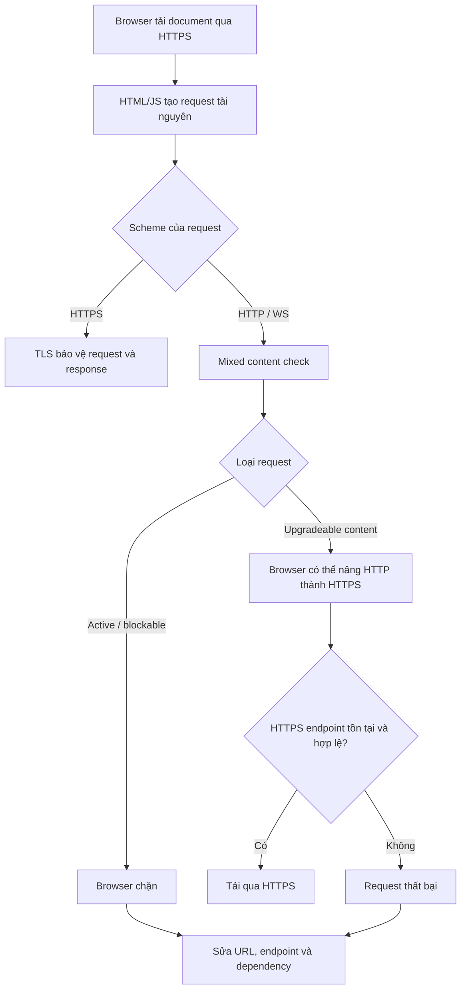

# Active mixed content: nhận diện và ngăn tài nguyên HTTP trong trang HTTPS

**Chương:** Mixed content  
**Mô-đun:** `SECURITY_APPLICATION_SECURITY_BROWSER_SECURITY` — phân tích ranh giới bảo mật giữa trình duyệt, origin, cookie và ứng dụng web để hiểu Same-Origin Policy (SOP), CORS và các cơ chế cách ly; thực hành phòng vệ XSS, CSRF, clickjacking bằng CSP, Trusted Types, security headers và kiểm chứng hành vi thực tế.

**Active mixed content** xảy ra khi một trang được tải an toàn qua HTTPS nhưng lại yêu cầu một tài nguyên hoặc kết nối không an toàn qua HTTP/WS, và tài nguyên đó có thể tác động đến cấu trúc, mã thực thi hoặc dữ liệu của trang. Ví dụ điển hình là trang HTTPS tải JavaScript từ URL HTTP, nạp stylesheet không an toàn, nhúng iframe HTTP hoặc gọi API bằng `fetch("http://...")`.

Trình duyệt xem các request này là rủi ro vì kẻ có khả năng can thiệp vào mạng không mã hóa có thể sửa response trước khi nó đến browser. Nếu response là JavaScript, attacker có thể thay mã được thực thi trong ngữ cảnh trang HTTPS. Nếu response là iframe, attacker có thể thay toàn bộ nội dung document con. Nếu request là API hoặc WebSocket, dữ liệu và hành vi trao đổi có thể bị đọc hoặc sửa trên đường truyền.

Các browser hiện đại thường **chặn active mixed content**. Một số loại nội dung ít có khả năng trực tiếp thay đổi hành vi trang, như hình ảnh, audio hoặc video, có thể được tự động nâng cấp từ HTTP sang HTTPS theo quy tắc mixed content hiện hành. Tuy nhiên, việc tự nâng cấp không bảo đảm tài nguyên tồn tại trên HTTPS. Cách khắc phục đúng vẫn là chuyển toàn bộ URL và endpoint sang HTTPS, kiểm tra redirect và loại bỏ dependency không an toàn.

## 1. Mục tiêu học tập

Sau bài học, bạn có thể:

1. Giải thích mixed content và lý do trang HTTPS không nên tải tài nguyên qua HTTP.
2. Nhận diện active/blockable mixed content như script, stylesheet, iframe, fetch/XHR, worker và WebSocket.
3. Phân biệt active mixed content với nhóm nội dung có thể được browser tự nâng cấp như image, audio và video.
4. Giải thích vì sao SOP, CORS và `mode: "no-cors"` không cho phép bỏ qua mixed content protection.
5. Tìm request không an toàn trong DevTools, response redirect, CSS, JavaScript và dữ liệu cấu hình.
6. Sửa URL, endpoint, dependency và cấu hình server để toàn bộ luồng sử dụng HTTPS.
7. Dùng `upgrade-insecure-requests` và HSTS đúng vai trò trong quá trình chuyển đổi.
8. Thiết kế test matrix và browser lab để chứng minh active mixed content bị chặn hoặc đã được loại bỏ.

## 2. Mixed content là gì?

Một document HTTPS được browser tải qua kết nối TLS. Kết nối này bảo vệ tính bí mật và toàn vẹn dữ liệu giữa browser và server trong phạm vi TLS được xác thực. Nếu document đó tiếp tục tải tài nguyên qua HTTP thuần, tài nguyên HTTP không có bảo vệ TLS tương đương.

Ví dụ:

```html
<!-- Document chính được tải qua HTTPS -->
<script src="http://cdn.example.test/app.js"></script>
<link rel="stylesheet" href="http://cdn.example.test/site.css">
<iframe src="http://legacy.example.test/account"></iframe>
```

Mặc dù thanh địa chỉ hiển thị HTTPS, các request con trên vẫn đi qua HTTP. Nếu browser cho phép script không an toàn chạy, kẻ tấn công trên đường truyền có thể thay nội dung JavaScript. Khi script chạy, nó thường có quyền của document đã tải nó, tức origin HTTPS của trang, và có thể thao tác DOM, đọc dữ liệu mà script cùng origin được phép đọc hoặc gửi request thay mặt trang.

Mixed content là một cơ chế bảo vệ do browser thực thi. Server không thể yêu cầu browser bỏ qua bằng cách thêm CORS header hoặc đổi thuộc tính HTML. Browser kiểm tra scheme và context của request trước khi cho tài nguyên được tải/hiển thị theo các quy tắc của nền tảng.

### 2.1. Mô hình đe dọa

Giả sử trang ngân hàng `https://bank.example.test` tải script từ `http://assets.example.test/widget.js`.

1. Người dùng kết nối an toàn tới `bank.example.test`.
2. HTML của trang yêu cầu script qua HTTP.
3. Một attacker có khả năng can thiệp mạng trên đường tới `assets.example.test` thay response JavaScript.
4. Nếu browser cho script chạy, mã bị thay thế có thể thực thi trong ngữ cảnh `bank.example.test`.
5. Mã có thể thay đổi nội dung trang hoặc gọi API bằng session của người dùng.

TLS của document chính không bảo vệ request HTTP độc lập. Vì vậy, một tài nguyên active không an toàn có thể phá vỡ lợi ích của HTTPS trên toàn trang.

### 2.2. Sơ đồ request



### 2.3. Mixed content chỉ xuất hiện trong secure document context

Mixed content được xét khi một document an toàn (thường là HTTPS) yêu cầu nội dung không an toàn. Trang HTTP tải script HTTP không phải mixed content theo định nghĩa này, vì document ban đầu vốn không được bảo vệ bằng HTTPS. Tuy nhiên, trang HTTP vẫn có các rủi ro nghe lén và sửa nội dung khác.

Một HTTPS iframe bên trong trang HTTP có thể tạo secure context riêng; các request do document HTTPS bên trong frame thực hiện vẫn phải tuân theo mixed content rules của document đó. Khi debug, hãy xác định document nào phát request và scheme của từng frame, không chỉ nhìn URL top-level.

## 3. Active mixed content và nhóm có thể nâng cấp

Thuật ngữ cũ thường chia mixed content thành **active** và **passive/display**. Đặc tả hiện đại thường dùng khái niệm **blockable mixed content** và **upgradable mixed content**. Trong thực tế, bài học này dùng “active mixed content” để nói về nhóm tài nguyên có khả năng tác động trực tiếp đến nội dung hoặc hành vi trang và thường bị browser chặn.

### 3.1. Active hoặc blockable mixed content

Các ví dụ thường gặp:

| Loại request | Ví dụ | Hành vi thường thấy trên browser hiện đại |
| --- | --- | --- |
| JavaScript | `<script src="http://...">` | Bị chặn |
| Stylesheet | `<link rel="stylesheet" href="http://...">` | Bị chặn |
| Iframe/document con | `<iframe src="http://...">` | Bị chặn |
| Fetch/XHR | `fetch("http://...")`, `XMLHttpRequest` | Bị chặn |
| Worker | `new Worker("http://...")`, `importScripts()` | Bị chặn theo secure-context/mixed-content rules |
| WebSocket không mã hóa | `ws://...` từ trang HTTPS | Bị chặn |
| Font | `@font-face` tải font qua HTTP | Bị chặn |
| Plugin/object | `<object>` hoặc `<embed>` qua HTTP | Bị chặn hoặc không được hỗ trợ |

Danh sách chính xác phụ thuộc loại request, browser và phiên bản. Khi đánh giá một trường hợp, hãy xem request destination, console message và tiêu chuẩn/browser behavior thay vì chỉ dựa vào tên thẻ.

### 3.2. Nội dung có thể được tự động nâng cấp

Một số loại nội dung ít có khả năng thay đổi logic của document được browser nâng scheme từ HTTP sang HTTPS. Ví dụ phổ biến:

- Hình ảnh qua `img src`, `srcset` hoặc ảnh CSS.
- Audio và video trong các context được quy định.

Ví dụ, trang có:

```html

```

Browser có thể thử tải `https://images.example.test/banner.jpg` thay vì request HTTP. Nếu server ảnh không hỗ trợ HTTPS, ảnh sẽ không tải. Browser không nhất thiết quay lại HTTP vì điều đó sẽ làm mất bảo vệ.

Không dựa vào cơ chế nâng cấp tự động để giữ URL HTTP trong source code. Hãy sửa URL thành HTTPS rõ ràng và xác minh endpoint HTTPS thực sự phục vụ đúng nội dung.

### 3.3. Navigation không đồng nghĩa với mixed content

Một liên kết `<a href="http://...">` được người dùng nhấp để điều hướng top-level sang website HTTP thường không được xem như một tài nguyên active được nhúng vào document hiện tại. Đây là **navigation downgrade** và vẫn có rủi ro: người dùng rời khỏi HTTPS, trang đích có thể bị sửa trên đường truyền.

Tương tự, form submission từ HTTPS tới HTTP là một luồng chuyển dữ liệu không an toàn cần được thiết kế lại, nhưng không nên đánh đồng mọi navigation/form action với quy tắc chặn mixed content của script/iframe. Dùng HTTPS cho cả đích điều hướng và endpoint nhận form.


## 4. Mixed content không được bỏ qua bằng SOP, CORS hoặc Fetch mode

Mixed content, SOP và CORS là các cơ chế khác nhau, chạy ở những bước khác nhau:

| Cơ chế | Câu hỏi chính | Có cho phép HTTP subresource trong HTTPS không? |
| --- | --- | --- |
| Mixed content check | Secure document có được tải request không an toàn này không? | Quyết định chặn hoặc nâng cấp theo loại request |
| SOP | Script từ origin này có được đọc DOM/dữ liệu của origin khác không? | Không. SOP không biến HTTP thành an toàn |
| CORS | Server có cho JavaScript đọc response cross-origin không? | Không. CORS không bỏ qua mixed content check |
| Fetch mode `no-cors` | Request có chạy ở chế độ opaque response không? | Không. `no-cors` không bỏ qua mixed content |
| CSP `connect-src` | Trang được kết nối tới endpoint nào? | Có thể hạn chế thêm; không thay thế mixed content protection |

Ví dụ, dù server HTTP trả:

```http
Access-Control-Allow-Origin: https://app.example.test
```

request từ trang HTTPS vẫn có thể bị browser chặn vì mixed content trước khi CORS cho phép JavaScript đọc response. CORS header không mã hóa request và không bảo vệ response khỏi attacker trên đường truyền.

Tương tự, `fetch(url, { mode: "no-cors" })` không phải cách né kiểm tra. `no-cors` giới hạn khả năng JavaScript đọc response; nó không cấp quyền gửi active mixed content từ secure context.

### 4.1. WebSocket: dùng WSS

Trang HTTPS phải kết nối WebSocket an toàn bằng `wss://`:

```javascript
const socket = new WebSocket("wss://api.example.test/events");
```

Không dùng `ws://` từ trang HTTPS. WebSocket không mã hóa có thể bị can thiệp trên đường truyền và browser xem là mixed content. Hãy cấu hình TLS ở WebSocket endpoint hoặc reverse proxy và cập nhật URL trong client.

### 4.2. Worker và module

Worker được tạo từ secure document phải tuân theo secure-context và mixed-content rules. Dùng URL HTTPS hoặc same-origin URL tương đối:

```javascript
const worker = new Worker("/workers/search-worker.js");
```

Nếu worker import thêm script, kiểm tra cả chuỗi dependency. Một worker script an toàn nhưng gọi `importScripts()` tới URL HTTP vẫn tạo request không an toàn.

### 4.3. Redirect từ HTTPS sang HTTP

Một request bắt đầu bằng HTTPS vẫn có thể trở thành mixed content nếu server redirect tới URL HTTP. Ví dụ:

```http
GET https://cdn.example.test/app.js
HTTP/1.1 302 Found
Location: http://legacy.example.test/app.js
```

Browser kiểm tra URL đích sau redirect và có thể chặn request. Vì vậy, không chỉ tìm URL HTTP trong HTML; cần kiểm tra redirect chain của CDN, storage, API gateway và dịch vụ bên thứ ba.

## 5. Tìm mixed content trong DevTools và codebase

### 5.1. Console

Mở trang HTTPS và kiểm tra Console. Browser thường ghi thông báo có dạng:

```text
Mixed Content: The page at 'https://app.example.test/' was loaded over HTTPS,
but requested an insecure resource 'http://legacy.example.test/app.js'.
This request has been blocked; the content must be served over HTTPS.
```

Thông báo thường cho biết URL trang, URL tài nguyên và hành động browser đã thực hiện (blocked hoặc upgraded). Câu chữ cụ thể thay đổi theo browser/version.

Phân biệt mixed content warning với các lỗi khác:

- **Mixed Content:** request HTTP xuất phát từ secure document.
- **CORS error:** request đã đi qua bước mixed content và bị giới hạn quyền đọc response.
- **TLS/certificate error:** URL dùng HTTPS nhưng chứng chỉ hoặc handshake không hợp lệ.
- **CSP violation:** request bị policy CSP chặn, có thể đồng thời tồn tại với mixed content.
- **Network error/404:** endpoint không truy cập được hoặc tài nguyên không tồn tại.

Một request có thể gặp nhiều vấn đề. Hãy sửa nguyên nhân đầu tiên trong chuỗi rồi tải lại để quan sát lỗi còn lại.

### 5.2. Network panel

Trong DevTools → Network:

1. Reload trang với cache disabled.
2. Lọc theo `http://` hoặc tìm request có scheme không an toàn.
3. Kiểm tra Initiator để tìm script, stylesheet hoặc document tạo request.
4. Xem redirect chain và URL cuối cùng.
5. Kiểm tra request bị blocked trước khi có response hay đã nhận redirect.
6. Phân biệt request được nâng lên HTTPS với request bị chặn.
7. Lưu lại URL, resource type, initiator, browser/version và kết quả.

Một số browser hiển thị request bị chặn với trạng thái đặc biệt như `(blocked:mixed-content)`. Không dựa duy nhất vào status label vì cách trình bày khác nhau.

### 5.3. Tìm URL không an toàn trong source

Tìm các pattern thường gặp trong HTML, JavaScript, CSS và cấu hình:

- Chuỗi `http://` trong `src`, `href`, `poster`, `srcset`, `@import` và `url()`.
- `fetch`, `XMLHttpRequest`, `EventSource`, WebSocket hoặc Worker tạo URL động.
- URL lấy từ API, CMS, database, feature flag hoặc biến môi trường.
- Script third-party, analytics, chat, video và payment widget.
- URL trong CSS được import gián tiếp hoặc trong stylesheet từ CDN.
- Redirect từ endpoint HTTPS tới host HTTP.

Không thể kết luận chỉ bằng tìm kiếm chuỗi `http://`: URL có thể được ghép lúc runtime, giải mã từ config, hoặc được server trả qua redirect. Kết hợp static search với browser runtime observation.

### 5.4. Đánh giá initiator và ownership

Với mỗi request HTTP, xác định:

- Route hoặc component tạo request.
- Team sở hữu mã nguồn hoặc dịch vụ.
- Có HTTPS endpoint chính thức hay không.
- Có thể thay bằng same-origin proxy hoặc asset first-party không.
- Request có thật sự cần thiết hay là dependency cũ không còn dùng.

Không tự động đổi mọi chuỗi `http://` thành `https://` bằng replace toàn repository. Một số URL có thể là ví dụ tài liệu, link navigation, webhook nội bộ hoặc endpoint không hỗ trợ TLS. Sửa theo từng dependency và xác minh response thực tế.

## 6. Cách khắc phục active mixed content

### 6.1. Chuyển URL tài nguyên sang HTTPS

Ưu tiên URL HTTPS rõ ràng:

```html
<script src="https://cdn.example.test/app.js"></script>
<link rel="stylesheet" href="https://cdn.example.test/site.css">
<iframe src="https://portal.example.test/widget"></iframe>
```

Nếu tài nguyên cùng origin, dùng URL tương đối:

```html
<script src="/assets/app.js"></script>
<link rel="stylesheet" href="/assets/site.css">
```

URL tương đối kế thừa scheme của document; khi trang chạy qua HTTPS, request cũng dùng HTTPS. Với tài nguyên bên ngoài, xác minh host hỗ trợ TLS và chứng chỉ hợp lệ.

### 6.2. Cập nhật API, WebSocket và endpoint động

Dùng HTTPS/WSS cho mọi endpoint:

```javascript
const apiBase = "https://api.example.test";
const eventsUrl = "wss://api.example.test/events";

const profile = await fetch(apiBase + "/v1/profile");
const socket = new WebSocket(eventsUrl);
```

Nếu URL đến từ cấu hình hoặc API, xác thực scheme trước khi sử dụng. Có thể parse URL và chỉ cho phép `https:` hoặc `wss:` tùy loại kết nối. Không dùng một allowlist chung cho mọi destination; script, API, WebSocket và navigation có yêu cầu khác nhau.

### 6.3. Sửa redirect và CDN

Cấu hình CDN, object storage và API gateway để redirect tới HTTPS đích. Kiểm tra:

- canonical URL và origin đích;
- redirect 301/302/307/308;
- signed URL hoặc URL có query token;
- hostname alias cũ;
- regional endpoint;
- asset manifest sinh trong build;
- proxy headers như `X-Forwarded-Proto` để app không sinh URL HTTP khi request ngoài là HTTPS.

Không gửi token nhạy cảm qua URL HTTP trong bất kỳ trường hợp nào. Nếu endpoint cũ không hỗ trợ HTTPS, nâng cấp dịch vụ, thay nhà cung cấp hoặc loại bỏ dependency.

### 6.4. Bỏ dependency không cần thiết

Nếu một widget hoặc SDK chỉ cung cấp endpoint HTTP, hãy đánh giá liệu có thể:

- bỏ chức năng không còn cần;
- thay bằng nhà cung cấp hỗ trợ HTTPS;
- self-host asset đã được kiểm tra và quản lý;
- đặt một proxy HTTPS có kiểm soát ở phía server nếu phù hợp về kiến trúc và điều khoản;
- chuyển chức năng sang API first-party.

Không tạo proxy mở nhận URL tùy ý; điều đó có thể biến server thành SSRF proxy. Chỉ proxy các host/path đã định, xác thực nguồn và giới hạn method/response.

### 6.5. Xác minh sau khi sửa

Sau mỗi thay đổi:

1. Xóa cache hoặc dùng hard reload.
2. Mở lại các route và trạng thái đăng nhập quan trọng.
3. Kiểm tra Console không còn active mixed content.
4. Xác nhận Network không có request HTTP bị chặn hoặc redirect về HTTP.
5. Kiểm tra endpoint HTTPS có certificate hợp lệ và nội dung đúng.
6. Chạy regression test để phát hiện URL HTTP quay trở lại trong lần build tiếp theo.


## 7. CSP và HSTS trong quá trình loại bỏ mixed content

### 7.1. CSP `upgrade-insecure-requests`

Directive `upgrade-insecure-requests` yêu cầu browser viết lại URL request không an toàn trong document thành HTTPS trước khi gửi request. Đây là công cụ hữu ích khi chuyển hệ thống cũ có nhiều URL HTTP sang HTTPS:

```http
Content-Security-Policy: upgrade-insecure-requests
```

Ví dụ, một trang chứa:

```html
<script src="http://cdn.example.test/app.js"></script>

```

Với directive này, browser thử request các URL tương ứng qua HTTPS. Nếu endpoint HTTPS hoạt động, request có thể thành công mà không cần sửa ngay từng HTML template. Nếu server không hỗ trợ HTTPS hoặc chứng chỉ lỗi, request thất bại; browser không nên quay lại HTTP để làm mất bảo vệ.

Directive này hữu ích như một lớp hỗ trợ migration, nhưng không nên là lý do để giữ URL HTTP trong codebase. Hãy cập nhật URL, config, asset manifest và endpoint gốc; sau khi kiểm kê sạch, có thể giữ directive như một biện pháp phòng vệ bổ sung nếu phù hợp.

### 7.2. `upgrade-insecure-requests` không phải phép sửa endpoint

- Nó không cài TLS cho server.
- Nó không sửa cấu hình redirect phía server hoặc bảo đảm toàn bộ redirect chain kết thúc ở HTTPS; luôn kiểm tra URL cuối cùng trong Network.
- Nó không bảo đảm host bên ngoài có HTTPS hoặc chứng chỉ hợp lệ.
- Nó không thay thế việc cập nhật URL do ứng dụng sinh động.
- Nó không bảo vệ navigation top-level tới HTTP theo cách HSTS thực hiện.

Không bật directive rồi coi mọi mixed content đã được giải quyết. Kiểm tra Network để xác nhận URL sau nâng cấp, TLS handshake và response thực tế.

### 7.3. `block-all-mixed-content` và browser hiện đại

Directive CSP `block-all-mixed-content` từng được dùng để yêu cầu chặn mixed content, nhưng hiện đã lỗi thời/không còn cần thiết trong browser hiện đại vì nhóm blockable mixed content vốn đã bị chặn theo mặc định. Không dựa vào directive này như cơ chế bảo vệ chính. Tập trung vào HTTPS URL, `upgrade-insecure-requests` khi migration và browser testing.

### 7.4. HSTS: buộc browser dùng HTTPS cho host đã biết

HTTP Strict Transport Security (HSTS) cho phép server thông báo rằng browser phải dùng HTTPS cho các lần truy cập tiếp theo tới host đó trong khoảng thời gian quy định:

```http
Strict-Transport-Security: max-age=31536000; includeSubDomains
```

- `max-age` xác định thời gian (giây) browser ghi nhớ policy.
- `includeSubDomains` áp dụng policy cho các subdomain.
- `preload` là tín hiệu liên quan chương trình preload list; thêm token vào header không tự động đưa domain vào danh sách preload.

HSTS phải được gửi qua HTTPS response; browser bỏ qua HSTS header nhận qua HTTP không an toàn. Khi host đã được ghi nhớ, browser tự nâng URL HTTP của host đó lên HTTPS trước khi gửi request. Điều này giảm nguy cơ downgrade và SSL stripping.

HSTS chỉ có hiệu lực sau khi browser đã nhận và ghi nhớ header từ một kết nối HTTPS an toàn, trừ khi domain đã có trong preload list của browser. Vì vậy, lần truy cập HTTP đầu tiên có thể chưa được bảo vệ nếu browser chưa từng nhận policy; preload giúp xử lý khoảng trống này.

### 7.5. HSTS có phạm vi theo host

HSTS không tự động bảo vệ mọi host bên thứ ba mà trang sử dụng. Nếu `app.example.test` bật HSTS, browser không vì thế tự áp policy cho `cdn.vendor.test`. Một host khác chỉ được bảo vệ nếu chính nó gửi HSTS hoặc nằm dưới domain đã bật `includeSubDomains` theo phạm vi phù hợp.

Trước khi bật `includeSubDomains` hoặc đăng ký preload cho domain thật, xác minh tất cả subdomain đều hỗ trợ HTTPS ổn định. Một subdomain legacy chỉ phục vụ HTTP có thể không truy cập được sau khi policy được áp dụng.

### 7.6. Phối hợp CSP và HSTS

Hai cơ chế giải quyết các phần khác nhau:

| Cơ chế | Tác dụng |
| --- | --- |
| HTTPS trên mọi endpoint | Mã hóa và xác thực kết nối của từng host |
| CSP `upgrade-insecure-requests` | Nâng URL request HTTP của document sang HTTPS |
| HSTS | Ghi nhớ yêu cầu dùng HTTPS cho một host và phạm vi subdomain |
| Mixed content blocking | Browser chặn request active không an toàn còn sót |
| DevTools/CI tests | Phát hiện URL, redirect và dependency chưa chuyển đổi |

Không cơ chế nào thay thế việc sửa endpoint không hỗ trợ TLS. Một request được nâng scheme nhưng server không phục vụ HTTPS vẫn thất bại.

## 8. Test matrix cho active mixed content

Dùng browser mục tiêu trong support matrix. Test phải phân biệt blockable request, upgradable content, redirect, CSP và HSTS.

| ID | Tình huống | Kết quả mong đợi |
| --- | --- | --- |
| MC-01 | HTTPS document tải script qua HTTP | Browser chặn active mixed content |
| MC-02 | HTTPS document tải stylesheet qua HTTP | Browser chặn stylesheet |
| MC-03 | HTTPS document nhúng iframe HTTP | Browser chặn document frame |
| MC-04 | HTTPS document gọi fetch/XHR qua HTTP | Browser chặn request |
| MC-05 | HTTPS document mở `ws://` | Browser chặn kết nối không an toàn |
| MC-06 | HTTPS document tạo Worker từ URL HTTP | Browser chặn worker request |
| MC-07 | HTTPS document tải image qua HTTP | Browser có thể tự nâng URL lên HTTPS; không fallback về HTTP |
| MC-08 | HTTPS document tải audio/video qua HTTP | Browser có thể tự nâng URL lên HTTPS theo quy tắc hiện hành |
| MC-09 | HTTPS resource redirect sang HTTP | Browser chặn URL đích không an toàn |
| MC-10 | Request HTTP có CORS `Access-Control-Allow-Origin` hợp lệ | Vẫn bị mixed content check chặn nếu là blockable request |
| MC-11 | Fetch dùng `mode: "no-cors"` | Không bỏ qua mixed content protection |
| MC-12 | CSP `upgrade-insecure-requests`, HTTPS endpoint tồn tại | Browser nâng request sang HTTPS và tải được |
| MC-13 | CSP `upgrade-insecure-requests`, HTTPS endpoint không tồn tại | Request thất bại qua HTTPS; không fallback HTTP |
| MC-14 | HSTS đã được ghi nhớ cho host | URL HTTP tới host được nâng lên HTTPS |
| MC-15 | HSTS của first-party nhưng request tới host third-party | Không tự áp HSTS cho third-party host |
| MC-16 | URL HTTP được tạo động từ API/config | Runtime test phát hiện và xác minh nguồn sinh URL |
| MC-17 | Tài nguyên HTTPS có certificate không hợp lệ | TLS/certificate error, phân biệt với mixed content |
| MC-18 | Route được mở trực tiếp và qua redirect | Không có active request hoặc redirect về HTTP |
| MC-19 | CSS có `@import` hoặc `url(http://...)` | Request phụ được kiểm tra; active resource bị chặn, upgradable resource có thể được nâng |
| MC-20 | Nhiều browser/version | Ghi nhận hành vi block/upgrade phù hợp support matrix |

### 8.1. Kiểm tra bằng curl

Dùng curl để kiểm tra redirect và header HSTS/CSP:

```bash
curl -sS -D - -o /dev/null https://app.example.test/
curl -sS -L -D - -o /dev/null https://app.example.test/assets/legacy.js
curl -sS -D - -o /dev/null http://app.example.test/
```

Lưu ý:

- `curl` không thực thi mixed content rules của browser.
- `curl -L` giúp quan sát redirect chain, nhưng không chứng minh browser sẽ cho phép request.
- HSTS là state do browser lưu; curl không mô phỏng chính xác HSTS cache/preload behavior của browser.
- Dùng browser test để xác nhận request thực sự bị chặn hoặc nâng cấp.


## 9. Lab: quan sát active mixed content trong browser

Lab dùng hai hostname local khác nhau:

- Trang chính HTTPS: `https://app.test:3443`.
- Server tài nguyên HTTP: `http://legacy.test:3000`.

Dùng hostname `.test` thay cho `localhost` vì browser xem localhost/loopback là môi trường có thể đáng tin trong một số secure-context checks. Nếu dùng `https://localhost` tải từ `http://localhost`, kết quả có thể khác một website HTTPS thực tế.

Lab không dùng tài khoản hay dữ liệu thật. Nó có script, stylesheet, iframe và API demo được phục vụ qua HTTP; mục tiêu là quan sát browser chặn các request active từ document HTTPS.

### 9.1. Chuẩn bị hostname và chứng chỉ local

Cần Node.js và `mkcert`.

1. Cài `mkcert` theo hướng dẫn của hệ điều hành.
2. Mở PowerShell với quyền phù hợp để cài CA local vào trust store, rồi chạy:

```powershell
mkcert -install
mkcert -key-file dev-key.pem -cert-file dev-cert.pem app.test
```

3. Mở file hosts với quyền Administrator:

```powershell
notepad C:\Windows\System32\drivers\etc\hosts
```

Thêm dòng:

```text
127.0.0.1 app.test legacy.test
```

Lưu file hosts. Chứng chỉ được tạo cho `app.test`; server `legacy.test` chỉ dùng HTTP trong lab.

### 9.2. Tạo server

Tạo file `mixed-content-lab.mjs` trong cùng thư mục với `dev-key.pem` và `dev-cert.pem`:

```javascript
import { createServer as createHttpServer } from "node:http";
import { createServer as createHttpsServer } from "node:https";
import { readFileSync } from "node:fs";

const tlsOptions = {
  key: readFileSync("./dev-key.pem"),
  cert: readFileSync("./dev-cert.pem")
};

const page = `<!doctype html>
<html lang="vi">
<head>
  <meta charset="utf-8">
  <meta name="viewport" content="width=device-width, initial-scale=1">
  <title>Active mixed content lab</title>
  <link rel="stylesheet" href="http://legacy.test:3000/active.css">
</head>
<body>
  <h1>Active mixed content lab</h1>
  <p id="scriptState">HTTP script: not loaded</p>
  <p id="styleState">HTTP stylesheet should add a red border.</p>

  <iframe
    title="HTTP child document"
    src="http://legacy.test:3000/frame"
    width="500"
    height="120"></iframe>

  <h2>HTTP fetch</h2>
  <pre id="apiState">Waiting for fetch...</pre>

  <script src="http://legacy.test:3000/active.js"></script>
  <script>
    fetch("http://legacy.test:3000/api/data")
      .then(response => response.json())
      .then(data => {
        document.querySelector("#apiState").textContent =
          JSON.stringify(data);
      })
      .catch(error => {
        document.querySelector("#apiState").textContent =
          "Fetch failed: " + error.message;
      });
  </script>
</body>
</html>`;

const legacyServer = createHttpServer((req, res) => {
  console.log("[HTTP legacy]", req.method, req.url);

  const headers = {
    "Cache-Control": "no-store",
    "Access-Control-Allow-Origin": "https://app.test:3443",
    "Vary": "Origin"
  };

  if (req.method === "GET" && req.url === "/active.js") {
    res.writeHead(200, {
      ...headers,
      "Content-Type": "text/javascript; charset=utf-8"
    });
    res.end(
      'document.querySelector("#scriptState").textContent = "HTTP script executed";'
    );
    return;
  }

  if (req.method === "GET" && req.url === "/active.css") {
    res.writeHead(200, {
      ...headers,
      "Content-Type": "text/css; charset=utf-8"
    });
    res.end("#styleState { border: 4px solid red; padding: 8px; }");
    return;
  }

  if (req.method === "GET" && req.url === "/frame") {
    res.writeHead(200, {
      ...headers,
      "Content-Type": "text/html; charset=utf-8"
    });
    res.end("<h2>HTTP iframe document loaded</h2>");
    return;
  }

  if (req.method === "GET" && req.url === "/api/data") {
    res.writeHead(200, {
      ...headers,
      "Content-Type": "application/json; charset=utf-8"
    });
    res.end(JSON.stringify({ status: "ok", source: "HTTP endpoint" }));
    return;
  }

  res.writeHead(404, {
    ...headers,
    "Content-Type": "text/plain; charset=utf-8"
  });
  res.end("Not found");
});

const appServer = createHttpsServer(tlsOptions, (req, res) => {
  if (req.method === "GET" && req.url === "/") {
    res.writeHead(200, {
      "Content-Type": "text/html; charset=utf-8",
      "Cache-Control": "no-store"
    });
    res.end(page);
    return;
  }

  res.writeHead(404, { "Content-Type": "text/plain; charset=utf-8" });
  res.end("Not found");
});

legacyServer.listen(3000, () => {
  console.log("HTTP resources: http://legacy.test:3000");
});

appServer.listen(3443, () => {
  console.log("HTTPS page: https://app.test:3443");
});
```

Chạy:

```bash
node mixed-content-lab.mjs
```

### 9.3. Quan sát browser chặn active mixed content

Mở `https://app.test:3443` trong browser:

1. Trang chính tải qua HTTPS và hiển thị trạng thái ban đầu.
2. `scriptState` vẫn là **HTTP script: not loaded** vì script HTTP bị chặn.
3. `styleState` không có viền đỏ vì stylesheet HTTP bị chặn.
4. Iframe HTTP không hiển thị nội dung `/frame`.
5. Fetch tới API HTTP thất bại và hiển thị thông báo lỗi.
6. Console ghi nhận mixed content warning/block cho các request.

Mở DevTools → Network để xác nhận URL, Initiator và trạng thái block. Trong terminal, quan sát log `[HTTP legacy]`. Browser thường chặn active request trước khi gửi tới server nên một số request có thể không xuất hiện trong log. Endpoint API có CORS header hợp lệ nhưng vẫn bị mixed content check chặn; điều này minh họa CORS không phải cách bỏ qua mixed content.

### 9.4. Kiểm tra trực tiếp server HTTP

Mở URL tài nguyên HTTP trong tab riêng để xác nhận server đang hoạt động:

- `http://legacy.test:3000/active.js`
- `http://legacy.test:3000/active.css`
- `http://legacy.test:3000/frame`
- `http://legacy.test:3000/api/data`

Các URL này có thể truy cập trực tiếp vì tab top-level đang dùng HTTP. Khi cùng tài nguyên được yêu cầu từ trang HTTPS, browser áp dụng mixed content rules và chặn request active.

### 9.5. Dọn lab

Dừng Node server bằng Ctrl+C. Xóa dòng `127.0.0.1 app.test legacy.test` khỏi file hosts nếu không còn cần; xóa `dev-key.pem` và `dev-cert.pem` sau khi hoàn tất. Có thể gỡ CA local bằng `mkcert -uninstall` nếu CA chỉ được cài riêng cho lab và không còn dùng ở dự án khác.

Không dùng server demo để phục vụ dữ liệu thật hoặc mở cổng ra mạng công cộng.


## 10. Những ngộ nhận thường gặp

**“Trang chính có HTTPS nên mọi request con đều được bảo vệ.”** Sai. Mỗi request có URL và kết nối riêng; tài nguyên HTTP không được TLS của document chính bảo vệ.

**“CORS cho phép request HTTP nếu server trả Access-Control-Allow-Origin.”** Sai. Mixed content check là cơ chế độc lập. CORS không mã hóa request và không vượt qua việc browser chặn active mixed content.

**“Dùng Fetch `no-cors` sẽ né được mixed content.”** Sai. Fetch mode chỉ ảnh hưởng khả năng đọc response; browser vẫn áp dụng mixed content rules.

**“Browser tự nâng mọi request HTTP lên HTTPS.”** Sai. Một số loại nội dung như image/audio/video có thể được tự động nâng cấp. Script, stylesheet, iframe, fetch và các request active khác thường bị chặn.

**“Nếu ảnh vẫn hiện thì trang không có mixed content.”** Sai. Browser có thể đã tự nâng URL ảnh lên HTTPS. Hãy xem URL thực tế trong Network và sửa URL nguồn để tránh phụ thuộc hành vi tự động.

**“Có `upgrade-insecure-requests` thì không cần sửa URL.”** Sai. Directive chỉ giúp nâng request trong quá trình migration; endpoint vẫn phải hỗ trợ HTTPS và redirect không được quay lại HTTP.

**“HSTS của domain chính bảo vệ cả CDN bên ngoài.”** Sai. HSTS có phạm vi theo host và subdomain được bao phủ bởi `includeSubDomains`; third-party host phải có policy riêng.

**“Một request HTTPS redirect sang HTTP vẫn an toàn vì URL ban đầu là HTTPS.”** Sai. Browser kiểm tra đích redirect; URL HTTP cuối có thể bị chặn như mixed content.

**“`localhost` luôn mô phỏng được website HTTPS production.”** Sai. Browser dành xử lý secure-context đặc biệt cho localhost/loopback. Dùng hostname test không thuộc ngoại lệ hoặc môi trường staging có TLS thật để kiểm thử sát thực tế.

**“Bật `block-all-mixed-content` là đủ.”** Sai. Directive này đã lỗi thời/không cần thiết trong browser hiện đại; cần sửa endpoint, URL và dependency, rồi kiểm tra browser.

**“Mixed content và certificate error là cùng một lỗi.”** Sai. Mixed content là request không an toàn từ secure document; certificate error xảy ra khi request dùng HTTPS nhưng TLS/certificate không hợp lệ.

## 11. Đưa mixed content testing vào CI

### 11.1. Static search

Có thể tìm các URL HTTP trong thư mục source:

```bash
rg -n "http://" src public config
```

Kết quả cần review thủ công vì có thể chứa tài liệu, link navigation, fixture hoặc test data hợp lệ. Static search không tìm được mọi URL được ghép động hoặc redirect từ server.

### 11.2. Browser automation

Trong Playwright hoặc browser automation tương đương, mở các route quan trọng bằng HTTPS, thu console message và request URL. Ví dụ minh họa:

```javascript
const mixedContentMessages = [];
const insecureSubresources = [];

page.on("console", message => {
  if (/mixed content/i.test(message.text())) {
    mixedContentMessages.push(message.text());
  }
});

page.on("request", request => {
  const url = request.url();

  if (url.startsWith("http://")) {
    insecureSubresources.push({
      url,
      resourceType: request.resourceType(),
      isNavigation: request.isNavigationRequest()
    });
  }
});

await page.goto("https://app.example.test", {
  waitUntil: "networkidle"
});

expect(mixedContentMessages).toEqual([]);
expect(insecureSubresources).toEqual([]);
```

Đây là khung test cần điều chỉnh theo ứng dụng. Nếu sản phẩm có link navigation HTTP được người dùng nhấp, không coi link chưa được tải là subresource; test nên ghi nhận request thực tế và phân biệt main-frame navigation với iframe/subresource. Browser có thể chặn request trước khi phát event request, nên Console message và Network inspection vẫn là bằng chứng cần thu thập.

### 11.3. Kiểm tra nhiều trạng thái ứng dụng

Chạy test trên:

- trang chưa đăng nhập và đã đăng nhập;
- dashboard, editor, upload, download và trang cài đặt;
- feature flag bật/tắt;
- route có widget, analytics, chat hoặc video;
- redirect login, logout và session hết hạn;
- trang lỗi do ứng dụng và CDN trả về.

URL HTTP có thể chỉ xuất hiện khi người dùng mở một tính năng cụ thể hoặc một dữ liệu do API trả về. Test trang chủ duy nhất không đủ.

### 11.4. Theo dõi thay đổi sau release

Ghi nhận browser/version, route, request URL, initiator và release. Khi có mixed content mới:

1. Xác định nguồn tạo URL.
2. Xác minh host có HTTPS endpoint không.
3. Sửa dependency hoặc cấu hình.
4. Chạy lại test browser.
5. Theo dõi Console/Network ở staging và production theo chính sách giám sát của tổ chức.

Không tự động allowlist hoặc tắt browser protection để làm CI xanh.

## 12. Checklist loại bỏ active mixed content

Trước khi phát hành, xác nhận:

1. **Document HTTPS:** mọi route nhạy cảm và public đều được phục vụ qua HTTPS với TLS hợp lệ.
2. **Script:** không còn script hoặc module được tải bằng HTTP.
3. **Stylesheet/font:** CSS, `@import`, font và URL phụ dùng HTTPS.
4. **Frame/object:** iframe và nội dung nhúng dùng HTTPS, có framing policy phù hợp.
5. **API:** fetch, XHR, EventSource và endpoint động dùng HTTPS.
6. **WebSocket/worker:** dùng WSS và worker script an toàn; kiểm tra dependency import.
7. **Redirect:** không có response HTTPS redirect tới HTTP.
8. **Dynamic URL:** kiểm tra URL từ API, CMS, config, database và feature flag.
9. **Third-party:** xác minh vendor hỗ trợ HTTPS và certificate hợp lệ; loại bỏ dependency không còn dùng.
10. **Passive content:** kiểm tra image/audio/video được nâng cấp hoặc tải qua HTTPS; không dựa vào auto-upgrade.
11. **CSP:** dùng `upgrade-insecure-requests` khi migration nếu phù hợp; không coi đó là thay thế việc sửa URL.
12. **HSTS:** triển khai theo host; chỉ bật `includeSubDomains`/preload khi mọi subdomain đã sẵn sàng.
13. **DevTools:** Console không còn active mixed content; Network không có subresource HTTP ngoài ý muốn.
14. **CI:** static search và browser automation chạy trên các route quan trọng.
15. **Browser coverage:** kiểm tra các browser/version trong support matrix và môi trường người dùng thực tế.
16. **Origin trust:** không phục vụ nội dung không tin cậy qua HTTP hoặc cùng origin nhạy cảm; giữ phân tách origin cho upload/preview.
17. **Regression:** thêm kiểm tra khi thay CDN, SDK, asset manifest, reverse proxy hoặc API gateway.

## 13. Câu hỏi tự kiểm tra

**Câu 1.** Trang HTTPS tải JavaScript qua HTTP. Browser hiện đại thường xử lý thế nào?  
**Đáp án:** Chặn request như active/blockable mixed content.

**Câu 2.** Vì sao JavaScript HTTP nguy hiểm hơn một ảnh HTTP?  
**Đáp án:** JavaScript có thể thực thi trong ngữ cảnh origin của trang; ảnh thường không trực tiếp thay đổi logic và có thể được browser tự nâng cấp.

**Câu 3.** CORS header hợp lệ có cho phép fetch HTTP từ trang HTTPS không?  
**Đáp án:** Không. Mixed content check độc lập với CORS.

**Câu 4.** `mode: "no-cors"` có bỏ qua mixed content protection không?  
**Đáp án:** Không. Nó chỉ giới hạn response mà script được đọc.

**Câu 5.** Một ảnh HTTP tự chuyển thành HTTPS nhưng không tải được. Nguyên nhân có thể là gì?  
**Đáp án:** Browser đã nâng URL; endpoint HTTPS không tồn tại, chứng chỉ lỗi hoặc không phục vụ tài nguyên tương ứng.

**Câu 6.** `upgrade-insecure-requests` có tự cài TLS cho third-party host không?  
**Đáp án:** Không. Nó chỉ nâng scheme; host vẫn phải phục vụ HTTPS hợp lệ.

**Câu 7.** HSTS của `app.example.test` có tự bảo vệ `cdn.vendor.test` không?  
**Đáp án:** Không. HSTS áp dụng theo host và phạm vi subdomain được khai báo.

**Câu 8.** HTTPS endpoint redirect sang HTTP có thể gây mixed content không?  
**Đáp án:** Có. Browser kiểm tra URL đích sau redirect.

**Câu 9.** Vì sao nên tránh dùng localhost để kiểm tra mixed content?  
**Đáp án:** Localhost/loopback có thể được browser xem là potentially trustworthy; kết quả không đại diện đầy đủ cho website thật.

**Câu 10.** Công cụ nào xác nhận browser thực sự chặn active mixed content?  
**Đáp án:** Browser DevTools Console/Network và browser automation trên trang HTTPS; curl chỉ kiểm tra response và redirect.

## 14. Ghi nhớ cốt lõi

Active mixed content là tài nguyên hoặc kết nối không an toàn được yêu cầu từ một secure document. Script, stylesheet, iframe, fetch/XHR, worker, font và WebSocket là những nhóm cần kiểm tra kỹ; browser hiện đại thường chặn chúng. Một số nội dung ít chủ động như image/audio/video có thể được tự động nâng lên HTTPS, nhưng request vẫn thất bại nếu endpoint HTTPS không hoạt động.

SOP và CORS không cho phép bỏ qua mixed content protection. Khắc phục bằng cách chuyển URL, API, WebSocket, CDN và redirect sang HTTPS; dùng `upgrade-insecure-requests` như công cụ migration và HSTS cho host đã sẵn sàng; kiểm tra bằng DevTools, test matrix và browser automation. **Mục tiêu là không còn active request HTTP trong secure document, không phải chỉ làm biến mất cảnh báo bằng một directive.**

### Tài liệu tham khảo

- [MDN — Mixed content](https://developer.mozilla.org/en-US/docs/Web/Security/Mixed_content).
- [MDN — Blockable mixed content](https://developer.mozilla.org/en-US/docs/Web/Security/Mixed_content#blockable_content).
- [MDN — CSP upgrade-insecure-requests](https://developer.mozilla.org/en-US/docs/Web/HTTP/Headers/Content-Security-Policy/upgrade-insecure-requests).
- [MDN — Strict-Transport-Security](https://developer.mozilla.org/en-US/docs/Web/HTTP/Headers/Strict-Transport-Security).
- [W3C — Mixed Content](https://www.w3.org/TR/mixed-content/).
- [W3C — Content Security Policy Level 3](https://www.w3.org/TR/CSP3/).
- [OWASP — Transport Layer Security Cheat Sheet](https://cheatsheetseries.owasp.org/cheatsheets/Transport_Layer_Security_Cheat_Sheet.html).

