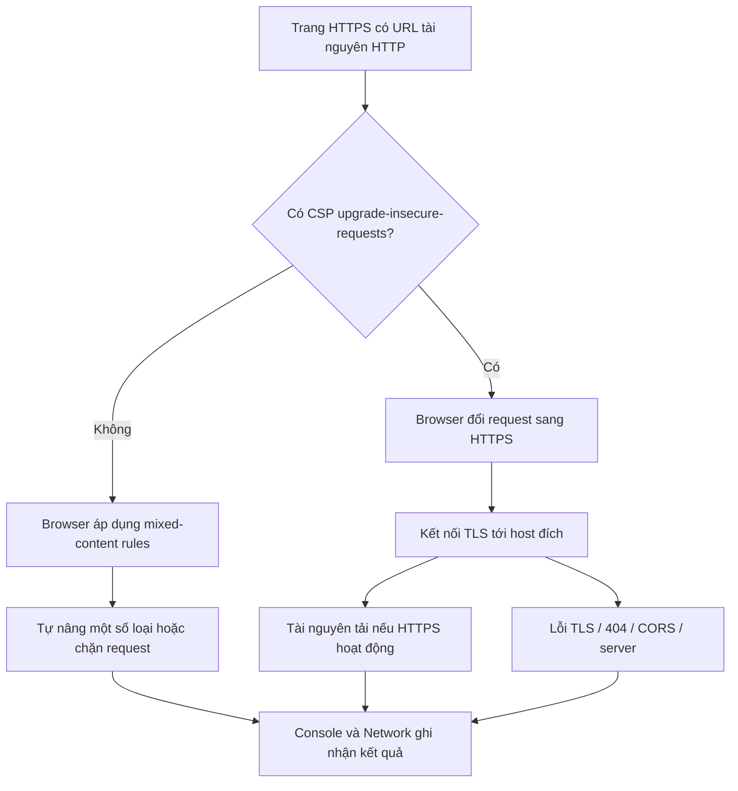

# Upgrade insecure requests: tự nâng request HTTP trong trang HTTPS

Một trang HTTPS có thể vẫn chứa URL tài nguyên bắt đầu bằng HTTP: ảnh từ CDN cũ, script bên thứ ba, stylesheet, font, video hoặc request API. Khi một tài liệu bảo mật tải tài nguyên qua kết nối không mã hóa, trình duyệt có thể cảnh báo, tự nâng cấp một số loại tài nguyên hoặc chặn request. Tình huống này được gọi là **mixed content**.

Chỉ thị CSP **upgrade-insecure-requests** giúp di chuyển ứng dụng đang còn URL HTTP bằng cách yêu cầu trình duyệt nâng các request không an toàn do tài liệu khởi tạo lên HTTPS trước khi gửi chúng. Nhờ đó, ứng dụng có thể sửa dần URL trong mã nguồn và cấu hình tài nguyên. Chỉ thị này không cấp HTTPS cho máy chủ đích, không thay thế HSTS và không bảo đảm mọi điều hướng của người dùng đều được nâng cấp.

Bài học thuộc chương **Mixed content**, trong phạm vi **SECURITY_APPLICATION_SECURITY_BROWSER_SECURITY**: phân tích ranh giới bảo mật giữa trình duyệt, origin, cookie và ứng dụng web để hiểu Same-Origin Policy, CORS và các cơ chế cách ly; thực hành phòng vệ XSS, CSRF, clickjacking bằng CSP, Trusted Types, security headers và kiểm chứng hành vi thực tế.

## 1. Mục tiêu học tập

Sau bài học, người học có thể:

1. Giải thích mixed content và rủi ro khi trang HTTPS tải tài nguyên HTTP.
2. Phân biệt loại nội dung thường bị chặn với loại có thể được browser tự nâng cấp.
3. Mô tả cách CSP **upgrade-insecure-requests** viết lại URL trước khi request được gửi.
4. Cấu hình chỉ thị trong HTTP response header và hiểu giới hạn của nó.
5. Phân biệt upgrade-insecure-requests với HSTS, HTTPS redirect và CORS.
6. Xác định nguyên nhân tài nguyên vẫn lỗi sau khi URL đã được nâng lên HTTPS.
7. Dùng DevTools để tìm mixed content trong HTML, CSS, JavaScript và dependency.
8. Lập kế hoạch chuyển đổi URL HTTP sang HTTPS và loại bỏ chỉ thị chuyển tiếp khi không còn cần.

## 2. Mixed content là gì?

Mixed content xuất hiện khi một tài liệu được tải qua HTTPS nhưng lại yêu cầu một tài nguyên hoặc thực hiện một thao tác qua HTTP không mã hóa. Trang chính được bảo vệ bởi TLS, nhưng một phần nội dung của nó đi qua kết nối có thể bị đọc hoặc sửa trên đường truyền.

Ví dụ:

```html
<!doctype html>
<html lang="vi">
<head>
  <meta charset="utf-8">
  <title>Mixed content demo</title>
  <link rel="stylesheet" href="http://assets.example.test/site.css">
</head>
<body>
  <h1>Trang HTTPS</h1>
  
  <script src="http://scripts.example.test/app.js"></script>
</body>
</html>
```

Nếu tài liệu được tải từ HTTPS, các URL HTTP trong ví dụ tạo mixed content. Tùy loại tài nguyên và hành vi của trình duyệt, request có thể bị tự nâng cấp hoặc bị chặn.

### Vì sao mixed content nguy hiểm?

- **Mất tính toàn vẹn:** kẻ tấn công trên đường truyền có thể sửa nội dung HTTP trước khi trình duyệt nhận.
- **Mất tính bí mật:** dữ liệu gửi tới endpoint HTTP có thể bị quan sát.
- **XSS và chiếm quyền trang:** script hoặc stylesheet bị sửa có thể thay đổi DOM, chèn mã hoặc đánh cắp dữ liệu mà JavaScript của trang được phép truy cập.
- **Giao diện giả mạo:** ảnh, font hoặc nội dung media có thể bị thay thế để lừa người dùng.
- **Rò rỉ request:** URL, query string hoặc dữ liệu gửi qua HTTP có thể bị lộ tùy request.

Một trang có biểu tượng khóa HTTPS không đồng nghĩa mọi tài nguyên mà trang dùng đều đã được bảo vệ. Cần kiểm tra cả tài liệu chính lẫn các request con.

## 3. Browser phân loại mixed content như thế nào?

Trong lịch sử, mixed content thường được chia thành active/blockable và passive/optionally blockable. Cách gọi và hành vi đã thay đổi theo chuẩn và phiên bản browser. Mô hình thực tế hiện nay nên hiểu theo hai nhóm:

| Nhóm thường gặp | Ví dụ | Hành vi phổ biến |
| --- | --- | --- |
| Nội dung chủ động có thể thay đổi cách trang hoạt động | Script, stylesheet, iframe, fetch/XHR, font, object và một số loại worker/resource | Thường bị chặn khi request vẫn là HTTP từ trang HTTPS. |
| Nội dung có thể được tự động nâng cấp | Một số ảnh, audio và video | Browser hiện đại thường thử đổi URL HTTP sang HTTPS; nếu endpoint HTTPS không hoạt động, tài nguyên có thể bị chặn hoặc không hiển thị. |

Đây là mô tả khái quát. Danh sách cụ thể và hành vi có thể khác giữa browser engine, loại phần tử, request mode và chính sách trang. Không dựa vào việc một loại ảnh đang tự nâng cấp trong browser hiện tại để kết luận mọi request HTTP đều an toàn.

### Nội dung chủ động

Script và stylesheet có khả năng ảnh hưởng trực tiếp tới trang. Nếu một script HTTP bị kẻ tấn công thay đổi, nó có thể chạy với quyền của trang HTTPS khi browser chấp nhận. Vì vậy, browser chặn loại nội dung chủ động này theo mặc định.

Các request như fetch/XHR tới HTTP cũng có thể bị chặn như mixed content. Nếu request được nâng lên HTTPS, server đích vẫn cần hỗ trợ HTTPS và đáp ứng CORS khi JavaScript gọi cross-origin.

### Ảnh, audio và video

Một số loại tài nguyên thụ động được browser tự nâng cấp từ HTTP sang HTTPS. Nếu máy chủ không có endpoint HTTPS hợp lệ, request nâng cấp thất bại; browser không nên quay lại dùng HTTP chỉ để hiển thị tài nguyên.

Không dựa vào cơ chế tự nâng cấp này làm chiến lược migration. Hãy sửa URL trong ứng dụng và kiểm tra response thực tế.

### Điều hướng top-level là trường hợp khác

Người dùng bấm liên kết HTTP từ một trang HTTPS để mở website khác là một điều hướng top-level, không giống việc trang âm thầm tải một subresource HTTP. Browser có thể cho phép điều hướng đó và hiển thị cảnh báo rằng trang đích không an toàn. HSTS của hostname đích hoặc HTTPS redirect của server có thể xử lý việc nâng cấp.

Không coi mixed-content protection là bảo đảm mọi liên kết, form hoặc điều hướng của người dùng đều tự chuyển sang HTTPS.

## 4. CSP upgrade-insecure-requests hoạt động thế nào?

Chỉ thị **upgrade-insecure-requests** yêu cầu browser nâng các URL không an toàn do tài liệu khởi tạo sang phiên bản bảo mật trước khi gửi request. Với URL tài nguyên dùng HTTP, browser thử dùng HTTPS cho cùng hostname/path theo quy tắc nâng cấp của chỉ thị.

Ví dụ response header:

```http
Content-Security-Policy: upgrade-insecure-requests
```

Trang có:

```html

<script src="http://scripts.example.test/app.js"></script>
```

Browser sẽ thử tải các tài nguyên qua HTTPS tương ứng. URL trong markup không nhất thiết được sửa lại trong file HTML hoặc trên server; việc nâng cấp được áp dụng ở quá trình xử lý request của browser.

### Nâng cấp trước khi gửi request

Điểm quan trọng là browser nâng URL trước khi thực hiện request không an toàn. Điều này khác với cách dựa vào server redirect:



Với URL HTTP được nâng cấp, browser không cần gửi request HTTP ban đầu để chờ redirect. Điều này tránh việc lộ request tài nguyên qua HTTP trước khi server có cơ hội chuyển hướng.

### Ví dụ kết hợp với CSP policy

Có thể kết hợp chỉ thị này với các directive khác:

```http
Content-Security-Policy: default-src 'self'; script-src 'self' https://scripts.example.com; img-src 'self' https://images.example.com; connect-src 'self' https://api.example.com; upgrade-insecure-requests; object-src 'none'; base-uri 'none'
```

**upgrade-insecure-requests** là directive độc lập, không có source list. Nó không thay thế **default-src**, **script-src**, **img-src**, **connect-src** hoặc các directive giới hạn nguồn khác.

### Không cần khai báo host trong directive

Không viết:

```http
Content-Security-Policy: upgrade-insecure-requests https://cdn.example.com
```

Directive không nhận danh sách host. Nếu cần giới hạn host được phép, hãy dùng directive phù hợp như **script-src**, **img-src**, **font-src** hoặc **connect-src**.

## 5. Điều gì xảy ra nếu endpoint HTTPS không hoạt động?

Upgrade-insecure-requests chỉ đổi scheme của request; nó không:

- Cài certificate cho server đích.
- Tạo listener HTTPS hoặc mở port TLS.
- Sửa certificate hết hạn, sai hostname hoặc chain không tin cậy.
- Chuyển tài nguyên sang một host CDN khác.
- Tự tạo route HTTPS nếu server chỉ phục vụ HTTP.
- Sửa CORS policy của API.

Ví dụ URL:

```text
http://legacy-assets.example.test/app.js
```

có thể được browser nâng thành:

```text
https://legacy-assets.example.test/app.js
```

Nếu host không phục vụ HTTPS, request sẽ thất bại. Browser không nên tự quay lại HTTP vì điều đó sẽ làm mất mục đích bảo vệ. Người dùng có thể thấy lỗi certificate, connection hoặc resource load failed.

### HTTPS endpoint phải phục vụ đúng nội dung

Ngay cả khi TLS handshake thành công, tài nguyên vẫn có thể lỗi vì:

- HTTPS server trả 404 hoặc 403 cho path cũ.
- CDN không có file tại hostname HTTPS tương ứng.
- Redirect HTTPS dẫn tới host khác không có certificate hợp lệ.
- API trả CORS header không phù hợp.
- CSP **script-src**, **img-src** hoặc **connect-src** chặn nguồn sau khi nâng cấp.
- Authentication hoặc cookie behavior thay đổi khi scheme/host/port thay đổi.

Do đó, kiểm tra kết quả cuối cùng ở Network, không chỉ nhìn thấy URL đã đổi thành HTTPS.

## 6. URL tương đối, protocol-relative và URL tạo động

Không phải mọi URL đều được viết trực tiếp thành http://... trong HTML. Mixed content có thể xuất phát từ nhiều vị trí.

### URL tuyệt đối

```html

```

Đây là trường hợp dễ tìm bằng tìm kiếm văn bản.

### URL protocol-relative

```html
<script src="//cdn.example.test/app.js"></script>
```

URL bắt đầu bằng // kế thừa scheme của tài liệu. Nếu trang là HTTPS, request sẽ dùng HTTPS; đây không phải cách ép dùng HTTP. Tuy nhiên, URL tuyệt đối HTTPS thường rõ ràng hơn và tránh phụ thuộc scheme của trang.

### CSS và import

Mixed content có thể nằm trong stylesheet:

```css
.hero {
  background-image: url("http://images.example.test/hero.png");
}

@import url("http://styles.example.test/legacy.css");
```

Kiểm tra CSS nội tuyến, file CSS được import, font-face và CSS do thư viện tạo.

### URL được tạo trong JavaScript

```js
const imageUrl = 'http://images.example.test/' + imageName;
image.src = imageUrl;
```

Tìm kiếm http:// trong repository không phát hiện được mọi URL ghép từ nhiều biến hoặc lấy từ API. Cần kiểm tra dữ liệu cấu hình, CMS, database và response của các endpoint cung cấp URL.

### srcset, poster và các thuộc tính ít được chú ý

Rà soát thêm:

- **srcset** và **picture/source**.
- **video.poster**, **audio.src**, **video.src** và **source**.
- **iframe.src**, **object.data**, **embed.src**.
- **link.href**, **script.src**, **form.action**.
- CSS **url()** và **@import**.
- URL trong manifest, worker/module loader và cấu hình thư viện.

Không phải tất cả các thuộc tính trên đều được xử lý như nhau bởi mixed-content algorithm. Hãy xác minh từng request bằng browser thay vì suy ra chỉ từ tên thuộc tính.

## 7. Upgrade-insecure-requests khác HSTS như thế nào?

Hai cơ chế có thể cùng được dùng nhưng phạm vi và cách lưu chính sách khác nhau:

| Đặc điểm | CSP upgrade-insecure-requests | HSTS |
| --- | --- | --- |
| Nơi khai báo | CSP của tài liệu | HSTS response header của hostname |
| Phạm vi | Request không an toàn do tài liệu áp dụng policy khởi tạo | Các lần truy cập tới hostname đã học policy, gồm điều hướng và request tài nguyên theo quy tắc HSTS |
| Lưu trạng thái | Không phải policy HSTS dài hạn theo hostname; áp dụng khi tài liệu có CSP | Browser lưu policy theo hostname trong thời hạn max-age |
| Lần truy cập đầu | Có tác dụng khi browser nhận được tài liệu có CSP | Chưa bảo vệ lần đầu nếu chưa preload và browser chưa học policy |
| Subdomain | Phụ thuộc các URL/request trong tài liệu và CSP | Có thể bao phủ subdomain bằng includeSubDomains |
| Mục đích | Hỗ trợ migration URL HTTP trong nội dung trang | Buộc hostname dùng HTTPS trong thời gian policy có hiệu lực |

### Dùng cả hai khi phù hợp

HSTS là biện pháp nền tảng để bảo vệ hostname khỏi bị truy cập bằng HTTP sau khi browser biết policy. **upgrade-insecure-requests** giúp xử lý các URL HTTP còn tồn tại trong HTML, CSS, JavaScript hoặc dữ liệu mà trang sử dụng.

Ví dụ:

```http
Strict-Transport-Security: max-age=31536000; includeSubDomains
Content-Security-Policy: upgrade-insecure-requests; default-src 'self'
```

Chỉ dùng **includeSubDomains** khi toàn bộ hostname con trong phạm vi đã sẵn sàng HTTPS.

## 8. Upgrade-insecure-requests khác redirect và mixed-content auto-upgrade

### So với HTTP redirect

Redirect yêu cầu browser gửi request tới URL ban đầu trước khi server có thể trả **301**, **302**, **307** hoặc **308**. Nếu URL ban đầu là HTTP và request bị browser chặn do mixed content, server có thể không bao giờ nhận được request để redirect.

Với **upgrade-insecure-requests**, browser đổi URL trước khi gửi request. Vì vậy server HTTPS đích cần phục vụ tài nguyên trực tiếp tại URL đã nâng cấp.

### So với tự nâng cấp ảnh/media

Browser hiện đại có thể tự nâng một số loại ảnh, audio hoặc video từ HTTP lên HTTPS ngay cả khi trang không khai báo **upgrade-insecure-requests**. Chỉ thị CSP áp dụng cơ chế nâng cấp cho các insecure request do tài liệu khởi tạo rộng hơn theo quy tắc của directive.

Không dựa vào auto-upgrade riêng của browser làm cấu hình tương thích. Khai báo CSP rõ ràng và loại bỏ URL HTTP khỏi mã nguồn sẽ dễ kiểm soát hơn.

### Không nhầm với block-all-mixed-content

**block-all-mixed-content** là directive cũ từng yêu cầu chặn mixed content thay vì tự nâng một số loại. Trong các browser hiện đại, mixed-content blocking và auto-upgrade đã được tích hợp vào hành vi mặc định; directive này đã lỗi thời và không nên dùng làm chiến lược chính.

**upgrade-insecure-requests** và **block-all-mixed-content** có mục tiêu khác nhau. Không khai báo cả hai với kỳ vọng vừa nâng cấp vừa chặn cùng một request. Chọn chính sách phù hợp và kiểm tra hành vi browser.

## 9. Giới hạn của upgrade-insecure-requests

Chỉ thị này hữu ích cho migration, nhưng không phải giải pháp thay thế việc sửa URL và cấu hình server.

### Không tạo HTTPS cho bên thứ ba

Nếu trang dùng script từ một dịch vụ chỉ hỗ trợ HTTP, browser có thể nâng URL lên HTTPS nhưng request sẽ thất bại. Cần yêu cầu nhà cung cấp hỗ trợ HTTPS, chuyển sang dịch vụ khác hoặc bỏ dependency.

### Không tự sửa điều hướng tới website HTTP

Một liên kết mà người dùng bấm để rời trang tới website HTTP khác là điều hướng top-level. Không dựa vào **upgrade-insecure-requests** để bảo đảm mọi website đích đều được nâng cấp. HSTS của hostname đích, URL HTTPS trong nội dung và redirect của server đích mới là các cơ chế phù hợp.

### Không thay thế CSP source directives

Nếu policy có:

```http
Content-Security-Policy: default-src 'self'; upgrade-insecure-requests
```

thì request đã được nâng lên HTTPS vẫn phải thỏa **default-src** hoặc directive chuyên biệt tương ứng. Việc scheme đã đổi không làm nguồn cross-origin tự động được phép.

### Không thay thế CORS

Một fetch() tới API khác origin có thể được nâng từ HTTP sang HTTPS nhưng vẫn bị CORS chặn nếu API không cho phép origin của trang đọc response. Kiểm tra **Access-Control-Allow-Origin**, credentials và preflight như một vấn đề riêng.

### Không sửa dữ liệu URL trong database

Browser có thể nâng request lúc chạy nhưng URL cũ vẫn nằm trong CMS, database, cấu hình hoặc HTML đã lưu. Điều đó khiến dependency vào directive tiếp tục tồn tại. Nên sửa dữ liệu gốc và kiểm tra các luồng tạo nội dung mới.

### Không thay thế xác thực TLS

Nếu HTTPS endpoint có certificate sai hoặc TLS lỗi, browser sẽ không có kết nối an toàn thành công. Không hạ cấp lại HTTP để tránh lỗi; sửa chứng chỉ và cấu hình endpoint.

## 10. Triển khai CSP upgrade-insecure-requests

Nên gửi CSP qua HTTP response header:

```http
Content-Security-Policy: upgrade-insecure-requests
```

Trong production, kết hợp với policy hiện có thay vì vô tình ghi đè CSP khác:

```http
Content-Security-Policy: default-src 'self'; script-src 'self' https://cdn.example.com; img-src 'self' https://images.example.com; connect-src 'self' https://api.example.com; upgrade-insecure-requests; object-src 'none'; base-uri 'none'
```

Nếu server đang gửi nhiều CSP header, browser áp dụng các policy đồng thời. Không tạo thêm header mới một cách tùy tiện với suy nghĩ nó sẽ ghi đè policy cũ. Hãy hợp nhất và review các policy hiện có.

### Meta element

Một số CSP directive có thể được khai báo bằng meta element, nhưng HTTP response header là cách triển khai nên ưu tiên. Với **upgrade-insecure-requests**, hãy cấu hình header trên response tài liệu để policy có hiệu lực sớm và nhất quán. Meta chỉ có hiệu lực từ vị trí trình duyệt parse được nó; request xảy ra trước vị trí đó không được bảo vệ hồi tố.

### Report-Only không phải cách thử directive này

**upgrade-insecure-requests** không có tác dụng trong **Content-Security-Policy-Report-Only**. Vì vậy, không thể chỉ thêm directive vào Report-Only rồi kỳ vọng browser nâng URL hoặc tạo báo cáo nâng cấp tương ứng.

Để chuẩn bị migration, dùng các phương pháp kiểm kê URL, Console, Network, CSP violation reporting phù hợp với các directive khác và staging. Sau khi xác nhận endpoint HTTPS hoạt động, bật directive enforcement trên môi trường thử nghiệm rồi production.

## 11. Quy trình migration từ HTTP sang HTTPS

Một lộ trình an toàn nên kết hợp kiểm kê, sửa URL gốc và dùng CSP như lớp chuyển tiếp.

### Bước 1: lập inventory URL

Tìm các URL HTTP trong:

- HTML template và component.
- CSS, Sass/Less đã build và stylesheet của dependency.
- JavaScript, cấu hình runtime và module loader.
- CMS, database, nội dung do người dùng hoặc biên tập viên tạo.
- API response, manifest và cấu hình CDN.
- Redirect, iframe và tích hợp bên thứ ba.

Tìm kiếm ban đầu trong repository:

```bash
rg -n -i "http://" src public assets
```

Đây chỉ là bước rà soát sơ bộ. URL có thể được ghép động, mã hóa, sinh từ database hoặc nằm trong bundle đã build. Kiểm tra thêm runtime và Network.

### Bước 2: xác minh endpoint HTTPS

Với từng host, xác minh:

- DNS trỏ tới đúng dịch vụ.
- TLS certificate hợp lệ và SAN khớp hostname.
- Path tài nguyên tồn tại qua HTTPS.
- Redirect không quay về HTTP.
- CDN phục vụ đúng content type và cache behavior.
- API có CORS policy phù hợp nếu request cross-origin.
- Authentication và cookie hoạt động đúng sau khi chuyển scheme.

### Bước 3: sửa URL tại nguồn

Thay URL HTTP bằng HTTPS rõ ràng trong template, CSS, JavaScript và database. Với URL cùng origin, cân nhắc URL tương đối khi phù hợp. Với CDN/API bên ngoài, dùng hostname HTTPS đã được xác minh.

Không thay hàng loạt http:// thành https:// mà không kiểm tra host và path; một số dịch vụ có thể chưa hỗ trợ HTTPS hoặc dùng URL HTTP có ý nghĩa riêng trong dữ liệu.

### Bước 4: bật upgrade-insecure-requests trong staging

Gửi header CSP và kiểm tra toàn bộ chức năng. Quan sát lỗi certificate, 404, CORS, CSP source restriction và dependency không tương thích.

### Bước 5: bật trong production và giám sát

Sau khi staging ổn định, triển khai trên các route phù hợp. Theo dõi Console, Network, frontend error monitoring và báo cáo CSP liên quan. Xác định owner của tài nguyên lỗi và sửa tại nguồn.

### Bước 6: loại bỏ URL HTTP còn sót

Khi inventory không còn URL HTTP cần hỗ trợ chuyển tiếp, gỡ chỉ thị nếu không còn nhu cầu migration. Duy trì HTTPS URL tường minh, HSTS và các CSP source directives phù hợp. Nếu giữ directive, ghi rõ lý do và chủ sở hữu để tránh nó trở thành lớp che lỗi lâu dài.

## 12. Thực hành: quan sát upgrade-insecure-requests

Thực hành trên trang HTTPS và các hostname thử nghiệm do người học kiểm soát. Dùng dữ liệu giả. Không thay đổi header hoặc thử tải tài nguyên HTTP từ website của bên thứ ba.

### 12.1. Chuẩn bị hai endpoint

Chuẩn bị:

- Một trang HTTPS, ví dụ **https://secure-lab.example.test/page.html**.
- Một host tài nguyên thử nghiệm có HTTP và HTTPS, ví dụ **assets-lab.example.test**.

Host tài nguyên phải có certificate hợp lệ cho HTTPS để phép thử nâng cấp thành công. Để thử trường hợp thất bại, dùng một host riêng không có HTTPS hoặc certificate không hợp lệ. Tránh dùng localhost/loopback nếu browser coi đó là potentially trustworthy và áp dụng ngoại lệ mixed-content.

### 12.2. Tạo trang có tài nguyên HTTP

Nội dung trang thử nghiệm:

```html
<!doctype html>
<html lang="vi">
<meta charset="utf-8">
<title>Upgrade insecure requests lab</title>
<h1>Mixed content lab</h1>

<script src="http://assets-lab.example.test/lab.js"></script>
<script>
  fetch('http://assets-lab.example.test/api/demo')
    .then((response) => response.text())
    .then((text) => console.log('API:', text))
    .catch((error) => console.error('Fetch failed:', error));
</script>
</html>
```

Thay domain ví dụ bằng host thử nghiệm thực tế. Không dùng script thực hiện hành động nhạy cảm.

### 12.3. Quan sát khi chưa bật directive

Phục vụ trang qua HTTPS mà chưa có **upgrade-insecure-requests**. Mở DevTools → **Network**, bật **Preserve log** và **Disable cache**, tải lại trang.

Quan sát:

- Script/fetch HTTP có thể bị browser chặn như mixed content.
- Ảnh có thể được browser tự nâng lên HTTPS theo hành vi hiện đại.
- Console hiển thị cảnh báo hoặc lỗi mixed content.
- Request bị chặn có thể không xuất hiện như một request HTTP đã gửi tới server.

Ghi lại request URL, initiator và lý do browser chặn hoặc nâng cấp.

### 12.4. Bật upgrade-insecure-requests

Trên response HTTPS của trang, thêm:

```http
Content-Security-Policy: upgrade-insecure-requests
```

Tải lại. Quan sát các URL HTTP do tài liệu khởi tạo được thử qua HTTPS. Nếu server đích hỗ trợ TLS và path tương ứng, tài nguyên có thể tải thành công. Nếu server không có HTTPS, request nâng cấp thất bại và không nên quay về HTTP.

### 12.5. Kiểm tra API và CORS

Với fetch cross-origin, xác minh API trả CORS header phù hợp cho origin HTTPS của trang. Một request có thể đã được nâng lên HTTPS nhưng vẫn thất bại do CORS. Quan sát Console để phân biệt mixed-content/TLS failure với CORS failure.

### 12.6. Kiểm tra URL động và CSS

Thêm một ảnh được tạo bằng JavaScript và một background image trong CSS dùng URL HTTP. Bật directive rồi kiểm tra Network để xác nhận request phát sinh từ runtime cũng được xử lý theo policy.

### 12.7. Kiểm tra giới hạn điều hướng

Đặt một liên kết tới website HTTP thử nghiệm và nhấp để mở. Quan sát đây là top-level navigation; không dựa vào **upgrade-insecure-requests** để bảo đảm website đích được nâng cấp. Kiểm tra HSTS hoặc redirect HTTPS của chính host đích.

### 12.8. Bằng chứng cần lưu

| Bằng chứng | Điều cần xác nhận |
| --- | --- |
| Response header | Trang HTTPS nhận CSP có **upgrade-insecure-requests**. |
| Network URL | Request tài nguyên HTTP được thử qua HTTPS sau khi bật directive. |
| Endpoint TLS | Host đích phục vụ tài nguyên qua HTTPS với certificate hợp lệ. |
| Failed upgrade | Host không có HTTPS hoặc TLS lỗi làm resource thất bại, không fallback về HTTP. |
| CORS | Fetch cross-origin đã được nâng cấp nhưng vẫn cần CORS hợp lệ. |
| Dynamic URL/CSS | Request tạo từ JavaScript/CSS cũng được kiểm tra trong Network. |
| Top-level navigation | Liên kết rời trang không được coi là đã được directive bảo vệ như subresource. |

## 13. Những lỗi thường gặp

| Hiện tượng | Nguyên nhân có thể | Cách kiểm tra |
| --- | --- | --- |
| Script vẫn không tải | HTTPS endpoint không tồn tại hoặc certificate lỗi | Mở URL HTTPS trực tiếp và xem Network/TLS error. |
| Ảnh biến mất sau khi bật directive | Browser nâng URL nhưng HTTPS server trả 404/403 | Kiểm tra path, host, content type và redirect. |
| Fetch vẫn lỗi sau upgrade | CORS không cho origin của trang đọc response | Kiểm tra ACAO, credentials và preflight. |
| CSP vẫn chặn request | Source list của **img-src**, **script-src** hoặc **connect-src** không cho phép host | Sửa directive nguồn phù hợp; không mở rộng toàn bộ **default-src**. |
| Một số URL vẫn HTTP | URL được ghép động hoặc lấy từ database/CMS | Kiểm tra runtime, API response và dữ liệu lưu. |
| Tưởng directive nâng mọi link | Nhầm subresource request với top-level navigation | Kiểm tra liên kết và HSTS/redirect ở host đích. |
| Header không có tác dụng | CSP header bị proxy ghi đè hoặc gửi sai response | Xác minh response document cuối trong Network. |
| Dùng Report-Only để thử nâng cấp | Directive không có tác dụng trong Report-Only | Thử enforcement trên staging có kiểm soát. |
| Bật rồi giữ mãi | URL HTTP cũ vẫn tồn tại, che lỗi dependency | Sửa URL tại nguồn và đặt tiêu chí gỡ directive. |

## 14. Checklist production

| Hạng mục | Câu hỏi rà soát | Kết quả mong đợi |
| --- | --- | --- |
| Inventory | Đã tìm URL HTTP trong HTML, CSS, JS, CMS và API chưa? | Có danh sách host/path và owner. |
| HTTPS endpoint | Từng host có TLS certificate và route hợp lệ không? | HTTPS tải đúng tài nguyên, không redirect về HTTP. |
| CSP header | Directive có trên response của đúng document không? | Network xác nhận policy được browser nhận. |
| Source policy | Request sau upgrade có thỏa CSP source directive không? | **script-src**, **img-src**, **connect-src** được khai báo theo nhu cầu. |
| CORS | API cross-origin có cho origin HTTPS đọc response không? | CORS và credential policy hợp lệ. |
| Redirect | Redirect chain có quay lại HTTP không? | Chuỗi redirect chỉ dùng HTTPS. |
| Dynamic URLs | CMS/API/runtime có còn tạo URL HTTP không? | Dữ liệu nguồn đã được sửa hoặc validate. |
| Third parties | CDN/widget có hỗ trợ HTTPS ổn định không? | Có cam kết và kiểm thử từ nhà cung cấp. |
| HSTS | Hostname có HSTS phù hợp không? | HSTS được triển khai riêng theo phạm vi hostname. |
| Report-Only | Có hiểu giới hạn của Report-Only với directive này không? | Không dựa vào Report-Only để nâng request. |
| Monitoring | Có theo dõi mixed-content, TLS, CORS và CSP errors không? | Lỗi được phân loại theo nguyên nhân. |
| Cleanup | Khi nào gỡ directive chuyển tiếp? | URL HTTP được loại khỏi mã và dữ liệu gốc. |

## 15. Câu hỏi tự kiểm tra

1. Mixed content là gì và vì sao một trang có HTTPS vẫn có thể bị ảnh hưởng bởi tài nguyên HTTP?
2. Vì sao script HTTP nguy hiểm hơn một ảnh HTTP bị thay thế?
3. Browser hiện đại thường xử lý ảnh/audio/video HTTP khác script và fetch HTTP như thế nào?
4. **upgrade-insecure-requests** thay đổi request ở giai đoạn nào?
5. Nếu server đích không hỗ trợ HTTPS, browser có quay lại HTTP không? Vì sao?
6. Vì sao redirect HTTP sang HTTPS không tương đương nâng URL trước khi gửi request?
7. **upgrade-insecure-requests** khác HSTS về phạm vi và thời gian lưu policy như thế nào?
8. Vì sao request đã được nâng lên HTTPS vẫn có thể thất bại do CSP hoặc CORS?
9. Vì sao không dùng Report-Only để kiểm tra hiệu quả nâng cấp của directive này?
10. Làm thế nào tìm URL HTTP phát sinh từ CSS, JavaScript, CMS và API thay vì chỉ tìm chuỗi trong HTML?

**Tiêu chí hoàn thành:** người học có thể giải thích mixed content và hành vi browser, bật CSP **upgrade-insecure-requests** đúng cách, xác minh request được nâng trước khi gửi, phân biệt lỗi TLS với CSP/CORS, hiểu giới hạn đối với top-level navigation và HSTS, đồng thời lập kế hoạch loại bỏ URL HTTP khỏi mã nguồn và dữ liệu ứng dụng.
