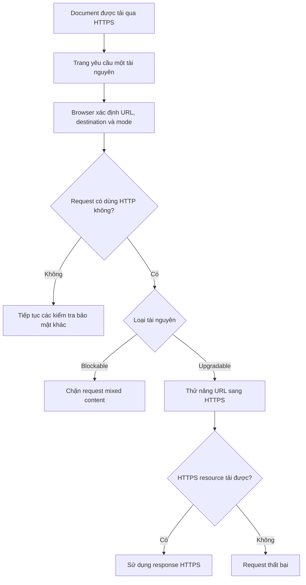

# Kiểm tra mixed content

## 1. Mixed content là gì?

**Mixed content** (nội dung hỗn hợp) xảy ra khi một trang được tải qua HTTPS nhưng lại yêu cầu tài nguyên qua HTTP không mã hóa. Ví dụ, người dùng mở `https://shop.example` nhưng trang lại tải ảnh, JavaScript hoặc stylesheet từ `http://cdn.example`. Kết nối tới trang chính được bảo vệ bằng TLS, còn request tới tài nguyên HTTP có thể bị nghe lén hoặc sửa đổi trên đường truyền.

Mixed content làm suy yếu cam kết bảo mật mà HTTPS tạo ra. Nếu tài nguyên HTTP là JavaScript, stylesheet, iframe hoặc dữ liệu API, kẻ tấn công trên đường truyền có thể thay đổi nội dung được browser xử lý trong ngữ cảnh trang HTTPS. Với ảnh hoặc media, nội dung cũng có thể bị thay thế, theo dõi hoặc thao túng.

Browser hiện đại phân loại mixed content và tự động nâng cấp hoặc chặn nhiều request. Tuy nhiên, kết quả phụ thuộc loại tài nguyên, URL ban đầu, redirect và chính sách browser. Vì vậy, kiểm tra mixed content cần xem cả source code, request thực tế và response cuối cùng trong DevTools.

Trong module `SECURITY_APPLICATION_SECURITY_BROWSER_SECURITY`, mixed content liên quan tới ranh giới bảo mật của browser, origin, security headers và cross-origin isolation. Bài này hướng dẫn cách nhận diện request không an toàn, hiểu browser xử lý từng loại tài nguyên, sửa nguồn URL và xác minh sau triển khai.

### Kết quả học tập

Sau bài này, người học có thể:

1. Giải thích mixed content và lý do HTTPS page tải HTTP resource tạo rủi ro.
2. Phân biệt tài nguyên bị chặn với tài nguyên browser tự động nâng cấp.
3. Kiểm tra URL ban đầu, redirect chain, request initiator và Console warning.
4. Phân biệt mixed content với mixed download, form action không an toàn và CORS error.
5. Dùng CSP `upgrade-insecure-requests` và HSTS đúng mục đích.
6. Tìm và sửa URL HTTP trong HTML, CSS, JavaScript, CMS, API và cấu hình CDN.
7. Xác minh rằng trang không còn request mixed content sau khi phát hành.

## 2. Vì sao mixed content nguy hiểm?

HTTPS bảo vệ tính bí mật, tính toàn vẹn và xác thực máy chủ cho kết nối tới origin được truy cập. Nhưng một trang HTTPS có thể phụ thuộc vào tài nguyên được tải qua HTTP. Khi đó, kẻ tấn công có khả năng can thiệp vào kết nối HTTP có thể thay đổi response trước khi browser sử dụng.

Ví dụ trang HTTPS tải script:

```html
<script src="http://cdn.example.net/app.js"></script>
```

Nếu browser thực thi script này, mã chạy trong ngữ cảnh trang chứa nó. Script có thể đọc DOM, tương tác với giao diện và gửi request theo quyền của trang. Kẻ tấn công có thể thay file JavaScript trên đường truyền để chèn mã độc. Vì vậy, mixed active content đặc biệt nguy hiểm.

Một ảnh HTTP có thể không thực thi JavaScript trực tiếp trong ngữ cảnh trang, nhưng vẫn có rủi ro về nội dung bị thay thế, theo dõi request, lộ địa chỉ IP hoặc thao túng giao diện. Browser thường xử lý ảnh/media khác với script vì mức độ rủi ro khác nhau.

Mixed content cũng có thể làm hỏng tính năng hợp lệ. Ví dụ, một trang HTTPS gọi API HTTP bằng `fetch()` có thể bị browser chặn trước khi ứng dụng nhận được response. Developer đôi khi nhầm lỗi này với CORS, nhưng CORS và mixed content là hai lớp kiểm tra khác nhau.

## 3. Nhận diện các loại mixed content

Trong mô hình hiện đại, tài nguyên mixed content thường được chia thành hai nhóm hành vi: **blockable mixed content** và **upgradable mixed content**. Tài liệu cũ có thể dùng tên active/passive hoặc optionally blockable; khi kiểm tra hệ thống hiện tại, hãy dựa vào hành vi browser thực tế.

### 3.1. Blockable mixed content

Đây là các loại tài nguyên mà browser thường chặn khi một secure document cố tải qua HTTP. Những ví dụ phổ biến:

- JavaScript và module script.
- Stylesheet CSS.
- iframe hoặc frame.
- Request `fetch()` và XMLHttpRequest.
- Font web.
- Worker và một số loại tài nguyên thực thi khác.
- Một số loại media/object hoặc request nhạy cảm khác theo quy tắc browser.

Ví dụ:

```html
<script src="http://assets.example.net/app.js"></script>
<link rel="stylesheet" href="http://assets.example.net/site.css">
<iframe src="http://legacy.example.net/account"></iframe>
```

```js
fetch("http://api.example.net/profile");
```

Các request trên không nên được kỳ vọng hoạt động trên một HTTPS page. Browser có thể chặn chúng và ghi lỗi mixed content trong Console.

### 3.2. Upgradable mixed content

Một số loại tài nguyên có thể được browser tự động nâng cấp từ HTTP sang HTTPS trước khi tải. Các ví dụ thường gặp là ảnh, audio và video:

```html

<audio src="http://media.example.net/intro.mp3" controls></audio>
<video src="http://media.example.net/demo.mp4" controls></video>
```

Browser có thể chuyển URL request sang HTTPS. Nếu máy chủ không hỗ trợ HTTPS hoặc tài nguyên không tồn tại ở HTTPS, request sẽ thất bại. Việc browser tự nâng cấp không có nghĩa URL nguồn đã được sửa trong ứng dụng.

Có ngoại lệ quan trọng: tài nguyên upgradable trỏ trực tiếp tới địa chỉ IP có thể bị chặn thay vì tự nâng cấp. Browser cũng có thể có khác biệt theo loại element, thuộc tính và phiên bản. Không nên dựa vào tự động nâng cấp làm giải pháp dài hạn; hãy cập nhật URL trong dữ liệu và mã nguồn.

### 3.3. Bảng nhận diện nhanh

| Loại tài nguyên | Ví dụ URL HTTP trên HTTPS page | Hành vi thường gặp |
| --- | --- | --- |
| Script | `script src="http://..."` | Bị chặn |
| Stylesheet | `link rel="stylesheet" href="http://..."` | Bị chặn |
| iframe | `iframe src="http://..."` | Bị chặn |
| Fetch/XHR | `fetch("http://...")` | Bị chặn |
| Font | `@font-face` với URL HTTP | Bị chặn |
| Ảnh | `img src="http://..."` | Thường được tự nâng cấp sang HTTPS; lỗi nếu HTTPS không dùng được |
| Audio/video | `audio` hoặc `video` với URL HTTP | Thường được tự nâng cấp; lỗi nếu HTTPS không dùng được |
| WebSocket | `ws://...` từ trang HTTPS | Dùng `wss://`; kết nối không an toàn có thể bị chặn |

Bảng này dùng để định hướng kiểm tra. Hãy xác nhận trong browser mục tiêu vì danh sách và cách xử lý chi tiết phụ thuộc chuẩn và implementation.

## 4. Cách browser kiểm tra mixed content

Browser biết document được tải trong một secure context, ví dụ HTTPS. Khi document yêu cầu tài nguyên, browser đánh giá URL đích và loại request trước khi sử dụng response.

Quy trình khái quát:



### 4.1. URL ban đầu và redirect chain

Không chỉ URL xuất hiện trong HTML mới quan trọng. Một URL HTTPS có thể redirect sang HTTP:

```text
https://assets.example.net/current.js
    -> 302 Location: http://legacy.example.net/current.js
```

Browser có thể chặn redirect tới HTTP trong ngữ cảnh mixed content. Vì vậy, khi DevTools hiển thị request lỗi, hãy xem redirect chain và `Location` header. Chỉ sửa URL ban đầu mà bỏ qua redirect server-side có thể không giải quyết được lỗi.

### 4.2. Scheme, host và port

Một request dùng HTTPS nhưng khác host vẫn là cross-origin, song không phải mixed content chỉ vì khác host. Mixed content liên quan tới việc secure document yêu cầu tài nguyên không an toàn, thường là HTTP. CORS, CORP, CSP và các chính sách khác có thể tiếp tục áp dụng cho tài nguyên HTTPS cross-origin.

Ví dụ:

- `https://app.example.com` tải `https://cdn.example.net/app.js`: không phải mixed content chỉ vì khác origin.
- `https://app.example.com` tải `http://cdn.example.net/app.js`: mixed content.
- `http://app.example.com` tải `http://cdn.example.net/app.js`: không phải mixed content theo định nghĩa secure-document-to-insecure-resource, nhưng trang cũng không có bảo vệ HTTPS.

### 4.3. Localhost và secure context

Browser xem một số origin local như `http://localhost` hoặc loopback address là potentially trustworthy cho các API secure-context. Điều này hữu ích khi phát triển local, nhưng không nên suy rộng rằng mọi HTTP host nội bộ đều an toàn. Một domain LAN, hostname tự đặt hoặc IP nội bộ không mặc nhiên được xem như localhost.

Khi kiểm thử mixed content, dùng một HTTPS origin thật hoặc local TLS setup có chứng chỉ được browser tin cậy; xác nhận browser đang coi document là secure context.

## 5. Mixed content và các lỗi gần giống

### 5.1. Mixed content không phải CORS

Mixed content được kiểm tra dựa trên secure document, URL scheme và loại request. CORS điều khiển việc JavaScript có được đọc response cross-origin hay không.

Một request có thể bị chặn vì mixed content trước khi CORS trở thành vấn đề. Ngược lại, một HTTPS request có thể không gặp mixed content nhưng vẫn thất bại vì server thiếu `Access-Control-Allow-Origin`.

| Hiện tượng | Lớp kiểm tra | Hướng điều tra |
| --- | --- | --- |
| HTTPS page gọi HTTP API và browser chặn | Mixed content | Chuyển API sang HTTPS |
| HTTPS page gọi HTTPS API nhưng Console báo CORS | CORS | Kiểm tra CORS response headers |
| HTTPS page nhúng HTTPS ảnh nhưng bị từ chối bởi CORP | CORP | Kiểm tra `Cross-Origin-Resource-Policy` |
| HTTPS page tải script HTTPS bị CSP chặn | CSP | Kiểm tra `script-src` và nguồn được phép |
| Chứng chỉ HTTPS hết hạn hoặc không hợp lệ | TLS/certificate validation | Sửa chứng chỉ và chuỗi tin cậy |

Không sửa lỗi mixed content bằng cách mở rộng CORS. CORS header không làm HTTP trở thành HTTPS.

### 5.2. Mixed download

Mixed download là tình huống trang HTTPS cung cấp file tải xuống qua HTTP. Nó có thể bị browser cảnh báo hoặc chặn tùy loại file, browser và mức độ rủi ro. Đây là vấn đề liên quan nhưng không đồng nhất với mixed subresource content.

Ví dụ:

```html
<a href="http://downloads.example.net/installer.exe">Tải ứng dụng</a>
```

Hãy chuyển link tải xuống sang HTTPS và đảm bảo file được phân phối qua endpoint an toàn. Không dựa vào người dùng bỏ qua cảnh báo browser.

### 5.3. Form gửi tới HTTP

Form trên trang HTTPS có thể có `action` trỏ tới HTTP:

```html
<form action="http://legacy.example.net/submit" method="post">
  <input name="email">
  <button type="submit">Gửi</button>
</form>
```

Điều này làm dữ liệu form có thể đi qua kết nối không mã hóa. Đây là một luồng gửi dữ liệu không an toàn cần sửa, dù không nên gộp nó với mọi quy tắc mixed subresource. Chuyển endpoint nhận form sang HTTPS và kiểm tra redirect, cookie, CSRF cùng cấu hình server.

### 5.4. WebSocket không an toàn

Trang HTTPS cần kết nối WebSocket bảo mật bằng `wss://`:

```js
const socket = new WebSocket("wss://realtime.example.net/events");
```

Nếu ứng dụng dùng `ws://`, browser có thể chặn kết nối như một mixed-content risk. Hãy chuyển server WebSocket sang TLS, cấu hình reverse proxy và kiểm tra certificate.

## 6. Tìm nguồn mixed content trong ứng dụng

Mixed content thường không chỉ nằm trong một file HTML. URL HTTP có thể được sinh từ template, database, CMS, CSS, cấu hình môi trường, API response hoặc script runtime.

### 6.1. Kiểm tra HTML

Tìm các thuộc tính tải tài nguyên:

```html
<script src="http://..."></script>
<link href="http://..." rel="stylesheet">

<iframe src="http://..."></iframe>
<video src="http://..."></video>
<audio src="http://..."></audio>
```

Kiểm tra cả `srcset`, `poster`, `source`, `object`, `embed`, manifest và các thuộc tính URL khác mà ứng dụng sử dụng.

### 6.2. Kiểm tra CSS

CSS có thể tham chiếu tài nguyên qua `url()` hoặc `@import`:

```css
@import url("http://fonts.example.net/legacy.css");

.hero {
  background-image: url("http://images.example.net/hero.jpg");
}

@font-face {
  font-family: "Brand";
  src: url("http://fonts.example.net/brand.woff2") format("woff2");
}
```

Một trang không có URL HTTP trong HTML vẫn có thể phát sinh mixed content từ stylesheet. Kiểm tra file CSS ngoài, CSS inline và CSS được sinh động từ theme hoặc component.

### 6.3. Kiểm tra JavaScript và dữ liệu runtime

Tìm URL được ghép trong code:

```js
const apiBase = "http://api.example.net";
fetch(apiBase + "/profile");

const image = document.createElement("img");
image.src = config.bannerUrl;
document.querySelector("#banner").replaceChildren(image);
```

`config.bannerUrl` có thể đến từ API, database hoặc CMS. Kiểm tra giá trị thực tại runtime và nơi tạo ra nó. Sửa dữ liệu nguồn thay vì chỉ vá một nơi render.

### 6.4. Kiểm tra redirect và cấu hình hạ tầng

Một URL có thể trông là HTTPS nhưng CDN, reverse proxy hoặc storage redirect sang HTTP. Hãy kiểm tra:

- HTTP `Location` header ở từng hop.
- Cấu hình origin và protocol của CDN.
- URL được tạo bởi CMS/media library.
- Cấu hình base URL trong từng môi trường.
- API response có chứa link HTTP.
- Service worker hoặc script cũ còn trả HTML/CSS tham chiếu HTTP.
- Cache CDN/browser còn lưu phiên bản cũ.

## 7. Công cụ kiểm tra trong DevTools

### 7.1. Console

Mở DevTools → Console và reload trang. Browser thường ghi rõ mixed content bị block hoặc URL đã được tự động nâng cấp. Ghi lại:

- URL document HTTPS.
- URL tài nguyên HTTP ban đầu.
- Loại tài nguyên.
- Hành vi: blocked, auto-upgraded hay request failed.
- Frame hoặc script tạo request.

Console là điểm bắt đầu nhanh, nhưng không phải bằng chứng duy nhất. Một request có thể được sinh sau khi người dùng thao tác hoặc sau khi ứng dụng tải dữ liệu.

### 7.2. Network

Trong DevTools → Network:

1. Bật Preserve log nếu trang điều hướng hoặc reload.
2. Bật Disable cache trong lúc kiểm tra.
3. Lọc theo `http://` hoặc tìm request có scheme HTTP.
4. Xem cột Initiator để tìm file hoặc call stack khởi tạo request.
5. Xem Request URL, redirect chain, status và Response Headers.
6. Phân biệt URL ban đầu với URL cuối cùng sau redirect/upgrade.

Nếu browser tự nâng cấp URL, request có thể xuất hiện dưới HTTPS trong Network. Console có thể cho biết URL nguồn đã được nâng cấp; đối chiếu với source và cấu hình để tìm vị trí cần sửa.

### 7.3. Security panel và kiểm tra certificate

Dùng Security panel để xem trạng thái bảo mật của document, certificate và các vấn đề kết nối. Một trang có certificate hợp lệ vẫn có thể chứa mixed content. HTTPS trên document chính không chứng minh mọi tài nguyên đều được tải an toàn.

### 7.4. Kiểm tra sau tương tác

Không chỉ reload trang chủ. Hãy đi qua các luồng:

- Đăng nhập và đăng xuất.
- Mở modal, tab, menu và widget.
- Upload/download.
- Tìm kiếm và phân trang.
- Phát video/audio.
- Mở trang quản trị.
- Tạo nội dung trong CMS.
- Luồng thanh toán hoặc nhúng bên thứ ba.

Một URL HTTP chỉ được tạo sau khi người dùng thao tác có thể không xuất hiện trong lần tải đầu tiên.
## 8. Khắc phục mixed content

### 8.1. Sửa URL tại nguồn

Cách sửa bền vững là chuyển tài nguyên sang HTTPS và cập nhật URL nơi nó được tạo ra:

- Thay URL HTTP bằng HTTPS khi máy chủ tài nguyên đã hỗ trợ TLS.
- Cập nhật base URL, biến môi trường và cấu hình CDN.
- Sửa link trong CMS/database bằng migration có kiểm tra.
- Cập nhật URL trong CSS, template, email HTML và nội dung do người dùng quản trị.
- Thay API endpoint và WebSocket endpoint bằng HTTPS/WSS.
- Loại bỏ redirect từ HTTPS về HTTP.

Không thay mọi chuỗi `http://` trong database một cách mù quáng. Một số chuỗi có thể là nội dung văn bản, ví dụ hoặc dữ liệu không phải URL tài nguyên. Hãy xác định cột/field URL, kiểm tra host và kiểm thử migration trước khi áp dụng.

### 8.2. Ưu tiên URL HTTPS tuyệt đối

Ví dụ:

```html
<script src="https://cdn.example.net/app.js"></script>

```

Không dùng URL HTTP rồi kỳ vọng browser sẽ tự nâng cấp. Nếu nhà cung cấp chưa hỗ trợ HTTPS, hãy chuyển tài nguyên sang host khác có TLS, proxy qua hạ tầng tin cậy hoặc loại bỏ phụ thuộc đó. Không tải tài nguyên active qua HTTP chỉ để giữ tương thích.

### 8.3. URL tương đối theo scheme

URL dạng protocol-relative:

```html

```

sẽ kế thừa scheme của document; trên trang HTTPS, browser sẽ dùng HTTPS. Cách này tránh hardcode HTTP, nhưng URL tuyệt đối HTTPS thường rõ ràng hơn và dễ kiểm tra hơn. Không chuyển URL thành `//host` nếu host không hỗ trợ HTTPS.

### 8.4. Sửa URL sinh động

Nếu URL được tạo từ cấu hình, hãy xác thực protocol ở điểm tiếp nhận cấu hình:

```js
function requireHttpsUrl(raw) {
  const url = new URL(raw);

  if (url.protocol !== "https:") {
    throw new Error("Chỉ chấp nhận URL HTTPS");
  }

  return url.href;
}

const imageUrl = requireHttpsUrl(config.bannerUrl);
const image = document.createElement("img");
image.src = imageUrl;
document.querySelector("#banner").replaceChildren(image);
```

Nếu tính năng cần truy cập host cụ thể, hãy kiểm tra thêm hostname/port theo allowlist. Chỉ kiểm tra protocol không bảo đảm URL trỏ tới đúng nhà cung cấp hoặc tài nguyên đáng tin.

### 8.5. Khi tài nguyên chưa hỗ trợ HTTPS

Nếu server tài nguyên không hỗ trợ HTTPS, có một số hướng xử lý:

1. Yêu cầu nhà cung cấp bật TLS trên chính host tài nguyên.
2. Chuyển tài nguyên sang CDN hoặc object storage do tổ chức kiểm soát và có HTTPS.
3. Proxy tài nguyên qua backend của ứng dụng nếu có lý do nghiệp vụ và kiểm soát được cache, quyền truy cập, loại nội dung và SSRF.
4. Loại bỏ tài nguyên hoặc tính năng cũ nếu không thể cung cấp an toàn.

Không tạo proxy mở nhận URL tùy ý từ client. Proxy kiểu đó có thể trở thành SSRF endpoint. Hãy dùng allowlist host/path, giới hạn redirect, giới hạn kích thước và xác thực loại nội dung.

## 9. Dùng CSP upgrade-insecure-requests

### 9.1. Chức năng

CSP directive `upgrade-insecure-requests` yêu cầu browser nâng cấp các URL tài nguyên không an toàn trong document thành HTTPS trước khi gửi request:

```http
Content-Security-Policy: upgrade-insecure-requests
```

Ví dụ markup:

```html

<script src="http://cdn.example.net/app.js"></script>
```

Với directive này, browser sẽ cố yêu cầu các URL tương ứng qua HTTPS. Script HTTP sau khi được nâng cấp có thể tải nếu endpoint HTTPS tồn tại và các chính sách khác cho phép. Nếu host không phục vụ HTTPS, request sẽ thất bại.

### 9.2. Phạm vi và giới hạn

`upgrade-insecure-requests` là công cụ chuyển tiếp hữu ích khi ứng dụng còn nhiều URL HTTP đã biết. Tuy nhiên:

- Không sửa source code, database hoặc nội dung CMS.
- Không bảo đảm host đích có HTTPS hoặc certificate hợp lệ.
- Không thay CORS, CSP source allowlist, CORP hay authentication.
- Không nên coi đây là giải pháp thay thế việc sửa URL gốc.
- Không dùng để thay thế việc bảo vệ điều hướng top-level hoặc link tải xuống.
- Không làm một endpoint HTTP trở thành endpoint HTTPS có cùng cấu hình và semantics.

Directive được áp dụng bởi browser khi xử lý tài nguyên của document. Hãy xác minh hành vi với loại request và browser mục tiêu; đừng giả định mọi URL trong mọi ngữ cảnh đều được nâng cấp.

### 9.3. Kết hợp với CSP hiện có

Có thể đưa directive vào policy CSP đang dùng:

```http
Content-Security-Policy: default-src 'self'; script-src 'self' https://cdn.example.net; object-src 'none'; base-uri 'self'; upgrade-insecure-requests
```

Đây chỉ là ví dụ minh họa. Các directive nguồn cần được thiết kế theo ứng dụng. `upgrade-insecure-requests` không cấp quyền cho một script bị `script-src` chặn và cũng không bỏ qua lỗi certificate.

### 9.4. block-all-mixed-content

Một số tài liệu cũ đề cập directive:

```http
Content-Security-Policy: block-all-mixed-content
```

Directive này từng được dùng để yêu cầu chặn mixed content thay vì nâng cấp một số loại tài nguyên. Trong browser hiện đại, phần lớn mixed content không được tự nâng cấp đã bị chặn theo mặc định; `block-all-mixed-content` được xem là obsolete và không nên dựa vào nó làm lớp bảo vệ chính.

Hãy dùng HTTPS URL, kiểm tra hành vi browser và cân nhắc `upgrade-insecure-requests` như biện pháp chuyển tiếp. Đừng thêm directive cũ mà không hiểu khả năng hỗ trợ và hiệu lực thực tế.

## 10. HSTS bảo vệ host như thế nào?

### 10.1. Strict-Transport-Security

HTTP Strict Transport Security (HSTS) cho phép server yêu cầu browser chỉ truy cập host qua HTTPS trong khoảng thời gian nhất định:

```http
Strict-Transport-Security: max-age=31536000
```

Sau khi browser nhận header hợp lệ từ một kết nối HTTPS, nó ghi nhớ chính sách và tự nâng các lần truy cập HTTP tiếp theo tới host đó lên HTTPS trong thời gian `max-age`.

HSTS khác với `upgrade-insecure-requests`:

| Cơ chế | Phạm vi chính | Mục tiêu |
| --- | --- | --- |
| `upgrade-insecure-requests` | Các request tài nguyên của document áp dụng CSP | Nâng URL tài nguyên HTTP trong trang lên HTTPS |
| HSTS | Các lần truy cập tới host đã ghi nhận HSTS | Buộc browser dùng HTTPS khi truy cập host đó |
| Sửa URL nguồn | Mã, dữ liệu và cấu hình ứng dụng | Loại bỏ tham chiếu HTTP ngay từ nguồn |

HSTS không tự sửa URL trong database/CMS và không thay thế CSP. Một trang vẫn có thể chứa URL HTTP tới host không có HSTS.

### 10.2. includeSubDomains

Có thể áp dụng HSTS cho subdomain:

```http
Strict-Transport-Security: max-age=31536000; includeSubDomains
```

Chỉ bật `includeSubDomains` khi tất cả subdomain liên quan đều hỗ trợ HTTPS ổn định. Một host cũ chỉ phục vụ HTTP có thể không truy cập được sau khi browser áp dụng chính sách.

### 10.3. preload

Một số tổ chức đăng ký host vào HSTS preload list để browser biết chính sách HTTPS ngay từ trước lần truy cập đầu tiên. Preload có yêu cầu và quy trình riêng; việc gỡ bỏ có thể mất thời gian để lan truyền qua các phiên bản browser.

Không thêm `preload` chỉ vì đã đặt `max-age`. Trước khi đăng ký, xác minh mọi subdomain đều có HTTPS, redirect đúng và có kế hoạch vận hành chứng chỉ dài hạn.

### 10.4. HSTS không thay certificate hợp lệ

HSTS yêu cầu browser dùng HTTPS; nó không làm chứng chỉ sai trở nên hợp lệ. Nếu certificate hết hạn, sai hostname hoặc không có chuỗi tin cậy, browser vẫn báo lỗi bảo mật và không nên cho người dùng bỏ qua.
## 11. Quy trình kiểm tra mixed content theo từng bước

Có thể dùng quy trình sau cho một website đang chạy:

1. **Xác nhận secure document:** mở trang bằng HTTPS và kiểm tra certificate.
2. **Tạo baseline:** mở DevTools, bật Preserve log và Disable cache, reload trang.
3. **Ghi nhận Console:** lưu từng cảnh báo mixed content, loại tài nguyên và URL.
4. **Rà soát Network:** tìm request HTTP, redirect, initiator và URL cuối.
5. **Kiểm tra source:** tìm URL trong HTML, CSS, JavaScript, cấu hình, CMS và API response.
6. **Phân loại:** blockable, upgradable, mixed download, form action hoặc WebSocket.
7. **Sửa nguồn:** chuyển endpoint sang HTTPS/WSS, sửa redirect và dữ liệu.
8. **Triển khai chuyển tiếp:** nếu phù hợp, dùng `upgrade-insecure-requests` trong CSP để giảm lỗi trong giai đoạn migration.
9. **Kiểm thử lại:** reload, thao tác các luồng và kiểm tra các trang con.
10. **Xác minh sau release:** kiểm tra trên browser mục tiêu, môi trường production và CDN cache.

### 11.1. Tạo bảng theo dõi

| URL/nguồn | Loại tài nguyên | Hành vi browser | Nguyên nhân | Hành động | Trạng thái |
| --- | --- | --- | --- | --- | --- |
| `http://cdn.example.net/app.js` | Script | Blocked | URL hardcode trong template | Chuyển sang HTTPS | Open |
| `http://media.example.net/banner.jpg` | Image | Upgraded | CMS lưu URL HTTP | Sửa dữ liệu CMS | Open |
| `https://api.example.net/profile` | Fetch | CORS error | Thiếu ACAO | Cấu hình CORS đúng origin | Separate issue |
| `https://assets.example.net/current.css` | Stylesheet | Redirect to HTTP | CDN origin config sai | Sửa redirect/origin | Open |
| `ws://realtime.example.net/events` | WebSocket | Blocked | Endpoint không có TLS | Chuyển sang WSS | Open |

Bảng theo dõi giúp phân biệt lỗi mixed content với lỗi CORS/TLS/CSP khác, tránh sửa nhầm lớp.

## 12. Thực hành: audit một HTTPS page

Bài lab nên chạy trên staging hoặc domain thử nghiệm do bạn kiểm soát, có certificate HTTPS hợp lệ và một host tài nguyên HTTP/HTTPS riêng để quan sát. Không dùng tài khoản thật hoặc dữ liệu nhạy cảm trong lab.

### 12.1. Tạo trang kiểm tra

Thay các hostname ví dụ bằng host do bạn kiểm soát. Đặt file này trên một trang HTTPS:

```html
<!doctype html>
<meta charset="utf-8">
<title>Mixed content audit lab</title>
<h1>Mixed content audit</h1>


<script src="http://assets.example.test/sample.js"></script>
<link rel="stylesheet" href="http://assets.example.test/sample.css">

<iframe
  src="http://assets.example.test/frame.html"
  title="Mixed content frame">
</iframe>

<button id="fetch-test" type="button">Test HTTP fetch</button>
<pre id="result">Chưa kiểm tra</pre>

<script>
  document.querySelector("#fetch-test").addEventListener("click", async () => {
    try {
      const response = await fetch("http://assets.example.test/data.json");
      document.querySelector("#result").textContent =
        "HTTP fetch status: " + response.status;
    } catch (error) {
      document.querySelector("#result").textContent = String(error);
    }
  });
</script>
```

Đảm bảo các URL HTTP trên thực sự trỏ tới host thử nghiệm do bạn quản lý. Một số browser tự nâng cấp ảnh; các loại script, stylesheet, iframe và fetch thường bị chặn. Nếu host hỗ trợ HTTPS, bật directive nâng cấp ở bước tiếp theo để so sánh.

### 12.2. Bật upgrade-insecure-requests

Trên response của trang HTTPS thử nghiệm, thêm header:

```http
Content-Security-Policy: upgrade-insecure-requests
```

Reload trang và so sánh:

- URL HTTP của tài nguyên có được browser nâng cấp sang HTTPS không?
- Script/CSS/iframe có tải được nếu host phục vụ HTTPS không?
- Ảnh có còn cảnh báo hoặc request lỗi không?
- Fetch có còn mixed content error hay chuyển sang lỗi CORS/TLS khác không?
- Resource host có certificate hợp lệ và đúng hostname không?

Nếu endpoint không hỗ trợ HTTPS, request được nâng cấp có thể thất bại. Đây là kết quả mong đợi khi server chưa sẵn sàng; không gỡ HTTPS để làm lab chạy.

### 12.3. Xác nhận không còn mixed content

Sau khi thay URL nguồn thành HTTPS:

1. Gỡ các URL HTTP thử nghiệm khỏi trang.
2. Reload với cache tắt.
3. Kiểm tra Console không còn mixed content warning/block.
4. Kiểm tra Network không còn request resource HTTP.
5. Thử thao tác nút Fetch và các chức năng tải động.
6. Kiểm tra redirect chain của mọi tài nguyên.
7. Xác nhận CSP/HSTS header trên response production.

## 13. Ma trận kiểm thử

| Mã | Trường hợp | Kết quả mong muốn |
| --- | --- | --- |
| MIX-01 | HTTPS page tải script HTTP | Browser chặn |
| MIX-02 | HTTPS page tải stylesheet HTTP | Browser chặn |
| MIX-03 | HTTPS page tải iframe HTTP | Browser chặn |
| MIX-04 | HTTPS page gọi fetch HTTP | Browser chặn |
| MIX-05 | HTTPS page tải image HTTP | Browser có thể tự nâng cấp; request thất bại nếu HTTPS không có |
| MIX-06 | HTTPS page tải audio/video HTTP | Browser thường nâng cấp; kiểm tra HTTPS endpoint |
| MIX-07 | HTTPS URL redirect sang HTTP | Redirect tới tài nguyên không an toàn bị chặn |
| MIX-08 | HTTP resource được nâng cấp bằng CSP | Browser yêu cầu HTTPS; TLS/404 vẫn có thể làm request thất bại |
| MIX-09 | HTTPS API thiếu CORS header | CORS thất bại, không phải mixed content |
| MIX-10 | HTTPS page mở WebSocket ws:// | Kết nối không an toàn bị chặn; dùng wss:// |
| MIX-11 | Link tải file qua HTTP | Kiểm tra mixed download warning/block |
| MIX-12 | Form HTTPS gửi tới HTTP | Dữ liệu có thể bị gửi không mã hóa; chuyển action sang HTTPS |
| MIX-13 | HTTPS resource redirect giữa các host HTTPS | Không phải mixed content chỉ vì đổi host; kiểm tra CORS/CSP/CORP riêng |
| MIX-14 | URL HTTP sinh sau thao tác người dùng | Phải được phát hiện qua kiểm thử tương tác |
| MIX-15 | Browser cache phiên bản HTML/CSS cũ | Xóa cache/purge và kiểm tra response mới |
| MIX-16 | HSTS áp dụng cho host | Browser tự nâng truy cập HTTP tới host đã ghi nhận HSTS |

## 14. Những sai lầm thường gặp

| Nhận định sai | Cách hiểu đúng |
| --- | --- |
| HTTPS page nghĩa là mọi request đều an toàn | Mỗi tài nguyên cần được kiểm tra; HTTP subresource có thể làm suy yếu trang |
| Browser luôn chặn mọi HTTP resource | Một số loại như image/media có thể được tự nâng cấp |
| Ảnh được nâng cấp nghĩa là đã sửa xong | URL nguồn vẫn có thể là HTTP và sẽ gây lỗi khi HTTPS không khả dụng |
| CORS cho phép HTTP resource trên HTTPS page | CORS không bỏ qua mixed-content checks |
| Thêm `upgrade-insecure-requests` là hoàn tất migration | Đây là biện pháp chuyển tiếp; cần sửa URL nguồn và kiểm tra endpoint |
| `block-all-mixed-content` là header cần có trong mọi site | Directive đã obsolete trong browser hiện đại; không dựa vào nó |
| HSTS thay thế CSP upgrade | HSTS áp dụng cho host đã ghi nhận; CSP upgrade xử lý URL tài nguyên trong document |
| URL HTTPS redirect sang HTTP vẫn an toàn | Redirect cuối sang HTTP có thể bị chặn |
| Khác origin đồng nghĩa mixed content | HTTPS cross-origin không tự động là mixed content |
| CORP/CORS/CSP đều là cùng một cơ chế | Mỗi chính sách kiểm soát một khía cạnh khác nhau |
| Localhost HTTP luôn đại diện production HTTP | Localhost được xử lý đặc biệt trong secure-context model |
| Form action HTTP luôn được kiểm tra giống script HTTP | Đây là luồng gửi dữ liệu không an toàn; cần đánh giá riêng và chuyển sang HTTPS |

## 15. Checklist triển khai

- [ ] Mở trang bằng HTTPS và xác minh certificate hợp lệ.
- [ ] Kiểm tra Console và Network với Preserve log, Disable cache.
- [ ] Tìm URL HTTP trong HTML, CSS, JavaScript, API, CMS và database.
- [ ] Kiểm tra cả request phát sinh sau thao tác người dùng.
- [ ] Kiểm tra request initiator, redirect chain và URL cuối.
- [ ] Phân biệt blockable với upgradable mixed content.
- [ ] Chuyển script, CSS, iframe, fetch/XHR, font và WebSocket sang HTTPS/WSS.
- [ ] Sửa URL ảnh/media tại nguồn, không phụ thuộc tự động nâng cấp.
- [ ] Sửa form action và link tải xuống để không gửi dữ liệu/file qua HTTP.
- [ ] Cấu hình `upgrade-insecure-requests` như lớp hỗ trợ migration khi phù hợp.
- [ ] Triển khai HSTS sau khi HTTPS ổn định trên host và các subdomain cần áp dụng.
- [ ] Không dùng CORS để xử lý mixed content.
- [ ] Purge cache và kiểm tra lại sau deploy.
- [ ] Xác minh không còn mixed-content warning/block trong browser mục tiêu.

### Ghi nhớ

**Mixed content xuất hiện khi một secure page yêu cầu tài nguyên không an toàn qua HTTP.** Browser thường chặn script, stylesheet, iframe và fetch/XHR; một số image/audio/video có thể được tự động nâng cấp sang HTTPS. Hãy kiểm tra URL nguồn, request initiator và redirect chain trong DevTools, sửa endpoint và dữ liệu để dùng HTTPS/WSS. `upgrade-insecure-requests` hỗ trợ migration, HSTS buộc browser dùng HTTPS cho host đã ghi nhận; cả hai đều không thay thế việc sửa URL gốc và kiểm tra certificate. Phân biệt mixed content với CORS, CORP, mixed download và form action để xử lý đúng lớp bảo mật.
