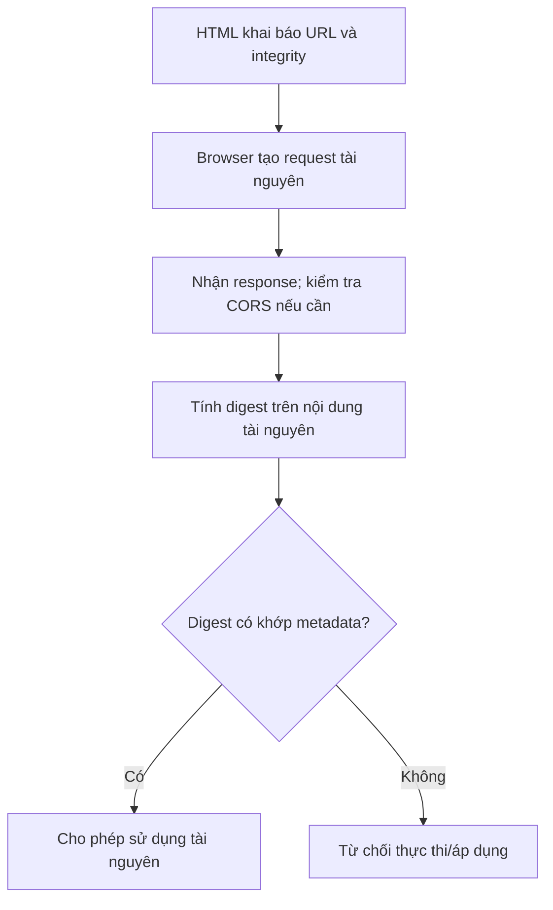

# Integrity attribute

> **Chương:** Resource integrity  
> **Học phần:** Application Security — Browser Security (`SECURITY_APPLICATION_SECURITY_BROWSER_SECURITY`)

Trang web thường tải JavaScript và CSS từ CDN hoặc một origin khác để tận dụng cache, giảm tải cho server và dùng thư viện bên thứ ba. Nhưng khi ứng dụng tin một URL tài nguyên, nội dung tại URL đó vẫn có thể thay đổi do CDN bị xâm nhập, tài khoản phát hành bị chiếm, lỗi triển khai hoặc đường phân phối bị can thiệp.

**Subresource Integrity (SRI)** cho phép trang khai báo digest mong đợi của tài nguyên bằng thuộc tính HTML `integrity`. Browser tải tài nguyên, tính hash trên nội dung nhận được rồi so sánh với metadata. Nếu không có hash hợp lệ khớp, browser từ chối sử dụng tài nguyên đó. Cơ chế này giúp phát hiện nội dung JavaScript/CSS bị thay đổi so với phiên bản mà ứng dụng đã phê duyệt.

SRI xác minh nội dung tài nguyên; nó không xác minh danh tính hay độ an toàn của nhà cung cấp. Nếu ứng dụng tự cập nhật cả file lẫn hash mà không review, hoặc attacker sửa được HTML chứa thuộc tính `integrity`, SRI không thể tự bảo vệ ứng dụng khỏi thay đổi đó. Cần kết hợp SRI với TLS, CSP, quản lý dependency, quy trình build/release và bảo vệ HTML.

## 1. Mục tiêu học tập

Sau bài học, bạn có thể:

1. Giải thích SRI và cách browser xác minh nội dung tài nguyên.
2. Sử dụng thuộc tính `integrity` trên script và stylesheet.
3. Tạo digest SHA-256, SHA-384 hoặc SHA-512 ở dạng Base64.
4. Hiểu vì sao một thay đổi byte nhỏ làm hash không còn khớp.
5. Kết hợp SRI với `crossorigin` và CORS khi tải tài nguyên cross-origin.
6. Phân biệt SRI với CSP hash source, CORS và CORP.
7. Quản lý hash khi nâng cấp thư viện, thay đổi CDN hoặc build asset.
8. Áp dụng SRI cho tài nguyên được tạo động theo đúng thứ tự.
9. Kiểm thử lỗi integrity và xử lý sự cố trong browser.

## 2. SRI giải quyết vấn đề gì?

Giả sử trang tải thư viện từ CDN:

```html
<script src="https://cdn.example.net/library/4.2.1/library.min.js"></script>
```

Ứng dụng tin rằng URL này luôn trả về đúng nội dung phiên bản `4.2.1`. Nhưng nếu file trên CDN bị thay thế, browser vẫn có thể thực thi nội dung mới vì URL và TLS của CDN vẫn hợp lệ. HTTPS bảo vệ đường truyền tới CDN; nó không chứng minh nội dung file đúng với bản mà ứng dụng đã review.

SRI bổ sung digest vào HTML:

```html
<script
  src="https://cdn.example.net/library/4.2.1/library.min.js"
  integrity="sha384-BASE64_DIGEST"
  crossorigin="anonymous"></script>
```

Browser so sánh nội dung tải được với digest. Nếu nội dung khác, script không được thực thi. Với stylesheet, browser không áp dụng stylesheet có integrity mismatch.

SRI đặc biệt hữu ích với asset tĩnh, có phiên bản rõ ràng và không thay đổi ngoài quy trình release. Nó tạo một liên kết giữa HTML đã phê duyệt và byte nội dung tài nguyên được sử dụng.

## 3. Cách browser kiểm tra `integrity`

Luồng xử lý khái quát:



Browser dùng thuật toán được nêu trong integrity metadata để tính digest và đối chiếu với nội dung thực tế. Với tài nguyên cross-origin, kiểm tra CORS cần thành công trước khi SRI có thể được sử dụng theo yêu cầu của trình duyệt.

Nếu hash không khớp, request có thể vẫn xuất hiện trong Network với response tải về thành công, nhưng browser từ chối thực thi script hoặc áp dụng stylesheet. Vì vậy, HTTP status `200` không chứng minh SRI đã thành công; cần kiểm tra Console và trạng thái sử dụng tài nguyên.

## 4. Cấu trúc integrity metadata

Giá trị `integrity` gồm một hoặc nhiều hash expression, phân tách bằng khoảng trắng:

```text
sha256-BASE64_DIGEST
sha384-BASE64_DIGEST
sha512-BASE64_DIGEST
```

Ví dụ:

```html
<script
  src="https://cdn.example.net/app/4.2.1/app.min.js"
  integrity="sha384-abc123BASE64DIGEST"
  crossorigin="anonymous"></script>
```

Chuỗi trong ví dụ là placeholder, không phải digest thực. Digest phải được tạo từ đúng file mà browser sẽ tải. SRI dùng Base64 chuẩn cho digest, không dùng chuỗi hexadecimal hoặc Base64URL.

Các thuật toán được dùng trong SRI là SHA-256, SHA-384 và SHA-512. Không dùng MD5 hoặc SHA-1. SHA-384 thường là lựa chọn cân bằng giữa độ dài metadata và mức an toàn; SHA-512 cũng hợp lệ nếu pipeline và công cụ của bạn hỗ trợ.

## 5. Tạo hash bằng Node.js

Hãy tạo digest từ byte của file cuối cùng, sau khi build/minify hoàn tất:

```js
const { createHash } = require("node:crypto");
const { readFileSync } = require("node:fs");

const fileBytes = readFileSync("dist/library.min.js");
const digest = createHash("sha384")
  .update(fileBytes)
  .digest("base64");

console.log(`sha384-${digest}`);
```

`readFileSync` trả về Buffer nên giữ nguyên byte. Không tự trim, normalize newline hoặc decode/encode lại file trước khi tính hash. Bất kỳ bước transform nào sau khi tạo hash đều có thể làm digest không khớp với tài nguyên phát hành.

Để dùng SHA-256 hoặc SHA-512, thay tên thuật toán trong `createHash` và prefix tương ứng. Prefix phải đúng với thuật toán đã dùng để tạo digest.

## 6. Tạo hash bằng OpenSSL

Với file đã build:

```bash
openssl dgst -sha384 -binary dist/library.min.js | openssl base64 -A
```

Ghép kết quả vào metadata:

```text
sha384-KET_QUA_BASE64
```

Ví dụ tạo SHA-256:

```bash
openssl dgst -sha256 -binary dist/styles.min.css | openssl base64 -A
```

Không lấy output dạng hex từ lệnh `openssl dgst -sha384 file` rồi dán trực tiếp vào `integrity`; browser cần digest Base64 theo định dạng SRI. Dùng `-binary` rồi chuyển sang Base64 như ví dụ.

## 7. Dùng SRI cho JavaScript bên ngoài

Ví dụ script từ CDN:

```html
<script
  src="https://cdn.example.net/library/4.2.1/library.min.js"
  integrity="sha384-BASE64_DIGEST"
  crossorigin="anonymous"></script>
```

Khi browser tải script, nó kiểm tra digest trước khi thực thi. Nếu CDN trả nội dung khác file đã dùng để tạo hash, script bị từ chối.

Nên:

- Dùng URL có phiên bản cố định thay vì alias luôn trỏ tới bản mới nhất.
- Tạo hash từ artifact đã review và phát hành.
- Lưu nguồn gốc file, version, digest và quy trình tạo digest trong build manifest hoặc dependency record.
- Cập nhật URL và hash cùng một thay đổi có review.
- Kiểm tra CDN không biến đổi nội dung bằng minify hoặc rewrite sau khi hash được tạo.

SRI không biến một URL tùy ý thành đáng tin. Nếu `src` được lấy trực tiếp từ input người dùng, attacker vẫn có thể điều khiển request hoặc gây lỗi tải; hãy allowlist URL/host và dùng manifest tài nguyên do ứng dụng kiểm soát.

## 8. Dùng SRI cho stylesheet

SRI cũng áp dụng cho stylesheet ngoài:

```html
<link
  rel="stylesheet"
  href="https://cdn.example.net/ui/3.8.0/ui.min.css"
  integrity="sha384-BASE64_DIGEST"
  crossorigin="anonymous">
```

Nếu CSS trên CDN bị thay đổi, browser không áp dụng stylesheet đó. Giao diện có thể thiếu style dù response tải về thành công.

Kiểm tra cả các dependency mà stylesheet tham chiếu. `integrity` trên file CSS xác minh byte của chính file CSS; nó không tự tạo một manifest hash cho mọi ảnh, font hoặc stylesheet được tham chiếu bằng `url(...)` hay `@import`. Từng tài nguyên cần được kiểm soát bằng cơ chế phù hợp của nó.

## 9. Cross-origin SRI cần CORS

Khi script hoặc stylesheet nằm trên origin khác, SRI yêu cầu tài nguyên phải được tải theo CORS-enabled request và response phải vượt qua CORS check. Vì vậy, markup thường cần thuộc tính `crossorigin`:

```html
<script
  src="https://cdn.example.net/library/4.2.1/library.min.js"
  integrity="sha384-BASE64_DIGEST"
  crossorigin="anonymous"></script>
```

CDN có thể trả:

```http
Access-Control-Allow-Origin: *
```

Với asset công khai không cần credential, `crossorigin="anonymous"` và `Access-Control-Allow-Origin: *` là cấu hình thường dùng. Server cũng có thể trả origin cụ thể, ví dụ:

```http
Access-Control-Allow-Origin: https://app.example.com
Vary: Origin
```

Nếu server phản chiếu origin theo allowlist, `Vary: Origin` giúp cache phân biệt response theo request origin. Không phản chiếu mọi giá trị `Origin` một cách vô điều kiện.

## 10. `crossorigin="anonymous"` và `use-credentials`

Thuộc tính `crossorigin` điều khiển CORS settings mode và cách gửi credential:

| Giá trị | Cách gửi credential | CORS response cần có |
| --- | --- | --- |
| `anonymous` | Không gửi credential cross-origin; request same-origin vẫn dùng credential theo quy tắc same-origin | `Access-Control-Allow-Origin: *` hoặc origin cụ thể phù hợp |
| `use-credentials` | Cho phép gửi credential cả cross-origin | Origin cụ thể và `Access-Control-Allow-Credentials: true` |

Ví dụ credentialed response:

```http
Access-Control-Allow-Origin: https://app.example.com
Access-Control-Allow-Credentials: true
Vary: Origin
```

Không thể dùng `Access-Control-Allow-Origin: *` cho response CORS có credentials. Với thư viện JavaScript/CSS công khai, ưu tiên `anonymous`; hiếm khi cần tải asset tĩnh bằng cookie người dùng. Nếu phải dùng `use-credentials`, đánh giá kỹ vì CDN/resource server sẽ nhận credential theo request và cần cấu hình CORS chặt.

## 11. CORS và SRI là hai bước kiểm tra khác nhau

Với tài nguyên cross-origin, hai câu hỏi độc lập được đặt ra:

1. **CORS:** Server có cho phép request từ origin của trang theo CORS mode không?
2. **SRI:** Nội dung response có đúng digest mà trang đã khai báo không?

| Trường hợp | Kết quả |
| --- | --- |
| CORS thất bại | Browser không cho sử dụng tài nguyên theo yêu cầu cross-origin SRI |
| CORS thành công, hash khớp | Tài nguyên có thể được sử dụng nếu các policy khác cũng cho phép |
| CORS thành công, hash sai | Browser từ chối thực thi script/áp dụng stylesheet |
| Hash đúng nhưng CSP chặn host | Tài nguyên vẫn bị CSP chặn |

SRI không thay thế CORS. CORS không xác minh nội dung có đúng phiên bản mong đợi. Một response được CORS cho phép đọc vẫn có thể chứa file bị thay đổi; SRI giúp phát hiện sự thay đổi đó.

## 12. SRI và CSP phối hợp với nhau

CSP và SRI có vai trò bổ sung:

- CSP `script-src`/`style-src` giới hạn nguồn tài nguyên mà trang được tải.
- SRI `integrity` xác minh nội dung tài nguyên tải từ URL đó.
- CORS cho phép request cross-origin đáp ứng điều kiện truy cập tương ứng.
- TLS bảo vệ tính toàn vẹn và bí mật của kết nối tới server.

Ví dụ:

```http
Content-Security-Policy: default-src 'self'; script-src 'self' https://cdn.example.net; style-src 'self' https://cdn.example.net; object-src 'none'; base-uri 'self'
```

```html
<script
  src="https://cdn.example.net/library/4.2.1/library.min.js"
  integrity="sha384-BASE64_DIGEST"
  crossorigin="anonymous"></script>
```

CSP cho phép tải script từ CDN đã chỉ định; SRI kiểm tra nội dung cụ thể. Nếu CDN bị xâm nhập và trả file khác, SRI có thể chặn file đó. Nếu CSP không cho CDN, tài nguyên bị chặn dù hash đúng.

Không nới `script-src` thành wildcard chỉ vì đã có SRI. URL và origin vẫn cần được giới hạn để giảm bề mặt request và tránh phụ thuộc không cần thiết.

## 13. SRI khác CSP hash source

Hai cơ chế đều dùng SHA digest nhưng áp dụng ở vị trí khác nhau:

| Tiêu chí | SRI | CSP hash source |
| --- | --- | --- |
| Nơi khai báo | Thuộc tính `integrity` trên element/API được hỗ trợ | CSP response header |
| Trường hợp phổ biến | File script hoặc stylesheet ngoài | Inline `<script>`/`<style>` block; cũng có quy tắc cho external script khi kết hợp integrity metadata theo CSP |
| Dữ liệu hash | Byte nội dung tài nguyên được tải | Nội dung inline block hoặc metadata liên quan theo quy tắc CSP |
| Mục đích | Xác minh tài nguyên tải về có đúng nội dung mong đợi | Cho phép nội dung phù hợp với policy CSP |

Ví dụ inline script:

```html
<script>
  initializeApplication();
</script>
```

Inline block không có URL tài nguyên ngoài để gắn SRI `integrity`. Nếu muốn cho phép inline script cụ thể, dùng CSP nonce hoặc hash source theo `script-src`/`script-src-elem`. Không nhầm hai loại hash chỉ vì cùng dùng SHA-384.

## 14. SRI không tự bảo vệ toàn bộ dependency graph

Một tài nguyên được bảo vệ bởi SRI có thể tải thêm tài nguyên khác. Ví dụ:

- CSS dùng `@import` hoặc `url(...)` để tải CSS/font/ảnh.
- JavaScript tạo thêm thẻ `<script>`.
- Một thư viện tải plugin hoặc worker theo URL.
- Module import các module khác theo dependency graph.

Hash của tài nguyên gốc chỉ xác minh nội dung của tài nguyên được gắn integrity. Không giả định một hash ở thẻ script ban đầu tự pin mọi tài nguyên mà code đó tải về. Với mỗi dependency quan trọng, hãy dùng version pinning, integrity metadata hoặc cơ chế phân phối phù hợp được browser hỗ trợ; đồng thời giới hạn nguồn bằng CSP.

Nếu một thư viện tải plugin từ URL do server trả về, cần kiểm tra tính toàn vẹn và tính tin cậy của cả manifest/response điều khiển việc tải plugin. SRI cho file gốc không làm cho dữ liệu cấu hình bên ngoài trở nên đáng tin.

## 15. SRI cho tài nguyên được tạo động

Nếu ứng dụng phải tạo script element bằng JavaScript, gán `integrity` và `crossOrigin` **trước khi** gắn element vào DOM để browser dùng chúng cho request:

```js
const script = document.createElement("script");
script.src = "https://cdn.example.net/library/4.2.1/library.min.js";
script.integrity = "sha384-BASE64_DIGEST";
script.crossOrigin = "anonymous";

document.head.append(script);
```

Đừng append script rồi mới đặt `integrity`; request có thể đã bắt đầu. Không lấy cả URL lẫn hash từ cùng một input không tin cậy rồi cho rằng SRI đã giải quyết vấn đề. URL phải được chọn từ manifest/allowlist đáng tin, còn hash phải đến từ artifact đã review.

Với stylesheet động, có thể tạo `link` tương tự:

```js
const link = document.createElement("link");
link.rel = "stylesheet";
link.href = "https://cdn.example.net/ui/3.8.0/ui.min.css";
link.integrity = "sha384-BASE64_DIGEST";
link.crossOrigin = "anonymous";

document.head.append(link);
```

Hãy xử lý `load`/`error` event và trạng thái giao diện khi resource bị từ chối. Không tự động fallback sang cùng URL nhưng bỏ `integrity`, vì điều đó vô hiệu hóa chính sách bảo vệ.

## 16. Nhiều hash trong cùng thuộc tính

`integrity` có thể chứa nhiều hash expression, ví dụ:

```html
<script
  src="https://cdn.example.net/library.min.js"
  integrity="sha256-HASH_256 sha384-HASH_384"
  crossorigin="anonymous"></script>
```

Khi có nhiều thuật toán, browser ưu tiên nhóm hash dùng thuật toán mạnh nhất mà nó hỗ trợ. Tài nguyên phải khớp ít nhất một hash trong nhóm mạnh nhất đó. Vì vậy, nếu có SHA-512 nhưng digest SHA-512 sai, một SHA-384 đúng ở cùng thuộc tính không nhất thiết cứu được request: browser đang kiểm tra theo thuật toán mạnh hơn.

Thông thường chỉ cần một digest SHA-384 cho mỗi artifact. Nhiều digest chỉ hữu ích khi có lý do tương thích hoặc quy trình chuyển đổi rõ ràng. Không thêm hash cũ yếu hơn để hy vọng browser tự chọn giá trị dễ khớp.

## 17. Cập nhật dependency và tái tạo hash

Khi nâng cấp thư viện, nội dung file thường thay đổi và digest phải được tạo lại. Quy trình release nên:

1. Chọn phiên bản dependency cụ thể.
2. Tải hoặc build artifact từ nguồn đã xác minh.
3. Review thay đổi và kiểm tra nguồn phát hành.
4. Tính hash từ byte của artifact cuối cùng.
5. Cập nhật URL, version và `integrity` trong cùng một commit.
6. Kiểm tra CDN response và CORS header.
7. Chạy integration test để xác nhận browser chấp nhận đúng resource.
8. Theo dõi lỗi integrity sau phát hành.

Không cập nhật hash tự động từ một URL đang phục vụ mà không xác minh nội dung. Nếu attacker đã thay file trên CDN trước lúc pipeline tính hash, pipeline có thể hợp thức hóa nội dung độc hại. Digest phải được gắn với artifact đã kiểm tra từ quy trình build/release đáng tin cậy.

## 18. Cache, CDN và nội dung biến đổi

SRI phù hợp nhất với tài nguyên versioned và bất biến. Các URL như `/latest.js`, `/bundle.js` có nội dung thay đổi theo thời gian dễ gây mismatch khi HTML cũ vẫn cache hash cũ.

Các lỗi phổ biến:

- CDN minify hoặc rewrite JavaScript/CSS sau khi hash được tạo.
- URL versioned bị ghi đè bằng nội dung mới.
- HTML và asset được cache/invalidated không đồng bộ.
- Một môi trường staging và production dùng artifact khác nhau nhưng chia sẻ hash.
- CDN trả trang lỗi HTML thay vì file JavaScript/CSS.
- Redirect dẫn tới tài nguyên cuối có byte khác dự kiến.

Giải pháp:

- Dùng URL versioned/content-addressed và cache immutable.
- Không ghi đè file đã phát hành; phát hành URL mới khi nội dung đổi.
- Tính hash sau mọi bước build/minify.
- Phát hành HTML và manifest integrity cùng phiên bản.
- Kiểm tra nội dung response cuối qua CDN, không chỉ file local.
- Có cảnh báo khi browser ghi nhận integrity mismatch.

## 19. CORP và SRI

Cross-Origin-Resource-Policy (CORP) và SRI cũng giải quyết hai câu hỏi khác nhau:

- CORP cho biết resource server cho phép tài nguyên được nhúng từ site/origin nào trong một số request no-CORS.
- SRI xác minh byte nội dung tài nguyên có khớp digest mà trang yêu cầu hay không.

CORP `cross-origin` không chứng minh file là đúng phiên bản. Ngược lại, hash SRI đúng không tự vượt qua COEP/CORP hoặc CORS check. Khi ứng dụng bật COEP, tài nguyên cross-origin phải đáp ứng yêu cầu embedder policy; SRI không thay thế opt-in đó.

## 20. Xử lý lỗi integrity

Khi SRI thất bại, browser thường ghi lỗi trong Console và không thực thi script hoặc không áp dụng stylesheet. Nguyên nhân có thể gồm:

- Hash được tạo từ phiên bản file khác.
- File bị thay đổi bởi CDN, minifier hoặc deploy process.
- HTML chứa hash cũ nhưng asset đã được cập nhật.
- URL redirect tới file khác.
- CORS không thành công với tài nguyên cross-origin.
- Response là trang lỗi hoặc nội dung không phải asset dự kiến.
- Thuộc tính `integrity` sai cú pháp hoặc digest không phải Base64 hợp lệ.

Quy trình điều tra:

1. Mở DevTools → Network, tìm request tài nguyên và kiểm tra URL cuối/redirect.
2. Kiểm tra response status, content type và nội dung response.
3. Xem Console để phân biệt integrity mismatch với CORS/CSP failure.
4. Lấy artifact đúng phiên bản từ build manifest.
5. Tính lại digest trên byte artifact và so sánh với HTML.
6. Kiểm tra response từ CDN có giống artifact đã phát hành không.
7. Kiểm tra `crossorigin` và `Access-Control-Allow-Origin` nếu resource cross-origin.
8. Phát hành HTML/hash/asset đồng bộ sau khi xác định nguyên nhân.

Không xử lý bằng cách xóa `integrity` ngay trên production. Nếu cần rollback, khôi phục một cặp HTML và asset đã được xác minh, cùng digest hợp lệ.

## 21. Các lỗi thường gặp

| Lỗi | Vì sao có vấn đề | Cách xử lý |
| --- | --- | --- |
| Copy hash từ phiên bản khác | Byte file không khớp | Tính hash từ đúng artifact phát hành |
| Dùng SHA-1/MD5 | Thuật toán không phù hợp với SRI | Dùng SHA-256/384/512 |
| Dán digest hex | Sai định dạng metadata | Dùng digest Base64 chuẩn |
| Quên `crossorigin` cho CDN | CORS-enabled request không được thiết lập phù hợp | Dùng `crossorigin="anonymous"` và CORS header |
| CDN không trả ACAO | Cross-origin SRI không vượt qua CORS | Cấu hình CORS ở resource server |
| Dùng `use-credentials` với ACAO `*` | Credentialed CORS không cho phép wildcard | Dùng origin cụ thể và ACAC true, hoặc chuyển anonymous |
| Dùng URL `latest` | Nội dung có thể thay đổi mà HTML không đổi | Pin version và phát hành URL bất biến |
| Tính hash trước minify | Byte sau build khác byte đã hash | Tính từ artifact cuối cùng |
| Chỉ gắn SRI cho file gốc rồi tin mọi dependency | Dependency con không tự động được pin bởi hash đó | Kiểm soát từng tài nguyên và nguồn bằng CSP |
| Tạo script rồi mới gán integrity | Request có thể đã bắt đầu | Gán `src`, `integrity`, `crossOrigin` trước khi append |
| Tự fallback bỏ integrity khi lỗi | Có thể tải và thực thi file chưa xác minh | Dừng tải, báo lỗi và rollback artifact đã xác minh |
| Cho rằng SRI thay CSP/TLS | Mỗi cơ chế có mục tiêu riêng | Kết hợp CSP, TLS, CORS và SRI |

## 22. Thực hành kiểm chứng trong môi trường lab

Thực hiện trên trang local hoặc domain lab do bạn kiểm soát, dùng thư viện vô hại và file CSS thử nghiệm. Không thay đổi CDN hoặc website của bên thứ ba.

### Bài thử A — Tạo và dùng hash cho script

1. Tạo file `hello.js` có nội dung vô hại, ví dụ `console.log("SRI lab");`.
2. Tính SHA-384 bằng Node.js hoặc OpenSSL.
3. Phục vụ file qua HTTPS lab và tạo thẻ `<script>` có `integrity` tương ứng.
4. Tải trang và quan sát Console.
5. Thay đổi một ký tự trong file nhưng giữ hash cũ.

**Kỳ vọng:** File đúng digest được thực thi; file đã thay đổi bị browser từ chối dù server vẫn trả response thành công.

### Bài thử B — SRI cho stylesheet

Tạo `theme.css`, tính SHA-384, gắn `integrity` vào `<link rel="stylesheet">`. Thay đổi một giá trị CSS nhưng giữ hash cũ.

**Kỳ vọng:** Stylesheet khớp hash được áp dụng; stylesheet mismatch không được áp dụng. Quan sát Console và computed style.

### Bài thử C — Cross-origin CORS

1. Phục vụ asset từ origin lab thứ hai.
2. Dùng `crossorigin="anonymous"` và `integrity` ở trang parent.
3. Thử khi server asset không có `Access-Control-Allow-Origin`.
4. Thêm ACAO `*` cho asset lab công khai và tải lại.

**Kỳ vọng:** Request cross-origin không vượt qua CORS thì SRI không thể hoàn tất; sau khi CORS hợp lệ, browser tiếp tục xác minh hash. Cố ý thay file để thấy integrity mismatch độc lập với CORS.

### Bài thử D — Hash không đồng bộ với build

Tính hash cho file trước khi minify, sau đó phục vụ bản minify. So sánh với hash tạo từ artifact sau minify.

**Kỳ vọng:** Hash từ file trước transform không khớp output cuối; hash từ artifact đã phát hành khớp.

### Bài thử E — SRI trên script được tạo động

Tạo script element, gán `src`, `integrity` và `crossOrigin` trước khi append. Sau đó thử append trước rồi mới gán integrity trong một biến thể riêng.

**Kỳ vọng:** Cấu hình trước khi append cho browser metadata cần thiết ngay lúc request bắt đầu. Không dựa vào việc gán integrity sau khi request đã khởi chạy.

## 23. Checklist review `integrity`

- [ ] Tài nguyên là asset tĩnh/versioned có nguồn phát hành được kiểm soát.
- [ ] Digest dùng SHA-256, SHA-384 hoặc SHA-512 và Base64 chuẩn.
- [ ] Hash được tạo từ byte của artifact cuối cùng sau build/minify.
- [ ] URL và hash được cập nhật cùng một thay đổi có review.
- [ ] Không dùng alias thay đổi nội dung như `latest` cho asset cần pin.
- [ ] Script/stylesheet cross-origin dùng CORS mode phù hợp và `crossorigin`.
- [ ] Resource server trả `Access-Control-Allow-Origin` đúng; credentialed CORS không dùng wildcard.
- [ ] CSP vẫn giới hạn host được tải, không mở wildcard chỉ vì đã có SRI.
- [ ] Mỗi dependency quan trọng được đánh giá riêng; không giả định hash gốc pin toàn bộ graph.
- [ ] Script động được gán `integrity`/`crossOrigin` trước khi append.
- [ ] Không có fallback tự động bỏ integrity khi xác minh thất bại.
- [ ] HTML, asset, manifest và CDN cache được phát hành đồng bộ.
- [ ] Có test kiểm tra hash mismatch, CORS failure và CSP blocking.
- [ ] Có quy trình rollback về artifact đã xác minh và hash tương ứng.

## 24. Câu hỏi tự kiểm tra

1. SRI xác minh điều gì và browser xử lý tài nguyên khi hash không khớp ra sao?
2. Vì sao HTTPS tới CDN chưa đủ chứng minh nội dung file đúng phiên bản đã review?
3. Integrity metadata có cấu trúc như thế nào và thuật toán nào được hỗ trợ?
4. Vì sao phải tính hash trên artifact sau bước build/minify cuối cùng?
5. Vì sao tài nguyên cross-origin cần CORS khi sử dụng SRI?
6. `crossorigin="anonymous"` khác `use-credentials` ra sao?
7. CORS, CORP, CSP hash source và SRI giải quyết những vấn đề khác nhau nào?
8. Vì sao hash trên file CSS không tự xác minh mọi font/ảnh được CSS tham chiếu?
9. Khi có nhiều hash algorithm trong một thuộc tính, browser chọn nhóm nào để kiểm tra?
10. Khi CDN trả HTTP 200 nhưng script không chạy, cần kiểm tra những nguyên nhân nào?

## 25. Ghi nhớ

Thuộc tính `integrity` dùng Subresource Integrity để browser xác minh byte của script hoặc stylesheet có khớp digest đã được ứng dụng phê duyệt hay không. Dùng SHA-256/384/512 với Base64 chuẩn và tạo hash từ artifact cuối cùng. Nếu nội dung thay đổi, browser từ chối thực thi script hoặc áp dụng stylesheet dù response có thể trả HTTP 200.

Với tài nguyên cross-origin, cần CORS-enabled request và response CORS phù hợp; `crossorigin="anonymous"` là lựa chọn phổ biến cho asset công khai. SRI khác CSP hash source, CORS và CORP; mỗi cơ chế có mục tiêu riêng. **Pin version, review artifact, sinh hash trong build pipeline, giới hạn nguồn bằng CSP và phát hành HTML/asset đồng bộ để SRI trở thành một phần đáng tin cậy của chuỗi cung ứng tài nguyên.**
