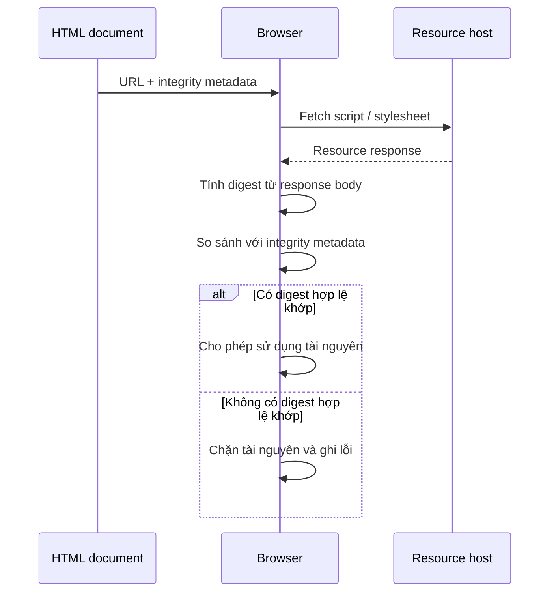

# Hash verification

> **Chương:** Resource integrity  
> **Bài học:** Hash verification — xác minh tính toàn vẹn của tài nguyên bên ngoài bằng Subresource Integrity (SRI)  
> **Phạm vi module:** **SECURITY_APPLICATION_SECURITY_BROWSER_SECURITY** — phân tích ranh giới bảo mật giữa trình duyệt, origin, cookie và ứng dụng web để hiểu Same-Origin Policy (SOP), CORS và các cơ chế cách ly; thực hành phòng vệ XSS, CSRF, clickjacking bằng CSP, Trusted Types, security headers và kiểm chứng thực tế.

## Mục tiêu học tập

Sau bài này, bạn có thể:

1. Giải thích hash verification và mục đích của Subresource Integrity (SRI).
2. Phân biệt hash của tài nguyên với chữ ký số, TLS và xác thực nguồn phát hành.
3. Đọc cú pháp integrity metadata và các thuật toán SHA-256, SHA-384, SHA-512.
4. Tạo hash từ đúng byte của file và đưa vào thuộc tính `integrity`.
5. Áp dụng SRI cho script và stylesheet, kể cả tài nguyên được tải từ CDN.
6. Giải thích vì sao tài nguyên cross-origin cần CORS response hợp lệ để browser xác minh SRI.
7. Hiểu cách browser xử lý nhiều hash, hash sai, redirect và nội dung tài nguyên thay đổi.
8. Tích hợp hash vào build/release pipeline và cập nhật đồng bộ khi nâng phiên bản dependency.
9. Kiểm tra SRI bằng DevTools và tái hiện lỗi hash mismatch trong môi trường local.
10. Nhận diện giới hạn của SRI và kết hợp nó với CSP, HTTPS, kiểm soát dependency và bảo vệ HTML.

## 1. Hash verification là gì?

**Hash verification** là việc tính một giá trị digest từ dữ liệu rồi so sánh với digest kỳ vọng đã được lưu hoặc phân phối qua một kênh tin cậy. Nếu dữ liệu thay đổi, digest thường thay đổi theo, giúp phát hiện nội dung không còn khớp với bản đã được chấp thuận.

Trong web, **Subresource Integrity (SRI)** cho phép tác giả trang khai báo hash kỳ vọng của một tài nguyên bên ngoài, chẳng hạn JavaScript hoặc CSS. Browser tải tài nguyên, tính hash trên nội dung nhận được và so sánh với metadata trong HTML. Nếu không có digest hợp lệ khớp, browser không sử dụng tài nguyên đó.

Ví dụ:

```html
<script
  src="https://cdn.example.net/lib/4.2.1/lib.min.js"
  integrity="sha384-BASE64_DIGEST"
  crossorigin="anonymous"
></script>
```

`sha384-BASE64_DIGEST` chỉ là chỗ giữ chỗ trong ví dụ. Khi triển khai, phải thay bằng digest Base64 được tạo từ đúng file phát hành.

SRI đặc biệt hữu ích khi tải thư viện từ CDN hoặc một host khác với ứng dụng. Nếu nội dung trên CDN bị thay đổi ngoài dự kiến, hash trong HTML vẫn là giá trị tham chiếu để browser phát hiện khác biệt.

### 1.1. Browser xác minh ở thời điểm nào?

Luồng cơ bản:



Với script, browser phải hoàn tất kiểm tra integrity trước khi thực thi nội dung. Với stylesheet, browser kiểm tra trước khi áp dụng stylesheet. Như vậy, mã hoặc CSS không khớp hash sẽ không được dùng theo cơ chế SRI.

### 1.2. SRI bảo vệ tình huống nào?

SRI giúp phát hiện trường hợp tài nguyên được tải về khác với bản mà trang đã chỉ định, ví dụ:

- CDN bị xâm nhập và trả về file JavaScript bị sửa.
- Một phiên bản thư viện trên host ngoài bị thay nội dung mà URL vẫn giữ nguyên.
- Cache hoặc hệ thống phân phối tài nguyên cung cấp nhầm artifact.
- Dependency bị thay đổi ngoài quy trình release đã phê duyệt.
- Một thay đổi không mong muốn trong pipeline xuất bản file CSS hoặc JavaScript.

Điều kiện quan trọng là **HTML chứa integrity metadata phải được bảo vệ**. Nếu kẻ tấn công có thể sửa cả HTML và thuộc tính integrity, họ có thể thay cả tài nguyên lẫn hash kỳ vọng. Vì vậy SRI là một lớp bảo vệ cho tài nguyên, không thay thế HTTPS, bảo mật origin ứng dụng, CSP hoặc kiểm soát quy trình phát hành.

## 2. Hash, digest và integrity metadata

Hash function nhận dữ liệu có độ dài bất kỳ và tạo digest có độ dài cố định. SRI dùng digest được biểu diễn trong metadata của thuộc tính `integrity`.

Ví dụ về cấu trúc:

```text
sha384-<Base64 digest>
```

Metadata gồm:

- Tên thuật toán: `sha256`, `sha384` hoặc `sha512`.
- Dấu gạch nối phân cách.
- Digest được mã hóa Base64.

Digest trong SRI dùng Base64, không phải chuỗi hex thường thấy ở một số lệnh hash.

### 2.1. Các thuật toán được dùng trong SRI

| Thuật toán | Độ dài digest | Nhận xét |
|---|---:|---|
| SHA-256 | 256 bit | Được hỗ trợ rộng; đủ mạnh cho xác minh integrity thông thường |
| SHA-384 | 384 bit | Lựa chọn phổ biến trong ví dụ SRI |
| SHA-512 | 512 bit | Digest dài hơn, vẫn được hỗ trợ trong SRI |

Không dùng MD5 hoặc SHA-1 làm integrity metadata. Chúng không phải lựa chọn phù hợp cho mục tiêu xác minh tính toàn vẹn hiện nay.

### 2.2. Hash không phải encryption

Hash function không mã hóa dữ liệu và không có khóa bí mật:

- Không thể giải mã digest để lấy lại nội dung gốc.
- Cùng một byte input với cùng thuật toán tạo cùng digest.
- Một thay đổi nhỏ trong byte input thường tạo digest rất khác.
- Digest không cho biết ai đã tạo file hoặc ai có quyền phát hành file.

SRI dùng hash để so sánh nội dung. Nó không phải chữ ký số và không xác minh danh tính nhà cung cấp.

### 2.3. Hash không phải chữ ký số

| Cơ chế | Điều được xác minh | Có xác thực người phát hành? |
|---|---|---|
| Hash thuần | Nội dung có khớp digest tham chiếu không | Không, nếu digest không được bảo vệ |
| SRI | Tài nguyên có khớp hash được khai báo trong HTML không | Không tự xác thực publisher |
| Chữ ký số | Dữ liệu được ký bởi private key tương ứng với public key tin cậy và không bị sửa | Có thể, nếu trust chain/key được xác minh đúng |
| TLS | Kết nối tới endpoint được xác thực được mã hóa và bảo vệ toàn vẹn | Xác thực endpoint theo certificate |

Một digest SRI chỉ đáng tin khi HTML chứa nó được phân phối qua một kênh và quy trình đáng tin cậy. Nếu HTML bị thay đổi, giá trị hash cũng có thể bị thay.

## 3. Thuộc tính integrity trong HTML

SRI được khai báo bằng thuộc tính `integrity` trên các phần tử hỗ trợ, thường gặp nhất là `script` và `link rel="stylesheet"`.

### 3.1. Script bên ngoài

Ví dụ:

```html
<script
  src="/assets/app-v4.2.1.min.js"
  integrity="sha384-REPLACE_WITH_REAL_BASE64_DIGEST"
></script>
```

Khi tài nguyên được tải, browser tính digest và so sánh với metadata. Nếu file bị thay đổi dù chỉ một byte, digest thường không còn khớp và browser chặn việc thực thi.

SRI áp dụng cho tài nguyên script bên ngoài. Không dùng thuộc tính này để kiểm tra nội dung inline script:

```html
<script>
  console.log('inline code');
</script>
```

Với inline script, CSP hash source hoặc nonce là cơ chế phù hợp để kiểm soát việc thực thi; SRI không thay thế CSP.

### 3.2. Stylesheet bên ngoài

Ví dụ:

```html
<link
  rel="stylesheet"
  href="https://cdn.example.net/ui/4.2.1/theme.min.css"
  integrity="sha384-REPLACE_WITH_REAL_BASE64_DIGEST"
  crossorigin="anonymous"
>

```

Nếu stylesheet trả về nội dung không khớp hash, browser không áp dụng stylesheet đó. Điều này có thể khiến giao diện thiếu style, nhưng ngăn CSS không đúng bản được sử dụng âm thầm.

### 3.3. Tài nguyên cùng origin và cross-origin

Với tài nguyên cùng origin, browser có thể xác minh SRI trực tiếp mà không cần CORS.

Với tài nguyên cross-origin, browser cần response CORS hợp lệ để có thể sử dụng response trong quá trình xác minh integrity. Vì vậy, SRI cross-origin thường đi cùng thuộc tính `crossorigin` và server tài nguyên phải cho phép origin của trang.

Không nhầm hai điều kiện:

- SRI kiểm tra nội dung tài nguyên có khớp hash kỳ vọng không.
- CORS xác định browser có được sử dụng response cross-origin theo chế độ CORS hay không.

Có CORS không có nghĩa nội dung đã được xác minh integrity; có hash không có nghĩa browser được phép đọc response cross-origin nếu CORS không hợp lệ.

## 4. CORS khi xác minh tài nguyên cross-origin

Khi một trang tải script hoặc stylesheet từ origin khác, browser cần biết response có được phép sử dụng trong chế độ CORS. Với SRI cross-origin, server tài nguyên phải trả CORS header phù hợp; nếu không, browser không thể hoàn tất việc xác minh theo yêu cầu.

### 4.1. Cấu hình phía HTML

Ví dụ tải script từ CDN:

```html
<script
  src="https://cdn.example.net/lib/4.2.1/lib.min.js"
  integrity="sha384-REPLACE_WITH_REAL_BASE64_DIGEST"
  crossorigin="anonymous"
></script>
```

`crossorigin="anonymous"` yêu cầu tải tài nguyên theo chế độ CORS không gửi credentials cross-origin. Đây là lựa chọn thường dùng cho thư viện công khai từ CDN.

### 4.2. Cấu hình phía resource server

CDN có thể trả:

```http
Access-Control-Allow-Origin: *
```

Hoặc chỉ cho phép một origin cụ thể:

```http
Access-Control-Allow-Origin: https://app.example
Vary: Origin
```

Nếu server trả origin cụ thể theo request, `Vary: Origin` giúp cache phân biệt response theo giá trị Origin. Không phản chiếu tùy tiện mọi giá trị Origin mà không có allowlist.

Với tài nguyên công khai, `Access-Control-Allow-Origin: *` thường phù hợp khi request không mang credentials. Nếu response dùng credentials, wildcard không hợp lệ.

### 4.3. Khi nào dùng use-credentials?

`crossorigin="use-credentials"` yêu cầu chế độ CORS có credentials. Response cross-origin khi đó cần:

```http
Access-Control-Allow-Origin: https://app.example
Access-Control-Allow-Credentials: true
Vary: Origin
```

Không dùng `Access-Control-Allow-Origin: *` cho response credentialed. Chỉ dùng credentials khi tài nguyên thực sự cần cookie hoặc HTTP authentication; thư viện JavaScript công khai thường không cần.

Cần nhớ: SRI không phải cơ chế xác thực cookie, và CORS không thay kiểm tra hash. Mỗi cơ chế giải quyết một phần khác nhau của request.

### 4.4. Module script và CORS

Module script được tải theo cơ chế CORS. Khi module hoặc dependency của module nằm ở origin khác, server phải cấu hình CORS tương ứng. Nếu dùng SRI cho entry module, vẫn cần đảm bảo response CORS hợp lệ.

Với module graph, không giả định hash của entry module tự động bao phủ mọi module được import. Hãy kiểm tra cách bundler/build pipeline phát hành graph, hoặc tạo artifact bundle có phiên bản và integrity metadata rõ ràng cho tài nguyên được tải trực tiếp.

## 5. Browser xử lý nhiều hash như thế nào?

Thuộc tính `integrity` có thể chứa nhiều metadata, phân cách bằng khoảng trắng.

Ví dụ minh họa:

```html
<script
  src="/assets/library.min.js"
  integrity="sha256-SHA256_BASE64 sha384-SHA384_BASE64 sha512-SHA512_BASE64"
></script>
```

Khi có nhiều thuật toán, browser chọn nhóm thuật toán mạnh nhất có mặt trong metadata rồi so sánh với các digest thuộc nhóm đó. Với nhiều digest cùng mức thuật toán mạnh nhất, chỉ cần một digest khớp là đủ để xác minh.

Thứ tự thuật toán mạnh thường được xét là:

```text
sha512 > sha384 > sha256
```

Ví dụ, nếu metadata có cả SHA-256 và SHA-512, browser dùng SHA-512 để quyết định. Digest SHA-256 khớp không cứu được trường hợp digest SHA-512 mạnh nhất không khớp.

### 5.1. Vì sao nhiều hash có thể hữu ích?

Nhiều digest cùng thuật toán có thể cho phép một trong vài nội dung được chấp nhận, nhưng cần hiểu rõ điều này có thể mở rộng tập nội dung hợp lệ.

Nhiều thuật toán đôi khi được dùng trong quá trình chuyển đổi tương thích. Tuy nhiên, đừng thêm hash yếu hơn như một fallback với kỳ vọng browser sẽ dùng nó khi hash mạnh hơn sai. Hãy tạo metadata có chủ đích, chỉ giữ các digest thực sự cần và quản lý chúng trong build pipeline.

### 5.2. Hash sai sẽ xảy ra điều gì?

Nếu không có digest hợp lệ khớp với tài nguyên:

- Browser chặn script trước khi thực thi.
- Browser không áp dụng stylesheet không hợp lệ.
- Console ghi thông báo integrity mismatch.
- Network panel vẫn có thể cho thấy request tải tài nguyên đã trả về thành công, vì lỗi nằm ở bước xác minh sau khi nhận response.

HTTP 200 không chứng minh SRI thành công. Phải kiểm tra cả Console và hành vi của tài nguyên.

## 6. Tạo hash từ đúng file

Hash phải được tính trên **byte của artifact thực tế được phát hành**. Không tự gõ digest, không lấy hash của URL, và không tính trên nội dung đã bị thay đổi sau khi build.

### 6.1. Dùng Node.js

Ví dụ script tạo integrity metadata:

```js
const fs = require('node:fs');
const crypto = require('node:crypto');

const filePath = process.argv[2];
const algorithm = process.argv[3] || 'sha384';

if (!filePath) {
  throw new Error('Usage: node sri-hash.js <file> [sha256|sha384|sha512]');
}

if (!['sha256', 'sha384', 'sha512'].includes(algorithm)) {
  throw new Error('Unsupported SRI hash algorithm');
}

const fileBytes = fs.readFileSync(filePath);
const digest = crypto
  .createHash(algorithm)
  .update(fileBytes)
  .digest('base64');

process.stdout.write(algorithm + '-' + digest + '\n');
```

Chạy:

```bash
node sri-hash.js dist/vendor.min.js sha384
```

Output có dạng:

```text
sha384-BASE64_DIGEST_FROM_REAL_FILE
```

Copy toàn bộ token output vào thuộc tính `integrity`. Script đọc file dưới dạng byte, không giải mã thành text rồi encode lại; điều này tránh vô tình thay đổi newline hoặc encoding trước khi tính hash.

### 6.2. Dùng OpenSSL

Trên môi trường có OpenSSL:

```bash
openssl dgst -sha384 -binary dist/vendor.min.js | openssl base64 -A
```

Kết quả của lệnh trên chỉ là Base64 digest. Ghép thêm prefix `sha384-` để tạo integrity metadata.

Không copy output hex từ `Get-FileHash` hoặc `sha256sum` trực tiếp vào thuộc tính SRI; SRI cần digest Base64.

### 6.3. Hash artifact cuối cùng

Một quy trình build có thể gồm:

1. Cài dependency theo lockfile.
2. Build/minify/bundle.
3. Tạo artifact cuối cùng.
4. Tính SRI trên artifact đó.
5. Sinh HTML/manifest chứa URL, phiên bản và integrity metadata.
6. Publish artifact và HTML đồng bộ.
7. Kiểm thử response thực tế từ CDN/origin.

Nếu tính hash trước khi minify hoặc nén nội dung ở bước build, digest sẽ không khớp với artifact sau cùng.

HTTP gzip/Brotli là content encoding của response; browser giải mã response trước khi xử lý nội dung tài nguyên. Hash phải tương ứng với byte của file tài nguyên sau các biến đổi build, không phải byte nén truyền trên dây.

### 6.4. Ví dụ HTML với hash được sinh từ build

```html
<script
  src="/assets/vendor.4.2.1.min.js"
  integrity="sha384-PASTE_DIGEST_GENERATED_BY_BUILD"
></script>
```

Tên file có version/hash trong URL giúp cache và rollback dễ quản lý. SRI vẫn có giá trị riêng: nếu cùng URL trả về nội dung khác artifact đã pin, browser sẽ phát hiện mismatch.

## 7. Quản lý thay đổi dependency và CDN

SRI chỉ hoạt động tốt khi HTML và artifact được phát hành nhất quán.

### 7.1. Pin phiên bản thay vì dùng URL trôi nổi

Nên dùng URL có phiên bản cụ thể:

```html
<script
  src="https://cdn.example.net/library/4.2.1/library.min.js"
  integrity="sha384-EXPECTED_DIGEST"
  crossorigin="anonymous"
></script>
```

Tránh URL như `/library/latest/library.min.js` nếu nhà cung cấp có thể thay nội dung mà không đổi URL. URL versioned giúp biết chính xác artifact nào đang được yêu cầu.

### 7.2. Khi nâng phiên bản phải cập nhật hash

Quy trình nâng dependency:

1. Chọn phiên bản mới và kiểm tra release notes.
2. Tải hoặc build artifact đúng phiên bản.
3. Tạo hash từ file cuối cùng.
4. Cập nhật URL và integrity metadata trong cùng một thay đổi.
5. Kiểm thử trên browser staging.
6. Phát hành HTML và tài nguyên theo thứ tự đảm bảo không có khoảng thời gian trỏ tới artifact chưa sẵn sàng.
7. Theo dõi lỗi integrity mismatch sau deploy.

Nếu chỉ đổi URL mà giữ hash cũ, browser sẽ chặn tài nguyên. Nếu chỉ thay hash nhưng URL vẫn trỏ tới nội dung cũ, browser cũng có thể chặn. Hai giá trị phải được quản lý như một cặp.

### 7.3. Không tự cập nhật hash từ nguồn chưa xác minh

Một bot tự động tải file mới rồi tự ghi hash vào HTML mà không review có thể biến một dependency đã bị xâm nhập thành nội dung được chấp nhận.

Pipeline nên xác minh nguồn phát hành, lockfile, checksum/chữ ký của package nếu có, review thay đổi và tạo artifact reproducible. SRI bảo vệ browser khỏi khác biệt giữa HTML và tài nguyên; nó không thay thế quy trình xác minh dependency.

## 8. Tải script động với SRI

Một số ứng dụng tạo phần tử script bằng JavaScript thay vì khai báo trực tiếp trong HTML. Có thể gắn integrity metadata trước khi thêm phần tử vào document:

```js
function loadPinnedScript(src, integrity) {
  const script = document.createElement('script');

  script.integrity = integrity;
  script.crossOrigin = 'anonymous';
  script.src = src;

  script.addEventListener('load', () => {
    console.log('Script đã tải và vượt qua integrity check');
  });

  script.addEventListener('error', () => {
    console.error('Không tải được script hoặc integrity/CORS check thất bại');
  });

  document.head.append(script);
}

loadPinnedScript(
  'https://cdn.example.net/lib/4.2.1/lib.min.js',
  'sha384-REPLACE_WITH_REAL_BASE64_DIGEST'
);
```

Ví dụ chỉ phù hợp khi URL và hash là giá trị đã được ứng dụng kiểm soát. Nếu URL đến từ dữ liệu người dùng, hãy kiểm tra URL bằng parser và allowlist origin/path trước khi tạo script. Không để người dùng cung cấp cả URL lẫn hash rồi biến chúng thành một nguồn script được tin cậy.

### 8.1. Gắn thuộc tính trước khi append

Hãy cấu hình `integrity`, `crossOrigin` và các thuộc tính liên quan trước khi đưa phần tử vào DOM. Khi phần tử được gắn vào document, browser có thể bắt đầu fetch ngay.

Không gắn script rồi mới cập nhật integrity metadata sau đó; request có thể đã bắt đầu mà không có metadata mong muốn.

### 8.2. Module và dependency graph

Với module script, thuộc tính integrity trên phần tử module giúp xác minh tài nguyên module được tham chiếu trực tiếp. Các module con được import tạo thành các lần fetch riêng; không nên giả định một digest ở entry module tự động xác minh mọi file trong graph.

Có thể giảm độ phức tạp bằng cách bundle dependency thành artifact được phát hành cùng nhau, pin phiên bản và tạo integrity metadata cho từng tài nguyên được tải trực tiếp. Nếu dùng import map hoặc cơ chế integrity cho module graph, hãy kiểm tra hỗ trợ browser và đầu ra build cụ thể.

## 9. SRI kết hợp với CSP

CSP và SRI bổ sung cho nhau:

- CSP kiểm soát nguồn và loại script/style mà document được phép tải hoặc thực thi.
- SRI kiểm tra nội dung của một tài nguyên có khớp digest kỳ vọng không.
- HTTPS bảo vệ đường truyền tới endpoint.
- Kiểm soát dependency và release bảo vệ quá trình chọn, build và phát hành artifact.

Ví dụ policy:

```http
Content-Security-Policy: default-src 'self'; script-src 'self' https://cdn.example.net; object-src 'none'; base-uri 'none'
```

Policy cho phép tải script từ host CDN. Thuộc tính integrity trên phần tử script tiếp tục pin nội dung cụ thể của file được tải.

Nếu CSP không cho phép host, SRI không thể ghi đè quyết định của CSP. Nếu CSP cho phép host nhưng hash không khớp, browser vẫn chặn tài nguyên do SRI.

### 9.1. SRI không phải cách thay CSP hash cho inline script

Ví dụ inline script:

```html
<script>
  initializeApplication();
</script>
```

Không thể thêm thuộc tính integrity vào inline script để xác minh nó. Dùng CSP nonce hoặc hash source phù hợp để kiểm soát inline script.

CSP hash source và SRI đều dùng hash nhưng phục vụ ngữ cảnh khác nhau:

| Cơ chế | Đối tượng được kiểm tra |
|---|---|
| SRI integrity metadata | Nội dung tài nguyên bên ngoài được fetch |
| CSP hash source | Nội dung inline script/style được phép thực thi/áp dụng theo policy |

Không nhầm hai loại hash hoặc lấy token SRI rồi mặc định nó đã được thêm đúng vào CSP.

## 10. SRI và các biến thể response

Hash phải khớp với nội dung tài nguyên mà browser thực sự nhận để sử dụng. Một URL có thể trả nội dung khác nhau theo thời gian, vùng CDN, cookie hoặc header request; đây là lý do nên phát hành artifact bất biến.

### 10.1. CDN rewrite hoặc tối ưu hóa nội dung

Một số CDN có thể minify, rewrite, chèn banner, đổi newline hoặc tạo biến thể file theo cấu hình. Những thay đổi byte này có thể khiến hash không còn khớp dù code nhìn bề ngoài có vẻ tương đương.

Khi dùng SRI:

- Tắt các tính năng tự sửa nội dung nếu chúng làm thay đổi artifact đã pin.
- Xác minh file sau các bước build/minify cuối cùng.
- Kiểm tra response body thực tế qua endpoint production/staging.
- Không tạo hash từ bản local rồi giả định CDN luôn trả đúng byte đó.

Nén truyền tải gzip/Brotli thông thường được browser giải mã trước khi kiểm tra nội dung. Điều cần khớp là artifact tài nguyên sau các biến đổi build, không phải byte nén trên đường truyền.

### 10.2. Redirect và URL cuối cùng

Tài nguyên có thể redirect từ URL ban đầu sang URL khác. Browser xác minh nội dung cuối cùng được fetch theo integrity metadata; redirect cũng có thể làm phát sinh yêu cầu CORS ở origin đích.

Hãy kiểm tra redirect chain, hostname cuối cùng và CORS headers của response cuối. Với dependency quan trọng, nên dùng URL versioned ổn định và tránh redirect không cần thiết.

### 10.3. Cache và versioning

SRI không thay thế cache strategy. Nên dùng URL chứa version hoặc content hash để cache lâu dài cho artifact bất biến. Khi artifact đổi, tạo URL mới và integrity metadata mới.

Nếu cùng một URL được tái sử dụng cho nội dung khác nhau, cache và rollout có thể tạo tình huống một số người dùng nhận HTML mới nhưng tài nguyên cũ, hoặc ngược lại. Hãy phát hành theo thứ tự an toàn và giữ artifact cũ trong thời gian HTML cũ còn có thể được phục vụ.

## 11. Những giới hạn và giả định bảo mật của SRI

SRI xác minh một tài nguyên cụ thể. Nó không phải sandbox cho mã và không biến một dependency nguy hiểm thành an toàn.

### 11.1. SRI không bảo vệ HTML chứa hash

Nếu attacker có thể sửa document HTML, họ có thể:

- Thay URL script.
- Thay integrity metadata.
- Thêm script inline mới.
- Xóa thuộc tính integrity.
- Thay đổi logic ứng dụng để tải tài nguyên khác.

Do đó cần bảo vệ origin ứng dụng, TLS, server deployment, template và pipeline tạo HTML.

### 11.2. SRI không đánh giá hành vi của code

Một file độc hại vẫn vượt qua SRI nếu digest của nó đã được chấp thuận và ghi vào HTML. Hash chỉ trả lời “nội dung có đúng bản được pin không”, không trả lời “nội dung có an toàn không”.

Review dependency, kiểm tra nguồn phát hành, lockfile, vulnerability scanning, code review và kiểm soát quyền publish vẫn cần thiết.

### 11.3. SRI không tự xác minh mọi dependency con

Nếu script đã được pin tải thêm script khác bằng cách tạo element động, hoặc một module import file khác, digest ở tài nguyên đầu không tự động bảo đảm nội dung mọi tài nguyên con.

Hãy pin từng tài nguyên được tải trực tiếp khi có thể, bundle dependency, giới hạn nguồn bằng CSP và kiểm tra dependency graph.

### 11.4. SRI không thay HTTPS hoặc CORS

- HTTPS bảo vệ kết nối và xác thực endpoint.
- CORS cho phép browser sử dụng response cross-origin theo chính sách server.
- SRI kiểm tra nội dung response có khớp digest.
- CSP giới hạn nguồn tài nguyên và hành vi script/style.

Nếu endpoint bị giả mạo hoặc CORS không hợp lệ, SRI không biến response đó thành một response được phép sử dụng.

### 11.5. SRI không áp dụng cho mọi loại nội dung

SRI chủ yếu được dùng cho external script và stylesheet qua các phần tử HTML hỗ trợ. Nó không phải một thuộc tính tổng quát để kiểm tra mọi response từ fetch, API JSON, hình ảnh hoặc nội dung tùy ý.

Với dữ liệu tải bằng fetch, ứng dụng có thể tự tính hash và so sánh, nhưng phải thiết kế quy trình xác minh riêng, bao gồm cách bảo vệ digest kỳ vọng và xử lý response. Không coi đoạn code tự viết đó là SRI native của browser.

## 12. Troubleshooting: vì sao integrity check thất bại?

Khi Console báo integrity mismatch hoặc tài nguyên không tải, kiểm tra theo thứ tự:

1. **Digest format:** metadata có đúng dạng thuật toán-dấu gạch nối-Base64 không?
2. **File đầu vào:** hash có được tính từ đúng file sau build/minify không?
3. **Thuật toán:** thuật toán có nằm trong nhóm SHA-256/384/512 không?
4. **Nhiều hash:** có hash mạnh hơn nào bị sai trong khi hash yếu hơn lại khớp không?
5. **URL/version:** URL có trỏ tới đúng artifact dự kiến không?
6. **CDN transformation:** CDN có minify, rewrite hoặc phục vụ biến thể khác không?
7. **Redirect:** response cuối có đến host khác hoặc file khác không?
8. **CORS:** tài nguyên cross-origin có ACAO phù hợp không?
9. **Credentials:** có dùng `use-credentials` nhưng server trả wildcard hoặc thiếu ACAC không?
10. **CSP:** `script-src` hoặc `style-src` có đang chặn host không?
11. **Cache/deploy:** HTML và tài nguyên có được phát hành lệch phiên bản không?
12. **Console/Network:** lỗi là integrity mismatch, CORS, CSP, DNS/TLS hay HTTP status?

Không sửa bằng cách xóa integrity attribute hoặc đổi hash sang giá trị lấy trực tiếp từ response đang nghi ngờ. Hãy xác minh artifact nguồn qua release đã được phê duyệt, rồi mới tạo hash mới.

## 13. Thực hành A — Tạo hash và pin script local

Dùng một thư mục lab riêng và một file JavaScript vô hại do bạn tự tạo.

### Bước 1: Tạo tài nguyên

Tạo file `app.js`:

```js
document.documentElement.dataset.sriDemo = 'loaded';
console.log('SRI demo script loaded');
```

### Bước 2: Tạo digest

Dùng script Node.js ở mục 6 để tạo SHA-384:

```bash
node sri-hash.js app.js sha384
```

Copy toàn bộ token output.

### Bước 3: Tạo trang HTML

```html
<!doctype html>
<html lang="vi">
<head>
  <meta charset="utf-8">
  <title>SRI local demo</title>
</head>
<body>
  <h1>Subresource Integrity demo</h1>
  <script
    src="./app.js"
    integrity="sha384-PASTE_REAL_DIGEST_HERE"
  ></script>
</body>
</html>
```

Thay placeholder bằng token thật vừa tạo. Phục vụ thư mục qua local HTTP server đơn giản thay vì mở file bằng `file://` để DevTools và fetch behavior dễ quan sát.

### Kết quả mong đợi

- Browser tải `app.js`.
- Console hiển thị thông báo của script.
- Phần tử HTML có thuộc tính `data-sri-demo="loaded"`.
- Không có lỗi integrity mismatch.

## 14. Thực hành B — Cố ý làm hash không khớp

1. Giữ nguyên HTML và integrity metadata.
2. Thay đổi một ký tự trong `app.js`, lưu file.
3. Reload trang với cache disabled trong DevTools.
4. Quan sát Console.
5. Xác minh script không chạy và thuộc tính `data-sri-demo` không được tạo.
6. Khôi phục file gốc hoặc tính lại hash từ artifact đã được chấp thuận.

Lab này chứng minh browser kiểm tra byte của resource. Chỉ thay đổi một ký tự cũng đủ làm digest khác.

## 15. Thực hành C — SRI với CDN cross-origin và CORS

Thực hiện trên staging hoặc hai host local khác port do bạn kiểm soát.

### Bước 1: Tạo hai origin

- Origin ứng dụng phục vụ HTML, ví dụ `http://localhost:3000`.
- Origin tài nguyên phục vụ JavaScript, ví dụ `http://localhost:4000`.

Hai port khác nhau tạo hai origin khác nhau.

### Bước 2: Cho phép CORS ở resource server

Response JavaScript từ port 4000 trả:

```http
Access-Control-Allow-Origin: http://localhost:3000
Vary: Origin
```

### Bước 3: Tải script với SRI

```html
<script
  src="http://localhost:4000/app.js"
  integrity="sha384-PASTE_REAL_DIGEST_HERE"
  crossorigin="anonymous"
></script>
```

1. Tạo hash từ đúng file app.js được phục vụ ở port 4000.
2. Mở trang ở port 3000.
3. Xác minh script chạy khi CORS và hash đều hợp lệ.
4. Bỏ header Access-Control-Allow-Origin rồi reload.
5. Quan sát browser báo lỗi CORS và không sử dụng script.
6. Khôi phục CORS header, sửa một byte của file và xác minh lỗi integrity mismatch.

Hai lần thử nghiệm tách biệt cho thấy CORS và SRI là hai điều kiện độc lập.

## 16. Thực hành D — Tải script động với integrity

Dùng file local đã tạo hash ở lab A:

```js
const script = document.createElement('script');
script.integrity = 'sha384-PASTE_REAL_DIGEST_HERE';
script.src = './app.js';

script.addEventListener('load', () => {
  console.log('Dynamic script loaded');
});

script.addEventListener('error', () => {
  console.error('Dynamic script blocked or failed');
});

document.head.append(script);
```

1. Đặt integrity trước khi append.
2. Reload trang và xác minh script chạy.
3. Thay một byte trong file, giữ hash cũ.
4. Reload và xác minh event error được kích hoạt.
5. Nếu dùng tài nguyên cross-origin, thêm `script.crossOrigin = 'anonymous'` và cấu hình CORS ở server.

## 17. Checklist review Hash verification

| Hạng mục | Câu hỏi cần trả lời |
|---|---|
| Resource | Tài nguyên nào cần pin bằng SRI? |
| Artifact | Hash được tạo từ file cuối cùng sau build/minify? |
| Algorithm | Dùng SHA-256, SHA-384 hoặc SHA-512? |
| Encoding | Digest có được encode Base64 đúng định dạng? |
| HTML | Integrity metadata trong HTML có được bảo vệ qua HTTPS và deployment? |
| Cross-origin | Script/stylesheet ngoài origin có `crossorigin` phù hợp? |
| CORS | Resource server có ACAO chính xác và Vary khi cần? |
| Credentials | Có thật sự cần `use-credentials`? Header CORS có phù hợp? |
| Version | URL dependency có pin phiên bản bất biến? |
| CDN | CDN có biến đổi byte sau khi hash được tạo? |
| Dynamic load | Script tạo động có integrity và crossorigin trước khi append? |
| Module graph | Các module con có được quản lý riêng trong build/release? |
| CSP | CSP có giới hạn nguồn script/style độc lập với SRI? |
| Cache | HTML và artifact có được phát hành đồng bộ, giữ version cũ phù hợp? |
| Verification | Đã thử hash đúng, hash sai, CORS thiếu và Console/Network chưa? |
| Operations | Có quy trình review, rollback và tái tạo hash khi nâng dependency? |

## 18. Câu hỏi tự kiểm tra

**1.** Subresource Integrity dùng để làm gì?  
**Đáp án:** Browser so sánh hash của script/stylesheet tải về với integrity metadata đã khai báo để phát hiện nội dung không khớp.

**2.** SRI dùng digest dạng hex hay Base64?  
**Đáp án:** SRI dùng digest Base64 sau tên thuật toán và dấu gạch nối.

**3.** Những thuật toán nào được dùng phổ biến trong SRI?  
**Đáp án:** SHA-256, SHA-384 và SHA-512.

**4.** SRI có phải chữ ký số không?  
**Đáp án:** Không. SRI xác minh nội dung có khớp digest trong HTML; nó không tự xác thực danh tính publisher.

**5.** Vì sao HTML chứa integrity metadata phải được bảo vệ?  
**Đáp án:** Nếu attacker sửa được HTML, họ có thể thay cả URL và hash kỳ vọng để chấp nhận tài nguyên khác.

**6.** Vì sao SRI cross-origin cần CORS?  
**Đáp án:** Browser cần response CORS hợp lệ để xác minh và sử dụng tài nguyên cross-origin theo cơ chế SRI.

**7.** `crossorigin="anonymous"` có ý nghĩa gì?  
**Đáp án:** Nó yêu cầu fetch CORS không gửi credentials cross-origin; server có thể cho phép tài nguyên công khai bằng ACAO wildcard.

**8.** Nếu có cả SHA-256 và SHA-512, browser chọn nhóm nào?  
**Đáp án:** Browser dùng thuật toán mạnh nhất có trong metadata, ở ví dụ này là SHA-512.

**9.** Hash có khớp nếu chỉ đổi một khoảng trắng trong file không?  
**Đáp án:** Thường không. SRI xác minh byte của tài nguyên, nên thay đổi byte có thể làm digest thay đổi.

**10.** SRI có bảo vệ inline script không?  
**Đáp án:** Không. Dùng CSP nonce hoặc hash source để kiểm soát inline script.

**11.** SRI có tự bảo vệ mọi dependency được script tải tiếp không?  
**Đáp án:** Không. Tài nguyên con được tải riêng cần được quản lý integrity riêng hoặc bundle vào artifact đã pin.

**12.** Vì sao không nên tự động lấy hash từ một CDN đang nghi ngờ rồi cập nhật HTML?  
**Đáp án:** Việc đó có thể chấp thuận chính nội dung đã bị thay đổi; hash phải được tạo từ artifact nguồn đã được xác minh và review.

## Ghi nhớ

**SRI cho browser biết chính xác nội dung script hoặc stylesheet nào được phép sử dụng.** Browser tính digest từ tài nguyên nhận được và so sánh với metadata SHA-256/384/512 được mã hóa Base64 trong HTML. Hash sai khiến tài nguyên bị chặn trước khi script chạy hoặc stylesheet được áp dụng.

Với tài nguyên cross-origin, cần cấu hình CORS hợp lệ và thường dùng `crossorigin="anonymous"`. Hash phải được tạo từ artifact cuối cùng sau build, rồi cập nhật đồng bộ với URL và HTML trong release. SRI không xác thực publisher, không bảo vệ HTML chứa hash, không kiểm tra code có an toàn hay không và không tự bao phủ dependency con. Hãy kết hợp SRI với HTTPS, CSP, lockfile, review dependency, pipeline phát hành đáng tin cậy và kiểm thử trên browser mục tiêu.
