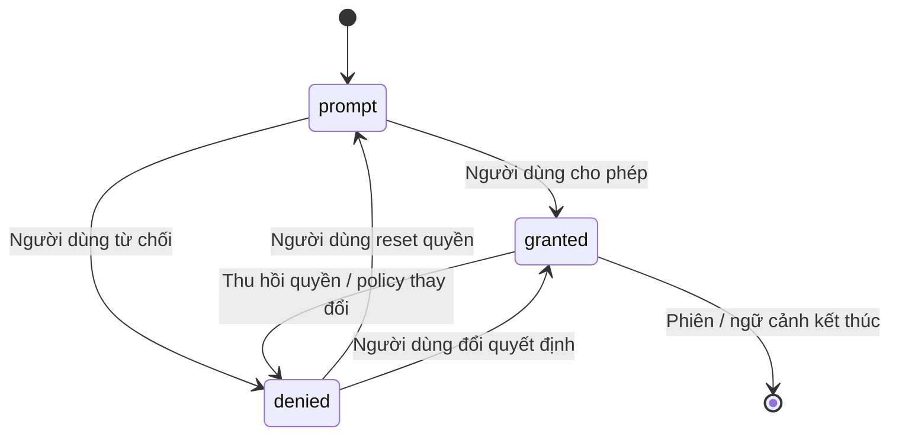

# Browser permission — quản lý quyền truy cập các tính năng nhạy cảm

> **Chương:** Permissions  
> **Mục tiêu:** Hiểu mô hình browser permission, vòng đời cấp quyền và các trạng thái `granted`, `denied`, `prompt`; phân biệt Permissions API với API thực sự yêu cầu quyền; sử dụng an toàn camera, microphone, geolocation, notifications và clipboard; kiểm soát iframe bằng Permissions Policy; xử lý từ chối, thu hồi quyền và kiểm thử trên browser thực tế.

## 1. Browser permission là gì?

Website có thể cần sử dụng những tính năng nhạy cảm của thiết bị hoặc browser, chẳng hạn:

- Camera và microphone để gọi video.
- Vị trí để tìm địa điểm gần người dùng.
- Notifications để gửi thông báo.
- Clipboard để đọc hoặc ghi nội dung sao chép.
- Một số tính năng khác như fullscreen, MIDI, USB, Bluetooth hoặc truy cập thiết bị.

Browser permission là cơ chế browser yêu cầu người dùng hoặc áp dụng quyết định đã lưu trước đó trước khi cho document sử dụng một tính năng. Mục tiêu là để người dùng kiểm soát việc website truy cập dữ liệu hoặc phần cứng nhạy cảm.

Ví dụ, khi ứng dụng gọi `getUserMedia()` để mở camera, browser có thể hiển thị prompt cho người dùng chọn cho phép hoặc từ chối. Nếu quyền đã được cấp hoặc bị từ chối trước đó, browser có thể áp dụng quyết định hiện tại mà không hiển thị prompt mới.

**Permission không phải authorization nghiệp vụ.** Browser có thể cho website dùng camera, nhưng server vẫn phải xác thực người dùng và kiểm tra quyền tham gia phòng họp. Tương tự, quyền đọc vị trí không có nghĩa người dùng được phép xem mọi dữ liệu theo vị trí đó.

## 2. Phân biệt browser permission, quyền của ứng dụng và quyền hệ điều hành

Một thao tác có thể phụ thuộc nhiều lớp quyền:

| Lớp | Câu hỏi |
| --- | --- |
| Browser permission | Website có được browser cho phép sử dụng feature không? |
| Permissions Policy | Document/iframe này có được phép yêu cầu feature trong ngữ cảnh hiện tại không? |
| Hệ điều hành | Browser có được OS cho phép truy cập camera, microphone, location hoặc clipboard không? |
| Authorization của ứng dụng | Người dùng hiện tại có quyền thực hiện hành động nghiệp vụ không? |

Ví dụ cuộc gọi video có thể cần:

1. HTTPS hoặc secure context.
2. Permissions Policy cho phép camera và microphone trong document.
3. Người dùng cấp quyền cho browser.
4. Hệ điều hành cho browser truy cập thiết bị.
5. Ứng dụng xác thực người dùng và cho phép tham gia phòng.

Nếu một lớp từ chối, tính năng có thể không hoạt động dù những lớp khác đã cho phép. Không dùng một trạng thái permission để suy ra toàn bộ quyền truy cập của người dùng.

## 3. Vòng đời và các trạng thái permission

Permissions API biểu diễn trạng thái quyền bằng ba giá trị phổ biến:

| State | Ý nghĩa |
| --- | --- |
| `granted` | Browser hiện cho phép feature trong ngữ cảnh hiện tại |
| `denied` | Quyền đang bị từ chối hoặc bị policy chặn |
| `prompt` | Chưa có quyết định được áp dụng; thao tác yêu cầu feature có thể cần prompt |

`prompt` không có nghĩa browser đã hiện hộp thoại. Nó chỉ cho biết chưa có trạng thái cho phép/từ chối cuối cùng được áp dụng theo mô hình permission của browser.

Vòng đời khái quát:



Thời hạn quyết định phụ thuộc browser, feature, thiết lập người dùng và lựa chọn trong prompt. Có browser hỗ trợ quyền một lần hoặc chỉ trong thời gian truy cập; có quyết định được lưu lâu hơn. Ứng dụng không được giả định mọi quyền đều tồn tại vĩnh viễn.

## 4. Permissions API dùng để kiểm tra trạng thái, không phải để xin quyền

Permissions API cung cấp `navigator.permissions.query()` để hỏi trạng thái của một permission descriptor mà browser hỗ trợ:

```js
async function inspectCameraPermission() {
  if (!navigator.permissions?.query) {
    return { supported: false, state: "unknown" };
  }

  try {
    const status = await navigator.permissions.query({
      name: "camera",
    });

    return {
      supported: true,
      state: status.state,
    };
  } catch (error) {
    // Descriptor có thể chưa được browser hỗ trợ.
    return {
      supported: false,
      state: "unknown",
      reason: error.name,
    };
  }
}
```

Không phải mọi browser đều hỗ trợ mọi descriptor. Một số lời gọi có thể reject nếu descriptor không được triển khai. Hãy dùng feature detection và xử lý lỗi.

Permissions API **không hiển thị prompt và không tự cấp quyền**. Muốn dùng feature, ứng dụng phải gọi API tương ứng, ví dụ:

- Camera/microphone: `navigator.mediaDevices.getUserMedia()`.
- Geolocation: `navigator.geolocation.getCurrentPosition()` hoặc `watchPosition()`.
- Notifications: `Notification.requestPermission()`.
- Clipboard: `navigator.clipboard.readText()` hoặc `writeText()`, theo điều kiện browser.

Không gọi `query()` rồi diễn giải `prompt` thành “người dùng đã từ chối”. Đây là trạng thái chưa có quyết định hiện hành.

## 5. Theo dõi khi trạng thái permission thay đổi

Kết quả từ `query()` là một `PermissionStatus`. Browser có thể phát sự kiện `change` khi trạng thái được cập nhật:

```js
async function watchGeolocationPermission() {
  if (!navigator.permissions?.query) return;

  try {
    const status = await navigator.permissions.query({
      name: "geolocation",
    });

    function renderState() {
      console.log("Geolocation permission:", status.state);
    }

    status.addEventListener("change", renderState);
    renderState();

    // Khi component bị hủy:
    return () => {
      status.removeEventListener("change", renderState);
    };
  } catch (error) {
    console.warn("Không thể theo dõi permission:", error.name);
  }
}
```

Không dựa vào sự kiện change như nguồn trạng thái duy nhất. Hãy xử lý lỗi API và kiểm tra lại trạng thái khi người dùng quay lại ứng dụng hoặc khi thao tác feature thất bại.

## 6. Secure context và user activation

Nhiều API nhạy cảm chỉ hoạt động trong **secure context**, thường là HTTPS. Một số môi trường phát triển như localhost được browser xem là secure context theo quy tắc riêng.

Ví dụ kiểm tra:

```js
if (!window.isSecureContext) {
  showMessage("Tính năng này cần kết nối HTTPS an toàn.");
}
```

Một số API cũng yêu cầu **user activation** — hành động trực tiếp của người dùng như click hoặc nhấn phím. Đây là cách giảm việc website tự động mở prompt hoặc đọc dữ liệu ngoài ý muốn.

Hãy thiết kế luồng:

1. Giải thích feature cần quyền gì và vì sao.
2. Người dùng chủ động bấm nút bật feature.
3. Trong handler của thao tác đó, gọi API cần thiết.
4. Hiển thị kết quả, trạng thái từ chối và cách tiếp tục.

Không tự yêu cầu camera, microphone, geolocation hoặc notification permission ngay khi trang vừa tải nếu người dùng chưa hiểu lý do.

## 7. Camera và microphone

Camera/microphone được truy cập qua MediaDevices API:

```js
async function startVideoPreview(videoElement) {
  if (!navigator.mediaDevices?.getUserMedia) {
    throw new Error("Browser không hỗ trợ getUserMedia.");
  }

  const stream = await navigator.mediaDevices.getUserMedia({
    video: true,
    audio: false,
  });

  videoElement.srcObject = stream;
  await videoElement.play();

  return stream;
}
```

Nên gọi hàm này sau khi người dùng bấm nút “Bật camera”. Khi không còn cần camera, dừng tất cả track:

```js
function stopMediaStream(stream) {
  for (const track of stream.getTracks()) {
    track.stop();
  }
}
```

Một lỗi thường gặp là chỉ ẩn video element nhưng không dừng track. Khi đó camera/microphone có thể vẫn hoạt động. Hãy dừng track khi người dùng tắt thiết bị, rời phòng hoặc component bị hủy.

### Chỉ yêu cầu thiết bị thực sự cần

Nếu chỉ cần camera, không yêu cầu audio:

```js
const stream = await navigator.mediaDevices.getUserMedia({
  video: true,
  audio: false,
});
```

Nếu cần microphone nhưng không cần camera:

```js
const stream = await navigator.mediaDevices.getUserMedia({
  video: false,
  audio: true,
});
```

Không yêu cầu cả camera và microphone theo thói quen. Giảm phạm vi quyền giúp người dùng hiểu yêu cầu và giảm dữ liệu có thể bị thu thập.

## 8. Geolocation

Geolocation API yêu cầu quyền truy cập vị trí và thường chỉ hoạt động trong secure context:

```js
function locateUser() {
  if (!navigator.geolocation) {
    showMessage("Browser không hỗ trợ geolocation.");
    return;
  }

  navigator.geolocation.getCurrentPosition(
    (position) => {
      const { latitude, longitude, accuracy } = position.coords;
      showLocation({ latitude, longitude, accuracy });
    },
    (error) => {
      showLocationError(error.code);
    },
    {
      enableHighAccuracy: false,
      timeout: 10000,
      maximumAge: 30000,
    },
  );
}
```

Gọi `locateUser()` sau thao tác rõ ràng như “Tìm địa điểm gần tôi”. Các tùy chọn có ý nghĩa:

- `enableHighAccuracy`: yêu cầu mức chính xác cao hơn khi có thể; có thể tốn pin hoặc thời gian hơn.
- `timeout`: giới hạn thời gian chờ.
- `maximumAge`: cho phép dùng vị trí đã lưu gần đây trong khoảng thời gian chỉ định.

Không mặc định yêu cầu độ chính xác cao nhất. Nếu chỉ cần chọn thành phố hoặc vùng lân cận, có thể không cần tọa độ chính xác đến mức thiết bị hỗ trợ.

### Xử lý lỗi geolocation

Các mã lỗi thường gặp:

| Code | Ý nghĩa |
| --- | --- |
| `1` | Người dùng hoặc policy từ chối quyền |
| `2` | Không xác định được vị trí |
| `3` | Quá thời gian chờ |

Không hiển thị thông báo “bạn đã từ chối” khi lỗi thực tế là timeout hoặc thiết bị không xác định được vị trí.

## 9. Notifications

Notifications API cho phép website hiển thị thông báo qua browser/OS khi được hỗ trợ và được người dùng cho phép.

Kiểm tra hỗ trợ và trạng thái:

```js
if (!("Notification" in window)) {
  showMessage("Browser không hỗ trợ notifications.");
} else {
  console.log(Notification.permission);
}
```

Các giá trị phổ biến của `Notification.permission`:

- `"granted"`: được phép hiển thị notification.
- `"denied"`: bị từ chối.
- `"default"`: chưa có quyết định rõ ràng; ứng dụng nên coi như chưa được cấp.

Chỉ yêu cầu quyền sau khi người dùng hiểu lợi ích, ví dụ bấm “Bật thông báo đơn hàng”:

```js
async function enableNotifications() {
  if (!("Notification" in window)) return "unsupported";

  const permission = await Notification.requestPermission();
  return permission;
}
```

Không gọi `requestPermission()` ngay khi trang tải. Prompt bất ngờ dễ làm người dùng từ chối và tạo trải nghiệm gây khó chịu. Một số browser chỉ cho phép yêu cầu permission trong user gesture hoặc có quy tắc riêng về notification prompt.

Đối với notification nền, ứng dụng thường cần Service Worker và Push API; quyền Notification không tự đăng ký push subscription và không xác thực nội dung notification. Server phải kiểm soát subscription, quyền nhận thông báo và nội dung được gửi.

## 10. Clipboard

Clipboard API có thể đọc hoặc ghi clipboard. Đây là dữ liệu nhạy cảm vì clipboard có thể chứa mật khẩu, mã xác thực, URL riêng tư hoặc nội dung người dùng vừa sao chép.

Ghi text thường cần secure context và user activation:

```js
async function copyInviteLink(inviteUrl) {
  await navigator.clipboard.writeText(inviteUrl);
  showMessage("Đã sao chép liên kết.");
}
```

Đọc clipboard:

```js
async function readClipboardText() {
  const text = await navigator.clipboard.readText();
  return text;
}
```

Đọc clipboard bị kiểm soát chặt hơn ghi clipboard; browser có thể yêu cầu permission, user activation hoặc điều kiện ngữ cảnh khác. Hành vi khác nhau theo browser và platform.

Không đọc clipboard tự động khi người dùng vừa mở trang. Hãy gắn hành động đọc vào nút có mô tả rõ ràng như “Dán mã xác nhận”, và chỉ đọc dữ liệu cần thiết.

Không giả định mọi browser hỗ trợ Permissions API descriptor `clipboard-read` hoặc `clipboard-write`. Hãy thử API thực tế và xử lý lỗi thay vì dựa vào query permission.

## 11. Permissions Policy: giới hạn feature trong document

Permissions Policy (trước đây gọi là Feature Policy) cho phép response của document giới hạn feature nào được sử dụng và trong ngữ cảnh nào.

Ví dụ khóa camera, microphone và geolocation:

```http
Permissions-Policy: camera=(), microphone=(), geolocation=()
```

Ví dụ chỉ cho phép document cùng origin:

```http
Permissions-Policy: camera=(self), microphone=(self), geolocation=(self)
```

Policy này giới hạn việc sử dụng feature ở cấp document. Nó không tự cấp browser permission và không thay prompt của người dùng.

Một feature có thể bị chặn bởi Permissions Policy ngay cả khi người dùng đã cấp quyền ở browser. Trong trường hợp đó, việc gọi API có thể thất bại và Console có thể ghi cảnh báo policy.

### Phạm vi và allowlist

Các directive có allowlist khác nhau theo feature và browser. Hãy khai báo rõ các feature cần thiết thay vì dựa vào default allowlist.

Một số ví dụ:

| Directive | Mục đích |
| --- | --- |
| `camera` | Camera |
| `microphone` | Microphone |
| `geolocation` | Vị trí |
| `fullscreen` | Fullscreen |
| `payment` | Payment Request API trong browser hỗ trợ |

Không phải mọi feature browser đều có Permissions Policy directive. Kiểm tra hỗ trợ trước khi thiết kế policy dựa trên một directive cụ thể.

## 12. Cho phép iframe dùng feature bằng allow

Trang cha có thể delegate một số feature cho iframe qua thuộc tính `allow`:

```html
<iframe
  src="https://meet.partner.example/room"
  title="Phòng họp"
  allow="camera; microphone"
></iframe>
```

Đối với iframe cross-origin, việc delegate phải được phép bởi policy của document cha và các điều kiện browser khác. Thuộc tính `allow` không thể mở rộng quyền vượt quá giới hạn mà response header của ancestor đã đặt.

Ví dụ header chỉ cho phép origin ứng dụng và đối tác:

```http
Permissions-Policy: camera=(self "https://meet.partner.example"), microphone=(self "https://meet.partner.example"), geolocation=()
```

Iframe:

```html
<iframe
  src="https://meet.partner.example/room"
  allow="camera https://meet.partner.example; microphone https://meet.partner.example"
  title="Phòng họp"
></iframe>
```

Hãy kiểm tra cú pháp và hỗ trợ trên browser mục tiêu. Nếu top-level response đặt `camera=()`, iframe không thể tự bật lại camera bằng thuộc tính `allow`.

### Không delegate rộng

Chỉ cấp feature mà widget thực sự cần. Một iframe quảng cáo hoặc widget nội dung không nên được cấp camera, microphone hay geolocation nếu không có yêu cầu nghiệp vụ rõ ràng.

## 13. Sandbox và permission trong iframe

Iframe sandbox giới hạn khả năng của document con. Nó có thể ảnh hưởng origin, script, form, popup và các API khác:

```html
<iframe
  src="https://widget.example.net/"
  sandbox="allow-scripts"
  title="Widget cô lập"
></iframe>
```

Một sandboxed iframe không có `allow-same-origin` thường có opaque origin. Điều này có thể ảnh hưởng cách browser xử lý permission và giao tiếp với parent.

Không thêm `allow-same-origin` hoặc các sandbox token khác chỉ để làm một API hoạt động. Đánh giá từng quyền, origin và khả năng của nội dung iframe; nếu cần feature nhạy cảm, hãy dùng một origin riêng và policy delegation tối thiểu.

Permissions Policy và sandbox giải quyết các lớp khác nhau:

- Permissions Policy giới hạn feature được phép sử dụng.
- Sandbox giới hạn khả năng của browsing context con.
- Browser permission ghi nhận quyết định người dùng.

Tất cả điều kiện liên quan phải thỏa.

## 14. Permission prompt và trải nghiệm người dùng

Prompt là một quyết định bảo mật của người dùng, không phải một bước onboarding cần vượt qua bằng mọi giá.

Một luồng tốt:

1. Giải thích tính năng sẽ làm gì.
2. Nêu lý do cần quyền và dữ liệu nào sẽ được sử dụng.
3. Để người dùng chủ động bấm nút bật tính năng.
4. Chỉ yêu cầu quyền đúng lúc cần.
5. Nếu bị từ chối, cung cấp cách dùng chức năng thay thế.
6. Cho phép tắt tính năng và dừng truy cập thiết bị.

Tránh:

- Hiện prompt ngay khi mở trang mà không có ngữ cảnh.
- Lặp lại prompt liên tục sau khi người dùng từ chối.
- Dùng nút giả hoặc nội dung gây áp lực để buộc người dùng cấp quyền.
- Che giấu việc ghi âm, ghi hình hoặc thu thập vị trí.
- Yêu cầu nhiều quyền cùng lúc khi chỉ một quyền đang cần.

Không dùng thông báo “hãy bật quyền trong Settings” như phản hồi duy nhất. Giải thích vì sao tính năng không hoạt động và cho phép tiếp tục với lựa chọn khác.

## 15. Quyền có thể bị thu hồi hoặc thay đổi

Người dùng có thể thay đổi quyết định trong giao diện cài đặt của browser hoặc hệ điều hành. Browser cũng có thể tự thu hồi một số quyền theo thời gian, theo chính sách sử dụng hoặc khi người dùng không tương tác lâu.

Ứng dụng cần:

- Xử lý API thất bại ở mọi thời điểm, kể cả sau khi đã từng được cấp quyền.
- Theo dõi `PermissionStatus.change` nếu browser hỗ trợ.
- Dừng stream khi người dùng tắt camera/microphone.
- Không giả định permission được lưu vĩnh viễn.
- Cung cấp nút thử lại hoặc hướng dẫn mở site settings khi phù hợp.
- Không tự mở lại thiết bị sau khi người dùng đã chủ động tắt.

Không có API web phổ quát cho phép website tự thu hồi mọi browser permission. Người dùng kiểm soát việc thu hồi qua browser/OS settings; ứng dụng chỉ nên cleanup tài nguyên và phản ứng với trạng thái mới.

## 16. Xử lý lỗi API và permission

Không gom mọi lỗi thành “người dùng từ chối”. Ví dụ với `getUserMedia()`:

| Error name | Nguyên nhân có thể |
| --- | --- |
| `NotAllowedError` | Người dùng từ chối, browser/OS chặn hoặc Permissions Policy không cho phép |
| `NotFoundError` | Không có thiết bị phù hợp |
| `NotReadableError` | Thiết bị không thể được đọc, có thể đang bận hoặc lỗi hệ thống |
| `OverconstrainedError` | Constraint yêu cầu không thể đáp ứng |
| `AbortError` | Quá trình truy cập thiết bị bị hủy hoặc thất bại |
| `SecurityError` | Ngữ cảnh hoặc chính sách bảo mật không cho phép |

Tên lỗi và chi tiết có thể khác theo browser. Hãy ghi nhận metadata cần thiết, không log dữ liệu camera/audio hoặc thông tin nhạy cảm.

Ví dụ xử lý:

```js
async function requestCamera(videoElement) {
  try {
    const stream = await navigator.mediaDevices.getUserMedia({
      video: true,
      audio: false,
    });

    videoElement.srcObject = stream;
    await videoElement.play();
    return stream;
  } catch (error) {
    switch (error.name) {
      case "NotAllowedError":
        showMessage("Camera chưa được cho phép trong browser hoặc thiết bị.");
        break;
      case "NotFoundError":
        showMessage("Không tìm thấy camera phù hợp.");
        break;
      case "NotReadableError":
        showMessage("Camera đang bận hoặc không thể truy cập.");
        break;
      default:
        showMessage("Không thể khởi động camera. Hãy thử lại.");
    }
    return null;
  }
}
```

Thông báo cho người dùng nên ngắn gọn, không tiết lộ stack trace hoặc thông tin hệ thống không cần thiết.

## 17. Quyền browser không thay thế bảo vệ dữ liệu

Sau khi được cấp quyền, ứng dụng phải quản lý dữ liệu thu được:

- Chỉ thu thập trường dữ liệu cần cho tính năng.
- Chỉ giữ dữ liệu trong thời gian cần thiết.
- Không gửi audio/video/location lên server nếu chưa có lý do và thông báo rõ ràng.
- Bảo vệ dữ liệu khi truyền và lưu trữ.
- Kiểm tra authorization trước khi cho người dùng khác xem hoặc tải dữ liệu.
- Có cơ chế dừng capture, xóa dữ liệu và thu hồi subscription khi người dùng yêu cầu.

Browser permission chỉ kiểm soát khả năng truy cập feature ở phía client. Nó không quyết định dữ liệu có được phép lưu, chia sẻ hoặc xử lý theo mục đích nghiệp vụ hay không.

## 18. Ví dụ: luồng bật camera có kiểm soát

HTML:

```html
<button id="enable-camera" type="button">Bật camera</button>
<button id="disable-camera" type="button">Tắt camera</button>
<video id="preview" autoplay muted playsinline></video>
<p id="camera-status" role="status"></p>
```

JavaScript:

```js
const enableButton = document.querySelector("#enable-camera");
const disableButton = document.querySelector("#disable-camera");
const preview = document.querySelector("#preview");
const status = document.querySelector("#camera-status");

let cameraStream = null;

enableButton.addEventListener("click", async () => {
  if (!window.isSecureContext || !navigator.mediaDevices?.getUserMedia) {
    status.textContent = "Camera cần browser hỗ trợ và kết nối HTTPS.";
    return;
  }

  try {
    cameraStream = await navigator.mediaDevices.getUserMedia({
      video: true,
      audio: false,
    });
    preview.srcObject = cameraStream;
    status.textContent = "Camera đang bật.";
  } catch (error) {
    status.textContent =
      error.name === "NotAllowedError"
        ? "Camera chưa được cho phép."
        : "Không thể bật camera.";
  }
});

disableButton.addEventListener("click", () => {
  if (cameraStream) {
    for (const track of cameraStream.getTracks()) {
      track.stop();
    }
  }

  cameraStream = null;
  preview.srcObject = null;
  status.textContent = "Camera đã tắt.";
});
```

Ví dụ này chỉ yêu cầu camera sau click, không yêu cầu microphone và dừng track khi người dùng tắt. Ứng dụng thực nên bổ sung cleanup khi component unmount, khi rời phòng và khi luồng nghiệp vụ kết thúc.

## 19. Kiểm thử browser permission bằng DevTools và site settings

Thực hành trong ứng dụng lab trên HTTPS hoặc localhost. Dùng thiết bị thử nghiệm và không thu dữ liệu người khác.

### Bước 1 — Kiểm tra secure context

Mở Console:

```js
console.log(window.isSecureContext);
```

Xác minh trang chạy trong secure context trước khi kiểm tra API.

### Bước 2 — Kiểm tra hỗ trợ Permissions API

```js
console.log("permissions" in navigator);
console.log("mediaDevices" in navigator);
console.log("geolocation" in navigator);
```

Không giả định các API có cùng mức hỗ trợ giữa browser.

### Bước 3 — Kiểm tra trạng thái

Thử query camera hoặc geolocation nếu browser hỗ trợ descriptor. Ghi nhận `granted`, `denied`, `prompt` hoặc trường hợp query reject.

### Bước 4 — Yêu cầu feature từ thao tác người dùng

Bấm nút bật camera hoặc tìm vị trí. Quan sát prompt của browser và kết quả API. Nếu đã có quyết định trước, browser có thể không hiện prompt.

### Bước 5 — Thu hồi quyền

Mở site settings của browser, đổi camera/geolocation sang Block hoặc reset quyền. Quay lại ứng dụng và thử lại. Xác minh ứng dụng xử lý lỗi và không giả định quyền cũ vẫn còn.

### Bước 6 — Kiểm tra iframe

Nhúng trang lab vào iframe cùng origin và cross-origin. Thử Permissions Policy header cùng thuộc tính `allow`. Xác minh iframe chỉ sử dụng được feature khi ancestor policy và browser permission đều cho phép.

### Bước 7 — Kiểm tra OS permission

Nếu browser báo quyền đã cấp nhưng thiết bị vẫn không hoạt động, kiểm tra quyền của browser trong cài đặt hệ điều hành và trạng thái thiết bị.

## 20. Chẩn đoán lỗi thường gặp

| Hiện tượng | Nguyên nhân có thể | Cách xử lý |
| --- | --- | --- |
| API không tồn tại | Browser không hỗ trợ hoặc không ở secure context | Feature detection và cung cấp fallback |
| Permissions API query reject | Descriptor không được hỗ trợ | Bắt lỗi; gọi API feature và xử lý kết quả |
| State là prompt nhưng không thấy hộp thoại | Query không hiển thị prompt; prompt chỉ xuất hiện khi gọi API feature | Gọi API sau user activation phù hợp |
| Camera bị từ chối dù browser permission đã granted | OS permission, policy iframe hoặc thiết bị | Kiểm tra Permissions Policy, OS và thiết bị |
| Iframe không dùng được camera | Ancestor policy không delegate hoặc header chặn | Kiểm tra Permissions-Policy và iframe allow |
| Geolocation timeout | GPS/network không trả vị trí kịp | Tăng timeout hợp lý hoặc cho phép thử lại |
| Notification prompt không xuất hiện | Browser policy, user gesture hoặc trạng thái đã quyết định | Yêu cầu sau hành động rõ ràng và kiểm tra site settings |
| Clipboard API bị từ chối | Thiếu secure context, activation hoặc permission | Gắn thao tác vào nút và xử lý lỗi |
| Camera vẫn hoạt động sau khi ẩn preview | MediaStream track chưa dừng | Gọi stop() trên mọi track |
| Quyền thay đổi sau thời gian dài | Browser tự thu hồi hoặc người dùng đổi settings | Theo dõi change và xử lý lại khi gọi API |

## 21. Những ngộ nhận thường gặp

| Ngộ nhận | Cách hiểu đúng |
| --- | --- |
| “Permissions API query sẽ hiện prompt.” | Query chỉ đọc trạng thái; API feature mới có thể kích hoạt yêu cầu quyền. |
| “granted nghĩa là camera chắc chắn hoạt động.” | OS, thiết bị, Permissions Policy và trạng thái runtime vẫn có thể chặn. |
| “prompt nghĩa là người dùng đã từ chối.” | Prompt nghĩa là chưa có quyết định hiện hành được áp dụng. |
| “HTTPS tự cấp quyền camera.” | Secure context là điều kiện kỹ thuật, không phải sự đồng ý của người dùng. |
| “Permissions-Policy camera=(self) cấp quyền camera.” | Nó chỉ giới hạn/delegate feature; browser permission vẫn riêng. |
| “iframe allow có thể vượt header của parent.” | Thuộc tính allow không thể mở rộng vượt policy ancestor. |
| “Quyền đã cấp sẽ tồn tại vĩnh viễn.” | Browser hoặc người dùng có thể thu hồi, giới hạn theo phiên hay tự động reset. |
| “Được phép dùng geolocation nghĩa là được lưu tọa độ.” | Việc lưu/chia sẻ dữ liệu cần mục đích, authorization và kiểm soát riêng. |
| “Ẩn video là đã tắt camera.” | Cần dừng MediaStream tracks. |

## 22. Checklist thiết kế browser permission

- Xác định feature và dữ liệu thực sự cần trước khi yêu cầu quyền.
- Chỉ gọi API yêu cầu quyền sau hành động rõ ràng của người dùng.
- Chạy trong secure context và kiểm tra feature support.
- Dùng Permissions API để quan sát trạng thái khi descriptor được hỗ trợ; không coi query là request.
- Xử lý `granted`, `denied`, `prompt` và lỗi API riêng biệt.
- Không giả định permission tồn tại vĩnh viễn; hỗ trợ thu hồi và thay đổi.
- Dừng camera/microphone tracks khi không còn cần.
- Dùng Permissions Policy để giới hạn feature ở document và iframe.
- Chỉ delegate camera/microphone/geolocation cho iframe thực sự cần.
- Không dùng sandbox token hoặc allowlist rộng chỉ để né lỗi permission.
- Cung cấp giải thích, lựa chọn thay thế và đường dẫn site settings phù hợp.
- Tối thiểu hóa dữ liệu, thời gian lưu và nơi chia sẻ.
- Tách browser permission khỏi authentication, authorization và quyền OS.
- Kiểm thử browser, OS, iframe, secure context và các trạng thái từ chối/thu hồi.

## 23. Câu hỏi tự kiểm tra

1. Browser permission khác authorization nghiệp vụ như thế nào?
2. Ba trạng thái phổ biến của Permissions API là gì?
3. Vì sao query() không làm xuất hiện prompt?
4. Secure context và user activation có vai trò gì?
5. Vì sao cần dừng mọi MediaStream track khi tắt camera?
6. Geolocation options enableHighAccuracy, timeout và maximumAge ảnh hưởng điều gì?
7. Notification.permission khác Permissions API state ra sao?
8. Vì sao clipboard read cần được gắn với hành động rõ ràng?
9. Permissions Policy khác browser permission như thế nào?
10. Vì sao iframe allow không thể vượt header policy của ancestor?
11. Những lớp nào có thể làm camera không hoạt động dù browser permission là granted?
12. Ứng dụng nên phản ứng thế nào khi người dùng thu hồi quyền?

**Ghi nhớ:** Browser permission là quyết định của browser/người dùng về việc website có thể dùng một feature nhạy cảm. Permissions API giúp quan sát trạng thái; API như getUserMedia, Geolocation, Notifications hoặc Clipboard mới thực hiện thao tác và có thể kích hoạt prompt theo điều kiện browser. Secure context, user activation, Permissions Policy, OS permission và authorization nghiệp vụ là các lớp riêng. Hãy yêu cầu quyền đúng lúc, giải thích rõ mục đích, xử lý từ chối/thu hồi và chỉ thu thập dữ liệu cần thiết.
