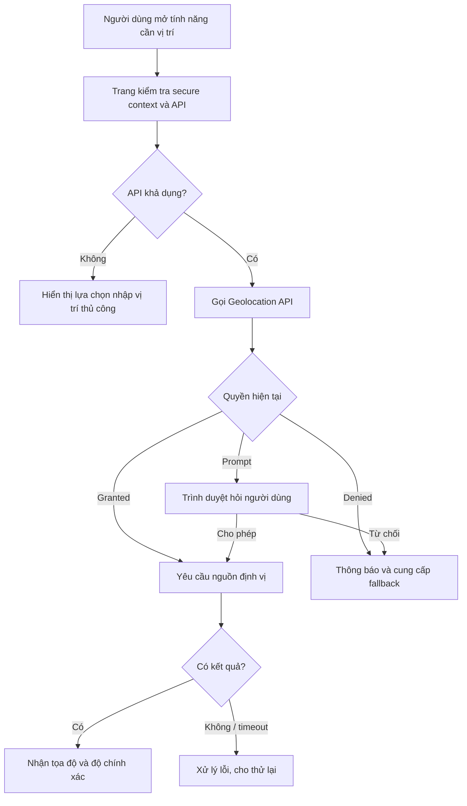

# Geolocation: xin quyền và lấy vị trí của người dùng

Geolocation API cho phép một trang web yêu cầu trình duyệt cung cấp vị trí hiện tại của thiết bị. Trình duyệt có thể tổng hợp thông tin từ GPS, Wi-Fi, mạng di động hoặc các nguồn định vị khác tùy thiết bị và hệ điều hành. Vì vị trí có thể tiết lộ nơi ở, nơi làm việc, thói quen di chuyển và các thông tin riêng tư khác, trình duyệt yêu cầu trang web chạy trong secure context và phải tuân theo quyết định cấp quyền của người dùng.

Ứng dụng truy cập API qua `navigator.geolocation`. Hai thao tác chính là `getCurrentPosition()` để lấy một vị trí và `watchPosition()` để theo dõi các lần cập nhật. Ứng dụng phải xử lý cả trường hợp người dùng từ chối, thiết bị không xác định được vị trí, request hết thời gian hoặc API không được hỗ trợ.

Bài học thuộc chương **Permissions**, trong phạm vi **SECURITY_APPLICATION_SECURITY_BROWSER_SECURITY**: phân tích ranh giới bảo mật giữa trình duyệt, origin, cookie và ứng dụng web để hiểu Same-Origin Policy, CORS và các cơ chế cách ly; thực hành phòng vệ XSS, CSRF, clickjacking bằng CSP, Trusted Types, security headers và kiểm chứng hành vi thực tế.

## 1. Mục tiêu học tập

Sau bài học, người học có thể:

1. Giải thích Geolocation API và các điều kiện bảo mật để sử dụng.
2. Mô tả vòng đời quyền vị trí: prompt, granted và denied.
3. Phân biệt kiểm tra quyền qua Permissions API với thao tác thực sự yêu cầu vị trí.
4. Dùng `getCurrentPosition()` và `watchPosition()` với các tùy chọn phù hợp.
5. Xử lý các mã lỗi `PERMISSION_DENIED`, `POSITION_UNAVAILABLE` và `TIMEOUT`.
6. Giải thích ý nghĩa và giới hạn của latitude, longitude, accuracy, altitude, heading, speed và timestamp.
7. Giới hạn quyền định vị cho iframe bằng Permissions Policy.
8. Thiết kế luồng xin quyền tôn trọng quyền riêng tư, có fallback và dừng theo dõi khi không còn cần.
9. Kiểm chứng hành vi trên HTTPS/localhost bằng DevTools và cài đặt quyền của trình duyệt.

## 2. Geolocation API hoạt động như thế nào?

Trang web không tự đọc trực tiếp GPS hoặc chip định vị. Trang gọi Geolocation API, trình duyệt kiểm tra điều kiện môi trường và quyền, rồi yêu cầu hệ điều hành hoặc dịch vụ định vị cung cấp kết quả nếu được phép.

Luồng khái quát:



Trình duyệt quyết định cách hiển thị prompt và cách lấy vị trí. Kết quả không nhất thiết đến từ GPS; máy tính để bàn có thể dùng Wi-Fi hoặc các nguồn khác, còn thiết bị di động có thể kết hợp nhiều nguồn.

### Geolocation không phải IP geolocation

IP geolocation là suy đoán khu vực từ địa chỉ IP ở phía server hoặc dịch vụ bên ngoài. Geolocation API là yêu cầu vị trí do browser quản lý và có thể sử dụng nguồn định vị của thiết bị. Hai phương pháp có độ chính xác, quyền riêng tư và cơ chế cấp quyền khác nhau.

Không dùng vị trí suy ra từ IP để giả định người dùng đã cấp quyền Geolocation API. Ngược lại, không mặc định tọa độ từ Geolocation API luôn chính xác như GPS.

## 3. Điều kiện bảo mật và khả năng hỗ trợ

Geolocation API chỉ được cung cấp trong **secure context**. Với website production, hãy dùng HTTPS và chứng chỉ hợp lệ. `localhost` thường được browser xem là potentially trustworthy để phát triển và thử nghiệm; một địa chỉ LAN hoặc hostname HTTP tùy ý không tự động được xem như vậy.

Kiểm tra:

```js
console.log({
  secureContext: window.isSecureContext,
  geolocationAvailable: 'geolocation' in navigator
});
```

Hai điều kiện cần xem xét:

- `window.isSecureContext` cho biết tài liệu có đang ở secure context hay không.
- `navigator.geolocation` cho biết API có được cung cấp trong môi trường hiện tại hay không.

Nếu API không khả dụng, hiển thị fallback phù hợp như nhập địa chỉ, chọn khu vực hoặc dùng vị trí đã lưu mà người dùng chủ động chọn. Không yêu cầu người dùng hạ cấp sang HTTP để bật định vị.

### Quyền gắn với origin

Quyết định cấp quyền được browser quản lý theo website/origin và các quy tắc riêng của trình duyệt. Scheme, host và port tạo thành origin; đổi từ HTTP sang HTTPS, đổi hostname hoặc đổi port có thể khiến trang được xem là một origin khác và phải xin quyền lại.

Người dùng có thể thay đổi hoặc thu hồi quyền trong cài đặt website của browser. Ứng dụng phải xử lý tình huống quyền thay đổi sau khi trang đã tải, kể cả khi trước đó một lần định vị thành công.

## 4. Vòng đời quyền vị trí

Permissions API thường biểu diễn trạng thái quyền bằng ba giá trị:

| State | Ý nghĩa | Hành vi ứng dụng |
| --- | --- | --- |
| `prompt` | Chưa có quyết định hiện hành; browser có thể hỏi khi API được gọi. | Giải thích lý do trước khi yêu cầu vị trí. |
| `granted` | Quyền đang được cấp theo quyết định và policy hiện tại. | Có thể gọi Geolocation API; vẫn phải xử lý lỗi thiết bị và timeout. |
| `denied` | Quyền bị từ chối hoặc bị chặn bởi một policy liên quan. | Không lặp prompt; hướng dẫn người dùng kiểm tra cài đặt hoặc dùng fallback. |

Trạng thái `prompt` không bảo đảm browser chắc chắn hiển thị prompt. Browser có thể áp dụng trải nghiệm cấp quyền riêng, hạn chế theo profile hoặc chặn do Permissions Policy.

### Người dùng quyết định, trang không tự cấp quyền

Trang web không thể tự đặt permission thành `granted` bằng JavaScript. Ứng dụng chỉ có thể giải thích mục đích, gọi API khi tính năng cần vị trí và xử lý kết quả theo quyết định của browser.

Không nên tự động yêu cầu vị trí ngay khi trang vừa mở nếu người dùng chưa hiểu tính năng cần gì. Hãy gắn lời giải thích với hành động rõ ràng, ví dụ nút “Dùng vị trí hiện tại”.

### Quyền có thể bị thu hồi

Người dùng có thể đổi quyền trong lúc trang đang mở. Với `watchPosition()`, ứng dụng cần xử lý callback lỗi và dừng theo dõi khi không còn quyền hoặc khi tính năng kết thúc. Không giả định một lần cấp quyền đồng nghĩa quyền tồn tại vĩnh viễn.

## 5. Kiểm tra trạng thái bằng Permissions API

Permissions API cho phép đọc trạng thái quyền mà browser đang báo cáo:

```js
async function readGeolocationPermission() {
  if (!navigator.permissions?.query) {
    return 'unknown';
  }

  try {
    const status = await navigator.permissions.query({
      name: 'geolocation'
    });

    return status.state;
  } catch {
    return 'unknown';
  }
}

readGeolocationPermission().then((state) => {
  console.log('Geolocation permission:', state);
});
```

Kết quả thường là `granted`, `prompt` hoặc `denied`. Hàm này **không hiển thị prompt và không lấy tọa độ**. Nó chỉ đọc trạng thái quyền hiện tại mà browser cung cấp.

### Theo dõi thay đổi permission

```js
async function observeGeolocationPermission(onChange) {
  if (!navigator.permissions?.query) return null;

  try {
    const status = await navigator.permissions.query({
      name: 'geolocation'
    });

    status.onchange = () => {
      onChange(status.state);
    };

    onChange(status.state);
    return status;
  } catch {
    return null;
  }
}
```

Hỗ trợ Permissions API và permission descriptor có thể khác giữa browser hoặc webview. Vì vậy, đây là cải tiến tùy chọn cho giao diện; không được coi nó là điều kiện bắt buộc để gọi Geolocation API.

### Vì sao không chỉ dựa vào permission state?

Ngay cả khi state là `granted`, request vẫn có thể thất bại do thiết bị không có nguồn định vị, hệ điều hành tắt dịch vụ vị trí, timeout hoặc môi trường thay đổi. Nếu state là `denied`, nguyên nhân có thể đến từ quyết định của người dùng hoặc Permissions Policy. State không cung cấp đầy đủ lý do nghiệp vụ để ứng dụng tự sửa.

Hãy gọi API ở đúng thời điểm tính năng cần dữ liệu và xử lý callback thành công/lỗi.

## 6. Lấy một vị trí bằng getCurrentPosition()

Phương thức:

```js
navigator.geolocation.getCurrentPosition(
  successCallback,
  errorCallback,
  options
);
```

Hai callback:

- `successCallback(position)`: nhận đối tượng `GeolocationPosition`.
- `errorCallback(error)`: nhận `GeolocationPositionError` nếu không lấy được vị trí.

Ví dụ:

```js
function showCurrentPosition() {
  if (!window.isSecureContext || !navigator.geolocation) {
    showMessage('Trình duyệt hoặc kết nối hiện tại không hỗ trợ định vị.');
    return;
  }

  navigator.geolocation.getCurrentPosition(
    (position) => {
      const { latitude, longitude, accuracy } = position.coords;

      showMessage(
        'Vị trí đã nhận. Sai số ước tính: ' + Math.round(accuracy) + ' m.'
      );

      console.log({
        latitude,
        longitude,
        accuracy,
        timestamp: position.timestamp
      });
    },
    (error) => {
      handleGeolocationError(error);
    },
    {
      enableHighAccuracy: false,
      timeout: 10000,
      maximumAge: 60000
    }
  );
}
```

Không hiển thị tọa độ chính xác trên giao diện nếu tính năng chỉ cần thông báo đã xác định khu vực. Chỉ lưu hoặc gửi những trường thật sự cần cho mục đích đã giải thích.

### PositionOptions

| Tùy chọn | Mặc định | Ý nghĩa |
| --- | --- | --- |
| `enableHighAccuracy` | `false` | Gợi ý browser ưu tiên kết quả có độ chính xác cao hơn nếu thiết bị hỗ trợ. Có thể tốn pin, thời gian hoặc tài nguyên hơn. |
| `timeout` | `Infinity` | Thời gian tối đa chờ kết quả, tính bằng mili giây. |
| `maximumAge` | `0` | Tuổi tối đa của vị trí đã cache có thể được chấp nhận, tính bằng mili giây. |

`enableHighAccuracy` chỉ là gợi ý; browser hoặc hệ điều hành có thể không đáp ứng. Đừng bật nó mặc định cho mọi tính năng.

`maximumAge: 0` yêu cầu không dùng vị trí cache cũ. Một giá trị lớn hơn cho phép browser dùng kết quả gần đây, giúp giảm thời gian chờ và hoạt động định vị. `maximumAge: Infinity` cho phép chấp nhận bất kỳ vị trí cache nào theo quy tắc API; chỉ dùng khi tính năng chấp nhận dữ liệu có thể cũ.

`timeout` giới hạn thời gian chờ lấy kết quả. Chọn giá trị phù hợp với trải nghiệm, rồi cung cấp cách thử lại hoặc nhập vị trí thủ công.

## 7. Đọc GeolocationPosition và tọa độ

Callback thành công nhận một `GeolocationPosition` gồm `coords` và `timestamp`.

| Trường | Đơn vị/kiểu | Ý nghĩa |
| --- | --- | --- |
| `coords.latitude` | Độ thập phân | Vĩ độ, từ -90 tới 90. |
| `coords.longitude` | Độ thập phân | Kinh độ, từ -180 tới 180. |
| `coords.accuracy` | Mét | Độ chính xác ước tính của vĩ độ/kinh độ. |
| `coords.altitude` | Mét hoặc `null` | Độ cao so với mực nước biển nếu xác định được. |
| `coords.altitudeAccuracy` | Mét hoặc `null` | Độ chính xác ước tính của độ cao. |
| `coords.heading` | Độ hoặc `null` | Hướng di chuyển, theo chiều kim đồng hồ từ hướng Bắc thật khi xác định được. |
| `coords.speed` | Mét/giây hoặc `null` | Tốc độ di chuyển nếu xác định được. |
| `position.timestamp` | Mili giây từ Unix epoch | Thời điểm vị trí được xác định. |

### Accuracy không phải cam kết GPS

`accuracy` là ước lượng sai số theo mét do nguồn định vị cung cấp. Giá trị nhỏ hơn thường biểu thị vị trí chính xác hơn, nhưng ứng dụng không nên coi nó là bảo đảm tuyệt đối. Độ chính xác có thể thay đổi theo môi trường trong nhà/ngoài trời, thiết bị, quyền hệ điều hành và nguồn định vị.

Ví dụ:

```js
function summarizePosition(position) {
  const { latitude, longitude, accuracy } = position.coords;

  return {
    latitude,
    longitude,
    accuracyMeters: Math.round(accuracy),
    measuredAt: new Date(position.timestamp).toISOString()
  };
}
```

Không làm tròn tọa độ rồi tuyên bố người dùng đang ở một địa chỉ cụ thể nếu chưa dùng dịch vụ reverse geocoding và chưa thông báo cách xử lý dữ liệu đó.

### Một số trường có thể null

Altitude, altitudeAccuracy, heading và speed có thể là `null` nếu browser không xác định được. Không viết logic giả định các trường này luôn là number.

## 8. Xử lý lỗi Geolocation

Callback lỗi nhận một đối tượng có `code` và `message`. Các mã chuẩn:

| Mã | Hằng số | Ý nghĩa | Hướng xử lý |
| --- | --- | --- | --- |
| `1` | `PERMISSION_DENIED` | Người dùng hoặc policy không cho phép định vị. | Giải thích cách bật quyền trong site settings hoặc cung cấp fallback. |
| `2` | `POSITION_UNAVAILABLE` | Không xác định được vị trí. | Kiểm tra dịch vụ vị trí, tín hiệu hoặc thử lại sau. |
| `3` | `TIMEOUT` | Không lấy được kết quả trong thời gian cho phép. | Cho phép thử lại hoặc tăng timeout có kiểm soát. |

Ví dụ:

```js
function handleGeolocationError(error) {
  switch (error.code) {
    case error.PERMISSION_DENIED:
      showMessage(
        'Bạn chưa cấp quyền vị trí. Có thể nhập địa chỉ thủ công.'
      );
      break;

    case error.POSITION_UNAVAILABLE:
      showMessage(
        'Thiết bị hiện chưa xác định được vị trí. Hãy thử lại sau.'
      );
      break;

    case error.TIMEOUT:
      showMessage(
        'Yêu cầu định vị đã hết thời gian. Bạn có thể thử lại.'
      );
      break;

    default:
      showMessage('Không thể lấy vị trí ở thời điểm này.');
  }
}
```

Không hiển thị nguyên `error.message` như nội dung hướng dẫn cho người dùng. Message có thể khác nhau giữa browser, chứa chi tiết kỹ thuật và không giải thích được chính xác nguyên nhân nghiệp vụ. Hãy dùng `code` để phân loại và cung cấp thông điệp thân thiện.

### Permission denied không phải lúc nào cũng do người dùng bấm từ chối

Request có thể bị chặn bởi Permissions Policy, cấu hình browser, quản trị thiết bị hoặc chính sách của môi trường nhúng. Không kết luận người dùng đã chủ động từ chối chỉ từ mã lỗi 1.

## 9. Theo dõi liên tục bằng watchPosition()

`watchPosition()` đăng ký nhận cập nhật khi browser có vị trí mới. Nó trả về một watch ID để dừng theo dõi bằng `clearWatch()`.

Ví dụ:

```js
let watchId = null;

function startLocationTracking() {
  if (!navigator.geolocation) {
    showMessage('Thiết bị không hỗ trợ định vị.');
    return;
  }

  if (watchId !== null) return;

  watchId = navigator.geolocation.watchPosition(
    (position) => {
      updateMapMarker({
        latitude: position.coords.latitude,
        longitude: position.coords.longitude,
        accuracy: position.coords.accuracy
      });
    },
    (error) => {
      handleGeolocationError(error);
      if (error.code === error.PERMISSION_DENIED) {
        stopLocationTracking();
      }
    },
    {
      enableHighAccuracy: true,
      timeout: 15000,
      maximumAge: 5000
    }
  );
}

function stopLocationTracking() {
  if (watchId === null) return;

  navigator.geolocation.clearWatch(watchId);
  watchId = null;
}

window.addEventListener('pagehide', stopLocationTracking);
```

### Chỉ theo dõi khi tính năng đang cần

`watchPosition()` có thể tiếp tục nhận cập nhật trong thời gian trang còn hoạt động. Việc theo dõi liên tục làm tăng mức độ thu thập dữ liệu và có thể ảnh hưởng pin. Ứng dụng cần:

- Chỉ bắt đầu sau khi người dùng bật tính năng cần theo dõi.
- Hiển thị trạng thái đang theo dõi và cách dừng.
- Gọi `clearWatch()` khi người dùng tắt tính năng, rời màn hình hoặc không còn cần dữ liệu.
- Không tiếp tục gửi tọa độ lên server sau khi đã dừng theo dõi.
- Xử lý lỗi và thay đổi permission trong lúc watch đang hoạt động.

Không dùng `watchPosition()` để âm thầm theo dõi người dùng khi họ chỉ cần một kết quả vị trí duy nhất. Trong trường hợp đó, `getCurrentPosition()` phù hợp hơn.

## 10. Permissions Policy và iframe

Geolocation có thể bị giới hạn bằng **Permissions Policy**. Với tài liệu top-level, header có thể chỉ cho phép origin hiện tại:

```http
Permissions-Policy: geolocation=(self)
```

Để chặn Geolocation API trong toàn bộ document tree thuộc policy:

```http
Permissions-Policy: geolocation=()
```

Để cho phép origin hiện tại và một origin widget cụ thể:

```http
Permissions-Policy: geolocation=(self "https://maps.example.com")
```

Tên feature là `geolocation`. Header này giới hạn context nào được phép sử dụng tính năng; nó không tự cấp quyền cho người dùng và không bỏ qua prompt/permission của browser.

### Ủy quyền cho iframe

Một iframe cross-origin cần được cho phép qua Permissions Policy của trang cha và thuộc tính `allow` trên iframe:

```html
<iframe
  src="https://maps.example.com/embed"
  title="Bản đồ"
  allow="geolocation">
</iframe>
```

Trang cha phải có policy cho phép origin của iframe. Thuộc tính `allow` không thể mở rộng vượt quá giới hạn mà policy cấp trên đã đặt. Tài liệu trong iframe vẫn phải đáp ứng secure context và quyết định permission của browser.

Ví dụ nếu response của trang cha là:

```http
Permissions-Policy: geolocation=(self)
```

thì iframe `https://maps.example.com` không được cấp quyền chỉ bằng cách thêm `allow="geolocation"`. Cần đưa origin đó vào allowlist nếu ứng dụng thật sự cần ủy quyền.

### Permissions Policy và user permission là hai lớp khác nhau

Để Geolocation hoạt động trong iframe, cả hai điều kiện phải phù hợp:

1. Permissions Policy cho phép frame sử dụng feature.
2. Browser cho phép origin/frame thực hiện yêu cầu theo permission của người dùng và chính sách trình duyệt.

Nếu một lớp chặn, trang không thể tự vượt qua bằng JavaScript.

## 11. Quyền riêng tư và thiết kế an toàn

Vị trí là dữ liệu nhạy cảm. Việc browser hiển thị prompt không thay thế trách nhiệm giải thích mục đích và xử lý dữ liệu có trách nhiệm của ứng dụng.

### Xin quyền đúng thời điểm

- Nói rõ tính năng cần vị trí để làm gì trước khi gọi API.
- Chỉ gọi khi người dùng chọn hành động liên quan, chẳng hạn “Tìm cửa hàng gần tôi”.
- Nếu chỉ cần thành phố hoặc khu vực, không yêu cầu độ chính xác cao hơn mức cần thiết.
- Cung cấp lựa chọn nhập địa chỉ hoặc chọn vị trí trên bản đồ.
- Không lặp lời nhắc hoặc gây áp lực khi người dùng từ chối.

### Thu thập tối thiểu

- Chỉ lấy một vị trí nếu tính năng không cần theo dõi.
- Chỉ lưu tọa độ nếu thực sự cần; cân nhắc chuyển thành khu vực gần đúng rồi loại bỏ tọa độ gốc.
- Không đưa tọa độ vào URL, analytics event hoặc log không cần thiết.
- Không gửi vị trí tới dịch vụ bên thứ ba nếu chưa giải thích và có cơ sở phù hợp.
- Đặt thời hạn lưu, quyền truy cập và cơ chế xóa dữ liệu rõ ràng.

### Tọa độ không phải bằng chứng xác thực

Vị trí do browser cung cấp là dữ liệu đầu vào cho trải nghiệm người dùng. Không dùng nó làm bằng chứng duy nhất để:

- Xác thực danh tính.
- Cấp quyền truy cập tài khoản hoặc tài nguyên.
- Xác nhận một giao dịch tài chính.
- Chứng minh người dùng đang có mặt tại một địa điểm với độ chắc chắn tuyệt đối.

Nguồn định vị có thể sai, không chính xác hoặc bị giả lập trong môi trường kiểm thử/thiết bị bị kiểm soát. Với quyết định bảo mật, cần cơ chế xác thực và kiểm tra phía server phù hợp.

### Tránh hiển thị hoặc chia sẻ ngoài ý muốn

Không in tọa độ chính xác vào console production, log tập trung hoặc thông báo lỗi. Nếu hiển thị vị trí trên bản đồ, cân nhắc mức zoom và độ chính xác; không công khai marker hoặc lịch sử di chuyển cho người khác nếu người dùng chưa chủ động chia sẻ.

## 12. Thực hành: kiểm tra Geolocation trên localhost

Thực hành trên ứng dụng local do người học kiểm soát. Dùng vị trí thử nghiệm, không lưu hoặc gửi tọa độ cá nhân thật.

### 12.1. Chuẩn bị trang HTTPS/localhost

Tạo một trang có nút yêu cầu vị trí:

```html
<!doctype html>
<html lang="vi">
<meta charset="utf-8">
<title>Geolocation permission lab</title>
<h1>Geolocation lab</h1>
<button id="locate">Dùng vị trí hiện tại</button>
<p id="status">Chưa yêu cầu vị trí</p>
<script src="/geolocation.js"></script>
</html>
```

Trong `geolocation.js`:

```js
const statusElement = document.querySelector('#status');
const locateButton = document.querySelector('#locate');

locateButton.addEventListener('click', () => {
  if (!window.isSecureContext || !navigator.geolocation) {
    statusElement.textContent =
      'Geolocation không khả dụng trong môi trường này.';
    return;
  }

  statusElement.textContent = 'Đang yêu cầu vị trí...';

  navigator.geolocation.getCurrentPosition(
    (position) => {
      statusElement.textContent =
        'Đã nhận vị trí với sai số khoảng ' +
        Math.round(position.coords.accuracy) + ' m.';
      console.log({
        latitude: position.coords.latitude,
        longitude: position.coords.longitude,
        accuracy: position.coords.accuracy
      });
    },
    (error) => {
      statusElement.textContent =
        'Không lấy được vị trí (mã ' + error.code + ').';
    },
    {
      enableHighAccuracy: false,
      timeout: 10000,
      maximumAge: 30000
    }
  );
});
```

Mở trang qua `http://localhost:<port>` hoặc HTTPS hợp lệ. Nhấn nút và quan sát prompt của browser. Việc gắn request với một hành động rõ ràng giúp người dùng hiểu tại sao ứng dụng hỏi quyền.

### 12.2. Thử ba trạng thái quyền

Trong cài đặt site của browser, thử:

1. **Ask/Prompt:** xóa quyết định cũ hoặc đặt lại quyền; nhấn nút và chọn Allow.
2. **Granted:** tải lại trang, gọi lại API và quan sát không nhất thiết có prompt mới.
3. **Denied:** đặt quyền Block, gọi API và quan sát callback lỗi với mã `PERMISSION_DENIED`.

Tên và vị trí mục cài đặt khác nhau theo browser. Có thể cần tải lại trang sau khi đổi permission.

### 12.3. Kiểm tra Permissions API

Chạy trong Console:

```js
const permission = await navigator.permissions.query({
  name: 'geolocation'
});
console.log(permission.state);
```

Quan sát `prompt`, `granted` hoặc `denied`. Xác nhận việc query không tự mở prompt và không trả về tọa độ.

### 12.4. Kiểm tra timeout và cache

Thử `timeout` ngắn và `maximumAge: 0`, sau đó so sánh với một `maximumAge` lớn hơn. Kết quả phụ thuộc thiết bị và cache của browser; mục tiêu là quan sát thời gian chờ và khả năng dùng vị trí gần đây, không giả định mọi lần thử cho cùng kết quả.

### 12.5. Kiểm tra watchPosition và dừng theo dõi

Tạo hai nút Start và Stop. Bắt đầu watch, quan sát callback khi thiết bị cung cấp cập nhật, sau đó gọi `clearWatch()` và xác nhận không còn cập nhật mới từ watch đó. Nếu thử trên thiết bị di động, di chuyển trong môi trường an toàn và chỉ dùng dữ liệu giả cho bài lab.

### 12.6. Kiểm tra Permissions Policy trong iframe

Tạo parent và iframe trên các origin local khác nhau. Trên response của parent, thử:

```http
Permissions-Policy: geolocation=()
```

Sau đó thử allowlist origin iframe và thêm:

```html
<iframe
  src="https://maps.example.test/embed"
  allow="geolocation">
</iframe>
```

Quan sát Console và callback của frame. Thay host ví dụ bằng origin lab thực tế; xác minh cả header của parent và thuộc tính `allow`. Không thể chỉ thêm `allow` để vượt policy chặn từ parent.

### 12.7. Bằng chứng cần lưu

| Bằng chứng | Điều cần xác nhận |
| --- | --- |
| Secure context | Trang chạy trong secure context và API khả dụng. |
| Permission prompt | Browser hỏi quyền khi tính năng được gọi ở trạng thái phù hợp. |
| Permission states | Có thể quan sát prompt/granted/denied bằng Permissions API nếu browser hỗ trợ. |
| Success callback | Nhận tọa độ, accuracy và timestamp hợp lệ. |
| Error callback | Phân biệt denied, unavailable và timeout. |
| Watch lifecycle | Có thể bắt đầu, nhận cập nhật và dừng bằng clearWatch. |
| Permissions Policy | Header và iframe allow quyết định frame có được dùng feature hay không. |

## 13. Những lỗi thường gặp

| Hiện tượng | Nguyên nhân có thể | Cách kiểm tra |
| --- | --- | --- |
| `navigator.geolocation` không có | Không secure context hoặc browser không hỗ trợ | Kiểm tra `isSecureContext` và feature detection. |
| Không thấy prompt | Quyền đã được ghi nhớ, browser chặn, policy không cho phép hoặc UX browser khác | Kiểm tra site settings, Permissions API và Console. |
| `PERMISSION_DENIED` | Người dùng từ chối, policy chặn hoặc quản trị thiết bị hạn chế | Kiểm tra Permissions Policy và cài đặt site; cung cấp fallback. |
| `POSITION_UNAVAILABLE` | Hệ điều hành/dịch vụ định vị không có kết quả | Kiểm tra dịch vụ vị trí, tín hiệu và thử lại. |
| `TIMEOUT` | Nguồn định vị phản hồi chậm hoặc timeout quá ngắn | Điều chỉnh timeout hợp lý và cho phép thử lại. |
| Tọa độ cũ | `maximumAge` cho phép dùng cache cũ | Giảm maximumAge nếu tính năng cần vị trí mới. |
| Tốn pin | Dùng high accuracy hoặc watch liên tục không cần thiết | Chuyển sang một lần lấy vị trí, tắt high accuracy và clearWatch. |
| Iframe không định vị được | Parent policy không ủy quyền hoặc thiếu allow | Kiểm tra header của parent, allow attribute và permission của browser. |
| Query báo denied | Browser báo quyền bị từ chối hoặc policy chặn | Không suy đoán nguyên nhân chỉ từ state; kiểm tra Console và policy. |

## 14. Checklist production

| Hạng mục | Câu hỏi rà soát | Kết quả mong đợi |
| --- | --- | --- |
| Purpose | Người dùng hiểu tại sao tính năng cần vị trí chưa? | Có giải thích ngắn ngay trước hành động xin quyền. |
| Timing | Có yêu cầu quyền ngay khi tải trang không? | Chỉ yêu cầu khi người dùng dùng tính năng liên quan. |
| Secure context | Trang có HTTPS hợp lệ không? | API hoạt động trong secure context. |
| Feature detection | Có xử lý browser không hỗ trợ không? | Có fallback nhập địa chỉ/chọn khu vực. |
| Permission state | Có phân biệt prompt, granted và denied không? | Permissions API chỉ dùng như tín hiệu tùy chọn. |
| Error handling | Có xử lý đủ ba mã lỗi chuẩn không? | Thông báo thân thiện và có hướng tiếp theo. |
| Accuracy | Có yêu cầu độ chính xác cao hơn mức cần thiết không? | Chọn enableHighAccuracy và maximumAge theo use case. |
| Watch lifecycle | Có dừng watch khi không còn cần không? | clearWatch được gọi khi tắt tính năng/rời luồng. |
| Permissions Policy | Có giới hạn frame nào được dùng geolocation không? | Allowlist hẹp; iframe được ủy quyền có chủ đích. |
| Data minimization | Có lưu/gửi tọa độ chính xác không cần thiết không? | Chỉ xử lý field và thời gian lưu cần thiết. |
| Authorization | Có dùng tọa độ làm bằng chứng xác thực duy nhất không? | Không; quyết định bảo mật được xác minh phía server. |
| Logging | Có ghi tọa độ vào log/analytics không? | Không log vị trí chính xác nếu không có nhu cầu rõ ràng. |
| Revocation | Có xử lý khi người dùng thu hồi quyền không? | Dừng theo dõi và chuyển sang fallback. |

## 15. Câu hỏi tự kiểm tra

1. Geolocation API lấy vị trí từ đâu và vì sao kết quả không nhất thiết là GPS?
2. Vì sao Geolocation API yêu cầu secure context?
3. Ba trạng thái `prompt`, `granted` và `denied` khác nhau thế nào?
4. Permissions API query có tự mở prompt hoặc lấy tọa độ không?
5. `getCurrentPosition()` khác `watchPosition()` ở vòng đời sử dụng nào?
6. `enableHighAccuracy`, `timeout` và `maximumAge` ảnh hưởng request ra sao?
7. `accuracy` có ý nghĩa gì và vì sao không phải cam kết vị trí tuyệt đối?
8. Ba mã lỗi chuẩn của Geolocation API là gì và nên xử lý thế nào?
9. Vì sao iframe cross-origin cần được cho phép bởi cả Permissions Policy và thuộc tính `allow`?
10. Vì sao không dùng tọa độ browser làm bằng chứng duy nhất cho authentication hoặc authorization?

**Tiêu chí hoàn thành:** người học có thể kiểm tra điều kiện secure context và quyền Geolocation, lấy một vị trí hoặc theo dõi có kiểm soát, giải thích các trường tọa độ và mã lỗi, cấu hình Permissions Policy cho iframe, đồng thời thiết kế luồng xin quyền minh bạch với data minimization, fallback và cơ chế dừng theo dõi.
