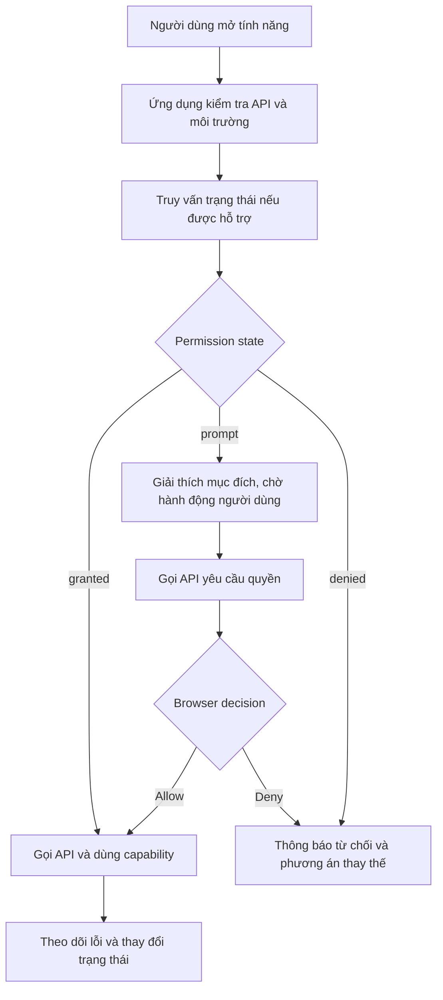

# Permission prompt

## 1. Permission prompt là gì?

**Permission prompt** là hộp thoại hoặc giao diện do browser hiển thị để hỏi người dùng có cho phép một website truy cập một khả năng nhạy cảm của thiết bị hay không. Ví dụ: sử dụng camera, microphone, vị trí, thông báo hoặc một số dữ liệu clipboard. Prompt là một phần của ranh giới bảo mật giữa website, browser, hệ điều hành và người dùng.

Một website không thể tự ý bật camera chỉ bằng cách thêm một thẻ HTML. Website phải gọi API phù hợp; browser kiểm tra secure context, trạng thái quyền, chính sách nhúng và các điều kiện khác. Nếu cần sự đồng ý, browser có thể hiển thị prompt để người dùng chọn cho phép hoặc từ chối.

Ví dụ một trang cần vị trí có thể gọi Geolocation API sau khi người dùng nhấn nút:

```js
const button = document.querySelector("#share-location");

button.addEventListener("click", () => {
  navigator.geolocation.getCurrentPosition(
    position => {
      console.log(position.coords.latitude, position.coords.longitude);
    },
    error => {
      console.error(error.message);
    }
  );
});
```

Lời gọi API mới là hành động yêu cầu quyền. Permissions API có thể giúp ứng dụng hỏi browser về trạng thái hiện tại, nhưng chỉ truy vấn trạng thái không tự hiển thị prompt và cũng không cấp quyền.

Trong module `SECURITY_APPLICATION_SECURITY_BROWSER_SECURITY`, permission prompt liên quan đến browser security boundary, origin, secure context, iframe và chính sách bảo vệ dữ liệu. Bài học tập trung vào vòng đời của quyền, cách browser quyết định hiển thị prompt, cách ứng dụng xử lý grant/deny và cách thiết kế yêu cầu quyền minh bạch.

### Kết quả học tập

Sau bài này, người học có thể:

1. Giải thích permission prompt và vai trò của browser trong việc cấp quyền.
2. Phân biệt Permissions API với API thực sự yêu cầu quyền.
3. Hiểu các trạng thái `granted`, `prompt` và `denied`.
4. Xác định yêu cầu secure context, origin và user activation của từng API.
5. Xử lý trường hợp người dùng cho phép, từ chối hoặc thu hồi quyền.
6. Hiểu cách Permissions Policy giới hạn quyền trong iframe.
7. Thiết kế UX yêu cầu quyền đúng thời điểm, đúng mục đích và với dữ liệu tối thiểu.
8. Kiểm tra trạng thái permission trong browser DevTools và cài đặt website.

## 2. Browser là bên thực thi quyết định quyền

Website có thể yêu cầu sử dụng một tính năng, nhưng browser quyết định request có đủ điều kiện và có được phép tiếp tục hay không. Tùy API, browser có thể:

- Cho phép ngay vì người dùng đã cấp quyền trước đó.
- Hiển thị prompt để hỏi người dùng.
- Từ chối vì người dùng đã chặn quyền.
- Từ chối vì document không ở secure context.
- Từ chối vì iframe hoặc document bị Permissions Policy giới hạn.
- Yêu cầu user activation hoặc điều kiện tương tác khác.
- Không hỗ trợ API hoặc loại permission được hỏi.

Một quyết định permission thường gắn với origin của document yêu cầu. Quyền camera của `https://app.example.com` không tự động đồng nghĩa `https://other.example.com` cũng được quyền sử dụng camera.

### 2.1. Các thành phần tham gia

| Thành phần | Vai trò |
| --- | --- |
| Website/document | Gọi API và giải thích cho người dùng vì sao cần quyền |
| Browser | Kiểm tra origin, secure context, policy và trạng thái permission; hiển thị prompt |
| Người dùng | Cho phép, từ chối hoặc thay đổi quyết định trong cài đặt |
| Hệ điều hành | Có thể yêu cầu cấp quyền ở cấp thiết bị hoặc chặn ứng dụng browser |
| Thiết bị/dịch vụ | Cung cấp camera, microphone, vị trí hoặc tính năng tương ứng |

Vì vậy, `granted` ở browser chưa chắc đã đủ để tính năng hoạt động. Ví dụ hệ điều hành có thể đã tắt quyền microphone cho browser, thiết bị không có camera hoặc camera đang được ứng dụng khác sử dụng.

### 2.2. Permission không phải authorization nghiệp vụ

Permission prompt trả lời câu hỏi: browser có cho website sử dụng một capability hay không? Nó không trả lời câu hỏi: người dùng có quyền xem hồ sơ, thanh toán, quản trị hay truy cập dữ liệu của một tài khoản hay không.

Ví dụ, quyền camera không chứng minh người dùng là nhân viên. Quyền geolocation không chứng minh người dùng đang ở địa điểm được phép thực hiện giao dịch. Server vẫn phải xác thực danh tính và kiểm tra authorization cho mọi hành động nghiệp vụ.

## 3. Vòng đời của permission

### 3.1. Ba trạng thái phổ biến

Permissions API biểu diễn trạng thái permission bằng ba giá trị chính:

| Trạng thái | Ý nghĩa | Ứng xử của ứng dụng |
| --- | --- | --- |
| `granted` | Browser cho phép API sử dụng capability | Gọi API cần thiết và xử lý lỗi thiết bị/runtime |
| `prompt` | Chưa có quyết định được ghi nhận; API có thể cần hỏi người dùng | Giải thích mục đích rồi gọi API phù hợp |
| `denied` | Quyền bị từ chối hoặc bị policy chặn | Hiển thị cách khắc phục phù hợp; không lặp prompt gây phiền |

Ý nghĩa chính xác và cách trạng thái được lưu có thể khác nhau giữa browser, API và nền tảng. `prompt` không bảo đảm browser sẽ hiện hộp thoại; request vẫn có thể bị chặn bởi Permissions Policy, secure context hoặc điều kiện khác.

### 3.2. Sơ đồ vòng đời



Không phải mọi API đều đi qua một prompt giống nhau. Có API hỏi quyền khi gọi, API có hộp thoại riêng, API yêu cầu user activation, và API chỉ cung cấp trạng thái qua Permissions API. Hãy đọc hành vi của API cụ thể thay vì giả định tất cả permission giống nhau.

### 3.3. Quyền có thể thay đổi sau khi trang đã tải

Người dùng có thể mở cài đặt website của browser, thu hồi quyền trong khi tab vẫn mở, hoặc thay đổi quyền ở cấp hệ điều hành. Ứng dụng cần xử lý lỗi từ API tại thời điểm sử dụng và, khi có hỗ trợ, lắng nghe `PermissionStatus` thay đổi.

Không lưu một biến boolean như `cameraAllowed = true` rồi xem nó là sự thật vĩnh viễn. Trạng thái cần được kiểm tra lại khi tính năng được sử dụng và phải xử lý lỗi thực tế từ browser/device API.

## 4. Permissions API: truy vấn trạng thái, không mở prompt

### 4.1. `navigator.permissions.query()`

Permissions API cho phép truy vấn trạng thái của một số permission descriptor:

```js
const status = await navigator.permissions.query({
  name: "geolocation"
});

console.log(status.state); // "granted", "prompt" hoặc "denied"
```

Điểm quan trọng: `query()` không xin quyền thay người dùng. Nếu trạng thái là `prompt`, hộp thoại không tự xuất hiện chỉ vì ứng dụng gọi `query()`.

Permissions API không hỗ trợ đồng đều mọi loại permission descriptor. Một descriptor không được browser hỗ trợ có thể làm Promise reject, thường với `TypeError`. Vì vậy, cần có fallback và vẫn xử lý lỗi từ API thực tế.

### 4.2. Theo dõi thay đổi

`PermissionStatus` có thể phát sự kiện `change` khi trạng thái thay đổi:

```js
async function watchGeolocationPermission(renderState) {
  if (!navigator.permissions) {
    renderState("unknown");
    return null;
  }

  try {
    const status = await navigator.permissions.query({
      name: "geolocation"
    });

    renderState(status.state);

    status.addEventListener("change", () => {
      renderState(status.state);
    });

    return status;
  } catch {
    renderState("unknown");
    return null;
  }
}
```

Không phải browser/API nào cũng cung cấp cùng mức hỗ trợ cho việc quan sát. `change` là tín hiệu để cập nhật UX; nó không thay thế việc bắt lỗi khi gọi Geolocation API hoặc API thiết bị.

### 4.3. Gọi API thực sự yêu cầu quyền

Ví dụ với geolocation:

```js
function requestCurrentPosition() {
  if (!("geolocation" in navigator)) {
    showMessage("Browser không hỗ trợ vị trí.");
    return;
  }

  navigator.geolocation.getCurrentPosition(
    position => {
      showMessage(
        "Đã nhận vị trí với độ chính xác khoảng " +
        Math.round(position.coords.accuracy) + " mét."
      );
    },
    error => {
      switch (error.code) {
        case error.PERMISSION_DENIED:
          showMessage("Quyền vị trí bị từ chối.");
          break;
        case error.POSITION_UNAVAILABLE:
          showMessage("Không xác định được vị trí hiện tại.");
          break;
        case error.TIMEOUT:
          showMessage("Yêu cầu vị trí đã hết thời gian chờ.");
          break;
        default:
          showMessage("Không thể lấy vị trí.");
      }
    },
    {
      enableHighAccuracy: false,
      timeout: 10000,
      maximumAge: 60000
    }
  );
}
```

Ứng dụng gọi API trong hành động phù hợp với luồng UX. Với các API yêu cầu user activation, hãy gọi trực tiếp từ handler của thao tác người dùng thay vì chờ một tác vụ bất đồng bộ dài rồi mới gọi.

## 5. Secure context và user activation

### 5.1. Secure context

Nhiều API nhạy cảm chỉ hoạt động trong **secure context**, thường là trang HTTPS có certificate hợp lệ. Một số origin local như `http://localhost` và loopback address được browser xem là potentially trustworthy cho phát triển.

Ví dụ, camera/microphone qua `getUserMedia`, Geolocation API và Clipboard API thường yêu cầu secure context. Một trang HTTP thông thường không nên kỳ vọng các API này hoạt động.

Có thể kiểm tra:

```js
if (!window.isSecureContext) {
  showMessage("Tính năng này cần trang HTTPS.");
}
```

Secure context là điều kiện nền, không đồng nghĩa người dùng đã cấp quyền. Một trang HTTPS vẫn có thể bị từ chối bởi permission state hoặc Permissions Policy.

### 5.2. User activation

Một số API yêu cầu hoặc được browser giới hạn bằng user activation (tương tác gần đây của người dùng), nhằm tránh website tự mở prompt hoặc thực hiện hành động nhạy cảm khi người dùng không chủ động.

Ví dụ thiết kế nên dùng:

```js
const button = document.querySelector("#enable-camera");

button.addEventListener("click", async () => {
  const stream = await navigator.mediaDevices.getUserMedia({
    video: true,
    audio: false
  });

  document.querySelector("#preview").srcObject = stream;
});
```

Không tự động gọi mọi API xin quyền ngay khi trang tải. Browser có thể không hiển thị prompt, chặn request hoặc khiến người dùng khó hiểu vì sao website đòi quyền.

Yêu cầu user activation cụ thể phụ thuộc API và browser. Không khẳng định mọi API permission đều bắt buộc click; hãy kiểm tra tài liệu và thử nghiệm trên browser mục tiêu. Tuy nhiên, gắn hành động yêu cầu quyền với một thao tác rõ ràng của người dùng là UX an toàn và dễ hiểu.

### 5.3. Kiểm tra API trước khi gọi

Ngoài secure context và permission state, cần kiểm tra API tồn tại:

```js
const canUseCamera =
  window.isSecureContext &&
  !!navigator.mediaDevices &&
  typeof navigator.mediaDevices.getUserMedia === "function";

if (!canUseCamera) {
  showMessage("Camera không khả dụng trong môi trường này.");
}
```

Không dùng kiểm tra này để suy ra người dùng đã cấp quyền. Nó chỉ xác định browser có cung cấp API trong môi trường hiện tại hay không.

## 6. Các API và permission thường gặp

| Capability | API thường dùng | Điều cần lưu ý |
| --- | --- | --- |
| Vị trí | `navigator.geolocation` | Secure context; quyền có thể bị từ chối; vị trí là dữ liệu nhạy cảm |
| Camera/microphone | `navigator.mediaDevices.getUserMedia()` | Secure context; có thể có prompt browser và quyền hệ điều hành |
| Thông báo | `Notification.requestPermission()` | Browser có thể giới hạn request theo user gesture và ngữ cảnh top-level |
| Clipboard đọc | `navigator.clipboard.readText()` | Secure context; thường chịu ràng buộc user activation và permission policy |
| Clipboard ghi | `navigator.clipboard.writeText()` | Secure context; browser có thể yêu cầu user activation |
| MIDI/USB/Bluetooth | API tương ứng như Web MIDI, WebUSB, Web Bluetooth | Thường có picker hoặc prompt riêng; không phải lúc nào cũng truy vấn được qua Permissions API |
| Screen capture | `navigator.mediaDevices.getDisplayMedia()` | Thường cần thao tác người dùng và picker chọn màn hình; không phải permission grant dài hạn đơn giản |

Không phải mọi capability đều có một permission descriptor thống nhất. Một số API dùng browser picker để người dùng chọn thiết bị hoặc tài nguyên cụ thể. Không nên dựa vào `navigator.permissions.query()` để dự đoán đầy đủ kết quả của những API này.

### 6.1. Camera và microphone

Ví dụ:

```js
async function startCamera() {
  if (!window.isSecureContext) {
    throw new Error("Camera cần secure context.");
  }

  if (!navigator.mediaDevices?.getUserMedia) {
    throw new Error("getUserMedia không khả dụng.");
  }

  const stream = await navigator.mediaDevices.getUserMedia({
    video: true,
    audio: true
  });

  const video = document.querySelector("#preview");
  video.srcObject = stream;
  await video.play();

  return stream;
}
```

Khi không còn cần camera/microphone, dừng track:

```js
function stopStream(stream) {
  for (const track of stream.getTracks()) {
    track.stop();
  }
}
```

Dừng stream là bước quan trọng để giải phóng thiết bị và thể hiện rõ với người dùng khi ứng dụng không còn thu nhận dữ liệu. Không giữ camera bật ở nền nếu tính năng đã kết thúc.

### 6.2. Geolocation

Chỉ yêu cầu vị trí khi tính năng cần nó, ví dụ tìm cửa hàng gần người dùng hoặc hiển thị vị trí trên bản đồ. Không lấy vị trí chính xác nếu dữ liệu gần đúng đủ đáp ứng mục đích.

Các option như `maximumAge`, `timeout` và `enableHighAccuracy` ảnh hưởng cách browser tìm vị trí. Chọn giá trị theo nhu cầu; high accuracy có thể tăng thời gian, pin hoặc mức dữ liệu thu thập.

### 6.3. Notifications

Một luồng cơ bản:

```js
async function requestNotifications() {
  if (!("Notification" in window)) {
    showMessage("Browser không hỗ trợ thông báo.");
    return;
  }

  const permission = await Notification.requestPermission();

  if (permission === "granted") {
    showMessage("Đã bật thông báo.");
  } else if (permission === "denied") {
    showMessage("Thông báo đang bị chặn trong cài đặt browser.");
  } else {
    showMessage("Chưa cấp quyền thông báo.");
  }
}
```

Notification permission API trả về trạng thái dạng string như `granted`, `denied` hoặc `default`. `default` tương ứng người dùng chưa đưa ra quyết định rõ ràng và cần được xử lý như chưa có quyền.

### 6.4. Clipboard

Ví dụ ghi văn bản:

```js
async function copyInviteLink() {
  try {
    await navigator.clipboard.writeText(location.href);
    showMessage("Đã sao chép liên kết.");
  } catch (error) {
    showMessage("Không thể truy cập clipboard.");
  }
}
```

Đọc clipboard nhạy cảm hơn ghi clipboard. Chỉ yêu cầu đọc khi người dùng chủ động chọn hành động dán/nhập từ clipboard và giải thích dữ liệu sẽ được dùng ra sao. Không đọc clipboard liên tục hoặc âm thầm để tìm token, mật khẩu hay thông tin cá nhân.

## 7. Quyền trong iframe và Permissions Policy

Một trang có thể nhúng iframe từ origin khác. Việc trang cha được phép dùng capability không tự động có nghĩa iframe cũng được phép. **Permissions Policy** cho phép document giới hạn những tính năng nào được sử dụng bởi chính nó và các frame con.

### 7.1. Header Permissions-Policy

Ví dụ chỉ cho phép geolocation trong chính origin của document:

```http
Permissions-Policy: geolocation=(self)
```

Ví dụ chặn camera và microphone trên toàn bộ document tree:

```http
Permissions-Policy: camera=(), microphone=()
```

Policy này được gửi trong response header của document. Cú pháp allowlist và hỗ trợ feature phụ thuộc browser; cần kiểm tra các directive được hỗ trợ trong browser mục tiêu.

### 7.2. iframe allow attribute

Trang cha có thể cấp quyền sử dụng feature cho iframe thông qua `allow` attribute:

```html
<iframe
  src="https://meet.example.com/room"
  allow="camera; microphone"
  title="Phòng họp">
</iframe>
```

Đây là cơ chế cho phép theo Permissions Policy, không phải hành động cấp quyền thay người dùng. Browser vẫn có thể hỏi permission, từ chối do cài đặt, hoặc áp dụng giới hạn khác.

Với iframe cross-origin, response header của trang cha cũng phải cho phép origin đó. Ví dụ:

```http
Permissions-Policy: camera=(self "https://meet.example.com"), microphone=(self "https://meet.example.com")
```

Header giới hạn các origin được phép; thuộc tính `allow` trên iframe tiếp tục giới hạn feature được cấp cho frame cụ thể. Chỉ thêm origin thật sự cần dùng camera/microphone vào allowlist.

### 7.3. Hai lớp phải cùng cho phép

Để iframe sử dụng một feature, phải xét policy từ document cha, `allow` của iframe, policy của document con và các quy tắc permission/browser. `allow` không thể ghi đè một chính sách cha đã cấm feature.

Vì vậy, khi camera không hoạt động trong iframe, kiểm tra:

1. Trang top-level có secure context không?
2. Header Permissions-Policy của trang cha có cho phép feature không?
3. iframe có `allow` attribute phù hợp không?
4. Document con có bị policy riêng giới hạn không?
5. Browser permission và quyền hệ điều hành có cho phép không?

### 7.4. Không mở rộng quyền quá mức

Không dùng `*` cho mọi feature khi chỉ một iframe cần quyền. Chỉ cho phép origin cụ thể, đúng feature và trong thời gian cần thiết. Một widget quảng cáo hoặc analytics thường không cần camera, microphone, geolocation hay clipboard.

## 8. Grant, deny và revoke

### 8.1. Khi người dùng cho phép

Khi permission được cấp, gọi API vẫn có thể thất bại do thiết bị, hệ điều hành, phần cứng, kết nối hoặc điều kiện runtime. Luôn bắt lỗi API và cung cấp trạng thái dễ hiểu.

Không giả định `granted` đồng nghĩa camera chắc chắn mở được hoặc vị trí chắc chắn có sẵn.

### 8.2. Khi người dùng từ chối

Nếu người dùng từ chối:

- Dừng luồng yêu cầu quyền hiện tại.
- Giải thích tính năng nào bị ảnh hưởng.
- Cung cấp cách tiếp tục không cần quyền nếu có.
- Chỉ hướng dẫn mở cài đặt browser khi tính năng thực sự cần quyền.
- Không lặp prompt hoặc hiển thị popup gây áp lực.

Một số browser ghi nhớ quyết định từ chối và sẽ không hiển thị prompt lại cho lần gọi sau. Ứng dụng không thể tự reset quyết định đó bằng JavaScript.

### 8.3. Khi người dùng thu hồi quyền

Người dùng có thể thay đổi quyền từ biểu tượng cài đặt site cạnh thanh địa chỉ, trang site settings hoặc cài đặt hệ điều hành. Khi quyền bị thu hồi, API có thể phát sinh lỗi ở lần sử dụng tiếp theo; với một số permission, `PermissionStatus` có thể phát `change`.

Ứng dụng nên:

- Dừng hoặc giải phóng tài nguyên đang sử dụng nếu API báo lỗi/revoke.
- Cập nhật giao diện và cho phép người dùng thử lại theo hành động chủ động.
- Không giữ dữ liệu nhạy cảm lâu hơn mục đích.
- Không coi trạng thái permission cũ trong memory là trạng thái hiện tại.

### 8.4. Quyền được lưu trong bao lâu?

Thời gian lưu grant/deny phụ thuộc browser, API, nền tảng và cài đặt riêng tư. Có quyền chỉ tồn tại trong phiên, có quyền được lưu lâu hơn, có quyền được tự reset hoặc thu hồi. Không thiết kế hệ thống dựa trên giả định mọi browser lưu quyền vĩnh viễn.

## 9. Thiết kế UX permission prompt an toàn

Permission prompt là quyết định của người dùng. Ứng dụng cần giải thích mục đích trước khi gọi API, thay vì yêu cầu nhiều quyền ngay khi trang vừa tải.

### 9.1. Yêu cầu đúng thời điểm

Một luồng tốt:

1. Người dùng mở tính năng cần capability.
2. Ứng dụng giải thích tính năng cần quyền gì và để làm gì.
3. Người dùng nhấn nút chủ động như “Bật camera” hoặc “Dùng vị trí”.
4. Ứng dụng gọi API phù hợp.
5. Nếu browser hiển thị prompt, người dùng quyết định.
6. Ứng dụng hiển thị kết quả và phương án thay thế.

Không gọi camera, microphone, vị trí và notification cùng lúc khi người dùng vừa mở trang mà chưa biết lý do.

### 9.2. Nói rõ dữ liệu được dùng thế nào

Thông báo nên cụ thể:

- “Cho phép vị trí để tìm cửa hàng gần bạn.”
- “Bật camera để quét mã QR.”
- “Cho phép microphone để tham gia cuộc gọi.”
- “Cho phép thông báo để nhận nhắc lịch mà bạn đã đăng ký.”

Tránh câu chung chung như “Cần quyền để tiếp tục” nếu có thể giải thích rõ mục đích.

### 9.3. Cung cấp lựa chọn thay thế

Nếu người dùng từ chối vị trí, có thể cho nhập địa chỉ hoặc mã bưu chính. Nếu không cấp camera, có thể cho tải ảnh lên. Nếu không bật thông báo, vẫn cho xem thông tin trong ứng dụng.

Không làm cho người dùng hiểu nhầm rằng họ phải cấp quyền thiết bị mới có thể sử dụng một chức năng không liên quan.

### 9.4. Thu thập tối thiểu

Chỉ yêu cầu capability thực sự cần thiết. Chọn độ chính xác và thời lượng phù hợp. Dừng stream khi kết thúc, không lưu vị trí chính xác nếu chỉ cần vùng gần đúng, và không gửi dữ liệu tới server nếu tính năng có thể chạy cục bộ.

### 9.5. Không dark pattern

Không che nút từ chối, không lặp prompt sau mỗi lần render, không gắn việc từ chối với hình phạt không liên quan. Người dùng cần có cách thu hồi quyền và hiểu ảnh hưởng của quyết định.

## 10. Thực hành: kiểm tra permission state và yêu cầu geolocation

Bài lab chạy trên `localhost` hoặc HTTPS. Tạo một trang HTML có nút chủ động yêu cầu vị trí, hiển thị trạng thái truy vấn nếu browser hỗ trợ và xử lý grant/deny.

### 10.1. Trang HTML

Tạo `permission-lab.html`:

```html
<!doctype html>
<meta charset="utf-8">
<title>Permission prompt lab</title>
<h1>Geolocation permission lab</h1>
<p id="state">Trạng thái: chưa kiểm tra</p>
<button id="check" type="button">Kiểm tra trạng thái quyền</button>
<button id="request" type="button">Dùng vị trí hiện tại</button>
<pre id="result">Chưa có kết quả</pre>

<script>
  const state = document.querySelector("#state");
  const result = document.querySelector("#result");

  async function checkPermission() {
    if (!navigator.permissions) {
      state.textContent = "Permissions API không khả dụng.";
      return;
    }

    try {
      const status = await navigator.permissions.query({
        name: "geolocation"
      });

      state.textContent = "Trạng thái: " + status.state;

      status.addEventListener("change", () => {
        state.textContent = "Trạng thái: " + status.state;
      });
    } catch (error) {
      state.textContent =
        "Không truy vấn được permission: " + error.name;
    }
  }

  function requestPosition() {
    if (!navigator.geolocation) {
      result.textContent = "Geolocation API không khả dụng.";
      return;
    }

    navigator.geolocation.getCurrentPosition(
      position => {
        result.textContent =
          "Độ chính xác: " +
          Math.round(position.coords.accuracy) +
          " mét.";
      },
      error => {
        result.textContent =
          "Geolocation error " + error.code + ": " + error.message;
      },
      {
        enableHighAccuracy: false,
        timeout: 10000,
        maximumAge: 60000
      }
    );
  }

  document.querySelector("#check").addEventListener("click", checkPermission);
  document.querySelector("#request").addEventListener("click", requestPosition);
</script>
```

### 10.2. Các bước kiểm tra

1. Mở trang trên HTTPS hoặc `localhost`.
2. Nhấn “Kiểm tra trạng thái quyền”; ghi nhận `granted`, `prompt`, `denied` hoặc trường hợp browser không hỗ trợ query.
3. Nhấn “Dùng vị trí hiện tại”; nếu cần, browser hiển thị prompt.
4. Chọn Allow và quan sát kết quả vị trí hoặc lỗi từ hệ thống.
5. Reload và kiểm tra trạng thái được browser ghi nhận.
6. Thu hồi quyền trong Site settings của browser.
7. Quay lại tab, thử dùng vị trí lần nữa và quan sát trạng thái/error.
8. Thử trong iframe bị Permissions Policy chặn để phân biệt policy denial với user denial.

Lưu ý: không cần ghi tọa độ thật vào log hoặc chia sẻ ra ngoài. Bài lab chỉ cần xác nhận API thành công/thất bại và permission state.

## 11. Ma trận kiểm thử

| Mã | Tình huống | Kết quả mong muốn |
| --- | --- | --- |
| PERM-01 | API được hỗ trợ, quyền đã granted | API được gọi; vẫn xử lý lỗi runtime |
| PERM-02 | Trạng thái prompt, người dùng Allow | API tiếp tục nếu các điều kiện khác hợp lệ |
| PERM-03 | Trạng thái prompt, người dùng Deny | API báo permission denied |
| PERM-04 | Trạng thái denied đã lưu | Ứng dụng không lặp prompt; hướng dẫn site settings |
| PERM-05 | Permissions API không tồn tại | Có fallback, vẫn xử lý API chính |
| PERM-06 | Permission descriptor không hỗ trợ | Query reject; ứng dụng xử lý graceful |
| PERM-07 | Document không phải secure context | API yêu cầu secure context không khả dụng/bị chặn |
| PERM-08 | Feature bị Permissions Policy chặn | Iframe/document không được dùng feature |
| PERM-09 | Browser grant nhưng OS deny | API vẫn có thể thất bại; hiển thị hướng dẫn phù hợp |
| PERM-10 | Người dùng revoke trong settings | Ứng dụng cập nhật trạng thái hoặc xử lý lỗi lần dùng tiếp |
| PERM-11 | Người dùng từ chối camera | Có phương án thay thế như upload ảnh nếu phù hợp |
| PERM-12 | Iframe không có allow cần thiết | Feature không được cấp cho frame |
| PERM-13 | Yêu cầu quyền khi tải trang | UX không tự động spam prompt; chỉ yêu cầu theo hành động |
| PERM-14 | Camera không còn cần thiết | Stream tracks được stop và thiết bị được giải phóng |

## 12. Những sai lầm thường gặp

| Nhận định sai | Cách hiểu đúng |
| --- | --- |
| `navigator.permissions.query()` mở prompt | Query chỉ đọc trạng thái khi descriptor được hỗ trợ |
| `granted` nghĩa là API chắc chắn hoạt động | Thiết bị, OS, policy và runtime vẫn có thể từ chối |
| `prompt` bảo đảm browser sẽ hỏi | Điều kiện khác có thể chặn request trước khi prompt xuất hiện |
| Mọi permission đều yêu cầu click | User activation phụ thuộc API/browser; click chủ động vẫn là UX nên dùng |
| HTTPS tự cấp quyền camera/vị trí | HTTPS chỉ đáp ứng một điều kiện môi trường |
| Quyền của trang cha tự truyền cho iframe | Permissions Policy và allowlist của frame quyết định phạm vi |
| Origin này được cấp quyền thì subdomain khác cũng được | Permission thường gắn với origin và quy tắc riêng của API |
| Deny có thể reset bằng JavaScript | Người dùng thường phải đổi quyết định trong browser settings |
| Browser grant bỏ qua quyền hệ điều hành | OS-level privacy controls vẫn có thể chặn |
| Permission prompt là authorization nghiệp vụ | Server vẫn phải xác thực và kiểm tra quyền nghiệp vụ |
| Cứ xin tất cả quyền khi trang tải là tốt | Chỉ xin quyền lúc tính năng cần và giải thích mục đích |
| Camera stream có thể để chạy mãi | Dừng tracks khi không còn sử dụng |

## 13. Checklist triển khai permission prompt

- [ ] Xác định capability và dữ liệu thực sự cần cho tính năng.
- [ ] Kiểm tra API có tồn tại và document có secure context.
- [ ] Dùng Permissions API để quan sát trạng thái khi descriptor được hỗ trợ.
- [ ] Không coi `query()` là hành động cấp quyền hoặc mở prompt.
- [ ] Gọi API yêu cầu quyền từ luồng UX rõ ràng; tuân thủ user activation nếu API cần.
- [ ] Giải thích mục đích trước khi browser hiển thị prompt.
- [ ] Xử lý `granted`, `prompt`, `denied`, unsupported và runtime errors.
- [ ] Không lặp prompt hoặc gây áp lực khi người dùng từ chối.
- [ ] Kiểm tra Permissions Policy và iframe `allow` khi nhúng.
- [ ] Phân biệt browser permission với quyền hệ điều hành.
- [ ] Cung cấp phương án thay thế không cần capability khi có thể.
- [ ] Thu thập dữ liệu tối thiểu, đúng thời gian và đúng mục đích.
- [ ] Dừng camera/microphone tracks khi kết thúc.
- [ ] Cho phép người dùng thay đổi lựa chọn và xử lý revoke.
- [ ] Server vẫn xác thực và authorize các hành động nghiệp vụ.

### Ghi nhớ

**Permission prompt là điểm browser hỏi người dùng trước khi website sử dụng một capability nhạy cảm.** Permissions API giúp quan sát trạng thái `granted`, `prompt` hoặc `denied`; API của tính năng mới là nơi thực sự yêu cầu quyền. Secure context, origin, user activation, Permissions Policy, browser settings và quyền hệ điều hành đều có thể ảnh hưởng kết quả. Hãy yêu cầu đúng lúc, giải thích mục đích, thu thập tối thiểu, xử lý từ chối/revoke và giữ authorization nghiệp vụ ở server.
