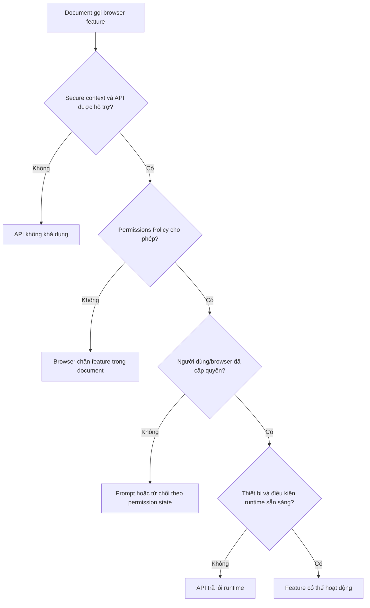

# Permissions Policy header: giới hạn tính năng trình duyệt theo origin

**Chương:** Permissions Policy  
**Mô-đun:** `SECURITY_APPLICATION_SECURITY_BROWSER_SECURITY` — phân tích ranh giới bảo mật giữa trình duyệt, origin, cookie và ứng dụng web để hiểu Same-Origin Policy (SOP), CORS và các cơ chế cách ly; thực hành phòng vệ XSS, CSRF, clickjacking bằng CSP, Trusted Types, security headers và kiểm chứng hành vi thực tế.

**Permissions Policy** là cơ chế cho phép website kiểm soát những tính năng nhạy cảm của trình duyệt mà một document được sử dụng, cũng như những tính năng mà document đó có thể ủy quyền cho iframe con. Chính sách thường được khai báo bằng HTTP response header `Permissions-Policy`. Ví dụ, ứng dụng có thể tắt camera và microphone trên toàn bộ trang, chỉ cho phép geolocation ở origin của chính ứng dụng, hoặc chỉ ủy quyền một tính năng cho một origin đối tác đã được xác minh.

Cơ chế này giúp giảm bề mặt tấn công và tránh việc một widget hoặc iframe bên thứ ba vô tình sử dụng camera, microphone, vị trí, thanh toán hoặc các API nhạy cảm. Tuy nhiên, Permissions Policy chỉ quyết định tính năng có được phép trong document hay không. Nó không tự cấp quyền từ người dùng, không thay thế hộp thoại permission của browser, không xác thực người dùng ở server và không thay thế CSP, SOP hay CORS.

Bài học tập trung vào **policy header**: cú pháp allowlist, giá trị mặc định, cách giới hạn và ủy quyền tính năng cho iframe, cách kiểm tra chính sách có hiệu lực và cách triển khai an toàn qua ứng dụng, reverse proxy và CDN.

## 1. Mục tiêu học tập

Sau bài học, bạn có thể:

1. Giải thích Permissions Policy kiểm soát điều gì và khác quyền người dùng của browser ra sao.
2. Cấu hình HTTP response header `Permissions-Policy` với allowlist chính xác.
3. Phân biệt các biểu thức `*`, `self`, `()` và origin cụ thể.
4. Hiểu default allowlist của từng feature và lý do nên khai báo tường minh với tính năng nhạy cảm.
5. Giải thích quan hệ giữa policy của trang cha, thuộc tính `allow` của iframe và policy của document con.
6. Phân biệt Permissions Policy với CSP, CORS, SOP, sandbox và Permissions API.
7. Kiểm tra policy bằng response header, DevTools, browser API và test tự động.
8. Triển khai header nhất quán trên route HTML, iframe, redirect, error page và các tầng CDN/proxy.

## 2. Permissions Policy giải quyết vấn đề gì?

Trình duyệt cung cấp nhiều API có thể truy cập tài nguyên hoặc khả năng của thiết bị:

- Geolocation có thể cung cấp vị trí của người dùng.
- Camera và microphone có thể truy cập thiết bị ghi hình/ghi âm.
- Display Capture có thể chia sẻ màn hình.
- Clipboard API có thể đọc hoặc ghi clipboard trong các điều kiện được phép.
- Payment API có thể tham gia luồng thanh toán.
- Fullscreen API có thể đưa document vào chế độ toàn màn hình.
- Một số API liên quan cảm biến, autoplay, USB, Web Share hoặc các tính năng khác tùy browser.

Các API này có thể hữu ích cho ứng dụng, nhưng không phải mọi trang hoặc bên thứ ba đều cần chúng. Một trang chính có thể nhúng video player, bản đồ, chat, analytics hoặc widget thanh toán. Nếu không giới hạn, iframe có thể yêu cầu sử dụng một tính năng mà chức năng của nó không cần.

Permissions Policy cho phép chủ sở hữu document thiết lập ranh giới: feature nào bị tắt, feature nào được phép ở cùng origin và feature nào được ủy quyền cho origin cụ thể. Browser kiểm tra policy trước khi cho document sử dụng API tương ứng.

### 2.1. Ví dụ: trang có nhiều iframe

Giả sử `https://shop.example.test` nhúng:

- Widget bản đồ từ `https://maps.example.test`.
- Widget chat từ `https://chat.vendor.test`.
- Widget thanh toán từ `https://pay.partner.test`.

Ứng dụng có thể chỉ cho phép geolocation ở trang chính và widget bản đồ, không cho phép camera/microphone ở widget chat, và chỉ cho phép payment feature trong frame thanh toán nếu browser hỗ trợ feature đó.

Nếu không có policy rõ ràng, một thay đổi dependency có thể làm widget yêu cầu thêm API nhạy cảm. Permissions Policy giúp ứng dụng đặt giới hạn ở cấp document và iframe, đồng thời biến giới hạn đó thành một phần có thể kiểm thử của cấu hình bảo mật.

### 2.2. Sơ đồ quyết định feature



Một lời gọi API thành công cần thỏa nhiều điều kiện. Policy cho phép chỉ là một điều kiện trong số đó.

## 3. Permissions-Policy response header

### 3.1. Cú pháp cơ bản

Header có tên:

```http
Permissions-Policy: geolocation=(self), camera=(), microphone=()
```

Header gồm các policy directive, mỗi directive gắn với tên feature và allowlist. Trong cú pháp header hiện đại, các directive được phân tách bằng dấu phẩy.

Một số ví dụ:

```http
# Không cho document hoặc iframe dùng camera và microphone
Permissions-Policy: camera=(), microphone=()

# Chỉ cho phép origin hiện tại dùng geolocation
Permissions-Policy: geolocation=(self)

# Cho phép origin hiện tại và một origin đối tác cụ thể
Permissions-Policy: geolocation=(self "https://maps.example.test")

# Cho phép mọi origin (rất rộng, cần lý do rõ ràng)
Permissions-Policy: fullscreen=*
```

Hãy kiểm tra chính xác tên feature và cú pháp theo browser mục tiêu. Không phải browser nào cũng hỗ trợ mọi feature hoặc mọi phiên bản của policy.

### 3.2. Ý nghĩa của các allowlist expression

| Expression | Ý nghĩa |
| --- | --- |
| `*` | Cho phép mọi origin phù hợp với policy và các ràng buộc khác |
| `self` | Chỉ cho phép origin của document hiện tại |
| `()` | Không cho phép origin nào |
| `"https://partner.example"` | Cho phép origin cụ thể |
| `src` trong iframe `allow` | Cho phép origin được chỉ định bởi thuộc tính `src` của iframe, theo cú pháp container policy |

Origin được xác định bởi **scheme, host và port**. Vì vậy, `https://app.example.test` và `http://app.example.test` là hai origin khác nhau; `https://app.example.test:8443` cũng khác origin dùng port mặc định. Không dùng so khớp hostname đơn thuần để xây dựng allowlist.

Trong header, origin cụ thể được đặt trong dấu ngoặc kép theo cú pháp Permissions Policy. Từ khóa `self` là token của policy, không viết thành chuỗi origin tùy ý.

### 3.3. Allowlist rỗng và wildcard

Dùng `()` khi feature hoàn toàn không cần thiết:

```http
Permissions-Policy: camera=(), microphone=(), geolocation=()
```

Dùng `*` sẽ mở rộng quyền tới mọi origin đủ điều kiện trong phạm vi directive. Với camera, microphone, geolocation hoặc display capture, wildcard thường quá rộng nếu ứng dụng chỉ cần một số frame cụ thể.

Không thêm feature vào allowlist chỉ vì một SDK có thể sử dụng nó. Xác định chức năng sản phẩm thực sự cần, origin sở hữu widget và thời điểm feature được gọi.

### 3.4. Default allowlist

Mỗi feature có một **default allowlist** do đặc tả định nghĩa. Tùy feature, giá trị mặc định có thể cho phép same-origin, cho phép rộng hơn hoặc không cho phép. Không được giả định mọi feature đều mặc định là `self`.

Nếu một feature không xuất hiện trong header, browser dùng default allowlist tương ứng với feature đó. Điều này có thể khiến cấu hình ngắn gọn nhưng khó đọc và khó audit. Với tính năng nhạy cảm, nên khai báo tường minh:

```http
Permissions-Policy: camera=(), microphone=(), geolocation=(self), display-capture=()
```

Header này thể hiện rõ ý định của ứng dụng: tắt camera, microphone và display capture; chỉ cho phép geolocation ở origin hiện tại. Hãy kiểm tra feature name và hỗ trợ của browser trước khi đưa vào baseline production.

### 3.5. Header là response policy

`Permissions-Policy` được gửi qua HTTP response header của document. Không dựa vào thẻ `meta` để cấu hình policy. Với trang chính, header nằm trên response HTML; với iframe, response của document con cũng có thể đặt policy riêng để giới hạn document đó và các descendant của nó.

Cần kiểm tra response cuối cùng sau redirect, route đăng nhập, trang lỗi HTML, trang SPA và response được phục vụ từ CDN. Header chỉ có ở trang chủ không đảm bảo các document khác cũng được bảo vệ.


## 4. Policy inheritance và ủy quyền cho iframe

Permissions Policy đặc biệt quan trọng khi trang chính nhúng nội dung từ origin khác. Cần phân biệt ba lớp:

1. **Policy của document cha:** header `Permissions-Policy` trên response của trang cha giới hạn những feature có thể được sử dụng trong document và những feature có thể được chuyển tiếp xuống frame con.
2. **Container policy của iframe:** thuộc tính `allow` trên phần tử `<iframe>` khai báo feature mà parent muốn ủy quyền cho frame đó.
3. **Policy của document con:** response header `Permissions-Policy` của trang được nhúng có thể tiếp tục giới hạn feature trong chính document con và các descendant của nó.

Để feature hoạt động trong iframe, các ràng buộc từ ancestor, container và document con đều phải cho phép. Một iframe không thể dùng thuộc tính `allow` để mở lại feature mà policy của ancestor đã cấm.

### 4.1. Ví dụ: chỉ ủy quyền geolocation cho widget bản đồ

Trang cha gửi:

```http
Permissions-Policy: geolocation=(self "https://maps.example.test"), camera=(), microphone=()
```

HTML của trang cha:

```html
<iframe
  src="https://maps.example.test/embed"
  title="Bản đồ"
  allow="geolocation 'src'">
</iframe>
```

Widget bản đồ có thể gửi policy riêng:

```http
Permissions-Policy: geolocation=(self), camera=(), microphone=()
```

Trong ví dụ này:

- Header của trang cha cho phép origin `https://maps.example.test` nhận geolocation.
- Thuộc tính `allow` ủy quyền geolocation cho origin của URL trong `src`.
- Header của widget cho phép geolocation trong chính origin của widget.
- Camera và microphone vẫn bị tắt trong các document chịu policy tương ứng.

Nếu bỏ origin bản đồ khỏi allowlist của trang cha, `allow="geolocation 'src'"` không thể tự cấp lại quyền. Nếu widget đặt `geolocation=()`, widget cũng tự giới hạn feature trong document của nó.

### 4.2. Thuộc tính allow không phải permission prompt

Thuộc tính `allow` chỉ cấu hình container policy. Nó không tự bật camera, không tự lấy vị trí và không thay thế consent của người dùng. Browser vẫn áp dụng permission state, secure-context requirement, thiết bị và các điều kiện runtime.

Ví dụ, `allow="camera 'src'"` chỉ có nghĩa iframe được phép yêu cầu camera theo policy. Người dùng vẫn có thể từ chối quyền camera, hệ điều hành có thể chặn ứng dụng, hoặc thiết bị có thể không có camera.

### 4.3. Nested iframe

Nếu trang A nhúng B và B nhúng C, feature chỉ có thể được sử dụng ở C khi toàn bộ chuỗi policy cho phép. Việc A ủy quyền cho B không có nghĩa B được tự do cấp mọi feature cho C. B phải được phép nhận feature, sau đó B cần cấu hình container policy cho iframe C; response policy của C tiếp tục có thể giới hạn feature.

Hãy kiểm thử nested frame khi ứng dụng có nhiều lớp widget. Một allowlist đúng ở iframe trực tiếp vẫn có thể thất bại vì một ancestor cao hơn đã giới hạn feature.

### 4.4. Iframe sandbox là cơ chế độc lập

Thuộc tính `sandbox` có thể giới hạn script, form, navigation, origin và một số khả năng khác của iframe. Permissions Policy và sandbox bổ sung cho nhau:

- `sandbox` kiểm soát môi trường thực thi và một số hành vi của document.
- `allow` cùng Permissions Policy kiểm soát feature của browser được ủy quyền.
- CSP kiểm soát nguồn và loại tài nguyên được tải/thực thi.

Không bỏ `sandbox` chỉ để làm Permissions Policy hoạt động. Xác định từng quyền cần thiết và kiểm thử kết hợp các cơ chế.

## 5. Permissions Policy khác quyền người dùng như thế nào?

Một feature có thể sử dụng được khi nhiều điều kiện cùng thỏa mãn:

| Điều kiện | Câu hỏi |
| --- | --- |
| Secure context | Document có được tải trong secure context mà API yêu cầu không? |
| Browser support | Browser có triển khai API và feature policy tương ứng không? |
| Permissions Policy | Document và toàn bộ ancestor có cho phép feature không? |
| User permission | Người dùng đã cấp quyền hoặc browser có trạng thái permission phù hợp không? |
| Runtime/device | Thiết bị, hệ điều hành và điều kiện sử dụng có sẵn sàng không? |

Permissions Policy là giới hạn ở phía document. User permission là quyết định của người dùng/browser. Server authorization là quyết định của ứng dụng về việc tài khoản có được thực hiện nghiệp vụ hay không. Ba lớp này không thay thế nhau.

### 5.1. Ví dụ với Geolocation

Nếu header đặt `geolocation=()`, document không được dùng geolocation dù người dùng từng cấp quyền vị trí cho website. Nếu header cho phép `geolocation=(self)`, browser vẫn có thể yêu cầu người dùng cấp quyền, và người dùng có thể từ chối.

### 5.2. Ví dụ với Camera và Microphone

Một trang có thể bị chặn camera bởi policy dù browser đã cấp quyền camera trước đó. Ngược lại, policy cho phép camera không đồng nghĩa người dùng đã đồng ý hoặc thiết bị đang sẵn sàng.

Với thao tác nhạy cảm như ghi âm, gọi video hoặc chia sẻ màn hình, UI cần giải thích rõ mục đích, thời điểm sử dụng và trạng thái permission. Không dùng việc API được policy cho phép làm bằng chứng rằng người dùng đã đồng ý.

### 5.3. Permissions API chỉ là tín hiệu hỗ trợ

Ứng dụng có thể truy vấn trạng thái permission khi browser hỗ trợ descriptor:

```javascript
async function readGeolocationPermission() {
  if (!navigator.permissions) {
    return "Permissions API không được hỗ trợ";
  }

  try {
    const status = await navigator.permissions.query({
      name: "geolocation"
    });
    return status.state; // "granted", "prompt" hoặc "denied"
  } catch {
    return "Browser không hỗ trợ descriptor này";
  }
}
```

Kết quả `granted`, `prompt` hoặc `denied` mô tả permission state mà browser báo cáo. Không dùng kết quả query này làm kiểm tra duy nhất cho Permissions Policy. Hãy kiểm tra cả response header, policy của iframe và lời gọi API thực tế; cách browser biểu diễn lỗi policy có thể khác nhau.


## 6. Các feature thường được quản lý

Tên feature trong header phải khớp với tên được định nghĩa trong Permissions Policy. Một số feature phổ biến:

| Feature | Mục đích | Ví dụ policy hạn chế |
| --- | --- | --- |
| `camera` | Truy cập camera | `camera=()` |
| `microphone` | Truy cập microphone | `microphone=()` |
| `geolocation` | Lấy vị trí | `geolocation=(self)` |
| `display-capture` | Chia sẻ màn hình | `display-capture=()` |
| `fullscreen` | Chế độ toàn màn hình | `fullscreen=(self)` |
| `payment` | Payment Request API | `payment=()` |
| `usb` | WebUSB | `usb=()` |
| `autoplay` | Tự động phát media | `autoplay=(self)` |

Bảng trên chỉ là ví dụ cấu hình, không phải khuyến nghị tắt mọi feature cho mọi ứng dụng. Hãy kiểm tra registry/đặc tả và browser support của từng feature; một số feature có thể không được triển khai hoặc có tên/behavior khác giữa các phiên bản.

### 6.1. Chọn policy theo nhu cầu sản phẩm

Một baseline thường gặp cho ứng dụng không cần truy cập thiết bị:

```http
Permissions-Policy: camera=(), microphone=(), geolocation=(), display-capture=()
```

Nếu trang cần geolocation nhưng không cần camera/microphone:

```http
Permissions-Policy: camera=(), microphone=(), geolocation=(self), display-capture=()
```

Nếu chỉ widget bản đồ cần geolocation, dùng allowlist origin chính xác và `allow` attribute cho iframe như ví dụ ở mục 4. Không cấp `*` nếu chỉ có một đối tác cần feature.

### 6.2. Tắt feature không được sử dụng

Tắt feature không cần thiết có hai lợi ích:

- Giảm khả năng một script hoặc iframe bên thứ ba vô tình gọi API nhạy cảm.
- Làm rõ hợp đồng kỹ thuật: widget nào cần feature nào và origin nào được phép sử dụng.

Tuy nhiên, policy quá chặt có thể làm hỏng tính năng hợp lệ. Hãy kiểm kê các use case trước khi áp dụng header toàn cục, nhất là với ứng dụng có video call, bản đồ, thanh toán hoặc chia sẻ màn hình.

## 7. Cấu hình Permissions-Policy ở server

### 7.1. Node.js / Express

Có thể đặt header ở middleware dùng chung:

```javascript
app.use((req, res, next) => {
  res.setHeader(
    "Permissions-Policy",
    "camera=(), microphone=(), geolocation=(self), display-capture=()"
  );
  next();
});
```

Nếu cần cho phép origin widget cụ thể:

```javascript
app.use((req, res, next) => {
  res.setHeader(
    "Permissions-Policy",
    'geolocation=(self "https://maps.example.test"), camera=(), microphone=()'
  );
  next();
});
```

Đặt middleware trước route và static middleware phù hợp với kiến trúc ứng dụng. Kiểm tra cả response HTML, trang lỗi, redirect và các route do một router hoặc service khác phục vụ. Không đặt header chỉ ở trang chủ rồi giả định mọi document đều nhận được policy.

### 7.2. Nginx

Ví dụ cấu hình header cho response:

```nginx
server {
    listen 443 ssl;
    server_name app.example.test;

    add_header Permissions-Policy "camera=(), microphone=(), geolocation=(self), display-capture=()" always;
}
```

Từ khóa `always` giúp header xuất hiện trên các response status mà `add_header` mặc định có thể bỏ qua. Kiểm tra quy tắc kế thừa `add_header` giữa `server` và `location`; một cấu hình lồng có thể làm thay đổi header được kế thừa. Sau khi reload, kiểm tra response thực tế bằng browser hoặc curl.

### 7.3. CDN và reverse proxy

Nếu ứng dụng có nhiều tầng, xác định nơi chịu trách nhiệm chính cho security headers. Kiểm tra:

- Header tại origin server.
- Header sau reverse proxy hoặc ingress.
- Header sau CDN/edge cache.
- Header trên redirect và error response.
- Header của document trong iframe.
- Header sau deploy khi cache còn response cũ.

Không phát nhiều `Permissions-Policy` header với giá trị khác nhau ở nhiều tầng mà không hiểu cách browser xử lý các policy được gửi. Giữ một policy rõ ràng, nhất quán và có thể audit.

### 7.4. Legacy Feature-Policy

`Feature-Policy` là tên header cũ, đã được thay bằng `Permissions-Policy`. Với triển khai mới, dùng `Permissions-Policy` và cú pháp hiện đại. Không sao chép cấu hình Feature-Policy cũ mà không chuyển đổi và kiểm tra lại tên feature, cú pháp allowlist cũng như browser support.

## 8. Phân biệt với các cơ chế bảo mật khác

| Cơ chế | Kiểm soát | Ví dụ |
| --- | --- | --- |
| Permissions Policy | Feature của browser mà document/iframe được phép sử dụng | `camera=()`, `geolocation=(self)` |
| CSP | Nguồn và cách tải/thực thi tài nguyên | `script-src 'self'` |
| SOP | Quyền truy cập DOM và dữ liệu giữa các origin | Script cross-origin không tự đọc DOM của trang khác |
| CORS | Quyền JavaScript đọc response cross-origin | `Access-Control-Allow-Origin` |
| iframe `sandbox` | Quyền và hành vi của document trong frame | Giới hạn script, form, navigation |
| Browser permission | Sự đồng ý/trạng thái quyền của người dùng | Người dùng cho phép vị trí |
| Server authorization | Quyền nghiệp vụ của tài khoản | User được phép xem hoặc sửa bản ghi |

Một trang có thể có CSP rất chặt nhưng vẫn cho phép geolocation; ngược lại, Permissions Policy có thể tắt geolocation dù CSP không chặn script. CORS không ủy quyền camera hoặc microphone. Browser permission không chứng minh tài khoản được quyền thực hiện nghiệp vụ ở server.

Hãy dùng mỗi cơ chế cho đúng lớp kiểm soát và kiểm thử sự kết hợp của chúng.


## 9. Test matrix cho Permissions Policy header

Một test đầy đủ phải kiểm tra cả response header, origin của frame, thuộc tính `allow`, policy của document con và trạng thái permission của browser.

| ID | Tình huống | Kết quả mong đợi |
| --- | --- | --- |
| PP-01 | Response HTML có `Permissions-Policy` | Header xuất hiện với cú pháp hợp lệ |
| PP-02 | `camera=()` ở trang chính | Document không được dùng camera qua policy |
| PP-03 | `geolocation=(self)` ở trang chính | Chỉ document cùng origin được policy cho phép; user permission vẫn độc lập |
| PP-04 | Iframe cross-origin không nằm trong allowlist | Feature bị chặn trong frame |
| PP-05 | Parent allowlist có widget và iframe có `allow="geolocation 'src'"` | Widget được policy cho phép yêu cầu geolocation |
| PP-06 | Parent deny widget nhưng iframe vẫn có `allow` | Feature vẫn bị chặn; iframe không thể mở rộng policy ancestor |
| PP-07 | Parent cho phép widget nhưng child response đặt `geolocation=()` | Feature bị chặn trong child |
| PP-08 | Nested iframe có ancestor không được phép | Feature bị chặn ở descendant |
| PP-09 | Allowlist chỉ có hostname nhưng sai scheme hoặc port | Origin không khớp và bị chặn |
| PP-10 | Policy cho phép nhưng người dùng từ chối permission | API không được sử dụng |
| PP-11 | Policy cho phép nhưng document không ở secure context | API yêu cầu secure context không khả dụng |
| PP-12 | Browser không hỗ trợ feature hoặc directive | Ghi nhận giới hạn hỗ trợ; không coi header là bằng chứng feature đã được bảo vệ |
| PP-13 | Response sau redirect hoặc error page | Header có mặt theo policy đã thiết kế |
| PP-14 | Widget được mở top-level và trong iframe | So sánh policy document riêng với policy kế thừa từ ancestor |
| PP-15 | Wildcard `*` được cấu hình | Xác nhận phạm vi rộng đúng chủ đích; review không cấp quyền ngoài nhu cầu |
| PP-16 | Header được thêm qua CDN/proxy | Response cuối có policy đúng, không mất hoặc ghi đè ngoài ý muốn |
| PP-17 | Feature không xuất hiện trong header | Browser dùng default allowlist của feature; không giả định giá trị mặc định |
| PP-18 | Browser permission đã granted nhưng policy chặn | Feature vẫn bị policy giới hạn |

### 9.1. Kiểm tra response header

Dùng curl để xem header server gửi:

```bash
curl -sS -D - -o /dev/null https://app.example.test/
curl -sS -D - -o /dev/null https://app.example.test/embed
curl -sS -D - -o /dev/null https://app.example.test/account/settings
```

Kiểm tra:

- Header `Permissions-Policy` có đúng trên từng document response.
- Directive và origin allowlist khớp use case.
- Redirect, login page và error page không bị bỏ sót.
- Header sau CDN/proxy giống policy đã phê duyệt.

Curl chỉ xác minh response. Nó không thực thi policy hoặc xác nhận browser đã chặn API.

### 9.2. Kiểm tra trong DevTools

Mở DevTools → Network, chọn response HTML và xem Response Headers. Sau đó kiểm tra Console khi document hoặc iframe gọi feature bị giới hạn. Browser có thể ghi policy violation message; câu chữ và mức chi tiết tùy phiên bản.

Để kết luận chính xác:

1. Xác nhận origin của top-level document.
2. Xác nhận origin của từng iframe.
3. Đọc header policy của parent và child.
4. Đọc thuộc tính `allow` trên iframe.
5. Kiểm tra browser permission state.
6. Gọi API thực tế trong môi trường test và ghi lại kết quả.

Không chỉ dựa vào việc không xuất hiện permission prompt. Prompt có thể không xuất hiện vì permission đã được cấp/từ chối trước đó, API không được hỗ trợ hoặc policy đã chặn feature.


## 10. Lab: ủy quyền Geolocation cho iframe theo origin

Lab dùng hai origin HTTPS local:

- Trang cha: `https://app.test:3443`.
- Widget: `https://widget.test:3444`.

Hai origin khác nhau vì hostname và port khác nhau. Trang cha có hai route: một route không cho widget dùng geolocation và một route ủy quyền rõ ràng cho widget. Cả hai route đều đặt thuộc tính `allow` trên iframe. Server widget có policy riêng chỉ cho phép geolocation trong origin của chính nó.

Lab yêu cầu Node.js và `mkcert`. Không dùng tài khoản hoặc dữ liệu thật.

### 10.1. Chuẩn bị hostname và chứng chỉ

1. Cài `mkcert` theo hướng dẫn hệ điều hành.
2. Cài CA local và tạo chứng chỉ cho cả hai hostname:

```powershell
mkcert -install
mkcert -key-file local-key.pem -cert-file local-cert.pem app.test widget.test
```

3. Mở file hosts với quyền Administrator:

```powershell
notepad C:\Windows\System32\drivers\etc\hosts
```

Thêm dòng:

```text
127.0.0.1 app.test widget.test
```

### 10.2. Tạo server HTTPS

Tạo file `permissions-policy-lab.mjs` trong cùng thư mục với hai file chứng chỉ:

```javascript
import { createServer as createHttpsServer } from "node:https";
import { readFileSync } from "node:fs";

const tlsOptions = {
  key: readFileSync("./local-key.pem"),
  cert: readFileSync("./local-cert.pem")
};

function send(res, status, contentType, body, headers = {}) {
  res.writeHead(status, {
    "Content-Type": contentType,
    "Cache-Control": "no-store",
    ...headers
  });
  res.end(body);
}

const parentPage = [
  "<!doctype html>",
  '<html lang="vi">',
  "<meta charset=\"utf-8\">",
  "<title>Permissions Policy parent</title>",
  "<h1>Parent document</h1>",
  "<p>Chọn route deny hoặc delegate để so sánh policy.</p>",
  '<iframe title="Geolocation widget" ',
  'src="https://widget.test:3444/child" ',
  'allow="geolocation \'src\'" ',
  'width="620" height="240"></iframe>'
].join("\n");

const childPage = [
  "<!doctype html>",
  '<html lang="vi">',
  "<meta charset=\"utf-8\">",
  "<title>Geolocation child</title>",
  "<h2>Widget origin: widget.test</h2>",
  '<button id="request">Request geolocation</button>',
  '<pre id="result">Chưa gọi API</pre>',
  "<script>",
  'document.querySelector("#request").addEventListener("click", () => {',
  '  const output = document.querySelector("#result");',
  '  if (!navigator.geolocation) {',
  '    output.textContent = "Geolocation API không khả dụng";',
  '    return;',
  '  }',
  '  output.textContent = "Đang yêu cầu vị trí...";',
  '  navigator.geolocation.getCurrentPosition(',
  '    position => {',
  '      output.textContent = "Latitude: " + position.coords.latitude +',
  '        "\\nLongitude: " + position.coords.longitude;',
  '    },',
  '    error => {',
  '      output.textContent = "Geolocation error: " + error.code +',
  '        " - " + error.message;',
  '    }',
  '  );',
  '});',
  "</script>",
  "</html>"
].join("\n");

const appServer = createHttpsServer(tlsOptions, (req, res) => {
  if (req.method !== "GET" || !["/deny", "/delegate"].includes(req.url)) {
    return send(res, 404, "text/plain; charset=utf-8", "Not found");
  }

  const policy = req.url === "/delegate"
    ? 'geolocation=(self "https://widget.test:3444"), camera=(), microphone=()'
    : "geolocation=(self), camera=(), microphone=()";

  return send(res, 200, "text/html; charset=utf-8", parentPage, {
    "Permissions-Policy": policy
  });
});

const widgetServer = createHttpsServer(tlsOptions, (req, res) => {
  if (req.method === "GET" && req.url === "/child") {
    return send(res, 200, "text/html; charset=utf-8", childPage, {
      "Permissions-Policy": "geolocation=(self), camera=(), microphone=()"
    });
  }

  return send(res, 404, "text/plain; charset=utf-8", "Not found");
});

appServer.listen(3443, () => {
  console.log("Parent: https://app.test:3443/deny");
  console.log("Delegated: https://app.test:3443/delegate");
});

widgetServer.listen(3444, () => {
  console.log("Widget: https://widget.test:3444/child");
});
```

Chạy:

```bash
node permissions-policy-lab.mjs
```

### 10.3. Quan sát policy từ chối

1. Mở `https://app.test:3443/deny`.
2. Trang cha gửi `Permissions-Policy: geolocation=(self)` nên không cho phép origin widget khác origin.
3. Iframe vẫn có `allow="geolocation 'src'"`, nhưng thuộc tính này không thể mở rộng policy của ancestor.
4. Nhấn **Request geolocation** trong iframe.
5. Browser phải giới hạn feature theo policy. Console có thể ghi violation; API có thể trả lỗi. Câu chữ và mã lỗi cụ thể tùy browser.

### 10.4. Quan sát policy ủy quyền

1. Mở `https://app.test:3443/delegate`.
2. Trang cha gửi allowlist gồm origin `https://widget.test:3444`.
3. Iframe có `allow="geolocation 'src'"` và widget response cho phép geolocation ở `self`.
4. Nhấn **Request geolocation** trong iframe.
5. Nếu browser hỏi quyền, chọn Allow để xác nhận luồng policy đã cho phép feature. Nếu người dùng từ chối, API vẫn thất bại dù policy cho phép.

Nếu trước đó đã lưu trạng thái permission, hãy reset quyền vị trí cho origin widget trong site settings của browser rồi chạy lại. Trong route deny, kiểm tra Console và policy trước; không nhầm lỗi do policy với việc người dùng từ chối quyền.

### 10.5. Kiểm tra response và dọn lab

Dùng curl:

```bash
curl -sS -D - -o /dev/null https://app.test:3443/deny
curl -sS -D - -o /dev/null https://app.test:3443/delegate
curl -sS -D - -o /dev/null https://widget.test:3444/child
```

Xác nhận:

- `/deny` chỉ cho phép `self`.
- `/delegate` cho phép `self` và widget origin cụ thể.
- `/child` chỉ cho phép `self`.
- Cả parent và widget đều trả response HTML qua HTTPS.

Dừng Node server bằng Ctrl+C. Xóa dòng `127.0.0.1 app.test widget.test` khỏi file hosts nếu không còn cần; xóa `local-key.pem` và `local-cert.pem`. Chỉ chạy lab trên máy local, không expose server ra mạng công cộng.


## 11. Những ngộ nhận thường gặp

**“Permissions Policy cấp quyền cho người dùng.”** Sai. Policy chỉ cho phép document yêu cầu feature. Browser vẫn kiểm tra user permission, secure context, thiết bị và điều kiện runtime.

**“Có `allow` trên iframe là iframe chắc chắn dùng được feature.”** Sai. Parent policy có thể đã cấm origin đó; policy của document con cũng có thể giới hạn feature.

**“Iframe có thể tự mở lại feature mà parent đã tắt.”** Sai. Policy của descendant không thể mở rộng quyền đã bị giới hạn bởi ancestor.

**“Không khai báo feature trong header có nghĩa feature bị tắt.”** Sai. Browser dùng default allowlist của từng feature. Giá trị mặc định không giống nhau cho mọi feature.

**“`self` chỉ so sánh hostname.”** Sai. Origin gồm scheme, host và port.

**“Permissions API trả `granted` nghĩa là Permissions Policy cho phép.”** Không thể kết luận chỉ từ trạng thái này. Hãy kiểm tra header, ancestor policy, iframe `allow` và lời gọi API thực tế.

**“Permissions Policy thay thế CSP.”** Sai. CSP kiểm soát nguồn tài nguyên; Permissions Policy kiểm soát feature của browser mà document được sử dụng.

**“CORS cho phép iframe dùng camera hoặc geolocation.”** Sai. CORS kiểm soát việc JavaScript đọc response cross-origin; việc ủy quyền feature dùng Permissions Policy.

**“Header trên trang cha là đủ cho mọi luồng.”** Sai. Cần kiểm tra response của document con, nested iframe, redirect và route HTML khác.

**“Mọi browser hỗ trợ mọi feature.”** Sai. Feature và API có mức hỗ trợ khác nhau. Kiểm thử browser/version thuộc support matrix và không dựa vào directive chưa được triển khai.

**“Feature được policy cho phép thì server phải chấp nhận request nghiệp vụ.”** Sai. Server vẫn phải xác thực session, authorization, CSRF và các điều kiện nghiệp vụ riêng.

## 12. Checklist triển khai Policy header

Trước khi phát hành, xác nhận:

1. **Feature inventory:** liệt kê API trình duyệt mà trang chính và từng widget thực sự cần.
2. **Default allowlist:** kiểm tra default allowlist của từng feature; không giả định giá trị mặc định là `self`.
3. **Explicit policy:** khai báo rõ feature nhạy cảm bằng `()`, `self` hoặc origin cụ thể theo nhu cầu.
4. **Origin precision:** kiểm tra scheme, hostname và port; tránh wildcard nếu không cần.
5. **Iframe delegation:** với mỗi iframe, kiểm tra cả header parent và thuộc tính `allow`.
6. **Child response:** xác minh policy riêng của document con không mở rộng hoặc mâu thuẫn với thiết kế.
7. **Nested frame:** kiểm tra toàn bộ ancestor chain khi widget có iframe lồng nhau.
8. **User permission:** test trường hợp người dùng granted, prompt và denied riêng với policy.
9. **Secure context:** xác nhận API yêu cầu secure context được chạy trên HTTPS hoặc môi trường local đáng tin phù hợp.
10. **Browser support:** kiểm tra feature name và browser/version trong support matrix.
11. **Response coverage:** áp dụng header cho route HTML, redirect, login, error page và document trong iframe.
12. **Deployment layers:** xác minh header sau application middleware, reverse proxy, ingress và CDN.
13. **No legacy confusion:** dùng `Permissions-Policy`; chuyển đổi cấu hình `Feature-Policy` cũ.
14. **Regression tests:** kiểm tra response header và gọi API thật trong browser automation.
15. **Server authorization:** giữ authentication, authorization và CSRF defense cho các thao tác nghiệp vụ.
16. **Documentation:** ghi owner, lý do và phạm vi của mỗi origin được ủy quyền.

## 13. Câu hỏi tự kiểm tra

**Câu 1.** Header nào điều khiển feature trình duyệt theo origin?  
**Đáp án:** `Permissions-Policy`.

**Câu 2.** `camera=()` có ý nghĩa gì?  
**Đáp án:** Không cho phép origin nào sử dụng camera trong phạm vi policy áp dụng.

**Câu 3.** `geolocation=(self)` có cho phép một iframe khác origin dùng geolocation không?  
**Đáp án:** Không. Cần allowlist origin đó ở ancestor và ủy quyền qua thuộc tính `allow` của iframe.

**Câu 4.** `allow="geolocation 'src'"` có thể vượt qua policy từ chối của parent không?  
**Đáp án:** Không. Container policy không thể mở rộng quyền mà ancestor đã giới hạn.

**Câu 5.** Vì sao policy cho phép camera nhưng API vẫn có thể thất bại?  
**Đáp án:** Người dùng có thể từ chối permission, browser/OS có thể chặn, API có thể không được hỗ trợ hoặc thiết bị không sẵn sàng.

**Câu 6.** Nếu feature không xuất hiện trong header, browser xử lý thế nào?  
**Đáp án:** Dùng default allowlist được định nghĩa cho feature đó.

**Câu 7.** `self` có bao gồm cùng hostname nhưng khác port không?  
**Đáp án:** Không. Scheme, host và port cùng xác định origin.

**Câu 8.** `Permissions-Policy` có thay thế CSP hoặc CORS không?  
**Đáp án:** Không. Mỗi cơ chế kiểm soát một lớp khác nhau.

**Câu 9.** Vì sao phải kiểm tra response của iframe child?  
**Đáp án:** Document con có thể đặt policy riêng để giới hạn feature trong chính nó và descendant; policy này được kết hợp với giới hạn từ ancestor.

**Câu 10.** Header có mặt trong curl có chứng minh browser đã cho phép feature không?  
**Đáp án:** Không. Cần kiểm thử browser, iframe delegation, user permission và lời gọi API thực tế.

## 14. Ghi nhớ cốt lõi

`Permissions-Policy` là response header dùng để giới hạn feature của browser theo origin. Allowlist có thể dùng `*`, `self`, `()` hoặc origin cụ thể. Mỗi feature có default allowlist riêng; với camera, microphone, geolocation, display capture và feature nhạy cảm, hãy khai báo tường minh theo nhu cầu.

Khi nhúng iframe, quyền sử dụng feature phụ thuộc vào policy của ancestor, thuộc tính `allow` của iframe và policy response của document con. Iframe không thể tự mở lại feature mà parent đã cấm. Ngay cả khi policy cho phép, browser vẫn cần kiểm tra user permission, secure context và điều kiện runtime.

Triển khai header trên mọi response document phù hợp, kiểm tra sau CDN/proxy, thử nested frame và tự động hóa test trên browser mục tiêu. **Permissions Policy giảm bề mặt tấn công ở cấp browser feature; nó không thay thế consent của người dùng, CSP, CORS hay authorization phía server.**

### Tài liệu tham khảo

- [MDN — Permissions Policy](https://developer.mozilla.org/en-US/docs/Web/HTTP/Guides/Permissions_Policy).
- [MDN — Permissions-Policy header](https://developer.mozilla.org/en-US/docs/Web/HTTP/Reference/Headers/Permissions-Policy).
- [MDN — iframe allow attribute](https://developer.mozilla.org/en-US/docs/Web/HTML/Element/iframe#allow).
- [W3C — Permissions Policy](https://www.w3.org/TR/permissions-policy/).
- [W3C — Secure Contexts](https://www.w3.org/TR/secure-contexts/).
- [MDN — Permissions API](https://developer.mozilla.org/en-US/docs/Web/API/Permissions_API).

