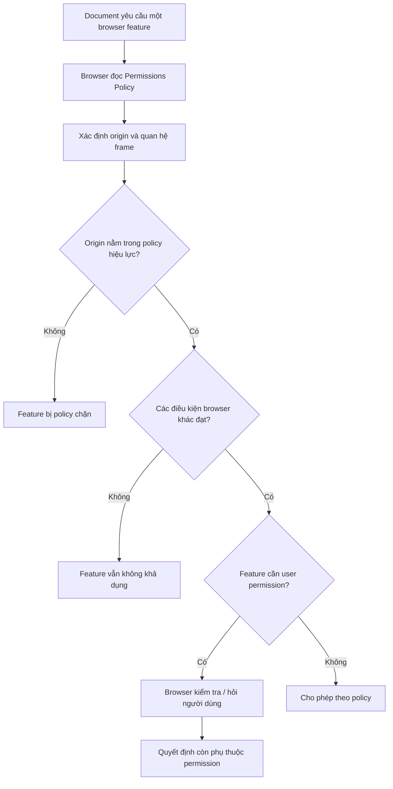
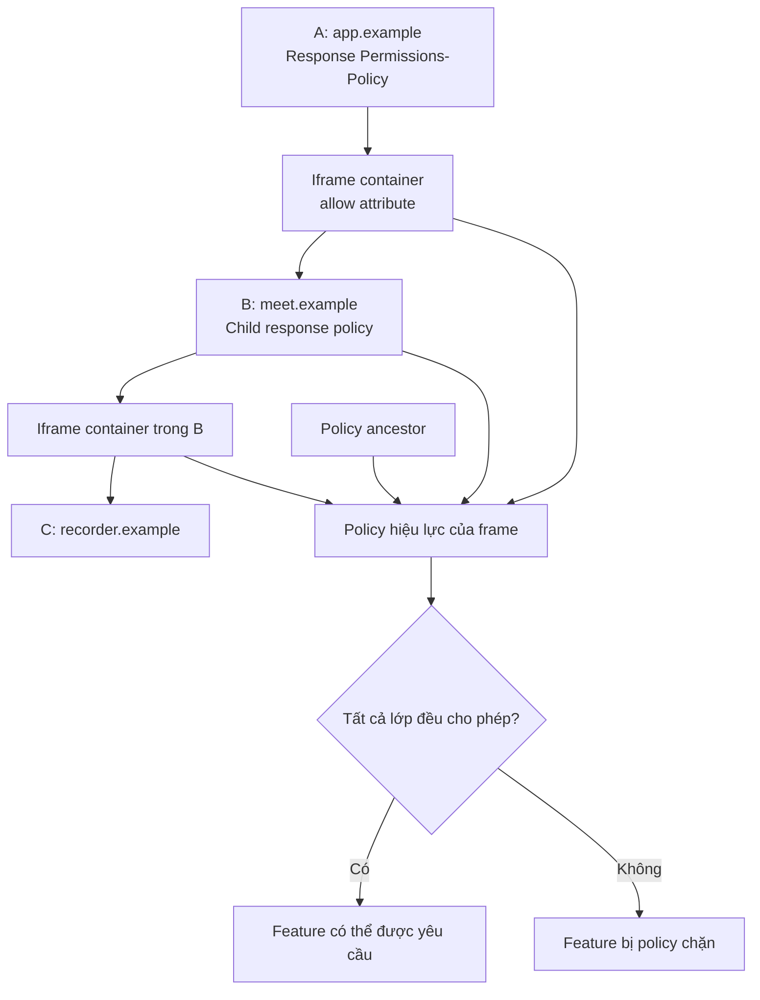

# Allowlist origin

> **Chương:** Permissions Policy  
> **Bài học:** Allowlist origin — giới hạn origin được phép sử dụng các tính năng nhạy cảm của browser  
> **Phạm vi module:** **SECURITY_APPLICATION_SECURITY_BROWSER_SECURITY** — phân tích ranh giới bảo mật giữa trình duyệt, origin, cookie và ứng dụng web để hiểu Same-Origin Policy (SOP), CORS và các cơ chế cách ly; thực hành phòng vệ XSS, CSRF, clickjacking bằng CSP, Trusted Types, security headers và kiểm chứng thực tế.

## Mục tiêu học tập

Sau bài này, bạn có thể:

1. Giải thích origin allowlist trong Permissions Policy và mục đích giới hạn quyền của document.
2. Đọc cú pháp header `Permissions-Policy` với `self`, origin cụ thể, `*` và allowlist rỗng.
3. Xác định origin chính xác từ scheme, host và port.
4. Phân biệt allowlist của response header với thuộc tính `allow` trên iframe.
5. Giải thích cách policy của trang cha, iframe container và document con kết hợp với nhau.
6. Thiết kế allowlist tối thiểu cho camera, microphone, geolocation, fullscreen và các tính năng khác.
7. Phân biệt quyền được phép ở tầng policy với permission prompt và quyết định của người dùng.
8. Kiểm tra quyền hiệu lực trong iframe lồng nhau, DevTools và browser thực tế.
9. Nhận diện wildcard quá rộng, cấu hình sai origin và các lỗi tích hợp thường gặp.
10. Kết hợp Permissions Policy với CSP, sandbox, CORS, HTTPS và authorization phía server.

## 1. Origin allowlist trong Permissions Policy là gì?

**Permissions Policy** là cơ chế để website giới hạn những tính năng browser mà document được phép sử dụng, cũng như xác định tính năng nào có thể được chia sẻ cho nội dung nhúng. Những tính năng đó có thể liên quan đến thiết bị, cảm biến, media, toàn màn hình hoặc các khả năng nhạy cảm khác.

Ví dụ, một ứng dụng họp trực tuyến có thể cần camera và microphone ở trang chính, nhưng không muốn mọi iframe được nhúng tự động có quyền yêu cầu các tính năng đó. Ứng dụng có thể khai báo policy chỉ cho phép một số origin đã được duyệt.

**Origin allowlist** là danh sách origin mà policy cho phép sử dụng một feature. Origin thông thường được xác định bởi ba thành phần:

- Scheme, ví dụ `https`.
- Host, ví dụ `meet.example`.
- Port, ví dụ `443` hoặc `8443`.

Do đó, `https://meet.example`, `http://meet.example` và `https://meet.example:8443` là các origin khác nhau.

Permissions Policy không xác minh nhà cung cấp hoặc chất lượng code ở origin đó. Nó chỉ xác định browser có cho document tại origin được dùng một feature hay không, theo policy đang có hiệu lực.

### 1.1. Ví dụ: chỉ cho phép một origin dùng camera

Server của trang cha có thể trả response header:

```http
Permissions-Policy: camera=(self "https://meet.example")
```

Ý nghĩa:

- `self` cho phép document cùng origin với trang cha dùng camera.
- `https://meet.example` là origin cụ thể được thêm vào allowlist.
- Các origin khác không có trong allowlist không được cấp camera theo policy này.

Có thể giới hạn nhiều feature trong cùng header:

```http
Permissions-Policy: camera=(self "https://meet.example"), microphone=(self "https://meet.example"), geolocation=()
```

Trong ví dụ:

- Trang cha và `https://meet.example` được policy cho phép dùng camera/microphone.
- Không document nào được cấp geolocation qua policy này vì allowlist của feature là rỗng.

Quyền sử dụng cuối cùng vẫn phụ thuộc browser, secure context, permission của người dùng và các điều kiện riêng của feature.

### 1.2. Sơ đồ quyết định quyền



Allowlist chỉ là một điều kiện trong quá trình quyết định. Nó không tự bật camera, không bỏ qua permission prompt và không cấp quyền truy cập API phía server.

### 1.3. Những feature thường được quản lý

Một số feature phổ biến:

| Feature | Khả năng được kiểm soát | Ví dụ sử dụng |
|---|---|---|
| `camera` | Truy cập camera | Họp video, quét mã |
| `microphone` | Truy cập microphone | Gọi thoại, ghi âm |
| `geolocation` | Truy cập vị trí | Bản đồ, dịch vụ theo vị trí |
| `fullscreen` | Yêu cầu chế độ toàn màn hình | Video player, trình chiếu |
| `autoplay` | Tự động phát media | Video/audio nhúng |
| `display-capture` | Chia sẻ màn hình | Họp trực tuyến |
| `clipboard-read` | Đọc clipboard | Ứng dụng soạn thảo |
| `clipboard-write` | Ghi clipboard | Sao chép nội dung |
| `payment` | Payment Request API | Checkout |
| `usb` | WebUSB | Ứng dụng thiết bị phần cứng |
| `accelerometer` | Cảm biến gia tốc | Trải nghiệm chuyển động |

Tên feature và mức hỗ trợ có thể khác theo browser/version. Hãy kiểm tra tài liệu tương thích của feature cụ thể trước khi dùng trong sản phẩm.

## 2. Cú pháp origin allowlist trong response header

Permissions Policy được cấu hình chủ yếu bằng HTTP response header:

```http
Permissions-Policy: camera=(self "https://meet.example"), microphone=()
```

Header chứa một danh sách directive. Mỗi directive gồm tên feature, dấu `=` và allowlist trong dấu ngoặc đơn.

### 2.1. Các giá trị allowlist thường gặp

| Giá trị | Ý nghĩa |
|---|---|
| `self` | Origin của document đã gửi policy |
| `"https://host.example"` | Một origin cụ thể |
| `*` | Mọi origin trong phạm vi directive |
| `()` | Không origin nào được phép |
| Danh sách nhiều origin | Chỉ các origin được liệt kê được phép |

Trong cú pháp HTTP Structured Fields của header hiện đại, token `self` và wildcard `*` không đặt trong dấu nháy; serialized origin được đặt trong dấu nháy kép.

Ví dụ:

```http
Permissions-Policy: geolocation=(self "https://maps.example" "https://dispatch.example"), camera=(), microphone=(self)
```

### 2.2. self có nghĩa là gì?

`self` tham chiếu origin của document phát ra header policy. Nó không có nghĩa là mọi subdomain cùng registrable domain hoặc mọi website cùng công ty.

Ví dụ trang có origin:

```text
https://app.example:443
```

thì `self` không tự bao gồm:

- `http://app.example`
- `https://api.example`
- `https://app.example:8443`
- `https://partner.example`

Các origin đó khác scheme, host hoặc port.

### 2.3. Origin phải khớp chính xác

Giả sử allowlist có:

```http
Permissions-Policy: camera=("https://meet.example")
```

Policy này không tự cho phép:

- `http://meet.example` vì scheme khác.
- `https://meet.example:8443` vì port khác.
- `https://meet.example.attacker.invalid` vì hostname khác.
- `https://other.example` vì host khác.

Hãy ghi origin dạng scheme + host + port, không thêm path, query hoặc fragment. Ví dụ `https://meet.example/room/1` là URL, không phải giá trị origin để đặt trong allowlist.

Không dựa vào so khớp chuỗi con như `host.includes("meet.example")` trong logic bảo mật của ứng dụng.

### 2.4. Wildcard có phạm vi rất rộng

Ví dụ:

```http
Permissions-Policy: camera=*
```

`*` cho phép mọi origin trong phạm vi directive, tùy các quy tắc và điều kiện của browser. Điều này có thể mở feature cho nội dung nhúng mà ứng dụng không dự định tin cậy.

Chỉ dùng wildcard khi thật sự muốn cho phép mọi origin có liên quan. Với camera, microphone, geolocation hoặc display capture, allowlist cụ thể thường dễ kiểm soát hơn.

### 2.5. Allowlist rỗng

Ví dụ:

```http
Permissions-Policy: camera=(), microphone=(), geolocation=()
```

Đây là cách tắt các feature đó cho document và các context con trong phạm vi policy. Nó hữu ích cho trang marketing, trang nội dung tĩnh hoặc khu vực không có lý do sử dụng thiết bị.

Không nhầm `()` với việc chưa khai báo directive. Khi directive bị bỏ qua, browser áp dụng default allowlist của feature; default này khác nhau theo từng feature.

## 3. Default allowlist và khi nào cần khai báo tường minh

Mỗi feature có một **default allowlist** do định nghĩa của feature quy định. Khi ứng dụng không khai báo directive tương ứng, browser áp dụng default allowlist đó.

Các giá trị mặc định thường thuộc một trong ba nhóm:

- `self`: chỉ document cùng origin được phép theo mặc định.
- `*`: có thể được dùng ở mọi origin trong phạm vi mặc định.
- `none`: mặc định không cho phép origin nào.

Không có một default chung cho tất cả feature. Ví dụ, các feature liên quan thiết bị thường có mặc định hạn chế hơn những tính năng ít nhạy cảm. Hãy tra cứu default allowlist của từng feature trong tài liệu chuẩn và kiểm tra browser mục tiêu.

### 3.1. Vì sao nên khai báo policy tường minh?

Khi response không có Permissions-Policy header, browser vẫn có các default allowlist. Tuy nhiên, để review và vận hành dễ hơn, ứng dụng có thể khai báo rõ những feature không cần:

```http
Permissions-Policy: camera=(), microphone=(), geolocation=(), usb=()
```

Nếu một trang chỉ cần camera cho cuộc họp, có thể mở đúng feature và giữ các feature khác bị tắt:

```http
Permissions-Policy: camera=(self "https://meet.example"), microphone=(self "https://meet.example"), geolocation=(), usb=()
```

Cấu hình này giúp người review nhìn thấy chủ đích của ứng dụng và tránh vô tình dựa vào default có thể thay đổi theo feature hoặc browser.

### 3.2. Không nhầm default allowlist với user permission

Có ba câu hỏi khác nhau:

1. **Policy:** document tại origin này có được phép yêu cầu feature không?
2. **Permission:** browser/người dùng có cấp quyền sử dụng feature không?
3. **Availability:** thiết bị, browser, secure context và môi trường có đáp ứng điều kiện không?

Một iframe có thể nằm trong allowlist nhưng camera vẫn không hoạt động vì người dùng từ chối permission, thiết bị không có camera, trang không chạy trong secure context hoặc browser không hỗ trợ feature.

## 4. Delegation cho iframe bằng thuộc tính allow

Response header đặt ranh giới policy tối đa của document. Khi trang cha nhúng một iframe, thuộc tính `allow` trên iframe có thể **delegate** một số feature cho document con trong phạm vi được policy cho phép.

Ví dụ, trang ứng dụng tại `https://app.example` nhúng ứng dụng họp tại `https://meet.example`.

### 4.1. Bước 1: response header của parent cho phép origin đích

Trang cha trả:

```http
Permissions-Policy: camera=(self "https://meet.example"), microphone=(self "https://meet.example")
```

Header này cho phép origin của parent và origin họp xuất hiện trong allowlist cho camera/microphone.

### 4.2. Bước 2: parent delegate feature trên iframe

HTML của parent:

```html
<iframe
  src="https://meet.example/room/42"
  title="Phòng họp"
  allow="camera https://meet.example; microphone https://meet.example"
  referrerpolicy="strict-origin"
></iframe>
```

Thuộc tính `allow` xác định feature được delegate cho browsing context của iframe. Hãy dùng origin khớp với origin thực của URL frame.

Nếu parent header không cho phép origin đích, chỉ thêm `allow` vào iframe không thể tự vượt qua policy tối đa của parent.

### 4.3. Bước 3: document con vẫn chịu điều kiện riêng

Ngay cả khi parent delegate camera và microphone:

- Browser vẫn có thể yêu cầu permission của người dùng.
- Document con phải chạy trong secure context theo yêu cầu của feature.
- Policy do response của document con đặt ra có thể tiếp tục hạn chế feature.
- Browser, hệ điều hành và thiết bị có thể không hỗ trợ hoặc không sẵn sàng.
- Người dùng có thể đã chặn permission ở cấp site hoặc browser.

Delegation không tự cấp quyền sử dụng thiết bị. Nó chỉ cho phép document con tham gia vào quá trình yêu cầu feature.

### 4.4. Allowlist trong header và iframe allow khác nhau

| Cơ chế | Nơi khai báo | Vai trò |
|---|---|---|
| `Permissions-Policy` | HTTP response header của document | Đặt policy cho document và giới hạn phạm vi delegation |
| `iframe allow` | Thuộc tính trên phần tử iframe của parent | Delegate hoặc giới hạn feature cho browsing context con |
| User permission | Browser/OS permission UI và trạng thái người dùng | Cho phép hoặc từ chối sử dụng feature thực tế |

Đối với tài liệu cùng origin, feature có thể được cho phép theo policy của parent mà không cần delegation cross-origin. Với iframe cross-origin, hãy khai báo allowlist ở parent và delegation trên iframe một cách tường minh.

### 4.5. Tắt feature cho một iframe cụ thể

Nếu một iframe không cần camera/microphone, parent có thể giới hạn riêng:

```html
<iframe
  src="https://video.example/embed"
  title="Video nhúng"
  allow="camera 'none'; microphone 'none'; geolocation 'none'"
></iframe>
```

Đây là lớp giới hạn bổ sung cho iframe đó. Dùng allowlist tối thiểu theo chức năng, và xác minh cú pháp/khả năng hỗ trợ trên browser mục tiêu.

## 5. Policy inheritance trong iframe lồng nhau

Permissions Policy được truyền theo cây browsing context. Khi một document nhúng document khác, policy hiệu lực của frame con được tính từ policy kế thừa và container policy mà parent đặt cho iframe. Response policy của child có thể tiếp tục thu hẹp quyền.

Có thể hiểu theo nguyên tắc: **một frame con chỉ được dùng feature nếu các lớp policy liên quan đều cho phép**.

### 5.1. Ví dụ cây frame

Giả sử:

- Trang A: `https://app.example`.
- Trang B: `https://meet.example`, được A nhúng.
- Trang C: `https://recorder.example`, được B nhúng.

A delegate camera cho B. B muốn delegate microphone cho C nhưng A không cho B microphone.

Khi đó B không thể cấp cho C một quyền mà B không được nhận từ ancestor. Việc B thêm token vào iframe con không mở rộng được policy đã bị parent giới hạn.

### 5.2. Sơ đồ kế thừa



### 5.3. Mỗi cấp phải delegate đúng origin

Nếu ứng dụng có nhiều cấp iframe, hãy kiểm tra từng quan hệ parent-child:

- Header của A có cho phép origin B không?
- Phần tử iframe do A tạo có delegate feature cho B không?
- Response của B có giữ feature trong policy của chính nó không?
- Phần tử iframe do B tạo có delegate feature cho C không?
- Origin C có khớp allowlist ở đúng cấp không?

Không chỉ kiểm tra iframe cuối cùng. Một cấp ancestor đã chặn feature thì các cấp bên dưới không thể tự bật lại.

### 5.4. Response policy của child có thể thu hẹp quyền

Ví dụ B nhận camera từ A nhưng response của B trả:

```http
Permissions-Policy: camera=()
```

B tự giới hạn camera cho document của mình và các context con theo policy đó. Child không thể yêu cầu B mở lại camera bằng thuộc tính iframe riêng.

Cách thiết kế tốt là mỗi document khai báo policy theo trách nhiệm của nó, và parent delegate đúng feature cho đúng child.

## 6. Allowlist và permission của người dùng

Permissions Policy quyết định document có được phép sử dụng feature theo chính sách của trang hay không. Browser permission là một lớp quyết định riêng, thường có sự tham gia của người dùng.

### 6.1. Policy cho phép không đồng nghĩa browser đã cấp permission

Ví dụ trang cha delegate camera cho iframe:

```http
Permissions-Policy: camera=(self "https://meet.example")
```

và:

```html
<iframe
  src="https://meet.example/room"
  allow="camera https://meet.example"
></iframe>
```

Nếu người dùng chưa cấp camera, browser vẫn có thể hiển thị permission prompt. Nếu người dùng từ chối, iframe không thể sử dụng camera chỉ nhờ allowlist.

Tương tự, permission đã được người dùng cấp từ trước không vượt qua được Permissions Policy đang chặn feature. Policy và user permission đều phải cho phép theo quy tắc của browser.

### 6.2. Không phải mọi feature đều có prompt giống nhau

- Camera và microphone thường cần permission của người dùng.
- Geolocation thường cần permission và secure context.
- Fullscreen thường phụ thuộc user activation và điều kiện browser.
- Autoplay chịu quy tắc autoplay riêng của browser.
- Một số feature có thể không cần prompt nhưng vẫn bị policy chặn.

Không viết logic ứng dụng theo giả định rằng mọi feature đều gọi một permission prompt giống nhau.

### 6.3. Permission có thể được lưu ở cấp site

Người dùng có thể cấp hoặc từ chối permission trong browser settings. Việc sửa response header không tự xóa lựa chọn permission đã lưu của người dùng.

Khi kiểm thử:

1. Xác nhận policy cho phép feature.
2. Xác nhận browser đang ở secure context nếu feature yêu cầu.
3. Kiểm tra site permission trong browser.
4. Kiểm tra thiết bị có sẵn và không bị ứng dụng khác chiếm dụng.
5. Thử lại trong profile sạch nếu cần phân biệt policy với trạng thái permission cũ.

Không yêu cầu người dùng bật permission để che một lỗi allowlist. Trước tiên hãy kiểm tra policy và delegation.

## 7. Kết hợp Permissions Policy với các cơ chế browser khác

Permissions Policy có ranh giới riêng. Các cơ chế khác giải quyết những câu hỏi khác nhau và cần được cấu hình đồng thời khi kiến trúc yêu cầu.

| Cơ chế | Câu hỏi nó trả lời | Ví dụ |
|---|---|---|
| Permissions Policy | Document/origin nào được dùng browser feature? | Cho phép `camera` trên `https://meet.example` |
| CSP `frame-src` | Trang này được tải iframe từ đâu? | Chỉ tải frame từ host họp đã duyệt |
| CSP `frame-ancestors` | Trang hiện tại được website nào nhúng? | Chặn website lạ nhúng trang quản trị |
| iframe `sandbox` | Browsing context con bị hạn chế hành vi nào? | Chặn script, form hoặc top navigation |
| CORS | JavaScript cross-origin được đọc response nào? | API cho phép origin cụ thể đọc JSON |
| SOP | Document khác origin có thể truy cập DOM/storage nào? | Widget khác origin không đọc DOM parent |
| HTTPS / secure context | Kết nối và môi trường có đủ an toàn cho feature không? | Camera/geolocation cần secure context |
| Server authorization | Người dùng được phép thực hiện hành động nghiệp vụ nào? | API xác minh quyền của tài khoản |

### 7.1. CSP frame-src không phải origin allowlist của feature

Ví dụ:

```http
Content-Security-Policy: frame-src https://meet.example
Permissions-Policy: camera=(self "https://meet.example"), microphone=(self "https://meet.example")
```

`frame-src` cho phép parent tải iframe từ `https://meet.example`. `Permissions-Policy` quyết định feature nào document tại origin đó có thể sử dụng.

Chỉ có `frame-src` không tự cấp camera. Chỉ có Permissions Policy cũng không có nghĩa CSP cho phép tải iframe từ host đó.

### 7.2. iframe sandbox vẫn có thể giới hạn frame được delegate

Ví dụ:

```html
<iframe
  src="https://meet.example/room"
  sandbox="allow-scripts allow-same-origin"
  allow="camera https://meet.example; microphone https://meet.example"
  title="Phòng họp"
></iframe>
```

`allow` delegate camera/microphone theo Permissions Policy. `sandbox` áp dụng các hạn chế browsing context riêng. Cả hai lớp phải tương thích với chức năng cần thiết.

Với nội dung không tin cậy, không cấp `allow-same-origin` và các token sandbox khác một cách tùy tiện chỉ để sửa lỗi feature. Hãy đánh giá origin và ranh giới tin cậy trước khi nới sandbox.

### 7.3. CORS không cấp camera hoặc microphone

CORS chỉ kiểm soát quyền đọc response cross-origin của JavaScript. Thêm `Access-Control-Allow-Origin` cho `https://meet.example` không tự cho phép iframe dùng camera.

Ngược lại, cho phép camera trong Permissions Policy không cấp quyền đọc API response cross-origin. Nếu widget cần gọi API, vẫn phải cấu hình CORS và server authorization riêng.

### 7.4. Permissions Policy không thay authorization phía server

Một iframe được phép dùng geolocation vẫn có thể gửi tọa độ đến server. Server phải xác thực người dùng, kiểm tra quyền truy cập và xử lý dữ liệu theo yêu cầu nghiệp vụ.

Không dùng origin allowlist như bằng chứng người dùng được phép xem tài khoản, đọc hồ sơ hoặc thực hiện giao dịch.

## 8. Thiết kế allowlist theo nguyên tắc least privilege

Hãy bắt đầu từ chức năng thực tế thay vì bật mọi feature cho mọi origin.

### 8.1. Lập danh sách feature và origin cần dùng

Ví dụ một ứng dụng họp có:

- Trang chính `https://app.example` cần camera/microphone.
- Widget họp `https://meet.example` cần camera/microphone.
- Bản đồ `https://maps.example` cần geolocation.
- Video nhúng `https://video.example` chỉ cần fullscreen.
- Các trang còn lại không cần camera, microphone hoặc geolocation.

Policy có thể là:

```http
Permissions-Policy: camera=(self "https://meet.example"), microphone=(self "https://meet.example"), geolocation=(self "https://maps.example"), fullscreen=(self "https://video.example"), usb=(), display-capture=()
```

Sau đó parent chỉ delegate feature tương ứng cho iframe cụ thể:

```html
<iframe
  src="https://meet.example/room"
  allow="camera https://meet.example; microphone https://meet.example"
  title="Cuộc họp"
></iframe>

<iframe
  src="https://maps.example/embed"
  allow="geolocation https://maps.example"
  title="Bản đồ"
></iframe>

<iframe
  src="https://video.example/player"
  allow="fullscreen https://video.example"
  title="Video"
></iframe>
```

Ví dụ minh họa cần được điều chỉnh theo feature thực tế, default allowlist và khả năng hỗ trợ của browser mục tiêu.

### 8.2. Tách policy theo route khi nhu cầu khác nhau

Không phải mọi trang trong ứng dụng đều cần cùng feature. Có thể cấu hình response header theo route:

- Trang họp: camera và microphone.
- Trang bản đồ: geolocation.
- Trang nội dung tĩnh: tắt camera, microphone, geolocation.
- Trang admin: chỉ bật feature thực sự cần cho chức năng quản trị.

Điều này giảm phạm vi ảnh hưởng nếu một route bị khai thác hoặc có widget bên thứ ba được thêm ngoài dự kiến.

### 8.3. Không tin origin chỉ vì tên miền có vẻ quen thuộc

Trước khi thêm origin:

- Xác minh tổ chức kiểm soát host.
- Xác minh HTTPS và certificate.
- Xác minh host không phải domain dùng chung cho nội dung do người dùng kiểm soát.
- Kiểm tra redirect và origin cuối của iframe.
- Xác minh host có thực sự cần feature.
- Ghi lại owner, lý do và thời điểm review allowlist.

Một host CDN dùng chung hoặc subdomain cho phép upload nội dung có thể không phù hợp để nhận quyền camera/microphone chỉ vì cùng nhà cung cấp.

### 8.4. Dùng exact origin, tránh kiểm tra chuỗi con

Nếu ứng dụng cần tự kiểm tra origin trong JavaScript, hãy dùng URL parser và so sánh origin đã chuẩn hóa:

```js
const trustedOrigins = new Set([
  'https://meet.example',
  'https://maps.example',
]);

function isTrustedOrigin(value) {
  try {
    const url = new URL(value);
    return trustedOrigins.has(url.origin);
  } catch {
    return false;
  }
}
```

Không dùng:

```js
value.includes('example')
```

So khớp chuỗi con có thể chấp nhận hostname giả như `https://example.attacker.invalid`. Tuy vậy, kiểm tra origin trong JavaScript không thay thế Permissions Policy response header; đây chỉ là kiểm tra bổ sung cho logic ứng dụng.

## 9. Cấu hình trên server và quản lý môi trường

Permissions Policy là response header. Hãy đặt header ở server, reverse proxy, ingress hoặc CDN nơi tạo response cuối cùng.

### 9.1. Node.js / Express

Ví dụ middleware:

```js
app.use((req, res, next) => {
  res.setHeader(
    'Permissions-Policy',
    'camera=(self "https://meet.example"), microphone=(self "https://meet.example"), geolocation=()'
  );

  next();
});
```

Nếu các route có nhu cầu khác nhau, hãy gắn policy theo route hoặc nhóm route. Không copy cùng một header rộng sang mọi response mà không xem xét chức năng của trang.

### 9.2. Nginx

Ví dụ:

```nginx
add_header Permissions-Policy "camera=(self \"https://meet.example\"), microphone=(self \"https://meet.example\"), geolocation=()" always;
```

Cú pháp quoting trong file cấu hình phụ thuộc cách viết chuỗi của server. Sau khi triển khai, xác minh response header thực tế trong Network; không chỉ tin vào nội dung file cấu hình.

### 9.3. Kiểm tra header sau reverse proxy/CDN

Một response có thể đi qua nhiều lớp:

```text
Browser
  -> CDN
  -> Load balancer / ingress
  -> Application server
```

Header ở application server có thể bị proxy ghi đè, loại bỏ hoặc thêm lần nữa. Hãy kiểm tra response cuối cùng mà browser nhận được và xử lý cấu hình duplicate/conflicting header.

### 9.4. Tránh legacy Feature-Policy

Header cũ `Feature-Policy` đã được thay bằng `Permissions-Policy`. Với triển khai mới, dùng header hiện đại và kiểm tra browser mục tiêu. Chỉ duy trì cấu hình legacy khi có yêu cầu tương thích đã được xác định, không gửi cả hai một cách máy móc.

## 10. Kiểm tra policy hiệu lực trong browser

Khi feature không hoạt động, cần xác định lỗi đến từ policy, permission, secure context, thiết bị hay hỗ trợ browser. Đừng bắt đầu bằng cách mở rộng allowlist.

### 10.1. Kiểm tra response header

Trong DevTools:

1. Mở tab Network.
2. Reload document top-level.
3. Chọn request loại Document.
4. Xem Response Headers và tìm `Permissions-Policy`.
5. Xác minh header có đúng trên response cuối sau redirect không.
6. Kiểm tra có header trùng lặp hoặc policy khác được thêm từ CDN/proxy không.

Với iframe, chọn request document của frame và kiểm tra response header riêng của child. Đồng thời kiểm tra HTML parent có thuộc tính `allow` trên đúng iframe không.

### 10.2. Kiểm tra origin thực tế

Dùng Console ở parent và child để xem origin:

```js
console.log({
  href: location.href,
  origin: location.origin,
  secureContext: window.isSecureContext,
});
```

So sánh scheme, host và port với allowlist. Nếu iframe redirect sang origin khác, origin cuối cùng có thể không còn khớp với giá trị đã cấu hình.

### 10.3. Kiểm tra feature policy qua API chẩn đoán

Một số browser cung cấp API để hỏi policy hiện tại:

```js
const policy = document.permissionsPolicy ?? document.featurePolicy;

if (policy?.allowsFeature) {
  console.log('camera allowed:', policy.allowsFeature('camera'));
  console.log('geolocation allowed:', policy.allowsFeature('geolocation'));
} else {
  console.log('Permissions Policy inspection API is unavailable');
}
```

API chẩn đoán này chưa được hỗ trợ đồng nhất ở mọi browser. Dùng nó như tín hiệu bổ sung; response header, iframe attributes, Console và kiểm thử feature thực tế vẫn là nguồn kiểm tra chính.

### 10.4. Đọc Console và lỗi API

Thông báo có thể cho biết feature bị chặn bởi Permissions Policy. Ví dụ, browser có thể ghi nhận policy violation khi document gọi camera hoặc geolocation mà policy không cho phép.

Phân biệt các lỗi:

- Policy violation: origin hoặc frame không được policy cho phép.
- Permission denied: người dùng/browser từ chối permission.
- NotAllowedError: có thể liên quan policy, permission hoặc điều kiện sử dụng.
- NotFoundError: thiết bị không có nguồn phù hợp.
- SecurityError: môi trường hoặc chính sách bảo mật không đáp ứng điều kiện.
- NotSupportedError: browser không hỗ trợ API/feature đó.

Tên lỗi và thông báo có thể khác theo API/browser. Hãy đọc Console cùng exception và trạng thái site permission.

## 11. Troubleshooting các lỗi allowlist thường gặp

### 11.1. Đã thêm origin nhưng iframe vẫn không dùng được feature

Kiểm tra:

1. Parent response có directive cho feature không?
2. Origin trong allowlist có khớp scheme, host và port không?
3. iframe có thuộc tính `allow` delegate feature không?
4. iframe có redirect sang origin khác không?
5. Ancestor frame nào đã chặn feature?
6. Response policy của child có tự đặt allowlist rỗng không?
7. Browser có yêu cầu secure context hoặc user permission không?

Không thêm wildcard trước khi xác định lớp policy nào đang chặn.

### 11.2. Dùng self nhưng subdomain không được phép

`self` chỉ là origin của document hiện tại. Nếu trang ở `https://app.example` và iframe ở `https://meet.example`, hai origin khác nhau.

Thêm origin cụ thể nếu đã xác minh host đó được tin cậy và thật sự cần feature.

### 11.3. Port hoặc scheme khác

Allowlist có `https://meet.example` không tự bao gồm `https://meet.example:8443` hoặc `http://meet.example`.

Hãy kiểm tra `location.origin` của frame cuối cùng và khai báo đúng origin. Không dùng HTTP trong production để làm cho phép thử vượt qua lỗi certificate hoặc secure context.

### 11.4. Header của CDN ghi đè cấu hình ứng dụng

Nếu ứng dụng server gửi policy đúng nhưng browser nhận policy khác, kiểm tra reverse proxy, ingress và CDN. Có thể nhiều lớp cùng thêm hoặc ghi đè response header.

Sửa tại lớp chịu trách nhiệm phát hành header và kiểm tra lại response thực tế trong Network.

### 11.5. Parent cho phép nhưng child vẫn bị chặn

Child có thể bị giới hạn bởi:

- Thuộc tính `allow` trên iframe.
- Policy kế thừa từ ancestor.
- Permissions-Policy response header của child.
- Policy của iframe lồng nhau ở cấp tiếp theo.

Kiểm tra từ top-level xuống từng frame, không chỉ ở document cuối cùng.

### 11.6. Policy cho phép nhưng permission bị từ chối

Nếu policy và delegation đều đúng, kiểm tra site permission trong browser, quyền hệ điều hành, thiết bị và secure context. Reset permission chỉ trong profile test nếu cần tái hiện trạng thái lần đầu.

Không yêu cầu người dùng bỏ chặn permission của browser nếu chức năng không cần thiết hoặc họ không muốn cấp quyền.

## 12. Thực hành A — Chặn feature không cần thiết bằng allowlist rỗng

Thực hiện trên trang local/staging do bạn kiểm soát.

### Bước 1: Cấu hình response header

```http
Permissions-Policy: camera=(), microphone=(), geolocation=()
```

### Bước 2: Thử gọi feature

Mở Console và thử:

```js
console.log('secure context:', window.isSecureContext);

navigator.geolocation?.getCurrentPosition(
  (position) => console.log('position available'),
  (error) => console.log('geolocation error:', error.name, error.message)
);
```

Kết quả mong đợi: browser chặn feature theo policy và có thể ghi policy violation trong Console. Không cần xin dữ liệu vị trí thật để xác minh header; dùng môi trường test và không lưu tọa độ.

## 13. Thực hành B — Delegate camera cho một iframe cross-origin

Dùng hai origin HTTPS local/staging do bạn kiểm soát, chẳng hạn hai hostname dev khác nhau. Camera yêu cầu secure context và permission của người dùng.

### Bước 1: Parent response

```http
Permissions-Policy: camera=(self "https://meet.dev.example")
```

### Bước 2: Parent HTML

```html
<iframe
  src="https://meet.dev.example/camera-test"
  title="Camera test"
  allow="camera https://meet.dev.example"
></iframe>
```

### Bước 3: Child document

Trong child, tạo nút để người dùng chủ động thử camera:

```html
<button id="start-camera">Thử camera</button>
<pre id="result"></pre>

<script>
  document.querySelector('#start-camera').addEventListener('click', async () => {
    const output = document.querySelector('#result');

    try {
      const stream = await navigator.mediaDevices.getUserMedia({ video: true });
      output.textContent = 'Camera được cấp cho trang test';
      stream.getTracks().forEach((track) => track.stop());
    } catch (error) {
      output.textContent = error.name + ': ' + error.message;
    }
  });
</script>
```

Kiểm tra:

1. Browser nhận header đúng ở response parent.
2. iframe có đúng `src` và `allow`.
3. Child chạy trong secure context.
4. Browser hiển thị permission prompt nếu chưa có quyết định trước.
5. Sau khi người dùng cho phép, camera hoạt động; từ chối permission thì feature không hoạt động.
6. Thử bỏ origin khỏi parent allowlist hoặc bỏ `allow` trên iframe và quan sát lỗi policy.

Không ghi lại hình ảnh/video hoặc giữ stream sau khi lab kết thúc.

## 14. Thực hành C — Phân biệt origin chính xác

Tạo hai host/port local để mô phỏng các origin khác nhau:

- Parent: `https://app.dev.example`
- Child: `https://meet.dev.example`
- Biến thể thử nghiệm: `https://meet.dev.example:8443`

Đặt allowlist chỉ có origin child đầu tiên:

```http
Permissions-Policy: camera=("https://meet.dev.example")
```

Sau đó:

1. Nhúng child tại host/port được allow.
2. Nhúng child tại port `8443`.
3. Quan sát policy violation ở biến thể port khác.
4. Đổi scheme sang HTTP trong môi trường test nếu có thể và ghi nhận đó là origin khác; lưu ý camera còn yêu cầu secure context.
5. Xác minh không dùng so khớp chuỗi con để phân loại origin.

## 15. Thực hành D — Quan sát policy inheritance

Tạo ba trang test A, B và C:

1. A nhúng B và delegate camera cho B.
2. B nhúng C nhưng không delegate camera.
3. Thử dùng camera trong C.
4. Thêm delegation ở B rồi thử lại.
5. Đặt `Permissions-Policy: camera=()` trên response B và thử lại.
6. Quan sát policy ở từng cấp và ghi lại nơi quyền bị giới hạn.

Kết quả mong đợi: C chỉ được phép yêu cầu camera khi policy kế thừa và delegation ở các cấp đều cho phép. Một child không thể tự mở lại feature đã bị ancestor hoặc response policy của chính nó chặn.

## 16. Checklist review Allowlist origin

| Hạng mục | Câu hỏi cần trả lời |
|---|---|
| Feature | Trang thực sự cần feature nào? |
| Default | Default allowlist của feature là gì trên browser mục tiêu? |
| Header | `Permissions-Policy` có được gửi trên response đúng không? |
| Origin | Scheme, host và port có khớp chính xác? |
| Wildcard | Có dùng `*` không? Lý do và phạm vi có được review? |
| Empty list | Feature không cần có được đặt `()` không? |
| iframe | Có delegate bằng `allow` trên đúng iframe không? |
| Inheritance | Các ancestor và frame lồng nhau có policy tương thích không? |
| Child response | Response policy của child có tự thu hẹp feature không? |
| Redirect | Origin cuối của iframe có đúng với allowlist không? |
| Permission | User permission và site settings có cho phép không? |
| Secure context | Feature có yêu cầu HTTPS/secure context không? |
| CSP | `frame-src` có giới hạn nguồn iframe phù hợp không? |
| Sandbox | Sandbox flags có tương thích và vẫn giữ least privilege không? |
| CORS | API cross-origin có CORS riêng khi cần không? |
| Server | Backend có xác thực và authorization độc lập không? |
| Testing | Đã thử allow, deny, wrong origin, wrong port và nested frame chưa? |
| Operations | Có owner, lý do và lịch review từng origin được allow không? |

## 17. Câu hỏi tự kiểm tra

**1.** Permissions Policy dùng để làm gì?  
**Đáp án:** Giới hạn browser feature mà document được phép sử dụng và kiểm soát việc delegate feature cho nội dung nhúng.

**2.** Origin thông thường gồm những thành phần nào?  
**Đáp án:** Scheme, host và port.

**3.** `self` có tự bao gồm mọi subdomain không?  
**Đáp án:** Không. `self` là origin của document hiện tại; subdomain khác là origin khác.

**4.** Allowlist rỗng `()` có nghĩa gì?  
**Đáp án:** Không cho phép origin nào sử dụng feature theo directive đó trong phạm vi policy.

**5.** `*` có ý nghĩa gì?  
**Đáp án:** Cho phép mọi origin trong phạm vi directive, nên cần cân nhắc kỹ với feature nhạy cảm.

**6.** Header `Permissions-Policy` khác iframe `allow` thế nào?  
**Đáp án:** Header đặt policy cho document và phạm vi tối đa; `allow` delegate hoặc giới hạn feature cho browsing context con.

**7.** Chỉ thêm `allow="camera"` có đủ để iframe cross-origin dùng camera không?  
**Đáp án:** Không nhất thiết. Parent policy, delegation, policy kế thừa, secure context và user permission đều cần được kiểm tra.

**8.** Document con có thể mở lại feature mà ancestor đã chặn không?  
**Đáp án:** Không. Policy hiệu lực bị giới hạn bởi các policy và container policy kế thừa.

**9.** Allowlist có tự cấp camera permission cho người dùng không?  
**Đáp án:** Không. Browser vẫn áp dụng permission của người dùng, secure context và điều kiện thiết bị.

**10.** `frame-src` có giống Permissions Policy không?  
**Đáp án:** Không. `frame-src` giới hạn nguồn iframe được tải; Permissions Policy giới hạn feature mà document được phép sử dụng.

**11.** CORS có cho phép camera không?  
**Đáp án:** Không. CORS kiểm soát việc đọc response cross-origin, còn camera do Permissions Policy và permission browser điều khiển.

**12.** Vì sao không nên dùng wildcard cho camera/microphone nếu chỉ có một widget cần chúng?  
**Đáp án:** Wildcard mở feature cho nhiều origin hơn mức cần thiết và làm tăng phạm vi ảnh hưởng nếu có nội dung nhúng không tin cậy.

## Ghi nhớ

**Origin allowlist xác định document nào được phép yêu cầu một browser feature.** Dùng response header `Permissions-Policy` để đặt ranh giới cho document, sau đó dùng iframe `allow` để delegate feature cần thiết cho đúng frame. Origin phải khớp scheme, host và port; `self` không bao gồm mọi subdomain, còn `*` mở phạm vi rất rộng.

Policy chỉ là một điều kiện. Browser permission, secure context, thiết bị và chính sách riêng của feature vẫn có hiệu lực. Hãy kiểm tra từ parent đến mọi nested frame, phân biệt Permissions Policy với CSP/CORS/sandbox, giữ allowlist ở mức tối thiểu và luôn xác thực quyền nghiệp vụ tại server.

